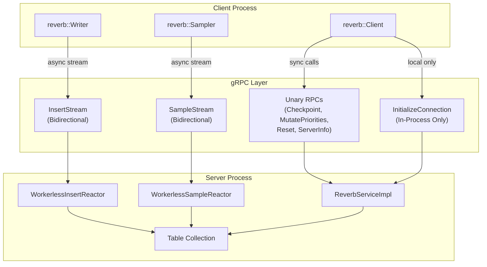
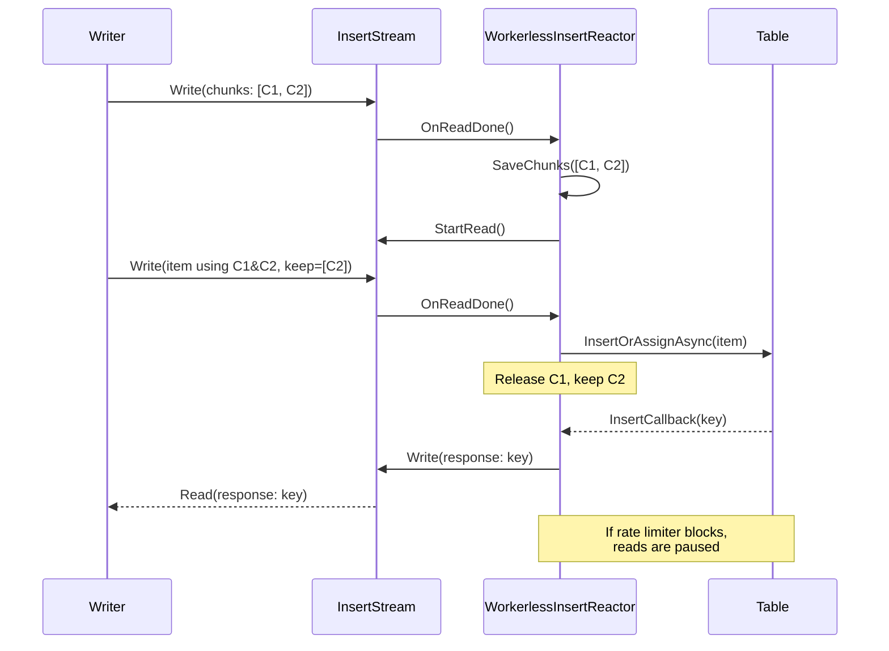
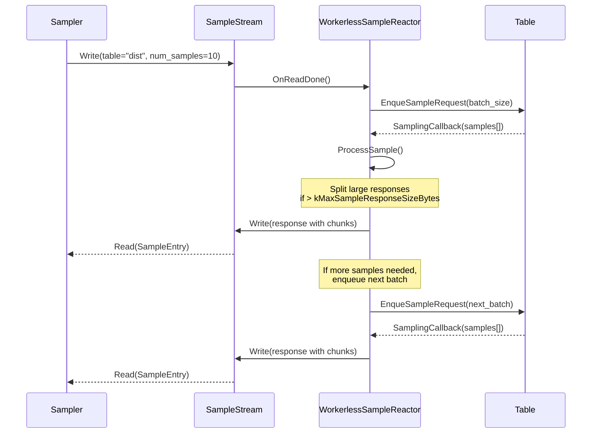
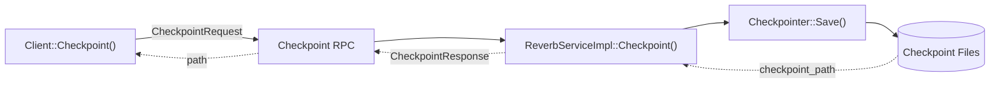
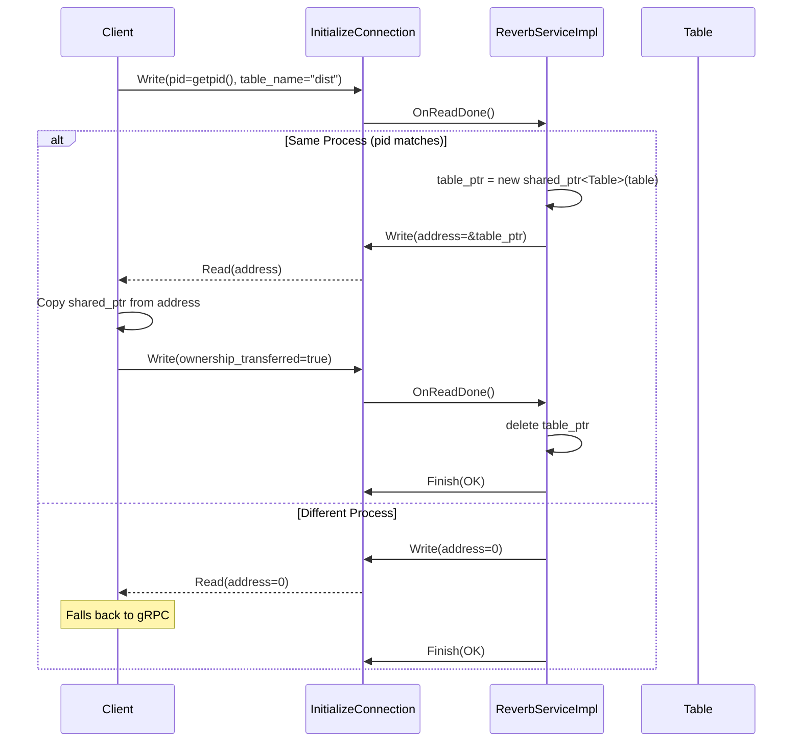
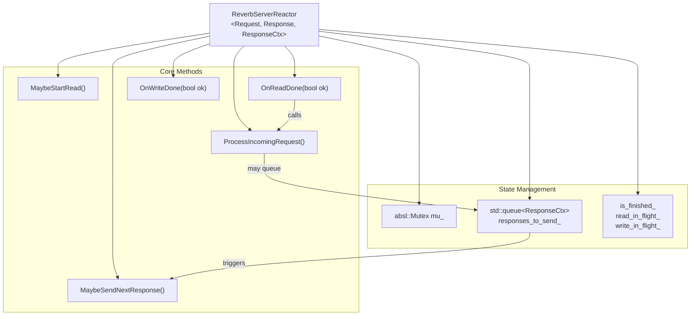
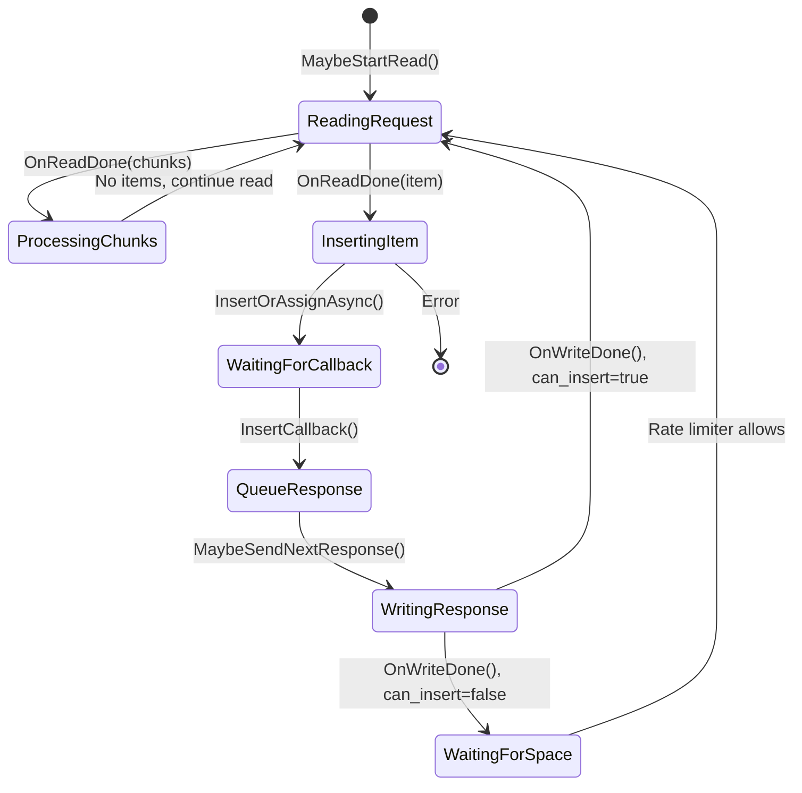
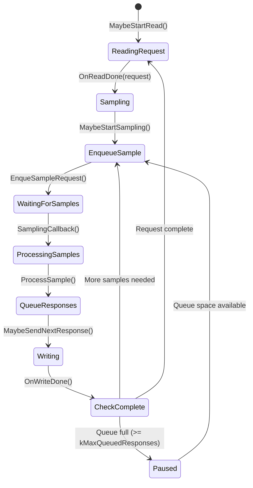
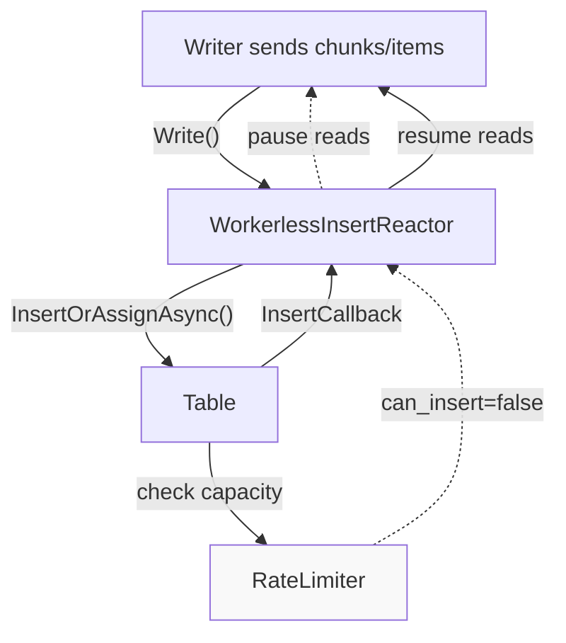

<!-- source: DeepWiki mcp.deepwiki.com · repo google-deepmind/reverb · page 2.1 Client-Server Communication · fetched 2026-10-26 -->

# Client-Server Communication

<details>
<summary>Relevant source files</summary>

The following files were used as context for generating this wiki page:

- [reverb/cc/BUILD](reverb/cc/BUILD)
- [reverb/cc/reverb_service.proto](reverb/cc/reverb_service.proto)
- [reverb/cc/reverb_service_impl.cc](reverb/cc/reverb_service_impl.cc)
- [reverb/cc/reverb_service_impl.h](reverb/cc/reverb_service_impl.h)
- [reverb/cc/reverb_service_impl_test.cc](reverb/cc/reverb_service_impl_test.cc)

</details>


## Purpose and Scope

This document describes the gRPC-based communication layer between Reverb clients and servers. It covers the RPC service definition, streaming protocols, reactor implementations, and the in-process optimization path. For information about the client-side API and Python bindings, see [Python Client API](#4). For details about the server-side data storage and processing, see [Table System](#3.1) and [gRPC Service Implementation](#3.4).

## Communication Architecture Overview

Reverb uses gRPC as its communication protocol, implementing both bidirectional streaming RPCs for high-throughput data operations and unary RPCs for management operations. The service is defined in protocol buffers and implemented using gRPC's callback-based (asynchronous) API.

**Core Communication Patterns:**
- **Bidirectional Streaming**: Used for `InsertStream` and `SampleStream` to support high-throughput data transfer with pipelining
- **Unary RPCs**: Used for `Checkpoint`, `MutatePriorities`, `Reset`, and `ServerInfo` for management operations
- **In-Process Optimization**: `InitializeConnection` enables zero-copy access when client and server are co-located



Sources: [reverb/cc/reverb_service.proto:1-178](), [reverb/cc/reverb_service_impl.h:15-149]()

## RPC Service Definition

The `ReverbService` is defined in protocol buffers with seven RPC methods:

| RPC Method | Type | Purpose | Request | Response |
|------------|------|---------|---------|----------|
| `InsertStream` | Bidirectional Streaming | Insert chunks and items into tables | `InsertStreamRequest` | `InsertStreamResponse` |
| `SampleStream` | Bidirectional Streaming | Sample items from tables | `SampleStreamRequest` | `SampleStreamResponse` |
| `MutatePriorities` | Unary | Update or delete items | `MutatePrioritiesRequest` | `MutatePrioritiesResponse` |
| `Reset` | Unary | Clear table contents | `ResetRequest` | `ResetResponse` |
| `Checkpoint` | Unary | Save tables to disk | `CheckpointRequest` | `CheckpointResponse` |
| `ServerInfo` | Unary | Get table metadata | `ServerInfoRequest` | `ServerInfoResponse` |
| `InitializeConnection` | Bidirectional Streaming | Get in-process table pointer | `InitializeConnectionRequest` | `InitializeConnectionResponse` |

Sources: [reverb/cc/reverb_service.proto:9-58]()

## Bidirectional Streaming RPCs

### InsertStream Protocol

`InsertStream` is a bidirectional streaming RPC that allows clients to continuously insert data into Reverb tables with flow control and confirmation.

**Message Flow Diagram**



**Request Message Structure:**
```
InsertStreamRequest {
  repeated ChunkData chunks = 1;        // Data chunks to store
  repeated PrioritizedItem items = 2;   // Items referencing chunks
  repeated uint64 keep_chunk_keys = 3;  // Chunks needed for next request
}
```

**Key Protocol Features:**

1. **Chunk Management**: Chunks are sent before items that reference them. The reactor maintains a map of chunks until they are no longer needed.
   - [reverb/cc/reverb_service_impl.cc:260-269]()

2. **Keep-Alive Mechanism**: `keep_chunk_keys` specifies which chunks should be retained for subsequent requests.
   - [reverb/cc/reverb_service_impl.cc:287-305]()

3. **Asynchronous Insertion**: Items are inserted asynchronously with callbacks to notify completion.
   - [reverb/cc/reverb_service_impl.cc:241-246]()

4. **Backpressure**: If rate limiter blocks or table buffer is full, reads are paused until space is available.
   - [reverb/cc/reverb_service_impl.cc:251-255]()

Sources: [reverb/cc/reverb_service.proto:29-30](), [reverb/cc/reverb_service.proto:93-113](), [reverb/cc/reverb_service_impl.cc:167-330]()

### SampleStream Protocol

`SampleStream` is a bidirectional streaming RPC that allows clients to continuously sample items from tables with automatic batching and response splitting.

**Message Flow Diagram**



**Request Message Structure:**
```
SampleStreamRequest {
  string table = 1;
  int64 num_samples = 2;
  Timeout rate_limiter_timeout = 3;
}
```

**Response Message Structure:**
```
SampleStreamResponse {
  repeated SampleEntry entries = 1;
  
  message SampleEntry {
    SampleInfo info = 1;           // Metadata (first message only)
    repeated ChunkData data = 2;   // Chunk data
    bool end_of_sequence = 3;      // Last chunk marker
  }
}
```

**Key Protocol Features:**

1. **Adaptive Batching**: Batch size starts at `kInitialGrpcSampleBatchSize` (64) and doubles until reaching request limit.
   - [reverb/cc/reverb_service_impl.cc:66](), [reverb/cc/reverb_service_impl.cc:586-588]()

2. **Response Splitting**: Large samples are split across multiple responses if they exceed `kMaxSampleResponseSizeBytes`.
   - [reverb/cc/reverb_service_impl.cc:59-60](), [reverb/cc/reverb_service_impl.cc:643-650]()

3. **Queue Management**: Maximum of `kMaxQueuedResponses` (3) responses queued to cap memory usage.
   - [reverb/cc/reverb_service_impl.cc:495](), [reverb/cc/reverb_service_impl.cc:598-602]()

4. **Zero-Copy Optimization**: ChunkData is attached to responses without copying using `UnsafeArenaAddAllocated`.
   - [reverb/cc/reverb_service_impl.cc:642]()

Sources: [reverb/cc/reverb_service.proto:48-49](), [reverb/cc/reverb_service.proto:139-170](), [reverb/cc/reverb_service_impl.cc:458-676]()

## Unary RPCs

### Checkpoint

Saves all table state to disk for persistence and recovery.



**Implementation:**
- Collects all tables and passes them to the configured `Checkpointer`
- Returns the checkpoint path on success
- Returns `INVALID_ARGUMENT` if no checkpointer is configured
- [reverb/cc/reverb_service_impl.cc:143-165]()

Sources: [reverb/cc/reverb_service.proto:14](), [reverb/cc/reverb_service_impl.cc:143-165]()

### MutatePriorities

Updates priorities or deletes items in a specific table.

**Request Message:**
```
MutatePrioritiesRequest {
  string table = 1;
  repeated KeyWithPriority updates = 2;    // Priority updates
  repeated uint64 delete_keys = 3;         // Items to delete
}
```

**Implementation:**
- Validates table exists, returns `NOT_FOUND` if missing
- Calls `Table::MutateItems()` with updates and deletes
- Operations are atomic per table
- [reverb/cc/reverb_service_impl.cc:425-442]()

Sources: [reverb/cc/reverb_service.proto:33-35](), [reverb/cc/reverb_service.proto:115-130](), [reverb/cc/reverb_service_impl.cc:425-442]()

### Reset

Clears all items from a table and resets its rate limiter.

**Implementation:**
- Validates table exists
- Calls `Table::Reset()` which clears all items and resets internal state
- [reverb/cc/reverb_service_impl.cc:444-456]()

Sources: [reverb/cc/reverb_service.proto:38](), [reverb/cc/reverb_service.proto:172-177](), [reverb/cc/reverb_service_impl.cc:444-456]()

### ServerInfo

Returns metadata about all tables on the server.

**Response Message:**
```
ServerInfoResponse {
  Uint128 tables_state_id = 1;         // Unique ID for table configuration
  repeated TableInfo table_info = 2;   // Metadata for each table
}
```

**Returned Information Per Table:**
- Table name, current size, max size
- Sampler and remover options
- Rate limiter configuration
- Table signature (data schema)
- Worker thread statistics

**Implementation:**
- Iterates through all tables and collects `table->info()`
- Generates random `tables_state_id` on service initialization
- [reverb/cc/reverb_service_impl.cc:705-715]()

Sources: [reverb/cc/reverb_service.proto:52](), [reverb/cc/reverb_service.proto:132-137](), [reverb/cc/reverb_service_impl.cc:705-715]()

## In-Process Optimization

### InitializeConnection Protocol

`InitializeConnection` is a special RPC that enables zero-copy access to tables when the client and server run in the same process. This bypasses gRPC serialization overhead for significantly improved performance.

**In-Process Connection Handshake**



**Protocol Steps:**

1. **Process Verification**: Client sends its process ID (PID)
   - [reverb/cc/reverb_service.proto:60-71]()
   
2. **Address Transmission**: If PIDs match, server allocates `shared_ptr<Table>` on heap and sends its memory address
   - [reverb/cc/reverb_service_impl.cc:354-379]()

3. **Ownership Transfer**: Client copies the `shared_ptr`, then confirms transfer so server can delete the heap object
   - [reverb/cc/reverb_service_impl.cc:382-386]()

4. **Fallback**: If PIDs don't match, server returns address=0 and client uses normal gRPC communication
   - [reverb/cc/reverb_service_impl.cc:354-360]()

**Security Consideration:**
- Only works for localhost or in-process connections
- Server checks `context->peer()` to ensure local connection
- [reverb/cc/reverb_service_impl.cc:340-343]()

Sources: [reverb/cc/reverb_service.proto:56-57](), [reverb/cc/reverb_service.proto:60-84](), [reverb/cc/reverb_service_impl.cc:332-423]()

## Reactor Implementation Pattern

Reverb uses gRPC's callback-based reactor API for asynchronous, high-performance operation. All streaming RPCs are implemented using custom reactor classes that inherit from `grpc::ServerBidiReactor`.

### ReverbServerReactor Base Class

The base template provides common functionality for all streaming reactors:



**Key Design Features:**

1. **Single-Threaded Request Processing**: Only one read is in-flight at a time to simplify state management
   - Tracked by `read_in_flight_` flag

2. **Response Queue**: Responses are queued and sent sequentially
   - `responses_to_send_` queue manages pending responses
   - Only one write is in-flight at a time

3. **Mutex Protection**: All reactor state is protected by `mu_`
   - Callbacks from different threads (table workers, gRPC threads) require synchronization

4. **Graceful Shutdown**: Reactor waits for all operations to complete before destroying
   - Weak pointers track outstanding callbacks

Sources: [reverb/cc/reverb_server_reactor.h:1-150]()

### WorkerlessInsertReactor

Handles `InsertStream` requests with chunk management and asynchronous table insertion.

**State Diagram**



**Chunk Lifecycle:**
- Chunks stored in `chunks_` map when received
- Referenced by items via `chunk_key`
- Released based on `keep_chunk_keys` field
- [reverb/cc/reverb_service_impl.cc:260-305]()

**Flow Control:**
- If `InsertOrAssignAsync` returns `can_insert=false`, reads pause
- Resumed when `InsertCallback` fires (indicating space available)
- [reverb/cc/reverb_service_impl.cc:251-256]()

Sources: [reverb/cc/reverb_service_impl.cc:173-327]()

### WorkerlessSampleReactor

Handles `SampleStream` requests with adaptive batching and response splitting.

**State Machine**



**Batching Strategy:**
- Initial batch size: 64 (`kInitialGrpcSampleBatchSize`)
- Doubles each iteration: `next_batch_size = min(2 * last_batch_size, remaining)`
- [reverb/cc/reverb_service_impl.cc:586-588]()

**Response Splitting:**
- If current response exceeds `kMaxSampleResponseSizeBytes` (2 * 1MB), start new response
- Info metadata only sent in first chunk of each sample
- [reverb/cc/reverb_service_impl.cc:610-650]()

**Memory Management:**
- Custom destructor releases protobuf fields without destroying them (they're owned by `TableItem`)
- [reverb/cc/reverb_service_impl.cc:468-481]()

Sources: [reverb/cc/reverb_service_impl.cc:497-673]()

## Backpressure and Flow Control

Reverb implements sophisticated flow control mechanisms to prevent memory exhaustion and maintain balanced operation.

### InsertStream Backpressure



**Mechanism:**
1. `Table::InsertOrAssignAsync()` returns `can_insert` flag indicating if buffer has space
2. If `false`, reactor stops calling `StartRead()` 
3. When insertion completes, `InsertCallback` fires and reads resume
4. This prevents unbounded chunk accumulation in the reactor

Sources: [reverb/cc/reverb_service_impl.cc:240-256]()

### SampleStream Backpressure

**Queue-Based Flow Control:**

| Condition | Action |
|-----------|--------|
| `responses_to_send_.size() >= kMaxQueuedResponses` | Pause sampling |
| Response queue has space | Resume sampling via `OnWriteDone()` |
| `waiting_for_enqueued_sample_ == true` | Wait for current batch to complete |

**Implementation:**
```cpp
// Don't enqueue more samples if queue is full
if (responses_to_send_.size() >= kMaxQueuedResponses) {
  return;  // Sampling triggered by OnWriteDone callback
}
```
[reverb/cc/reverb_service_impl.cc:598-602]()

Sources: [reverb/cc/reverb_service_impl.cc:581-606]()

## Error Handling

### Error Propagation

All errors are converted to gRPC status codes:

| Error Type | gRPC Status Code | Example |
|------------|------------------|---------|
| Table not found | `NOT_FOUND` | Invalid table name in request |
| Missing chunks | `INTERNAL` | Item references non-existent chunk |
| Invalid argument | `INVALID_ARGUMENT` | Empty request, invalid parameters |
| Rate limit timeout | `DEADLINE_EXCEEDED` | Sample blocked too long |

**Conversion Function:**
```cpp
grpc::Status ToGrpcStatus(const absl::Status& status);
```

Sources: [reverb/cc/support/grpc_util.h:1-50]()

### Reactor Cancellation

When a reactor is cancelled or encounters an error:

1. `SetReactorAsFinished()` sets `is_finished_ = true`
2. No new reads or writes are started
3. Pending callbacks are ignored (checked via `is_finished_` flag)
4. Reactor waits for in-flight operations to complete before destroying
5. Weak pointers ensure callbacks don't access destroyed reactor

Sources: [reverb/cc/reverb_server_reactor.h:60-80]()

## Performance Characteristics

### Message Size Limits

| Constant | Value | Purpose |
|----------|-------|---------|
| `Table::kMaxSampleResponseSizeBytes` | 1 MB | Max size of single table sample response |
| `kMaxSampleResponseSizeBytes` | 2 MB | Max size of single gRPC sample response |
| `kInitialGrpcSampleBatchSize` | 64 | Initial sampling batch size |
| `kMaxQueuedResponses` | 3 | Max queued responses per reactor |

Sources: [reverb/cc/reverb_service_impl.cc:59-66](), [reverb/cc/reverb_service_impl.cc:495]()

### Thread Model

**Server-Side Threading:**
- gRPC threads handle network I/O and callbacks
- Table worker threads process insert/sample operations
- Callback executor threads run table extensions
- Reactors coordinate across threads using mutexes

**No Dedicated Reactor Threads:**
- Reactors are "workerless" - they don't spawn threads
- All work delegated to existing thread pools
- Callbacks may execute on any thread

Sources: [reverb/cc/reverb_service_impl.cc:45-46](), [reverb/cc/reverb_service_impl.h:35-37]()

### In-Process Performance

When using `InitializeConnection`:
- **Zero serialization overhead**: Direct memory access to table
- **No gRPC overhead**: Bypasses network stack entirely  
- **Shared memory**: No data copying between client and server
- **Use case**: TensorFlow datasets in same process as server

Sources: [reverb/cc/reverb_service_impl.cc:332-423]()

---

