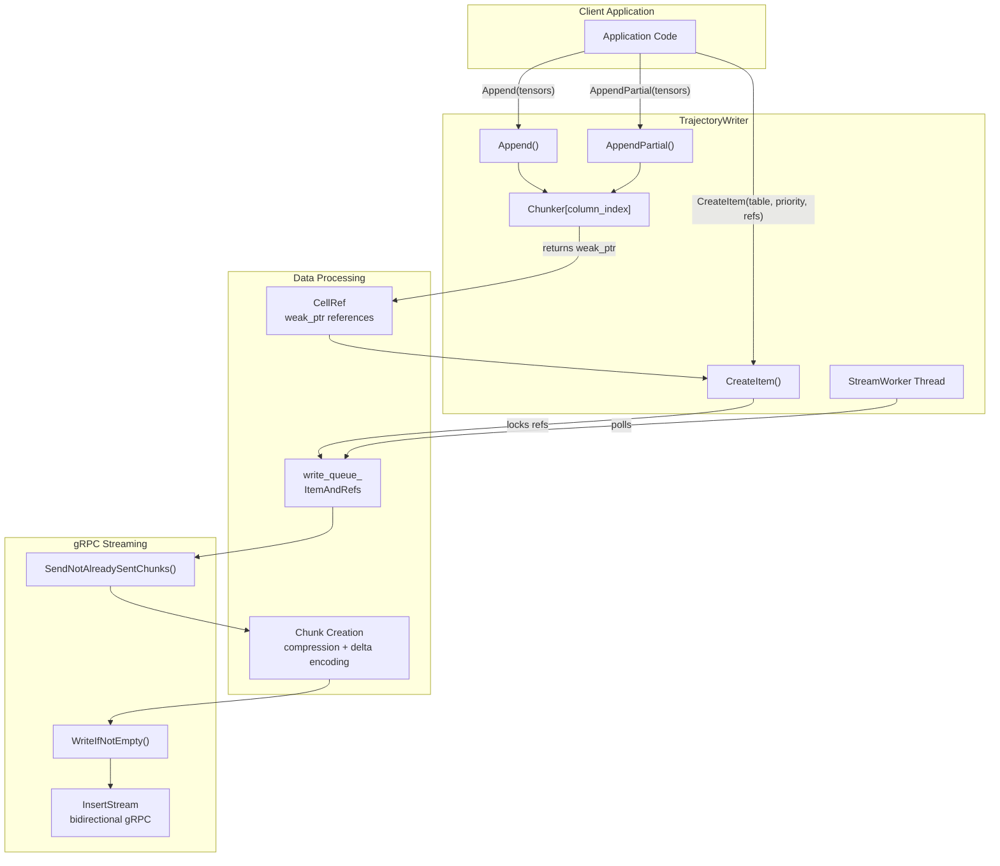
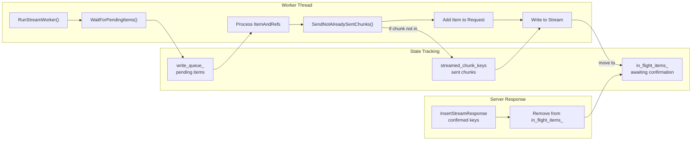
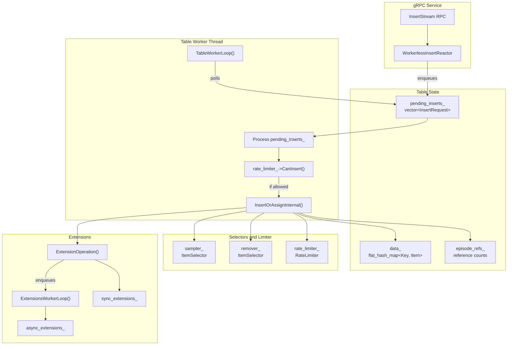
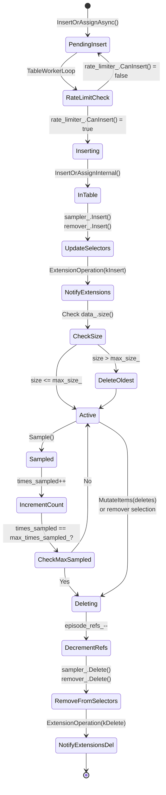
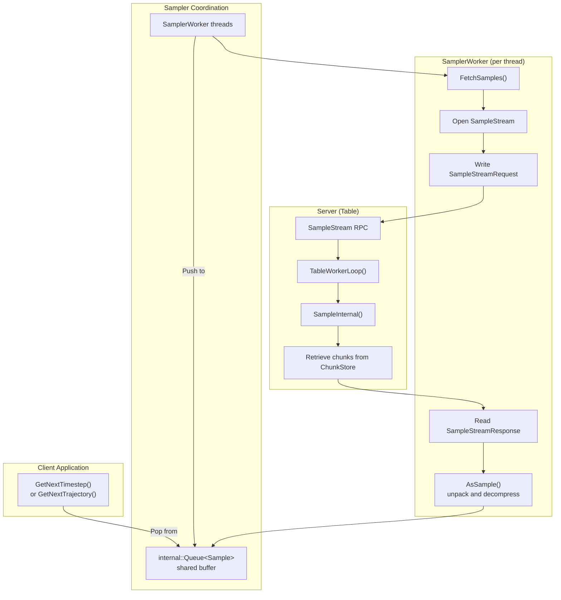
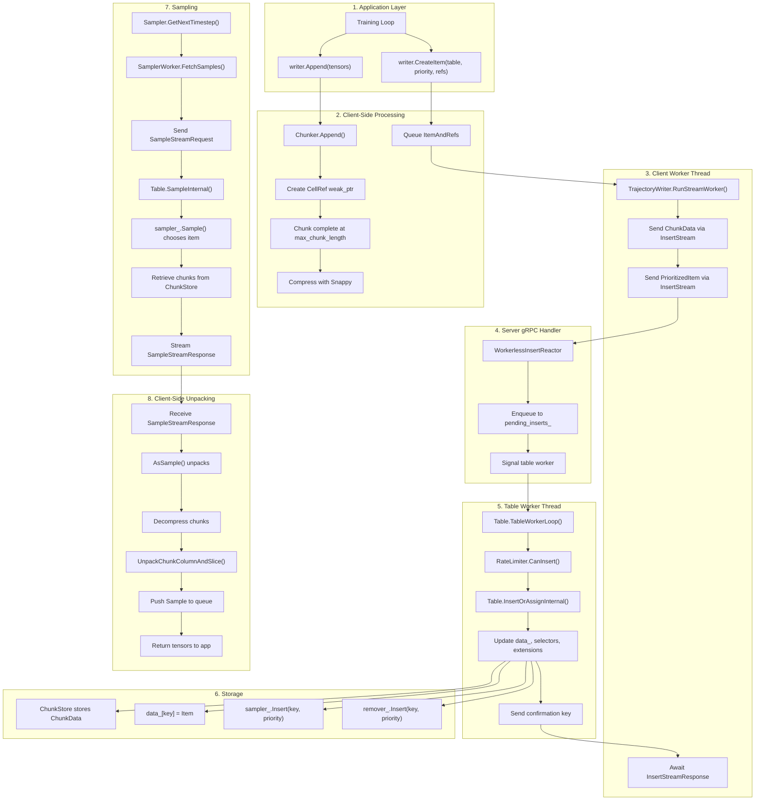

<!-- source: DeepWiki mcp.deepwiki.com · repo google-deepmind/reverb · page 2.2 Data Flow Pipeline · fetched 2026-10-26 -->

# Data Flow Pipeline

Relevant source files

The following files were used as context for generating this wiki page:

- [reverb/cc/platform/tfrecord_checkpointer.cc](reverb/cc/platform/tfrecord_checkpointer.cc)
- [reverb/cc/sampler.cc](reverb/cc/sampler.cc)
- [reverb/cc/sampler.h](reverb/cc/sampler.h)
- [reverb/cc/sampler_test.cc](reverb/cc/sampler_test.cc)
- [reverb/cc/table.cc](reverb/cc/table.cc)
- [reverb/cc/table.h](reverb/cc/table.h)
- [reverb/cc/table_test.cc](reverb/cc/table_test.cc)
- [reverb/cc/trajectory_writer.cc](reverb/cc/trajectory_writer.cc)
- [reverb/cc/trajectory_writer.h](reverb/cc/trajectory_writer.h)
- [reverb/cc/trajectory_writer_test.cc](reverb/cc/trajectory_writer_test.cc)
- [reverb/cc/writer.cc](reverb/cc/writer.cc)
- [reverb/cc/writer.h](reverb/cc/writer.h)
- [reverb/cc/writer_test.cc](reverb/cc/writer_test.cc)

This document describes the complete lifecycle of data in Reverb, from ingestion through storage to sampling. It covers how data flows through the system's three main stages: the **Write Path** (client-side data ingestion), the **Storage Layer** (server-side table management), and the **Sample Path** (data retrieval). For details about specific components mentioned here, see [Table System](#3.1), [Data Ingestion System](#3.2), and [Sampling System](#3.3).

## Overview

Data flows through Reverb in three distinct stages:

| Stage | Primary Components | Data Format |
|-------|-------------------|-------------|
| Write Path | `TrajectoryWriter`, `Chunker`, `InsertStream` | Tensors → ChunkData (compressed) |
| Storage Layer | `Table`, `ChunkStore`, `RateLimiter`, `ItemSelector` | ChunkData + PrioritizedItem |
| Sample Path | `Sampler`, `SamplerWorker`, `SampleStream` | ChunkData (compressed) → Tensors |

## Write Path: Data Ingestion

### Client-Side Chunking and Compression

The write path begins when application code appends data to a writer. The `TrajectoryWriter` manages multiple column `Chunker` instances, one per data column. Each chunker accumulates timesteps and creates compressed chunks when configured thresholds are reached.

**Key Operations:**

- **`TrajectoryWriter::Append(data, refs)`** [reverb/cc/trajectory_writer.cc:347-351](): Appends a complete timestep across all columns. Each tensor in `data` is passed to its corresponding `Chunker`, which returns a `CellRef` - a weak pointer to the data location.

- **`TrajectoryWriter::AppendPartial(data, refs)`** [reverb/cc/trajectory_writer.cc:353-358](): Appends partial timesteps without incrementing the episode step counter, allowing multi-stage step construction.

- **`Chunker::Append(tensor, episode_info, ref)`**: Accumulates tensors and triggers chunk creation when `max_chunk_length` is reached. Chunks are compressed using Snappy and optionally delta-encoded [reverb/cc/trajectory_writer.cc:382-386]().

- **`TrajectoryWriter::CreateItem(table, priority, trajectory)`** [reverb/cc/trajectory_writer.cc:426-475](): Locks all `CellRef` weak pointers to prevent premature deallocation, constructs a `PrioritizedItem` proto referencing the chunks, and queues it for transmission.

Sources: reverb/cc/trajectory_writer.cc, reverb/cc/trajectory_writer.h, reverb/cc/chunker.h

### Streaming Protocol

Data transmission to the server occurs asynchronously on a background worker thread that manages the gRPC `InsertStream`.

**Key Mechanisms:**

- **`TrajectoryWriter::RunStreamWorker()`** [reverb/cc/trajectory_writer.cc:595-700](): The background thread's main loop. It continuously:
  1. Waits for items in `write_queue_`
  2. Sends unreferenced chunks via `SendNotAlreadySentChunks()`
  3. Waits if any referenced chunks are incomplete (blocks on `data_cv_`)
  4. Sends the item when all chunks are ready
  5. Moves item to `in_flight_items_` awaiting server confirmation

- **`TrajectoryWriter::SendNotAlreadySentChunks()`** [reverb/cc/trajectory_writer.cc:185-210](): Iterates through `CellRef`s, checks if chunks are ready and not yet sent (tracked in `streamed_chunk_keys`), then adds them to the current request. Respects the `kMaxRequestSizeBytes` limit (40MB), splitting into multiple writes if needed.

- **Retry Logic**: If the stream fails, `RunStreamWorker()` re-enqueues all `in_flight_items_` back to the front of `write_queue_` and retries with exponential backoff [reverb/cc/trajectory_writer.cc:308-316]().

- **Keep Keys**: To prevent premature server-side chunk deletion, each request includes `keep_chunk_keys` listing chunks referenced by pending items [reverb/cc/trajectory_writer.cc:568-593]().

Sources: reverb/cc/trajectory_writer.cc:595-700, reverb/cc/trajectory_writer.cc:185-210, reverb/cc/trajectory_writer.cc:568-593

## Storage Layer: Table Management

### Insert Processing

Server-side insert processing is handled by the `Table` class through its worker thread architecture.

**Core Insert Flow:**

- **`Table::InsertOrAssignAsync(item, can_insert_more, callback)`** [reverb/cc/table.cc:568-591](): The entry point for inserts. Creates an `InsertRequest` containing the `Item` and callback, pushes it to `pending_inserts_`, and signals the worker thread. Returns immediately with `can_insert_more` indicating if the queue has capacity.

- **`Table::TableWorkerLoop()`** [reverb/cc/table.cc:236-423](): The worker thread's main loop processes both inserts and samples. For inserts:
  1. Checks `rate_limiter_->CanInsert()` [reverb/cc/table.cc:270]()
  2. Calls `InsertOrAssignInternal()` if allowed
  3. Executes the insert callback asynchronously via `callback_executor_`
  4. Alternates with sample processing for fairness

- **`Table::InsertOrAssignInternal(item)`** [reverb/cc/table.cc:593-632](): Performs the actual insert:
  1. Sets insertion timestamp [reverb/cc/table.cc:605]()
  2. Inserts into `data_` hash map [reverb/cc/table.cc:606]()
  3. Updates `sampler_->Insert()` and `remover_->Insert()` [reverb/cc/table.cc:608-609]()
  4. Increments `episode_refs_` for referenced chunks [reverb/cc/table.cc:616-618]()
  5. Invokes extensions via `ExtensionOperation()` [reverb/cc/table.cc:620]()
  6. Deletes oldest item if `data_.size() > max_size_` [reverb/cc/table.cc:623-625]()
  7. Notifies `rate_limiter_->Insert()` [reverb/cc/table.cc:629]()

Sources: reverb/cc/table.cc:568-632, reverb/cc/table.cc:236-423, reverb/cc/table.h:152-241

### Item Lifecycle and Rate Limiting

Items progress through multiple states from insertion to deletion, with the `RateLimiter` controlling flow.

**Rate Limiter Integration:**

The `RateLimiter` enforces desired insert-to-sample ratios and minimum/maximum table sizes [reverb/cc/table.cc:152-182]():

- **`CanInsert(mu, count)`**: Returns true if inserts are currently allowed based on configured ratios and table state
- **`Insert(mu)`**: Called after successful insert to update limiter state [reverb/cc/table.cc:629]()
- **`MaybeCommitSample(mu)`**: Returns true if sampling is allowed and decrements available sample budget [reverb/cc/table.cc:295]()
- **`Delete(mu)`**: Called when item deleted to update state [reverb/cc/table.cc:834]()

When rate limiting blocks, the worker thread sleeps on condition variables (`wakeup_worker_`) until state changes [reverb/cc/table.cc:384]().

Sources: reverb/cc/table.cc:593-632, reverb/cc/table.cc:814-843, reverb/cc/rate_limiter.h

## Sample Path: Data Retrieval

### Sampler Architecture

The `Sampler` uses multiple worker threads to fetch samples from tables, with each worker managing its own gRPC stream.

**Key Components:**

- **`Sampler` Class** [reverb/cc/sampler.cc:444-551](): Coordinates multiple `SamplerWorker` threads and a shared `internal::Queue<Sample>`. Workers continuously fetch samples and push to the queue; client calls pop from the queue.

- **Worker Implementations**:
  - **`GrpcSamplerWorker`** [reverb/cc/sampler.cc:172-302](): Fetches samples via gRPC `SampleStream`. Manages stream lifecycle, handles rate limiter timeouts, and implements retry logic.
  - **`LocalSamplerWorker`** [reverb/cc/sampler.cc:325-434](): For in-process optimization, directly calls `Table::SampleFlexibleBatch()` to avoid gRPC serialization overhead.

Sources: reverb/cc/sampler.cc:444-551, reverb/cc/sampler.cc:172-434, reverb/cc/sampler.h:116-169

### Sample Processing and Decompression

Server-side sample processing retrieves items and their referenced chunks, then streams them to the client for unpacking.

```mermaid
graph LR
    subgraph "Table Sample Processing"
        SampleReq["EnqueSampleRequest()"]
        WorkerPoll["TableWorkerLoop polls"]
        CheckRate["rate_limiter_<br/>.MaybeCommitSample()"]
        SelectItem["sampler_.Sample()"]
        GetItem["data_[key]"]
        IncrementCount["times_sampled++"]
        GetChunks["item->chunks()"]
    end
    
    subgraph "Stream Response"
        BuildEntry["SampleStreamResponse<br/>.SampleEntry"]
        AddChunks["entry.add_data()<br/>ChunkData protos"]
        MarkEnd["entry.set_end_of_sequence()"]
        Stream["Write to SampleStream"]
    end
    
    subgraph "Client Unpacking"
        Receive["Read SampleStreamResponse"]
        AsSample["AsSample()"]
        Decompress["Decompress chunks"]
        UnpackSlices["UnpackChunkColumnAndSlice()"]
        BuildTensors["Reconstruct tensors"]
        CreateSample["Create Sample object"]
    end
    
    SampleReq --> WorkerPoll
    WorkerPoll --> CheckRate
    CheckRate -->|"allowed"| SelectItem
    SelectItem --> GetItem
    GetItem --> IncrementCount
    IncrementCount --> GetChunks
    GetChunks --> BuildEntry
    BuildEntry --> AddChunks
    AddChunks --> MarkEnd
    MarkEnd --> Stream
    
    Stream --> Receive
    Receive --> AsSample
    AsSample --> Decompress
    Decompress --> UnpackSlices
    UnpackSlices --> BuildTensors
    BuildTensors --> CreateSample
```

**Server-Side Sampling:**

- **`Table::EnqueSampleRequest(num_samples, callback, timeout)`** [reverb/cc/table.cc:660-689](): Enqueues an asynchronous sample request. Creates a `SampleRequest` with deadline, reserves space for samples, and signals the worker thread.

- **`Table::SampleInternal(rate_limited, result)`** [reverb/cc/table.cc:716-748](): The core sampling logic:
  1. Calls `sampler_->Sample()` to select an item based on configured strategy [reverb/cc/table.cc:717]()
  2. Retrieves item from `data_` hash map [reverb/cc/table.cc:718]()
  3. Increments `times_sampled` counter [reverb/cc/table.cc:725]()
  4. Constructs `SampledItem` with metadata and chunk pointers [reverb/cc/table.cc:728-735]()
  5. Invokes extensions [reverb/cc/table.cc:738]()
  6. Deletes item if `max_times_sampled_` reached [reverb/cc/table.cc:743-745]()

**Client-Side Unpacking:**

- **`AsSample(responses, sample)`** [reverb/cc/sampler.cc:73-129](): Processes one or more `SampleStreamResponse::SampleEntry` protos:
  1. Collects all `ChunkData` from entries into a hash map keyed by `chunk_key`
  2. Counts chunk references to enable progressive memory release
  3. For each column, iterates through `chunk_slices`, calls `UnpackChunkColumnAndSlice()` to decompress and extract the relevant portion
  4. Releases chunk memory as soon as all references processed
  5. Returns a `Sample` object with unpacked tensors organized by column

- **`Sample::GetNextTimestep()`**: Decomposes trajectory samples into individual timesteps, sub-slicing column tensors one step at a time. The `Sample` tracks `next_timestep_index_` and progressively deallocates chunks as they're consumed.

Sources: reverb/cc/table.cc:660-748, reverb/cc/sampler.cc:73-171, reverb/cc/sampler.h:54-114

## End-to-End Data Flow

The following diagram shows the complete journey of a single data item from application code to sampling.

**Data Transformations:**

| Stage | Input Format | Transformation | Output Format |
|-------|--------------|----------------|---------------|
| Append | `vector<Tensor>` | Chunker accumulation | `CellRef` weak_ptr |
| Chunk Creation | Accumulated tensors | Compression (Snappy), optional delta encoding | `ChunkData` proto |
| Item Creation | `vector<CellRef>`, priority | Lock refs, build trajectory proto | `PrioritizedItem` proto |
| gRPC Write | `PrioritizedItem`, `ChunkData` | Serialization | `InsertStreamRequest` bytes |
| Table Insert | `InsertStreamRequest` | Deserialization, indexing | In-memory `Item`, `Chunk` objects |
| Sample Selection | Sample request | ItemSelector algorithm | `SampledItem` with chunk refs |
| gRPC Sample | `SampledItem` | Serialization | `SampleStreamResponse` bytes |
| Unpacking | `SampleStreamResponse` | Decompression, slicing | `Sample` with `vector<Tensor>` |

Sources: reverb/cc/trajectory_writer.cc, reverb/cc/table.cc, reverb/cc/sampler.cc, reverb/cc/tensor_compression.h

## Performance Considerations

### Chunking Strategy

Chunk length affects both memory usage and latency:
- **Larger chunks** (e.g., 200+ timesteps): Reduce overhead from compression and network transmission, but increase memory usage and delay before chunks can be sent
- **Smaller chunks** (e.g., 10-50 timesteps): Lower memory overhead and latency, but more compression/decompression work

The `TrajectoryWriter` supports per-column chunking configuration via `ConfigureChunker()` [reverb/cc/trajectory_writer.h:313-314]().

### Asynchronous Operations

The pipeline is designed to be non-blocking:
- **Client-side**: `CreateItem()` returns immediately; streaming happens on background thread [reverb/cc/trajectory_writer.cc:426-475]()
- **Server-side**: `InsertOrAssignAsync()` returns immediately; processing happens on table worker thread [reverb/cc/table.cc:568-591]()
- **Sampling**: Multi-threaded workers pre-fetch samples into queue, decoupling fetch latency from application [reverb/cc/sampler.cc:444-551]()

### Backpressure Mechanisms

Multiple backpressure mechanisms prevent resource exhaustion:
- **Write queue limit**: `max_enqueued_inserts_` limits pending client items (default: 10% of `max_size`) [reverb/cc/table.h:162-163]()
- **Rate limiter**: Blocks inserts/samples to maintain configured ratios [reverb/cc/rate_limiter.h]()
- **Extension queue**: `max_enqueued_extension_ops_` limits pending extension operations [reverb/cc/table.h:165-169]()
- **Sample queue**: Worker reserves space before fetching to prevent unbounded growth [reverb/cc/sampler.cc:228-232]()

Sources: reverb/cc/trajectory_writer.cc, reverb/cc/table.cc, reverb/cc/sampler.cc, reverb/cc/rate_limiter.h

---

