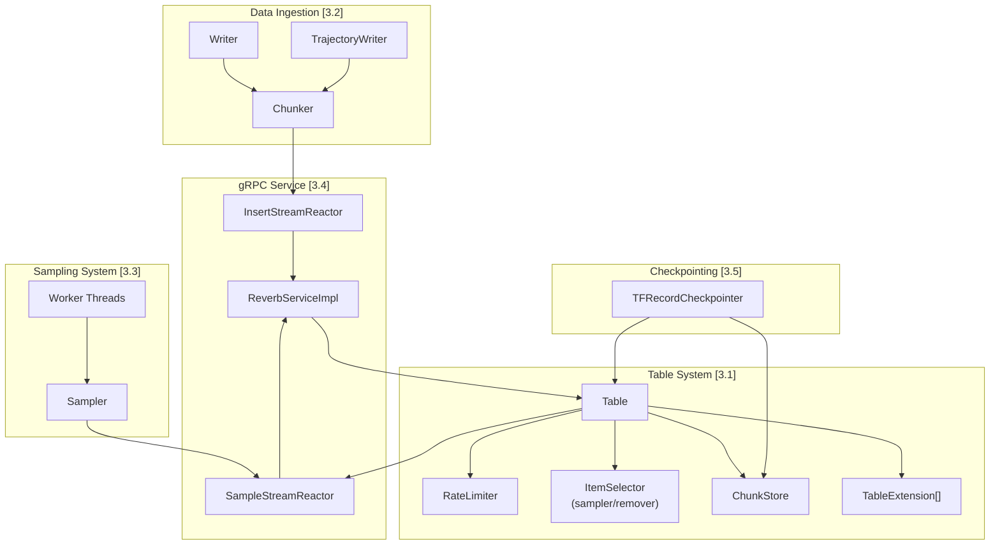
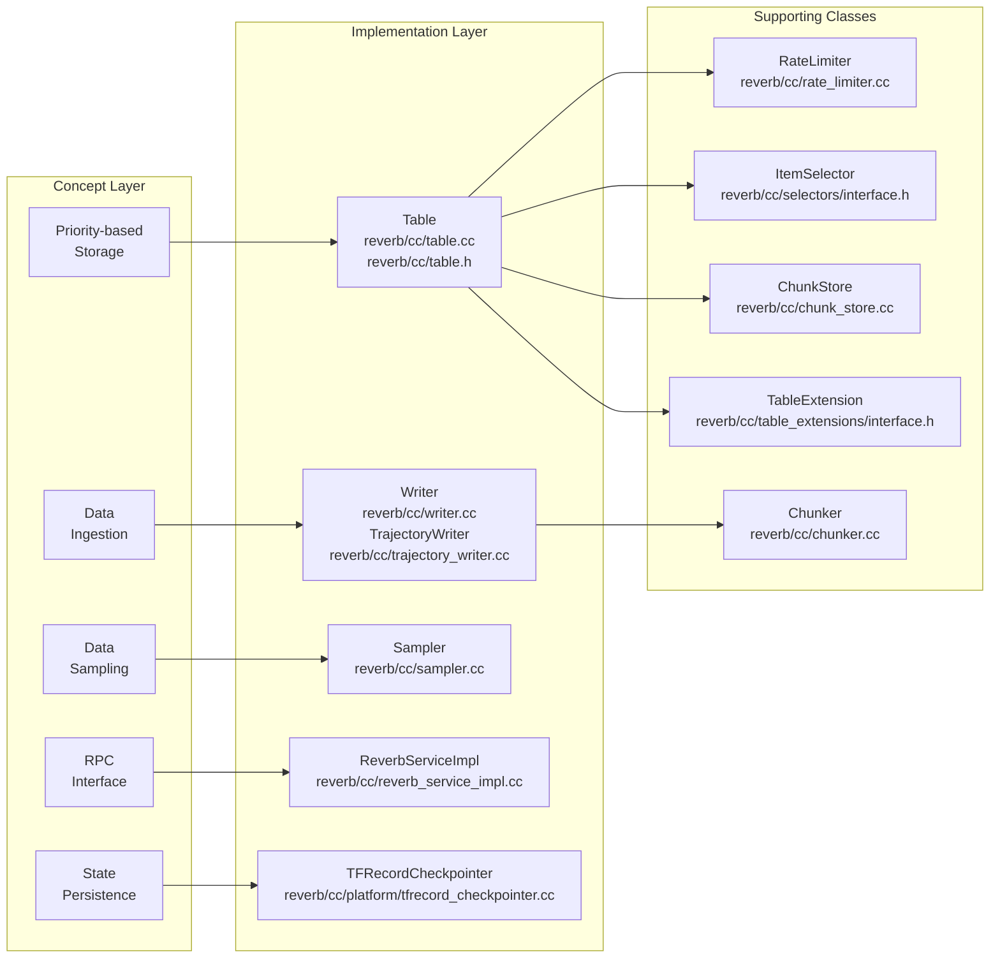
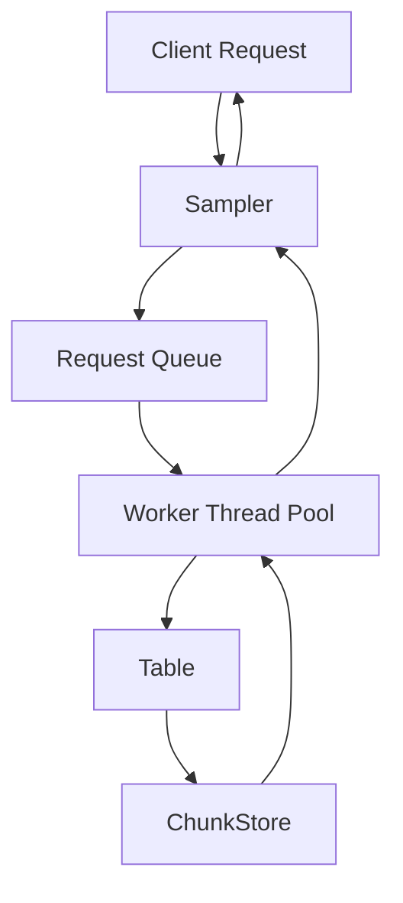
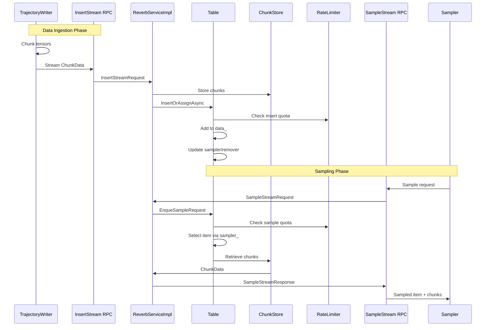

<!-- source: DeepWiki mcp.deepwiki.com · repo google-deepmind/reverb · page 3 Core Components · fetched 2026-10-26 -->

# Core Components

Relevant source files

The following files were used as context for generating this wiki page:

- [reverb/cc/BUILD](reverb/cc/BUILD)
- [reverb/cc/platform/tfrecord_checkpointer.cc](reverb/cc/platform/tfrecord_checkpointer.cc)
- [reverb/cc/table.cc](reverb/cc/table.cc)
- [reverb/cc/table.h](reverb/cc/table.h)
- [reverb/cc/table_test.cc](reverb/cc/table_test.cc)

This page provides an overview of Reverb's fundamental building blocks and their interactions. Each component is introduced at a high level, with links to detailed documentation in subsequent sections.

**Scope**: This page covers the five major subsystems that form Reverb's core: the Table system, Data Ingestion, Sampling, gRPC Service, and Checkpointing. For information about the overall architecture and client-server communication patterns, see [System Architecture](#2). For Python-specific APIs, see [Python Client API](#4).

## Component Overview

Reverb's core consists of five primary components that work together to provide prioritized experience replay:

| Component | Primary Class | Purpose |
|-----------|--------------|---------|
| **Table System** | `Table` | Central data store that manages items, enforces capacity limits, and coordinates sampling/insertion operations |
| **Data Ingestion** | `Writer`, `TrajectoryWriter` | Handles chunking, compression, and streaming of trajectory data to the server |
| **Sampling System** | `Sampler` | Multi-threaded component that retrieves and decompresses data for training |
| **gRPC Service** | `ReverbServiceImpl` | Server-side RPC handler that routes requests to appropriate tables |
| **Checkpointing** | `TFRecordCheckpointer` | Persists and restores table state for fault tolerance |

Each component is described in detail in sections [3.1](#3.1) through [3.5](#3.5).

## Core Component Architecture

The following diagram shows how the five core components interact:

**Sources**: [reverb/cc/table.h:156-656](), [reverb/cc/BUILD:430-452]()

## Code Entity Mapping

This diagram maps high-level concepts to specific C++ classes and files:

**Sources**: [reverb/cc/BUILD:133-545](), [reverb/cc/table.h:1-661]()

## Table System

The `Table` class [reverb/cc/table.h:156-656]() is the central data structure in Reverb, managing all stored items and coordinating operations. Each table maintains:

- **`data_`**: A hash map storing all items indexed by key [reverb/cc/table.h:542-543]()
- **`sampler_`**: An `ItemSelector` that determines which items to return during sampling [reverb/cc/table.h:535]()
- **`remover_`**: An `ItemSelector` that determines which items to evict when capacity is reached [reverb/cc/table.h:538]()
- **`rate_limiter_`**: Controls the ratio of insert to sample operations [reverb/cc/table.h:581]()
- **`sync_extensions_`** and **`async_extensions_`**: Hooks for custom behavior [reverb/cc/table.h:642-655]()

The table uses two dedicated worker threads:
- **`table_worker_`**: Processes asynchronous insert and sample requests [reverb/cc/table.h:587]()
- **`extension_worker_`**: Executes extension callbacks asynchronously [reverb/cc/table.h:620]()

For detailed information about table operations, concurrency, and lifecycle management, see [Table System](#3.1).

**Sources**: [reverb/cc/table.h:156-656](), [reverb/cc/table.cc:152-234]()

## Data Ingestion System

The data ingestion system consists of two main components:

**Writer** [reverb/cc/writer.h]() provides low-level functionality for:
- Buffering tensors and creating chunks
- Delta encoding for compression efficiency
- Streaming chunks to the server via bidirectional gRPC

**TrajectoryWriter** [reverb/cc/trajectory_writer.h]() builds on `Writer` to provide:
- Management of trajectory history with configurable column specifications
- Automatic chunking based on data patterns
- Episode lifecycle management

Both writers use the **Chunker** [reverb/cc/chunker.h]() class to:
- Group tensors into compressed chunks
- Apply optional delta encoding
- Generate `ChunkData` protobuf messages for transmission

The ingestion process streams data through the `InsertStream` RPC, which is a bidirectional stream handled by server-side reactors.

For implementation details including chunking strategies and compression, see [Data Ingestion System](#3.2).

**Sources**: [reverb/cc/BUILD:229-293](), [reverb/cc/table.cc:568-631]()

## Sampling System

The `Sampler` class [reverb/cc/sampler.h]() provides multi-threaded data retrieval with the following architecture:

Key features:
- **Parallel workers**: Multiple threads process sample requests concurrently [reverb/cc/sampler.cc]()
- **Batch sampling**: `SampleFlexibleBatch` returns multiple items efficiently [reverb/cc/table.cc:691-714]()
- **Decompression**: Chunk data is decompressed before returning to client
- **Rate limiting integration**: Respects table rate limiter constraints

The sampler uses the `SampleStream` bidirectional gRPC to maintain persistent connections with low latency.

For details on sampling strategies, worker coordination, and local vs. remote modes, see [Sampling System](#3.3).

**Sources**: [reverb/cc/BUILD:204-227](), [reverb/cc/table.cc:653-748]()

## gRPC Service Implementation

The **ReverbServiceImpl** class [reverb/cc/reverb_service_impl.h]() implements all server-side RPC endpoints:

| RPC Method | Type | Purpose |
|------------|------|---------|
| `InsertStream` | Bidirectional Stream | Receives chunked trajectory data and inserts items |
| `SampleStream` | Bidirectional Stream | Returns sampled items with chunks |
| `MutatePriorities` | Unary | Updates item priorities or deletes items |
| `Reset` | Unary | Clears table contents |
| `Checkpoint` | Unary | Triggers checkpoint creation |
| `ServerInfo` | Unary | Returns metadata about tables and server state |
| `InitializeConnection` | Special | In-process optimization for co-located clients |

The service uses **reactor pattern** for streaming RPCs:
- **WorkerlessInsertReactor**: Handles incoming insert streams without blocking
- **WorkerlessSampleReactor**: Manages outgoing sample streams with backpressure

The `InitializeConnection` method provides zero-copy access when client and server are in the same process, bypassing serialization overhead.

For RPC implementation details, backpressure management, and streaming protocols, see [gRPC Service Implementation](#3.4).

**Sources**: [reverb/cc/BUILD:430-452](), [reverb/cc/reverb_service_impl.h]()

## Checkpointing and Persistence

The **TFRecordCheckpointer** class [reverb/cc/platform/tfrecord_checkpointer.cc:156-169]() provides fault tolerance by saving and restoring table state:

### Checkpoint Structure

A checkpoint directory contains three TFRecord files:
- **`tables.tfrecord`**: Serialized `PriorityTableCheckpoint` messages containing table metadata [reverb/cc/platform/tfrecord_checkpointer.cc:57]()
- **`items.tfrecord`**: All `PrioritizedItem` messages currently in tables [reverb/cc/platform/tfrecord_checkpointer.cc:58]()
- **`chunks.tfrecord`**: All `ChunkData` referenced by items [reverb/cc/platform/tfrecord_checkpointer.cc:59]()
- **`DONE`**: Marker file indicating checkpoint completion [reverb/cc/platform/tfrecord_checkpointer.cc:60]()

### Save Operation

The save process [reverb/cc/platform/tfrecord_checkpointer.cc:171-278]():
1. Calls `Table::Checkpoint()` on each table to capture consistent snapshots [reverb/cc/table.cc:949-984]()
2. Collects all referenced chunks across tables
3. Writes table metadata, items, and chunks to compressed TFRecords
4. Writes `DONE` marker to indicate successful completion
5. Deletes old checkpoints based on `keep_latest` parameter

### Load Operation

The load process [reverb/cc/platform/tfrecord_checkpointer.cc:541-554]():
1. Verifies `DONE` file exists in checkpoint directory [reverb/cc/platform/tfrecord_checkpointer.cc:287-290]()
2. Loads table metadata and validates against server configuration
3. Reads all chunks into `ChunkStore` [reverb/cc/platform/tfrecord_checkpointer.cc:416-456]()
4. Reconstructs items by resolving chunk references
5. Uses `Table::InitializeFromCheckpoint()` to restore table state [reverb/cc/table.cc:184-213]()
6. Inserts items with `Table::InsertCheckpointItem()` bypassing rate limiting [reverb/cc/table.cc:986-1011]()

The checkpointer supports both compressed (zlib) and uncompressed formats for backward compatibility [reverb/cc/platform/tfrecord_checkpointer.cc:544-552]().

For details on checkpoint lifecycle, format evolution, and extension coordination, see [Checkpointing and Persistence](#3.5).

**Sources**: [reverb/cc/platform/tfrecord_checkpointer.cc:156-595](), [reverb/cc/table.cc:949-1011]()

## Component Interaction Flow

The following diagram illustrates a complete cycle of data insertion and sampling:

**Sources**: [reverb/cc/table.cc:568-631](), [reverb/cc/table.cc:660-748](), [reverb/cc/reverb_service_impl.cc]()

## Thread Safety and Concurrency

All core components are designed for concurrent access:

- **Table**: Uses `mu_` mutex to protect shared state; worker threads process queued operations asynchronously [reverb/cc/table.h:532]()
- **ChunkStore**: Thread-safe hash map allows concurrent chunk lookups [reverb/cc/chunk_store.h]()
- **RateLimiter**: Coordinates insert/sample operations across multiple threads [reverb/cc/rate_limiter.h]()
- **Extensions**: Separated into synchronous (holding `mu_`) and asynchronous (background worker) execution [reverb/cc/table.h:642-655]()

The table worker architecture avoids holding locks during expensive operations (memory deallocation, extension callbacks) to maximize throughput. See [Concurrency and Threading](#7.1) for detailed analysis.

**Sources**: [reverb/cc/table.h:532-656](), [reverb/cc/table.cc:236-502]()

## Summary

Reverb's core components form a cohesive system:

1. **Table** acts as the central coordinator, managing data lifecycle and enforcing policies
2. **Writers** handle data ingestion with efficient chunking and compression
3. **Sampler** provides high-throughput retrieval with parallel workers
4. **ReverbServiceImpl** exposes all functionality via gRPC with optimized streaming
5. **TFRecordCheckpointer** ensures state can be saved and restored reliably

The following sections ([3.1](#3.1) through [3.5](#3.5)) provide detailed documentation for each component.

**Sources**: [reverb/cc/table.h:1-661](), [reverb/cc/BUILD:1-546]()

---

