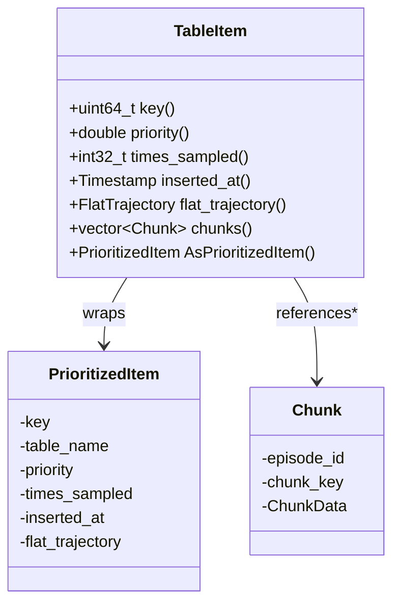
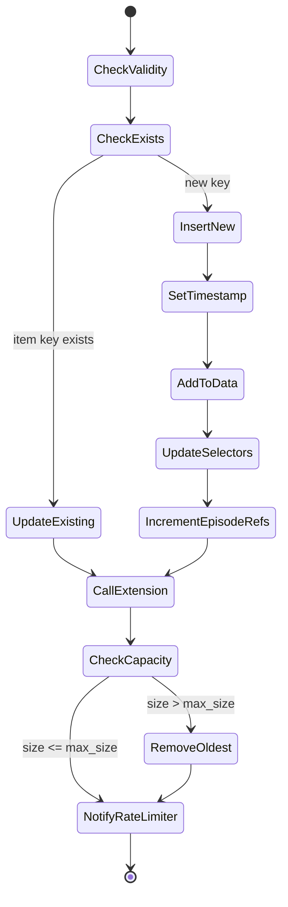
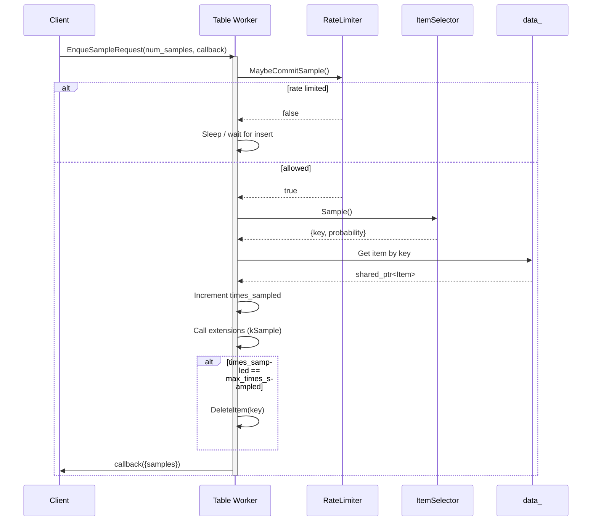
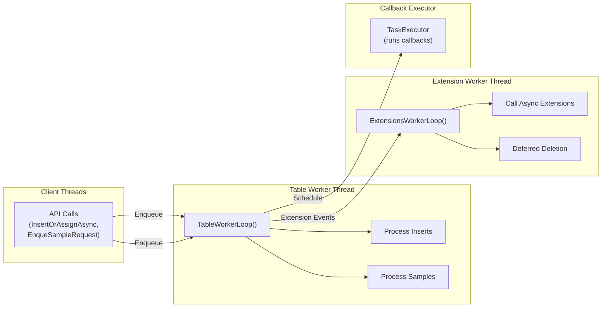
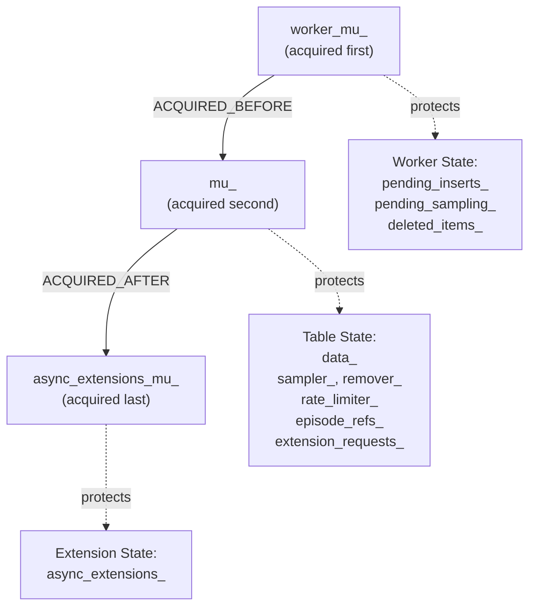
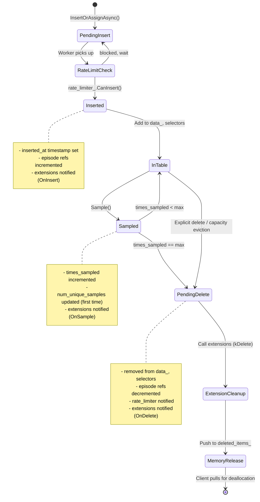
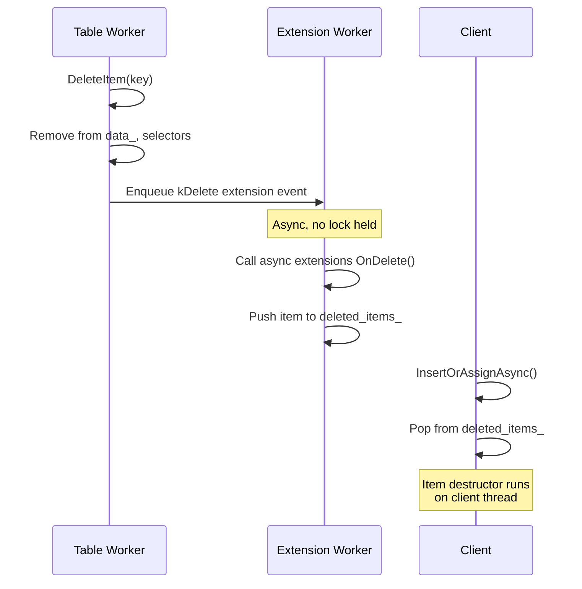
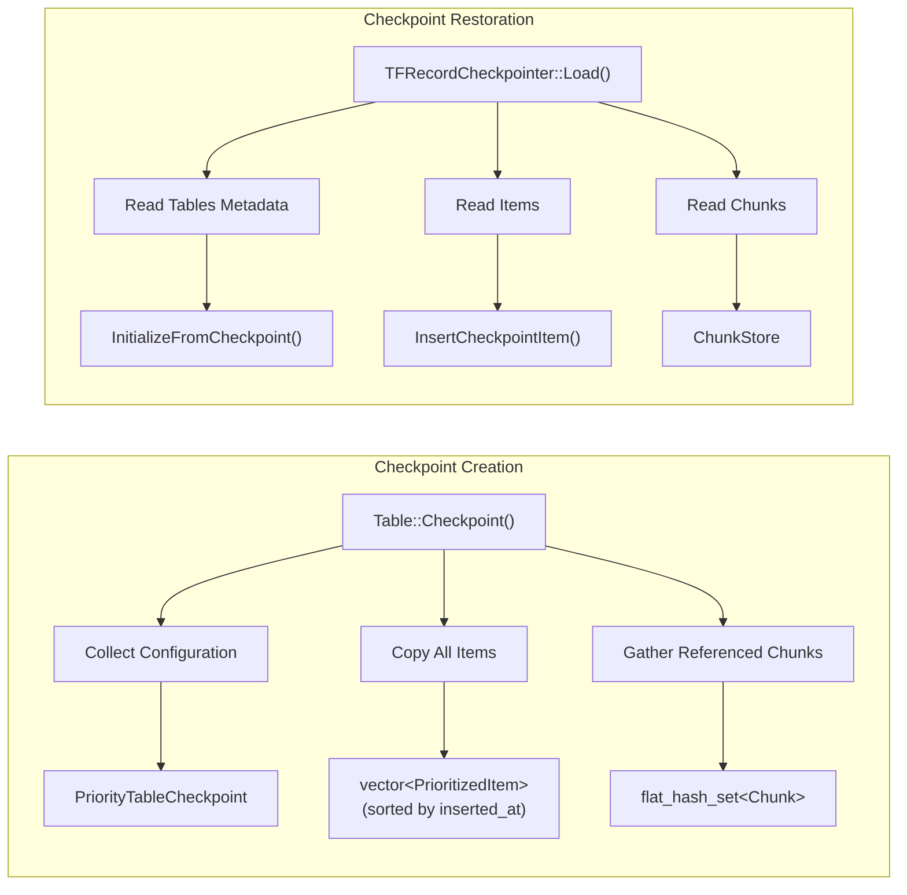

<!-- source: DeepWiki mcp.deepwiki.com · repo google-deepmind/reverb · page 3.1 Table System · fetched 2026-10-26 -->

# Table System

<details>
<summary>Relevant source files</summary>

The following files were used as context for generating this wiki page:

- [reverb/cc/platform/tfrecord_checkpointer.cc](reverb/cc/platform/tfrecord_checkpointer.cc)
- [reverb/cc/table.cc](reverb/cc/table.cc)
- [reverb/cc/table.h](reverb/cc/table.h)
- [reverb/cc/table_test.cc](reverb/cc/table_test.cc)

</details>


**Purpose**: This document describes the `Table` class, which is the core data structure in Reverb responsible for storing, sampling, and managing the lifecycle of replay buffer items. For information about how sampling strategies work, see [Item Selection Strategies](#3.1.1). For rate limiting behavior, see [Rate Limiting](#3.1.2). For extension hooks, see [Table Extensions](#3.1.3).

**Scope**: This page covers the `Table` class implementation in C++, including its data structures, operations, concurrency model, and item lifecycle management. It does not cover the Python API (see [Python Client API](#4)) or how data is ingested (see [Data Ingestion System](#3.2)).

## Overview

The `Table` is a prioritized container that stores `TableItem` objects and uses `ItemSelector` instances to control sampling and removal behavior. It integrates with a `RateLimiter` to maintain desired insert-to-sample ratios and supports extension hooks for custom behavior. The implementation uses multiple worker threads to handle asynchronous operations efficiently.

**Key Characteristics**:
- Maximum capacity enforced by automatic removal of items
- Configurable sampling and removal strategies via `ItemSelector` instances
- Rate-limited insert and sample operations
- Support for both synchronous and asynchronous extensions
- Thread-safe concurrent access
- Checkpoint/restore capability for fault tolerance

Sources: [reverb/cc/table.h:128-156](), [reverb/cc/table.cc:152-182]()

## Core Concepts

### TableItem Structure

A `TableItem` represents a single entry in the table and contains:



**Field Details**:
- `key`: Unique identifier (64-bit unsigned integer)
- `priority`: Double value used by selectors for sampling/removal decisions
- `times_sampled`: Counter incremented on each sample (mutable)
- `inserted_at`: Timestamp when item was added to the table
- `flat_trajectory`: Flattened representation of trajectory data
- `chunks`: Vector of shared pointers to compressed data chunks

The `TableItem` class wraps a `PrioritizedItem` proto but extracts mutable fields (`times_sampled`, `priority`) to avoid protobuf thread-safety issues when concurrent readers access the immutable trajectory while sampling increments counters.

Sources: [reverb/cc/table.h:62-113](), [reverb/cc/table.cc:1149-1194]()

### Table Configuration

Tables are configured with the following parameters:

| Parameter | Type | Purpose |
|-----------|------|---------|
| `name` | string | Unique identifier for the table |
| `sampler` | ItemSelector | Strategy for selecting items to sample |
| `remover` | ItemSelector | Strategy for selecting items to remove when at capacity |
| `max_size` | int64_t | Maximum number of items the table can hold |
| `max_times_sampled` | int32_t | Maximum times an item can be sampled (≤0 = unlimited) |
| `rate_limiter` | RateLimiter | Controls insert/sample operation flow |
| `extensions` | vector\<TableExtension\> | Custom hooks for observability/behavior |
| `signature` | StructuredValue (optional) | Schema declaration for stored data |

Sources: [reverb/cc/table.h:222-239](), [reverb/cc/table.cc:152-182]()

## Internal Data Structures

```mermaid
graph TB
    Table["Table Instance"]
    
    subgraph "Core State (protected by mu_)"
        data_["data_<br/>flat_hash_map&lt;Key, shared_ptr&lt;Item&gt;&gt;<br/>★ Primary storage ★"]
        sampler_["sampler_<br/>shared_ptr&lt;ItemSelector&gt;"]
        remover_["remover_<br/>shared_ptr&lt;ItemSelector&gt;"]
        rate_limiter_["rate_limiter_<br/>shared_ptr&lt;RateLimiter&gt;"]
        episode_refs_["episode_refs_<br/>flat_hash_map&lt;episode_id, refcount&gt;"]
        extension_requests_["extension_requests_<br/>vector&lt;ExtensionRequest&gt;"]
        sync_extensions_["sync_extensions_<br/>vector&lt;shared_ptr&lt;TableExtension&gt;&gt;"]
    end
    
    subgraph "Worker State (protected by worker_mu_)"
        pending_inserts_["pending_inserts_<br/>vector&lt;InsertRequest&gt;"]
        pending_sampling_["pending_sampling_<br/>vector&lt;unique_ptr&lt;SampleRequest&gt;&gt;"]
        deleted_items_["deleted_items_<br/>vector&lt;shared_ptr&lt;Item&gt;&gt;"]
    end
    
    subgraph "Async Extension State (protected by async_extensions_mu_)"
        async_extensions_["async_extensions_<br/>vector&lt;shared_ptr&lt;TableExtension&gt;&gt;"]
    end
    
    Table --> data_
    Table --> sampler_
    Table --> remover_
    Table --> rate_limiter_
    Table --> episode_refs_
    Table --> pending_inserts_
    Table --> pending_sampling_
    Table --> async_extensions_
```



**Key Data Structures**:

- **`data_`**: Hash map from item key to `TableItem`. This is the primary storage container holding all active items in the table.

- **`sampler_` / `remover_`**: Separate `ItemSelector` instances that maintain their own priority distributions. Both are updated on insert/update/delete operations.

- **`episode_refs_`**: Reference counter tracking how many items reference each episode ID. When the count reaches zero, the episode is considered deleted.

- **`pending_inserts_` / `pending_sampling_`**: Queues of operations waiting to be processed by the table worker thread.

- **`deleted_items_`**: Items removed from the table but not yet deallocated. Clients consume from this list to spread deallocation load.

- **`sync_extensions_` / `async_extensions_`**: Extensions are split into synchronous (executed while holding `mu_`) and asynchronous (executed by extension worker without lock).

Sources: [reverb/cc/table.h:532-655](), [reverb/cc/table.cc:152-182]()

## Operations

### Insert Operations

**InsertOrAssign (Synchronous)**
```cpp
absl::Status InsertOrAssign(Item item, 
                           absl::Duration timeout = absl::InfiniteDuration())
```

Legacy synchronous insertion that blocks until the rate limiter allows the operation or timeout expires. Returns `DeadlineExceededError` on timeout.

**InsertOrAssignAsync (Asynchronous)**
```cpp
absl::Status InsertOrAssignAsync(
    Item item, 
    bool* can_insert_more,
    std::weak_ptr<InsertCallback> insert_completed)
```

Enqueues an insert request for the table worker. Returns immediately with:
- `can_insert_more`: false if the pending queue is near capacity (slows down producer)
- `insert_completed`: callback invoked when insertion completes

The table worker processes inserts through `InsertOrAssignInternal`:



**Insert Workflow**:
1. Validate item (trajectory not empty, chunks match references)
2. Check if key exists - if yes, update priority and return
3. Set `inserted_at` timestamp (after acquiring lock to maintain ordering)
4. Insert into `data_` map
5. Insert into both `sampler_` and `remover_`
6. Increment episode reference counts
7. Call extensions with `kInsert` event
8. If `size() > max_size`, delete oldest item via `remover_->Sample()`
9. Notify rate limiter of successful insert

Sources: [reverb/cc/table.cc:551-632](), [reverb/cc/table.h:275-286]()

### Sample Operations

**Sample (Synchronous)**
```cpp
absl::Status Sample(SampledItem* item, 
                   absl::Duration timeout = kDefaultTimeout)
```

Blocks until rate limiter allows sampling or timeout expires.

**EnqueSampleRequest (Asynchronous)**
```cpp
void EnqueSampleRequest(int num_samples,
                       std::weak_ptr<SamplingCallback> callback,
                       absl::Duration timeout = kDefaultTimeout)
```

Enqueues a batch sampling request for the table worker to process asynchronously. The worker calls `SampleInternal` for each sample:



**SampleFlexibleBatch**:
Samples up to `batch_size` items without releasing the lock. Only waits for the rate limiter on the first sample; remaining samples are added if immediately available. This minimizes lock contention while maximizing throughput.

Sources: [reverb/cc/table.cc:653-748](), [reverb/cc/table.h:308-341]()

### Mutation Operations

**MutateItems**
```cpp
absl::Status MutateItems(absl::Span<const KeyWithPriority> updates,
                        absl::Span<const Key> deletes)
```

Atomically applies priority updates and deletions. Operations are applied in order within a single lock acquisition.

**UpdateItem**:
- Updates priority in `data_`, `sampler_`, and `remover_`
- Calls extensions with `kUpdate` event
- Ignores non-existent keys

**DeleteItem**:
1. Remove from `data_`
2. Decrement episode reference counts (track `num_deleted_episodes_`)
3. Notify rate limiter
4. Remove from `sampler_` and `remover_`
5. Call extensions with `kDelete` event
6. Optionally return deleted item for deferred deallocation

Sources: [reverb/cc/table.cc:634-906]()

### Management Operations

**Reset**:
- Clears all items from `data_`, `sampler_`, `remover_`
- Resets rate limiter state
- Clears episode reference counts
- Calls `OnReset` on all extensions
- Waits for extension worker to finish pending operations

**Checkpoint**:
Returns a `CheckpointAndChunks` struct containing:
- `PriorityTableCheckpoint`: Table configuration and metadata
- `vector<PrioritizedItem>`: All items sorted by insertion time
- `flat_hash_set<Chunk>`: All chunks referenced by items (prevents premature cleanup)

**InsertCheckpointItem**:
Special insertion path that bypasses rate limiter (used during checkpoint restore).

Sources: [reverb/cc/table.cc:908-1011]()

## Concurrency Model

### Worker Threads

The Table uses three execution contexts:



**Table Worker (`TableWorkerLoop`)**:

Located at [reverb/cc/table.cc:236-423](), this worker:
- Processes `pending_inserts_` and `pending_sampling_` queues
- Alternates between insert and sample operations for fairness
- Sleeps when no work is available or rate limited
- Tracks time spent in different states (`TableWorkerState` enum)
- Handles timeouts for sample requests

**Extension Worker (`ExtensionsWorkerLoop`)**:

Located at [reverb/cc/table.cc:425-502](), this worker:
- Processes `extension_requests_` queue
- Calls asynchronous extensions without holding `mu_`
- Performs deferred memory deallocation for deleted items
- Allows clients to pull items from `deleted_items_` for distributed deallocation load

**Callback Executor**:

A `TaskExecutor` instance that runs completion callbacks on a separate thread pool to avoid blocking the table worker.

Sources: [reverb/cc/table.cc:236-502](), [reverb/cc/table.h:443-477]()

### Locking Strategy

Three mutexes protect different parts of the table state:



**Lock Ordering** (enforced by Abseil thread annotations):
1. `worker_mu_` - Must be acquired before `mu_` if both are needed
2. `mu_` - Main table lock for data access
3. `async_extensions_mu_` - Must be acquired after `mu_` if both are needed

**Critical Sections**:
- API calls briefly hold `worker_mu_` to enqueue operations
- Table worker holds `mu_` while processing inserts/samples
- Extension worker holds `async_extensions_mu_` while calling extensions
- Synchronous extensions execute while holding `mu_`
- Asynchronous extensions execute while holding `async_extensions_mu_` (not `mu_`)

**Backpressure Mechanism**:
- `max_enqueued_inserts_` = min(1000, 10% of `max_size`)
- `max_enqueued_extension_ops_` = min(1000, 10% of `max_size`)
- `WaitForBackgroundWork()` blocks while extension queue is full

Sources: [reverb/cc/table.h:532-655](), [reverb/cc/table.cc:888-893]()

## Item Lifecycle



**Key Lifecycle Events**:

1. **Insertion**: Item added to table after rate limiter approval
2. **Sampling**: Item selected by sampler, `times_sampled` incremented
3. **Auto-deletion**: Item removed when `times_sampled == max_times_sampled`
4. **Capacity eviction**: Oldest item removed when `size() > max_size`
5. **Explicit deletion**: Item removed via `MutateItems`
6. **Memory release**: Item deallocation deferred to clients to avoid blocking

**Episode Reference Counting**:
Each chunk has an `episode_id`. The table tracks how many items reference each episode in `episode_refs_`. When the reference count drops to zero, `num_deleted_episodes_` is incremented.

Sources: [reverb/cc/table.cc:593-632](), [reverb/cc/table.cc:716-748](), [reverb/cc/table.cc:814-843]()

## Memory Management

The table uses a deferred deallocation strategy to avoid blocking critical sections:



**Key Mechanisms**:

1. **Shared Pointers**: Items stored as `shared_ptr<Item>` allow multiple references during sampling
2. **Deleted Items Queue**: Items moved to `deleted_items_` (protected by `worker_mu_`)
3. **Client Deallocation**: Clients pull from `deleted_items_` during insert/sample operations
4. **Progressive Cleanup**: At most one item deallocated per client operation to spread load

**Chunk Lifetime**:
- Chunks are managed by `ChunkStore` (see [Data Ingestion System](#3.2))
- Each `TableItem` holds `shared_ptr<Chunk>` references
- Chunks remain in memory as long as any item references them
- When an item is deleted, chunk reference counts decrement automatically

Sources: [reverb/cc/table.cc:425-502](), [reverb/cc/table.cc:568-591]()

## Checkpointing

The table supports full state serialization for fault tolerance:



**Checkpoint Contents**:
- Table name, max_size, max_times_sampled
- Sampler and remover options
- Rate limiter state
- Table signature (optional)
- All items sorted by insertion time (maintains FIFO order)
- All chunks referenced by items
- Metadata: `num_deleted_episodes`, `num_unique_samples`

**InitializeFromCheckpoint**:
- Only callable on empty tables (enforced by REVERB_CHECK)
- Replaces sampler, remover, rate_limiter
- Must be called before any items are inserted
- Extensions are retained from original table configuration

**InsertCheckpointItem**:
- Bypasses rate limiter to allow unconditional insertion
- Calls extensions normally to maintain consistency
- Items inserted in sorted order preserve selection strategy state

Sources: [reverb/cc/table.cc:949-1011](), [reverb/cc/platform/tfrecord_checkpointer.cc:280-538]()

---

