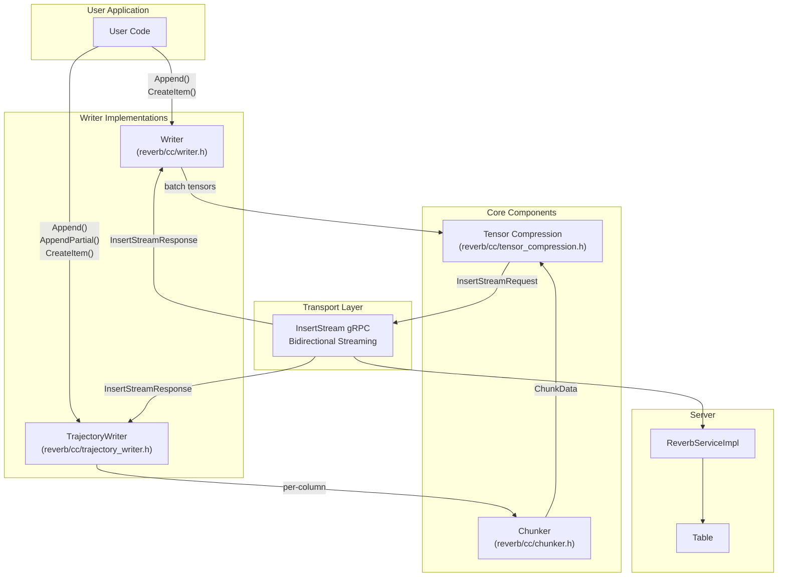
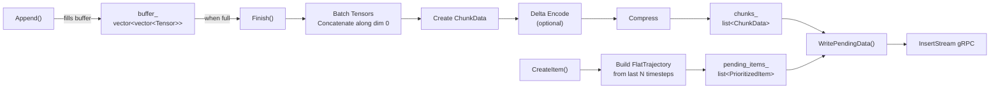
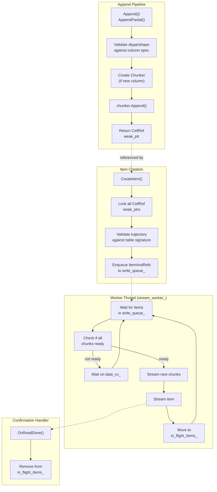
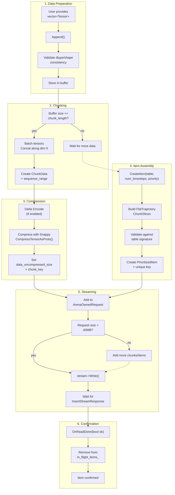
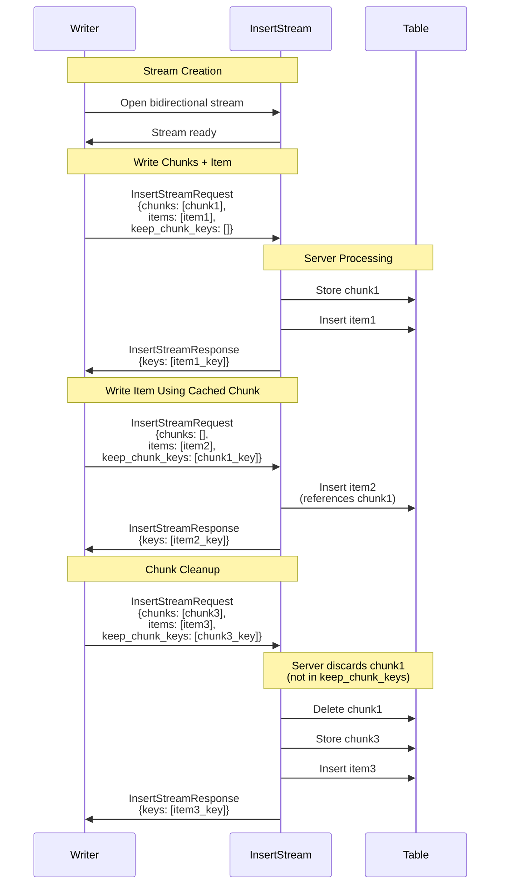

<!-- source: DeepWiki mcp.deepwiki.com · repo google-deepmind/reverb · page 3.2 Data Ingestion System · fetched 2026-10-26 -->

# Data Ingestion System

<details>
<summary>Relevant source files</summary>

The following files were used as context for generating this wiki page:

- [reverb/cc/trajectory_writer.cc](reverb/cc/trajectory_writer.cc)
- [reverb/cc/trajectory_writer.h](reverb/cc/trajectory_writer.h)
- [reverb/cc/trajectory_writer_test.cc](reverb/cc/trajectory_writer_test.cc)
- [reverb/cc/writer.cc](reverb/cc/writer.cc)
- [reverb/cc/writer.h](reverb/cc/writer.h)
- [reverb/cc/writer_test.cc](reverb/cc/writer_test.cc)

</details>


## Purpose and Scope

The Data Ingestion System is responsible for efficiently writing experience data to Reverb's replay buffer. It handles the complete pipeline from raw tensors provided by the user through chunking, compression, streaming to the server, and confirmation of insertion. This system provides two primary writer implementations—`Writer` and `TrajectoryWriter`—that offer different trade-offs between simplicity and flexibility.

This page provides an overview of the data ingestion architecture, the writer implementations, and the streaming protocol. For detailed information on specific components, see:
- C++ Writer implementation details: [3.2.1](#3.2.1)
- C++ TrajectoryWriter implementation details: [3.2.2](#3.2.2)
- Chunking and compression mechanisms: [3.2.3](#3.2.3)
- Python client APIs: [4.2](#4.2)

## System Architecture

The Data Ingestion System consists of two parallel implementations with different design goals:



**Writer vs TrajectoryWriter Design Philosophy**

| Aspect | Writer | TrajectoryWriter |
|--------|--------|------------------|
| **Use Case** | Simple sequential trajectories | Complex, sparse, or partial trajectories |
| **API Complexity** | Simple: `Append()`, `CreateItem()` | Advanced: `AppendPartial()`, `CellRef` references |
| **Trajectory Type** | Dense, continuous ranges | Sparse, arbitrary cell references |
| **Chunking** | Automatic at fixed intervals | Configurable per-column with auto-tuning |
| **Concurrency** | Synchronous with blocking reads | Asynchronous with worker thread |
| **Recovery** | Retries on UNAVAILABLE errors | Full recovery with item re-queuing |
| **Memory** | Fixed buffer size | Dynamic with reference counting |

Sources: [reverb/cc/writer.h](), [reverb/cc/trajectory_writer.h]()

## Writer Implementation

The `Writer` class provides a simple, stateful API for inserting dense trajectories:



**Key Characteristics:**

1. **Fixed Chunk Length**: All chunks have exactly `chunk_length_` timesteps (except potentially the last chunk in an episode).

2. **Automatic Batching**: When `Append()` fills the buffer to `chunk_length_`, the writer automatically:
   - Concatenates tensors along the first dimension
   - Optionally delta-encodes the batch
   - Compresses using Snappy
   - Creates a `ChunkData` message

3. **Item Creation**: `CreateItem(table, num_timesteps, priority)` creates a trajectory from the most recent `num_timesteps` timesteps by referencing the appropriate chunks.

4. **Stream Management**: A single gRPC `InsertStream` is maintained, with automatic retry on transient errors.

Sources: [reverb/cc/writer.h:43-249](), [reverb/cc/writer.cc:73-644]()

## TrajectoryWriter Implementation

The `TrajectoryWriter` provides a more powerful but complex API for advanced use cases:



**Key Characteristics:**

1. **Column-Based Chunking**: Each column has its own `Chunker` with independent configuration for:
   - `max_chunk_length`: Number of steps before finalizing
   - `num_keep_alive_refs`: How many recent steps to keep in memory
   - Delta encoding and compression settings

2. **Cell References**: `Append()` returns `std::vector<absl::optional<std::weak_ptr<CellRef>>>`, allowing users to reference specific timesteps when creating items. This enables:
   - Sparse trajectories (skip timesteps)
   - Non-contiguous trajectories (reference arbitrary timesteps)
   - Sharing data across multiple items

3. **Asynchronous Architecture**: A dedicated `stream_worker_` thread handles all I/O:
   - Waits for items in `write_queue_`
   - Streams chunks and items when ready
   - Manages `in_flight_items_` until confirmed
   - Re-queues items on connection failure

4. **Partial Steps**: `AppendPartial()` allows writing to a subset of columns without incrementing the episode step counter, enabling incremental step construction (e.g., action selection after observation).

Sources: [reverb/cc/trajectory_writer.h:230-465](), [reverb/cc/trajectory_writer.cc:278-858]()

## Data Flow Pipeline

The complete data ingestion flow involves multiple stages from user data to confirmed insertion:



Sources: [reverb/cc/writer.cc:420-485](), [reverb/cc/trajectory_writer.cc:595-700]()

## Streaming Protocol

Both writers use the bidirectional `InsertStream` gRPC method to communicate with the server:

### Message Structure

**InsertStreamRequest** ([reverb/cc/schema.proto]()):
```
message InsertStreamRequest {
  repeated ChunkData chunks = 1;          // New chunks to store
  repeated PrioritizedItem items = 2;     // Items to insert
  repeated uint64 keep_chunk_keys = 3;    // Chunks server should retain
}
```

**InsertStreamResponse** ([reverb/cc/schema.proto]()):
```
message InsertStreamResponse {
  repeated uint64 keys = 1;  // Confirmed item keys
}
```

### Protocol Flow



### Chunk Keep-Alive Management

The `keep_chunk_keys` field tells the server which chunks to retain:

**Writer** ([reverb/cc/writer.cc:525-555]()):
- Sends all chunk keys that are:
  1. Referenced by pending items
  2. Still within the `max_timesteps_` window

**TrajectoryWriter** ([reverb/cc/trajectory_writer.cc:568-593]()):
- Sends chunk keys that are:
  1. Referenced by items in `write_queue_` (except the first item)
  2. Referenced by any column `Chunker` via `GetKeepKeys()`

This allows the server to garbage collect chunks that are no longer needed, preventing memory leaks while ensuring all required data remains available.

Sources: [reverb/cc/writer.cc:500-575](), [reverb/cc/trajectory_writer.cc:158-210]()

## Error Handling and Retries

Both writers implement robust error handling with different recovery strategies:

### Writer Error Handling

**Retry Logic** ([reverb/cc/writer.cc:487-498]()):
```cpp
absl::Status Writer::WriteWithRetries(bool retry_on_unavailable) {
  while (true) {
    if (WritePendingData()) return absl::OkStatus();
    stream_->WritesDone();
    REVERB_RETURN_IF_ERROR(StopItemConfirmationWorker());
    auto status = FromGrpcStatus(stream_->Finish());
    stream_ = nullptr;
    if (!absl::IsUnavailable(status) || !retry_on_unavailable) {
      return status;
    }
    // Retry: create new stream and resend all data
  }
}
```

**Error Categories**:
- **Transient (UNAVAILABLE)**: Retried automatically by opening a new stream and resending all chunks and pending items
- **Non-transient (other errors)**: Returned immediately to the caller

### TrajectoryWriter Error Handling

**Stream Worker Recovery** ([reverb/cc/trajectory_writer.cc:286-328]()):
```cpp
stream_worker_ = internal::StartThread("TrajectoryWriter_StreamWorker", [this] {
  absl::Duration retry_backoff = absl::Milliseconds(1);
  while (true) {
    absl::Status status = RunStreamWorker();
    
    if (closed_) {
      unrecoverable_status_ = absl::CancelledError(...);
      return;
    }
    
    if (!status.ok() && !absl::IsUnavailable(status)) {
      unrecoverable_status_ = status;
      return;
    }
    
    // Re-queue all in-flight items
    for (auto& [_, item_and_refs] : in_flight_items_) {
      write_queue_.push_front(std::move(item_and_refs));
    }
    in_flight_items_.clear();
    
    // Exponential backoff
    if (absl::Now() - start_time < absl::Seconds(2)) {
      retry_backoff = std::min(absl::Seconds(1), 2 * retry_backoff);
    }
  }
});
```

**Recovery Features**:
- **Item Re-queuing**: Items sent but not confirmed are automatically re-queued to `write_queue_`
- **Chunk Re-transmission**: All chunks referenced by re-queued items are sent again (server may not have received them)
- **Exponential Backoff**: Prevents rapid retry loops on persistent failures
- **Unrecoverable Errors**: Non-transient errors stop the worker and fail all future operations

### Backpressure Management

**Writer** ([reverb/cc/writer.cc:581-588]()):
```cpp
bool Writer::ConfirmItems(int limit) {
  absl::ReaderMutexLock lock(mu_);
  auto done = [limit, this]() { 
    return num_items_in_flight_ <= limit || !item_confirmation_worker_running_;
  };
  mu_.Await(absl::Condition(&done));
  return num_items_in_flight_ <= limit;
}
```

The writer blocks when `num_items_in_flight_` exceeds `max_in_flight_items_` (default 25), preventing unbounded memory growth.

**TrajectoryWriter** ([reverb/cc/trajectory_writer.cc:651-662]()):
```cpp
if (in_flight_items_.size() + write_queue_.size() >= 
    kPendingItemsWarningThreshold) {
  REVERB_LOG_EVERY_N(REVERB_WARNING, 10) << absl::StrFormat(
      "The number of pending items is alarmingly high...");
}
```

The trajectory writer logs warnings at 50 pending items but does not block. Users should call `Flush()` regularly to prevent unbounded memory growth.

Sources: [reverb/cc/writer.cc:376-418](), [reverb/cc/writer.cc:487-498](), [reverb/cc/trajectory_writer.cc:286-328](), [reverb/cc/trajectory_writer.cc:595-700]()

## Request Size Management

Both writers split large requests to avoid exceeding gRPC message size limits:

**Maximum Request Size** ([reverb/cc/writer.h:45](), [reverb/cc/trajectory_writer.h:238]()):
```cpp
static constexpr int64_t kMaxRequestSizeBytes = 40 * 1024 * 1024;  // 40MB
```

**Writer** ([reverb/cc/writer.cc:542-551]()):
```cpp
if (request.r.ByteSizeLong() >= Writer::kMaxRequestSizeBytes) {
  if (!stream_->Write(request.r, options)) {
    return false;
  }
  // Continue with remaining chunks
  request.Clear();
}
```

**TrajectoryWriter** ([reverb/cc/trajectory_writer.cc:199-207]()):
```cpp
if (request->RequestSize() >= TrajectoryWriter::kMaxRequestSizeBytes) {
  if (!WriteIfNotEmpty(*streamed_chunk_keys, request)) {
    return false;
  }
  // Continue with remaining chunks
}
```

This ensures that even very large trajectories with many chunks can be transmitted without exceeding gRPC limits.

Sources: [reverb/cc/writer.cc:500-575](), [reverb/cc/trajectory_writer.cc:158-210]()

## Performance Considerations

### Writer Performance

**Advantages**:
- **Simple synchronous API**: Minimal thread overhead
- **Batched tensors**: Efficient concatenation and compression
- **Fixed chunk size**: Predictable memory usage

**Limitations**:
- **Blocking I/O**: Network operations block the calling thread
- **Dense trajectories only**: Cannot represent sparse data efficiently
- **Fixed chunking**: No per-column optimization

### TrajectoryWriter Performance

**Advantages**:
- **Asynchronous I/O**: Background worker handles all network operations without blocking
- **Sparse data support**: Only stores and transmits referenced cells
- **Configurable chunking**: Per-column optimization based on data patterns
- **Better pipelining**: Can create items while previous items are being confirmed

**Optimizations**:
- **Arena-allocated requests** ([reverb/cc/trajectory_writer.cc:54-91]()): Avoids proto copy overhead
- **Chunk deduplication**: Only sends each chunk once, even if referenced by multiple items
- **Progressive deallocation**: Old chunks are freed as soon as they're no longer referenced

### Memory Management

**Writer** ([reverb/cc/writer.cc:477-480]()):
```cpp
while ((chunks_.size() - 1) * chunk_length_ >= max_timesteps_) {
  streamed_chunk_keys_.erase(chunks_.front().chunk_key());
  chunks_.pop_front();
}
```

Maintains a sliding window of `max_timesteps_` timesteps.

**TrajectoryWriter** ([reverb/cc/chunker.cc]()):
Uses reference counting via `std::shared_ptr<CellRef>` to automatically free chunks when no items reference them. The `num_keep_alive_refs` parameter controls how many recent steps remain accessible for new items.

Sources: [reverb/cc/writer.cc:420-485](), [reverb/cc/trajectory_writer.cc:595-700](), [reverb/cc/trajectory_writer.cc:54-91]()

---

