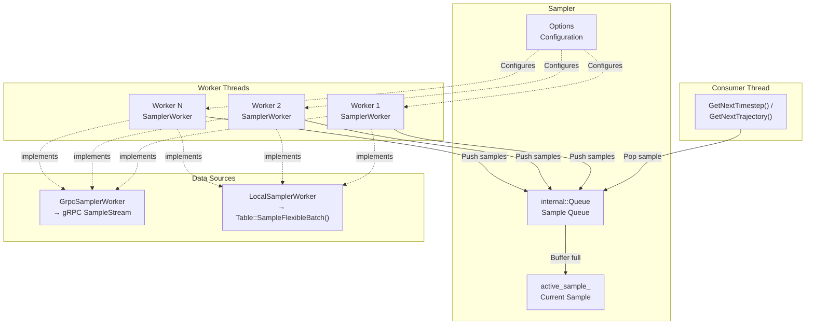
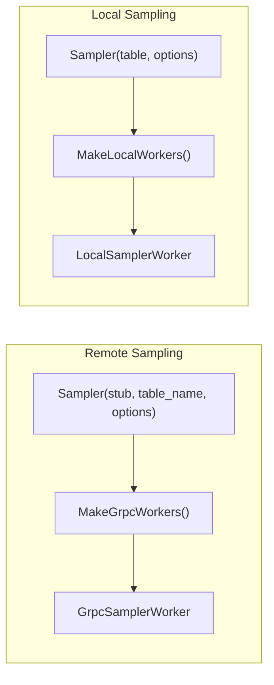
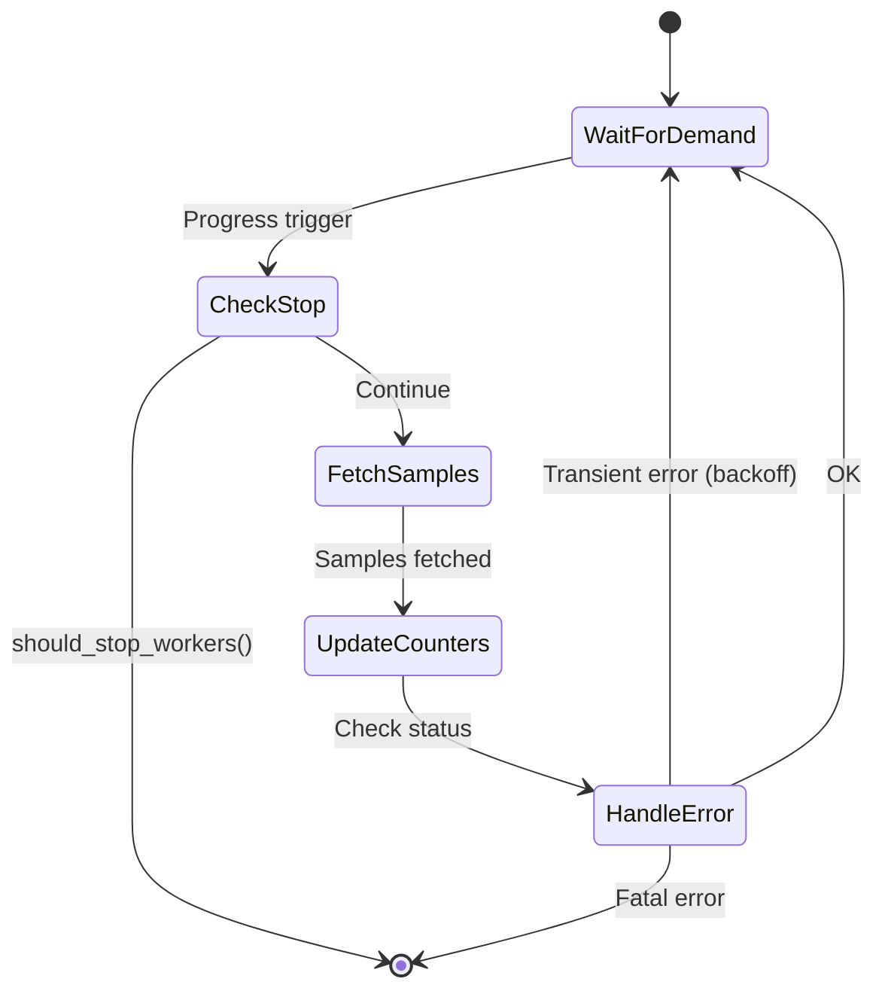
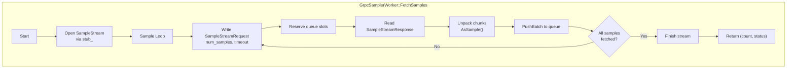
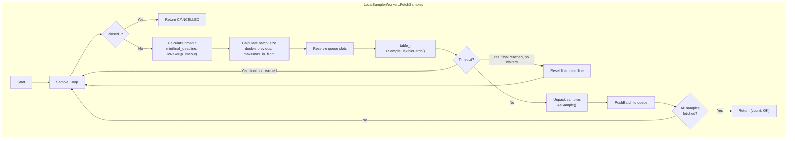
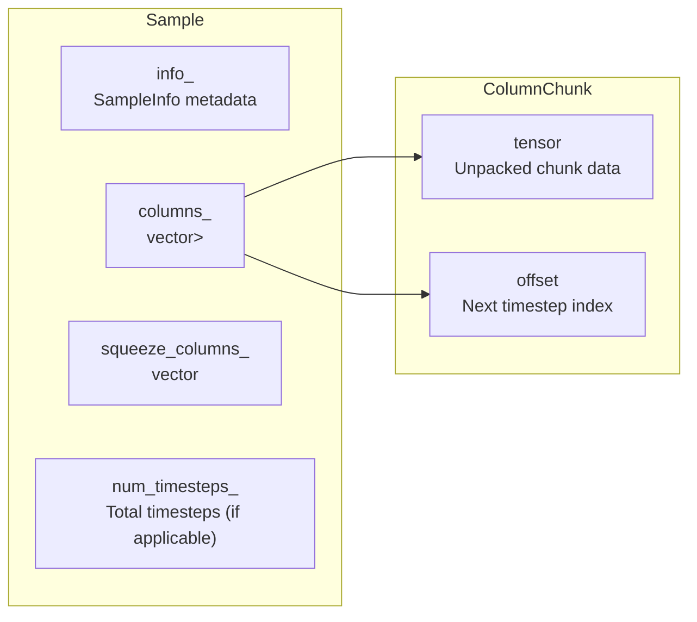
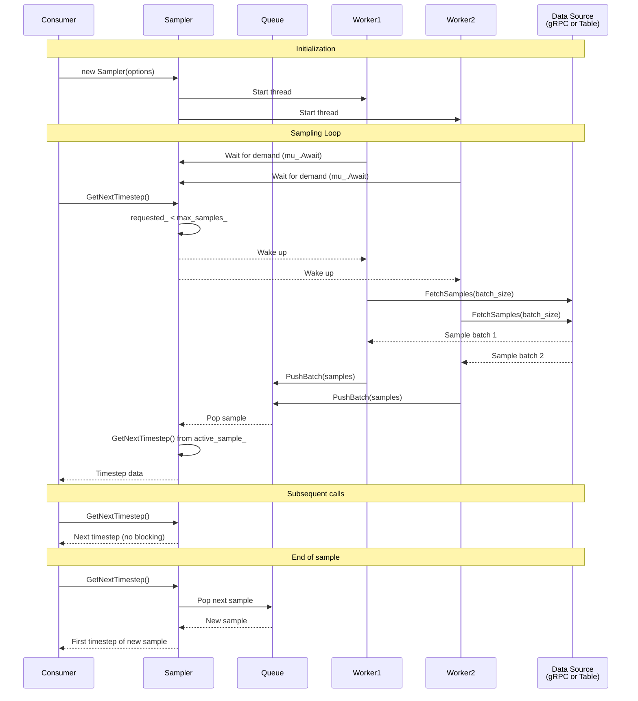

<!-- source: DeepWiki mcp.deepwiki.com · repo google-deepmind/reverb · page 3.3 Sampling System · fetched 2026-10-26 -->

# Sampling System

<details>
<summary>Relevant source files</summary>

The following files were used as context for generating this wiki page:

- [reverb/cc/sampler.cc](reverb/cc/sampler.cc)
- [reverb/cc/sampler.h](reverb/cc/sampler.h)
- [reverb/cc/sampler_test.cc](reverb/cc/sampler_test.cc)

</details>


## Purpose and Scope

The Sampling System is responsible for efficiently retrieving data from Reverb tables and delivering it to consumers (typically ML training loops). This document covers the `Sampler` class, its multi-threaded worker architecture, and the two primary sampling modes: remote sampling via gRPC and local sampling for in-process tables. The system handles sample retrieval, unpacking, and delivery through a queue-based architecture with configurable concurrency and batching.

For information about how data is stored in tables, see [Table System](#3.1). For details on how samples are consumed in TensorFlow pipelines, see [TensorFlow Datasets](#5.2).

## Architecture Overview

The Sampling System employs a producer-consumer architecture where multiple worker threads fetch and unpack samples concurrently, pushing them into a shared queue that the consumer reads from.



**Sources:** [reverb/cc/sampler.h:170-384](), [reverb/cc/sampler.cc:491-523]()

## Sampler Class

The `Sampler` class ([reverb/cc/sampler.h:170-384]()) is the main entry point for sampling data from Reverb. It manages worker threads, coordinates sampling requests, and provides two primary interfaces for data retrieval.

### Key Components

| Component | Type | Purpose |
|-----------|------|---------|
| `workers_` | `vector<unique_ptr<SamplerWorker>>` | Pool of worker threads that fetch samples |
| `worker_threads_` | `vector<unique_ptr<Thread>>` | OS threads running workers |
| `samples_` | `internal::Queue<unique_ptr<Sample>>` | Thread-safe queue of fetched samples |
| `active_sample_` | `unique_ptr<Sample>` | Current sample being decomposed into timesteps |
| `max_samples_` | `int64_t` | Maximum samples to return before terminating |
| `max_samples_per_stream_` | `int64_t` | Maximum samples per stream before reconnecting |
| `rate_limiter_timeout_` | `absl::Duration` | Timeout for rate limiter waits |

**Sources:** [reverb/cc/sampler.h:334-383]()

### Construction

The `Sampler` supports two construction modes:



**Sources:** [reverb/cc/sampler.h:249-265](), [reverb/cc/sampler.cc:491-528]()

### Primary Methods

#### GetNextTimestep

```cpp
absl::Status GetNextTimestep(
    std::vector<tensorflow::Tensor>* data,
    bool* end_of_sequence,
    std::shared_ptr<const SampleInfo>* info = nullptr);
```

Retrieves a single timestep from the current sample. If a sample has multiple timesteps, consecutive calls will return subsequent timesteps until `end_of_sequence` is true, then automatically advances to the next sample.

**Sources:** [reverb/cc/sampler.h:279-281](), [reverb/cc/sampler.cc:532-558]()

#### GetNextTrajectory

```cpp
absl::Status GetNextTrajectory(
    std::vector<tensorflow::Tensor>* data,
    std::shared_ptr<const SampleInfo>* info = nullptr);
```

Retrieves an entire sample as a batched trajectory (all timesteps concatenated along the time dimension).

**Sources:** [reverb/cc/sampler.h:291-293](), [reverb/cc/sampler.cc:560-575]()

## Worker Architecture

### SamplerWorker Interface

The `SamplerWorker` abstract interface ([reverb/cc/sampler.h:117-129]()) defines the contract for fetching samples:

```cpp
class SamplerWorker {
 public:
  virtual void Cancel() = 0;
  virtual std::pair<int64_t, absl::Status> FetchSamples(
      internal::Queue<std::unique_ptr<Sample>>* queue,
      int64_t num_samples,
      absl::Duration rate_limiter_timeout) = 0;
};
```

Each worker runs in its own thread executing the `Sampler::RunWorker` method ([reverb/cc/sampler.cc:651-702]()), which:

1. Waits for sampling demand (`requested_ < max_samples_`)
2. Determines batch size (`samples_to_stream`)
3. Calls `FetchSamples` on the worker
4. Handles transient errors with exponential backoff
5. Updates request counters and propagates fatal errors



**Sources:** [reverb/cc/sampler.h:117-129](), [reverb/cc/sampler.cc:651-702]()

### GrpcSamplerWorker

The `GrpcSamplerWorker` ([reverb/cc/sampler.cc:172-323]()) implements remote sampling via gRPC bidirectional streaming:



**Key Features:**
- **Streaming Protocol:** Uses `SampleStream` gRPC bidirectional stream
- **Batching:** Requests up to `samples_per_request_` samples per batch
- **Chunk Assembly:** Handles multi-part samples where chunks span multiple responses
- **Early Exit:** Returns OK if rate limiter times out with no waiting consumers
- **Memory Management:** Tracks `reserved_slots_` to prevent queue overflow

**Sources:** [reverb/cc/sampler.cc:172-323](), [reverb/cc/sampler.cc:460-473]()

### LocalSamplerWorker

The `LocalSamplerWorker` ([reverb/cc/sampler.cc:325-442]()) implements in-process sampling directly from a `Table`:



**Key Features:**
- **Direct Access:** Bypasses gRPC, calls `Table::SampleFlexibleBatch` directly
- **Adaptive Batching:** Doubles batch size on success up to `max_in_flight_samples_`
- **Periodic Wakeup:** Uses 3-second wakeup interval to check for cancellation
- **Deadline Management:** Resets timeout when no consumers are waiting

**Sources:** [reverb/cc/sampler.cc:325-442](), [reverb/cc/sampler.cc:475-487]()

## Sample Class

The `Sample` class ([reverb/cc/sampler.h:54-114]()) represents a single sampled item and supports two retrieval modes:

### Internal Structure



**Sources:** [reverb/cc/sampler.h:54-114](), [reverb/cc/sampler.cc:704-733]()

### Sample Construction

Samples are constructed from gRPC responses or local `Table::SampledItem` objects through the `AsSample` function:

**From gRPC Response** ([reverb/cc/sampler.cc:73-129]()):
1. Collect all `ChunkData` from response entries
2. Count chunk references for progressive deallocation
3. Unpack each chunk slice using `UnpackChunkColumnAndSlice`
4. Free chunks as soon as all references are processed

**From Local Table** ([reverb/cc/sampler.cc:131-170]()):
1. Access chunks directly from `Table::SampledItem`
2. Unpack slices without decompression overhead (already decompressed)
3. Construct `SampleInfo` from item metadata

### Timestep Decomposition

The `is_composed_of_timesteps()` method ([reverb/cc/sampler.cc:765-782]()) checks if all columns have the same length, which is required for timestep-by-timestep retrieval.

`GetNextTimestep()` ([reverb/cc/sampler.cc:735-758]()) returns the next timestep by:
1. Taking a slice from each column's front chunk
2. Incrementing the offset
3. Popping chunks when fully consumed (progressive memory deallocation)
4. Deep copying unaligned tensors

### Trajectory Assembly

`AsTrajectory()` ([reverb/cc/sampler.cc:784-828]()) returns the entire sample by:
1. Concatenating all chunks in each column along the time dimension
2. Removing batch dimension from squeezed columns
3. Moving tensors efficiently (avoiding copies where possible)

**Sources:** [reverb/cc/sampler.cc:735-828]()

## Configuration Options

The `Sampler::Options` struct ([reverb/cc/sampler.h:209-247]()) controls sampling behavior:

| Option | Default | Description |
|--------|---------|-------------|
| `max_samples` | `kUnlimitedMaxSamples` (-1) | Maximum samples to return before terminating |
| `max_in_flight_samples_per_worker` | 100 | Batch size per worker request |
| `num_workers` | `kAutoSelectValue` → 1 | Number of worker threads |
| `max_samples_per_stream` | `kAutoSelectValue` → 10000 | Maximum samples per stream before reconnection |
| `rate_limiter_timeout` | `InfiniteDuration` | Timeout for waiting on rate limiter |

### Worker Count Selection

The number of workers is automatically computed by `GetNumWorkers` ([reverb/cc/sampler.cc:444-458]()):

```cpp
int64_t num_workers = std::min<int64_t>(
    configured_workers,
    std::max<int64_t>(1, max_samples / max_in_flight_samples_per_worker));
```

This ensures that workers are only created if they can meaningfully contribute to fetching `max_samples`.

**Sources:** [reverb/cc/sampler.h:209-247](), [reverb/cc/sampler.cc:444-458](), [reverb/cc/sampler.cc:830-858]()

## Error Handling and Retry Logic

The Sampling System distinguishes between transient and fatal errors:

### Transient Errors

These errors trigger automatic retry with exponential backoff:
- `UNAVAILABLE`: Server temporarily unavailable
- `CANCELLED`: Stream cancelled (e.g., during shutdown)

**Backoff Configuration** ([reverb/cc/sampler.cc:57-60]()):
```cpp
constexpr absl::Duration kResetBackoffThreshold = absl::Seconds(2);
constexpr absl::Duration kMinRetryBackoff = absl::Milliseconds(1);
constexpr absl::Duration kMaxRetryBackoff = absl::Seconds(1);
```

The backoff resets to minimum if a stream stays open longer than `kResetBackoffThreshold`, otherwise it doubles up to `kMaxRetryBackoff`.

**Sources:** [reverb/cc/sampler.cc:689-699]()

### Fatal Errors

These errors immediately terminate all workers and propagate to the consumer:
- `NOT_FOUND`: Table doesn't exist
- `INVALID_ARGUMENT`: Invalid request
- `DEADLINE_EXCEEDED`: Rate limiter timeout (when consumers are waiting)
- Any other non-transient gRPC error

**Sources:** [reverb/cc/sampler.cc:682-689]()

### Rate Limiter Timeout Handling

When a rate limiter timeout occurs:
- **No waiting consumers:** Worker exits with OK status and will restart with a new stream
- **Waiting consumers:** Timeout error propagates to consumer

This prevents blocking when data isn't actually needed.

**Sources:** [reverb/cc/sampler.cc:242-250](), [reverb/cc/sampler.cc:384-392]()

## Sampling Flow Diagram



**Sources:** [reverb/cc/sampler.cc:532-575](), [reverb/cc/sampler.cc:651-702]()

## Performance Considerations

### Batch Size Selection

The initial batch size starts small ([reverb/cc/sampler.cc:56]()):
```cpp
constexpr int64_t kInitialSampleBatchSize = 8;
```

For `LocalSamplerWorker`, the batch size doubles on each successful fetch ([reverb/cc/sampler.cc:368-371]()) up to `max_in_flight_samples_per_worker`, providing adaptive performance.

### Memory Management

**Progressive Deallocation:** The `Sample` class uses deques of chunks ([reverb/cc/sampler.h:103]()) so that chunk memory can be freed as soon as all timesteps from that chunk have been consumed ([reverb/cc/sampler.cc:752-754]()).

**Queue Reservation:** Workers reserve queue slots before fetching ([reverb/cc/sampler.cc:228-232](), [reverb/cc/sampler.cc:374-377]()) to prevent unbounded memory growth.

**Chunk Reference Counting:** When unpacking gRPC responses, chunks are freed as soon as all column slices referencing them have been processed ([reverb/cc/sampler.cc:88-120]()).

### Stream Lifecycle

Streams are limited to `max_samples_per_stream` ([reverb/cc/sampler.h:184](), default 10000) to ensure:
- Uniform sampling across multiple backends
- Fresh connections that pick up configuration changes
- Bounded memory per stream

**Sources:** [reverb/cc/sampler.cc:56](), [reverb/cc/sampler.cc:368-371](), [reverb/cc/sampler.cc:752-754](), [reverb/cc/sampler.cc:88-120]()

## Integration Points

### With Table System

Local sampling bypasses gRPC and calls directly:
- `Table::SampleFlexibleBatch()` for batch sampling
- Accesses `Table::SampledItem` with direct chunk references

**Sources:** [reverb/cc/sampler.cc:380]()

### With TensorFlow

The `WithInfoTensors` static method ([reverb/cc/sampler.h:206-207](), [reverb/cc/sampler.cc:860-872]()) prepends metadata tensors (key, probability, table_size, priority, times_sampled) to sampled data for use in TensorFlow pipelines.

### With gRPC Service

Remote sampling uses the `SampleStream` RPC ([reverb/cc/sampler.cc:211]()) defined in `reverb_service.proto`, sending `SampleStreamRequest` messages and receiving `SampleStreamResponse` messages with compressed chunk data.

**Sources:** [reverb/cc/sampler.cc:860-872](), [reverb/cc/sampler.cc:211]()

---

