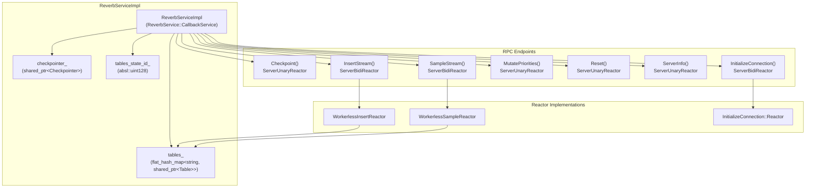
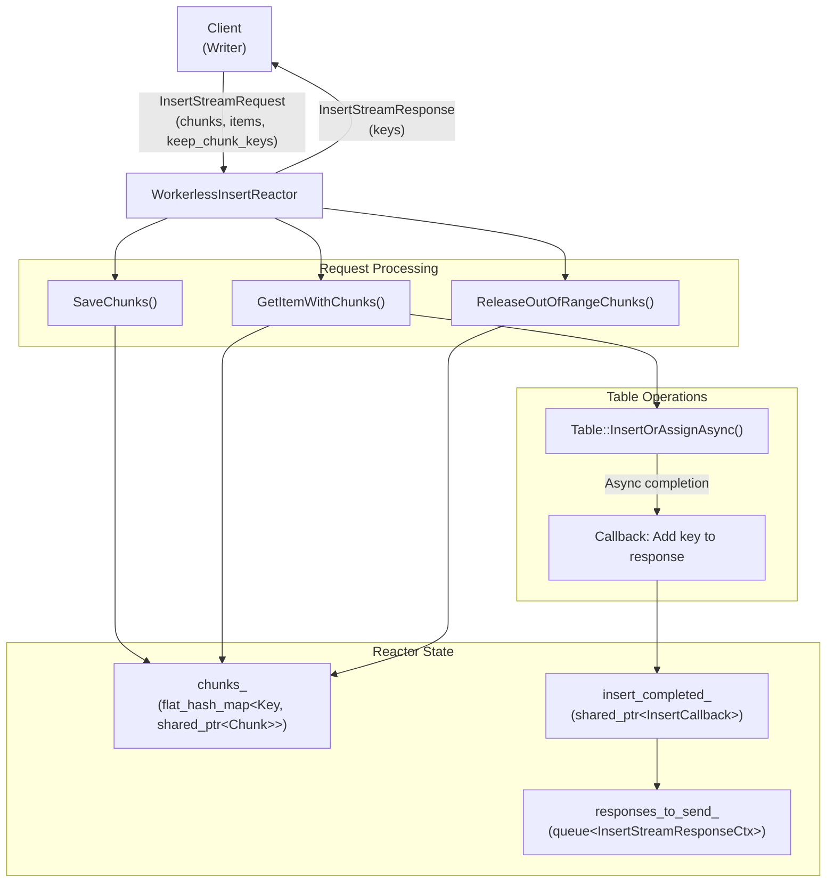
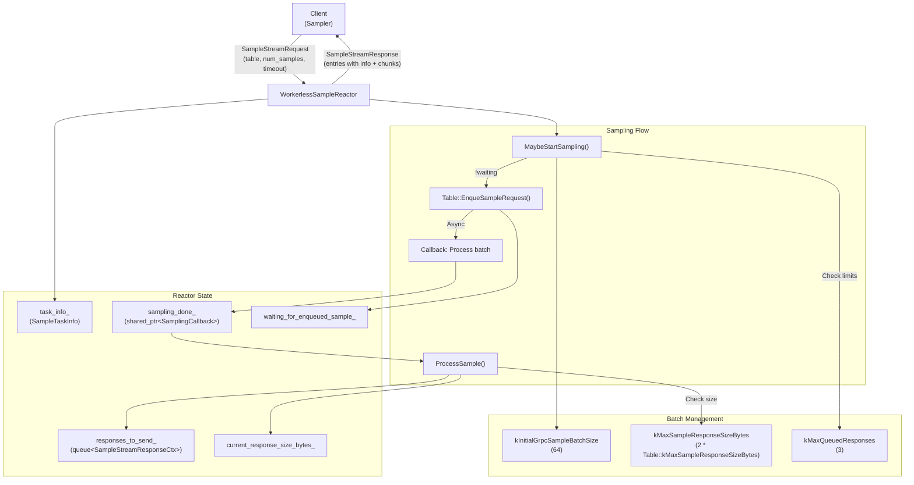
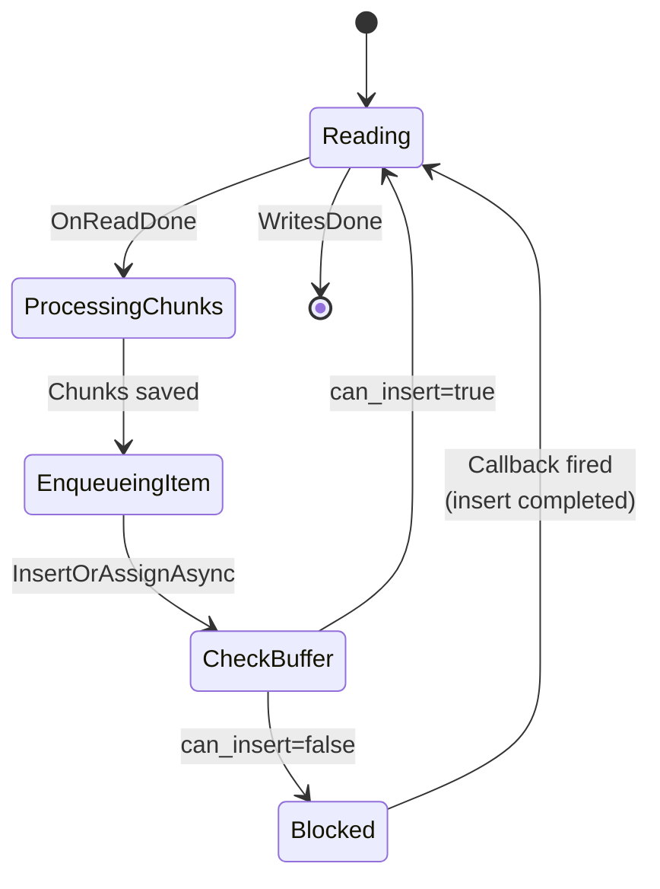
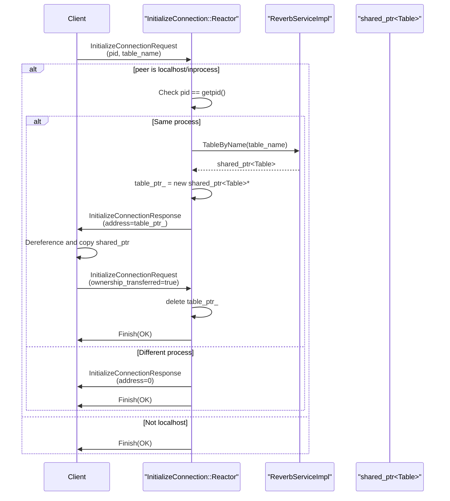

<!-- source: DeepWiki mcp.deepwiki.com · repo google-deepmind/reverb · page 3.4 gRPC Service Implementation · fetched 2026-10-26 -->

# gRPC Service Implementation

<details>
<summary>Relevant source files</summary>

The following files were used as context for generating this wiki page:

- [reverb/cc/reverb_service.proto](reverb/cc/reverb_service.proto)
- [reverb/cc/reverb_service_impl.cc](reverb/cc/reverb_service_impl.cc)
- [reverb/cc/reverb_service_impl.h](reverb/cc/reverb_service_impl.h)
- [reverb/cc/reverb_service_impl_test.cc](reverb/cc/reverb_service_impl_test.cc)

</details>


## Purpose and Scope

This document details the `ReverbServiceImpl` class, which implements the gRPC server interface for Reverb. This is the primary entry point for all client-server communication, handling both unary and bidirectional streaming RPCs.

For information about the overall client-server communication architecture, see [Client-Server Communication](#2.1). For details on the Table operations that the service coordinates, see [Table System](#3.1). For TensorFlow-specific integration, see [TensorFlow Custom Operations](#5.1).

**Sources:** [reverb/cc/reverb_service_impl.h:35-143](), [reverb/cc/reverb_service_impl.cc:83-141]()

## Service Architecture

The `ReverbServiceImpl` class implements the `ReverbService::CallbackService` interface defined in the protocol buffer specification. It manages a collection of `Table` instances and coordinates all data operations through gRPC reactors.



**Diagram: ReverbServiceImpl Class Structure**

**Sources:** [reverb/cc/reverb_service_impl.h:37-143](), [reverb/cc/reverb_service_impl.cc:83-141]()

### Initialization

The service is created through the static factory method `ReverbServiceImpl::Create()`, which performs the following steps:

1. Constructs the service with an optional `Checkpointer`
2. Attempts to load the latest checkpoint from disk (if checkpointer is configured)
3. Falls back to loading a fallback checkpoint if no latest checkpoint exists
4. Populates the `tables_` map with provided `Table` instances
5. Creates a shared `TaskExecutor` with configurable thread pool size (default: 32 threads)
6. Assigns the executor to all tables for callback processing
7. Generates a random `tables_state_id_` for client synchronization

**Sources:** [reverb/cc/reverb_service_impl.cc:86-141]()

```mermaid
sequenceDiagram
    participant Client
    participant Create as "ReverbServiceImpl::Create()"
    participant Init as "Initialize()"
    participant CP as "Checkpointer"
    participant Executor as "TaskExecutor"
    participant Tables as "Table instances"
    
    Client->>Create: tables, checkpointer
    Create->>Init: tables
    
    alt Checkpointer configured
        Init->>CP: LoadLatest(&tables)
        alt No checkpoint in root
            Init->>CP: LoadFallbackCheckpoint(&tables)
        end
    end
    
    Init->>Init: Populate tables_ map
    Init->>Executor: Create (32 threads)
    
    loop For each table
        Init->>Tables: SetCallbackExecutor(executor)
    end
    
    Init->>Init: Generate tables_state_id_
    Init-->>Create: OkStatus
    Create-->>Client: unique_ptr<ReverbServiceImpl>
```

**Diagram: Service Initialization Sequence**

**Sources:** [reverb/cc/reverb_service_impl.cc:86-141]()

## RPC Endpoints

The service exposes seven RPC endpoints, divided into unary and streaming categories:

| RPC Method | Type | Purpose | Reactor Type |
|------------|------|---------|--------------|
| `Checkpoint` | Unary | Persist all tables to disk | `ServerUnaryReactor` |
| `MutatePriorities` | Unary | Update/delete items by key | `ServerUnaryReactor` |
| `Reset` | Unary | Clear table contents | `ServerUnaryReactor` |
| `ServerInfo` | Unary | Query table metadata | `ServerUnaryReactor` |
| `InsertStream` | Bidirectional Stream | Insert chunks and items | `WorkerlessInsertReactor` |
| `SampleStream` | Bidirectional Stream | Sample items from table | `WorkerlessSampleReactor` |
| `InitializeConnection` | Bidirectional Stream | In-process optimization | Custom `Reactor` |

**Sources:** [reverb/cc/reverb_service_impl.h:44-110](), [reverb/cc/reverb_service.proto:9-58]()

### Unary RPCs

#### Checkpoint

Triggers a checkpoint operation to persist all table data to disk. Returns an error if no checkpointer is configured.

**Implementation:** [reverb/cc/reverb_service_impl.cc:143-165]()

```cpp
grpc::ServerUnaryReactor* ReverbServiceImpl::Checkpoint(
    grpc::CallbackServerContext* context, const CheckpointRequest* request,
    CheckpointResponse* response)
```

The method:
1. Validates that a `checkpointer_` is configured
2. Collects raw pointers to all tables
3. Calls `checkpointer_->Save()` with tables and keep count of 1
4. Populates `checkpoint_path` in response
5. Finishes the reactor with appropriate status

#### MutatePriorities

Updates priorities or deletes items in a specified table.

**Implementation:** [reverb/cc/reverb_service_impl.cc:425-442]()

```cpp
grpc::ServerUnaryReactor* ReverbServiceImpl::MutatePriorities(
    grpc::CallbackServerContext* context,
    const MutatePrioritiesRequest* request,
    MutatePrioritiesResponse* response)
```

The method:
1. Looks up the table by name from `request->table()`
2. Returns `NOT_FOUND` if table doesn't exist
3. Calls `table->MutateItems()` with updates and delete keys
4. Converts and returns the status

#### Reset

Clears all items from a table and resets its rate limiter.

**Implementation:** [reverb/cc/reverb_service_impl.cc:444-456]()

#### ServerInfo

Returns metadata about all tables and the current `tables_state_id_`.

**Implementation:** [reverb/cc/reverb_service_impl.cc:705-715]()

The method populates a `ServerInfoResponse` with:
- `tables_state_id`: 128-bit unique identifier for table configuration
- `table_info`: Array of `TableInfo` messages from `table->info()` for each table

**Sources:** [reverb/cc/reverb_service_impl.cc:143-165](), [reverb/cc/reverb_service_impl.cc:425-456](), [reverb/cc/reverb_service_impl.cc:705-715]()

### Bidirectional Streaming RPCs

#### InsertStream

The `InsertStream` RPC handles insertion of chunks and items through a bidirectional stream. It uses a custom `WorkerlessInsertReactor` that extends `ReverbServerReactor`.



**Diagram: InsertStream Data Flow**

**Sources:** [reverb/cc/reverb_service_impl.cc:167-330]()

##### WorkerlessInsertReactor Implementation

The reactor is defined as a nested class within the `InsertStream` method:

**Key components:**

1. **Chunk Storage** [reverb/cc/reverb_service_impl.cc:319-320](): Maintains a `flat_hash_map` of chunks indexed by `ChunkStore::Key`. Chunks are kept alive until explicitly released via `keep_chunk_keys`.

2. **Insert Callback** [reverb/cc/reverb_service_impl.cc:180-195](): A lambda captured in a `shared_ptr` that is called by the table when insertion completes. It adds the item key to the response queue and triggers sending if needed.

3. **Request Processing** [reverb/cc/reverb_service_impl.cc:210-257]():
   - `SaveChunks()`: Stores received chunks in the local map
   - `GetItemWithChunks()`: Constructs `Table::Item` by collecting chunks
   - `ReleaseOutOfRangeChunks()`: Removes chunks not in `keep_chunk_keys`

4. **Backpressure** [reverb/cc/reverb_service_impl.cc:251-255](): Reading is paused when `table->InsertOrAssignAsync()` returns `can_insert=false`, indicating the table's internal buffer is full.

5. **Destructor Safety** [reverb/cc/reverb_service_impl.cc:200-208](): Ensures the callback cannot execute after reactor destruction by waiting for the weak pointer reference count to reach zero.

**Sources:** [reverb/cc/reverb_service_impl.cc:167-330]()

#### SampleStream

The `SampleStream` RPC handles sampling requests through a bidirectional stream using `WorkerlessSampleReactor`.



**Diagram: SampleStream Data Flow**

**Sources:** [reverb/cc/reverb_service_impl.cc:458-676]()

##### WorkerlessSampleReactor Implementation

The reactor manages adaptive batch sizing and response streaming:

1. **Adaptive Batch Sizing** [reverb/cc/reverb_service_impl.cc:581-606]():
   - Starts with `kInitialGrpcSampleBatchSize` (64 samples)
   - Doubles batch size on each iteration: `2 * task_info_.last_batch_size`
   - Capped by remaining samples: `requested_samples - fetched_samples`

2. **Response Chunking** [reverb/cc/reverb_service_impl.cc:608-655]():
   - Splits samples across multiple response messages if total size exceeds `kMaxSampleResponseSizeBytes` (2x table's limit)
   - Each `SampleEntry` contains item info (first chunk only) and chunk data
   - Sets `end_of_sequence` flag on the last chunk of each item

3. **Backpressure Management** [reverb/cc/reverb_service_impl.cc:598-602]():
   - Limits queued responses to `kMaxQueuedResponses` (3)
   - Pauses sampling when queue is full
   - Resumes on `OnWriteDone()` callback

4. **Callback Processing** [reverb/cc/reverb_service_impl.cc:506-532]():
   - Receives batch of samples from table
   - Processes each sample, potentially creating multiple responses
   - Triggers next batch if more samples needed

5. **Memory Management** [reverb/cc/reverb_service_impl.cc:468-481]():
   - Custom destructor for `SampleStreamResponseCtx` releases proto fields without destroying underlying data
   - Uses `UnsafeArenaReleaseLast()` to avoid copying chunk data
   - Maintains `table_items` vector to keep samples alive

**Sources:** [reverb/cc/reverb_service_impl.cc:458-676]()

## Backpressure and Flow Control

Both streaming reactors implement sophisticated backpressure mechanisms to prevent memory exhaustion:

### InsertStream Backpressure



**Diagram: InsertStream Flow Control State Machine**

**Key mechanisms:**

1. **Insert Buffer Check** [reverb/cc/reverb_service_impl.cc:227-246](): `Table::InsertOrAssignAsync()` returns `can_insert` flag indicating whether the table can accept more items immediately.

2. **Read Suspension** [reverb/cc/reverb_service_impl.cc:251-255](): When `can_insert=false`, the reactor does not call `MaybeStartRead()`, effectively pausing incoming requests.

3. **Callback Resume** [reverb/cc/reverb_service_impl.cc:180-195](): The insert callback calls `MaybeStartRead()` when executed, potentially resuming reads if the reactor was blocked.

**Sources:** [reverb/cc/reverb_service_impl.cc:180-257]()

### SampleStream Backpressure

```mermaid
stateDiagram-v2
    [*] --> WaitingForRequest
    WaitingForRequest --> ProcessingRequest: OnReadDone
    ProcessingRequest --> CheckQueue: MaybeStartSampling
    
    CheckQueue --> CheckWaiting: queue < kMaxQueuedResponses
    CheckQueue --> Paused: queue >= kMaxQueuedResponses
    
    CheckWaiting --> EnqueueSample: !waiting_for_enqueued_sample_
    CheckWaiting --> Paused: waiting_for_enqueued_sample_
    
    EnqueueSample --> WaitingForSample: Table::EnqueSampleRequest
    WaitingForSample --> ProcessingSamples: Callback fired
    ProcessingSamples --> CheckRemaining: Add to responses_to_send_
    
    CheckRemaining --> CheckQueue: More samples needed
    CheckRemaining --> WaitingForRequest: Request complete
    
    Paused --> CheckQueue: OnWriteDone
```

**Diagram: SampleStream Flow Control State Machine**

**Key mechanisms:**

1. **Queue Size Limit** [reverb/cc/reverb_service_impl.cc:598-602](): Sampling pauses when `responses_to_send_.size() >= kMaxQueuedResponses` (3 queued responses).

2. **Inflight Request Tracking** [reverb/cc/reverb_service_impl.cc:593-596](): The `waiting_for_enqueued_sample_` flag prevents multiple concurrent sample requests to the same table.

3. **Write Completion Resume** [reverb/cc/reverb_service_impl.cc:549-553](): `OnWriteDone()` calls `MaybeStartSampling()` to potentially queue the next batch.

4. **Adaptive Batch Sizing** [reverb/cc/reverb_service_impl.cc:586-588](): Doubling batch size reduces overhead while capping response size prevents memory spikes.

**Sources:** [reverb/cc/reverb_service_impl.cc:549-606]()

## In-Process Optimization

The `InitializeConnection` RPC provides a zero-copy optimization when the client and server run in the same process.



**Diagram: In-Process Optimization Handshake**

**Sources:** [reverb/cc/reverb_service_impl.cc:334-423]()

### Implementation Details

The reactor performs the following steps:

1. **Process Verification** [reverb/cc/reverb_service_impl.cc:340-343]():
   - Checks if connection is from localhost or in-process using `IsLocalhostOrInProcess(context->peer())`
   - Returns immediately if not local

2. **PID Matching** [reverb/cc/reverb_service_impl.cc:354-360]():
   - Compares `request_.pid()` with `getpid()`
   - Returns `address=0` if processes differ

3. **Pointer Transfer** [reverb/cc/reverb_service_impl.cc:362-379]():
   - Allocates a new `shared_ptr<Table>*` on the heap
   - Transmits the memory address as `int64_t`
   - Client dereferences the pointer to copy the `shared_ptr`

4. **Cleanup Handshake** [reverb/cc/reverb_service_impl.cc:382-406]():
   - Client sends second request with `ownership_transferred=true`
   - Server deletes the heap-allocated pointer
   - Connection closes successfully

5. **Cleanup on Destruction** [reverb/cc/reverb_service_impl.cc:408-413]():
   - `OnDone()` ensures `table_ptr_` is deleted if still allocated

**Security Note:** This optimization only works for same-process clients and requires PID verification to prevent unauthorized access to memory addresses.

**Sources:** [reverb/cc/reverb_service_impl.cc:334-423]()

## Error Handling

The service implements consistent error handling across all RPCs:

### Error Types and Status Codes

| Scenario | Status Code | Implementation |
|----------|-------------|----------------|
| Table not found | `NOT_FOUND` | [reverb/cc/reverb_service_impl.cc:72-75]() |
| No checkpointer configured | `INVALID_ARGUMENT` | [reverb/cc/reverb_service_impl.cc:148-151]() |
| Missing chunk reference | `INTERNAL` | [reverb/cc/reverb_service_impl.cc:278-280]() |
| Invalid request parameters | `INVALID_ARGUMENT` | [reverb/cc/reverb_service_impl.cc:213-217]() |
| Chunk reference mismatch | `FAILED_PRECONDITION` | [reverb/cc/reverb_service_impl.cc:297-302]() |
| Table operation failure | Converted via `ToGrpcStatus()` | [reverb/cc/reverb_service_impl.cc:161]() |

### Helper Functions

The implementation uses inline helper functions for common error cases:

```cpp
inline grpc::Status TableNotFound(absl::string_view name) {
  return grpc::Status(grpc::StatusCode::NOT_FOUND,
                      absl::StrCat("Priority table ", name, " was not found"));
}

inline grpc::Status Internal(const std::string& message) {
  return grpc::Status(grpc::StatusCode::INTERNAL, message);
}
```

**Sources:** [reverb/cc/reverb_service_impl.cc:72-79]()

### Status Conversion

Table operations return `absl::Status`, which is converted to `grpc::Status` using the `ToGrpcStatus()` utility:

```cpp
auto status = table->MutateItems(...);
reactor->Finish(ToGrpcStatus(status));
```

**Sources:** [reverb/cc/reverb_service_impl.cc:436-441](), [reverb/cc/support/grpc_util.h]()

## Thread Safety

The service is designed for concurrent access:

1. **Table Map**: The `tables_` map is populated during initialization and is read-only afterward, making lookups thread-safe.

2. **Reactor Isolation**: Each RPC creates a separate reactor instance with its own state, eliminating shared mutable state between concurrent requests.

3. **Mutex Protection**: Reactor state accessed by callbacks is protected by `mu_` mutex inherited from `ReverbServerReactor`.

4. **Callback Safety**: Both streaming reactors implement destructor guards to ensure callbacks cannot access freed memory [reverb/cc/reverb_service_impl.cc:200-208](), [reverb/cc/reverb_service_impl.cc:539-547]().

**Sources:** [reverb/cc/reverb_service_impl.cc:83-141](), [reverb/cc/reverb_server_reactor.h]()

## Performance Considerations

### Constants and Tuning

| Constant | Value | Purpose | Location |
|----------|-------|---------|----------|
| `kMaxSampleResponseSizeBytes` | 2 × `Table::kMaxSampleResponseSizeBytes` | Limits response message size | [reverb/cc/reverb_service_impl.cc:59-60]() |
| `kInitialGrpcSampleBatchSize` | 64 | Initial sampling batch size | [reverb/cc/reverb_service_impl.cc:66]() |
| `kMaxQueuedResponses` | 3 | Max queued sample responses | [reverb/cc/reverb_service_impl.cc:495]() |
| `kCallbackWaitTime` | 1 millisecond | Callback cleanup polling | [reverb/cc/reverb_service_impl.cc:70]() |
| `FLAGS_reverb_callback_executor_num_threads` | 32 | Thread pool size for callbacks | [reverb/cc/reverb_service_impl.cc:45-46]() |

### Optimization Strategies

1. **Adaptive Batching**: Sample batch size doubles exponentially to reduce RPC overhead while capping at table limits.

2. **Response Chunking**: Large samples are split across multiple messages to avoid hitting gRPC message size limits.

3. **Zero-Copy Transfers**: In-process optimization bypasses serialization entirely.

4. **Asynchronous Callbacks**: Table operations complete asynchronously, freeing reactor threads for other work.

**Sources:** [reverb/cc/reverb_service_impl.cc:45-70](), [reverb/cc/reverb_service_impl.cc:581-655]()

---

