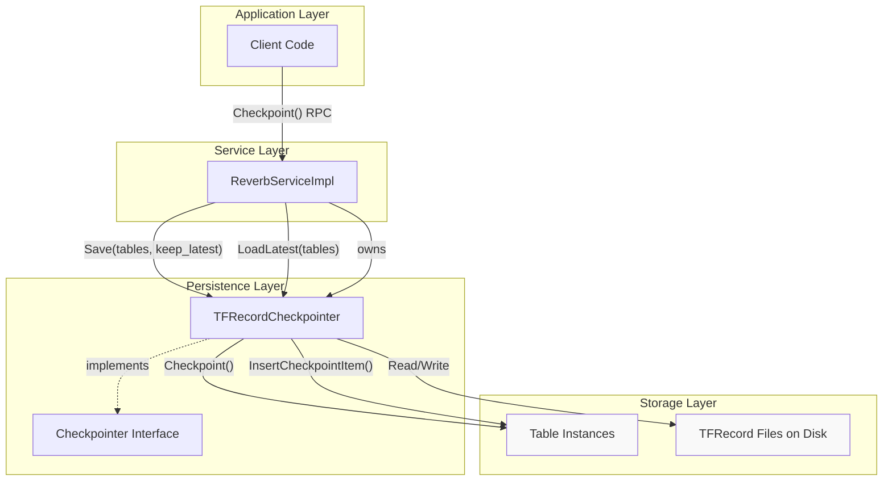
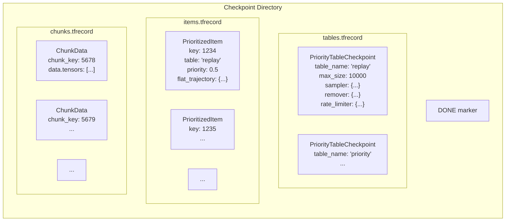
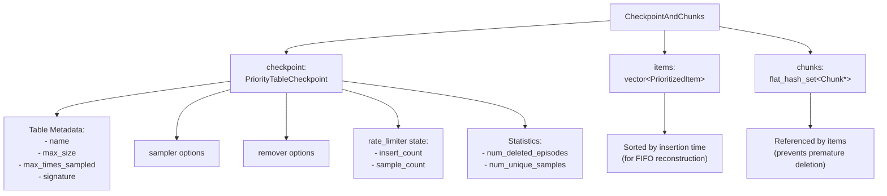
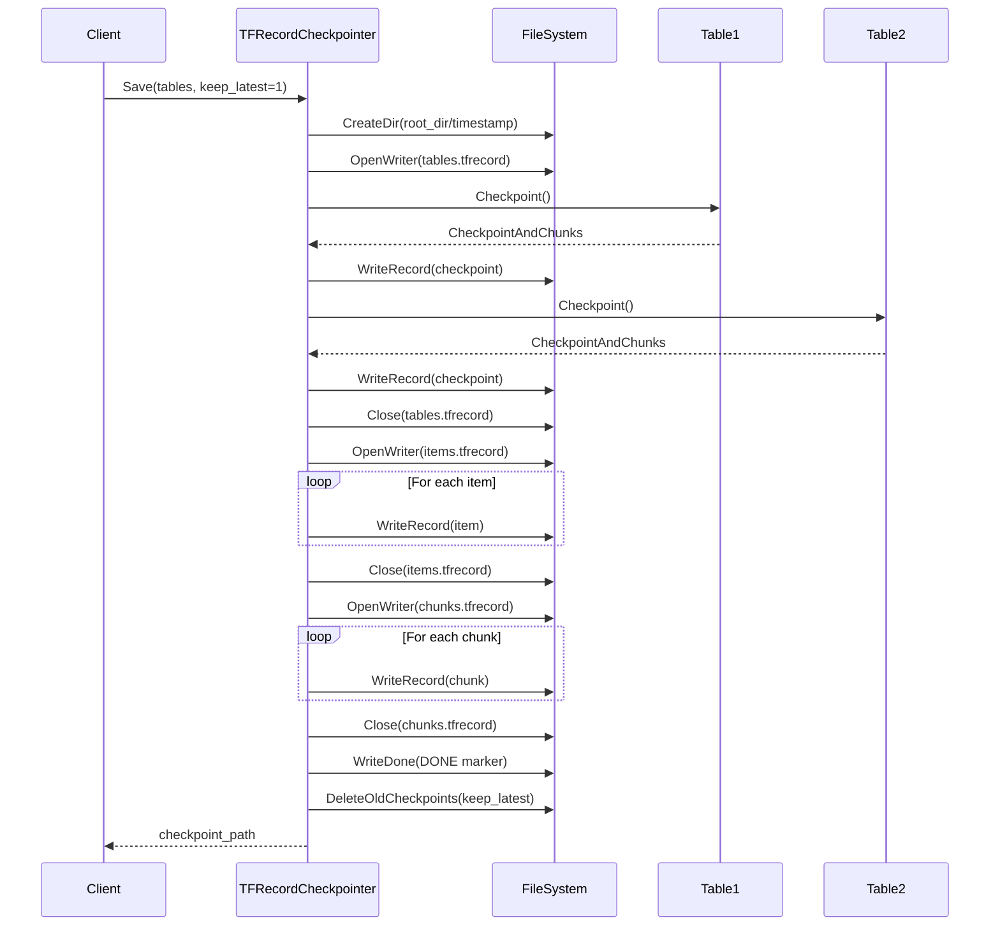
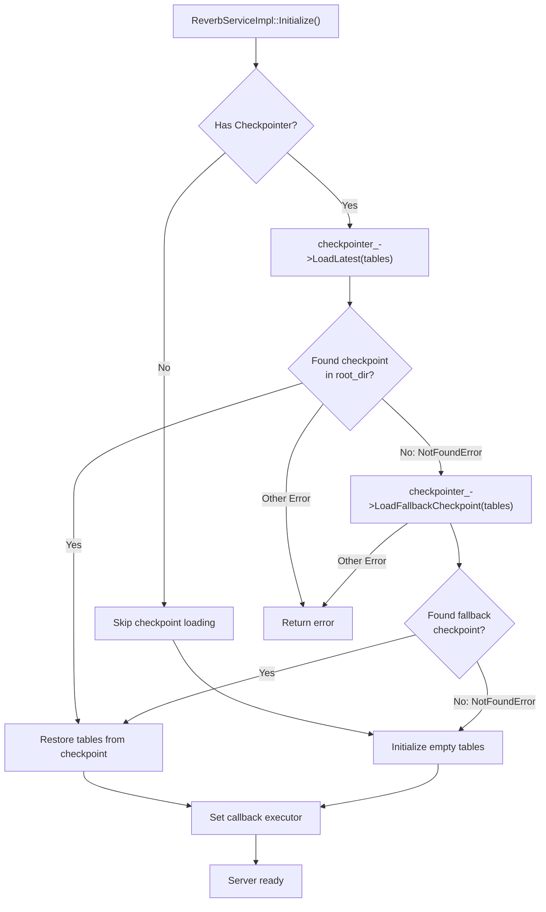
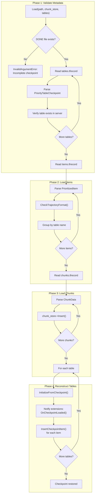
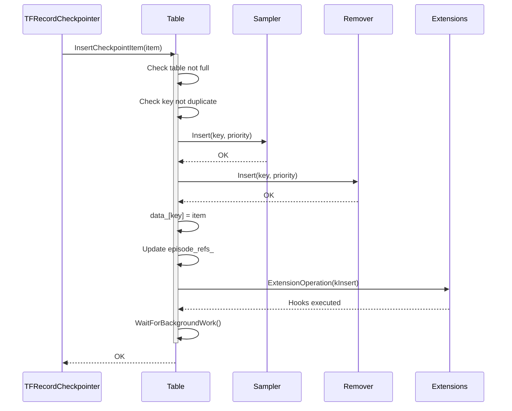
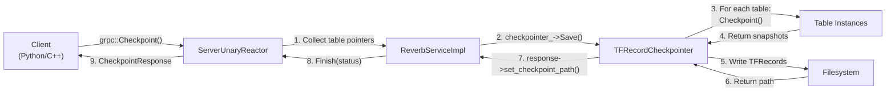
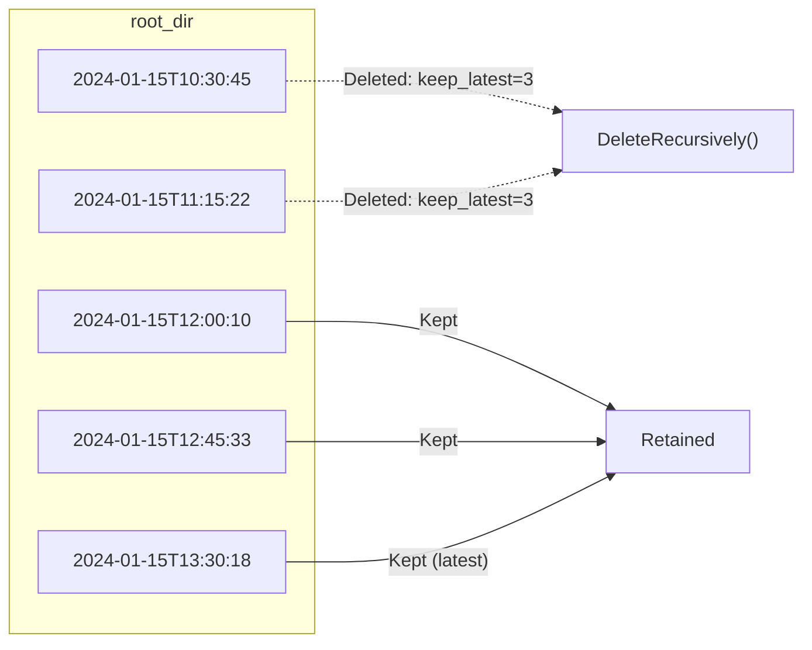
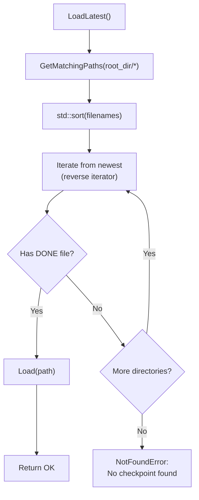

<!-- source: DeepWiki mcp.deepwiki.com · repo google-deepmind/reverb · page 3.5 Checkpointing and Persistence · fetched 2026-10-26 -->

# Checkpointing and Persistence

<details>
<summary>Relevant source files</summary>

The following files were used as context for generating this wiki page:

- [reverb/cc/platform/tfrecord_checkpointer.cc](reverb/cc/platform/tfrecord_checkpointer.cc)
- [reverb/cc/reverb_service.proto](reverb/cc/reverb_service.proto)
- [reverb/cc/reverb_service_impl.cc](reverb/cc/reverb_service_impl.cc)
- [reverb/cc/reverb_service_impl.h](reverb/cc/reverb_service_impl.h)
- [reverb/cc/reverb_service_impl_test.cc](reverb/cc/reverb_service_impl_test.cc)
- [reverb/cc/table.cc](reverb/cc/table.cc)
- [reverb/cc/table.h](reverb/cc/table.h)
- [reverb/cc/table_test.cc](reverb/cc/table_test.cc)

</details>


## Purpose and Scope

This page describes Reverb's checkpointing and persistence system, which enables saving and restoring the complete state of replay tables to/from disk. This system provides fault tolerance for long-running training jobs and supports warm-starting from pre-existing data.

For information about the Table system that manages in-memory data, see [Table System](#3.1). For details on the gRPC service endpoints, see [gRPC Service Implementation](#3.4).

---

## Overview

Reverb's checkpointing system serializes the complete state of all tables—including items, priorities, sampling metadata, and underlying chunk data—to disk in TFRecord format. The system supports:

- **Manual checkpointing** via RPC calls
- **Automatic restoration** on server startup
- **Fallback checkpoints** for initializing from other experiments
- **Checkpoint rotation** with configurable retention policies
- **Compressed storage** using zlib compression

The checkpointing process is coordinated between three main components:
- `Table` class that generates per-table snapshots
- `Checkpointer` interface and `TFRecordCheckpointer` implementation
- `ReverbServiceImpl` that orchestrates checkpointing for all tables

**Key Components and Their Roles:**



Sources: [reverb/cc/table.h:388-390](), [reverb/cc/platform/tfrecord_checkpointer.cc:156-169](), [reverb/cc/reverb_service_impl.cc:83-96]()

---

## Checkpoint File Structure

A checkpoint directory contains three TFRecord files plus a completion marker:

**Checkpoint Directory Layout:**

| File | Content | Purpose |
|------|---------|---------|
| `tables.tfrecord` | Serialized `PriorityTableCheckpoint` protos | Table metadata (name, max_size, rate limiter state, selector options) |
| `items.tfrecord` | Serialized `PrioritizedItem` protos | Item keys, priorities, trajectories, sample counts |
| `chunks.tfrecord` | Serialized `ChunkData` protos | Raw tensor data referenced by items |
| `DONE` | Empty marker file | Indicates checkpoint completed successfully |

**File Format Diagram:**



All TFRecord files use zlib compression for efficient storage. Each record is a serialized protocol buffer message.

Sources: [reverb/cc/platform/tfrecord_checkpointer.cc:56-60](), [reverb/cc/platform/tfrecord_checkpointer.cc:69-103]()

---

## Saving Checkpoints

### Table::Checkpoint()

The `Table::Checkpoint()` method creates a snapshot of a single table's state. It returns a `CheckpointAndChunks` struct containing:

**CheckpointAndChunks Structure:**



The checkpoint process acquires the table's mutex (`mu_`) and performs the following steps:

1. **Serialize table configuration** into `PriorityTableCheckpoint`
2. **Copy rate limiter state** via `rate_limiter_->CheckpointReader(&mu_)`
3. **Collect all items** from `data_` map
4. **Gather referenced chunks** from each item
5. **Sort items by insertion time** to preserve FIFO ordering

Sources: [reverb/cc/table.cc:949-984](), [reverb/cc/table.h:216-220]()

### TFRecordCheckpointer::Save()

The `TFRecordCheckpointer::Save()` method orchestrates the multi-table checkpoint process:

**Save Operation Flow:**



Key implementation details:

- **Directory naming**: Uses timestamp via `absl::FormatTime(absl::Now())` for natural sorting
- **Compression**: TFRecord files use `tensorflow::io::compression::kZlib`
- **Atomicity**: `DONE` marker written only after all files complete successfully
- **Cleanup**: Old checkpoints deleted based on `keep_latest` parameter

Sources: [reverb/cc/platform/tfrecord_checkpointer.cc:171-278](), [reverb/cc/platform/tfrecord_checkpointer.cc:105-117]()

---

## Loading Checkpoints

### Initialization on Startup

The `ReverbServiceImpl::Initialize()` method attempts checkpoint restoration during server startup:

**Checkpoint Loading Strategy:**



This two-tier loading strategy allows:
1. **Resumption after preemption**: Load from `root_dir` to continue previous run
2. **Warm-starting**: Load from `fallback_checkpoint_path` to initialize with data from another experiment

Sources: [reverb/cc/reverb_service_impl.cc:98-141]()

### TFRecordCheckpointer::Load()

The loading process reverses the save operation, with special handling for data integrity:

**Load Operation Phases:**



**Critical Implementation Details:**

1. **Compression Handling**: Tries zlib first, falls back to uncompressed for legacy checkpoints
   ```cpp
   auto status = LoadWithCompression(path, chunk_store, tables, 
                                      tensorflow::io::compression::kZlib);
   if (absl::IsDataLoss(status)) {
     // Try old checkpoint without compression
     status = LoadWithCompression(path, chunk_store, tables,
                                   tensorflow::io::compression::kNone);
   }
   ```

2. **Extension Notification**: After tables initialized but before items loaded, extensions are notified via `OnCheckpointLoaded()` to update their table pointers

3. **Order Preservation**: Items are inserted in timestamp order (already sorted during save) to correctly reconstruct FIFO structures

Sources: [reverb/cc/platform/tfrecord_checkpointer.cc:280-538](), [reverb/cc/platform/tfrecord_checkpointer.cc:541-554]()

### Table::InsertCheckpointItem()

This method bypasses normal insertion flow (rate limiter, extensions, max_size checks) to efficiently restore checkpointed data:

**InsertCheckpointItem vs Normal Insert:**

| Aspect | Normal Insert | InsertCheckpointItem |
|--------|---------------|----------------------|
| Rate Limiter | Consulted | **Bypassed** |
| Max Size Check | Enforced, may delete items | Assumed checkpoint respects limit |
| Table Worker | Queued for async processing | **Synchronous**, lock held |
| Extensions | Async extensions via worker | Sync extensions only |
| Validation | Full item validation | Assumes checkpoint validity |

**Checkpoint Insertion Process:**



Sources: [reverb/cc/table.cc:986-1011]()

---

## Integration with ReverbService

### Checkpoint RPC

The `Checkpoint` RPC endpoint allows clients to trigger checkpoint creation:

**RPC Flow:**



**Implementation Details:**

The service validates that a checkpointer is configured before attempting the operation:

```cpp
grpc::ServerUnaryReactor* ReverbServiceImpl::Checkpoint(
    grpc::CallbackServerContext* context,
    const CheckpointRequest* request,
    CheckpointResponse* response) {
  grpc::ServerUnaryReactor* reactor = context->DefaultReactor();
  
  if (checkpointer_ == nullptr) {
    reactor->Finish(grpc::Status(grpc::StatusCode::INVALID_ARGUMENT,
                                  "no Checkpointer configured"));
    return reactor;
  }
  
  std::vector<Table*> tables;
  for (auto& table : tables_) {
    tables.push_back(table.second.get());
  }
  
  auto status = checkpointer_->Save(std::move(tables), 1, 
                                     response->mutable_checkpoint_path());
  reactor->Finish(ToGrpcStatus(status));
  return reactor;
}
```

Sources: [reverb/cc/reverb_service_impl.cc:143-165](), [reverb/cc/reverb_service.proto:10-14]()

---

## Checkpoint Lifecycle and Retention

### Directory Management

TFRecordCheckpointer manages checkpoint directories using timestamp-based naming:

**Checkpoint Directory Timeline:**



### Retention Policy

The `keep_latest` parameter in `Save()` determines how many checkpoints to retain:

**Retention Logic:**

1. **List directories**: `GetMatchingPaths(root_dir/*)`
2. **Sort**: Lexicographically (timestamp format ensures chronological order)
3. **Count from newest**: Keep `keep_latest` most recent
4. **Delete older**: `DeleteRecursively()` for each exceeded checkpoint

**Example with keep_latest=1:**

```cpp
std::vector<std::string> filenames;
GetMatchingPaths(JoinPath(root_dir_, "*"), &filenames);
std::sort(filenames.begin(), filenames.end());

int history_counter = 0;
for (auto it = filenames.rbegin(); it != filenames.rend(); it++) {
  if (++history_counter > keep_latest) {
    int64_t undeleted_files, undeleted_dirs;
    DeleteRecursively(*it, &undeleted_files, &undeleted_dirs);
  }
}
```

Sources: [reverb/cc/platform/tfrecord_checkpointer.cc:259-274]()

### LoadLatest Implementation

The `LoadLatest()` method finds the most recent valid checkpoint:

**Discovery Process:**



This approach ensures:
- **Resilience**: Skips incomplete checkpoints (missing DONE marker)
- **Correctness**: Loads only fully-written checkpoints
- **Latest-first**: Returns most recent valid checkpoint

Sources: [reverb/cc/platform/tfrecord_checkpointer.cc:556-574]()

---

## Usage Patterns

### Manual Checkpointing

**Python Client Example:**

```python
import reverb

client = reverb.Client('localhost:8000')

# Trigger checkpoint
checkpoint_path = client.checkpoint()
print(f"Checkpoint saved to: {checkpoint_path}")
```

### Server Initialization with Checkpointing

**C++ Server Setup:**

```cpp
// Configure checkpointer
auto checkpointer = std::make_shared<TFRecordCheckpointer>(
    /*root_dir=*/"/tmp/reverb_checkpoints",
    /*group=*/"",
    /*fallback_checkpoint_path=*/"/data/pretrained_checkpoint");

// Create service (automatically loads checkpoint if available)
std::unique_ptr<ReverbServiceImpl> service;
ReverbServiceImpl::Create(tables, checkpointer, &service);
```

**Initialization Behavior:**

1. **First run**: No checkpoint in `/tmp/reverb_checkpoints`, loads fallback from `/data/pretrained_checkpoint`
2. **After preemption**: Finds checkpoint in `/tmp/reverb_checkpoints`, restores previous state
3. **No checkpoints**: Initializes empty tables

Sources: [reverb/cc/platform/tfrecord_checkpointer.cc:156-169](), [reverb/cc/reverb_service_impl.cc:86-96]()

---

## Error Handling

### Checkpoint Validation

The loading process performs extensive validation:

**Validation Checks:**

| Check | Purpose | Error Type |
|-------|---------|------------|
| DONE file exists | Checkpoint completed successfully | `InvalidArgumentError` |
| Table name matches | Checkpoint compatible with server config | `InvalidArgumentError` |
| Trajectory format | Item uses correct proto schema | `InternalError` |
| Chunk keys present | All referenced chunks available | `InternalError` |
| Items fit in table | Checkpoint size ≤ max_size | `FailedPreconditionError` |

### Backward Compatibility

Checkpoints support legacy formats:

1. **Compression**: Tries zlib, falls back to uncompressed
2. **Trajectory format**: Converts `deprecated_sequence_range` to `flat_trajectory`
3. **Items location**: Supports both `deprecated_items` in table proto and separate `items.tfrecord`

**Migration Logic:**

```cpp
if (checkpoint_item.has_deprecated_sequence_range()) {
  // Convert old format to new flat_trajectory
  *checkpoint_item.mutable_flat_trajectory() =
      internal::FlatTimestepTrajectory(
          trajectory_chunks,
          checkpoint_item.deprecated_sequence_range().offset(),
          checkpoint_item.deprecated_sequence_range().length());
  
  checkpoint_item.clear_deprecated_sequence_range();
  checkpoint_item.clear_deprecated_chunk_keys();
}
```

Sources: [reverb/cc/platform/tfrecord_checkpointer.cc:145-152](), [reverb/cc/platform/tfrecord_checkpointer.cc:503-516]()

---

## Performance Considerations

### Checkpoint Operation Costs

**Save Operation:**
- **Table locks**: Each `Table::Checkpoint()` acquires `mu_` mutex
- **Memory**: Full copy of items, chunk references held during write
- **I/O**: Sequential writes to 3 TFRecord files per checkpoint
- **Compression**: CPU cost of zlib compression for all data

**Load Operation:**
- **Sequential I/O**: Reads all three TFRecord files sequentially
- **Decompression**: CPU cost of decompressing all records
- **Memory**: All chunks loaded into `ChunkStore` before table reconstruction
- **Table reconstruction**: Items inserted serially with locks held

### Optimization Strategies

1. **Separate files**: Items and chunks in separate files enable parallel processing if needed
2. **Chunk deduplication**: `flat_hash_set` ensures each chunk stored once even if referenced by multiple items
3. **Streaming writes**: `RecordWriter` buffers and flushes incrementally
4. **Bypass mechanisms**: `InsertCheckpointItem()` skips rate limiter and worker queues

Sources: [reverb/cc/table.cc:949-984](), [reverb/cc/platform/tfrecord_checkpointer.cc:171-278]()

---

