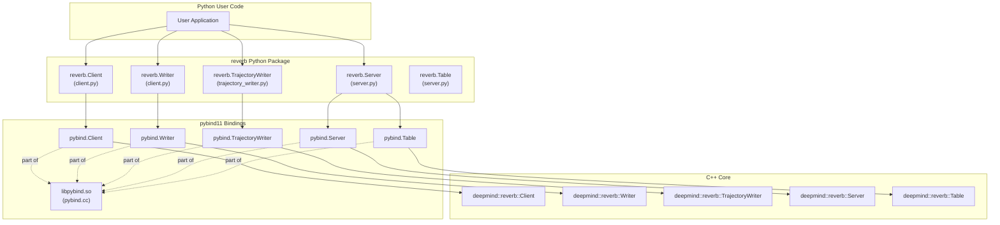
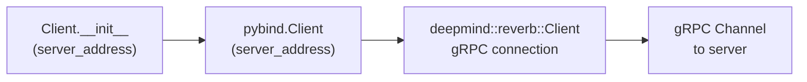
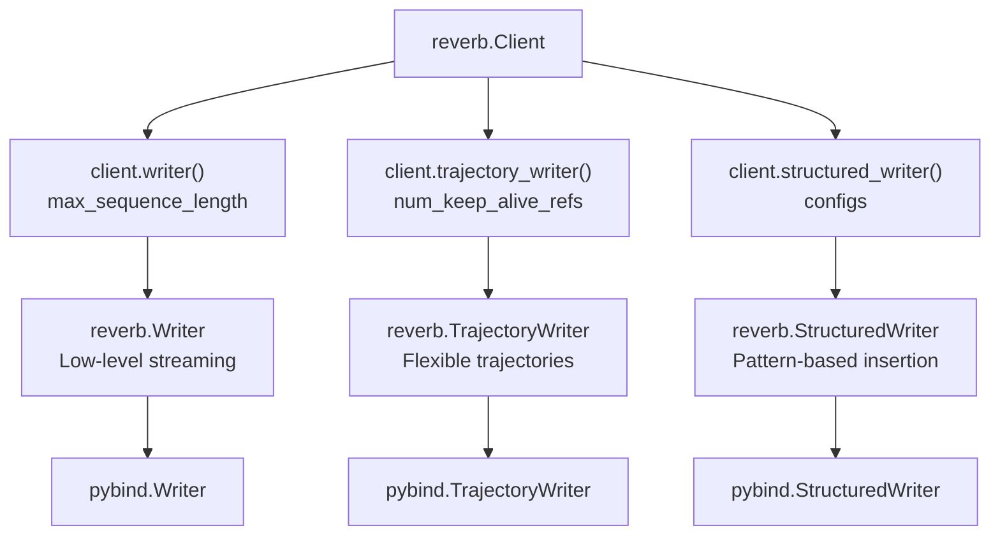
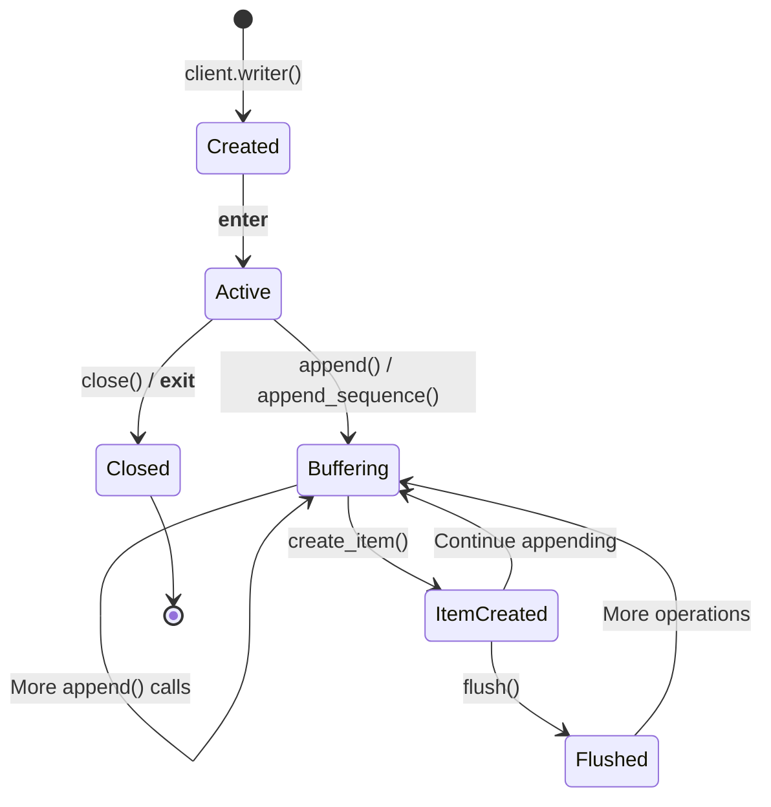
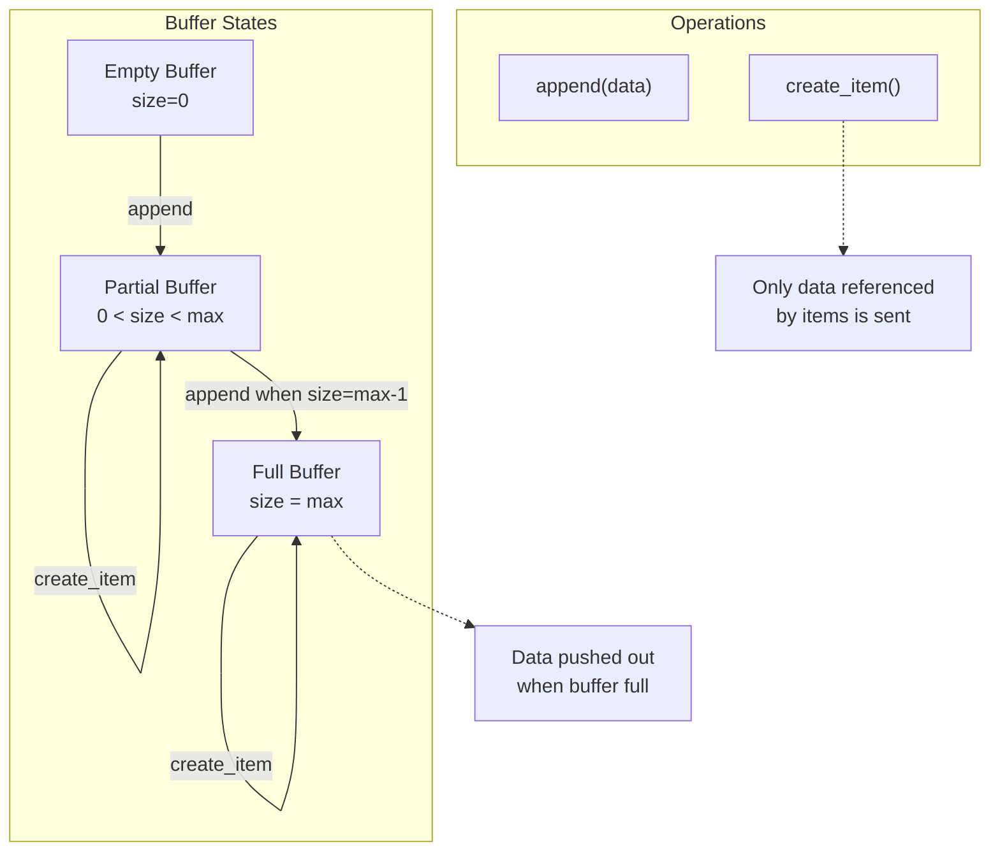
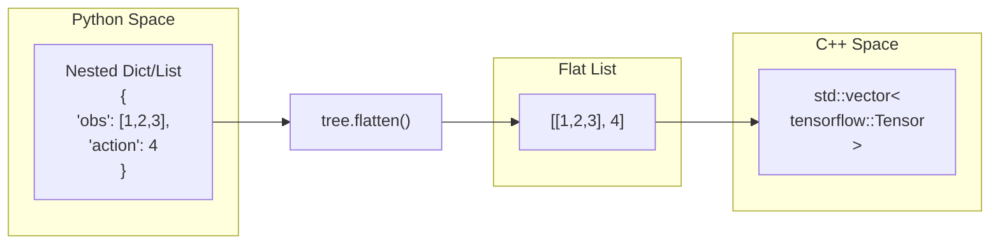
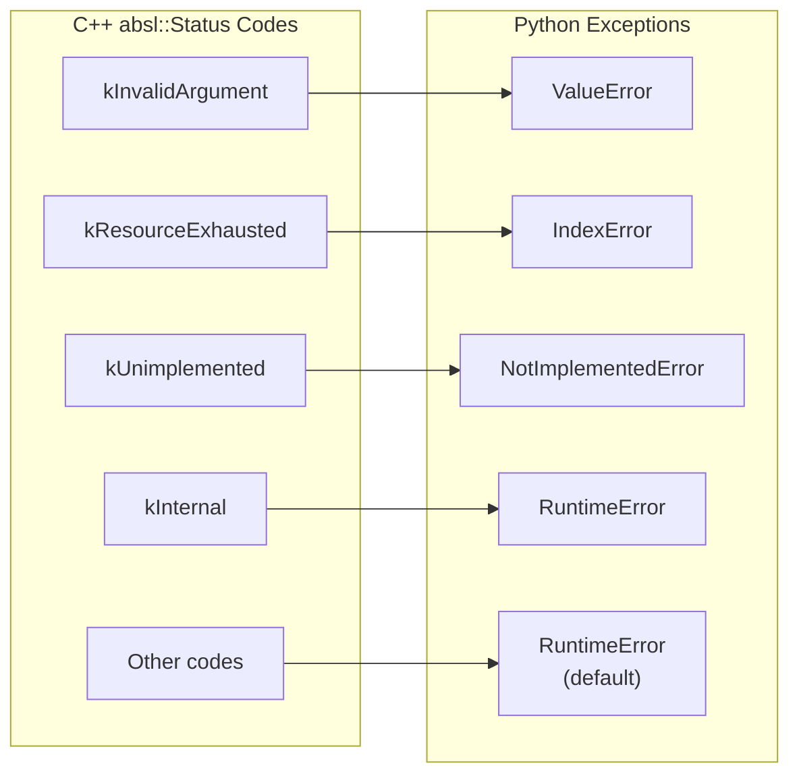
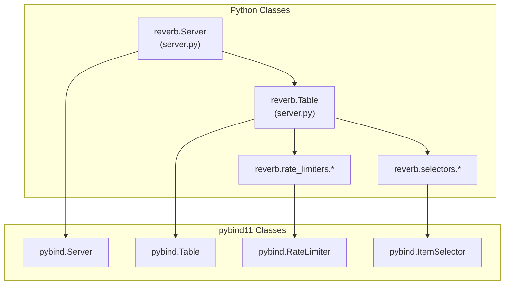

<!-- source: DeepWiki mcp.deepwiki.com · repo google-deepmind/reverb · page 4 Python Client API · fetched 2026-10-26 -->

# Python Client API

<details>
<summary>Relevant source files</summary>

The following files were used as context for generating this wiki page:

- [README.md](README.md)
- [docs/images/multiple_tables_example.png](docs/images/multiple_tables_example.png)
- [reverb/BUILD](reverb/BUILD)
- [reverb/__init__.py](reverb/__init__.py)
- [reverb/cc/ops/BUILD](reverb/cc/ops/BUILD)
- [reverb/client.py](reverb/client.py)
- [reverb/pip_package/reverb_version.py](reverb/pip_package/reverb_version.py)
- [reverb/pip_package/setup.py](reverb/pip_package/setup.py)
- [reverb/pybind.cc](reverb/pybind.cc)
- [reverb/pybind.pyi](reverb/pybind.pyi)

</details>


This page documents the primary Python API for interacting with Reverb servers. It covers the `Client` class for connecting to servers and performing operations, the `Writer` class for streaming data, and the Python interfaces for server configuration. This API provides a high-level, Pythonic interface to Reverb's C++ core implementation.

**Related pages:**
- For Python-C++ binding implementation details, see [4.1](#4.1)
- For `TrajectoryWriter` usage and API, see [4.2](#4.2)
- For detailed documentation of `Client` operations, see [4.3](#4.3)
- For `Server` configuration and table setup, see [4.4](#4.4)
- For TensorFlow integration (`TFClient`, datasets), see [5](#5)

## Architecture Overview

The Python Client API is built as a thin layer over C++ implementations, exposed via pybind11. This design provides Python ergonomics while maintaining the performance characteristics of the C++ core.



**Sources:** [reverb/__init__.py:1-56](), [reverb/client.py:1-602](), [reverb/pybind.cc:1-783](), [reverb/BUILD:22-41]()

## Client Class

The `Client` class provides the primary interface for connecting to and interacting with a Reverb server. It is defined in [reverb/client.py:211-602]() and wraps the C++ `Client` implementation exposed through [reverb/pybind.cc:342-502]().

### Client Construction and Connection



The `Client` constructor takes a single argument: the server address as a string. This can be a direct address (e.g., `"localhost:8000"`) or a load-balanced endpoint.

**Key methods:**

| Method | Purpose | Returns |
|--------|---------|---------|
| `insert()` | Insert a single data blob into tables | `None` |
| `sample()` | Sample items from a table | `Generator[ReplaySample]` |
| `mutate_priorities()` | Update or delete item priorities | `None` |
| `reset()` | Clear a table and reset rate limiter | `None` |
| `server_info()` | Get metadata about server tables | `Dict[str, TableInfo]` |
| `checkpoint()` | Trigger server checkpoint | `str` (checkpoint path) |
| `writer()` | Create a low-level `Writer` | `Writer` |
| `trajectory_writer()` | Create a `TrajectoryWriter` | `TrajectoryWriter` |
| `structured_writer()` | Create a `StructuredWriter` | `StructuredWriter` |

**Sources:** [reverb/client.py:211-602](), [reverb/pybind.cc:342-502]()

### Client Factory Methods for Writers

The `Client` class provides factory methods to create different types of writers:



**Factory method signatures:**

- `writer(max_sequence_length, delta_encoded=False, chunk_length=None, max_in_flight_items=25)` - Creates a `Writer` with bounded buffer [reverb/client.py:264-343]()
- `trajectory_writer(num_keep_alive_refs, validate_items=True)` - Creates a `TrajectoryWriter` with auto-tuned chunking [reverb/client.py:531-568]()
- `structured_writer(configs)` - Creates a `StructuredWriter` for pattern-based insertion [reverb/client.py:570-590]()

**Sources:** [reverb/client.py:264-590](), [reverb/pybind.cc:342-502]()

## Writer Class

The `Writer` class provides a low-level streaming interface for inserting data into Reverb tables. It maintains an internal buffer and allows creating items that reference subsequences of the buffered data.

### Writer Lifecycle and Operations



**Writer methods:**

| Method | Purpose | Side Effects |
|--------|---------|--------------|
| `append(data)` | Add data to internal buffer | Pops oldest if buffer full |
| `append_sequence(sequence)` | Add multiple timesteps at once | Equivalent to multiple `append()` |
| `create_item(table, num_timesteps, priority)` | Create item referencing buffer | Sends to server (buffered) |
| `flush()` | Force send pending items | Blocks until confirmed |
| `close()` | Close stream and cleanup | Sends any pending data |

**Key characteristics:**
- The writer is a context manager (`with` statement support) [reverb/client.py:47-54]()
- Buffer size is controlled by `max_sequence_length` parameter
- Items reference the most recent `num_timesteps` in the buffer
- Data is only sent to the server when referenced by an item [reverb/client.py:65-95]()

**Sources:** [reverb/client.py:36-209](), [reverb/pybind.cc:295-317]()

### Writer Buffer Management

The `Writer` maintains a circular buffer with size `max_sequence_length`. Understanding buffer behavior is critical for correct usage:



**Important notes:**
- Data not referenced by any item before it leaves the buffer is **never sent** to the server [reverb/client.py:83-93]()
- `create_item()` references the most recent `num_timesteps` entries in the buffer
- The buffer operates as a FIFO queue for managing data lifetime

**Sources:** [reverb/client.py:65-176]()

## Python-to-C++ Type Conversions

The pybind11 layer handles automatic type conversions between Python and C++ types. Understanding these conversions is important for correct API usage.

### Supported Type Mappings

| Python Type | C++ Type | Conversion Location |
|-------------|----------|---------------------|
| `np.ndarray` | `tensorflow::Tensor` | [reverb/pybind.cc:133-167]() |
| `None` | `absl::nullopt` | [reverb/pybind.cc:123-130]() |
| `Dict[str, float]` | `std::vector<KeyWithPriority>` | [reverb/pybind.cc:454-460]() |
| Python exceptions | `absl::Status` | [reverb/pybind.cc:58-83]() |
| `bytes` | Serialized protobuf | Various proto parsing sites |

### Nested Structure Flattening

Reverb uses `tree.flatten()` to convert nested Python structures into flat lists before passing to C++:



This flattening occurs in:
- `Writer.append()` [reverb/client.py:101]()
- `Writer.append_sequence()` [reverb/client.py:151]()
- `Client.insert()` [reverb/client.py:259]()

**Sources:** [reverb/client.py:101-151](), [reverb/pybind.cc:133-167]()

## Error Handling

Errors propagate from C++ to Python through the pybind11 error handling mechanism. The `MaybeRaiseFromStatus` function [reverb/pybind.cc:58-83]() converts `absl::Status` codes to appropriate Python exceptions.

### Status Code to Exception Mapping



**Key error handling patterns:**

1. **GIL Management**: The GIL is released during blocking operations and reacquired before raising exceptions [reverb/pybind.cc:308-313]()
2. **Exception Safety**: All exceptions are caught and converted at the Python boundary
3. **Custom Error Module**: Additional error types defined in [reverb/errors.py]() such as `DeadlineExceededError` [reverb/client.py:501-506]()

**Sources:** [reverb/pybind.cc:58-83](), [reverb/pybind.cc:308-313](), [reverb/client.py:501-506]()

## Server and Table Configuration

The Python API provides classes for configuring and starting Reverb servers. These are thin wrappers over the C++ implementations.

### Server and Table Class Hierarchy



**Server initialization** [reverb/pybind.cc:518-533]():
```python
server = reverb.Server(
    tables=[table1, table2],
    port=8000,
    checkpointer=optional_checkpointer
)
```

**Table configuration** [reverb/pybind.cc:245-293]():
```python
table = reverb.Table(
    name='my_table',
    sampler=reverb.selectors.Uniform(),
    remover=reverb.selectors.Fifo(),
    max_size=1000,
    max_times_sampled=1,
    rate_limiter=reverb.rate_limiters.MinSize(1),
    extensions=[],
    signature=None  # Optional table signature
)
```

**Sources:** [reverb/pybind.cc:245-293](), [reverb/pybind.cc:518-533](), [README.md:86-102]()

## Package Structure and Imports

The Reverb Python package is organized with a clear import hierarchy that exposes the main API at the top level.

### Module Organization

| Module | Purpose | Key Exports |
|--------|---------|-------------|
| `reverb` | Top-level package | `Client`, `Server`, `Table`, `TrajectoryWriter` |
| `reverb.client` | Client implementation | `Client`, `Writer` |
| `reverb.server` | Server configuration | `Server`, `Table` |
| `reverb.pybind` | C++ bindings (internal) | `libpybind.so` module |
| `reverb.rate_limiters` | Rate limiter constructors | `MinSize`, `SampleToInsertRatio`, `Queue`, `Stack` |
| `reverb.item_selectors` | Selector constructors (aliased as `selectors`) | `Uniform`, `Fifo`, `Lifo`, `Prioritized`, `Heap` |
| `reverb.trajectory_writer` | TrajectoryWriter implementation | `TrajectoryWriter`, `TrajectoryColumn` |
| `reverb.structured_writer` | StructuredWriter implementation | `StructuredWriter`, `Config` |
| `reverb.replay_sample` | Sample data structures | `ReplaySample`, `SampleInfo` |
| `reverb.errors` | Custom exceptions | `ReverbError`, `DeadlineExceededError` |

**Top-level imports** [reverb/__init__.py:27-55]():
```python
from reverb import selectors      # Item selection strategies
from reverb import rate_limiters  # Rate limiting configurations
from reverb.client import Client, Writer
from reverb.server import Server, Table
from reverb.trajectory_writer import TrajectoryWriter, TrajectoryColumn
# ... and more
```

**Sources:** [reverb/__init__.py:1-56](), [reverb/BUILD:22-41]()

## Usage Patterns and Examples

### Basic Insert and Sample

```python
# Connect to server
client = reverb.Client('localhost:8000')

# Insert a single item
client.insert([1, 2, 3], priorities={'my_table': 1.0})

# Sample items
for sample in client.sample('my_table', num_samples=10):
    # sample is a ReplaySample with .info and .data
    process(sample.data)
```

**Sources:** [README.md:104-146]()

### Using Writer for Streaming

```python
with client.writer(max_sequence_length=100) as writer:
    for timestep in episode:
        writer.append(timestep)
        
        # Create item referencing last 10 timesteps
        writer.create_item(
            table='my_table',
            num_timesteps=10,
            priority=compute_priority(timestep)
        )
    
    writer.flush()  # Ensure all items sent
```

**Sources:** [README.md:118-139](), [reverb/client.py:264-343]()

### Server Configuration

```python
server = reverb.Server(
    tables=[
        reverb.Table(
            name='experience_replay',
            sampler=reverb.selectors.Uniform(),
            remover=reverb.selectors.Fifo(),
            max_size=1000,
            rate_limiter=reverb.rate_limiters.MinSize(100)
        )
    ],
    port=8000
)

# Server runs in background thread
client = reverb.Client(f'localhost:{server.port}')
```

**Sources:** [README.md:88-102]()

## Thread Safety and Concurrency

The Python API uses the Global Interpreter Lock (GIL) strategically to ensure thread safety:

1. **GIL Release during blocking operations**: Long-running C++ operations release the GIL using `py::gil_scoped_release` [reverb/pybind.cc:310](), allowing other Python threads to execute
2. **GIL Reacquisition for exceptions**: The GIL is held when raising Python exceptions to ensure safe error handling [reverb/pybind.cc:307-313]()
3. **Thread-safe C++ layer**: The underlying C++ implementations handle their own thread safety, so multiple Python threads can safely share a `Client` object

**Sources:** [reverb/pybind.cc:287-313](), [reverb/pybind.cc:373-383]()

---

