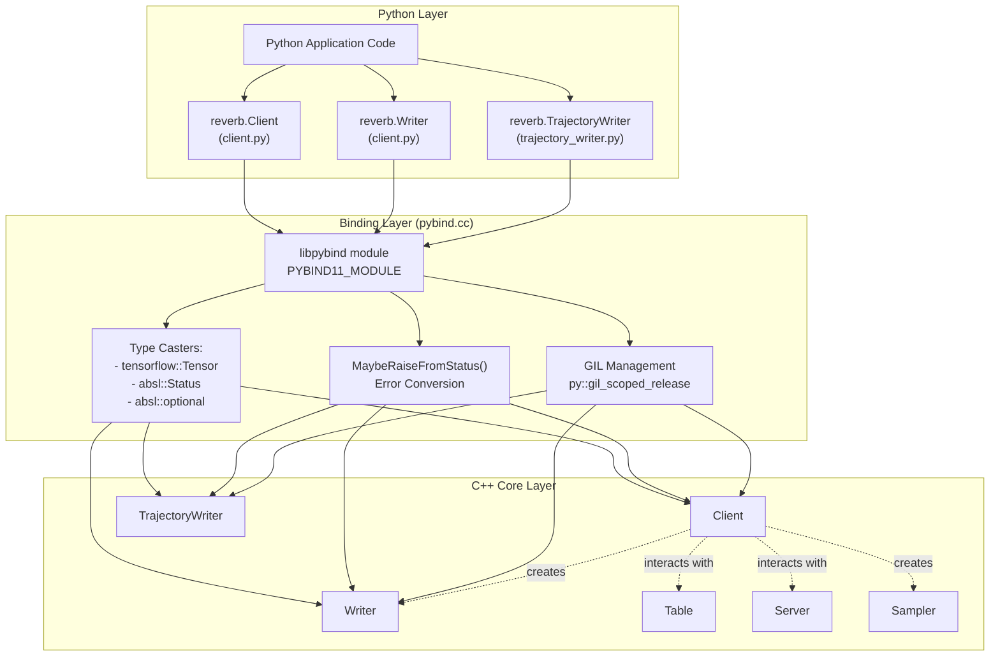
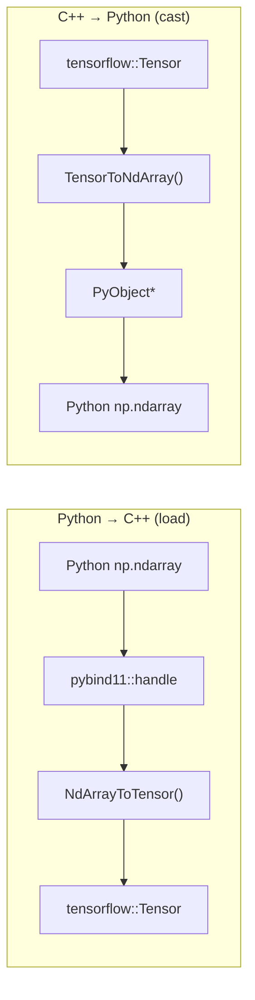
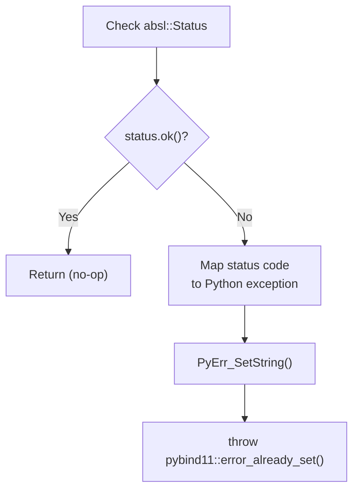
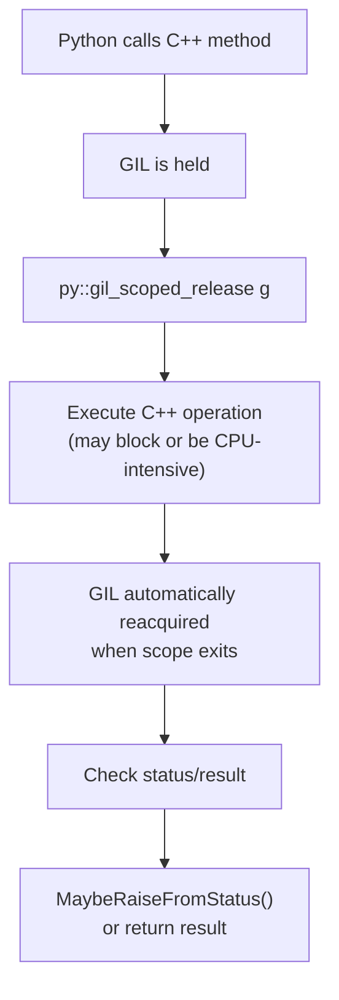
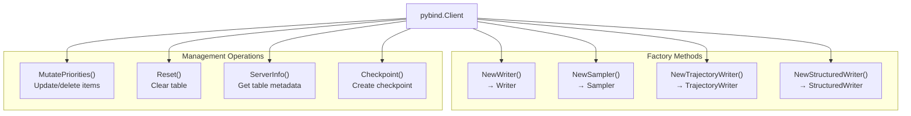
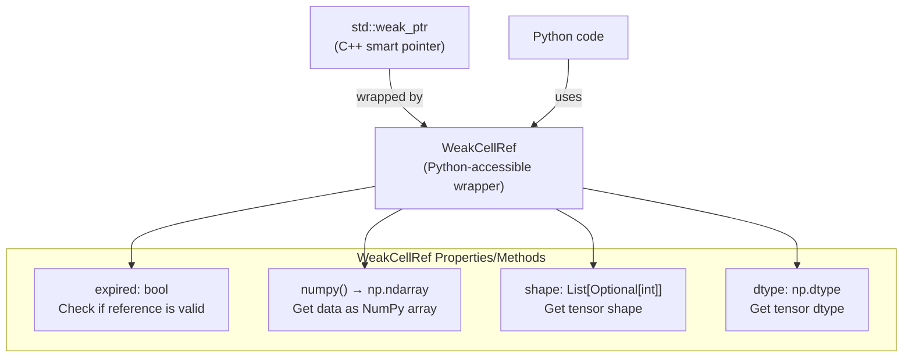
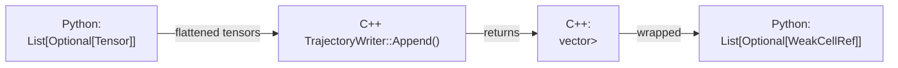
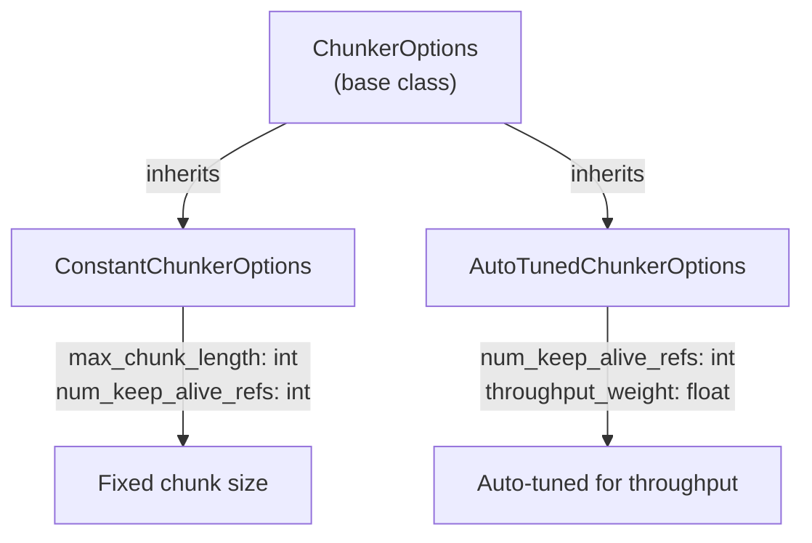

<!-- source: DeepWiki mcp.deepwiki.com · repo google-deepmind/reverb · page 4.1 Python-C++ Bindings · fetched 2026-10-26 -->

# Python-C++ Bindings

<details>
<summary>Relevant source files</summary>

The following files were used as context for generating this wiki page:

- [reverb/client.py](reverb/client.py)
- [reverb/pybind.cc](reverb/pybind.cc)
- [reverb/pybind.pyi](reverb/pybind.pyi)

</details>


This page documents the pybind11-based binding layer that exposes Reverb's C++ implementation to Python. This layer provides the bridge between Python client code and the high-performance C++ core.

**Scope:** This page covers the technical implementation of the Python-C++ interface, including type conversions, error handling, and GIL management. For information about using the Python API, see [Python Client API](#4). For TensorFlow-specific integration, see [TensorFlow Integration](#5).

## Overview

The Python-C++ binding layer is implemented using pybind11 and compiled into a shared library module named `libpybind`. This module exposes core C++ classes and functions to Python, enabling Python code to interact with Reverb's C++ implementation while maintaining performance.



**Sources:** [reverb/pybind.cc:1-783](), [reverb/client.py:1-602]()

## Module Definition

The binding module is defined using pybind11's `PYBIND11_MODULE` macro at [reverb/pybind.cc:190]():

```
PYBIND11_MODULE(libpybind, m)
```

This creates a Python module named `libpybind` that contains all exposed classes and functions. The module is imported by Python code as `reverb.pybind`.

**Sources:** [reverb/pybind.cc:190]()

## Type Conversions

The binding layer implements custom type casters to convert between Python and C++ types seamlessly.

### TensorFlow Tensor Conversion

The most critical type conversion handles `tensorflow::Tensor` objects, enabling data to flow between Python NumPy arrays and C++ TensorFlow tensors.



The implementation at [reverb/pybind.cc:132-167]() provides:

- **load()**: Converts Python handle to `tensorflow::Tensor` using `deepmind::reverb::pybind::NdArrayToTensor`
- **cast()**: Converts `tensorflow::Tensor` to Python using `deepmind::reverb::pybind::TensorToNdArray`

Error handling clears `PyErr` on conversion failures to provide readable error messages.

**Sources:** [reverb/pybind.cc:132-167]()

### Status to Exception Mapping

The `absl::Status` type caster at [reverb/pybind.cc:170-178]() converts C++ status codes to Python exceptions:

| Status Code | Python Exception |
|-------------|-----------------|
| `kInvalidArgument` | `ValueError` |
| `kResourceExhausted` | `IndexError` |
| `kUnimplemented` | `NotImplementedError` |
| `kInternal` | `RuntimeError` |
| Other codes | `RuntimeError` |

When a method returns `absl::Status`, the type caster automatically:
1. Checks if status is OK
2. Calls `MaybeRaiseFromStatus()` if not OK
3. Returns Python `None` if OK

**Sources:** [reverb/pybind.cc:170-178](), [reverb/pybind.cc:58-83]()

### Optional Type Handling

The binding supports `absl::optional<T>` types by reusing pybind11's built-in `std::optional` caster at [reverb/pybind.cc:114-130](). This enables:

- `absl::nullopt` maps to Python `None`
- `absl::optional<T>` with value maps to Python value
- Python `None` converts to `absl::nullopt`

**Sources:** [reverb/pybind.cc:114-130]()

## Error Handling

The `MaybeRaiseFromStatus()` function at [reverb/pybind.cc:58-83]() is the central error handling mechanism:



This function:
1. Returns immediately if status is OK
2. Maps status code to appropriate Python exception type
3. Sets Python error using `PyErr_SetString()`
4. Throws `pybind11::error_already_set()` to propagate to Python

Methods that return `absl::Status` are wrapped to call this function, ensuring C++ errors are properly converted to Python exceptions.

**Sources:** [reverb/pybind.cc:58-83]()

## GIL Management

The Global Interpreter Lock (GIL) must be carefully managed to enable concurrent execution while preventing crashes. The binding uses `py::gil_scoped_release` to release the GIL during blocking or CPU-intensive C++ operations.

### GIL Release Patterns



**Key principle:** The GIL must be held when calling `MaybeRaiseFromStatus()` or manipulating Python objects, but should be released during long-running C++ operations.

### Examples

**Pattern 1: Simple blocking operation** at [reverb/pybind.cc:302-314]():
```cpp
// Writer::Flush
.def("Flush", [](Writer *writer) {
  absl::Status status;
  {
    py::gil_scoped_release g;  // Release GIL
    status = writer->Flush();   // Blocking C++ call
  }  // GIL reacquired here
  MaybeRaiseFromStatus(status); // Must have GIL
})
```

**Pattern 2: Method with result** at [reverb/pybind.cc:319-340]():
```cpp
// Sampler::GetNextTrajectory
.def("GetNextTrajectory", [](Sampler *sampler) {
  absl::Status status;
  std::shared_ptr<const SampleInfo> info;
  std::vector<tensorflow::Tensor> data;
  
  {
    py::gil_scoped_release g;
    status = sampler->GetNextTrajectory(&data, &info);
  }
  
  MaybeRaiseFromStatus(status);
  return Sampler::WithInfoTensors(*info, std::move(data));
})
```

**Pattern 3: Call guard for entire method** at [reverb/pybind.cc:277-280]():
```cpp
// Simple non-blocking methods
.def("can_sample", &Table::CanSample,
     py::call_guard<py::gil_scoped_release>())
.def("can_insert", &Table::CanInsert,
     py::call_guard<py::gil_scoped_release>())
```

**Sources:** [reverb/pybind.cc:302-340](), [reverb/pybind.cc:277-280]()

## Exposed Classes

The binding layer exposes the following C++ classes to Python:

### Core Data Structures

| Python Class | C++ Class | Purpose | Definition |
|--------------|-----------|---------|------------|
| `ItemSelector` | `ItemSelector` | Base class for sampling strategies | [reverb/pybind.cc:194-196]() |
| `PrioritizedSelector` | `PrioritizedSelector` | Prioritized sampling | [reverb/pybind.cc:198-200]() |
| `FifoSelector` | `FifoSelector` | FIFO sampling | [reverb/pybind.cc:202-204]() |
| `LifoSelector` | `LifoSelector` | LIFO sampling | [reverb/pybind.cc:206-208]() |
| `UniformSelector` | `UniformSelector` | Uniform random sampling | [reverb/pybind.cc:210-212]() |
| `HeapSelector` | `HeapSelector` | Min/max heap sampling | [reverb/pybind.cc:214-216]() |
| `RateLimiter` | `RateLimiter` | Flow control | [reverb/pybind.cc:238-243]() |
| `Table` | `Table` | Core data store | [reverb/pybind.cc:245-293]() |
| `TableExtension` | `TableExtension` | Extension hooks | [reverb/pybind.cc:233-236]() |

**Sources:** [reverb/pybind.cc:194-293]()

### Client and Server

| Python Class | C++ Class | Purpose | Definition |
|--------------|-----------|---------|------------|
| `Client` | `Client` | Connect to Reverb server | [reverb/pybind.cc:342-502]() |
| `Server` | `Server` | Run Reverb server | [reverb/pybind.cc:518-533]() |
| `Checkpointer` | `Checkpointer` | Persistence | [reverb/pybind.cc:504-516]() |

**Sources:** [reverb/pybind.cc:342-533]()

### Writers

| Python Class | C++ Class | Purpose | Definition |
|--------------|-----------|---------|------------|
| `Writer` | `Writer` | Stream data with fixed buffer | [reverb/pybind.cc:295-317]() |
| `TrajectoryWriter` | `TrajectoryWriter` | Stream trajectories with weak references | [reverb/pybind.cc:639-741]() |
| `StructuredWriter` | `StructuredWriter` | Stream structured data with configs | [reverb/pybind.cc:743-776]() |

**Sources:** [reverb/pybind.cc:295-776]()

### Samplers

| Python Class | C++ Class | Purpose | Definition |
|--------------|-----------|---------|------------|
| `Sampler` | `Sampler` | Multi-threaded sampling | [reverb/pybind.cc:319-340]() |

**Sources:** [reverb/pybind.cc:319-340]()

## Client Class Bindings

The `Client` class at [reverb/pybind.cc:342-502]() exposes methods for creating writers, samplers, and performing operations:



Key implementation details:

1. **Constructor** at [reverb/pybind.cc:343](): Takes `server_address` string
2. **NewWriter** at [reverb/pybind.cc:344-364](): Creates `Writer` with chunking parameters
3. **NewSampler** at [reverb/pybind.cc:365-384](): Creates `Sampler` for table
4. **NewTrajectoryWriter** at [reverb/pybind.cc:385-411](): Creates `TrajectoryWriter` with chunker options and optional validation
5. **NewStructuredWriter** at [reverb/pybind.cc:412-448](): Parses serialized configs and creates `StructuredWriter`
6. **MutatePriorities** at [reverb/pybind.cc:449-462](): Updates/deletes items by key
7. **ServerInfo** at [reverb/pybind.cc:464-492](): Returns serialized `TableInfo` protos
8. **Checkpoint** at [reverb/pybind.cc:493-502](): Triggers checkpoint creation

**Sources:** [reverb/pybind.cc:342-502]()

## WeakCellRef Wrapper

The `WeakCellRef` class at [reverb/pybind.cc:96-107]() wraps `std::weak_ptr<CellRef>` to enable Python code to hold weak references to trajectory data:



The wrapper enables:
- **Checking validity** via `expired` property at [reverb/pybind.cc:536]()
- **Data access** via `numpy()` method at [reverb/pybind.cc:537-556]()
- **Shape inspection** via `shape` property at [reverb/pybind.cc:557-585]()
- **Type inspection** via `dtype` property at [reverb/pybind.cc:586-613]()

All methods lock the `weak_ptr` before accessing data and raise `FailedPreconditionError` if the reference has expired.

**Sources:** [reverb/pybind.cc:96-107](), [reverb/pybind.cc:535-613]()

## TrajectoryWriter Bindings

The `TrajectoryWriter` class at [reverb/pybind.cc:639-741]() provides methods for building trajectories with flexible column references:

### Method Bindings

| Method | C++ Signature | Python Returns | Purpose |
|--------|---------------|----------------|---------|
| `Append` | [pybind.cc:641-660]() | `List[Optional[WeakCellRef]]` | Add full timestep, return references |
| `AppendPartial` | [pybind.cc:661-680]() | `List[Optional[WeakCellRef]]` | Add partial timestep |
| `CreateItem` | [pybind.cc:681-708]() | `None` | Create item from weak references |
| `Flush` | [pybind.cc:709-720]() | `None` | Flush pending items |
| `EndEpisode` | [pybind.cc:721-733]() | `None` | End episode and optionally clear buffers |
| `Close` | [pybind.cc:734-735]() | `None` | Close writer |
| `ConfigureChunker` | [pybind.cc:736-737]() | `None` | Configure chunking for column |

### Data Flow in Append



The `Append` and `AppendPartial` methods at [reverb/pybind.cc:641-680]():
1. Accept Python list of optional tensors
2. Call C++ method to append data and get weak references
3. Wrap each `std::weak_ptr<CellRef>` in `WeakCellRef` for Python
4. Return list of optional wrapped references

**Sources:** [reverb/pybind.cc:639-741]()

## Chunker Options

The binding exposes chunker configuration classes for controlling how data is chunked:



- **ChunkerOptions** at [reverb/pybind.cc:615-616](): Base class
- **ConstantChunkerOptions** at [reverb/pybind.cc:618-627](): Fixed chunk length
- **AutoTunedChunkerOptions** at [reverb/pybind.cc:629-637](): Dynamic tuning based on throughput

**Sources:** [reverb/pybind.cc:615-637]()

## Proto Deserialization

Several methods accept serialized protocol buffer bytes from Python and deserialize them in C++:

| Method | Proto Type | Usage |
|--------|-----------|-------|
| `selector_from_proto` | `KeyDistributionOptions` | [reverb/pybind.cc:218-231]() |
| `Table.__init__` | `StructuredValue` (signature) | [reverb/pybind.cc:254-267]() |
| `NewStructuredWriter` | `StructuredWriterConfig` | [reverb/pybind.cc:413-427]() |

This pattern:
1. Python serializes proto to bytes using `SerializeToString()`
2. C++ receives `std::string` of serialized bytes
3. C++ parses using `ParseFromString()`
4. On parse failure, calls `MaybeRaiseFromStatus()` with `InvalidArgumentError`

**Sources:** [reverb/pybind.cc:218-231](), [reverb/pybind.cc:254-267](), [reverb/pybind.cc:413-427]()

## Summary

The Python-C++ binding layer provides:

1. **Seamless type conversion** between Python and C++ types, especially NumPy arrays and TensorFlow tensors
2. **Automatic error handling** that converts C++ status codes to Python exceptions
3. **Careful GIL management** to enable concurrent execution without crashes
4. **Complete exposure** of core C++ classes including Client, Writers, Samplers, Tables, and Servers
5. **Special wrappers** like `WeakCellRef` to handle C++ idioms that don't map directly to Python

The binding is implemented in a single file [reverb/pybind.cc]() with corresponding type stubs at [reverb/pybind.pyi]().

**Sources:** [reverb/pybind.cc:1-783](), [reverb/pybind.pyi:1-226]()

---

