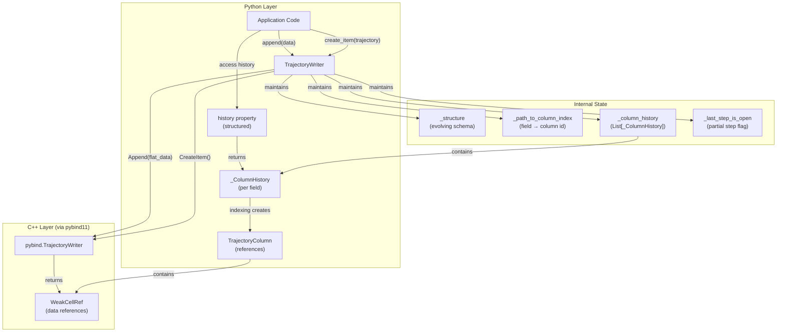
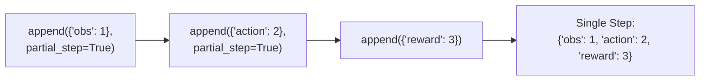
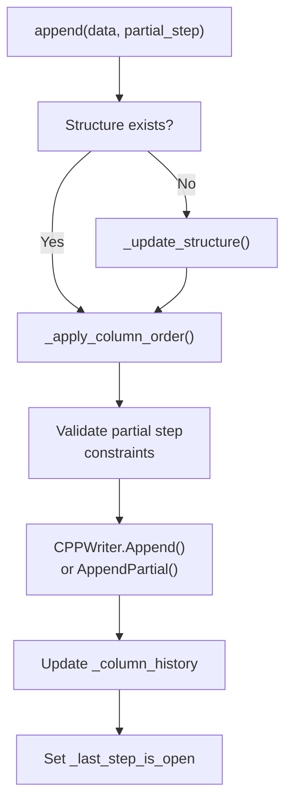
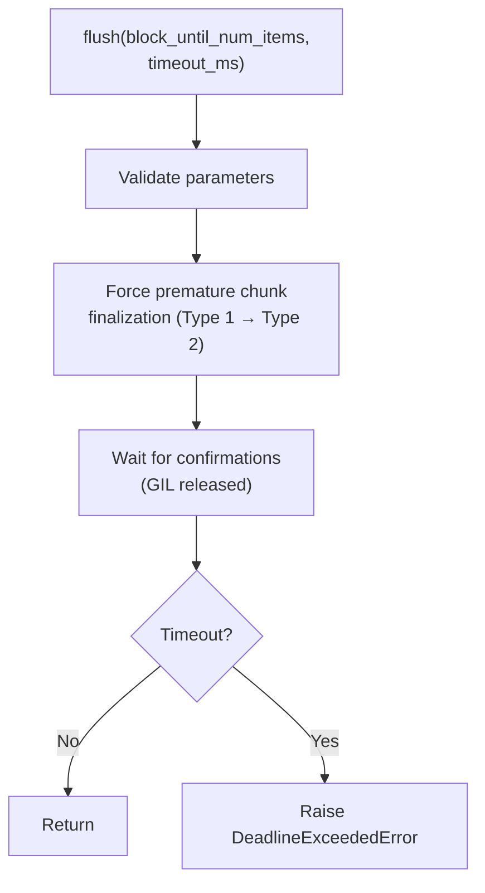
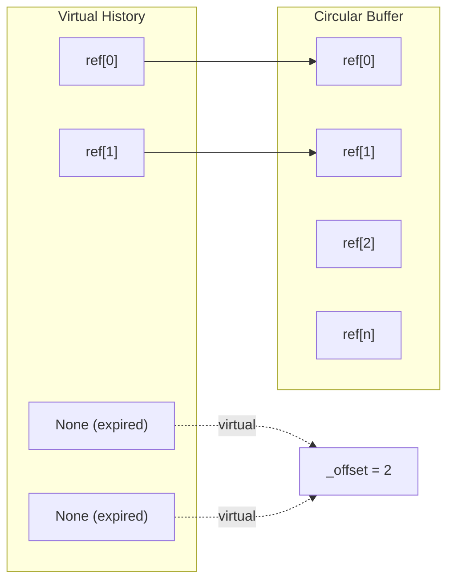

<!-- source: DeepWiki mcp.deepwiki.com · repo google-deepmind/reverb · page 4.2 Python TrajectoryWriter · fetched 2026-10-26 -->

# Python TrajectoryWriter

<details>
<summary>Relevant source files</summary>

The following files were used as context for generating this wiki page:

- [reverb/trajectory_dataset_test.py](reverb/trajectory_dataset_test.py)
- [reverb/trajectory_writer.py](reverb/trajectory_writer.py)
- [reverb/trajectory_writer_test.py](reverb/trajectory_writer_test.py)

</details>


## Purpose and Scope

This page documents the Python `TrajectoryWriter` class, which provides a high-level Python interface for writing structured trajectory data to Reverb tables. The `TrajectoryWriter` manages an internal buffer of data references, supports dynamic schema evolution, and handles flexible trajectory construction through its history mechanism.

For details on the underlying C++ implementation, see [C++ TrajectoryWriter](#3.2.2). For information on history and column management specifics, see [History and Column Management](#4.2.1). For episode lifecycle details, see [Episode Management](#4.2.2).

**Sources:** [reverb/trajectory_writer.py:1-748]()

## Overview

The `TrajectoryWriter` class at [reverb/trajectory_writer.py:29-528]() is the primary Python interface for writing data to Reverb. It wraps a C++ `pybind.TrajectoryWriter` and provides:

- **Dynamic Structure Evolution**: The structure of appended data can grow over time
- **History Management**: Access to recently appended data through a structured history interface
- **Flexible Trajectory Construction**: Build trajectories by referencing arbitrary combinations of historical data
- **Partial Steps**: Support for appending data to the same step across multiple calls
- **Episode Management**: Track episode boundaries and reset buffers

The writer maintains a separation between the structure of data provided to `append()` and the structure of trajectories created via `create_item()`. This allows maximum flexibility in how data is organized during collection versus sampling.

**Sources:** [reverb/trajectory_writer.py:29-110]()

## Architecture and Components



**Diagram: TrajectoryWriter Component Architecture**

This diagram shows how the Python `TrajectoryWriter` manages state and interacts with the C++ layer. The writer maintains multiple data structures to support dynamic schema evolution and flexible history access.

**Sources:** [reverb/trajectory_writer.py:112-141]()

## Key Concepts

### Steps and Partial Steps

A **step** represents a single point in time where data is appended. By default, each `append()` call creates a new step. However, the `partial_step` flag allows multiple `append()` calls to contribute to the same step:



**Diagram: Partial Step Construction**

The `_last_step_is_open` flag at [reverb/trajectory_writer.py:140]() tracks whether the current step is still accepting data. When a partial step is open, the `set_last()` method at [reverb/trajectory_writer.py:565-570]() is used to populate existing column positions rather than creating new ones.

**Sources:** [reverb/trajectory_writer.py:136-141](), [reverb/trajectory_writer.py:238-340]()

### Dynamic Structure Evolution

The `_structure` field at [reverb/trajectory_writer.py:119]() represents the union of all field paths observed across all `append()` calls. When new fields are introduced, the structure automatically expands:

| Call | Data | Resulting Structure | History State |
|------|------|---------------------|---------------|
| 1 | `{'x': 1, 'z': 2}` | `{'x': 0, 'z': 1}` | `x: [1], z: [2]` |
| 2 | `{'z': 3, 'y': 4}` | `{'x': 0, 'z': 1, 'y': 2}` | `x: [1, None], z: [2, 3], y: [None, 4]` |
| 3 | `{'w': 5}` | `{'x': 0, 'z': 1, 'y': 2, 'w': 3}` | `x: [1, None, None], ...` |

The structure maps field paths to column indices. This mapping is maintained in `_path_to_column_index` at [reverb/trajectory_writer.py:132]() and allows consistent flattening even as new fields are added.

**Sources:** [reverb/trajectory_writer.py:500-528]()

### History and Column Management

The `history` property at [reverb/trajectory_writer.py:152-186]() provides structured access to data references. It returns the same structure as `_structure`, but each leaf is a `_ColumnHistory` object that supports list-like indexing:

```python
writer.append({'obs': 1, 'reward': 10})
writer.append({'obs': 2, 'reward': 20})
writer.append({'obs': 3, 'reward': 30})

# Access specific steps
first_obs = writer.history['obs'][0]      # TrajectoryColumn with 1 ref
last_obs = writer.history['obs'][-1]      # TrajectoryColumn with 1 ref

# Access ranges
all_obs = writer.history['obs'][:]        # TrajectoryColumn with 3 refs
last_two = writer.history['obs'][-2:]     # TrajectoryColumn with 2 refs

# Access arbitrary indices
custom = writer.history['obs'][[0, 2]]    # TrajectoryColumn with refs 0,2
```

For detailed information on history implementation, see [History and Column Management](#4.2.1).

**Sources:** [reverb/trajectory_writer.py:152-186]()

## Core Operations

### append()

The `append()` method at [reverb/trajectory_writer.py:238-340]() adds structured data to the internal buffer:



**Diagram: append() Operation Flow**

The method performs several key steps:

1. **Structure Update**: If new fields are present, call `_update_structure()` at [reverb/trajectory_writer.py:500-528]()
2. **Flattening**: Convert structured data to flat list using `_apply_column_order()` at [reverb/trajectory_writer.py:462-467]()
3. **Validation**: Check that partial step constraints are met (no duplicate fields in same step) at [reverb/trajectory_writer.py:291-300]()
4. **C++ Call**: Forward flat data to `CPPWriter.Append()` or `AppendPartial()` at [reverb/trajectory_writer.py:304-308]()
5. **History Update**: Append or set references in `_column_history` at [reverb/trajectory_writer.py:329-340]()

**Sources:** [reverb/trajectory_writer.py:238-340]()

### create_item()

The `create_item()` method at [reverb/trajectory_writer.py:342-376]() constructs and enqueues a table item:

```python
# Build trajectory from history
trajectory = {
    'states': writer.history['observation'][-5:],    # Last 5 observations
    'actions': writer.history['action'][-4:],        # Last 4 actions
    'rewards': writer.history['reward'][-4:],        # Last 4 rewards
}

# Create item (non-blocking)
writer.create_item(
    table='my_table',
    priority=1.0,
    trajectory=trajectory
)
```

The method validates that:
- All leaves in `trajectory` are `TrajectoryColumn` objects at [reverb/trajectory_writer.py:365-368]()
- All referenced data is still alive (not expired)
- Data within each column has compatible dtypes and shapes

The trajectory structure is then flattened and passed to the C++ layer at [reverb/trajectory_writer.py:373-375]().

**Important**: This method is **non-blocking**. Items are enqueued for background insertion. Use `flush()` to control runahead.

**Sources:** [reverb/trajectory_writer.py:342-376]()

### flush()

The `flush()` method at [reverb/trajectory_writer.py:377-426]() blocks until pending items are confirmed by the server:



**Diagram: flush() Operation**

There are two types of pending items:
- **Type 1**: Data referenced but not yet finalized into chunks
- **Type 2**: Item written to gRPC stream but confirmation not received

The `block_until_num_items` parameter allows keeping some items as Type 1 to avoid premature chunk finalization. This is useful for maintaining optimal chunk sizes when items are created continuously.

**Sources:** [reverb/trajectory_writer.py:377-426]()

### end_episode()

The `end_episode()` method at [reverb/trajectory_writer.py:428-458]() flushes all pending items and resets the writer:

```python
# Flush all items and clear buffers
writer.end_episode(clear_buffers=True, timeout_ms=None)

# Flush items but keep history (for cross-episode trajectories)
writer.end_episode(clear_buffers=False)
```

When `clear_buffers=True` (default):
1. Calls `CPPWriter.EndEpisode()` at [reverb/trajectory_writer.py:447]()
2. Clears all `_ColumnHistory` objects at [reverb/trajectory_writer.py:455-457]()
3. Resets `episode_steps` counter to 0
4. Generates a new episode ID

When `clear_buffers=False`, the history is preserved, allowing trajectories that span episode boundaries.

For more details on episode lifecycle, see [Episode Management](#4.2.2).

**Sources:** [reverb/trajectory_writer.py:428-458]()

### configure()

The `configure()` method at [reverb/trajectory_writer.py:197-236]() overrides chunking options for individual columns:

```python
# Configure a column with custom settings
writer.configure(
    path=('observation',),
    num_keep_alive_refs=100,        # Circular buffer size
    max_chunk_length=10             # Fixed chunk length
)

# Use auto-tuned chunking
writer.configure(
    path=('action',),
    num_keep_alive_refs=50,
    max_chunk_length=None           # Auto-tune based on throughput
)
```

Configuration can be applied before or after the column is first observed. If applied before, the configuration is stored in `_path_to_column_config` at [reverb/trajectory_writer.py:134]() and applied when the column is created.

**Sources:** [reverb/trajectory_writer.py:197-236]()

## Supporting Classes

### _ColumnHistory

The `_ColumnHistory` class at [reverb/trajectory_writer.py:530-634]() manages data references for a single column:



**Diagram: _ColumnHistory Circular Buffer with Offset**

Key features:
- **Circular Buffer**: Maintains up to `buffer_size` most recent references at [reverb/trajectory_writer.py:548-549]()
- **Virtual History**: Tracks total length including expired references via `_offset` at [reverb/trajectory_writer.py:550]()
- **Indexing**: Supports int, slice, and list indexing at [reverb/trajectory_writer.py:619-629]()
- **Partial Step Support**: Can set the last reference via `set_last()` at [reverb/trajectory_writer.py:565-570]()

**Sources:** [reverb/trajectory_writer.py:530-634]()

### TrajectoryColumn

The `TrajectoryColumn` class at [reverb/trajectory_writer.py:636-708]() represents a column of data references used in trajectory construction:

| Property | Description | Example |
|----------|-------------|---------|
| `is_squeezed` | Whether column contains single reference | `history['obs'][0]` → `True` |
| `shape` | Shape of resulting tensor | `(5, 84, 84)` for 5 frames |
| `dtype` | Data type of referenced data | `np.float32` |
| `numpy()` | Materialize data as numpy array | Decompresses and stacks refs |

Key behaviors:
- **Validation**: Cannot contain `None` references at [reverb/trajectory_writer.py:648-651]()
- **Indexing**: Supports int, slice, and list indexing at [reverb/trajectory_writer.py:662-671]()
- **Squeezing**: Single-reference columns have shape without leading batch dimension at [reverb/trajectory_writer.py:674-678]()
- **Materialization**: The `numpy()` method at [reverb/trajectory_writer.py:684-707]() decompresses data if needed

**Sources:** [reverb/trajectory_writer.py:636-708]()

## Usage Patterns

### Basic Episode Collection

```python
with client.trajectory_writer(num_keep_alive_refs=5) as writer:
    for episode in range(NUM_EPISODES):
        timestep = env.reset()
        
        while not timestep.last():
            # Append step data
            writer.append({
                'observation': timestep.observation,
                'action': policy(timestep),
                'reward': timestep.reward,
            })
            
            # Create trajectory when enough history exists
            if writer.episode_steps >= 5:
                writer.create_item(
                    table='my_table',
                    priority=1.0,
                    trajectory={
                        'obs': writer.history['observation'][-5:],
                        'act': writer.history['action'][-4:],
                    }
                )
                writer.flush(block_until_num_items=5)
            
            timestep = env.step()
        
        writer.end_episode()
```

**Sources:** [reverb/trajectory_writer.py:48-108]()

### Partial Steps for On-Policy Learning

```python
# Start step with observation only
writer.append({'observation': obs}, partial_step=True)

# Create and learn from trajectory
if writer.episode_steps >= 5:
    trajectory = create_sars_trajectory(writer.history)
    writer.create_item('table', 1.0, trajectory)
    action = learn_and_select_action(trajectory)
else:
    action = random_action()

# Complete step with action
writer.append({'action': action})
```

This pattern allows learning from a trajectory that includes the current observation before selecting the action.

**Sources:** [reverb/trajectory_writer.py:167-201]()

### Dynamic Schema with Sparse Fields

```python
# First step has minimal data
writer.append({'state': s1})

# Second step adds reward
writer.append({'state': s2, 'reward': r1})

# Third step adds additional metric
writer.append({'state': s3, 'reward': r2, 'episode_return': total_return})

# History automatically pads missing values with None
# history['reward'] = [None, r1, r2]
# history['episode_return'] = [None, None, total_return]
```

The writer automatically handles schema evolution by padding earlier steps with `None` for newly introduced fields.

**Sources:** [reverb/trajectory_writer.py:115-147]()

### Cross-Episode Trajectories

```python
# Keep buffers across episodes
writer.end_episode(clear_buffers=False)

# History is preserved, allowing trajectories that span episode boundaries
trajectory = {
    'states': writer.history['observation'][-10:],  # May span episodes
}
```

This is useful for algorithms that need to learn from transitions across episode boundaries.

**Sources:** [reverb/trajectory_writer.py:428-458]()

## Error Handling

The `TrajectoryWriter` performs validation at multiple levels:

### Append-Time Validation

At [reverb/trajectory_writer.py:309-324](), dtype and shape errors from the C++ layer are reformatted to include the field path:

```python
# Original error: "Tensor of wrong dtype provided for column 2"
# Reformatted: "Tensor of wrong dtype provided for column ('nest', 'field')"
```

### Partial Step Validation

At [reverb/trajectory_writer.py:291-300](), attempting to set the same field twice in one step raises:

```
ValueError: Field ('x',) has already been set in the active step by previous 
(partial) append call and thus must be omitted or set to None but got: 4
```

### History Access Validation

At [reverb/trajectory_writer.py:182-184](), accessing history before any `append()` raises:

```
RuntimeError: history cannot be accessed before `append` is called at least once.
```

### TrajectoryColumn Validation

At [reverb/trajectory_writer.py:648-651](), creating a column with `None` references raises:

```
ValueError: TrajectoryColumns cannot contain any None data references
```

**Sources:** [reverb/trajectory_writer.py:238-340](), [reverb/trajectory_writer.py:152-186](), [reverb/trajectory_writer.py:636-708]()

## Context Manager Protocol

The `TrajectoryWriter` implements the context manager protocol at [reverb/trajectory_writer.py:142-150]():

```python
with client.trajectory_writer(num_keep_alive_refs=10) as writer:
    # ... use writer ...
    pass
# Automatically calls flush() on normal exit
```

On normal exit (`__exit__` with `exc_type=None`), the writer calls `flush()` to ensure all items are sent. However, if a `ReverbError` is raised within the context, flush is skipped to avoid masking the original error.

**Sources:** [reverb/trajectory_writer.py:142-150]()

## Relationship to C++ Layer

The Python `TrajectoryWriter` delegates core operations to `pybind.TrajectoryWriter`:

| Python Method | C++ Method | Purpose |
|---------------|------------|---------|
| `append()` | `Append()` | Add data to columns |
| `append(partial_step=True)` | `AppendPartial()` | Add partial step data |
| `create_item()` | `CreateItem()` | Enqueue item insertion |
| `flush()` | `Flush()` | Block until confirmations |
| `end_episode()` | `EndEpisode()` | Reset and flush |
| `configure()` | `ConfigureChunker()` | Set chunking options |
| `close()` | `Close()` | Cleanup resources |

The C++ layer at [reverb/cc/trajectory_writer.h]() and [reverb/cc/trajectory_writer.cc]() handles:
- Chunking and compression
- gRPC streaming to server
- Reference counting and memory management
- Background worker threads

For details on the C++ implementation, see [C++ TrajectoryWriter](#3.2.2).

**Sources:** [reverb/trajectory_writer.py:112-114](), [reverb/trajectory_writer.py:238-460]()

---

