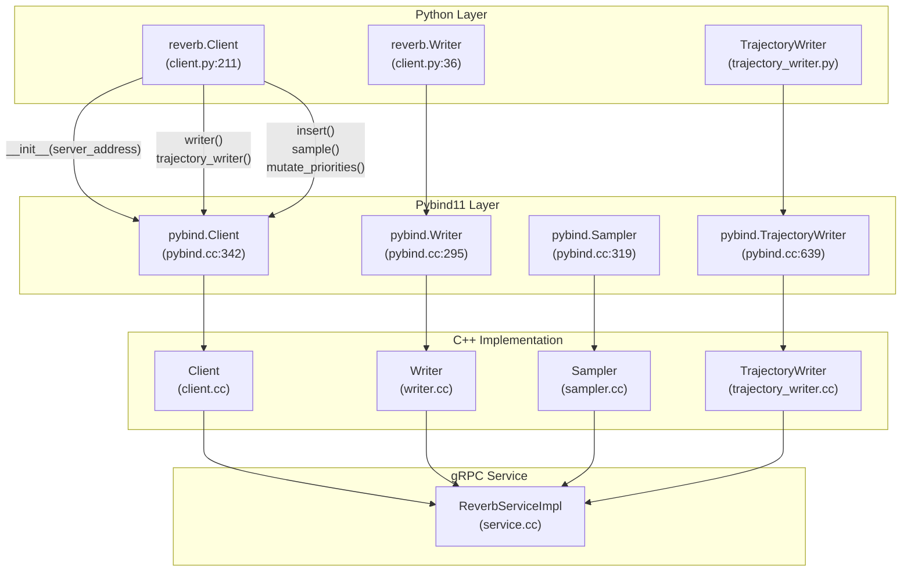
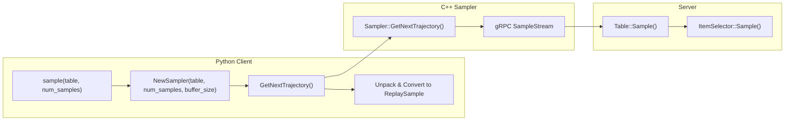
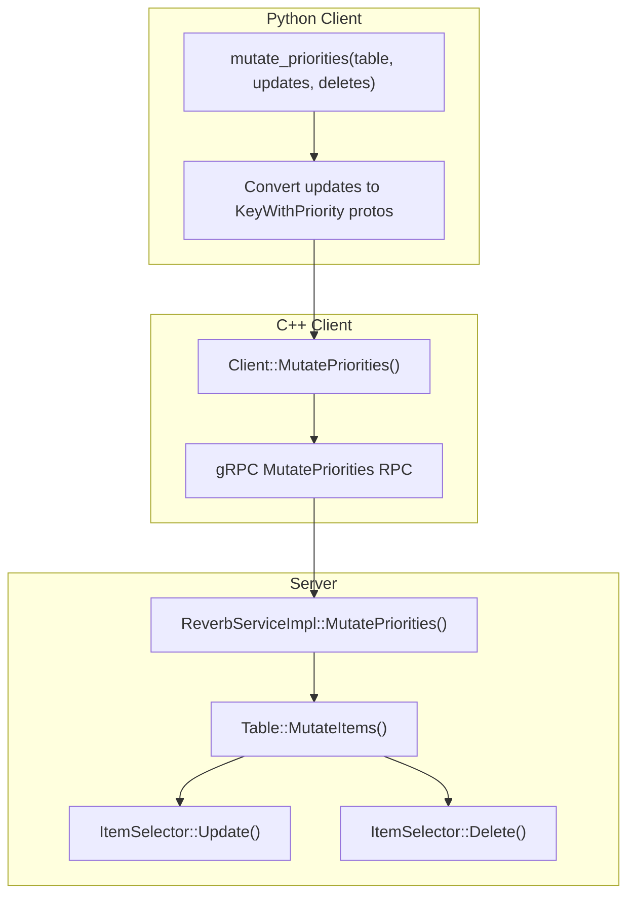

<!-- source: DeepWiki mcp.deepwiki.com · repo google-deepmind/reverb · page 4.3 Client Operations · fetched 2026-10-26 -->

# Client Operations

<details>
<summary>Relevant source files</summary>

The following files were used as context for generating this wiki page:

- [README.md](README.md)
- [docs/images/multiple_tables_example.png](docs/images/multiple_tables_example.png)
- [reverb/client.py](reverb/client.py)
- [reverb/pip_package/reverb_version.py](reverb/pip_package/reverb_version.py)
- [reverb/pip_package/setup.py](reverb/pip_package/setup.py)
- [reverb/pybind.cc](reverb/pybind.cc)
- [reverb/pybind.pyi](reverb/pybind.pyi)

</details>


This page documents the operations available through the `reverb.Client` class for interacting with a Reverb server. The `Client` provides methods for inserting data, sampling items, managing priorities, and controlling server state.

For information about creating and configuring writers, see [Python TrajectoryWriter](#4.2). For server configuration and startup, see [Server Configuration](#4.4). For details on TensorFlow-native client operations, see [TFClient](#5.3).

## Overview

The `Client` class [reverb/client.py:211-602]() serves as the primary Python interface for communicating with a Reverb server. It wraps a C++ client implementation [reverb/pybind.cc:342-502]() that handles gRPC communication and provides operations for:

- **Data Insertion**: Adding items to tables via simple `insert()` or streaming writers
- **Sampling**: Retrieving items from tables based on selection strategies
- **Priority Management**: Updating or deleting existing items
- **Server Control**: Resetting tables, triggering checkpoints, and retrieving metadata

### Client Architecture



**Sources:** [reverb/client.py:1-602](), [reverb/pybind.cc:1-783]()

## Client Initialization

The `Client` is initialized with a server address and establishes a gRPC connection to the Reverb server.

### Constructor

```python
client = reverb.Client(server_address: str)
```

**Parameters:**
- `server_address`: gRPC address of the Reverb server (e.g., `"localhost:8000"`)

The constructor [reverb/client.py:219-227]() creates an internal C++ client [reverb/pybind.cc:343]() that maintains the gRPC connection. The client is picklable for distributed usage.

**Example:**
```python
# Connect to local server
client = reverb.Client('localhost:8000')

# Connect to remote server
client = reverb.Client('192.168.1.100:8000')
```

**Sources:** [reverb/client.py:219-227](), [reverb/pybind.cc:342-343]()

## Data Insertion Operations

### Simple Insert

The `insert()` method [reverb/client.py:239-263]() provides a high-level interface for inserting complete data structures (e.g., full trajectories) into one or more tables.

```python
def insert(self, data: Any, priorities: Dict[str, float]) -> None
```

**Parameters:**
- `data`: Nested structure of numpy arrays or tensors
- `priorities`: Mapping from table name to priority value

**Behavior:**
1. Creates a temporary `Writer` with `max_sequence_length=1`
2. Appends the data as a single timestep
3. Creates items in each specified table
4. Flushes and closes the writer

**Example:**
```python
# Insert a complete trajectory into multiple tables
trajectory = {
    'observation': np.array([[1, 2], [3, 4]]),
    'action': np.array([0, 1]),
    'reward': np.array([1.0, 0.5])
}

client.insert(trajectory, priorities={
    'uniform_table': 1.0,
    'prioritized_table': 10.0
})
```

**Implementation Note:** This method internally uses `writer()` [reverb/client.py:258-263](), so the data is stored as a single item referencing one timestep.

**Sources:** [reverb/client.py:239-263]()

### Writer-Based Insertion

For streaming data or creating items that reference multiple timesteps, use the `writer()` method [reverb/client.py:264-343]() to create a `Writer` context manager.

```python
def writer(self,
           max_sequence_length: int,
           delta_encoded: bool = False,
           chunk_length: Optional[int] = None,
           max_in_flight_items: Optional[int] = 25) -> Writer
```

**Parameters:**
- `max_sequence_length`: Size of circular buffer (maximum trajectory length)
- `delta_encoded`: Enable delta encoding for compression (default: False)
- `chunk_length`: Timesteps per chunk (default: `min(10, max_sequence_length)`)
- `max_in_flight_items`: Maximum unconfirmed items (default: 25)

**Returns:** `Writer` context manager [reverb/client.py:36-209]()

**Example:**
```python
with client.writer(max_sequence_length=100) as writer:
    for step in episode:
        writer.append(step)
        
        # Create item referencing last 10 steps
        if len(episode) >= 10:
            writer.create_item('my_table', num_timesteps=10, priority=1.0)
    
    writer.flush()
```

**Note:** This method will be deprecated in favor of `trajectory_writer()`. See [Python TrajectoryWriter](#4.2) for the preferred approach.

**Sources:** [reverb/client.py:264-343](), [reverb/pybind.cc:345-364]()

## Sampling Operations

The `sample()` method [reverb/client.py:345-450]() retrieves items from a table according to its sampling strategy.

```python
def sample(self,
           table: str,
           num_samples: int = 1,
           *,
           emit_timesteps: bool = True,
           unpack_as_table_signature: bool = False
          ) -> Generator[Union[List[ReplaySample], ReplaySample], None, None]
```

**Parameters:**
- `table`: Name of table to sample from
- `num_samples`: Number of items to sample (default: 1)
- `emit_timesteps`: Return trajectories as lists of timesteps (default: True)
- `unpack_as_table_signature`: Unpack data according to table signature (default: False)

**Returns:** Generator yielding `ReplaySample` objects

### Sampling Behavior



**Important Notes:**

1. **Blocking Behavior**: If `num_samples` exceeds available items or rate limiter constraints, the generator blocks until items become available [reverb/client.py:365-379]()

2. **Timestep Emission**: When `emit_timesteps=True`, each sampled trajectory is decomposed into individual timesteps [reverb/client.py:436-446](). This requires all columns to have the same length.

3. **Not for Training**: This method is intended for prototyping only. For training, use TensorFlow datasets (see [TensorFlow Datasets](#5.2))

**Example - Basic Sampling:**
```python
# Sample 10 items as timestep lists
for timesteps in client.sample('my_table', num_samples=10):
    for timestep in timesteps:
        print(timestep.info.key, timestep.info.priority)
        print(timestep.data)
```

**Example - Trajectory Sampling:**
```python
# Sample full trajectories (not decomposed into timesteps)
for sample in client.sample('my_table', num_samples=5, emit_timesteps=False):
    print(f"Key: {sample.info.key}, Priority: {sample.info.priority}")
    print(f"Trajectory data: {sample.data}")
```

**Sources:** [reverb/client.py:345-450](), [reverb/pybind.cc:365-384]()

## Priority Mutation Operations

The `mutate_priorities()` method [reverb/client.py:451-473]() updates priorities or deletes items in a table.

```python
def mutate_priorities(self,
                     table: str,
                     updates: Optional[Dict[int, float]] = None,
                     deletes: Optional[List[int]] = None) -> None
```

**Parameters:**
- `table`: Name of table containing items to mutate
- `updates`: Mapping from item key to new priority value
- `deletes`: List of item keys to delete

**Behavior:**
1. Updates are applied first [reverb/client.py:460-473]()
2. Deletes are applied second
3. Non-existent keys are silently ignored
4. Operation is executed as a single gRPC unary call

### Priority Mutation Flow



**Example:**
```python
# Update priorities for items 100, 101
client.mutate_priorities(
    table='my_table',
    updates={100: 5.0, 101: 3.0}
)

# Delete items 200, 201, 202
client.mutate_priorities(
    table='my_table',
    deletes=[200, 201, 202]
)

# Both update and delete in one call
client.mutate_priorities(
    table='my_table',
    updates={100: 10.0},
    deletes=[200, 201]
)
```

**Use Case:** Commonly used in Prioritized Experience Replay to update priorities based on TD-errors after training on sampled items.

**Sources:** [reverb/client.py:451-473](), [reverb/pybind.cc:449-462]()

## Server Management Operations

### Reset Table

The `reset()` method [reverb/client.py:475-481]() clears all items from a table and resets its rate limiter state.

```python
def reset(self, table: str) -> None
```

**Parameters:**
- `table`: Name of table to reset

**Effects:**
1. All items are removed from the table
2. All data chunks with no remaining references are freed
3. RateLimiter counters are reset to initial state
4. ItemSelectors are reset

**Example:**
```python
# Clear all data from a table
client.reset('my_table')

# Table is now empty and ready for new data
print(client.server_info()['my_table'].current_size)  # 0
```

**Warning:** This operation is irreversible. All data in the table will be lost.

**Sources:** [reverb/client.py:475-481](), [reverb/pybind.cc:463]()

### Server Info

The `server_info()` method [reverb/client.py:483-521]() retrieves metadata about all tables on the server.

```python
def server_info(self,
               timeout: Optional[int] = None
              ) -> Dict[str, reverb_types.TableInfo]
```

**Parameters:**
- `timeout`: Timeout in seconds (default: None = wait indefinitely)

**Returns:** Dictionary mapping table names to `TableInfo` objects

**TableInfo Contents:**
- `name`: Table name
- `sampler`: Sampler configuration
- `remover`: Remover configuration
- `max_size`: Maximum number of items
- `max_times_sampled`: Maximum sample count per item
- `rate_limiter_info`: Rate limiter state
- `signature`: Table signature (if configured)
- `current_size`: Current number of items
- `num_episodes`: Number of episodes stored
- `num_deleted_episodes`: Number of deleted episodes
- `num_unique_samples`: Total unique samples

**Example:**
```python
# Get info about all tables
info = client.server_info()

for table_name, table_info in info.items():
    print(f"Table: {table_name}")
    print(f"  Size: {table_info.current_size}/{table_info.max_size}")
    print(f"  Can sample: {table_info.rate_limiter_info.can_sample(1)}")
    print(f"  Signature: {table_info.signature}")
```

**Implementation Detail:** The first successful call to `server_info()` populates an internal signature cache [reverb/client.py:515-519]() used by `sample()` when `unpack_as_table_signature=True`.

**Sources:** [reverb/client.py:483-521](), [reverb/pybind.cc:464-492]()

### Checkpoint

The `checkpoint()` method [reverb/client.py:523-529]() triggers the server to save its state to persistent storage.

```python
def checkpoint(self) -> str
```

**Returns:** Absolute path to the saved checkpoint directory

**Behavior:**
1. Server blocks all insert/sample/update/delete operations
2. All table state and data is serialized
3. Checkpoint is written to configured storage
4. Operations resume after checkpoint completes

**Example:**
```python
# Trigger checkpoint
checkpoint_path = client.checkpoint()
print(f"Checkpoint saved to: {checkpoint_path}")

# Checkpoint can later be used to restore server state
# (see Server Configuration documentation)
```

**Note:** Checkpointing blocks the server. For production use, consider checkpoint frequency vs. latency requirements. See [Checkpointing and Persistence](#3.5) for details.

**Sources:** [reverb/client.py:523-529](), [reverb/pybind.cc:493-502]()

## Writer Creation Methods

The `Client` provides three methods for creating writers, each suited to different use cases.

### Method Comparison

| Method | Use Case | Status | See Also |
|--------|----------|--------|----------|
| `writer()` | Simple streaming, legacy code | Deprecated | [Writer-Based Insertion](#writer-based-insertion) |
| `trajectory_writer()` | Flexible trajectory construction | **Recommended** | [Python TrajectoryWriter](#4.2) |
| `structured_writer()` | Complex multi-table patterns | Advanced | [StructuredWriter](#4.2) |

### TrajectoryWriter Creation

```python
def trajectory_writer(self,
                     num_keep_alive_refs: int,
                     *,
                     validate_items: bool = True) -> TrajectoryWriter
```

**Parameters:**
- `num_keep_alive_refs`: Circular buffer size (max trajectory length)
- `validate_items`: Validate items against table signature before sending (default: True)

**Returns:** `TrajectoryWriter` with auto-tuned chunk lengths

The `TrajectoryWriter` is the preferred writer for most use cases. It provides:
- Flexible column-based history management
- Automatic chunk size tuning
- Schema validation
- Partial step support

**Example:**
```python
with client.trajectory_writer(num_keep_alive_refs=100) as writer:
    for step in episode:
        writer.append(step)
        
        # Create overlapping trajectories
        if writer.episode_steps >= 5:
            writer.create_item(
                table='my_table',
                priority=1.0,
                trajectory={
                    'obs': writer.history['obs'][-5:],
                    'action': writer.history['action'][-5:]
                })
```

For detailed documentation, see [Python TrajectoryWriter](#4.2).

**Sources:** [reverb/client.py:531-568](), [reverb/pybind.cc:385-411]()

### StructuredWriter Creation

```python
def structured_writer(self,
                     configs: Sequence[structured_writer_lib.Config]
                    ) -> StructuredWriter
```

**Parameters:**
- `configs`: List of `Config` objects defining insertion patterns

**Returns:** `StructuredWriter` that automatically creates items based on patterns

The `StructuredWriter` is designed for complex use cases where items should be created according to predefined patterns (e.g., n-step returns, overlapping windows).

**Example:**
```python
from reverb import structured_writer

# Configure automatic n-step trajectory creation
config = structured_writer.Config(
    table='my_table',
    pattern=structured_writer.pattern_builder.create_n_step_pattern(5)
)

with client.structured_writer([config]) as writer:
    for step in episode:
        writer.append(step)
        # Items are automatically created according to pattern
```

**Sources:** [reverb/client.py:570-590](), [reverb/pybind.cc:412-448]()

## Error Handling

All Client methods may raise exceptions based on underlying C++ status codes [reverb/pybind.cc:58-83]():

| Status Code | Python Exception | Common Causes |
|-------------|------------------|---------------|
| `kInvalidArgument` | `ValueError` | Invalid parameters, schema mismatch |
| `kResourceExhausted` | `IndexError` | Table full, rate limiter blocking |
| `kUnimplemented` | `NotImplementedError` | Feature not supported |
| `kInternal` | `RuntimeError` | Internal error, server crash |
| Others | `RuntimeError` | Network errors, server unavailable |

**Example - Handling Rate Limiter:**
```python
try:
    with client.writer(max_sequence_length=10) as writer:
        writer.append(data)
        writer.create_item('full_table', num_timesteps=1, priority=1.0)
except IndexError as e:
    # Table is full or rate limiter is blocking
    print(f"Cannot insert: {e}")
```

**Example - Handling Connection Errors:**
```python
try:
    info = client.server_info(timeout=5)
except errors.DeadlineExceededError:
    print("Server did not respond within 5 seconds")
except RuntimeError as e:
    print(f"Connection error: {e}")
```

**Sources:** [reverb/pybind.cc:58-83](), [reverb/client.py:499-506]()

## Complete Usage Example

```python
import reverb
import numpy as np

# Initialize client
client = reverb.Client('localhost:8000')

# Check server status
info = client.server_info()
print(f"Connected to server with tables: {list(info.keys())}")

# Simple insert
trajectory = {'obs': np.array([1, 2, 3]), 'reward': np.array([1.0])}
client.insert(trajectory, priorities={'my_table': 1.0})

# Streaming insert with TrajectoryWriter
with client.trajectory_writer(num_keep_alive_refs=100) as writer:
    for t in range(100):
        step = {
            'observation': np.random.randn(4),
            'action': np.random.randint(0, 4),
            'reward': np.random.randn()
        }
        writer.append(step)
        
        # Create 10-step trajectory
        if t >= 9:
            writer.create_item(
                table='my_table',
                priority=1.0,
                trajectory={
                    'observation': writer.history['observation'][-10:],
                    'action': writer.history['action'][-10:],
                    'reward': writer.history['reward'][-10:]
                })

# Sample from table
for sample in client.sample('my_table', num_samples=5):
    for timestep in sample:
        print(f"Key {timestep.info.key}: {timestep.data}")

# Update priorities based on training
updates = {key: new_priority for key, new_priority in priority_updates.items()}
client.mutate_priorities('my_table', updates=updates)

# Save checkpoint
checkpoint_path = client.checkpoint()
print(f"Saved checkpoint to {checkpoint_path}")
```

**Sources:** [reverb/client.py:1-602](), [README.md:86-150]()

---

