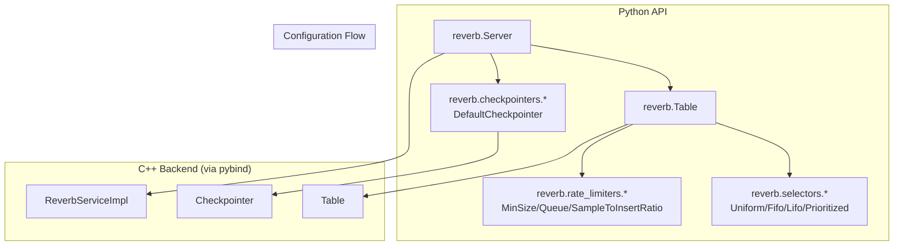
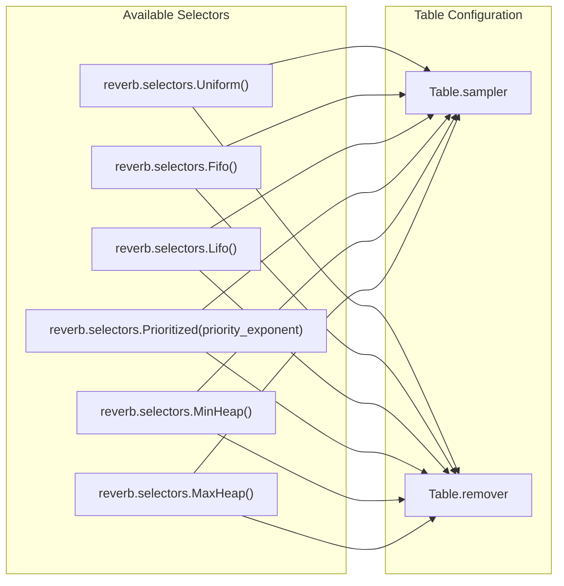
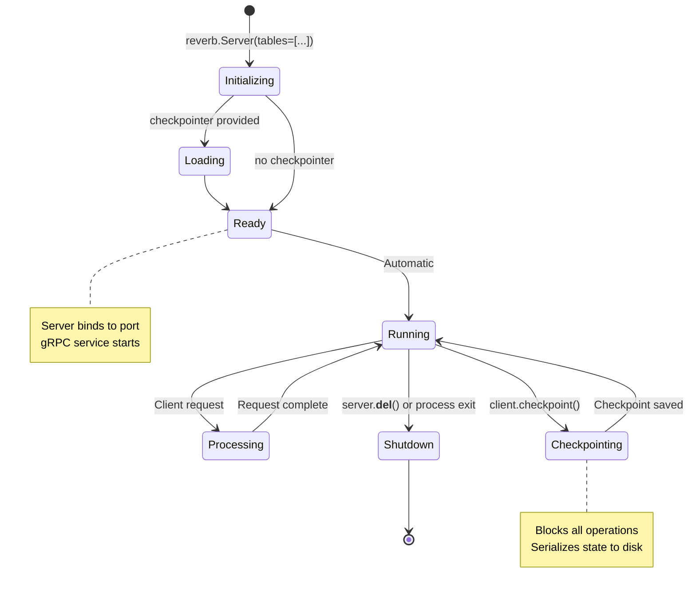

<!-- source: DeepWiki mcp.deepwiki.com · repo google-deepmind/reverb · page 4.4 Server Configuration · fetched 2026-10-26 -->

# Server Configuration

<details>
<summary>Relevant source files</summary>

The following files were used as context for generating this wiki page:

- [README.md](README.md)
- [docs/images/multiple_tables_example.png](docs/images/multiple_tables_example.png)
- [reverb/BUILD](reverb/BUILD)
- [reverb/__init__.py](reverb/__init__.py)
- [reverb/cc/ops/BUILD](reverb/cc/ops/BUILD)
- [reverb/pip_package/reverb_version.py](reverb/pip_package/reverb_version.py)
- [reverb/pip_package/setup.py](reverb/pip_package/setup.py)

</details>


This page explains how to configure and start a Reverb server from Python, including table setup, rate limiters, checkpointers, and server options. For information about server-side implementation details, see [3.4 gRPC Service Implementation](#3.4). For client-side operations on a running server, see [4.3 Client Operations](#4.3).

## Overview

A Reverb server hosts one or more tables that store and serve replay data. Server configuration involves:

1. **Table definitions** - Specifying data structures with sampling/removal strategies
2. **Rate limiters** - Controlling insert and sample throughput
3. **Checkpointers** - Optional persistence for fault tolerance
4. **Server options** - Port binding and other runtime settings

The server runs a gRPC service that accepts connections from clients for inserting, sampling, and managing data.

## Server Class Structure



**Sources:** [reverb/__init__.py:45-46](), [reverb/BUILD:72-84](), [README.md:88-102]()

## Basic Server Setup

### Minimal Server

The simplest server configuration creates a single table with default settings:

```python
import reverb

server = reverb.Server(tables=[
    reverb.Table(
        name='my_table',
        sampler=reverb.selectors.Uniform(),
        remover=reverb.selectors.Fifo(),
        max_size=100,
        rate_limiter=reverb.rate_limiters.MinSize(1)
    ),
])

# Server automatically binds to an available port
print(f"Server running on port {server.port}")
```

**Sources:** [README.md:88-102]()

### Server Constructor Parameters

| Parameter | Type | Description |
|-----------|------|-------------|
| `tables` | `List[Table]` | List of table configurations (required) |
| `port` | `Optional[int]` | Port to bind. If `None`, uses any available port |
| `checkpointer` | `Optional[Checkpointer]` | Checkpointer for persistence. Default is `None` |

**Sources:** [reverb/__init__.py:45-46]()

## Table Configuration

### Table Parameters

The `reverb.Table` class configures individual tables within the server:

```python
reverb.Table(
    name='my_table',              # Unique table identifier
    sampler=reverb.selectors.Uniform(),  # Sampling strategy
    remover=reverb.selectors.Fifo(),     # Removal strategy
    max_size=1000,                # Maximum items in table
    max_times_sampled=None,       # Max samples per item (None = unlimited)
    rate_limiter=reverb.rate_limiters.MinSize(100),  # Flow control
    signature=None,               # Optional: TensorFlow signature
)
```

**Table Parameter Details:**

| Parameter | Description |
|-----------|-------------|
| `name` | String identifier for the table. Must be unique within the server. Used by clients to reference this table. |
| `sampler` | `ItemSelector` determining which items to sample. See [3.1.1 Item Selection Strategies](#3.1.1). |
| `remover` | `ItemSelector` determining which items to remove when table is full. |
| `max_size` | Maximum number of items the table can hold. When exceeded, items are removed using the `remover` strategy. |
| `max_times_sampled` | Maximum times an item can be sampled before automatic deletion. `None` means no limit. |
| `rate_limiter` | Controls insert/sample rate relationship. See [3.1.2 Rate Limiting](#3.1.2). |
| `signature` | Optional TensorFlow type signature for validation. |

**Sources:** [README.md:94-99](), [README.md:174-202]()

### Item Selection Strategies

Selection strategies control sampling and removal behavior:



| Selector | Behavior | Common Use |
|----------|----------|------------|
| `Uniform()` | Random sampling with equal probability | Experience replay |
| `Fifo()` | First-in-first-out (oldest first) | Queue behavior, removal |
| `Lifo()` | Last-in-first-out (newest first) | Stack behavior |
| `Prioritized(exponent)` | Sample proportional to priority^exponent | Prioritized replay |
| `MinHeap()` | Select items with lowest priority | Custom prioritization |
| `MaxHeap()` | Select items with highest priority | Custom prioritization |

**Sources:** [README.md:281-294](), [reverb/__init__.py:27]()

### Rate Limiters

Rate limiters enforce relationships between insert and sample operations:

```python
# Minimum size before sampling is allowed
reverb.rate_limiters.MinSize(min_size_to_sample)

# Maintain ratio of samples to inserts
reverb.rate_limiters.SampleToInsertRatio(
    samples_per_insert=1.0,
    min_size_to_sample=1,
    error_buffer=0.1
)

# Queue behavior: sample once then remove
reverb.rate_limiters.Queue(size=1000)

# Stack behavior: sample once then remove (LIFO)
reverb.rate_limiters.Stack(size=1000)
```

**Rate Limiter Details:**

| Rate Limiter | Parameters | Behavior |
|--------------|-----------|----------|
| `MinSize` | `min_size_to_sample` | Blocks sampling until table contains at least `min_size_to_sample` items |
| `SampleToInsertRatio` | `samples_per_insert`, `min_size_to_sample`, `error_buffer` | Maintains average ratio of samples to inserts by blocking operations as needed |
| `Queue` | `size` | Items sampled exactly once before removal (FIFO) |
| `Stack` | `size` | Items sampled exactly once before removal (LIFO) |

**Sources:** [README.md:296-309](), [reverb/__init__.py:28]()

## Common Configuration Patterns

### Uniform Experience Replay

Standard experience replay with uniform sampling and FIFO removal:

```python
reverb.Table(
    name='uniform_replay_buffer',
    sampler=reverb.selectors.Uniform(),
    remover=reverb.selectors.Fifo(),
    max_size=1000,
    rate_limiter=reverb.rate_limiters.MinSize(100),
)
```

This configuration:
- Samples uniformly from all items (equal probability)
- Removes oldest items when buffer is full
- Blocks sampling until 100 items are inserted
- Maintains up to 1000 items

**Use Case:** SAC, DDPG algorithms

**Sources:** [README.md:211-228]()

### Prioritized Experience Replay

Priority-based sampling with FIFO removal:

```python
reverb.Table(
    name='prioritized_replay_buffer',
    sampler=reverb.selectors.Prioritized(priority_exponent=0.8),
    remover=reverb.selectors.Fifo(),
    max_size=1000,
    rate_limiter=reverb.rate_limiters.MinSize(100),
)
```

This configuration:
- Samples proportional to item priority (priority^0.8)
- Removes oldest items when buffer is full
- Blocks sampling until 100 items are inserted
- Higher priority items sampled more frequently

**Use Case:** DQN, D4PG algorithms

**Sources:** [README.md:233-255]()

### Queue Configuration

FIFO queue where each item is sampled exactly once:

```python
reverb.Table(
    name='queue',
    sampler=reverb.selectors.Fifo(),
    remover=reverb.selectors.Fifo(),
    max_size=1000,
    max_times_sampled=1,
    rate_limiter=reverb.rate_limiters.Queue(size=1000),
)

# Or use the convenience method:
reverb.Table.queue(name='queue', max_size=1000)
```

This configuration:
- Samples oldest items first (FIFO)
- Automatically removes items after one sample
- Blocks inserts when full, blocks samples when empty

**Use Case:** IMPALA, asynchronous PPO

**Sources:** [README.md:256-279]()

## Multiple Tables

A single server can host multiple tables with different configurations:

```python
server = reverb.Server(tables=[
    # Prioritized replay for training
    reverb.Table(
        name='transitions',
        sampler=reverb.selectors.Prioritized(0.8),
        remover=reverb.selectors.Fifo(),
        max_size=100000,
        rate_limiter=reverb.rate_limiters.MinSize(1000),
    ),
    
    # Queue for model evaluation
    reverb.Table(
        name='eval_episodes',
        sampler=reverb.selectors.Fifo(),
        remover=reverb.selectors.Fifo(),
        max_size=100,
        max_times_sampled=1,
        rate_limiter=reverb.rate_limiters.Queue(size=100),
    ),
    
    # Uniform buffer for auxiliary tasks
    reverb.Table(
        name='auxiliary_data',
        sampler=reverb.selectors.Uniform(),
        remover=reverb.selectors.Fifo(),
        max_size=10000,
        rate_limiter=reverb.rate_limiters.MinSize(100),
    ),
])
```

Tables are independent and can have different:
- Sampling/removal strategies
- Size limits
- Rate limiting policies
- Item schemas

**Data Sharing:** Multiple tables can reference the same underlying data chunks, making multi-table configurations memory-efficient.

**Sources:** [README.md:173-202]()

## Checkpointing Configuration

Checkpointing enables persistence and warm-starting of server state:

### Setting Up Checkpointing

```python
# Create checkpointer pointing to directory
checkpointer = reverb.checkpointers.DefaultCheckpointer(
    path='/path/to/checkpoint/directory'
)

# Server with checkpointing enabled
server = reverb.Server(
    tables=[...],
    checkpointer=checkpointer
)
```

### Checkpoint Directory Structure

The checkpointer creates timestamped checkpoint directories:

```
/path/to/checkpoint/directory/
├── checkpoint_000000/
│   ├── table_my_table_000000.ckpt
│   └── server_metadata.ckpt
├── checkpoint_000001/
│   ├── table_my_table_000001.ckpt
│   └── server_metadata.ckpt
└── ...
```

### Restoring from Checkpoint

```python
# Checkpointer automatically loads most recent checkpoint
checkpointer = reverb.checkpointers.DefaultCheckpointer(
    path='/path/to/checkpoint/directory'
)

# Server restores state during initialization
# Table configurations must match original server
server = reverb.Server(
    tables=[
        reverb.Table(
            name='my_table',  # Must match checkpointed table name
            sampler=reverb.selectors.Uniform(),
            remover=reverb.selectors.Fifo(),
            max_size=1000,
            rate_limiter=reverb.rate_limiters.MinSize(1),
        ),
    ],
    checkpointer=checkpointer
)
```

**Important:** Table configurations (name, max_size, etc.) must match the original server that created the checkpoint.

**Sources:** [README.md:328-359]()

## Server Lifecycle



**Sources:** [README.md:328-355]()

## Port Configuration

By default, the server binds to an available port. To specify a port:

```python
# Bind to specific port
server = reverb.Server(
    tables=[...],
    port=8000
)
print(f"Server running on port {server.port}")  # 8000

# Bind to any available port
server = reverb.Server(
    tables=[...],
    port=None  # or omit parameter
)
print(f"Server running on port {server.port}")  # e.g., 45231
```

The server port is accessible via the `server.port` property after initialization.

**Sources:** [README.md:88-102]()

## Command Line Server (Beta)

Reverb provides a `reverb_server` command-line tool for starting servers without Python code:

### Basic Usage

```bash
reverb_server --config="
port: 8000
tables: {
  table_name: \"my_table\"
  sampler: {
    fifo: true
  }
  remover: {
    fifo: true
  }
  max_size: 200
  max_times_sampled: 5
  rate_limiter: {
    min_size_to_sample: 1
    samples_per_insert: 1
    min_diff: $(python3 -c \"import sys; print(-sys.float_info.max)\")
    max_diff: $(python3 -c \"import sys; print(sys.float_info.max)\")
  }
}
"
```

### TextProto Configuration Format

The configuration uses Protocol Buffer text format:

```protobuf
port: 8000
tables: {
  table_name: "my_table"
  sampler: {
    fifo: true          # FIFO sampling
    # OR uniform: true  # Uniform sampling
    # OR prioritized: { priority_exponent: 0.8 }
  }
  remover: {
    fifo: true          # FIFO removal
  }
  max_size: 1000
  max_times_sampled: 1  # Queue-like behavior
  rate_limiter: {
    min_size_to_sample: 100
    samples_per_insert: 1.0
    min_diff: -1.7976931348623157e+308  # -float_max
    max_diff: 1.7976931348623157e+308   # float_max
  }
}
```

**Rate Limiter Equivalents:**

| Python | TextProto |
|--------|-----------|
| `MinSize(1)` | `min_size_to_sample: 1, samples_per_insert: 1, min_diff: -∞, max_diff: ∞` |
| `Queue(size)` | `min_size_to_sample: 0, max_times_sampled: 1, max_size: size` |

**Sources:** [README.md:361-389](), [reverb/pip_package/setup.py:136-139]()

## Server Information

After server creation, retrieve configuration details via client:

```python
server = reverb.Server(tables=[...])
client = reverb.Client(f'localhost:{server.port}')

info = client.server_info()
print(info)
# ServerInfo containing:
# - Table names and configurations
# - Current item counts
# - Version information
```

**Sources:** [README.md:104-109]()

## Configuration Best Practices

### Buffer Sizing

| Pattern | Recommended `max_size` | Rationale |
|---------|----------------------|-----------|
| Off-policy RL (small state) | 100,000 - 1,000,000 | Large diverse experience pool |
| Off-policy RL (image obs) | 10,000 - 100,000 | Memory constraints with images |
| On-policy (queue) | 1,000 - 10,000 | Only recent data needed |
| Prioritized replay | 100,000+ | Priority distribution benefits from size |

### Rate Limiter Selection

| Use Case | Rate Limiter | Configuration |
|----------|--------------|---------------|
| Off-policy training | `MinSize` | Set to 10-20% of max_size |
| Maintain sample/insert ratio | `SampleToInsertRatio` | Match algorithm requirements |
| On-policy algorithms | `Queue` | Size = trajectory length × num actors |
| Evaluation episodes | `Queue` with `max_times_sampled=1` | Ensures each episode used once |

### Multiple Tables

Use multiple tables when:
- Different data types need different sampling strategies (e.g., transitions vs full episodes)
- Mixing on-policy and off-policy data
- Separating training and evaluation data streams
- Implementing auxiliary learning objectives

**Sources:** [README.md:174-294]()

---

