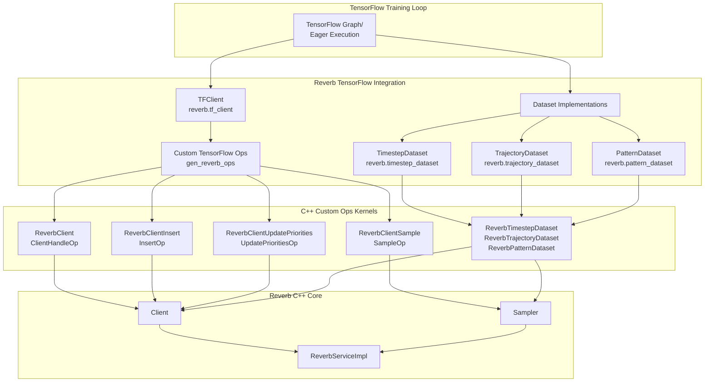
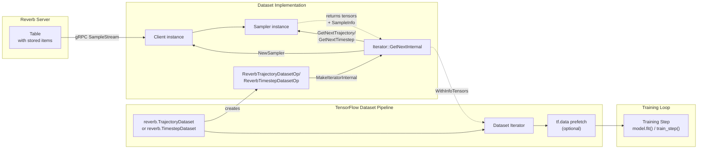
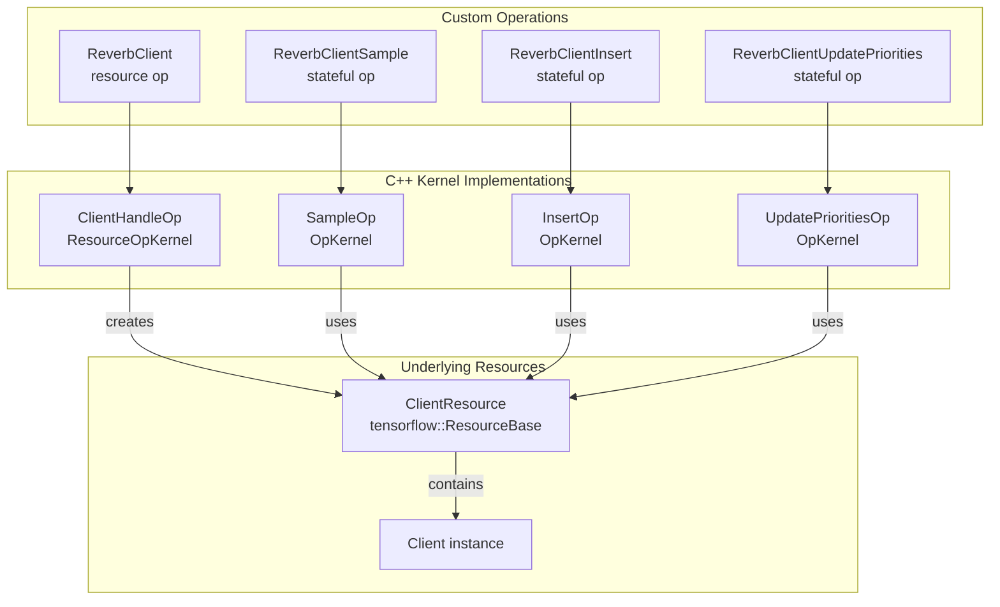
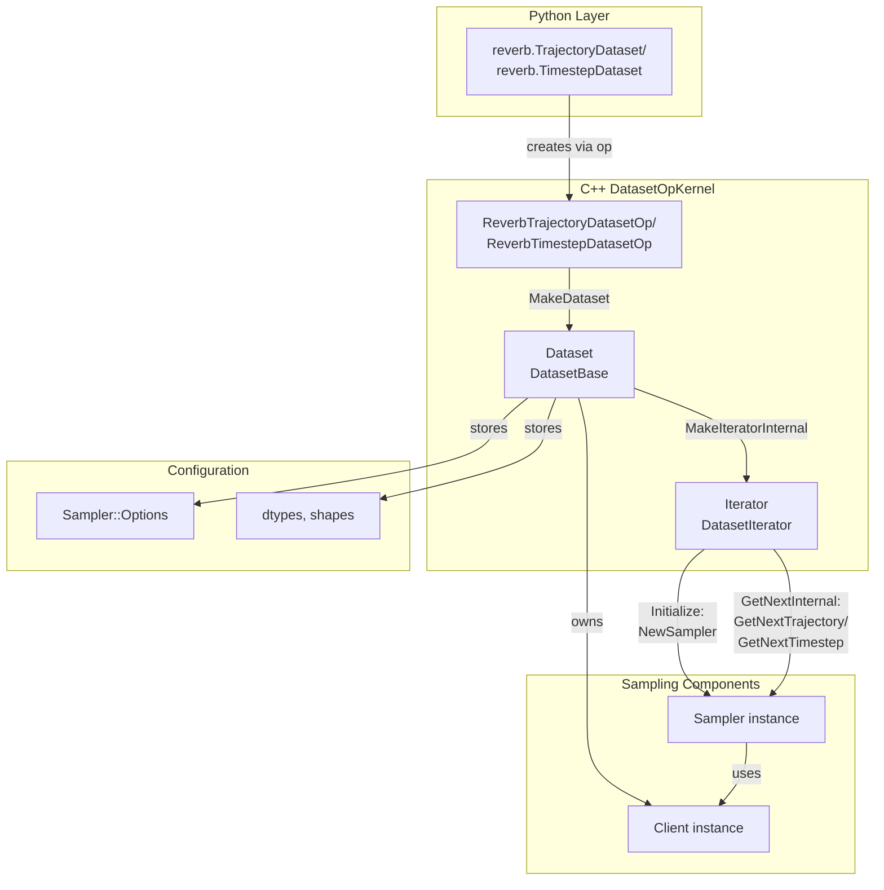
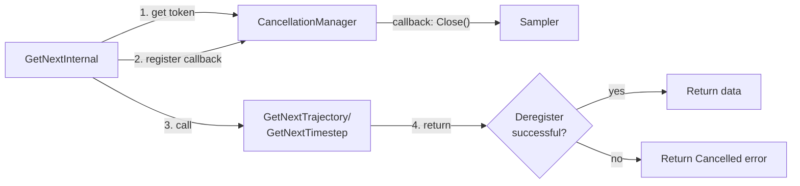
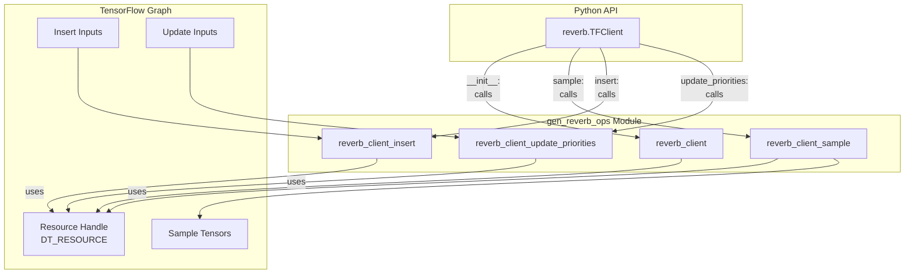
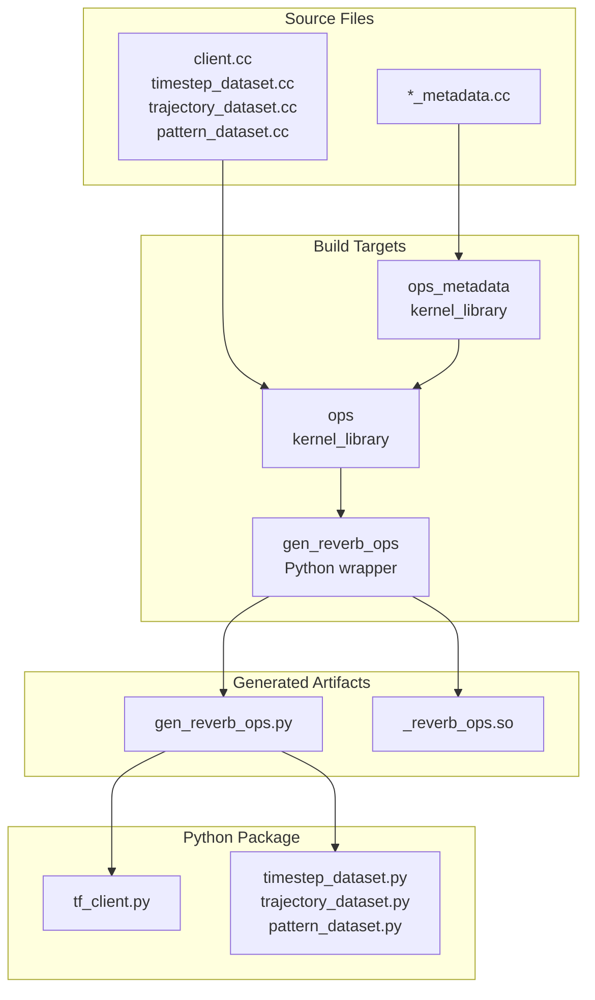

<!-- source: DeepWiki mcp.deepwiki.com · repo google-deepmind/reverb · page 5 TensorFlow Integration · fetched 2026-10-26 -->

# TensorFlow Integration

<details>
<summary>Relevant source files</summary>

The following files were used as context for generating this wiki page:

- [reverb/BUILD](reverb/BUILD)
- [reverb/__init__.py](reverb/__init__.py)
- [reverb/cc/ops/BUILD](reverb/cc/ops/BUILD)
- [reverb/cc/ops/client.cc](reverb/cc/ops/client.cc)
- [reverb/cc/ops/timestep_dataset.cc](reverb/cc/ops/timestep_dataset.cc)
- [reverb/cc/ops/trajectory_dataset.cc](reverb/cc/ops/trajectory_dataset.cc)

</details>


## Purpose and Scope

This document describes how Reverb integrates with TensorFlow to enable efficient data pipelines for machine learning training. Reverb provides two primary integration mechanisms: custom TensorFlow operations for native graph integration and specialized dataset implementations that extend TensorFlow's `tf.data.Dataset` API.

For information about the Python client API that operates independently of TensorFlow, see [Python Client API](#4). For details on the underlying C++ sampling and client implementations, see [Sampling System](#3.3) and [Client-Server Communication](#2.1).

---

## Integration Architecture

Reverb's TensorFlow integration consists of three main components that work together to provide seamless integration with TensorFlow training pipelines:



**Sources:** [reverb/BUILD:1-347](), [reverb/__init__.py:1-56](), [reverb/cc/ops/BUILD:1-88]()

The architecture separates concerns into three layers:

| Layer | Components | Purpose |
|-------|-----------|---------|
| **Python API** | `TFClient`, Dataset classes | User-facing interface for TensorFlow integration |
| **Custom Operations** | `gen_reverb_ops`, kernel implementations | TensorFlow graph-level primitives for Reverb operations |
| **C++ Core** | `Client`, `Sampler` | High-performance implementation of core functionality |

---

## Data Flow in TensorFlow Pipelines

The following diagram illustrates how data flows from a Reverb server through TensorFlow datasets into a training loop:



**Sources:** [reverb/cc/ops/trajectory_dataset.cc:1-317](), [reverb/cc/ops/timestep_dataset.cc:1-317]()

### Key Data Flow Characteristics

1. **Lazy Initialization**: The `Client` and `Sampler` are created only when the dataset iterator is initialized, not when the dataset object is constructed ([reverb/cc/ops/trajectory_dataset.cc:193-221]()).

2. **Validation**: On initialization, the dataset validates expected dtypes and shapes against the server's table signature with a 30-second timeout ([reverb/cc/ops/trajectory_dataset.cc:194-220]()).

3. **Metadata Tensors**: Each sample includes metadata tensors (key, probability, table_size, priority, times_sampled) in addition to the actual data ([reverb/cc/ops/trajectory_dataset.cc:247]()).

4. **Cancellation Support**: The iterator registers cancellation callbacks with TensorFlow's cancellation manager to handle graceful shutdown ([reverb/cc/ops/trajectory_dataset.cc:228-243]()).

---

## TensorFlow Custom Operations

Reverb defines four custom TensorFlow operations that provide low-level access to Reverb functionality within TensorFlow graphs. These are implemented as C++ kernels and exposed through the `gen_reverb_ops` Python module.

### Operation Catalog



**Sources:** [reverb/cc/ops/client.cc:1-247]()

### Operation Details

#### ReverbClient (ClientHandleOp)

The `ReverbClient` operation creates a `ClientResource` that wraps a C++ `Client` instance. This resource is stored in TensorFlow's resource manager and accessed by other operations.

**Implementation:** [reverb/cc/ops/client.cc:39-76]()

**Key attributes:**
- `server_address` (string): The address of the Reverb server to connect to

**Returns:** A resource handle to the `ClientResource`

#### ReverbClientSample (SampleOp)

Samples a single item from a specified table using a temporary sampler.

**Implementation:** [reverb/cc/ops/client.cc:78-127]()

**Inputs:**
- `handle`: Resource handle from `ReverbClient`
- `table`: Table name to sample from

**Returns:** Flattened list of tensors containing:
1. Sample metadata (key, probability, table_size, priority, times_sampled)
2. Actual data tensors as defined by the table signature

**Behavior:**
- Creates a temporary `Sampler` with `max_samples=1` and `max_in_flight_samples_per_worker=1` ([reverb/cc/ops/client.cc:94-96]())
- Validates signature with 30-second timeout ([reverb/cc/ops/client.cc:98-102]())
- Calls `GetNextTimestep` to retrieve a single sample ([reverb/cc/ops/client.cc:106-107]())

#### ReverbClientInsert (InsertOp)

Inserts data into one or more tables as a single item.

**Implementation:** [reverb/cc/ops/client.cc:179-229]()

**Inputs:**
- `handle`: Resource handle from `ReverbClient`
- `tables`: 1-D tensor of table names
- `priorities`: 1-D tensor of priorities (same shape as `tables`)
- `data`: List of tensors to insert

**Behavior:**
- Creates a temporary `Writer` with buffer size 1 ([reverb/cc/ops/client.cc:211-212]())
- Appends all data tensors as a single timestep ([reverb/cc/ops/client.cc:213-214]())
- Creates items in each specified table with corresponding priorities ([reverb/cc/ops/client.cc:216-221]())
- Flushes and closes the writer ([reverb/cc/ops/client.cc:223-225]())

#### ReverbClientUpdatePriorities (UpdatePrioritiesOp)

Updates priorities for existing items in a table.

**Implementation:** [reverb/cc/ops/client.cc:129-177]()

**Inputs:**
- `handle`: Resource handle from `ReverbClient`
- `table`: Table name
- `keys`: 1-D tensor of item keys (uint64)
- `priorities`: 1-D tensor of new priorities (double)

**Behavior:**
- Calls `Client::MutatePriorities` to update priorities ([reverb/cc/ops/client.cc:171]())
- Implements automatic retry for transient failures (unavailable/deadline exceeded) ([reverb/cc/ops/client.cc:169-172]())

**Sources:** [reverb/cc/ops/client.cc:1-247]()

---

## TensorFlow Dataset Implementations

Reverb provides three dataset implementations that extend `tf.data.Dataset` to efficiently sample data from Reverb servers within TensorFlow pipelines.

### Dataset Comparison

| Dataset | Sampling Unit | Use Case | Output Shape |
|---------|--------------|----------|--------------|
| **TimestepDataset** | Individual timesteps | Single-step methods (DQN, PPO) | Flattens trajectory into timesteps |
| **TrajectoryDataset** | Complete trajectories | Multi-step methods (n-step returns) | Returns full sequences |
| **PatternDataset** | Pattern-matched structures | Complex structured data | Returns nested structures |

### Implementation Architecture

Both `TimestepDataset` and `TrajectoryDataset` share a common implementation pattern:



**Sources:** [reverb/cc/ops/trajectory_dataset.cc:82-301](), [reverb/cc/ops/timestep_dataset.cc:82-301]()

### Common Dataset Features

#### Sampler Configuration

Both datasets accept identical sampler configuration parameters:

| Parameter | Type | Default | Description |
|-----------|------|---------|-------------|
| `max_in_flight_samples_per_worker` | int | - | Maximum concurrent sample requests per worker |
| `num_workers_per_iterator` | int | - | Number of parallel sampling workers |
| `max_samples_per_stream` | int | - | Maximum samples before reopening stream |
| `rate_limiter_timeout_ms` | int64 | - | Timeout for rate limiter (ms) |
| `max_samples` | int64 | - | Total samples before iterator exhaustion (0 = unlimited) |

**Configuration source:** [reverb/cc/ops/trajectory_dataset.cc:44-64]()

#### Initialization and Validation

The iterator initialization process ([reverb/cc/ops/trajectory_dataset.cc:193-221]()):

1. **Create Sampler**: Calls `Client::NewSampler` with validation dtypes/shapes (excluding metadata tensors)
2. **Validation Timeout**: Uses 30-second timeout for server communication
3. **Fallback on Timeout**: If validation times out, creates sampler without validation (using `-absl::InfiniteDuration()`)
4. **Warning Logging**: Logs warning when validation is skipped due to timeout

#### Cancellation Handling

The iterator properly integrates with TensorFlow's cancellation mechanism ([reverb/cc/ops/trajectory_dataset.cc:228-243]()):



**Sources:** [reverb/cc/ops/trajectory_dataset.cc:228-243](), [reverb/cc/ops/timestep_dataset.cc:228-243]()

#### Rate Limiter Timeout Handling

When `rate_limiter_timeout` is set to a finite duration, the iterator converts rate limiter timeout errors to end-of-sequence signals rather than propagating them as errors ([reverb/cc/ops/trajectory_dataset.cc:250-254]()).

#### Max Samples Handling

When `max_samples > 0`, the iterator converts `OutOfRange` errors to end-of-sequence signals ([reverb/cc/ops/trajectory_dataset.cc:255-259]()).

### TimestepDataset vs TrajectoryDataset

The primary difference between the two dataset implementations is the sampling method called:

| Dataset | C++ Method | Python Equivalent | Behavior |
|---------|-----------|-------------------|----------|
| **TimestepDataset** | `Sampler::GetNextTimestep` | `sampler.GetNextTimestep` | Flattens trajectories, returns one timestep at a time |
| **TrajectoryDataset** | `Sampler::GetNextTrajectory` | `sampler.GetNextTrajectory` | Returns complete trajectories as-is |

**Implementation comparison:**
- TimestepDataset: [reverb/cc/ops/timestep_dataset.cc:236-239]()
- TrajectoryDataset: [reverb/cc/ops/trajectory_dataset.cc:236-238]()

### TraceMeMetadata Support

Both datasets implement `GetTraceMeMetadata` to expose rate limiting information for profiling ([reverb/cc/ops/trajectory_dataset.cc:278-280]()):

```cpp
tensorflow::data::TraceMeMetadata GetTraceMeMetadata() const override {
  return {{"rate_limited", rate_limited_ ? "true" : "false"}};
}
```

This allows TensorFlow's profiler to track whether samples are delayed due to rate limiting.

**Sources:** [reverb/cc/ops/trajectory_dataset.cc:1-317](), [reverb/cc/ops/timestep_dataset.cc:1-317]()

---

## TFClient

The `TFClient` class provides a Python interface to the custom TensorFlow operations, enabling imperative-style interaction with Reverb from within TensorFlow code.

### TFClient Architecture



**Sources:** [reverb/BUILD:123-131](), [reverb/__init__.py:48]()

### TFClient Methods

The `TFClient` wraps the four custom operations into a cohesive Python API:

| Method | Underlying Op | Purpose |
|--------|--------------|---------|
| `__init__(server_address)` | `ReverbClient` | Create client resource |
| `sample(table)` | `ReverbClientSample` | Sample a single item |
| `insert(data, tables, priorities)` | `ReverbClientInsert` | Insert data into tables |
| `update_priorities(table, keys, priorities)` | `ReverbClientUpdatePriorities` | Update item priorities |

### Usage Context

`TFClient` is designed for use within TensorFlow's execution context (graph or eager mode). For general Python usage outside TensorFlow, use `reverb.Client` instead (see [Python Client API](#4)).

**Key distinction:**
- **TFClient**: Operations are TensorFlow ops that can be part of a computation graph
- **Client**: Pure Python/C++ client for imperative programming

**Sources:** [reverb/tf_client.py]() (referenced but not provided), [reverb/__init__.py:48]()

---

## Build System Integration

The TensorFlow integration components are built using Reverb's custom build rules that handle the complexity of creating TensorFlow-compatible extensions.

### Build Structure



**Sources:** [reverb/cc/ops/BUILD:1-88](), [reverb/BUILD:1-347]()

### Build Rules

The build process uses several custom Bazel rules:

1. **reverb_kernel_library**: Compiles C++ kernels that implement TensorFlow operations ([reverb/cc/ops/BUILD:16-47]())
2. **reverb_gen_op_wrapper_py**: Generates Python wrappers from kernel definitions ([reverb/cc/ops/BUILD:49-54]())
3. **reverb_pytype_library**: Creates Python modules with type checking ([reverb/BUILD:123-155]())

### Dependency Graph

| Component | Dependencies | Purpose |
|-----------|-------------|---------|
| **ops_metadata** | TensorFlow framework | Operation metadata (signatures, attributes) |
| **ops kernels** | ops_metadata, Client, Sampler | Kernel implementations |
| **gen_reverb_ops** | ops, ops_metadata | Python-accessible operations |
| **Python modules** | gen_reverb_ops | User-facing API |

**Sources:** [reverb/cc/ops/BUILD:1-88](), [reverb/BUILD:1-347]()

---

## Summary

Reverb's TensorFlow integration provides three levels of abstraction:

1. **Custom Operations** (`gen_reverb_ops`): Low-level TensorFlow ops for direct graph integration
2. **TFClient**: Imperative Python interface to custom ops
3. **Dataset Classes**: High-level `tf.data.Dataset` implementations for seamless pipeline integration

The integration is designed for high performance with features like:
- Lazy initialization and validation
- Automatic retry for transient failures
- Proper cancellation handling
- Rate limiter integration
- Profiling support via TraceMeMetadata

For most use cases, the Dataset classes (`TimestepDataset`, `TrajectoryDataset`, `PatternDataset`) provide the recommended interface for consuming Reverb data in TensorFlow training loops.

**Sources:** [reverb/__init__.py:1-56](), [reverb/cc/ops/client.cc:1-247](), [reverb/cc/ops/trajectory_dataset.cc:1-317](), [reverb/cc/ops/timestep_dataset.cc:1-317]()

---

