<!-- source: DeepWiki mcp.deepwiki.com · repo google-deepmind/reverb · page 5.1 TensorFlow Custom Operations · fetched 2026-10-26 -->

# TensorFlow Custom Operations

<details>
<summary>Relevant source files</summary>

The following files were used as context for generating this wiki page:

- [reverb/cc/ops/client.cc](reverb/cc/ops/client.cc)
- [reverb/cc/ops/timestep_dataset.cc](reverb/cc/ops/timestep_dataset.cc)
- [reverb/cc/ops/trajectory_dataset.cc](reverb/cc/ops/trajectory_dataset.cc)

</details>


## Purpose and Scope

This document describes the TensorFlow custom operations (ops) that enable native integration between Reverb and TensorFlow. These ops provide two primary integration patterns: resource-based client operations for imperative sampling and insertion, and dataset operations for building efficient TensorFlow input pipelines.

For information about using these ops from Python through the TFClient and Dataset APIs, see [TFClient](#5.3) and [TensorFlow Datasets](#5.2). For general client-side operations using pybind11, see [Python Client API](#4).

---

## Overview of Custom Operations

Reverb implements five custom TensorFlow operations that expose C++ functionality to TensorFlow's graph execution engine:

| Operation Name | Implementation Class | Purpose |
|----------------|---------------------|---------|
| `ReverbClient` | `ClientHandleOp` | Creates a resource handle to a Reverb client |
| `ReverbClientSample` | `SampleOp` | Samples a single item from a table |
| `ReverbClientInsert` | `InsertOp` | Inserts data into one or more tables |
| `ReverbClientUpdatePriorities` | `UpdatePrioritiesOp` | Updates item priorities |
| `ReverbTimestepDataset` | `ReverbTimestepDatasetOp` | Creates a dataset for sampling timesteps |
| `ReverbTrajectoryDataset` | `ReverbTrajectoryDatasetOp` | Creates a dataset for sampling trajectories |

These operations are registered with TensorFlow and can be used directly in TensorFlow graphs or through higher-level Python wrappers.

Sources: [reverb/cc/ops/client.cc:1-246](), [reverb/cc/ops/timestep_dataset.cc:1-317](), [reverb/cc/ops/trajectory_dataset.cc:1-317]()

---

## Custom Operation Architecture

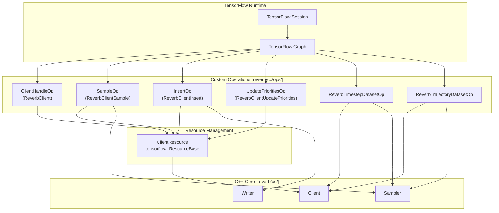

**Diagram: TensorFlow Custom Operations Architecture**

The architecture separates resource management (for client ops) from dataset operations. The `ClientResource` pattern allows multiple ops to share a single gRPC connection, while dataset ops create their own `Client` instances for independent lifecycle management.

Sources: [reverb/cc/ops/client.cc:39-76](), [reverb/cc/ops/timestep_dataset.cc:82-301](), [reverb/cc/ops/trajectory_dataset.cc:82-301]()

---

## Client Resource Management

### ClientResource and ClientHandleOp

The `ClientResource` class wraps a C++ `Client` instance and manages its lifetime according to TensorFlow's resource management semantics:

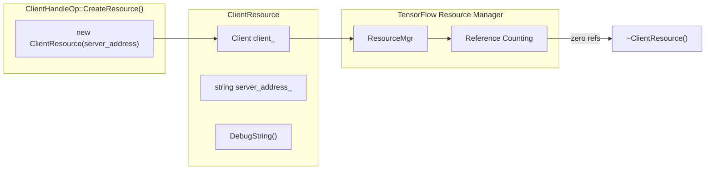

**Diagram: ClientResource Lifecycle**

The `ClientHandleOp` inherits from `tensorflow::ResourceOpKernel<ClientResource>` and implements `CreateResource()` to instantiate the resource:

```
ClientHandleOp::CreateResource(ClientResource** ret)
├── Creates new ClientResource with server_address attribute
└── TensorFlow manages lifecycle via reference counting
```

When the op executes, it returns a resource handle (tensor) that other ops can use to access the same `Client` instance.

Sources: [reverb/cc/ops/client.cc:39-76]()

---

## Client Operation Implementations

### ReverbClientSample (SampleOp)

The `SampleOp` performs synchronous sampling of a single item from a table:

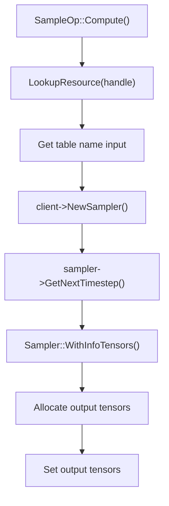

**Diagram: SampleOp Execution Flow**

Key implementation details:

1. **Resource Lookup**: Uses `LookupResource()` with the handle from input 0 to access `ClientResource`
2. **Sampler Creation**: Creates a `Sampler` with `max_samples=1` and `max_in_flight_samples_per_worker=1` for single-item sampling
3. **Validation Timeout**: Uses a 30-second timeout for shape/dtype validation
4. **Output Construction**: Combines sample data with info tensors (key, probability, table_size, priority) using `Sampler::WithInfoTensors()`
5. **Tensor Allocation**: Allocates output tensors and moves data to avoid copies

The output includes `Sampler::kNumInfoTensors` metadata tensors followed by the actual data tensors.

Sources: [reverb/cc/ops/client.cc:78-127]()

---

### ReverbClientInsert (InsertOp)

The `InsertOp` inserts data into one or more tables:

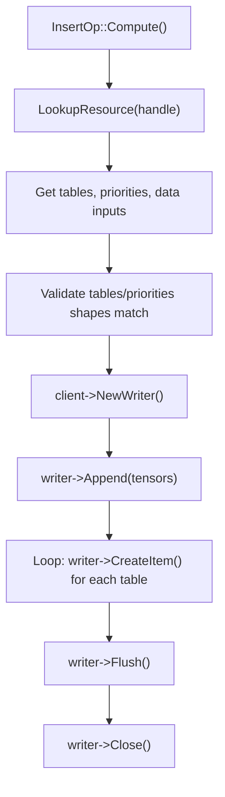

**Diagram: InsertOp Execution Flow**

Implementation characteristics:

1. **Input Validation**: Ensures `tables` and `priorities` tensors are rank-1 with matching shapes
2. **Writer Configuration**: Creates a `Writer` with `chunk_length=1` and `max_timesteps=1` for single-step insertion
3. **Data Append**: Appends all data tensors in a single call
4. **Multi-table Insert**: Creates items for each table in the `tables` tensor with corresponding priorities
5. **Synchronous Flush**: Calls `Flush()` and `Close()` to ensure data is sent before returning

This op is designed for simple insertions where all data fits in a single chunk.

Sources: [reverb/cc/ops/client.cc:179-229]()

---

### ReverbClientUpdatePriorities (UpdatePrioritiesOp)

The `UpdatePrioritiesOp` updates priorities for existing items:

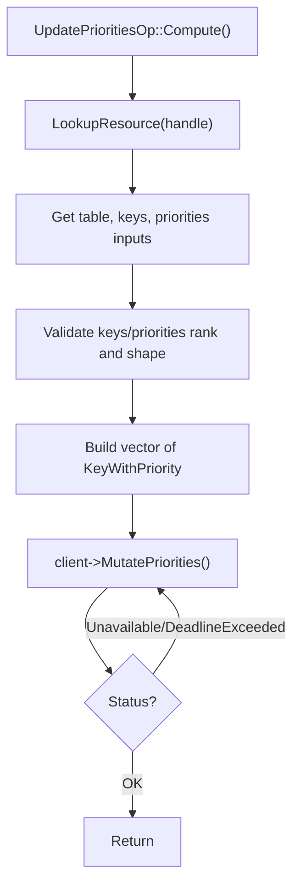

**Diagram: UpdatePrioritiesOp Execution Flow**

Implementation features:

1. **Input Validation**: Verifies `keys` and `priorities` are rank-1 tensors with identical shapes
2. **Update Construction**: Builds `KeyWithPriority` proto messages for each key-priority pair
3. **Retry Logic**: Retries on `Unavailable` or `DeadlineExceeded` status (server preemption)
4. **Wait-for-ready**: The underlying `MutatePriorities` call uses gRPC's wait-for-ready feature, so retries will block until server is available

The retry loop is safe because `MutatePriorities` is idempotent.

Sources: [reverb/cc/ops/client.cc:129-177]()

---

## Dataset Operation Architecture

### Dataset Op Pattern

Both `ReverbTimestepDatasetOp` and `ReverbTrajectoryDatasetOp` follow TensorFlow's dataset op pattern:

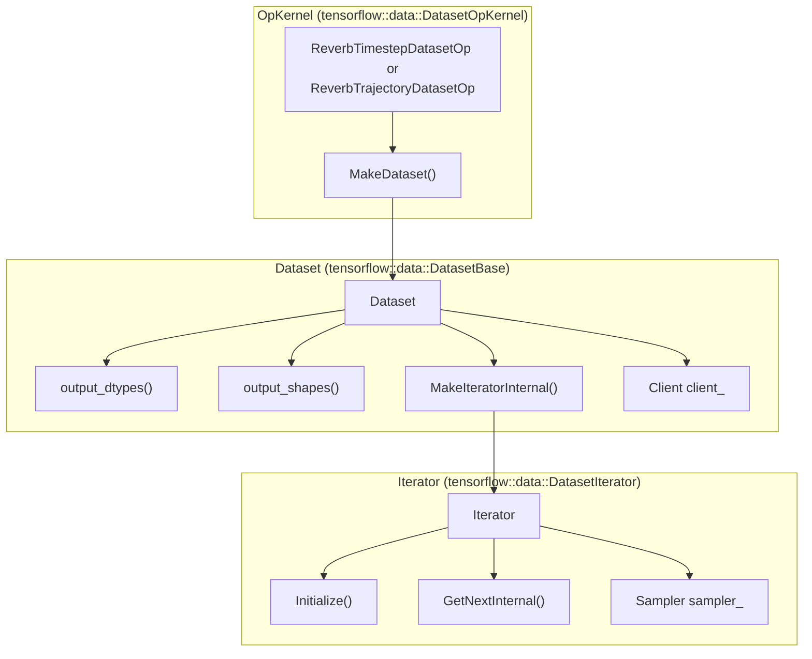

**Diagram: Dataset Operation Class Hierarchy**

The three-tier structure separates concerns:

1. **OpKernel**: Parses attributes and creates the Dataset
2. **Dataset**: Holds configuration and creates Iterators
3. **Iterator**: Performs actual sampling via `Sampler`

Each `Iterator` instance creates its own `Sampler` during initialization, allowing independent sampling across multiple dataset iterators.

Sources: [reverb/cc/ops/timestep_dataset.cc:41-308](), [reverb/cc/ops/trajectory_dataset.cc:41-308]()

---

## TimestepDataset and TrajectoryDataset

### Common Configuration

Both dataset ops share the same configuration attributes:

| Attribute | Type | Purpose |
|-----------|------|---------|
| `server_address` | string | Reverb server address |
| `table` | string | Table name to sample from |
| `max_in_flight_samples_per_worker` | int64 | Concurrent sample requests per worker |
| `num_workers_per_iterator` | int64 | Number of sampling workers |
| `max_samples_per_stream` | int64 | Items per gRPC stream before reconnecting |
| `rate_limiter_timeout_ms` | int64 | Timeout for rate limiter (ms) |
| `max_samples` | int64 | Maximum samples before ending iteration |
| `dtypes` | list(type) | Expected output data types |
| `shapes` | list(shape) | Expected output shapes |

These are stored in `Sampler::Options` and passed to the `Sampler` during iterator initialization.

Sources: [reverb/cc/ops/timestep_dataset.cc:43-64](), [reverb/cc/ops/trajectory_dataset.cc:43-64]()

---

### Iterator Initialization and Validation

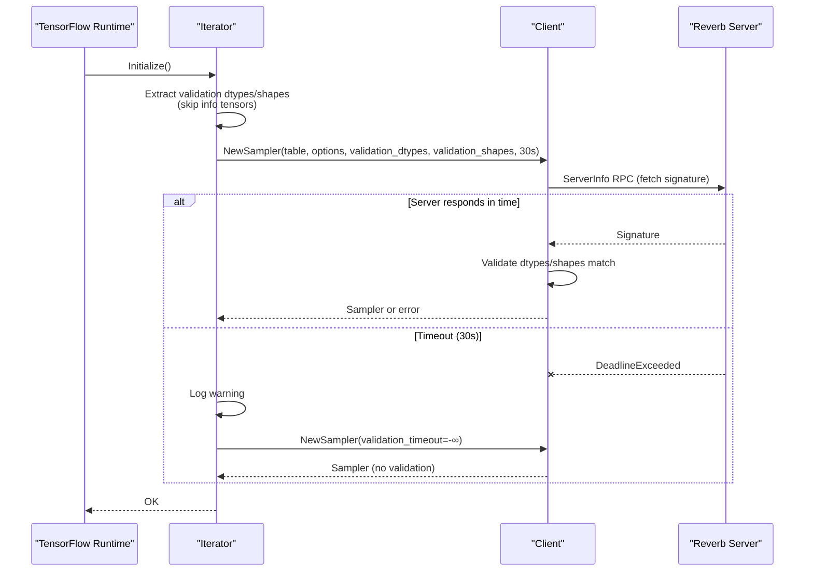

**Diagram: Iterator Initialization with Shape/Dtype Validation**

The validation process:

1. **Metadata Exclusion**: The first `Sampler::kNumInfoTensors` elements of `dtypes_` and `shapes_` are metadata fields, so they're excluded from validation
2. **Server Query**: Attempts to fetch the table signature from the server with a 30-second timeout
3. **Graceful Degradation**: If the server is unreachable, logs a warning and creates the sampler without validation
4. **Negative Timeout**: Passing `-absl::InfiniteDuration()` as validation timeout signals to skip validation

This allows datasets to be constructed even when the server is temporarily unavailable.

Sources: [reverb/cc/ops/timestep_dataset.cc:193-221](), [reverb/cc/ops/trajectory_dataset.cc:193-221]()

---

### GetNextInternal: Sampling Loop

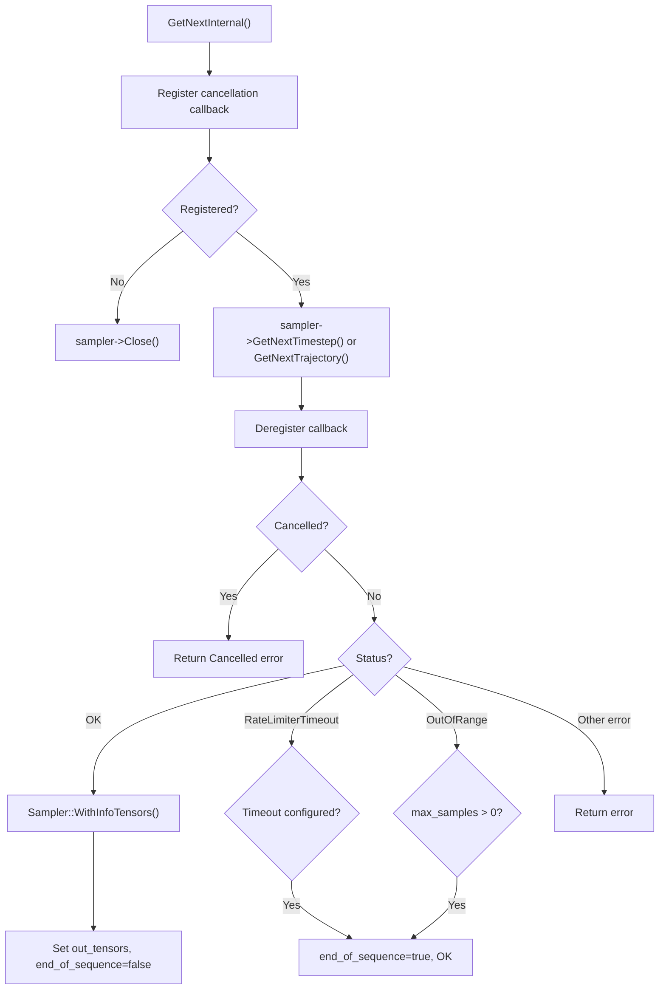

**Diagram: GetNextInternal Execution Flow**

Key aspects of the sampling implementation:

1. **Cancellation Support**: Registers a callback with TensorFlow's `CancellationManager` that calls `sampler_->Close()` on cancellation
2. **Timestep vs Trajectory**: `ReverbTimestepDatasetOp` calls `GetNextTimestep()`, while `ReverbTrajectoryDatasetOp` calls `GetNextTrajectory()`
3. **Rate Limiter Timeout**: If configured and a rate limiter timeout occurs, ends the sequence gracefully rather than returning an error
4. **Max Samples**: When `max_samples` is reached, `Sampler` returns `OutOfRange`, which is converted to end-of-sequence
5. **Info Tensors**: Uses `Sampler::WithInfoTensors()` to prepend metadata tensors to the data tensors

The `rate_limited_` field is updated for telemetry via `GetTraceMeMetadata()`.

Sources: [reverb/cc/ops/timestep_dataset.cc:223-264](), [reverb/cc/ops/trajectory_dataset.cc:223-263]()

---

## Integration with TensorFlow Runtime

### Resource Registration

Client operations use TensorFlow's resource management system:

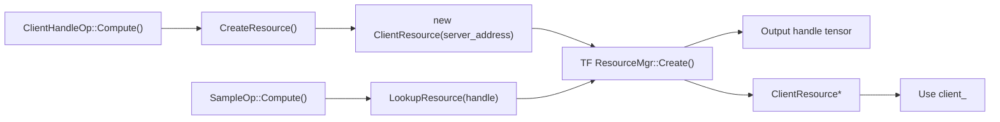

**Diagram: Resource Management Flow**

The handle is a unique identifier tensor that allows multiple ops to share the same `ClientResource`. TensorFlow automatically manages reference counting and cleanup.

Sources: [reverb/cc/ops/client.cc:59-76]()

---

### Kernel Registration

All ops are registered with TensorFlow's kernel registry for CPU devices:

```cpp
REGISTER_KERNEL_BUILDER(Name("ReverbClient").Device(tensorflow::DEVICE_CPU),
                        ClientHandleOp);

REGISTER_KERNEL_BUILDER(Name("ReverbClientInsert").Device(tensorflow::DEVICE_CPU), 
                        InsertOp);

REGISTER_KERNEL_BUILDER(Name("ReverbClientSample").Device(tensorflow::DEVICE_CPU), 
                        SampleOp);

REGISTER_KERNEL_BUILDER(Name("ReverbClientUpdatePriorities").Device(tensorflow::DEVICE_CPU),
                        UpdatePrioritiesOp);

REGISTER_KERNEL_BUILDER(Name("ReverbTimestepDataset").Device(tensorflow::DEVICE_CPU),
                        ReverbTimestepDatasetOp);

REGISTER_KERNEL_BUILDER(Name("ReverbTrajectoryDataset").Device(tensorflow::DEVICE_CPU),
                        ReverbTrajectoryDatasetOp);
```

These registrations map op names to their implementations and specify device compatibility. All Reverb ops currently run only on CPU due to the gRPC communication requirement.

Sources: [reverb/cc/ops/client.cc:231-242](), [reverb/cc/ops/timestep_dataset.cc:310-312](), [reverb/cc/ops/trajectory_dataset.cc:310-312]()

---

## Error Handling and Status Conversion

### Status Conversion Utilities

Reverb uses `ToTensorflowStatus()` and `FromTensorflowStatus()` to convert between Abseil and TensorFlow status types:

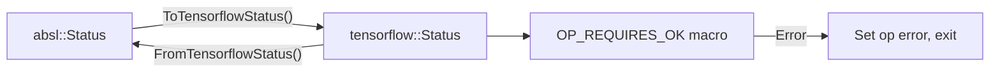

**Diagram: Status Conversion Flow**

The `OP_REQUIRES_OK` macro is used extensively to check status and automatically handle errors:

- On success: continues execution
- On failure: sets the op's error status and returns immediately

This provides clean error propagation from C++ core components to TensorFlow.

Sources: [reverb/cc/ops/client.cc:15-246](), [reverb/cc/support/tf_util.h]()

---

### Retry Logic for Transient Failures

The `UpdatePrioritiesOp` implements retry logic for transient failures:

```cpp
absl::Status status;
do {
  status = resource->client()->MutatePriorities(table_str, updates, {});
} while (absl::IsUnavailable(status) || absl::IsDeadlineExceeded(status));
```

This tight retry loop is safe because:

1. `MutatePriorities` is idempotent (multiple updates with same data produce same result)
2. gRPC's `wait_for_ready` flag ensures the request waits until server is available
3. Only retries on server unavailability, not client errors

Other ops do not implement retry logic and fail immediately on errors.

Sources: [reverb/cc/ops/client.cc:169-173]()

---

## Dataset Serialization Support

### AsGraphDefInternal Implementation

Both dataset ops implement `AsGraphDefInternal()` to support graph serialization:

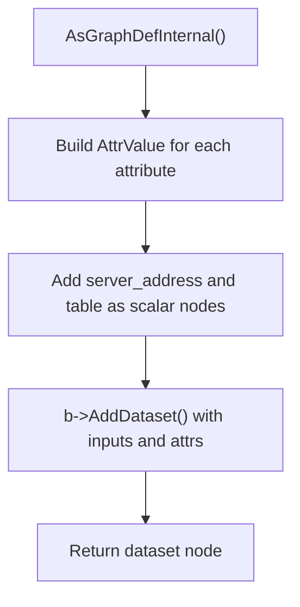

**Diagram: Dataset Serialization Flow**

This enables:

1. **Graph Export**: Datasets can be serialized to GraphDef for saving
2. **Cross-platform Execution**: Serialized graphs can be loaded and executed in different processes
3. **TensorFlow Serving**: Datasets can be embedded in SavedModels

However, iterator state serialization is not supported (both `SaveInternal` and `RestoreInternal` return `Unimplemented` errors).

Sources: [reverb/cc/ops/timestep_dataset.cc:128-175](), [reverb/cc/ops/trajectory_dataset.cc:128-175]()

---

## Performance Considerations

### Sampler Configuration

The dataset ops expose `Sampler::Options` that directly impact performance:

| Parameter | Impact | Recommended Range |
|-----------|--------|-------------------|
| `num_workers` | Higher = more parallelism, more server load | 1-12 per iterator |
| `max_in_flight_samples_per_worker` | Higher = better throughput, more memory | 5-100 |
| `max_samples_per_stream` | Lower = more reconnection overhead | 100-1000 |

The optimal configuration depends on:

- Network latency between client and server
- Size of sampled items
- Rate limiter configuration
- Available client memory

Sources: [reverb/cc/ops/timestep_dataset.cc:46-56](), [reverb/cc/ops/trajectory_dataset.cc:46-56]()

---

### Single-Item Sampling Efficiency

The `ReverbClientSample` op is designed for ad-hoc sampling but is less efficient than datasets:

**Inefficiencies:**
- Creates a new `Sampler` on every call
- Performs shape/dtype validation on every sample
- Uses single worker with `max_in_flight=1`
- No connection pooling across samples

**Use Cases:**
- Interactive debugging
- Non-performance-critical sampling
- Single samples in actor loops

For training loops, prefer `ReverbTimestepDataset` or `ReverbTrajectoryDataset`.

Sources: [reverb/cc/ops/client.cc:78-127]()

---

## Summary

The TensorFlow custom operations provide two integration patterns:

1. **Resource-based Ops** (`ReverbClient`, `ReverbClientSample`, `ReverbClientInsert`, `ReverbClientUpdatePriorities`): Imperative operations for simple use cases, sharing a single client connection via TensorFlow's resource management.

2. **Dataset Ops** (`ReverbTimestepDataset`, `ReverbTrajectoryDataset`): Efficient streaming integration with TensorFlow's data pipeline, supporting parallel workers, prefetching, and automatic batching.

All ops properly integrate with TensorFlow's error handling, cancellation, and graph serialization mechanisms. The dataset ops provide production-ready performance through multi-threaded sampling, while the client ops offer simplicity for prototyping and debugging.

Sources: [reverb/cc/ops/client.cc:1-246](), [reverb/cc/ops/timestep_dataset.cc:1-317](), [reverb/cc/ops/trajectory_dataset.cc:1-317]()

---

