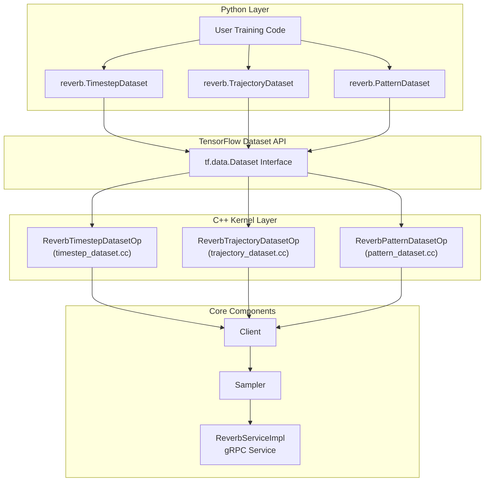
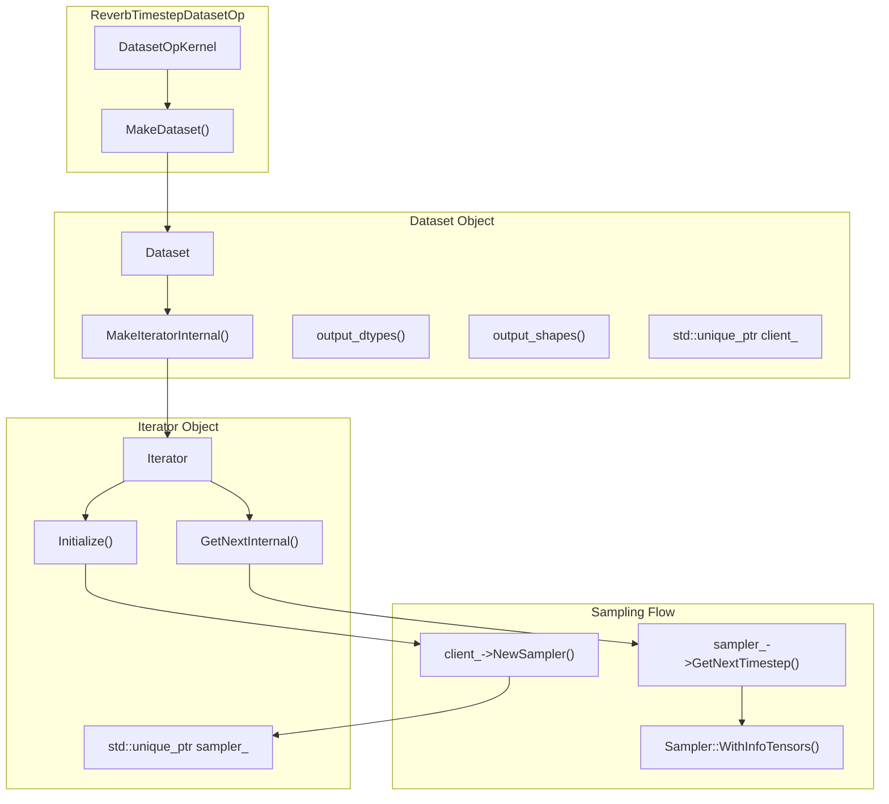
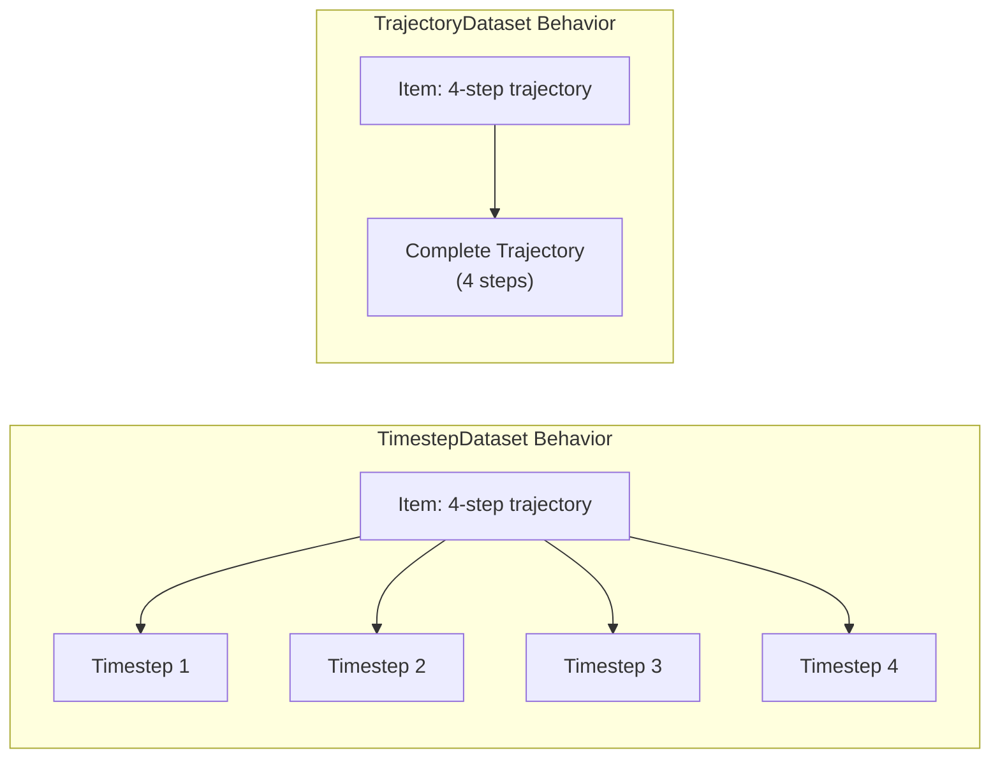
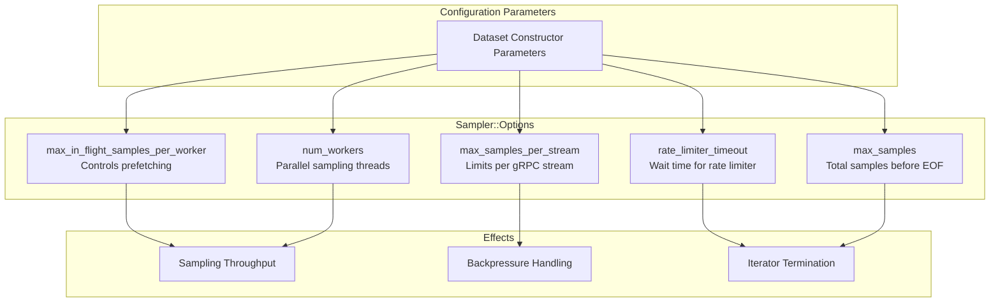
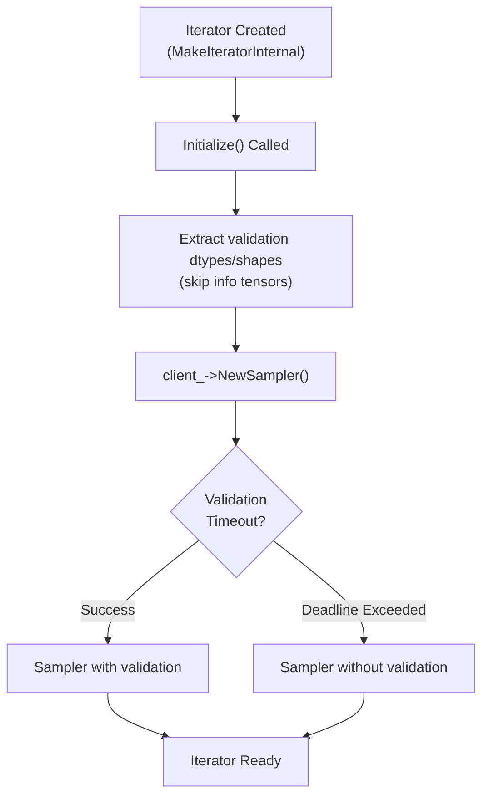
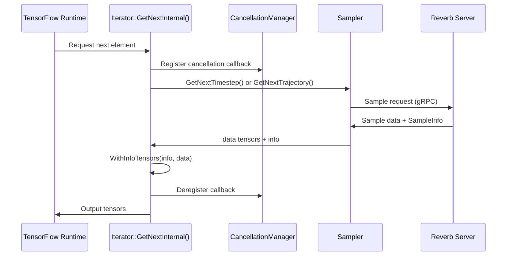
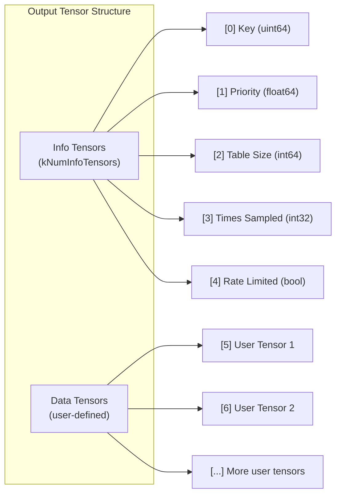

<!-- source: DeepWiki mcp.deepwiki.com · repo google-deepmind/reverb · page 5.2 TensorFlow Datasets · fetched 2026-10-26 -->

# TensorFlow Datasets

<details>
<summary>Relevant source files</summary>

The following files were used as context for generating this wiki page:

- [reverb/BUILD](reverb/BUILD)
- [reverb/__init__.py](reverb/__init__.py)
- [reverb/cc/ops/BUILD](reverb/cc/ops/BUILD)
- [reverb/cc/ops/client.cc](reverb/cc/ops/client.cc)
- [reverb/cc/ops/timestep_dataset.cc](reverb/cc/ops/timestep_dataset.cc)
- [reverb/cc/ops/trajectory_dataset.cc](reverb/cc/ops/trajectory_dataset.cc)

</details>


## Purpose and Scope

This document describes the TensorFlow Dataset implementations in Reverb that enable integration with TensorFlow's `tf.data.Dataset` API for building efficient training pipelines. These datasets provide a native TensorFlow interface for consuming samples from Reverb tables, allowing seamless integration into existing TensorFlow training loops.

For information about the underlying TensorFlow custom operations that power these datasets, see [TensorFlow Custom Operations](#5.1). For the TensorFlow-native client interface, see [TFClient](#5.3).

---

## Overview

Reverb provides three dataset types that implement TensorFlow's `tf.data.Dataset` interface:

| Dataset Type | Purpose | Returns | Source File |
|--------------|---------|---------|-------------|
| **TimestepDataset** | Individual timestep sampling | Single timesteps from trajectories | [reverb/timestep_dataset.py]() |
| **TrajectoryDataset** | Full trajectory sampling | Complete trajectories | [reverb/trajectory_dataset.py]() |
| **PatternDataset** | Pattern-based sampling | Data matching structural patterns | [reverb/pattern_dataset.py]() |

Each dataset type is implemented as a TensorFlow custom dataset operation in C++ with a Python wrapper for ease of use.

**Sources:** [reverb/BUILD:133-155](), [reverb/__init__.py:50-52]()

---

## Architecture

### Two-Layer Implementation



**Diagram: TensorFlow Dataset Architecture**

Each dataset consists of:
1. **Python Wrapper**: Exposes a `tf.data.Dataset`-compatible interface
2. **C++ DatasetOpKernel**: Implements the core dataset operation
3. **Dataset Class**: Manages connection to Reverb server via `Client`
4. **Iterator Class**: Handles actual data sampling via `Sampler`

**Sources:** [reverb/cc/ops/timestep_dataset.cc:41-308](), [reverb/cc/ops/trajectory_dataset.cc:41-308]()

---

## TimestepDataset

### Purpose

`TimestepDataset` samples individual timesteps from Reverb tables. When items are multi-timestep trajectories, the dataset unpacks them and returns one timestep at a time.

### Python Interface

```python
# reverb/timestep_dataset.py
class TimestepDataset(tf.data.Dataset):
    def __init__(
        self,
        server_address: str,
        table: str,
        dtypes: Sequence[tf.DType],
        shapes: Sequence[tf.TensorShape],
        max_in_flight_samples_per_worker: int = 2,
        num_workers_per_iterator: int = -1,
        max_samples_per_stream: int = -1,
        rate_limiter_timeout_ms: int = -1,
        max_samples: int = -1,
    )
```

**Sources:** [reverb/timestep_dataset.py]()

### C++ Implementation Structure



**Diagram: TimestepDataset Implementation Flow**

**Sources:** [reverb/cc/ops/timestep_dataset.cc:41-312]()

### Key Implementation Details

#### Dataset Construction
The C++ kernel `ReverbTimestepDatasetOp` extends `tensorflow::data::DatasetOpKernel` and creates a `Dataset` object that holds:
- Server address and table name
- Expected dtypes and shapes
- Sampler configuration options
- A `Client` instance for communication

**Sources:** [reverb/cc/ops/timestep_dataset.cc:82-125]()

#### Iterator Initialization
When an iterator is created:
1. `Initialize()` is called with an `IteratorContext`
2. A new `Sampler` is created via `client_->NewSampler()`
3. Shape and dtype validation occurs (with 30-second timeout)
4. If validation times out, the sampler is created without validation

**Sources:** [reverb/cc/ops/timestep_dataset.cc:193-221]()

#### Timestep Retrieval
In `GetNextInternal()`:
1. Cancellation callback is registered to allow early termination
2. `sampler_->GetNextTimestep()` is called
3. Data tensors and `SampleInfo` metadata are retrieved
4. Info tensors are prepended via `Sampler::WithInfoTensors()`
5. Rate limiter timeout results in `end_of_sequence = true`

**Sources:** [reverb/cc/ops/timestep_dataset.cc:223-264]()

---

## TrajectoryDataset

### Purpose

`TrajectoryDataset` samples complete trajectories from Reverb tables. Each call to the iterator returns an entire trajectory as stored in the table.

### Python Interface

```python
# reverb/trajectory_dataset.py
class TrajectoryDataset(tf.data.Dataset):
    def __init__(
        self,
        server_address: str,
        table: str,
        dtypes: Sequence[tf.DType],
        shapes: Sequence[tf.TensorShape],
        max_in_flight_samples_per_worker: int = 2,
        num_workers_per_iterator: int = -1,
        max_samples_per_stream: int = -1,
        rate_limiter_timeout_ms: int = -1,
        max_samples: int = -1,
    )
```

**Sources:** [reverb/trajectory_dataset.py]()

### Differences from TimestepDataset

The implementation is nearly identical to `TimestepDataset`, with one key difference:

| Aspect | TimestepDataset | TrajectoryDataset |
|--------|-----------------|-------------------|
| Sampling Method | `sampler_->GetNextTimestep()` | `sampler_->GetNextTrajectory()` |
| Returns | Single timestep | Full trajectory |
| Trajectory Unpacking | Yes (automatic) | No |



**Diagram: TimestepDataset vs TrajectoryDataset Output**

**Sources:** [reverb/cc/ops/trajectory_dataset.cc:238](), [reverb/cc/ops/timestep_dataset.cc:239]()

---

## Configuration Options

### Sampler Options

Both dataset types accept the same configuration parameters, which are passed to the underlying `Sampler`:



**Diagram: Configuration Options and Effects**

| Option | Default | Purpose |
|--------|---------|---------|
| `max_in_flight_samples_per_worker` | 2 | Controls how many samples each worker prefetches |
| `num_workers_per_iterator` | -1 (auto) | Number of parallel sampling threads |
| `max_samples_per_stream` | -1 (unlimited) | Max samples per gRPC stream before reconnection |
| `rate_limiter_timeout_ms` | -1 (infinite) | Timeout waiting for rate limiter; causes EOF on timeout |
| `max_samples` | -1 (unlimited) | Total samples to return before EOF |

**Sources:** [reverb/cc/ops/timestep_dataset.cc:46-63](), [reverb/cc/ops/trajectory_dataset.cc:46-63]()

### Validation Timeout

During iterator initialization, shape and dtype validation occurs with a 30-second timeout:

```cpp
constexpr auto kValidationTimeout = absl::Seconds(30);
auto status = client_->NewSampler(table_, sampler_options_,
                                  validation_dtypes, validation_shapes,
                                  kValidationTimeout, &sampler_);
```

If the server cannot be reached within this timeout, the sampler is created without validation.

**Sources:** [reverb/cc/ops/timestep_dataset.cc:194-220](), [reverb/cc/ops/trajectory_dataset.cc:194-220]()

---

## Iterator Lifecycle

### Initialization Flow



**Diagram: Iterator Initialization Process**

**Sources:** [reverb/cc/ops/timestep_dataset.cc:193-221]()

### Sampling Flow



**Diagram: Sampling Flow During Iteration**

**Sources:** [reverb/cc/ops/timestep_dataset.cc:223-264]()

### Termination Conditions

The iterator signals `end_of_sequence = true` under these conditions:

1. **Rate Limiter Timeout**: If `rate_limiter_timeout` is set and the rate limiter blocks longer than this duration
2. **Max Samples Reached**: If `max_samples` is set and that many samples have been returned
3. **Cancellation**: If the TensorFlow context is cancelled

```cpp
if (status.ok()) {
  *end_of_sequence = false;
  *out_tensors = Sampler::WithInfoTensors(*info, std::move(data));
  rate_limited_ = info->rate_limited();
  return absl::OkStatus();
} else if (sampler_options_.rate_limiter_timeout < absl::InfiniteDuration() &&
           errors::IsRateLimiterTimeout(status)) {
  *end_of_sequence = true;
  return absl::OkStatus();
} else if (absl::IsOutOfRange(status) && sampler_options_.max_samples > 0) {
  *end_of_sequence = true;
  return absl::OkStatus();
} else {
  return ToTensorflowStatus(status);
}
```

**Sources:** [reverb/cc/ops/timestep_dataset.cc:246-263]()

---

## Metadata Tensors

### Info Tensor Structure

Every sample returned by a Reverb dataset includes metadata tensors prepended to the data tensors. These are defined by `Sampler::kNumInfoTensors`:



**Diagram: Dataset Output Tensor Structure**

### Validation Adjustments

During validation, info tensors are excluded:

```cpp
// The shapes and dtypes contains metadata fields but the signature does not.
tensorflow::DataTypeVector validation_dtypes(
    dtypes_.begin() + Sampler::kNumInfoTensors, dtypes_.end());
std::vector<tensorflow::PartialTensorShape> validation_shapes(
    shapes_.begin() + Sampler::kNumInfoTensors, shapes_.end());
```

This ensures that only the user-defined data structure is validated against the table's signature.

**Sources:** [reverb/cc/ops/timestep_dataset.cc:196-201]()

---

## PatternDataset

### Purpose

`PatternDataset` provides pattern-based sampling that matches structural patterns defined using protocol buffers. This allows for more complex sampling patterns than simple trajectories.

### Integration

PatternDataset is listed in the build dependencies and exported from the main module:

- **Build target**: [reverb/BUILD:326-337]()
- **Export**: [reverb/__init__.py:38]()
- **Implementation**: [reverb/pattern_dataset.py]()

The C++ kernel is registered as `ReverbPatternDataset` in [reverb/cc/ops/pattern_dataset.cc]().

**Sources:** [reverb/BUILD:326-337](), [reverb/__init__.py:38]()

---

## Cancellation Handling

### Graceful Shutdown

Both dataset types support cancellation through TensorFlow's `CancellationManager`:

```cpp
auto token = ctx->cancellation_manager()->get_cancellation_token();
bool registered = ctx->cancellation_manager()->RegisterCallback(
    token, [&] { sampler_->Close(); });
if (!registered) {
  sampler_->Close();
}

// ... perform sampling ...

if (registered && !ctx->cancellation_manager()->DeregisterCallback(token)) {
  return Cancelled("Iterator context was cancelled");
}
```

This ensures that:
1. When cancellation is requested, the sampler is immediately closed
2. In-flight sampling operations are interrupted
3. Resources are cleaned up properly

**Sources:** [reverb/cc/ops/timestep_dataset.cc:228-243](), [reverb/cc/ops/trajectory_dataset.cc:228-243]()

---

## Rate Limiting Metadata

### TraceMeMetadata

The iterator provides metadata for TensorFlow's profiling tools via `GetTraceMeMetadata()`:

```cpp
tensorflow::data::TraceMeMetadata GetTraceMeMetadata() const override {
  return {{"rate_limited", rate_limited_ ? "true" : "false"}};
}
```

This allows profiling tools to identify when samples are delayed due to rate limiting, which is valuable for diagnosing performance issues.

**Sources:** [reverb/cc/ops/timestep_dataset.cc:279-281](), [reverb/cc/ops/trajectory_dataset.cc:279-281]()

---

## Serialization Support

### Current Limitations

Dataset serialization (checkpointing) is currently not supported:

```cpp
absl::Status SaveInternal(
    tensorflow::data::SerializationContext* ctx,
    tensorflow::data::IteratorStateWriter* writer) override {
  return Unimplemented("SaveInternal is currently not supported");
}

absl::Status RestoreInternal(
    tensorflow::data::IteratorContext* ctx,
    tensorflow::data::IteratorStateReader* reader) override {
  return Unimplemented("RestoreInternal is currently not supported");
}
```

This means Reverb datasets cannot be checkpointed as part of a TensorFlow SavedModel or training checkpoint.

**Sources:** [reverb/cc/ops/timestep_dataset.cc:267-276]()

---

## Summary

Reverb's TensorFlow datasets provide a seamless integration with TensorFlow's data pipeline API:

1. **TimestepDataset** unpacks and returns individual timesteps
2. **TrajectoryDataset** returns complete trajectories
3. **PatternDataset** supports pattern-based sampling
4. All datasets use C++ kernels for performance with Python wrappers for ease of use
5. Configuration options control throughput, backpressure, and termination
6. Metadata tensors provide sample information for training
7. Cancellation and rate limiting are properly handled

**Sources:** [reverb/BUILD:133-155](), [reverb/__init__.py:50-52](), [reverb/cc/ops/timestep_dataset.cc](), [reverb/cc/ops/trajectory_dataset.cc]()

---

