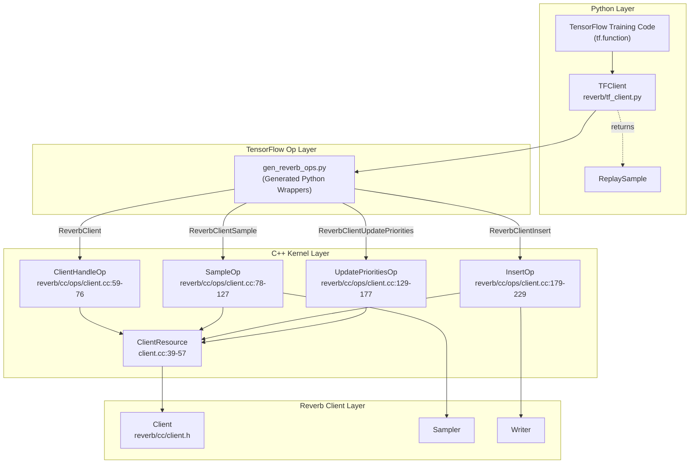
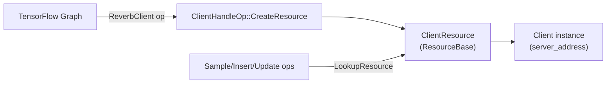
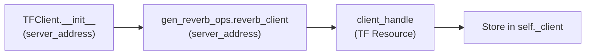
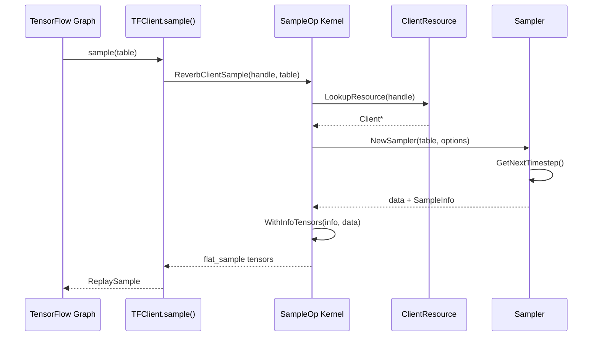
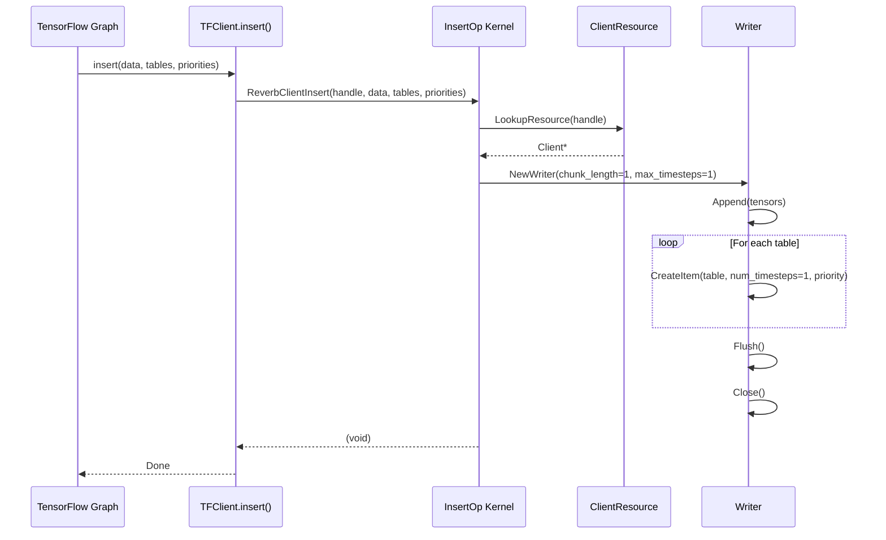
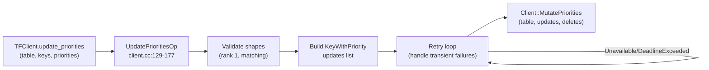
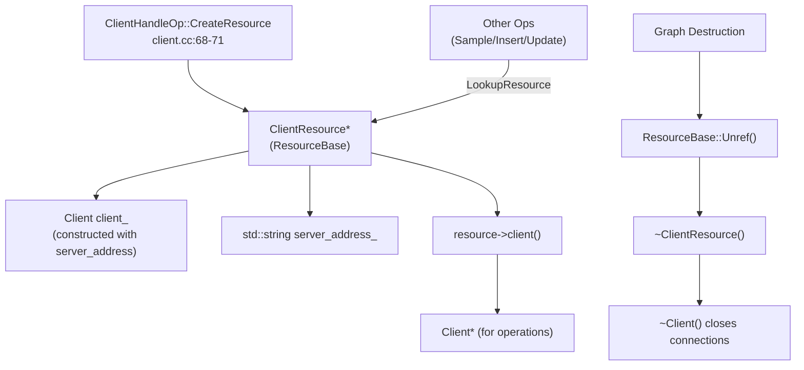
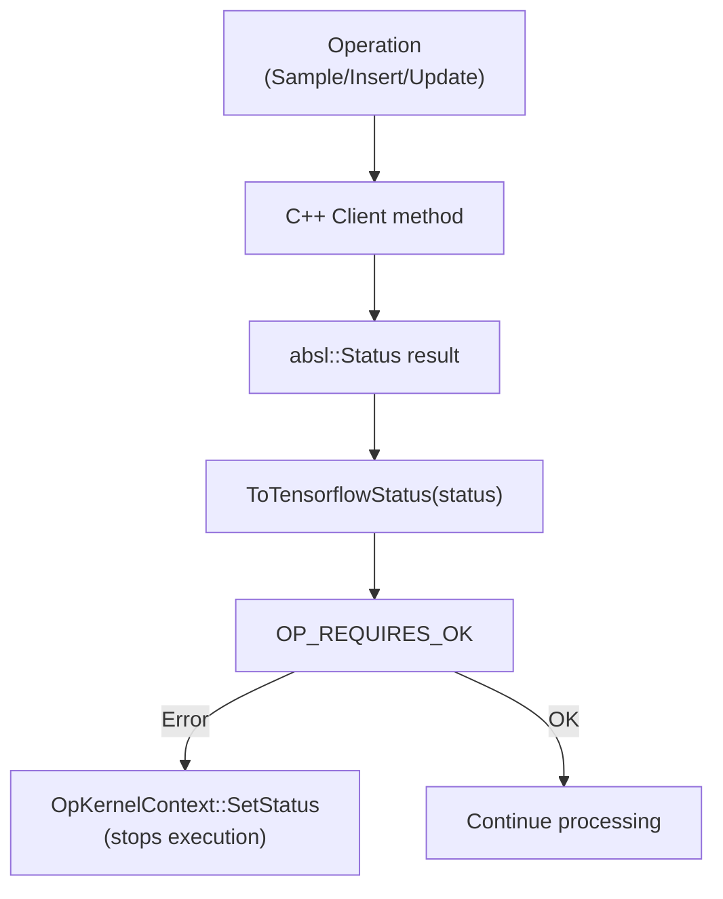
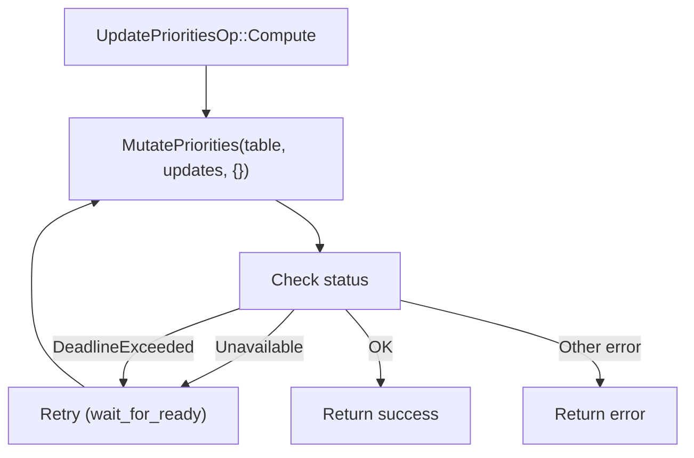

<!-- source: DeepWiki mcp.deepwiki.com · repo google-deepmind/reverb · page 5.3 TFClient · fetched 2026-10-26 -->

# TFClient

<details>
<summary>Relevant source files</summary>

The following files were used as context for generating this wiki page:

- [reverb/BUILD](reverb/BUILD)
- [reverb/__init__.py](reverb/__init__.py)
- [reverb/cc/ops/BUILD](reverb/cc/ops/BUILD)
- [reverb/cc/ops/client.cc](reverb/cc/ops/client.cc)
- [reverb/cc/ops/timestep_dataset.cc](reverb/cc/ops/timestep_dataset.cc)
- [reverb/cc/ops/trajectory_dataset.cc](reverb/cc/ops/trajectory_dataset.cc)

</details>


## Purpose and Scope

This document describes the `TFClient` class, which provides TensorFlow-native interaction with Reverb servers. TFClient enables users to perform Reverb operations (sampling, inserting, updating priorities) as TensorFlow operations that can be embedded directly in TensorFlow graphs and executed efficiently within TensorFlow's runtime.

For information about the underlying TensorFlow custom operations that TFClient uses, see [TensorFlow Custom Operations](#5.1). For information about consuming Reverb data using TensorFlow datasets, see [TensorFlow Datasets](#5.2). For general Python client operations, see [Client Operations](#4.3).

**Sources:** [reverb/BUILD:124-131](), [reverb/__init__.py:48]()

## Overview

`TFClient` is a TensorFlow-native wrapper around Reverb's core client functionality. Unlike the standard Python `Client` class (which uses imperative Python calls to C++), `TFClient` exposes Reverb operations as TensorFlow ops that can be:

- Embedded in TensorFlow computation graphs
- Executed within `tf.function` decorated functions
- Integrated with TensorFlow's automatic differentiation and optimization
- Traced and optimized by TensorFlow's graph compiler (XLA, Grappler)

The class is implemented in `reverb/tf_client.py` and depends on the generated TensorFlow ops from `gen_reverb_ops`, which provides the low-level TensorFlow operation bindings.

**Sources:** [reverb/BUILD:124-131](), [reverb/cc/ops/BUILD:49-54]()

## Architecture



**Diagram: TFClient Architecture and Dependencies**

The diagram shows how `TFClient` bridges TensorFlow graphs to Reverb's C++ implementation:

1. **TFClient** wraps the generated TensorFlow ops from `gen_reverb_ops`
2. **gen_reverb_ops** provides Python bindings for the C++ TensorFlow kernels
3. **C++ Op Kernels** implement the actual TensorFlow operations, managing `ClientResource` instances
4. **ClientResource** holds a C++ `Client` instance and coordinates with `Sampler` and `Writer`

**Sources:** [reverb/BUILD:124-131](), [reverb/cc/ops/client.cc:1-246](), [reverb/cc/ops/BUILD:49-54]()

## Core TensorFlow Operations

TFClient relies on four fundamental TensorFlow operations registered in the C++ kernel layer:

| Operation Name | C++ Kernel Class | Purpose | Registration |
|----------------|------------------|---------|--------------|
| `ReverbClient` | `ClientHandleOp` | Creates a client resource handle | [client.cc:231-232]() |
| `ReverbClientSample` | `SampleOp` | Samples a single item from a table | [client.cc:237-238]() |
| `ReverbClientInsert` | `InsertOp` | Inserts data into one or more tables | [client.cc:234-235]() |
| `ReverbClientUpdatePriorities` | `UpdatePrioritiesOp` | Updates priorities of existing items | [client.cc:240-242]() |

### ClientResource Management

The `ClientHandleOp` creates a `ClientResource`, which is a TensorFlow ResourceBase that manages the lifecycle of a C++ `Client` instance:



**Diagram: ClientResource Lifecycle**

The `ClientResource` is created with a server address and persists for the lifetime of the graph execution. Other operations look up this resource by handle to access the underlying `Client`.

**Sources:** [reverb/cc/ops/client.cc:39-76]()

## TFClient Operations

### Initialization

TFClient is initialized with a server address, which creates the underlying `ReverbClient` TensorFlow op:



**Diagram: TFClient Initialization Flow**

**Sources:** [reverb/BUILD:124-131](), [reverb/cc/ops/client.cc:59-76]()

### Sample Operation

The `sample` method wraps `ReverbClientSample` to retrieve a single item from a table:



**Diagram: Sample Operation Flow**

Key implementation details from `SampleOp::Compute`:
- Creates a `Sampler` with `max_samples=1` and `max_in_flight_samples_per_worker=1` [client.cc:94-96]()
- Uses a 30-second validation timeout [client.cc:98]()
- Calls `GetNextTimestep` to retrieve data [client.cc:106-107]()
- Combines data tensors with info tensors using `Sampler::WithInfoTensors` [client.cc:117]()
- Returns tensors in order: info tensors first, then data tensors

**Sources:** [reverb/cc/ops/client.cc:78-127]()

### Insert Operation

The `insert` method wraps `ReverbClientInsert` to add data to one or more tables:



**Diagram: Insert Operation Flow**

The `InsertOp` implementation:
- Creates a single-use `Writer` with `chunk_length=1, max_timesteps=1` [client.cc:211-212]()
- Appends all data tensors in a single call [client.cc:213-214]()
- Creates items for each (table, priority) pair [client.cc:218-221]()
- Flushes and closes the writer immediately [client.cc:223-225]()

**Sources:** [reverb/cc/ops/client.cc:179-229]()

### Update Priorities Operation

The `update_priorities` method wraps `ReverbClientUpdatePriorities` to modify item priorities:



**Diagram: Update Priorities Operation Flow**

Key aspects:
- Validates that `keys` and `priorities` are rank-1 tensors with matching shapes [client.cc:146-153]()
- Builds a vector of `KeyWithPriority` protos [client.cc:156-162]()
- Implements retry logic for transient failures (`Unavailable`, `DeadlineExceeded`) [client.cc:169-172]()
- Uses `wait_for_ready` semantics to handle server restarts gracefully [client.cc:166-168]()

**Sources:** [reverb/cc/ops/client.cc:129-177]()

## Comparison with Python Client

| Aspect | TFClient | Python Client |
|--------|----------|---------------|
| **Execution Model** | TensorFlow graph operations | Imperative Python calls |
| **API Surface** | TensorFlow ops wrapped in Python | C++ methods wrapped via pybind11 |
| **Use Cases** | Graph execution, tf.function | Interactive/imperative scripting |
| **Sampling Granularity** | Single sample per call | Configurable via Sampler |
| **Writer Lifecycle** | Single-use (created per insert) | Persistent, reusable |
| **Resource Management** | TensorFlow ResourceManager | Python/C++ lifetime |
| **Integration** | Native TensorFlow pipeline | Python control flow |

**Sources:** [reverb/cc/ops/client.cc:1-246](), [reverb/BUILD:52-63]()

## Usage Patterns

### Graph Mode with tf.function

TFClient is designed for use within TensorFlow graphs:

```python
# Conceptual usage pattern (not actual code)
tf_client = reverb.TFClient(server_address="localhost:8000")

@tf.function
def training_step():
    # Sample can be embedded in the graph
    sample = tf_client.sample(table="replay_buffer")
    
    # Use sample.data for training
    loss = compute_loss(sample.data)
    
    # Update priorities based on TD error
    tf_client.update_priorities(
        table="replay_buffer",
        keys=sample.info.key,
        priorities=compute_priority(loss)
    )
    
    return loss
```

### Inserting Data in Graph Mode

```python
# Conceptual usage (not actual code)
@tf.function
def insert_experience(observation, action, reward):
    data = [observation, action, reward]
    tf_client.insert(
        data=data,
        tables=["replay_buffer"],
        priorities=[1.0]
    )
```

**Sources:** [reverb/BUILD:220-231]()

## Implementation Details

### ClientResource Lifecycle

The `ClientResource` class manages the C++ `Client` instance:



**Diagram: ClientResource Memory Management**

The resource is reference-counted by TensorFlow's resource manager and automatically cleaned up when the graph is destroyed.

**Sources:** [reverb/cc/ops/client.cc:39-76]()

### Error Handling

Each operation converts C++ `absl::Status` to TensorFlow `Status`:



**Diagram: Error Handling Flow**

The `ToTensorflowStatus` utility converts between `absl::Status` and `tensorflow::Status`, preserving error codes and messages.

**Sources:** [reverb/cc/ops/client.cc:100](), [reverb/cc/ops/client.cc:173](), [reverb/cc/ops/client.cc:211]()

### Retry Logic for MutatePriorities

The `UpdatePrioritiesOp` implements special retry logic:



**Diagram: MutatePriorities Retry Logic**

This retry pattern handles server restarts and temporary unavailability gracefully, as noted in the comment at [client.cc:164-168]():
> "The call will only fail if the Reverb-server is brought down during an active call (e.g preempted). When this happens the request is retried and since MutatePriorities sets `wait_for_ready` the request will not be sent before the server is brought up again."

**Sources:** [reverb/cc/ops/client.cc:169-173]()

## Limitations

1. **Single Sample per Call**: `SampleOp` only retrieves one sample at a time (hardcoded `max_samples=1`). For batch sampling, use TensorFlow Datasets (see [TensorFlow Datasets](#5.2)).

2. **Ephemeral Writers**: Each insert creates and immediately closes a `Writer`, which is less efficient than reusing writers for multiple inserts. For high-throughput writing, use the Python `TrajectoryWriter` or `StructuredWriter`.

3. **No Trajectory Support**: TFClient operations work with flat tensor lists. For trajectory-structured data, use datasets or the Python client.

4. **Resource Cleanup**: `ClientResource` instances persist for the lifetime of the graph. In long-running applications with dynamic graphs, this can lead to resource accumulation.

**Sources:** [reverb/cc/ops/client.cc:78-229]()

---

