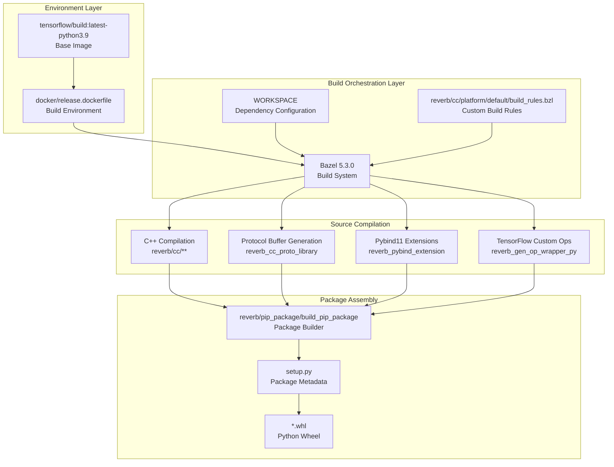
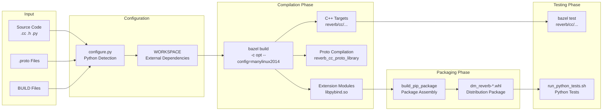
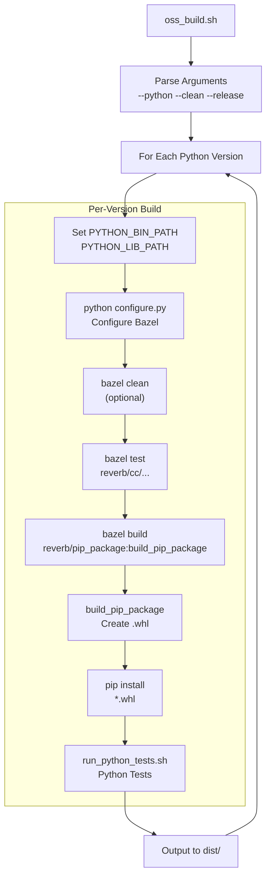
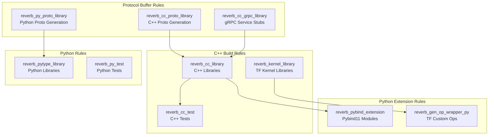
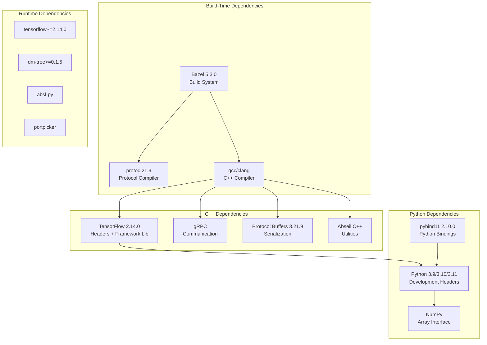
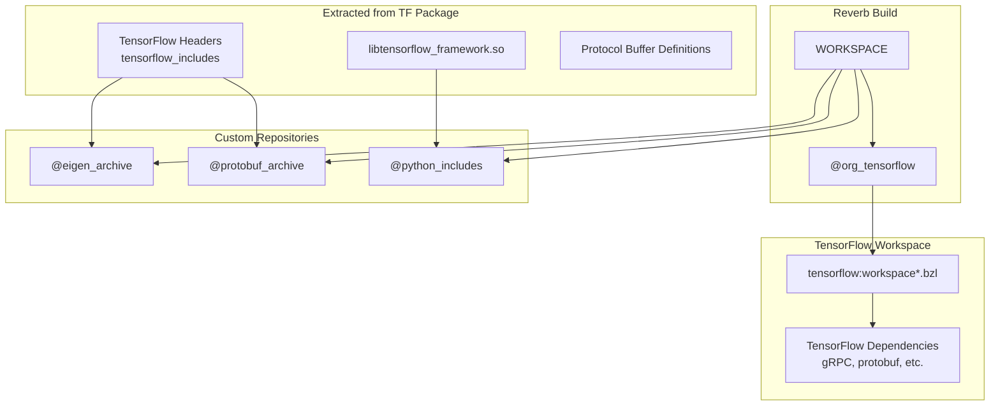

<!-- source: DeepWiki mcp.deepwiki.com · repo google-deepmind/reverb · page 6 Build System and Development · fetched 2026-10-26 -->

# Build System and Development

<details>
<summary>Relevant source files</summary>

The following files were used as context for generating this wiki page:

- [WORKSPACE](WORKSPACE)
- [docker/release.dockerfile](docker/release.dockerfile)
- [oss_build.sh](oss_build.sh)
- [reverb/cc/platform/default/build_rules.bzl](reverb/cc/platform/default/build_rules.bzl)
- [reverb/cc/platform/default/repo.bzl](reverb/cc/platform/default/repo.bzl)
- [reverb/pip_package/BUILD](reverb/pip_package/BUILD)
- [reverb/pip_package/README.md](reverb/pip_package/README.md)
- [run_python_tests.sh](run_python_tests.sh)

</details>


This document provides an overview of Reverb's build system architecture, development workflows, and tooling infrastructure. It covers the Bazel-based build system, Docker containerization for reproducible builds, dependency management, and the process of building Reverb from source. For detailed information on specific topics, see the subsections: [Bazel Build Rules](#6.1), [Dependency Management](#6.2), [Building from Source](#6.3), [Release Process](#6.4), and [Package Structure](#6.5).

## Purpose and Scope

Reverb uses a sophisticated build system designed to handle the complexity of building C++ extensions with TensorFlow dependencies and creating distributable Python packages for multiple Python versions. The build system must:

- Compile C++ code with TensorFlow dependencies
- Generate Python bindings using pybind11
- Create TensorFlow custom operations
- Build Protocol Buffer definitions for both C++ and Python
- Package everything into pip-installable wheels
- Support multiple Python versions (3.9, 3.10, 3.11)
- Ensure ABI compatibility with TensorFlow

## Build System Architecture

Reverb's build system consists of three primary layers: the Docker containerization layer for environment isolation, the Bazel build orchestration layer, and the Python package distribution layer.

### Build System Stack



**Sources:** [docker/release.dockerfile:1-110](), [WORKSPACE:1-252](), [reverb/cc/platform/default/build_rules.bzl:1-626]()

### Build Flow Pipeline



**Sources:** [oss_build.sh:1-160](), [reverb/pip_package/README.md:109-129]()

## Core Build Tools

### Bazel Build System

Reverb uses **Bazel 5.3.0** as its primary build system. Bazel manages the complex dependency graph between C++, Python, Protocol Buffers, and TensorFlow components.

**Key Bazel Version:** [docker/release.dockerfile:52-60]()

```
bazel_version=5.3.0
```

Bazel is responsible for:
- Compiling C++ libraries and tests
- Generating Protocol Buffer code for C++ and Python
- Building shared libraries (.so files) for Python extensions
- Managing external dependencies (TensorFlow, gRPC, protobuf, etc.)
- Creating TensorFlow custom operations

### Docker Build Environment

The Docker container provides a hermetic build environment with consistent tooling across different machines. The container is based on TensorFlow's official build images.

**Container Configuration:** [docker/release.dockerfile:1-110]()

Key aspects:
- **Base Image:** `tensorflow/build:latest-python3.9`
- **Python Versions:** Supports 3.9, 3.10, 3.11 (configured via `python_version` build arg)
- **TensorFlow Version:** Configurable via `tensorflow_pip` build arg (default: `tf-nightly`)
- **Build Tools:** Bazel 5.3.0, gcc, binutils 2.35.1

The Dockerfile installs development headers for all supported Python versions:

```dockerfile
python3.9-dev
python3.10-dev
python3.11-dev
```

**Sources:** [docker/release.dockerfile:33-39]()

### Build Script (oss_build.sh)

The `oss_build.sh` script orchestrates the entire build process for creating release packages. It handles multiple Python versions, test execution, and wheel generation.

**Build Script Structure:**



**Sources:** [oss_build.sh:1-160]()

**Key Build Flags:**

| Flag | Purpose | Example |
|------|---------|---------|
| `--python` | Python versions to build | `"3.9 3.10 3.11"` |
| `--release` | Mark as release build | `--release` |
| `--clean` | Run `bazel clean` | `--clean true` |
| `--clear_bazel_cache` | Delete Bazel cache | `--clear_bazel_cache true` |
| `--tf_dep_override` | TensorFlow version constraint | `"tensorflow~=2.14.0"` |
| `--output_dir` | Wheel output directory | `/tmp/reverb/dist/` |
| `--debug_build` | Include debug symbols | `--debug_build true` |

**Sources:** [oss_build.sh:28-94]()

## Custom Bazel Rules

Reverb defines several custom Bazel rules to handle the complexity of building Python extensions with TensorFlow dependencies.

### Core Build Rules



**Sources:** [reverb/cc/platform/default/build_rules.bzl:1-626]()

### Key Build Rule Functions

#### reverb_cc_proto_library

Compiles `.proto` files into C++ code. This rule:
1. Creates a filegroup with proto sources and dependencies
2. Uses `protoc` to generate `.pb.cc` and `.pb.h` files
3. Wraps the generated code in a `cc_library`

**Implementation:** [reverb/cc/platform/default/build_rules.bzl:58-117]()

#### reverb_pybind_extension

Creates Python extension modules using pybind11. This rule:
1. Compiles C++ source into a shared library (`.so`)
2. Generates a Python wrapper file that loads the extension
3. Handles symbol visibility and linking with TensorFlow

**Implementation:** [reverb/cc/platform/default/build_rules.bzl:408-549]()

Key features:
- Symbol export control for proper dynamic linking
- RPATH configuration for finding TensorFlow shared libraries
- Automatic Python wrapper generation with TensorFlow import handling

#### reverb_gen_op_wrapper_py

Creates TensorFlow custom operations. This rule:
1. Builds a shared library containing TF kernels and ops
2. Generates Python code to load the library via `tf.load_op_library`
3. Exports symbols properly for TensorFlow compatibility

**Implementation:** [reverb/cc/platform/default/build_rules.bzl:274-357]()

The generated Python file pattern:
```python
import tensorflow as _tf
from reverb.platform.default import load_op_library as _load_op_library

_reverb_gen_op = _tf.load_op_library(
  _tf.compat.v1.resource_loader.get_path_to_datafile("lib{name}_gen_op.so"))
```

**Sources:** [reverb/cc/platform/default/build_rules.bzl:336-346]()

## Dependency Management

Reverb has several categories of dependencies that must be carefully coordinated.

### External Dependency Categories



**Sources:** [WORKSPACE:1-252](), [docker/release.dockerfile:62-79]()

### TensorFlow Dependency

Reverb has a tight coupling with TensorFlow but uses mechanisms to minimize version lock-in:

**Build-Time TensorFlow:**
- Headers are extracted from installed TensorFlow package
- Shared library (`libtensorflow_framework.so.2`) is linked dynamically
- Version configured via Docker build arg: `tensorflow_pip=tensorflow~=2.14.0`

**Implementation:** [reverb/cc/platform/default/repo.bzl:19-234]()

The `_find_tf_include_path` and `_find_tf_lib_path` functions dynamically locate TensorFlow headers and libraries from the Python installation:

```python
import tensorflow as tf
tf.sysconfig.get_include()  # Returns header path
tf.sysconfig.get_lib()      # Returns library path
```

**Sources:** [reverb/cc/platform/default/repo.bzl:19-47]()

### Protobuf Version Coordination

Reverb includes a version check to ensure protobuf compatibility between TensorFlow and Reverb's build environment. The check compares:
- TensorFlow's bundled protobuf version
- Reverb's WORKSPACE protobuf version

**Version Check:** [reverb/pip_package/README.md:135-156]()

As noted in the documentation, protobuf releases use inconsistent versioning (e.g., protoc 21.9 corresponds to protobuf library 3.21.9).

## Building from Source

### Local Development Build

For local development inside Docker:

```bash
# Build Docker container
docker build --tag tensorflow:reverb \
  - < "$REVERB_DIR/docker/release.dockerfile"

# Run container
docker run --rm -it \
  --mount "type=bind,src=$REVERB_DIR,dst=/tmp/reverb" \
  tensorflow:reverb bash

# Inside container: configure and build
python3.9 configure.py
bazel build -c opt //reverb/pip_package:build_pip_package

# Create wheel
./bazel-bin/reverb/pip_package/build_pip_package \
  --dst /tmp/reverb_build/dist/

# Install
pip install /tmp/reverb_build/dist/*.whl
```

**Sources:** [reverb/pip_package/README.md:86-129]()

### Release Build

For building release packages for multiple Python versions:

```bash
# Build release Docker container
docker build --pull --no-cache \
  --tag tensorflow:reverb_release \
  --build-arg tensorflow_pip=tensorflow~=2.14.0 \
  --build-arg python_version="python3.9 python3.10 python3.11" \
  - < "$REVERB_DIR/docker/release.dockerfile"

# Build packages for all Python versions
docker run --rm --mount "type=bind,src=$REVERB_DIR,dst=/tmp/reverb" \
  tensorflow:reverb_release bash oss_build.sh --clean true \
  --clear_bazel_cache true --tf_dep_override "tensorflow~=2.14.0" \
  --release --python "3.9 3.10 3.11"
```

**Sources:** [reverb/pip_package/README.md:39-63]()

### Build Configuration

The `configure.py` script sets up Bazel's Python configuration:

**Python Version Configuration:** [oss_build.sh:106-118]()

```bash
# Example for Python 3.9
export PYTHON_BIN_PATH=/usr/bin/python3.9
export PYTHON_LIB_PATH=/usr/local/lib/python3.9/dist-packages
```

The ABI tag is determined by Python version:
- Python 3.9: `cp39`
- Python 3.10: `cp310`
- Python 3.11: `cp311`

### Bazel Cache Considerations

**Important:** Bazel caches compilation results, which can cause issues when building for multiple Python versions sequentially. The build system includes `--clear_bazel_cache` flag to address this.

**Issue:** [reverb/pip_package/README.md:33-37]()

Solutions:
1. Use `--clear_bazel_cache true` between Python version builds
2. Run separate Docker containers for each Python version
3. Use `bazel clean` between builds

## Testing Strategy

Reverb employs a two-phase testing strategy:

### C++ Tests

Executed during the Bazel build phase:

```bash
bazel test -c opt --copt=-mavx --config=manylinux2014 \
  --test_output=errors //reverb/cc/...
```

**Test Configuration:** [oss_build.sh:130]()

### Python Tests

Executed after wheel installation:

```bash
bash run_python_tests.sh
```

The script discovers and runs all `*_test.py` files in the package.

**Test Runner:** [run_python_tests.sh:27-46]()

Test execution flow:
1. Find all `*_test.py` files
2. Execute each with `$PYTHON_BIN_PATH`
3. Collect exit codes
4. Report failures

## Build Artifacts

### Compiled Artifacts

The build process produces several types of artifacts:

| Artifact Type | Pattern | Purpose |
|--------------|---------|---------|
| C++ Libraries | `libreverbX.a` | Static libraries for internal use |
| Pybind Extensions | `libpybind.so` | Python extension modules |
| TF Custom Ops | `lib{name}_gen_op.so` | TensorFlow operations |
| Proto Libraries | `*.pb.{cc,h,py}` | Generated protocol buffer code |
| Python Wheels | `dm_reverb-*-{cp39,cp310,cp311}*.whl` | Pip packages |

### Wheel Package Contents

A typical Reverb wheel contains:

```
dm_reverb-X.Y.Z-cp39-cp39-manylinux_2_17_x86_64.whl
├── reverb/
│   ├── __init__.py
│   ├── libpybind.so          # Main pybind11 extension
│   ├── libgen_reverb_ops.so  # TensorFlow custom ops
│   ├── *_pb2.py              # Protocol buffer Python files
│   └── ... (Python modules)
└── dm_reverb-X.Y.Z.dist-info/
    ├── METADATA
    ├── WHEEL
    └── ...
```

The wheel naming follows PEP 427:
- `dm_reverb`: Package name
- `X.Y.Z`: Version
- `cp39`: CPython 3.9 ABI
- `cp39`: ABI tag
- `manylinux_2_17_x86_64`: Platform tag

## Platform Support

### Supported Platforms

Reverb officially supports:

| Platform | Architecture | Build Config |
|----------|-------------|--------------|
| Linux | x86_64 | `--config=manylinux2014` |
| macOS | x86_64 | Default config |

The `manylinux2014` configuration ensures binary compatibility with most Linux distributions (RHEL 7+, Ubuntu 14.04+, Debian 8+).

### Platform-Specific Considerations

**Linux:**
- Uses `manylinux2014` Docker base image
- Links against older glibc for compatibility
- RPATH set to `$ORIGIN` for relative library loading

**macOS:**
- Uses `@loader_path` for RPATH
- Different exported symbols file format
- TensorFlow framework is `.dylib` instead of `.so`

**Platform Selection:** [reverb/cc/platform/default/build_rules.bzl:399-406]()

```python
select({
    "@platforms//os:macos": ["-Wl,@loader_path/..."],
    "//conditions:default": ["-Wl,$$ORIGIN/..."],
})
```

## Integration with TensorFlow Build System

Reverb's build system integrates deeply with TensorFlow's infrastructure:

### TensorFlow Dependencies



**Sources:** [WORKSPACE:36-156](), [reverb/cc/platform/default/repo.bzl:266-297]()

The integration happens through:

1. **WORKSPACE Configuration:** [WORKSPACE:6-15]()
   - Fetches specific TensorFlow commit
   - Loads TensorFlow's workspace configuration
   - Inherits TensorFlow's dependency versions

2. **Repository Rules:** [reverb/cc/platform/default/repo.bzl:1-405]()
   - `_tensorflow_includes_repo_impl`: Symlinks TensorFlow headers
   - `_tensorflow_solib_repo_impl`: Links TensorFlow framework library
   - `_eigen_archive_repo_impl`: Extracts Eigen headers from TensorFlow
   - `_protobuf_includes_repo_impl`: Extracts protobuf headers

### Dependency Cascade

```python
# WORKSPACE file loads TensorFlow dependencies in cascade
load("@org_tensorflow//tensorflow:workspace3.bzl", "tf_workspace3")
tf_workspace3()

load("@org_tensorflow//tensorflow:workspace2.bzl", "tf_workspace2")
tf_workspace2()

load("@org_tensorflow//tensorflow:workspace1.bzl", "tf_workspace1")
tf_workspace1()

load("@org_tensorflow//tensorflow:workspace0.bzl", "tf_workspace0")
tf_workspace0()
```

**Sources:** [WORKSPACE:36-156]()

This cascade pattern is required because Bazel's `load()` statements must be at file scope, preventing dynamic repository loading.

## Troubleshooting

### Common Build Issues

**Protobuf Version Mismatch:**

Error message: "Please update the PROTOC_VERSION in your WORKSPACE"

Solution: Ensure TensorFlow's protobuf version matches Reverb's WORKSPACE protobuf version. Note the version numbering discrepancy (protoc 21.9 = protobuf 3.21.9).

**Sources:** [reverb/pip_package/README.md:135-156]()

**Bazel Cache Issues:**

When building for multiple Python versions, Bazel may cache the wrong Python configuration.

Solution: Use `--clear_bazel_cache true` flag or run `rm -rf $HOME/.cache/bazel`.

**Sources:** [reverb/pip_package/README.md:33-37](), [oss_build.sh:100-104]()

**Linker Issues:**

The build uses binutils 2.35.1 to avoid gold linker issues.

**Sources:** [docker/release.dockerfile:94-105]()

## Next Steps

For detailed information on specific aspects of the build system:

- **[Bazel Build Rules](#6.1)**: Deep dive into custom Bazel macros and rules
- **[Dependency Management](#6.2)**: Detailed dependency resolution and version constraints
- **[Building from Source](#6.3)**: Step-by-step build instructions and common workflows
- **[Release Process](#6.4)**: Creating distributable packages and release automation
- **[Package Structure](#6.5)**: Python package organization and entry points

**Sources:** [reverb/pip_package/README.md:1-157](), [oss_build.sh:1-160](), [WORKSPACE:1-252](), [docker/release.dockerfile:1-110](), [reverb/cc/platform/default/build_rules.bzl:1-626](), [reverb/cc/platform/default/repo.bzl:1-405]()

---

