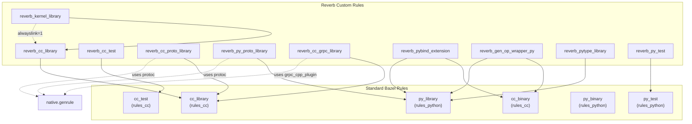
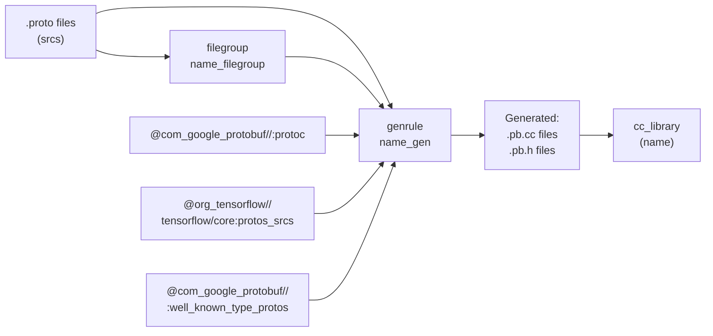
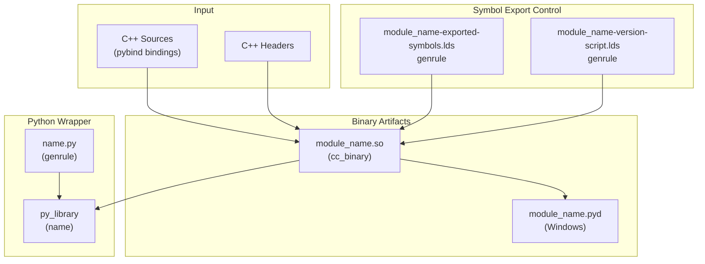
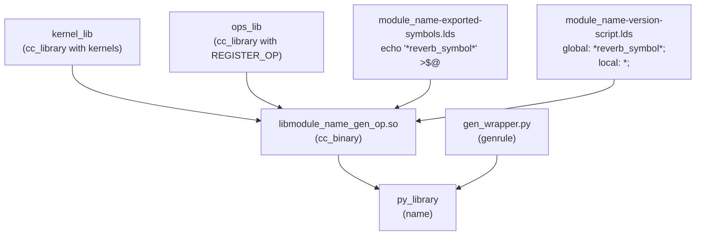

<!-- source: DeepWiki mcp.deepwiki.com · repo google-deepmind/reverb · page 6.1 Bazel Build Rules · fetched 2026-10-26 -->

# Bazel Build Rules

<details>
<summary>Relevant source files</summary>

The following files were used as context for generating this wiki page:

- [WORKSPACE](WORKSPACE)
- [reverb/cc/platform/default/build_rules.bzl](reverb/cc/platform/default/build_rules.bzl)
- [reverb/cc/platform/default/repo.bzl](reverb/cc/platform/default/repo.bzl)
- [reverb/pip_package/BUILD](reverb/pip_package/BUILD)

</details>


## Purpose and Scope

This document explains the custom Bazel build rules defined in Reverb for building C++ libraries, Python extensions, and protocol buffers. These rules encapsulate common build patterns, dependency management, and platform-specific configurations used throughout the Reverb codebase.

For information about dependency management and external repositories, see [Dependency Management](#6.2). For the overall build process and compilation steps, see [Building from Source](#6.3).

## Overview

Reverb defines custom Bazel rules in [reverb/cc/platform/default/build_rules.bzl:1-626]() to abstract common build patterns and ensure consistency. These rules wrap standard Bazel rules (`cc_library`, `cc_test`, `py_library`, etc.) with Reverb-specific defaults, dependency injection, and build configurations.

**Build Rule Categories:**

| Category | Rules | Purpose |
|----------|-------|---------|
| C++ Libraries | `reverb_cc_library`, `reverb_kernel_library` | Build C++ code with TensorFlow integration |
| C++ Tests | `reverb_cc_test` | Build C++ tests with GoogleTest |
| Protocol Buffers | `reverb_cc_proto_library`, `reverb_py_proto_library` | Compile .proto files to C++ and Python |
| gRPC Services | `reverb_cc_grpc_library` | Generate gRPC service stubs |
| Python Extensions | `reverb_pybind_extension`, `reverb_gen_op_wrapper_py` | Build native Python modules |
| Python Libraries | `reverb_pytype_library`, `reverb_pytype_binary` | Build Python code with dependencies |
| Python Tests | `reverb_py_test` | Build Python tests with standard imports |

Sources: [reverb/cc/platform/default/build_rules.bzl:1-626]()

## Build Rule Hierarchy



Sources: [reverb/cc/platform/default/build_rules.bzl:13-44](), [reverb/cc/platform/default/build_rules.bzl:249-272]()

## C++ Build Rules

### reverb_cc_library

The `reverb_cc_library` rule is the foundation for all C++ libraries in Reverb. It wraps `cc_library` with automatic dependency injection and TensorFlow-compatible compiler options.

**Key Features:**
- Automatically adds TensorFlow dependencies via `reverb_tf_deps()`
- Applies `tf_copts()` for TensorFlow compatibility ([reverb/cc/platform/default/build_rules.bzl:10-11]())
- Injects GoogleTest dependencies for testonly targets ([reverb/cc/platform/default/build_rules.bzl:20-23]())
- Uses `depset` for efficient dependency handling

**Function Signature:**
```python
def reverb_cc_library(
    name,
    srcs = [],
    hdrs = [],
    deps = [],
    testonly = 0,
    **kwargs)
```

**Implementation Details:**

[reverb/cc/platform/default/build_rules.bzl:13-34]() shows that the rule:
1. Conditionally adds test dependencies if `testonly=True`
2. Calls `cc_library` with `copts = tf_copts()` 
3. Merges user deps with automatic deps using `depset(deps + new_deps)`

The `tf_copts()` function returns `["-Wno-sign-compare"]` to suppress sign comparison warnings common in TensorFlow code.

Sources: [reverb/cc/platform/default/build_rules.bzl:13-34](), [reverb/cc/platform/default/build_rules.bzl:10-11]()

### reverb_kernel_library

The `reverb_kernel_library` rule is specialized for TensorFlow kernel/ops libraries that need to be always linked.

**Key Features:**
- Sets `alwayslink = 1` to ensure kernels are linked even if not directly referenced
- Automatically includes TensorFlow dependencies
- Used for TensorFlow custom operations

**Function Signature:**
```python
def reverb_kernel_library(name, srcs = [], deps = [], **kwargs)
```

**Implementation:**

[reverb/cc/platform/default/build_rules.bzl:36-44]() shows this rule:
1. Augments deps with `reverb_tf_deps()`
2. Calls `reverb_cc_library` with `alwayslink = 1`
3. Inherits all features of `reverb_cc_library`

Sources: [reverb/cc/platform/default/build_rules.bzl:36-44]()

### reverb_cc_test

The `reverb_cc_test` rule standardizes C++ test builds with GoogleTest and gRPC testing support.

**Auto-injected Dependencies:**
- `@com_google_googletest//:gtest`
- `@com_google_googletest//:gtest_main`
- `@com_github_grpc_grpc//:grpc++_test`
- `@com_google_absl//absl/status:status_matchers`
- All TensorFlow dependencies via `reverb_tf_deps()`

**Function Signature:**
```python
def reverb_cc_test(name, srcs, deps = [], **kwargs)
```

**Implementation:**

[reverb/cc/platform/default/build_rules.bzl:249-272]() shows:
1. Adds test framework dependencies automatically
2. Sets default size to "small" if not specified
3. Applies `tf_copts()` for compatibility
4. Converts deps to list using `depset().to_list()`

Sources: [reverb/cc/platform/default/build_rules.bzl:249-272]()

## Protocol Buffer Rules

### reverb_cc_proto_library

The `reverb_cc_proto_library` rule compiles `.proto` files to C++ headers and sources with TensorFlow protobuf import support.

**Build Process Diagram:**



**Implementation Details:**

[reverb/cc/platform/default/build_rules.bzl:58-117]() implements a three-stage process:

1. **Filegroup Creation** ([reverb/cc/platform/default/build_rules.bzl:85-89]()): Creates `<name>_filegroup` containing source protos and dependency filegroups

2. **Proto Compilation** ([reverb/cc/platform/default/build_rules.bzl:90-109]()): Uses `native.genrule` to:
   - Compute output directory with sed regex: `'s#reverb(/.*|$$)##'`
   - Run protoc with multiple proto paths:
     - `--proto_path=external/org_tensorflow/`
     - `--proto_path=external/com_google_protobuf/src`
     - `--proto_path=.`
   - Generate `.pb.cc` and `.pb.h` files

3. **Library Creation** ([reverb/cc/platform/default/build_rules.bzl:110-117]()): Creates `cc_library` with:
   - Generated sources and headers
   - TensorFlow dependencies
   - `alwayslink = 1` flag

**Proto Path Normalization:**

[reverb/cc/platform/default/build_rules.bzl:52-56]() defines helper functions:
- `_normalize_proto(x)`: Converts `"foo_proto"` or `"foo_cc_proto"` to `"foo_proto"`
- `_filegroup_name(x)`: Returns `"<name>_proto_filegroup"` for dependency resolution

Sources: [reverb/cc/platform/default/build_rules.bzl:58-117](), [reverb/cc/platform/default/build_rules.bzl:46-56]()

### reverb_py_proto_library

The `reverb_py_proto_library` rule compiles `.proto` files to Python `_pb2.py` modules.

**Key Differences from C++ Version:**
- Generates `_pb2.py` files instead of `.pb.cc/.pb.h`
- Uses `--python_out` instead of `--cpp_out`
- Separates proto dependencies from Python dependencies
- Includes proto deps as `data` attribute

**Function Signature:**
```python
def reverb_py_proto_library(name, srcs = [], deps = [], **kwargs)
```

**Implementation:**

[reverb/cc/platform/default/build_rules.bzl:119-179]() follows similar pattern to C++ version:
1. Creates filegroup for source tracking
2. Runs protoc to generate Python files
3. Creates `py_library` with proto deps as data

The `deps` parameter is split ([reverb/cc/platform/default/build_rules.bzl:141-147]()):
- Proto dependencies (ending in `_proto`) → added to srcs and data
- Python library dependencies → added to `py_library` deps

Sources: [reverb/cc/platform/default/build_rules.bzl:119-179]()

## gRPC Service Rules

### reverb_cc_grpc_library

The `reverb_cc_grpc_library` rule generates gRPC service stubs and optionally mock headers from `.proto` service definitions.

**Generated Files:**
- Service stubs: `<name>.grpc.pb.cc`, `<name>.grpc.pb.h`
- Mock headers (if `generate_mocks=True`): `<name>_mock.grpc.pb.h`

**Function Signature:**
```python
def reverb_cc_grpc_library(
    name,
    srcs = [],
    deps = [],
    generate_mocks = False,
    **kwargs)
```

**Build Process:**

[reverb/cc/platform/default/build_rules.bzl:181-247]() implements:

1. **Mock Generation** ([reverb/cc/platform/default/build_rules.bzl:213-216]()): Conditionally adds mock headers to outputs

2. **gRPC Compilation** ([reverb/cc/platform/default/build_rules.bzl:218-240]()): Uses protoc with grpc_cpp_plugin:
   ```
   --plugin=protoc-gen-grpc=$(location @com_github_grpc_grpc//src/compiler:grpc_cpp_plugin)
   --grpc_out=generate_mock_code=true:$$OUTDIR  # if mocks enabled
   ```

3. **Library Creation** ([reverb/cc/platform/default/build_rules.bzl:241-247]()): Creates `cc_library` with:
   - Generated stub sources and headers
   - Dependency on `@com_github_grpc_grpc//:grpc++_codegen_proto`
   - All user-provided deps (must include corresponding `_cc_proto` library)

Sources: [reverb/cc/platform/default/build_rules.bzl:181-247]()

## Python Extension Rules

### reverb_pybind_extension

The `reverb_pybind_extension` rule builds pybind11-based Python extension modules with TensorFlow integration.

**Build Artifacts Diagram:**



**Key Implementation Details:**

1. **Module Name Validation** ([reverb/cc/platform/default/build_rules.bzl:452-456]()): Ensures `name != module_name` to allow wrapper logic

2. **Symbol Export Files** ([reverb/cc/platform/default/build_rules.bzl:463-480]()): Creates linker scripts to export only `PyInit_<module_name>` symbol

3. **Shared Library Compilation** ([reverb/cc/platform/default/build_rules.bzl:481-511]()): Builds `.so` file with:
   - `copts`: `-fno-strict-aliasing`, `-fexceptions`, `-fvisibility=hidden`
   - `linkopts`: Platform-specific symbol export flags and rpath settings
   - `linkshared = 1` for dynamic library

4. **Python Wrapper Generation** ([reverb/cc/platform/default/build_rules.bzl:512-536]()): Creates `<name>.py` that:
   - Imports TensorFlow
   - Loads the native module with error handling
   - Re-exports all symbols from native module

**Rpath Configuration:**

[reverb/cc/platform/default/build_rules.bzl:390-406]() defines `_rpath_linkopts()` to enable finding shared libraries:
- On macOS: Uses `@loader_path`
- On Linux: Uses `$$ORIGIN`
- Searches parent directories up to TensorFlow root

Sources: [reverb/cc/platform/default/build_rules.bzl:408-549](), [reverb/cc/platform/default/build_rules.bzl:382-406]()

### reverb_gen_op_wrapper_py

The `reverb_gen_op_wrapper_py` rule builds TensorFlow custom operation shared libraries that can be loaded via `tf.load_op_library`.

**Usage Pattern:**
```python
reverb_gen_op_wrapper_py(
    name = "gen_client_ops",
    out = "gen_client_ops.py",
    kernel_lib = ":client_ops_kernel",
    ops_lib = ":client_ops_cc",
)
```

**Build Process:**



**Implementation Details:**

1. **Symbol Name Extraction** ([reverb/cc/platform/default/build_rules.bzl:296]()): Extracts symbol from name:
   - `"gen_client_ops"` → `"reverb_client"`
   - Pattern: `reverb_<name.split("_")[1]>`

2. **Symbol Export Control** ([reverb/cc/platform/default/build_rules.bzl:293-311]()): Creates linker scripts allowing only reverb-prefixed symbols

3. **Shared Library Build** ([reverb/cc/platform/default/build_rules.bzl:312-332]()): Compiles with:
   - `linkshared = 1`
   - Visibility hidden and rpath configuration
   - Platform-specific symbol export flags

4. **Python Wrapper** ([reverb/cc/platform/default/build_rules.bzl:333-348]()): Generates code that:
   - Calls `tf.load_op_library()` with path to `.so`
   - Wraps import errors with custom error handler
   - Re-exports all operations to module namespace

Sources: [reverb/cc/platform/default/build_rules.bzl:274-357]()

## Python Library Rules

### reverb_pytype_library and reverb_pytype_binary

These rules wrap `py_library` and `py_binary` with automatic dependency injection for common Reverb imports.

**Auto-injected Dependencies:**

[reverb/cc/platform/default/build_rules.bzl:551-559]() defines `reverb_py_standard_imports()`:
```python
[
    "@pypi//absl_py",
    "@pypi//tf_nightly",
    "@pypi//dm_tree",
    "@pypi//portpicker",
    "@pypi//numpy",
    "@pypi//six",
]
```

**Function Signatures:**
```python
def reverb_pytype_library(deps = [], **kwargs)
def reverb_pytype_binary(deps = [], **kwargs)
```

**Implementation:**

[reverb/cc/platform/default/build_rules.bzl:362-380]() shows both rules:
1. Remove `strict_deps` if present (not supported in open-source Bazel)
2. Add standard imports and proto deps
3. Delegate to standard `py_library` or `py_binary`

The `reverb_pytype_strict_*` aliases ([reverb/cc/platform/default/build_rules.bzl:370](), [reverb/cc/platform/default/build_rules.bzl:380]()) are provided for internal compatibility but have identical behavior.

Sources: [reverb/cc/platform/default/build_rules.bzl:362-380](), [reverb/cc/platform/default/build_rules.bzl:551-559]()

### reverb_py_test

The `reverb_py_test` rule standardizes Python test builds with automatic dependency injection.

**Function Signature:**
```python
def reverb_py_test(
    name,
    srcs = [],
    deps = [],
    paropts = [],
    python_version = "PY3",
    **kwargs)
```

**Implementation:**

[reverb/cc/platform/default/build_rules.bzl:561-579]() shows:
1. Sets default test size to "small"
2. Removes unsupported `enable_dashboard` kwarg if present
3. Injects `reverb_py_standard_imports()` and `reverb_py_proto_deps()`
4. Calls standard `py_test` with merged dependencies

Sources: [reverb/cc/platform/default/build_rules.bzl:561-579]()

## Dependency Management Functions

### TensorFlow Dependencies

The `reverb_tf_deps()` function provides all TensorFlow-related dependencies:

**Dependencies Returned:**

[reverb/cc/platform/default/build_rules.bzl:592-596]()
```python
[
    "@pypi//tf_nightly:headers_lib",
    "@pypi//tf_nightly:framework_lib",
]
```

These correspond to:
- `headers_lib`: TensorFlow header files (C++ API)
- `framework_lib`: `libtensorflow_framework.so` shared library

Sources: [reverb/cc/platform/default/build_rules.bzl:592-596]()

### gRPC Dependencies

The `reverb_grpc_deps()` function returns gRPC libraries:

[reverb/cc/platform/default/build_rules.bzl:598-599]()
```python
["@com_github_grpc_grpc//:grpc++"]
```

Sources: [reverb/cc/platform/default/build_rules.bzl:598-599]()

### Abseil Dependencies

The `reverb_absl_deps()` function provides carefully curated Abseil libraries:

**Included Libraries:**

[reverb/cc/platform/default/build_rules.bzl:601-625]() lists:
- Core: `absl/base`, `absl/base:core_headers`, `absl/memory`
- Numeric: `absl/numeric:int128`, `absl/random`, `absl/random:distributions`
- Status: `absl/status`, `absl/status:statusor`
- Strings: `absl/strings`, `absl/strings:cord`, `absl/strings:str_format`
- Synchronization: `absl/synchronization`
- Time: `absl/time`
- Types: `absl/types:optional`, `absl/types:span`
- Functional: `absl/functional:bind_front`, `absl/functional:any_invocable`

**Important Note:**

The comment at [reverb/cc/platform/default/build_rules.bzl:603-604]() states:
> "We purposefully don't include absl::flat_hash_{map,set} so that users are forced to use platform:hash_{map,set}, which uses a safer hasher."

This enforces use of Reverb's custom hash containers for security.

Sources: [reverb/cc/platform/default/build_rules.bzl:601-625]()

### Pybind11 Dependencies

The `reverb_pybind_deps()` function provides pybind11 and NumPy headers:

[reverb/cc/platform/default/build_rules.bzl:581-585]()
```python
[
    "@pybind11",
    "@pypi//numpy:numpy_headers",
]
```

Sources: [reverb/cc/platform/default/build_rules.bzl:581-585]()

## Complete Build Rule Dependency Graph

```mermaid
graph TB
    subgraph "External Dependencies"
        tf_headers["@pypi//tf_nightly:headers_lib"]
        tf_framework["@pypi//tf_nightly:framework_lib"]
        grpc["@com_github_grpc_grpc//:grpc++"]
        grpc_plugin["@com_github_grpc_grpc//<br/>src/compiler:grpc_cpp_plugin"]
        protoc["@com_google_protobuf//:protoc"]
        gtest["@com_google_googletest//:gtest"]
        pybind11_lib["@pybind11"]
        absl_libs["@com_google_absl//<br/>multiple packages"]
    end
    
    subgraph "Dependency Functions"
        reverb_tf_deps["reverb_tf_deps()"]
        reverb_grpc_deps["reverb_grpc_deps()"]
        reverb_absl_deps["reverb_absl_deps()"]
        reverb_pybind_deps["reverb_pybind_deps()"]
        reverb_py_standard_imports["reverb_py_standard_imports()"]
    end
    
    subgraph "Build Rules"
        reverb_cc_library_rule["reverb_cc_library"]
        reverb_kernel_library_rule["reverb_kernel_library"]
        reverb_cc_test_rule["reverb_cc_test"]
        reverb_cc_proto_library_rule["reverb_cc_proto_library"]
        reverb_cc_grpc_library_rule["reverb_cc_grpc_library"]
        reverb_pybind_extension_rule["reverb_pybind_extension"]
        reverb_gen_op_wrapper_py_rule["reverb_gen_op_wrapper_py"]
        reverb_pytype_library_rule["reverb_pytype_library"]
        reverb_py_test_rule["reverb_py_test"]
    end
    
    tf_headers --> reverb_tf_deps
    tf_framework --> reverb_tf_deps
    grpc --> reverb_grpc_deps
    absl_libs --> reverb_absl_deps
    pybind11_lib --> reverb_pybind_deps
    
    reverb_tf_deps --> reverb_cc_library_rule
    reverb_tf_deps --> reverb_cc_test_rule
    reverb_tf_deps --> reverb_cc_proto_library_rule
    
    reverb_grpc_deps --> reverb_cc_grpc_library_rule
    
    reverb_pybind_deps --> reverb_pybind_extension_rule
    
    reverb_py_standard_imports --> reverb_pytype_library_rule
    reverb_py_standard_imports --> reverb_py_test_rule
    
    gtest --> reverb_cc_test_rule
    protoc -.compiles.-> reverb_cc_proto_library_rule
    protoc -.compiles.-> reverb_py_proto_library_rule
    grpc_plugin -.generates.-> reverb_cc_grpc_library_rule
    
    reverb_cc_library_rule --> reverb_kernel_library_rule
```



Sources: [reverb/cc/platform/default/build_rules.bzl:1-626]()

## Helper Functions and Utilities

### String Processing

**`_removesuffix(x, txt)`** ([reverb/cc/platform/default/build_rules.bzl:46-50]()): Backport of Python 3.9's `str.removesuffix()` for older Bazel/Python versions.

**`_normalize_proto(x)`** ([reverb/cc/platform/default/build_rules.bzl:52-53]()): Normalizes proto target names by removing `_proto` and `_cc` suffixes.

**`_filegroup_name(x)`** ([reverb/cc/platform/default/build_rules.bzl:55-56]()): Generates consistent filegroup names for proto dependencies.

### Linker Configuration

**`_rpath_linkopts(name)`** ([reverb/cc/platform/default/build_rules.bzl:390-406]()): Generates platform-specific rpath linker options for finding shared libraries at runtime. Computes search depth based on package nesting level.

**`_make_search_paths(prefix, levels_to_root)`** ([reverb/cc/platform/default/build_rules.bzl:382-388]()): Generates comma-separated rpath entries for multiple parent directory levels.

### Visibility Control

**`reverb_tf_ops_visibility()`** ([reverb/cc/platform/default/build_rules.bzl:587-590]()): Returns visibility list for TensorFlow ops:
```python
["//reverb:__subpackages__"]
```

This restricts TensorFlow op targets to be visible only within the Reverb package tree.

Sources: [reverb/cc/platform/default/build_rules.bzl:46-56](), [reverb/cc/platform/default/build_rules.bzl:382-406](), [reverb/cc/platform/default/build_rules.bzl:587-590]()

## Usage Examples from Codebase

### C++ Library with TensorFlow Integration

Example pattern from various BUILD files:
```python
reverb_cc_library(
    name = "table",
    srcs = ["table.cc"],
    hdrs = ["table.h"],
    deps = [
        ":chunk_store",
        ":rate_limiter",
        "//reverb/cc/selectors:interface",
    ],
)
```

### Protocol Buffer Compilation

Example pattern:
```python
reverb_cc_proto_library(
    name = "reverb_service_cc_proto",
    srcs = ["reverb_service.proto"],
    deps = [
        ":schema_cc_proto",
    ],
)

reverb_py_proto_library(
    name = "reverb_service_py_pb2",
    srcs = ["reverb_service.proto"],
    deps = [
        ":schema_cc_proto",
        ":schema_py_pb2",
    ],
)
```

### gRPC Service Generation

Example pattern:
```python
reverb_cc_grpc_library(
    name = "reverb_service_cc_grpc_proto",
    srcs = ["reverb_service.proto"],
    generate_mocks = True,
    deps = [
        ":reverb_service_cc_proto",
    ],
)
```

### Pybind11 Extension Module

Example pattern:
```python
reverb_pybind_extension(
    name = "pybind",
    srcs = ["client.cc", "server.cc"],
    module_name = "libpybind",
    deps = [
        ":client",
        ":server",
    ],
)
```

### TensorFlow Custom Operation

Example pattern:
```python
reverb_gen_op_wrapper_py(
    name = "gen_client_ops",
    out = "gen_client_ops.py",
    kernel_lib = ":client_ops_kernels",
    ops_lib = ":client_ops_cc",
)
```

Sources: Based on common patterns in [reverb/cc/platform/default/build_rules.bzl:1-626]()

---

