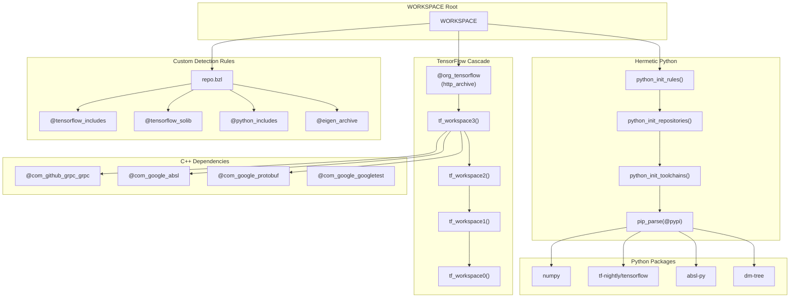
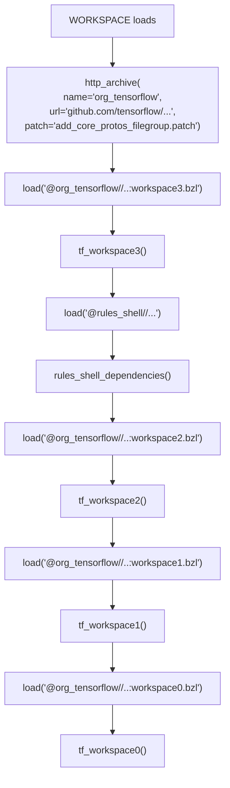
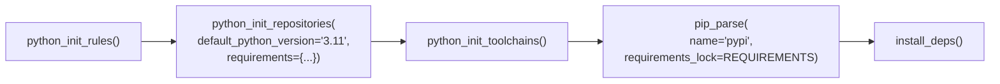
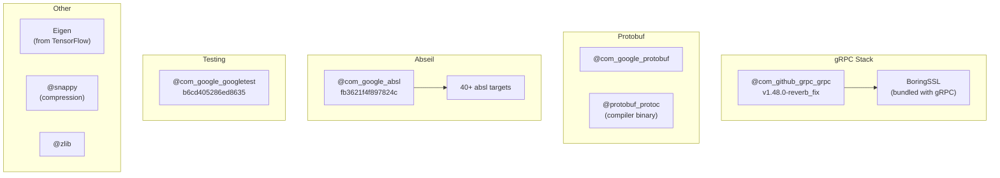
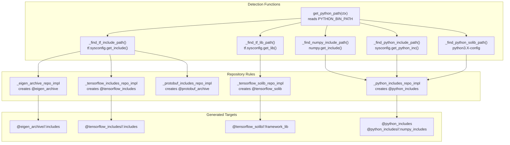
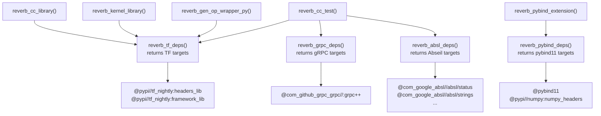
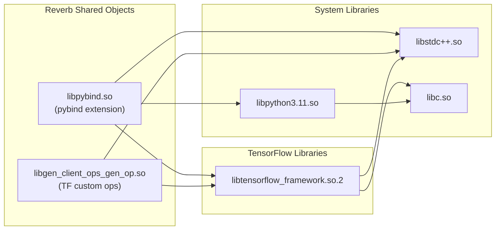

<!-- source: DeepWiki mcp.deepwiki.com · repo google-deepmind/reverb · page 6.2 Dependency Management · fetched 2026-10-26 -->

# Dependency Management

<details>
<summary>Relevant source files</summary>

The following files were used as context for generating this wiki page:

- [WORKSPACE](WORKSPACE)
- [reverb/cc/platform/default/build_rules.bzl](reverb/cc/platform/default/build_rules.bzl)
- [reverb/cc/platform/default/repo.bzl](reverb/cc/platform/default/repo.bzl)
- [reverb/pip_package/BUILD](reverb/pip_package/BUILD)

</details>


This page explains how Reverb manages external dependencies through Bazel's WORKSPACE file and custom repository rules. It covers TensorFlow integration, gRPC/protobuf dependencies, hermetic Python setup, and the custom repository rules that enable building against pre-installed packages.

For information about the Bazel build rules themselves, see [Bazel Build Rules](#6.1). For the complete build process from source, see [Building from Source](#6.3).

## Overview

Reverb uses a multi-layered dependency management strategy that handles both build-time and runtime dependencies:

- **Build-time dependencies**: C++ libraries (gRPC, protobuf, abseil) managed through Bazel's `http_archive` rules
- **Python dependencies**: Managed through hermetic Python with pip requirements files
- **TensorFlow integration**: Dual approach supporting both TensorFlow-from-source and pip-installed TensorFlow
- **Dynamic detection**: Custom repository rules that detect pre-installed packages at configuration time

This hybrid approach allows Reverb to be built in multiple ways: as part of TensorFlow's internal build system, against a TensorFlow source checkout, or against pip-installed TensorFlow packages.

**Dependency Architecture**



Sources: [WORKSPACE:1-252](), [reverb/cc/platform/default/repo.bzl:1-405]()

## WORKSPACE File Structure

The [WORKSPACE:1-252]() file is the entry point for all dependency management. It follows a specific loading sequence to handle the complex dependency graph, particularly around TensorFlow.

### TensorFlow Dependency Cascade

Reverb imports TensorFlow directly from GitHub and then calls a cascade of workspace functions to initialize TensorFlow's own dependencies:



Sources: [WORKSPACE:6-156]()

This cascade is necessary because Bazel's `load()` statements must appear at the top level of a file and cannot be conditional. Each workspace function loads additional dependencies that subsequent functions need. The specific TensorFlow commit is pinned at [WORKSPACE:13-14]():

```
strip_prefix = "tensorflow-9da042273660460b94d29062ef02428fc98b0758"
```

A custom patch [WORKSPACE:9-10]() is applied to add a filegroup for core proto sources, allowing Reverb's proto compilation to access TensorFlow's proto definitions.

Sources: [WORKSPACE:6-156]()

## Hermetic Python Setup

Reverb uses TensorFlow's hermetic Python infrastructure to ensure reproducible builds across different environments. This system downloads and manages specific Python versions rather than using system Python.

### Python Initialization Sequence



Sources: [WORKSPACE:46-144]()

The hermetic Python setup [WORKSPACE:47-66]() specifies:

| Parameter | Value | Purpose |
|-----------|-------|---------|
| `default_python_version` | `"3.11"` | Default Python version to use |
| `requirements` | `{"3.11": "//reverb/pip_package:requirements_lock_3_11.txt"}` | Requirements file per Python version |

### Package Annotations

Special annotations add C++ library targets to Python packages for native integration [WORKSPACE:71-139]():

**NumPy Annotation** [WORKSPACE:71-90]():
- Creates `cc_library` target `numpy_headers` 
- Exposes header files from both `numpy/core/include` (NumPy 1.x) and `numpy/_core/include` (NumPy 2.x)
- Allows C++ code to use NumPy C API

**TensorFlow Annotation** [WORKSPACE:92-115]():
- Creates `headers_lib` target with all TensorFlow headers
- Creates `framework_lib` target linking to `libtensorflow_framework.so.2`
- Platform-specific paths for Linux vs macOS

These annotations are referenced in build rules via [reverb/cc/platform/default/build_rules.bzl:592-596]():

```python
def reverb_tf_deps():
    return [
        "@pypi//tf_nightly:headers_lib",
        "@pypi//tf_nightly:framework_lib",
    ]
```

Sources: [WORKSPACE:46-144](), [reverb/cc/platform/default/build_rules.bzl:592-596]()

## C++ Dependencies

C++ dependencies are managed through TensorFlow's workspace functions, which import specific versions tested with TensorFlow.

### Major C++ Dependencies



Sources: [reverb/cc/platform/default/repo.bzl:333-370]()

### gRPC Patch

Reverb uses a patched version of gRPC [WORKSPACE:334-347]() to work around compilation issues with older GCC versions in TensorFlow's build environment. The patch [WORKSPACE:336-338]():

```python
patch_cmds = [
    """sed -i.bak 's/"python",/"python3",/g' third_party/py/python_configure.bzl""",
    """sed -i.bak 's/PYTHONHASHSEED=0/PYTHONHASHSEED=0 python3/g' bazel/cython_library.bzl""",
]
```

This ensures Python 3 is used explicitly in gRPC's build process.

### Abseil Dependencies

The build rules [reverb/cc/platform/default/build_rules.bzl:601-626]() carefully select specific Abseil components:

```python
def reverb_absl_deps():
    return [
        "@com_google_absl//absl/base",
        "@com_google_absl//absl/status",
        "@com_google_absl//absl/status:statusor",
        "@com_google_absl//absl/strings",
        "@com_google_absl//absl/synchronization",
        # ... more components
    ]
```

Note that `flat_hash_map` and `flat_hash_set` are explicitly excluded [reverb/cc/platform/default/build_rules.bzl:603-604]() to force usage of `platform:hash_{map,set}` which use a safer hasher.

Sources: [WORKSPACE:333-370](), [reverb/cc/platform/default/build_rules.bzl:601-626]()

## Custom Repository Rules

Reverb includes custom repository rules in [reverb/cc/platform/default/repo.bzl:1-405]() that dynamically detect and configure dependencies from installed packages. This enables building against pip-installed TensorFlow.

### Repository Rule Architecture



Sources: [reverb/cc/platform/default/repo.bzl:10-297]()

### TensorFlow Include Detection

The `_find_tf_include_path()` function [reverb/cc/platform/default/repo.bzl:19-32]() executes Python to query TensorFlow's installation:

```python
exec_result = repo_ctx.execute(
    [
        get_python_path(repo_ctx),
        "-c",
        "import tensorflow as tf; import sys; " +
        "sys.stdout.write(tf.sysconfig.get_include())",
    ],
    quiet = True,
)
```

The resulting path (e.g., `/usr/local/lib/python3.11/site-packages/tensorflow/include`) is then symlinked into the repository [reverb/cc/platform/default/repo.bzl:186-219]():

```python
def _tensorflow_includes_repo_impl(repo_ctx):
    tf_include_path = _find_tf_include_path(repo_ctx)
    repo_ctx.symlink(tf_include_path, "tensorflow_includes")
    repo_ctx.file("BUILD", content = """
cc_library(
    name = "includes",
    hdrs = glob([
        "tensorflow_includes/**/*.h",
        "tensorflow_includes/third_party/eigen3/**",
    ], exclude = ["tensorflow_includes/absl/**/*.h"]),
    includes = ["tensorflow_includes"],
    deps = [
        "@com_google_absl//absl/container:flat_hash_map",
        "@eigen_archive//:includes",
        "@protobuf_archive//:includes",
        # ...
    ],
    visibility = ["//visibility:public"],
)""")
```

This creates a `cc_library` target that other C++ code can depend on, pointing to the pip-installed TensorFlow headers.

### Eigen and Nested Dependencies

Eigen headers are extracted from TensorFlow's include directory [reverb/cc/platform/default/repo.bzl:107-125]():

```python
def _eigen_archive_repo_impl(repo_ctx):
    tf_include_path = _find_tf_include_path(repo_ctx)
    repo_ctx.symlink(tf_include_path, "tf_includes")
    repo_ctx.file("BUILD", content = """
cc_library(
    name = "includes",
    hdrs = glob(["tf_includes/Eigen/**/*.h",
                 "tf_includes/Eigen/**",
                 "tf_includes/unsupported/Eigen/**/*.h",
                 "tf_includes/unsupported/Eigen/**"]),
    includes = ["tf_includes"],
    visibility = ["//visibility:public"],
)""")
```

Similarly, Snappy [reverb/cc/platform/default/repo.bzl:162-179]() and Zlib [reverb/cc/platform/default/repo.bzl:143-160]() headers are extracted from `tensorflow/include/external/`.

### Python and NumPy Detection

The `_python_includes_repo_impl()` [reverb/cc/platform/default/repo.bzl:236-264]() detects both Python and NumPy include paths and the Python shared library:

```python
def _python_includes_repo_impl(repo_ctx):
    python_include_path = _find_python_include_path(repo_ctx)  # e.g., /usr/include/python3.11
    python_solib = _find_python_solib_path(repo_ctx)           # e.g., libpython3.11.so
    repo_ctx.symlink(python_include_path, "python_includes")
    
    numpy_include_path = _find_numpy_include_path(repo_ctx)   # e.g., .../site-packages/numpy/core/include
    repo_ctx.symlink(numpy_include_path, "numpy_includes")
```

This allows pybind11 extensions to be built correctly with the detected Python version.

Sources: [reverb/cc/platform/default/repo.bzl:19-264]()

## Python Package Dependencies

Python runtime dependencies are managed through pip requirements files and hermetic Python.

### Requirements Management

The [reverb/pip_package/BUILD:1-31]() file defines how requirements are managed:

```python
compile_pip_requirements(
    name = "requirements",
    srcs = ["requirements.in"],
    extra_args = [
        "--allow-unsafe",
        "--build-isolation",
        "--rebuild",
    ],
    generate_hashes = True,
    requirements_txt = REQUIREMENTS,
    tags = ["manual"],
)
```

This uses `pip-compile` to generate locked requirements files with hashes for reproducibility. The `requirements.in` file specifies high-level dependencies, which are compiled to version-pinned `requirements_lock_3_11.txt`.

### Standard Python Imports

Build rules provide standard Python dependencies [reverb/cc/platform/default/build_rules.bzl:551-559]():

```python
def reverb_py_standard_imports():
    return [
        "@pypi//absl_py",
        "@pypi//tf_nightly",
        "@pypi//dm_tree",
        "@pypi//portpicker",
        "@pypi//numpy",
        "@pypi//six",
    ]
```

These are automatically added to all Python tests [reverb/cc/platform/default/build_rules.bzl:575]() and libraries that use `reverb_pytype_library` [reverb/cc/platform/default/build_rules.bzl:366]().

| Package | Purpose |
|---------|---------|
| `absl_py` | Command-line flags and logging |
| `tf_nightly` | TensorFlow integration |
| `dm_tree` | Nested data structure utilities |
| `portpicker` | Finding free ports for tests |
| `numpy` | Numerical operations |
| `six` | Python 2/3 compatibility utilities |

Sources: [reverb/pip_package/BUILD:1-31](), [reverb/cc/platform/default/build_rules.bzl:551-579]()

## Dependency Resolution Mechanisms

Reverb supports multiple dependency resolution strategies to accommodate different build environments.

### Build Modes

```mermaid
graph TB
    subgraph "Mode 1: TensorFlow from Source"
        TFSource["WORKSPACE imports<br/>@org_tensorflow"]
        TFSourceBuild["Build TF targets<br/>from source"]
        TFSourceUse["Link against<br/>TensorFlow .a files"]
    end
    
    subgraph "Mode 2: Pip TensorFlow + Custom Rules"
        RepoRules["cc_tf_configure()<br/>in repo.bzl"]
        DetectTF["Detect pip TensorFlow<br/>tf.sysconfig.get_*()"]
        WrapTF["Create wrapper targets<br/>@tensorflow_includes"]
        UsePipTF["Link against pip<br/>libtensorflow_framework.so"]
    end
    
    subgraph "Mode 3: Hermetic Pip (Current)"
        HermeticPy["Hermetic Python<br/>python_init_repositories()"]
        PipParse["pip_parse(@pypi)"]
        Annotations["Package annotations<br/>add C++ targets"]
        UseAnnotated["Use @pypi//tf_nightly:headers_lib<br/>@pypi//tf_nightly:framework_lib"]
    end
    
    TFSource --> TFSourceBuild
    TFSourceBuild --> TFSourceUse
    
    RepoRules --> DetectTF
    DetectTF --> WrapTF
    WrapTF --> UsePipTF
    
    HermeticPy --> PipParse
    PipParse --> Annotations
    Annotations --> UseAnnotated
```



Sources: [WORKSPACE:1-252](), [reverb/cc/platform/default/repo.bzl:266-297]()

### Dependency Function Hierarchy

The build rules provide functions that return appropriate dependencies based on the build mode [reverb/cc/platform/default/build_rules.bzl:592-626]():



Sources: [reverb/cc/platform/default/build_rules.bzl:13-626]()

## Version Pinning and Compatibility

Reverb pins specific versions of critical dependencies to ensure compatibility.

### Version Pins

| Dependency | Version/Commit | Location | Notes |
|------------|---------------|----------|-------|
| TensorFlow | `9da042273660460b94d29062ef02428fc98b0758` | [WORKSPACE:13]() | Specific commit from TensorFlow main |
| gRPC | `reverb_fix` branch | [WORKSPACE:341]() | Custom patch for GCC compatibility |
| Abseil | `fb3621f4f897824c0dbe0615fa94543df6192f30` | [WORKSPACE:364]() | Must match TensorFlow's Abseil version |
| pybind11 | `v2.10.0` | [reverb/cc/platform/default/repo.bzl:303]() | SHA256 verified |
| Python | `3.11` (default) | [WORKSPACE:58]() | Supports 3.9, 3.10, 3.11 |

### TensorFlow Version Compatibility

Reverb's TensorFlow dependency follows a specific commit rather than a release. This is necessary because:

1. Reverb needs access to TensorFlow internals not exposed in pip packages
2. The C++ ABI must match exactly between Reverb and TensorFlow
3. Proto definitions must be compatible

The workspace applies a patch [WORKSPACE:9-10]() to expose proto source files:

```python
patches = [
    "//third_party:add_core_protos_filegroup.patch",
]
```

This allows Reverb's proto compilation to reference TensorFlow proto types.

### Python Version Support

The requirements system supports multiple Python versions [WORKSPACE:57-62]():

```python
python_init_repositories(
    default_python_version = "3.11",
    requirements = {
        "3.11": "//reverb/pip_package:requirements_lock_3_11.txt",
    },
)
```

Additional Python versions can be added by:
1. Creating additional `requirements_lock_3_X.txt` files
2. Adding entries to the `requirements` dictionary
3. Building separate wheels per Python version (see [Release Process](#6.4))

Sources: [WORKSPACE:1-252](), [reverb/cc/platform/default/repo.bzl:300-320]()

## Build-Time vs Runtime Dependencies

Reverb distinguishes between dependencies needed at build time and those needed at runtime.

### Build-Time Dependencies

These are needed to compile Reverb but not required at runtime:

- **Bazel**: Build system itself
- **protoc**: Protocol buffer compiler [reverb/cc/platform/default/build_rules.bzl:98]()
- **grpc_cpp_plugin**: gRPC code generator [reverb/cc/platform/default/build_rules.bzl:227]()
- **C++ compiler**: Provided by Bazel toolchain
- **Python headers**: For building pybind extensions [reverb/cc/platform/default/repo.bzl:236-264]()

### Runtime Dependencies

These must be present when using Reverb:

- **Python 3.9+**: Runtime interpreter
- **TensorFlow**: Either `tensorflow` or `tf-nightly` pip package
- **libtensorflow_framework.so**: TensorFlow shared library [WORKSPACE:109-111]()
- **Python packages**: absl-py, numpy, dm-tree, etc.

### Shared Library Dependencies

The pybind extension and TensorFlow ops link against shared libraries that must be available at runtime:



The `_rpath_linkopts()` function [reverb/cc/platform/default/build_rules.bzl:390-406]() ensures shared libraries can be found at runtime by setting RPATH:

```python
def _rpath_linkopts(name):
    levels_to_root = native.package_name().count("/") + name.count("/")
    return select({
        "@platforms//os:macos": [
            "-Wl,%s" % (_make_search_paths("@loader_path", levels_to_root),),
        ],
        "//conditions:default": [
            "-Wl,%s" % (_make_search_paths("$$ORIGIN", levels_to_root),),
        ],
    })
```

This sets RPATH to search parent directories up to the TensorFlow root, allowing the extension to find `libtensorflow_framework.so` at runtime.

Sources: [reverb/cc/platform/default/build_rules.bzl:390-406](), [WORKSPACE:106-114]()

---

