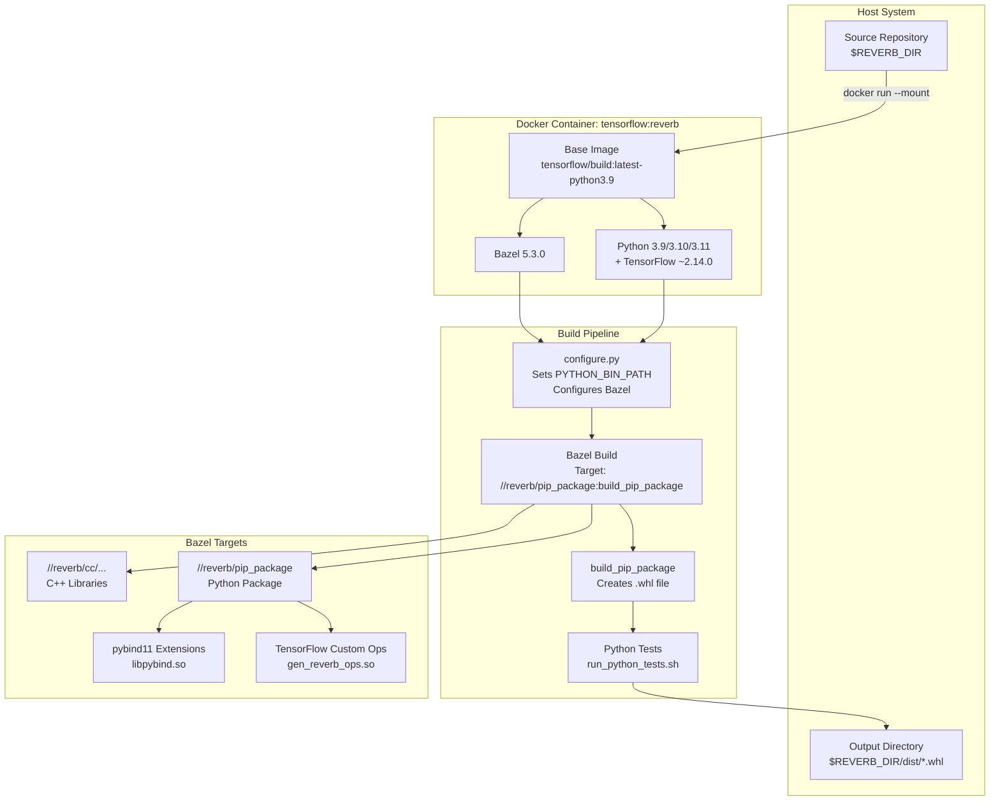

<!-- source: DeepWiki mcp.deepwiki.com · repo google-deepmind/reverb · page 6.3 Building from Source · fetched 2026-10-26 -->

# Building from Source

<details>
<summary>Relevant source files</summary>

The following files were used as context for generating this wiki page:

- [docker/release.dockerfile](docker/release.dockerfile)
- [oss_build.sh](oss_build.sh)
- [reverb/pip_package/README.md](reverb/pip_package/README.md)
- [run_python_tests.sh](run_python_tests.sh)

</details>


This document provides step-by-step instructions for building Reverb from source code. It covers the Docker-based development workflow, local compilation steps, and common build issues. This is intended for developers who want to modify Reverb, debug issues, or create custom builds.

For information about the Bazel build rules and targets, see [Bazel Build Rules](#6.1). For details on external dependencies, see [Dependency Management](#6.2). For the complete multi-version release build process, see [Release Process](#6.4).

## Prerequisites

Building Reverb requires:

- Docker (for containerized builds, recommended)
- Git (to clone the repository)
- 8GB+ RAM (for Bazel compilation)
- Linux x86_64 environment (other platforms not officially supported)

The build process uses Docker containers based on `tensorflow/build` images, which provide:
- Bazel 5.3.0 ([docker/release.dockerfile:52-60]())
- Python 3.9, 3.10, and 3.11 development headers ([docker/release.dockerfile:33-39]())
- TensorFlow ~2.14.0 ([docker/release.dockerfile:11](), [reverb/pip_package/README.md:49]())
- Build dependencies (gcc, protobuf, gRPC, etc.) ([docker/release.dockerfile:20-47]())

**Sources:** [docker/release.dockerfile:1-110](), [reverb/pip_package/README.md:1-157]()

## Build Architecture Overview



**Diagram: Build System Architecture**

This diagram shows how the Docker-based build isolates dependencies and orchestrates the Bazel build process to produce platform-specific wheel files.

**Sources:** [docker/release.dockerfile:1-110](), [oss_build.sh:1-160](), [reverb/pip_package/README.md:86-130]()

## Development Build Workflow

The standard workflow for developing Reverb involves building inside a Docker container to ensure consistent dependencies.

### Step 1: Build the Docker Container

Build the development container with the desired Python version:

```bash
export REVERB_DIR=/path/to/reverb/github/repo

# Build container with Python 3.9 (default)
docker build --tag tensorflow:reverb \
  - < "$REVERB_DIR/docker/release.dockerfile"

# Build container with Python 3.10
docker build --tag tensorflow:reverb \
  --build-arg python_version=python3.10 \
  - < "$REVERB_DIR/docker/release.dockerfile"

# Build container with Python 3.11
docker build --tag tensorflow:reverb \
  --build-arg python_version=python3.11 \
  - < "$REVERB_DIR/docker/release.dockerfile"
```

The `release.dockerfile` performs these key steps:
- Installs system dependencies via `apt-get` ([docker/release.dockerfile:20-47]())
- Downloads and installs Bazel 5.3.0 ([docker/release.dockerfile:52-60]())
- Installs TensorFlow and Python dependencies via pip ([docker/release.dockerfile:74-79]())
- Creates symbolic links for Python headers in `/dt9/usr/include/` ([docker/release.dockerfile:83-90]())
- Updates binutils to version 2.35.1 to avoid linker issues ([docker/release.dockerfile:94-105]())

**Sources:** [docker/release.dockerfile:1-110](), [reverb/pip_package/README.md:88-98]()

### Step 2: Start the Docker Container

Run the container with mounted source directory:

```bash
docker run --rm -it \
  --mount "type=bind,src=$REVERB_DIR,dst=/tmp/reverb" \
  --mount "type=bind,src=$HOME/.gitconfig,dst=/etc/gitconfig,ro" \
  --name reverb tensorflow:reverb bash
```

The mounts provide:
- Source code access at `/tmp/reverb` (read-write)
- Git configuration for commits (read-only)

The working directory is set to `/tmp/reverb` by the Dockerfile ([docker/release.dockerfile:107]()).

**Sources:** [reverb/pip_package/README.md:100-107]()

### Step 3: Configure the Build

Inside the container, configure Bazel for the target Python version:

```bash
# For Python 3.9
python3.9 configure.py

# For Python 3.10
python3.10 configure.py

# For Python 3.11
python3.11 configure.py
```

The `configure.py` script (not shown in provided files, but referenced) sets environment variables that Bazel uses:
- `PYTHON_BIN_PATH`: Path to Python interpreter
- `PYTHON_LIB_PATH`: Path to Python site-packages

These are consumed by Bazel rules during compilation ([oss_build.sh:107-118]()).

**Sources:** [reverb/pip_package/README.md:112-114](), [oss_build.sh:106-121]()

### Step 4: Compile Reverb

Build the pip package target:

```bash
bazel build -c opt //reverb/pip_package:build_pip_package
```

Key Bazel flags:
- `-c opt`: Optimized build (use `-c dbg` for debug symbols)
- `//reverb/pip_package:build_pip_package`: Target that builds the wheel

For release builds, additional flags are used:
- `--copt=-mavx`: Enable AVX instructions ([oss_build.sh:130]())
- `--config=manylinux2014`: Use manylinux2014 toolchain for portability ([oss_build.sh:130]())

**Sources:** [reverb/pip_package/README.md:113-114](), [oss_build.sh:130-137]()

### Step 5: Generate the Wheel File

Execute the build script to create the `.whl` package:

```bash
./bazel-bin/reverb/pip_package/build_pip_package \
  --dst /tmp/reverb_build/dist/
```

The `build_pip_package` binary:
- Collects compiled artifacts (`.so` files)
- Assembles Python source files
- Creates a wheel with proper ABI tags (e.g., `cp39`, `cp310`)
- Outputs to the specified `--dst` directory

**Sources:** [reverb/pip_package/README.md:116-121]()

### Step 6: Install and Test

Install the built wheel:

```bash
# Install the wheel
$PYTHON_BIN_PATH -mpip install --upgrade /tmp/reverb_build/dist/*.whl

# Run Python tests
bash run_python_tests.sh
```

The test script `run_python_tests.sh` discovers all `*_test.py` files and executes them ([run_python_tests.sh:32-41]()).

**Sources:** [reverb/pip_package/README.md:123-129](), [run_python_tests.sh:1-47]()

## Build Pipeline Data Flow

```mermaid
graph LR
    subgraph "Configuration Phase"
        C1["configure.py"] -->|"exports"| C2["PYTHON_BIN_PATH<br/>PYTHON_LIB_PATH"]
    end
    
    subgraph "Bazel Compilation Phase"
        C2 --> B1["Bazel Analysis<br/>Reads BUILD files"]
        B1 --> B2["C++ Compilation<br/>//reverb/cc/..."]
        B2 --> B3["Proto Generation<br/>reverb_service.proto"]
        B3 --> B4["Pybind11 Extension<br/>pybind.cc → libpybind.so"]
        B3 --> B5["TF Custom Ops<br/>ops/*.cc → gen_reverb_ops.so"]
        B4 --> B6["Link Phase<br/>Creates .so files"]
        B5 --> B6
    end
    
    subgraph "Package Assembly Phase"
        B6 --> P1["build_pip_package<br/>Script Execution"]
        P1 --> P2["Collect Artifacts<br/>.so + .py files"]
        P2 --> P3["Generate Metadata<br/>setup.py + MANIFEST"]
        P3 --> P4["Create Wheel<br/>dm_reverb-X.Y.Z-cpXY-cpXY-linux_x86_64.whl"]
    end
    
    subgraph "Testing Phase"
        P4 --> T1["pip install"]
        T1 --> T2["Import Tests"]
        T2 --> T3["Unit Tests<br/>*_test.py files"]
    end
```



**Diagram: Compilation and Packaging Pipeline**

This diagram traces how source files are transformed into a distributable Python wheel through Bazel's build system and the packaging script.

**Sources:** [oss_build.sh:96-160](), [reverb/pip_package/README.md:109-130]()

## Multi-Version Release Builds

For building Reverb across multiple Python versions (typically done for releases), use the `oss_build.sh` script:

```bash
# Build Docker container with all Python versions
docker build --pull --no-cache \
  --tag tensorflow:reverb_release \
  --build-arg tensorflow_pip=tensorflow~=2.14.0 \
  --build-arg python_version="python3.9 python3.10 python3.11" \
  - < "$REVERB_DIR/docker/release.dockerfile"

# Build wheels for all versions
docker run --rm --mount "type=bind,src=$REVERB_DIR,dst=/tmp/reverb" \
  tensorflow:reverb_release bash oss_build.sh \
  --clean true \
  --clear_bazel_cache true \
  --tf_dep_override "tensorflow~=2.14.0" \
  --release \
  --python "3.9 3.10 3.11"
```

The `oss_build.sh` script ([oss_build.sh:1-160]()):
- Iterates over Python versions ([oss_build.sh:96-118]())
- Sets appropriate `PYTHON_BIN_PATH` and ABI tags ([oss_build.sh:106-118]())
- Runs `configure.py` for each version ([oss_build.sh:121]())
- Executes C++ tests with `bazel test` ([oss_build.sh:130]())
- Builds the wheel with platform-specific flags ([oss_build.sh:137-138]())
- Installs and tests each wheel ([oss_build.sh:141-156]())

### Bazel Cache Management

**Important:** Bazel caches configuration state that can cause issues when switching Python versions. The `--clear_bazel_cache true` flag removes `$HOME/.cache/bazel` between builds ([oss_build.sh:100-102]()).

**Sources:** [reverb/pip_package/README.md:20-83](), [oss_build.sh:1-160]()

## Build Configuration Options

The `oss_build.sh` script accepts several important flags:

| Flag | Values | Purpose |
|------|--------|---------|
| `--python` | `3.9`, `3.10`, `3.11` | Target Python version(s) ([oss_build.sh:59-62]()) |
| `--release` | (boolean) | Marks build as release, affects version string ([oss_build.sh:56-58]()) |
| `--clean` | `true`/`false` | Runs `bazel clean` before build ([oss_build.sh:63-66]()) |
| `--clear_bazel_cache` | `true`/`false` | Deletes Bazel cache folder ([oss_build.sh:67-70]()) |
| `--tf_dep_override` | e.g., `tensorflow~=2.14.0` | TensorFlow version for pip dependency ([oss_build.sh:83-87]()) |
| `--output_dir` | Path | Where to write `.whl` files ([oss_build.sh:75-78]()) |
| `--debug_build` | `true`/`false` | Enables debug symbols with `-g2` flag ([oss_build.sh:79-82](), [oss_build.sh:133-135]()) |
| `--python_tests` | `true`/`false` | Whether to run Python tests after build ([oss_build.sh:71-74]()) |

**Sources:** [oss_build.sh:28-94](), [reverb/pip_package/README.md:33-82]()

## Common Build Issues

### Protobuf Version Mismatch

Reverb validates that the protoc compiler version matches TensorFlow's protobuf library version. A mismatch produces:

```
Error: Please update the PROTOC_VERSION in your WORKSPACE
```

**Resolution:**
- TensorFlow sets its protobuf version in `tensorflow/workspace2.bzl`
- Reverb sets its protoc version in the root `WORKSPACE` file
- Note: protoc releases use version `21.9` while protobuf library uses `3.21.0` for the same release

As of February 2023, TensorFlow uses protobuf 3.21.9 ([reverb/pip_package/README.md:136-156]()).

**Sources:** [reverb/pip_package/README.md:135-157]()

### Python Header Link Errors

The Docker container may have stale symbolic links in `/dt9/usr/include/x86_64-linux-gnu/` for Python headers.

**Resolution:**
The Dockerfile explicitly removes and recreates these links ([docker/release.dockerfile:83-90]()):

```bash
rm /dt9/usr/include/x86_64-linux-gnu/python3.9
ln -s "/usr/include/x86_64-linux-gnu/python3.9" "/dt9/usr/include/x86_64-linux-gnu/python3.9"
```

**Sources:** [docker/release.dockerfile:83-90]()

### Bazel Cache Issues Between Python Versions

When building for multiple Python versions consecutively, Bazel may cache Python-specific configuration from the first build.

**Resolution:**
- Use `--clear_bazel_cache true` flag ([reverb/pip_package/README.md:33-37]())
- Or run separate Docker containers for each Python version
- Or explicitly run `bazel clean` between versions

**Sources:** [reverb/pip_package/README.md:33-37](), [oss_build.sh:67-70](), [oss_build.sh:99-104]()

### Linker (Gold) Errors

Older versions of binutils can cause linking failures with error messages referencing the gold linker.

**Resolution:**
The Dockerfile updates binutils to version 2.35.1 ([docker/release.dockerfile:94-105]()):

```bash
wget https://old-releases.ubuntu.com/ubuntu/pool/main/b/binutils/binutils_2.35.1-1ubuntu1_amd64.deb
dpkg -i binutils_2.35.1-1ubuntu1_amd64.deb
```

**Sources:** [docker/release.dockerfile:94-105]()

## Debug Builds

To create a debug build with symbols for gdb/lldb debugging:

```bash
docker run --rm --mount "type=bind,src=$REVERB_DIR,dst=/tmp/reverb" \
  tensorflow:reverb_release bash oss_build.sh \
  --clean true \
  --debug_build true \
  --output_dir /tmp/reverb/dist/debug/ \
  --tf_dep_override "tensorflow~=2.14.0" \
  --python "3.9"
```

Debug builds ([reverb/pip_package/README.md:73-81]()):
- Add `--copt=-g2` to Bazel compilation ([oss_build.sh:133-135]())
- Are approximately 90MB vs 7MB for release builds
- Are not labeled as "debug" to avoid installation conflicts
- Output to a separate directory (e.g., `dist/debug/`)

**Sources:** [reverb/pip_package/README.md:73-81](), [oss_build.sh:133-137]()

## Local Development Without Docker

While Docker is recommended, local builds are possible if you have:
- Bazel 5.3.0 installed
- TensorFlow ~2.14.0 installed via pip
- Python development headers
- gRPC, protobuf, and other dependencies

The basic steps are:

```bash
cd $REVERB_DIR
python3.9 configure.py
bazel build -c opt //reverb/pip_package:build_pip_package
./bazel-bin/reverb/pip_package/build_pip_package --dst ./dist/
pip install ./dist/*.whl
```

However, this approach is not officially supported and may encounter dependency version mismatches.

**Sources:** [reverb/pip_package/README.md:109-130]()

## Build Artifacts and Output

After a successful build, the following artifacts are generated:

| Artifact | Location | Description |
|----------|----------|-------------|
| Wheel file | `$OUTPUT_DIR/dm_reverb-*.whl` | Distributable Python package |
| C++ libraries | `bazel-bin/reverb/cc/` | Compiled `.a` and `.so` files |
| Pybind extension | `bazel-bin/reverb/pybind.so` | Python-C++ binding library |
| TF ops | `bazel-bin/reverb/gen_reverb_ops.so` | TensorFlow custom operations |
| Proto files | `bazel-bin/reverb/*_pb2.py` | Generated protocol buffer Python code |

The wheel filename format is: `dm_reverb-{version}-{abi}-{platform}.whl`, for example:
- `dm_reverb-0.12.0-cp39-cp39-linux_x86_64.whl`

**Sources:** [oss_build.sh:137-142](), [reverb/pip_package/README.md:116-141]()

---

