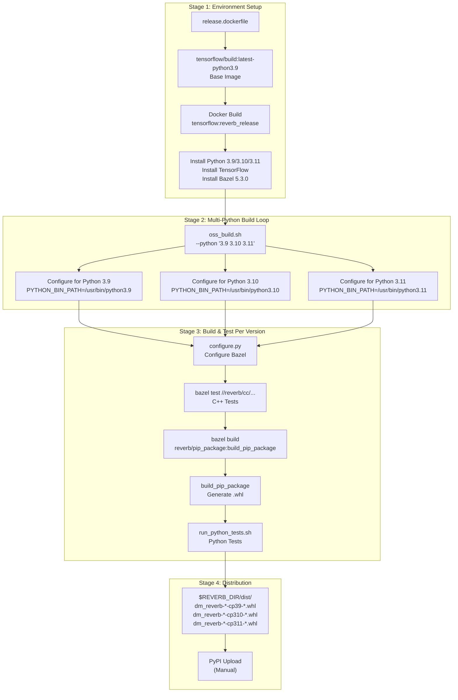
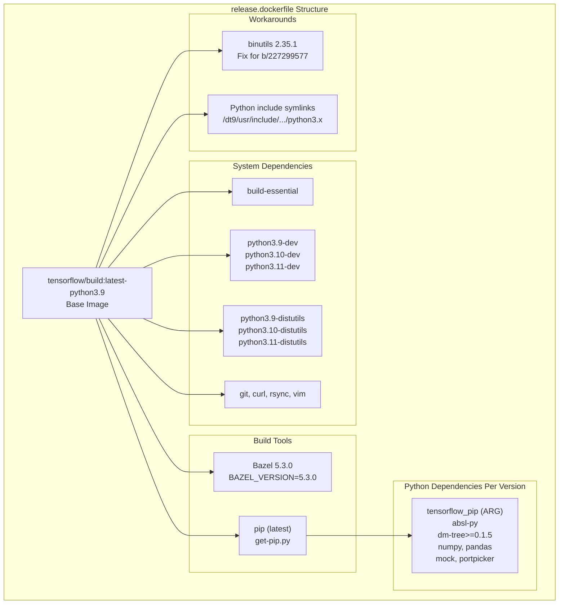
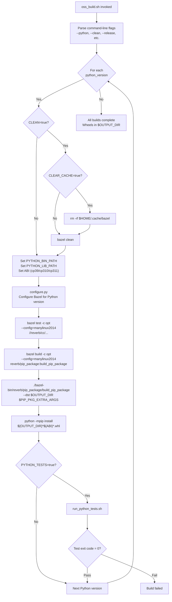
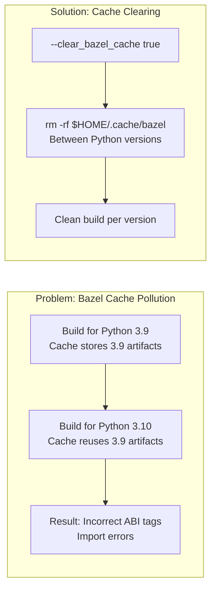
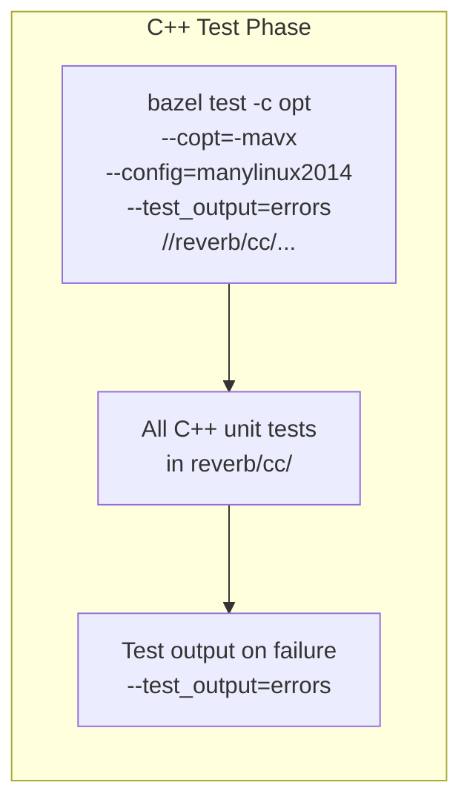
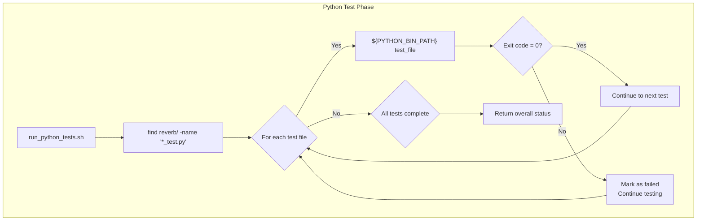
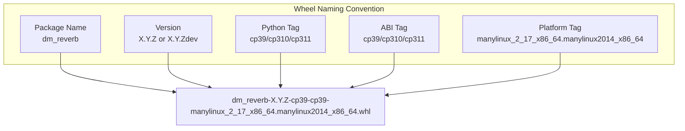
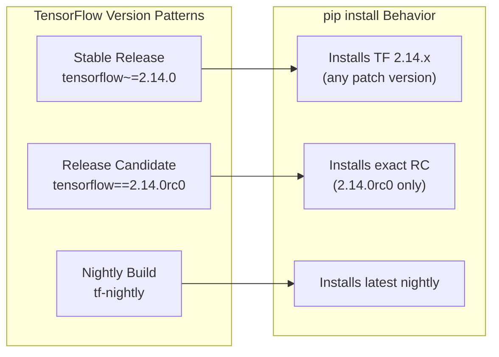
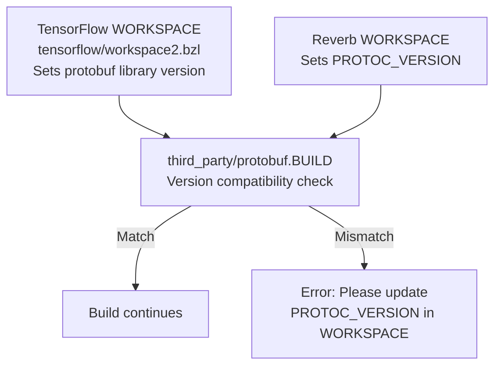
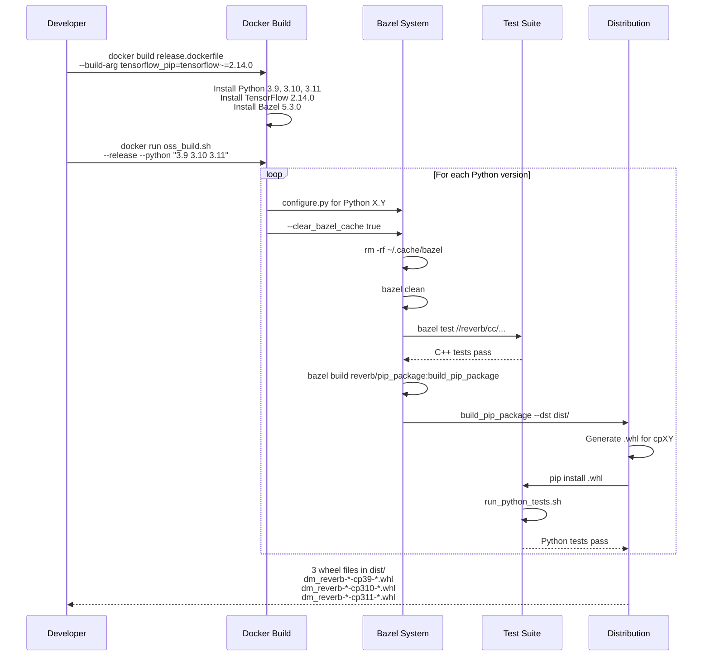

<!-- source: DeepWiki mcp.deepwiki.com · repo google-deepmind/reverb · page 6.4 Release Process · fetched 2026-10-26 -->

# Release Process

<details>
<summary>Relevant source files</summary>

The following files were used as context for generating this wiki page:

- [docker/release.dockerfile](docker/release.dockerfile)
- [oss_build.sh](oss_build.sh)
- [reverb/pip_package/README.md](reverb/pip_package/README.md)
- [run_python_tests.sh](run_python_tests.sh)

</details>


## Purpose and Scope

This document describes the process for creating official Reverb release builds that are distributed as Python wheel packages (`.whl` files). It covers the Docker-based build environment, multi-Python version compilation, testing procedures, and package generation. This process is designed to produce `manylinux2014`-compliant wheels compatible with PyPI distribution.

For information about building Reverb for development purposes, see [Building from Source](#6.3). For details on package structure and distribution, see [Package Structure](#6.5).

---

## Overview

The Reverb release process is a multi-stage pipeline that creates wheel packages for multiple Python versions (3.9, 3.10, 3.11) in a reproducible Docker environment. The process ensures compatibility with specific TensorFlow versions and produces `manylinux2014`-compliant wheels for broad Linux distribution compatibility.

### Release Pipeline



**Sources:** [reverb/pip_package/README.md:1-157](), [oss_build.sh:1-160](), [docker/release.dockerfile:1-110]()

---

## Docker Build Environment

The release process uses a Docker container based on TensorFlow's official build images to ensure reproducibility and compatibility. The container is configured with all necessary build tools and dependencies.

### Container Configuration



Key build arguments in [docker/release.dockerfile:1-110]():

| Argument | Default | Purpose |
|----------|---------|---------|
| `base_image` | `tensorflow/build:latest-python3.9` | Base TensorFlow build image |
| `tensorflow_pip` | `tf-nightly` | TensorFlow version to install |
| `python_version` | `python3.9` | Space-separated list of Python versions |
| `bazel_version` | `5.3.0` | Bazel version for building |

**Sources:** [docker/release.dockerfile:1-110]()

---

## Build Command Patterns

### Creating a Stable Release

The standard release build creates wheels for all supported Python versions against a specific TensorFlow version:

```bash
# Build Docker container with specific TensorFlow version
docker build --pull --no-cache \
  --tag tensorflow:reverb_release \
  --build-arg tensorflow_pip=tensorflow~=2.14.0 \
  --build-arg python_version="python3.9 python3.10 python3.11" \
  - < "$REVERB_DIR/docker/release.dockerfile"

# Execute multi-Python build
docker run --rm --mount "type=bind,src=$REVERB_DIR,dst=/tmp/reverb" \
  tensorflow:reverb_release bash oss_build.sh --clean true \
  --clear_bazel_cache true --tf_dep_override "tensorflow~=2.14.0" \
  --release --python "3.9 3.10 3.11"
```

### Release Candidate Build

For TensorFlow release candidates, strict version pinning is required:

```bash
# RC builds need exact version match
docker run --rm --mount "type=bind,src=$REVERB_DIR,dst=/tmp/reverb" \
  tensorflow:reverb_release bash oss_build.sh --clean true \
  --clear_bazel_cache true --tf_dep_override "tensorflow==2.14.0rc0" \
  --release --python "3.9 3.10 3.11"
```

The `--tf_dep_override` flag sets the TensorFlow dependency in the generated wheel's metadata [oss_build.sh:83-86]().

**Sources:** [reverb/pip_package/README.md:39-83](), [oss_build.sh:83-86]()

---

## Build Script Architecture

The `oss_build.sh` script orchestrates the entire build process, iterating over Python versions and executing build, test, and packaging steps for each.

### Build Script Flow



### Key Environment Variables Per Python Version

[oss_build.sh:96-118]() sets version-specific variables:

| Python | `PYTHON_BIN_PATH` | `PYTHON_LIB_PATH` | `ABI` |
|--------|-------------------|-------------------|-------|
| 3.9 | `/usr/bin/python3.9` | `/usr/local/lib/python3.9/dist-packages` | `cp39` |
| 3.10 | `/usr/bin/python3.10` | `/usr/local/lib/python3.10/dist-packages` | `cp310` |
| 3.11 | `/usr/bin/python3.11` | `/usr/local/lib/python3.11/dist-packages` | `cp311` |

The `ABI` variable determines the wheel filename suffix used for installation [oss_build.sh:141]().

**Sources:** [oss_build.sh:1-160]()

---

## Bazel Cache Management

A critical aspect of multi-Python builds is Bazel cache management. Bazel caches build artifacts based on the first Python version encountered, which can cause issues when building for multiple versions sequentially.

### Cache Clearing Strategy



From [reverb/pip_package/README.md:33-37]():
> Bazel is caching the first version of files or a config of the first version of Python used. If building reverb consecutively for different versions of Python `--clear_bazel_cache true` is needed.

The build script implements this in [oss_build.sh:99-104]():
- When `--clear_bazel_cache true` is set, `rm -rf $HOME/.cache/bazel` is executed
- Additionally, `bazel clean` removes build outputs
- This ensures each Python version gets a fresh build environment

**Sources:** [reverb/pip_package/README.md:33-37](), [oss_build.sh:99-104]()

---

## Testing Pipeline

The release process includes two levels of testing to ensure quality:

### C++ Test Execution



C++ tests are run via Bazel [oss_build.sh:130](). Only tests under `//reverb/cc/...` are executed during the build process because Bazel test execution doesn't respect the configured Python version for Python tests [oss_build.sh:124-129]().

### Python Test Execution



Python tests run after wheel installation [oss_build.sh:143-157]():
1. Install the newly built wheel for the current Python version
2. Execute `run_python_tests.sh` which finds all `*_test.py` files
3. Run each test with the configured `PYTHON_BIN_PATH`
4. Collect results and fail the build if any test fails

The script in [run_python_tests.sh:27-44]() discovers and executes all Python tests, continuing even if some fail to get a complete test report.

**Sources:** [oss_build.sh:124-157](), [run_python_tests.sh:1-47]()

---

## Build Configurations

### Standard Release Build

The standard release configuration produces optimized, compact wheels (~7MB):

```bash
bazel build -c opt --copt=-mavx --config=manylinux2014 \
  reverb/pip_package:build_pip_package
```

Key flags:
- `-c opt`: Optimized compilation mode
- `--copt=-mavx`: Enable AVX CPU instructions for performance
- `--config=manylinux2014`: PEP 599 compliance for broad Linux compatibility

### Debug Build

Debug builds include symbols and debugging information (~90MB):

```bash
docker run --rm --mount "type=bind,src=$REVERB_DIR,dst=/tmp/reverb" \
  tensorflow:reverb_release bash oss_build.sh --clean true --debug_build true \
  --clear_bazel_cache true --output_dir /tmp/reverb/dist/debug/ \
  --tf_dep_override "tensorflow~=2.14.0" --release --python "3.9 3.10 3.11"
```

The `--debug_build true` flag adds `-g2` compilation option [oss_build.sh:133-135](), which embeds debugging symbols for GDB/LLDB debugging.

### Build Flag Reference

| Flag | Default | Purpose |
|------|---------|---------|
| `--release` | (not set) | Marks build as release (vs nightly) |
| `--python` | `3.9` | Space-separated list of Python versions |
| `--clean` | `false` | Run `bazel clean` before build |
| `--clear_bazel_cache` | `false` | Delete Bazel cache directory |
| `--tf_dep_override` | (required) | TensorFlow version dependency string |
| `--python_tests` | `true` | Whether to run Python tests |
| `--output_dir` | `/tmp/reverb/dist/` | Destination for wheel files |
| `--debug_build` | `false` | Build with debug symbols |

**Sources:** [oss_build.sh:28-94](), [reverb/pip_package/README.md:73-81]()

---

## Output Artifacts

### Wheel Package Naming

The build process generates wheels with version-specific ABI tags:

```
dm_reverb-<version>-cp39-cp39-manylinux_2_17_x86_64.manylinux2014_x86_64.whl
dm_reverb-<version>-cp310-cp310-manylinux_2_17_x86_64.manylinux2014_x86_64.whl
dm_reverb-<version>-cp311-cp311-manylinux_2_17_x86_64.manylinux2014_x86_64.whl
```



The ABI tag matches the Python version:
- `cp39`: CPython 3.9
- `cp310`: CPython 3.10
- `cp311`: CPython 3.11

The wheel installation logic uses this tag to select the correct wheel [oss_build.sh:141]():
```bash
$PYTHON_BIN_PATH -mpip install ${OUTPUT_DIR}*${ABI}*.whl
```

### Output Directory Structure

```
$REVERB_DIR/dist/
├── dm_reverb-X.Y.Z-cp39-cp39-manylinux_2_17_x86_64.manylinux2014_x86_64.whl
├── dm_reverb-X.Y.Z-cp310-cp310-manylinux_2_17_x86_64.manylinux2014_x86_64.whl
└── dm_reverb-X.Y.Z-cp311-cp311-manylinux_2_17_x86_64.manylinux2014_x86_64.whl

# Debug builds (if --output_dir specified):
$REVERB_DIR/dist/debug/
├── dm_reverb-X.Y.Z-cp39-cp39-manylinux_2_17_x86_64.manylinux2014_x86_64.whl
├── dm_reverb-X.Y.Z-cp310-cp310-manylinux_2_17_x86_64.manylinux2014_x86_64.whl
└── dm_reverb-X.Y.Z-cp311-cp311-manylinux_2_17_x86_64.manylinux2014_x86_64.whl
```

**Sources:** [oss_build.sh:138-141](), [reverb/pip_package/README.md:30-31]()

---

## TensorFlow Version Compatibility

### Version Dependency Specification

The `--tf_dep_override` flag controls the TensorFlow dependency declared in the wheel metadata. This affects what gets installed when users run `pip install reverb[tensorflow]`.



From [reverb/pip_package/README.md:58-71]():
- **Stable releases**: Use `tensorflow~=2.14.0` (compatible release specifier)
- **Release candidates**: Use `tensorflow==2.14.0rc0` (exact match required)
  - RCs need strict equality because pip doesn't recognize `2.4.0rc0` as greater than `2.3.0`
- **Nightly builds**: Typically use `tf-nightly` or no override

The dependency override is passed to `build_pip_package` via `PIP_PKG_EXTRA_ARGS` [oss_build.sh:84-86]():
```bash
PIP_PKG_EXTRA_ARGS="${PIP_PKG_EXTRA_ARGS} --tf-version ${2}"
```

**Sources:** [reverb/pip_package/README.md:58-71](), [oss_build.sh:83-86]()

---

## Protobuf Version Synchronization

Reverb requires protobuf version compatibility between itself and TensorFlow to avoid runtime errors.

### Version Checking Mechanism



From [reverb/pip_package/README.md:135-156]():
> There is a check in the Reverb build process that checks if the protoc library in Tensorflow matches what Reverb is using. It throws this error if there is a mismatch: "Please update the PROTOC_VERSION in your WORKSPACE".

The version numbers follow a dual naming scheme:
- **protoc binary**: Released as version `21.9`
- **protobuf library**: Released as version `3.21.9`

When updating protobuf versions:
1. Check TensorFlow's WORKSPACE for its protobuf library version
2. Update Reverb's WORKSPACE with the corresponding protoc version
3. Account for the version number mapping (e.g., protoc 21.9 = protobuf 3.21.9)

**Sources:** [reverb/pip_package/README.md:135-156]()

---

## Complete Release Workflow

### Full Production Release



### Typical Command Sequence

```bash
# 1. Set working directory
export REVERB_DIR=/path/to/reverb

# 2. Build Docker container (one-time or when base changes)
docker build --pull --no-cache \
  --tag tensorflow:reverb_release \
  --build-arg tensorflow_pip=tensorflow~=2.14.0 \
  --build-arg python_version="python3.9 python3.10 python3.11" \
  - < "$REVERB_DIR/docker/release.dockerfile"

# 3. Execute multi-Python release build
docker run --rm --mount "type=bind,src=$REVERB_DIR,dst=/tmp/reverb" \
  tensorflow:reverb_release bash oss_build.sh \
  --clean true \
  --clear_bazel_cache true \
  --tf_dep_override "tensorflow~=2.14.0" \
  --release \
  --python "3.9 3.10 3.11"

# 4. Verify output
ls -lh $REVERB_DIR/dist/*.whl

# 5. (Manual) Upload to PyPI
# twine upload dist/*.whl
```

**Sources:** [reverb/pip_package/README.md:39-83](), [oss_build.sh:1-160]()

---

