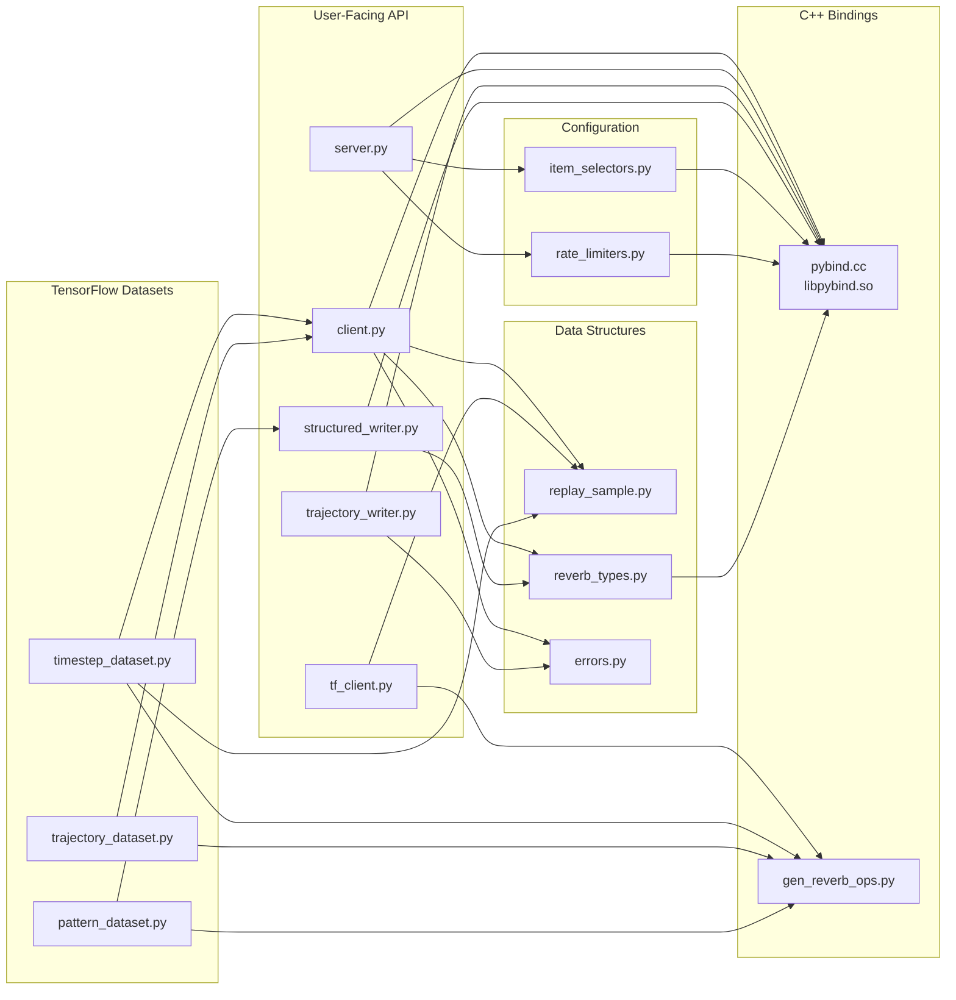
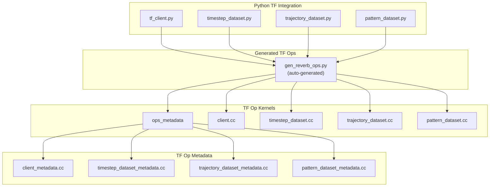
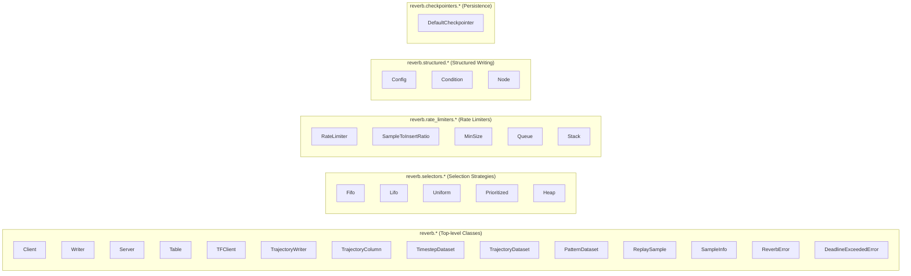
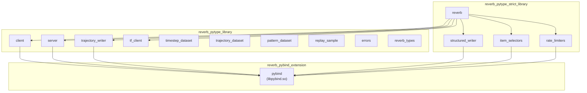
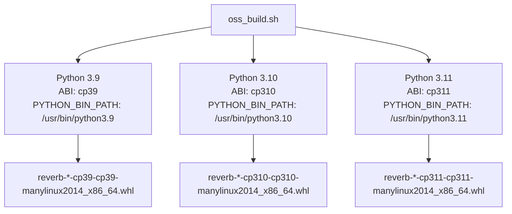
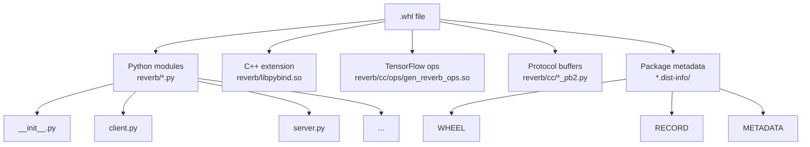

<!-- source: DeepWiki mcp.deepwiki.com · repo google-deepmind/reverb · page 6.5 Package Structure · fetched 2026-10-26 -->

# Package Structure

<details>
<summary>Relevant source files</summary>

The following files were used as context for generating this wiki page:

- [docker/release.dockerfile](docker/release.dockerfile)
- [oss_build.sh](oss_build.sh)
- [reverb/BUILD](reverb/BUILD)
- [reverb/__init__.py](reverb/__init__.py)
- [reverb/cc/ops/BUILD](reverb/cc/ops/BUILD)
- [reverb/pip_package/README.md](reverb/pip_package/README.md)
- [run_python_tests.sh](run_python_tests.sh)

</details>


## Purpose and Scope

This document describes the organization of the Reverb Python package, including its module hierarchy, entry points, and version management. It explains how Python modules are structured, how they depend on each other, and how the C++ implementation is exposed through the `pybind` binding layer.

For information about building the package from source, see [Building from Source](#6.3). For details about the release build process, see [Release Process](#6.4). For the pybind11 implementation details, see [Python-C++ Bindings](#4.1).

## Package Overview

The Reverb package (`dm-reverb` on PyPI) is distributed as a Python wheel containing:
- Pure Python modules located in `reverb/`
- C++ extension module `libpybind.so` (built via pybind11)
- TensorFlow custom operations in `gen_reverb_ops.so`
- Protocol buffer definitions

The package supports Python 3.9, 3.10, and 3.11, with separate wheels built for each version using appropriate ABI tags (`cp39`, `cp310`, `cp311`).

Sources: [reverb/pip_package/README.md:59-63](), [oss_build.sh:106-118]()

## Module Hierarchy

The package is organized into a flat module structure under the `reverb` namespace:

```mermaid
graph TB
    root["reverb/__init__.py"]
    
    root --> client["client.py"]
    root --> server["server.py"]
    root --> trajectory_writer["trajectory_writer.py"]
    root --> structured_writer["structured_writer.py"]
    root --> tf_client["tf_client.py"]
    
    root --> item_selectors["item_selectors.py"]
    root --> rate_limiters["rate_limiters.py"]
    root --> errors["errors.py"]
    root --> replay_sample["replay_sample.py"]
    root --> reverb_types["reverb_types.py"]
    
    root --> timestep_dataset["timestep_dataset.py"]
    root --> trajectory_dataset["trajectory_dataset.py"]
    root --> pattern_dataset["pattern_dataset.py"]
    
    root --> pybind["pybind.cc → libpybind.so"]
    root --> gen_ops["gen_reverb_ops.py"]
    
    root --> checkpointers["platform/default/checkpointers"]
    
    style pybind fill:#f9f9f9
    style gen_ops fill:#f9f9f9
```



**Diagram: Reverb Module Structure**

All modules are direct children of the `reverb` namespace, providing a flat import hierarchy for user code.

Sources: [reverb/__init__.py:17-56](), [reverb/BUILD:22-41]()

## Core Python Modules

### Client and Server Modules

| Module | Bazel Target | Key Classes | Purpose |
|--------|--------------|-------------|---------|
| `client.py` | `:client` | `Client`, `Writer` | Client API for remote server interaction |
| `server.py` | `:server` | `Server`, `Table` | Server configuration and table management |
| `trajectory_writer.py` | `:trajectory_writer` | `TrajectoryWriter`, `TrajectoryColumn` | High-level trajectory construction |
| `structured_writer.py` | `:structured_writer` | `StructuredWriter` | Pattern-based structured data writing |

Sources: [reverb/BUILD:52-84](), [reverb/__init__.py:32-55]()

### TensorFlow Integration Modules

| Module | Bazel Target | Key Classes | Purpose |
|--------|--------------|-------------|---------|
| `tf_client.py` | `:tf_client` | `TFClient` | TensorFlow-native client operations |
| `timestep_dataset.py` | `:timestep_dataset` | `TimestepDataset` | TensorFlow dataset for timestep sampling |
| `trajectory_dataset.py` | `:trajectory_dataset` | `TrajectoryDataset` | TensorFlow dataset for trajectory sampling |
| `pattern_dataset.py` | `:pattern_dataset` | `PatternDataset` | TensorFlow dataset for pattern-based sampling |

Sources: [reverb/BUILD:124-337]()

### Configuration and Utilities

| Module | Bazel Target | Key Classes/Functions | Purpose |
|--------|--------------|---------------------|---------|
| `item_selectors.py` | `:item_selectors` | `Fifo`, `Lifo`, `Uniform`, `Prioritized` | Sampling strategy configuration |
| `rate_limiters.py` | `:rate_limiters` | `RateLimiter`, `SampleToInsertRatio` | Flow control configuration |
| `errors.py` | `:errors` | `ReverbError`, `DeadlineExceededError` | Exception types |
| `replay_sample.py` | `:replay_sample` | `ReplaySample`, `SampleInfo` | Sample data structures |
| `reverb_types.py` | `:reverb_types` | Type definitions | Common type aliases |

Sources: [reverb/BUILD:44-192]()

## Module Dependency Graph



**Diagram: Module Dependencies**

Sources: [reverb/BUILD:52-337]()

## C++ Binding Layer

The `pybind` module provides the Python-C++ bridge, exposing core C++ functionality:

```mermaid
graph TB
    subgraph "Python Modules"
        client_py["client.py"]
        server_py["server.py"]
        writer_py["trajectory_writer.py"]
        selectors_py["item_selectors.py"]
        limiters_py["rate_limiters.py"]
    end
    
    subgraph "Pybind Extension"
        pybind_cc["pybind.cc"]
        pybind_so["libpybind.so<br/>(compiled extension)"]
    end
    
    subgraph "C++ Core"
        client_cc["//reverb/cc:client"]
        table_cc["//reverb/cc:table"]
        writer_cc["//reverb/cc:writer"]
        trajectory_writer_cc["//reverb/cc:trajectory_writer"]
        structured_writer_cc["//reverb/cc:structured_writer"]
        sampler_cc["//reverb/cc:sampler"]
        chunker_cc["//reverb/cc:chunker"]
        selectors_cc["//reverb/cc/selectors:*"]
        server_cc["//reverb/cc/platform:server"]
        checkpointing_cc["//reverb/cc/platform:checkpointing"]
    end
    
    client_py --> pybind_so
    server_py --> pybind_so
    writer_py --> pybind_so
    selectors_py --> pybind_so
    limiters_py --> pybind_so
    
    pybind_cc --> pybind_so
    
    pybind_cc --> client_cc
    pybind_cc --> table_cc
    pybind_cc --> writer_cc
    pybind_cc --> trajectory_writer_cc
    pybind_cc --> structured_writer_cc
    pybind_cc --> sampler_cc
    pybind_cc --> chunker_cc
    pybind_cc --> selectors_cc
    pybind_cc --> server_cc
    pybind_cc --> checkpointing_cc
```



**Diagram: Pybind Extension Structure**

The `pybind` module is built as a shared library (`libpybind.so`) via the `reverb_pybind_extension` rule:

- **Module name**: `libpybind` [reverb/BUILD:95]()
- **Source file**: `pybind.cc` [reverb/BUILD:94]()
- **Type stubs**: `pybind.pyi` [reverb/BUILD:96]()

### C++ Dependencies in Pybind

The pybind extension links against core C++ libraries:

| C++ Component | Bazel Dependency | Purpose |
|---------------|------------------|---------|
| Client | `//reverb/cc:client` | Client communication |
| Table | `//reverb/cc:table` | Table implementation |
| Writer | `//reverb/cc:writer` | Basic writer |
| TrajectoryWriter | `//reverb/cc:trajectory_writer` | Trajectory writer |
| StructuredWriter | `//reverb/cc:structured_writer` | Structured writer |
| Sampler | `//reverb/cc:sampler` | Sampling implementation |
| Chunker | `//reverb/cc:chunker` | Data chunking |
| ItemSelectors | `//reverb/cc/selectors:*` | Selection strategies |
| Server | `//reverb/cc/platform:server` | Server implementation |
| Checkpointing | `//reverb/cc/platform:checkpointing` | Persistence |

Sources: [reverb/BUILD:92-121]()

## TensorFlow Custom Operations

The TensorFlow integration layer is built separately from the pybind extension:



**Diagram: TensorFlow Custom Operations Structure**

The `gen_reverb_ops.py` file is auto-generated from C++ TensorFlow operation definitions using the `reverb_gen_op_wrapper_py` build rule:

- **Generator rule**: `reverb_gen_op_wrapper_py` [reverb/cc/ops/BUILD:49-54]()
- **Output file**: `gen_reverb_ops.py` [reverb/cc/ops/BUILD:51]()
- **Kernel library**: `:ops` [reverb/cc/ops/BUILD:52]()
- **Metadata library**: `:ops_metadata` [reverb/cc/ops/BUILD:53]()

Sources: [reverb/cc/ops/BUILD:1-88]()

## Package Entry Points

The main package entry point is `reverb/__init__.py`, which establishes the public API:

### Import Structure

```python
# Version check (first thing)
from reverb.platform.default import ensure_tf_install
ensure_tf_install.ensure_tf_version()

# Submodules (namespaced)
from reverb import item_selectors as selectors
from reverb import rate_limiters
from reverb import structured_writer as structured
from reverb.platform.default import checkpointers

# Main classes (top-level)
from reverb.client import Client, Writer
from reverb.server import Server, Table
from reverb.trajectory_writer import TrajectoryWriter, TrajectoryColumn
from reverb.tf_client import TFClient
from reverb.timestep_dataset import TimestepDataset
from reverb.trajectory_dataset import TrajectoryDataset
from reverb.pattern_dataset import PatternDataset
from reverb.replay_sample import ReplaySample, SampleInfo
from reverb.errors import ReverbError, DeadlineExceededError
```

Sources: [reverb/__init__.py:19-56]()

### Public API Categories



**Diagram: Public API Namespace Organization**

Sources: [reverb/__init__.py:27-55]()

## Build Targets and Module Definitions

Each Python module is defined as a Bazel library target in `reverb/BUILD`:

### Library Type Classification



**Diagram: Bazel Library Targets and Types**

### Build Rule Summary

| Rule Type | Purpose | Examples |
|-----------|---------|----------|
| `reverb_pytype_strict_library` | Type-checked pure Python with strict mode | `reverb`, `rate_limiters`, `item_selectors` |
| `reverb_pytype_library` | Type-checked pure Python | Most modules |
| `reverb_pybind_extension` | C++ extension module | `pybind` → `libpybind.so` |
| `reverb_gen_op_wrapper_py` | TensorFlow ops wrapper generation | `gen_reverb_ops` |
| `reverb_py_test` | Python test target | All `*_test.py` files |

Sources: [reverb/BUILD:1-348]()

## Version Management

Version management occurs at multiple levels:

### Python Version Support

The package is built for three Python versions, each with its own ABI tag:



**Diagram: Multi-Python Version Build Process**

Sources: [oss_build.sh:106-118](), [reverb/pip_package/README.md:44-51]()

### TensorFlow Version Dependency

The package declares a TensorFlow dependency that can be overridden at build time:

- **Default**: `tf-nightly` (for development)
- **Release builds**: Explicitly specified via `--tf_dep_override` flag
- **Example stable**: `tensorflow~=2.14.0`
- **Example RC**: `tensorflow==2.14.0rc0`

The version constraint is passed to `setup.py` during wheel generation via the `build_pip_package` script with the `--tf-version` flag.

Sources: [reverb/pip_package/README.md:45-71](), [oss_build.sh:83-86]()

### Package Versioning

Version information is managed through:

1. **Build metadata**: Set during wheel creation by `build_pip_package`
2. **Release vs nightly**: Controlled by `--release` flag in build script
3. **Version string**: Generated based on git state and release flag

Sources: [oss_build.sh:56-57](), [reverb/pip_package/README.md:55-63]()

## Installation Artifacts

The build process generates Python wheels with the following characteristics:

### Wheel Naming Convention

```
dm_reverb-<version>-<python_tag>-<abi_tag>-<platform_tag>.whl
```

Example:
```
dm_reverb-0.12.0-cp39-cp39-manylinux2014_x86_64.whl
dm_reverb-0.12.0-cp310-cp310-manylinux2014_x86_64.whl
dm_reverb-0.12.0-cp311-cp311-manylinux2014_x86_64.whl
```

### Wheel Contents



**Diagram: Python Wheel Contents**

Sources: [reverb/pip_package/README.md:115-129](), [oss_build.sh:136-141]()

### Platform Tags

All wheels are built with the `manylinux2014_x86_64` platform tag, indicating compatibility with Linux distributions that support the manylinux2014 standard. The build uses Docker containers based on `tensorflow/build` images to ensure ABI compatibility.

Sources: [docker/release.dockerfile:1-110](), [oss_build.sh:130]()

## Testing and Validation

Python tests are organized alongside their corresponding modules:

### Test Structure

| Test File | Target Module | Bazel Target |
|-----------|---------------|--------------|
| `client_test.py` | `client.py` | `:client_test` |
| `server_test.py` | `server.py` | `:server_test` |
| `trajectory_writer_test.py` | `trajectory_writer.py` | `:trajectory_writer_test` |
| `structured_writer_test.py` | `structured_writer.py` | `:structured_writer_test` |
| `tf_client_test.py` | `tf_client.py` | `:tf_client_test` |
| `timestep_dataset_test.py` | `timestep_dataset.py` | `:timestep_dataset_test` |
| `trajectory_dataset_test.py` | `trajectory_dataset.py` | `:trajectory_dataset_test` |
| `pattern_dataset_test.py` | `pattern_dataset.py` | `:pattern_dataset_test` |
| `rate_limiters_test.py` | `rate_limiters.py` | `:rate_limiters_test` |
| `pybind_test.py` | `pybind.cc` | `:pybind_test` |

Sources: [reverb/BUILD:194-347]()

### Test Execution

Tests can be run in two ways:

1. **Bazel**: C++ tests during build [oss_build.sh:130]()
2. **pytest**: Python tests after wheel installation [run_python_tests.sh:27-44]()

The build script runs all tests found in `reverb/*_test.py` after installing the wheel to validate the package:

```bash
bash run_python_tests.sh
```

Sources: [run_python_tests.sh:1-47](), [oss_build.sh:143-157]()

---

