<!-- source: DeepWiki mcp.deepwiki.com · repo google-deepmind/reverb · page 7 Advanced Topics · fetched 2026-10-26 -->

# Advanced Topics

<details>
<summary>Relevant source files</summary>

The following files were used as context for generating this wiki page:

- [README.md](README.md)
- [docs/images/multiple_tables_example.png](docs/images/multiple_tables_example.png)
- [reverb/cc/platform/tfrecord_checkpointer.cc](reverb/cc/platform/tfrecord_checkpointer.cc)
- [reverb/cc/table.cc](reverb/cc/table.cc)
- [reverb/cc/table.h](reverb/cc/table.h)
- [reverb/cc/table_test.cc](reverb/cc/table_test.cc)
- [reverb/pip_package/reverb_version.py](reverb/pip_package/reverb_version.py)
- [reverb/pip_package/setup.py](reverb/pip_package/setup.py)

</details>


This page covers advanced implementation details and internal mechanisms of Reverb, including concurrency models, memory management strategies, error handling patterns, performance optimizations, and distributed deployment considerations. This material is intended for developers who need to understand Reverb's internals for debugging, optimization, or extension development.

For basic usage patterns, see [Overview](#1). For client API documentation, see [Python Client API](#4). For core component architecture, see [Core Components](#3).

---

## Concurrency and Threading Model

Reverb's `Table` class employs a sophisticated multi-threaded architecture to maximize throughput while maintaining consistency. The system uses multiple worker threads and carefully ordered locks to handle concurrent insert and sample operations efficiently.

### Worker Thread Architecture

The `Table` class maintains two dedicated worker threads that process operations asynchronously:

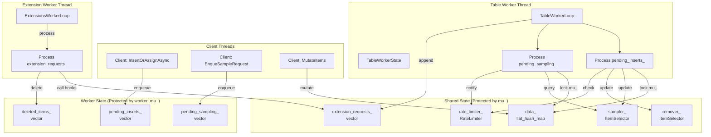

**Sources:** [reverb/cc/table.h:586-614](), [reverb/cc/table.cc:236-423](), [reverb/cc/table.cc:425-502]()

The **table worker thread** (`table_worker_`) runs `TableWorkerLoop()` and is responsible for:
- Processing asynchronous insert requests from `pending_inserts_`
- Processing asynchronous sample requests from `pending_sampling_`
- Coordinating with the `RateLimiter` to enforce insert/sample ratios
- Managing request timeouts via deadline checking
- Tracking worker state for performance monitoring

The **extension worker thread** (`extension_worker_`) runs `ExtensionsWorkerLoop()` and is responsible for:
- Processing extension callbacks from `extension_requests_`
- Executing asynchronous extensions without holding `mu_`
- Progressive memory deallocation via `deleted_items_`

### Lock Ordering and Mutex Hierarchy

Reverb uses multiple mutexes with a strict acquisition order to prevent deadlocks:

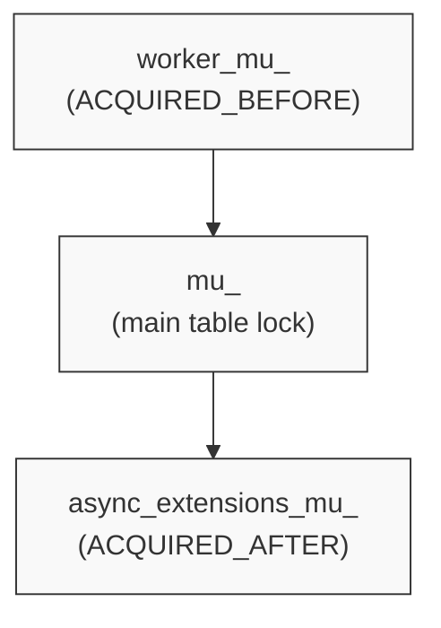

| Mutex | Purpose | Protected Data | Lock Order |
|-------|---------|----------------|------------|
| `worker_mu_` | Protects worker thread state | `pending_inserts_`, `pending_sampling_`, `deleted_items_`, `worker_time_distribution_` | First |
| `mu_` | Protects table data and operations | `data_`, `sampler_`, `remover_`, `rate_limiter_`, `extension_requests_`, `sync_extensions_` | Second |
| `async_extensions_mu_` | Protects asynchronous extensions | `async_extensions_` | Third |

**Critical Lock Ordering Rules:**
- When acquiring both `worker_mu_` and `mu_`, `worker_mu_` MUST be acquired first
- When acquiring both `mu_` and `async_extensions_mu_`, `mu_` MUST be acquired first
- Never hold `mu_` while waiting on condition variables in `worker_mu_`

**Sources:** [reverb/cc/table.h:532-533](), [reverb/cc/table.h:614](), [reverb/cc/table.h:650]()

### Table Worker States

The table worker tracks its state for performance monitoring and debugging:

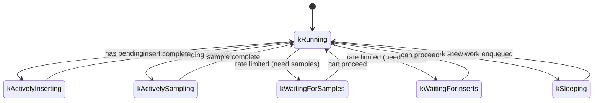

**Sources:** [reverb/cc/table.h:444-463](), [reverb/cc/table.cc:257-385]()

State transitions are tracked in `worker_time_distribution_` (type `StateStatistics<TableWorkerState>`) which is periodically updated and exposed via `TableInfo` for monitoring.

### Asynchronous Operation Flow

Insert and sample operations follow an asynchronous pattern to avoid blocking client threads:

**Insert Flow:**
1. Client calls `InsertOrAssignAsync()` which enqueues `InsertRequest` into `pending_inserts_`
2. `wakeup_worker_` condition variable signals the table worker
3. Table worker processes the request when `rate_limiter_->CanInsert()` returns true
4. Worker calls `InsertOrAssignInternal()` holding `mu_`
5. Callback is scheduled on `callback_executor_` to notify client
6. If table exceeds `max_size_`, an item is removed via `DeleteItem()`

**Sample Flow:**
1. Client calls `EnqueSampleRequest()` which enqueues `SampleRequest` into `pending_sampling_`
2. `wakeup_worker_` condition variable signals the table worker
3. Table worker processes when `rate_limiter_->MaybeCommitSample()` returns true
4. Worker calls `SampleInternal()` to select item via `sampler_->Sample()`
5. When batch is complete or size limit reached, request is finalized
6. Callback is scheduled on `callback_executor_` to return samples to client

**Sources:** [reverb/cc/table.cc:568-591](), [reverb/cc/table.cc:660-689](), [reverb/cc/table.cc:236-423]()

### Extension Execution Model

Extensions can run synchronously or asynchronously depending on their `CanRunAsync()` implementation:

- **Synchronous extensions** (`sync_extensions_`) execute within the table worker while holding `mu_`
- **Asynchronous extensions** (`async_extensions_`) are enqueued as `ExtensionRequest` and processed by the extension worker without holding `mu_`

This separation allows expensive extension operations (like metrics aggregation) to run without blocking critical table operations.

**Sources:** [reverb/cc/table.cc:509-538](), [reverb/cc/table.cc:845-893]()

---

## Memory Management Strategies

Reverb implements sophisticated memory management to handle the shared ownership of data chunks across multiple items and tables while avoiding blocking operations on critical paths.

### Reference Counting for Chunks

Data chunks use reference counting to track usage across items:

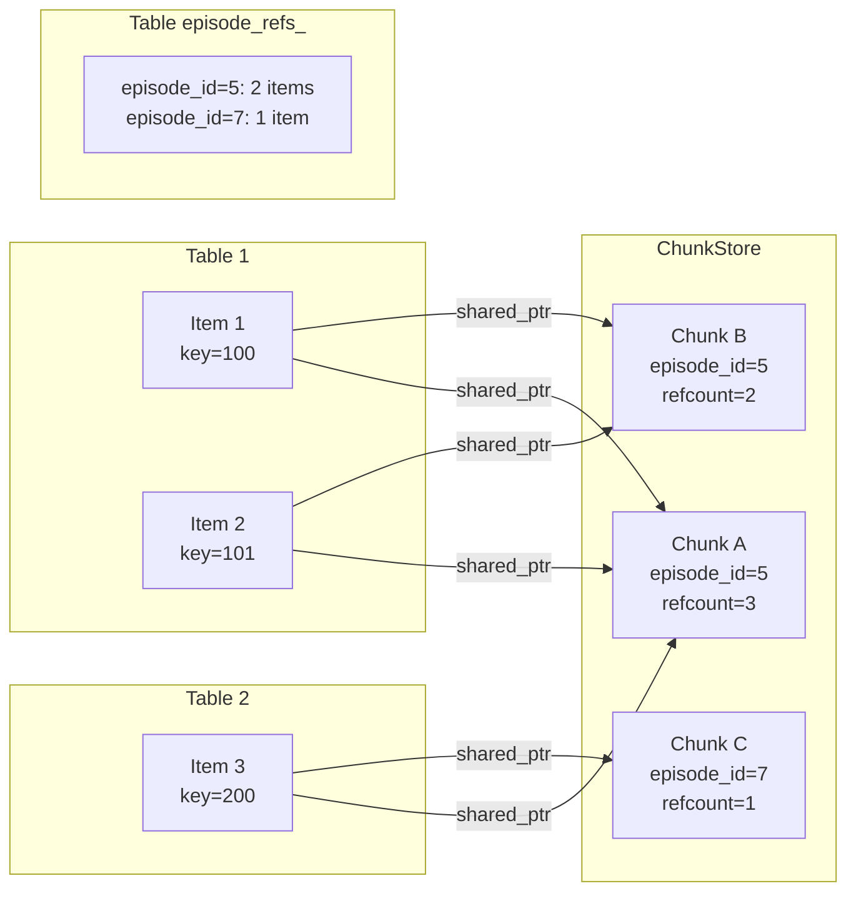

**Key Components:**
- Each `TableItem` holds `std::vector<std::shared_ptr<ChunkStore::Chunk>>` 
- Multiple items can reference the same chunk via shared pointers
- `episode_refs_` tracks how many items reference each episode ID
- When an item is deleted, episode reference counts are decremented
- When `episode_refs_[episode_id]` reaches 0, `num_deleted_episodes_` is incremented

**Sources:** [reverb/cc/table.h:102](), [reverb/cc/table.h:546](), [reverb/cc/table.cc:613-631](), [reverb/cc/table.cc:814-843]()

### Progressive Deallocation Strategy

To avoid blocking table operations with expensive memory deallocation, Reverb uses a progressive deallocation strategy:

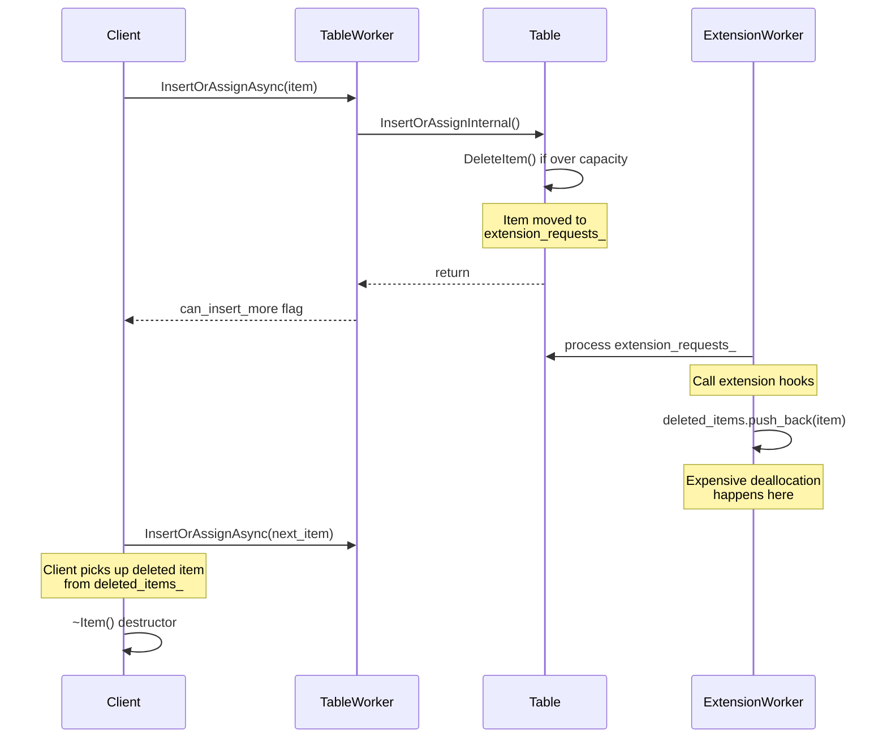

**Memory Deallocation Flow:**

1. When `DeleteItem()` is called (holding `mu_`), the item is appended to `extension_requests_` with type `kDelete` or `kMemoryRelease`
2. Extension worker processes the request and moves the item to `deleted_items_` (holding `worker_mu_`)
3. When clients make subsequent insert/sample requests, they pick up items from `deleted_items_` and release them outside the lock
4. The actual `~Item()` destructor runs in client threads, avoiding blocking worker threads

**Sources:** [reverb/cc/table.cc:574-591](), [reverb/cc/table.cc:425-502](), [reverb/cc/table.cc:814-843]()

### Memory Backpressure Mechanisms

To prevent unbounded memory growth, Reverb implements several backpressure mechanisms:

| Mechanism | Purpose | Threshold | Behavior When Exceeded |
|-----------|---------|-----------|------------------------|
| `max_enqueued_inserts_` | Limit pending inserts | `min(max_size * 0.1, 1000)` | `InsertOrAssignAsync()` sets `can_insert_more=false` |
| `max_enqueued_extension_ops_` | Limit extension work queue | `min(max_size * 0.1, 1000)` | `WaitForBackgroundWork()` blocks on `extension_buffer_available_cv_` |
| `kMaxSampleResponseSizeBytes` | Limit sample response size | 1 MB | `SampleFlexibleBatch()` finalizes current batch |

**Sources:** [reverb/cc/table.h:158-175](), [reverb/cc/table.cc:162-169](), [reverb/cc/table.cc:202-205](), [reverb/cc/table.cc:888-893]()

The `WaitForBackgroundWork()` method is called after critical operations to ensure the extension queue doesn't grow unbounded:

```cpp
void Table::WaitForBackgroundWork() {
  while (extension_worker_ &&
         extension_requests_.size() > max_enqueued_extension_ops_) {
    extension_buffer_available_cv_.Wait(&mu_);
  }
}
```

**Sources:** [reverb/cc/table.cc:888-893]()

### Checkpoint Memory Management

During checkpointing, all referenced chunks must remain valid throughout the operation. The `CheckpointAndChunks` structure holds shared pointers to prevent premature deletion:

```cpp
struct CheckpointAndChunks {
  PriorityTableCheckpoint checkpoint;
  std::vector<PrioritizedItem> items;
  internal::flat_hash_set<std::shared_ptr<ChunkStore::Chunk>> chunks;
};
```

**Sources:** [reverb/cc/table.h:216-220](), [reverb/cc/table.cc:949-984]()

---

## Error Handling and Retry Mechanisms

Reverb uses `absl::Status` for error propagation and implements timeout-based retry mechanisms for transient failures.

### Status-Based Error Propagation

All operations return `absl::Status` or `absl::StatusOr<T>` to enable consistent error handling:

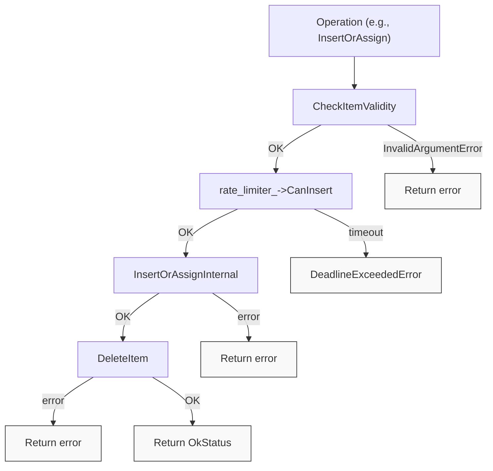

**Common Error Types:**

| Error Code | Typical Cause | Recovery Strategy |
|------------|---------------|-------------------|
| `InvalidArgumentError` | Invalid item structure, empty trajectory | Fix client code |
| `FailedPreconditionError` | Missing chunk, corrupted state | Reload from checkpoint |
| `DeadlineExceededError` | Rate limiter timeout | Retry with longer timeout |
| `CancelledError` | Server shutdown during operation | Reconnect to server |
| `OutOfRange` | End of checkpoint file | Expected during checkpoint loading |
| `DataLoss` | Corrupted checkpoint data | Try fallback checkpoint |

**Sources:** [reverb/cc/table.cc:74-97](), [reverb/cc/table.cc:551-566](), [reverb/cc/errors.h]()

### Timeout and Deadline Handling

Sample requests support deadlines to prevent indefinite blocking:

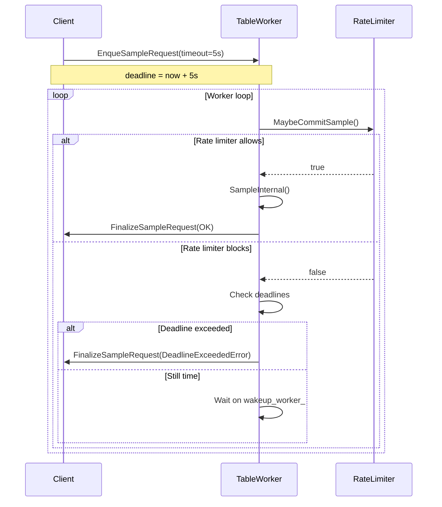

**Sources:** [reverb/cc/table.cc:124-140](), [reverb/cc/table.cc:358-399]()

The `GetExpiredRequests()` function checks deadlines and moves expired requests to a separate list for termination:

```cpp
void GetExpiredRequests(
    const absl::Time& deadline,
    std::vector<std::unique_ptr<Table::SampleRequest>>* requests,
    std::vector<std::unique_ptr<Table::SampleRequest>>* to_terminate,
    absl::Time* next_deadline);
```

**Sources:** [reverb/cc/table.cc:124-140]()

### Checkpoint Error Handling

Checkpoint loading implements fallback mechanisms and format detection:

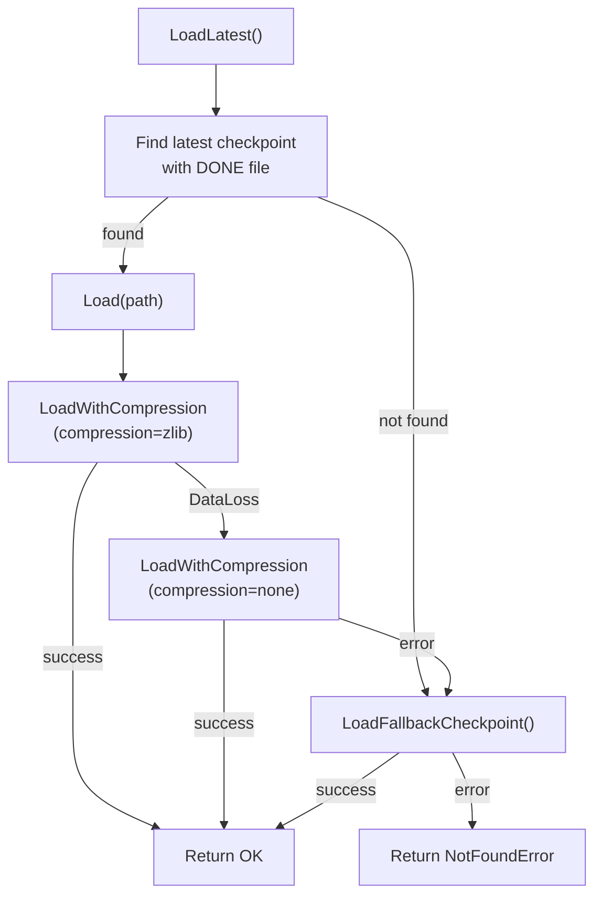

**Key error handling patterns:**
- Try compressed (zlib) format first, fallback to uncompressed if `DataLoss` error
- Support deprecated checkpoint formats with automatic migration
- Validate table names match server configuration before loading data
- Use fallback checkpoint path if primary checkpoint directory is empty

**Sources:** [reverb/cc/platform/tfrecord_checkpointer.cc:541-587](), [reverb/cc/platform/tfrecord_checkpointer.cc:145-152]()

### Worker Thread Error Handling

Worker thread loops catch and log errors without crashing the server:

```cpp
table_worker_ = internal::StartThread("TableWorker_" + name_, [&]() {
  auto status = TableWorkerLoop();
  REVERB_LOG_IF(REVERB_ERROR, !status.ok())
      << "Table worker encountered a fatal error: " << status;
});
```

If a worker encounters a fatal error, it logs the error and terminates gracefully. The server remains running but the table becomes non-functional until restarted.

**Sources:** [reverb/cc/table.cc:517-521]()

---

## Performance Optimization Techniques

Reverb employs numerous optimizations to achieve high throughput for experience replay workloads.

### Batched Sampling Operations

The `SampleFlexibleBatch()` method optimizes throughput by sampling multiple items in a single lock acquisition:

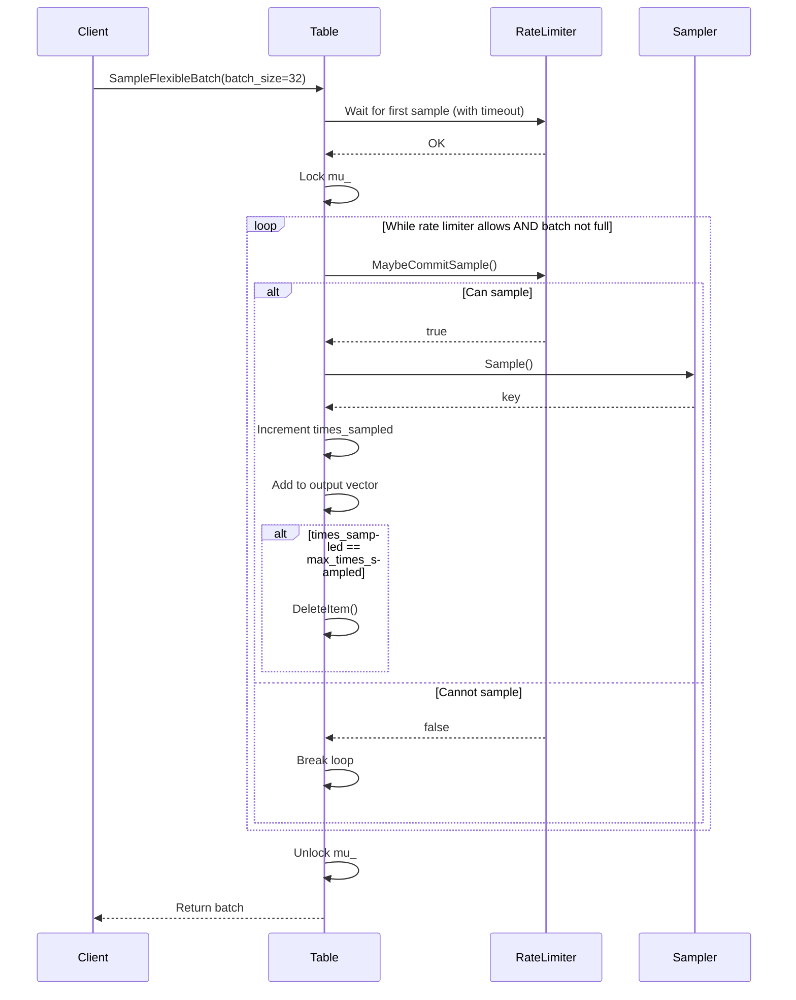

**Key optimization:** The lock is held continuously while sampling multiple items, avoiding repeated lock acquisition overhead. The timeout only applies to the first sample; subsequent samples in the batch proceed without blocking.

**Sources:** [reverb/cc/table.cc:691-714](), [reverb/cc/table.h:319-341]()

### Compression and Delta Encoding

Data chunks are compressed to reduce memory usage and network transfer time:

| Technique | Location | Benefit |
|-----------|----------|---------|
| Snappy compression | ChunkData serialization | Fast compression with good ratio |
| Delta encoding | Trajectory chunking | Reduces redundancy in sequential data |
| Chunk deduplication | ChunkStore | Shared chunks across items |

During checkpoint writing, data is compressed with zlib for better storage efficiency:

```cpp
tensorflow::io::RecordWriterOptions::CreateRecordWriterOptions(
    tensorflow::io::compression::kZlib)
```

**Sources:** [reverb/cc/platform/tfrecord_checkpointer.cc:76-79](), [reverb/cc/platform/tfrecord_checkpointer.cc:237-252]()

### In-Process Optimization

When client and server are co-located in the same process, Reverb bypasses gRPC serialization:

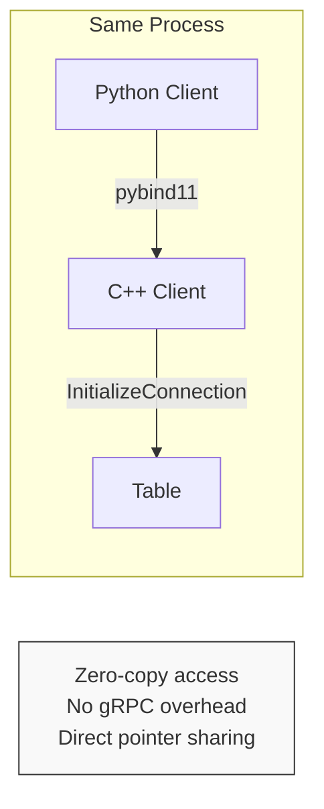

The `InitializeConnection` RPC method detects co-located deployment and provides direct table access, avoiding serialization overhead for inserts and samples.

**Sources:** System architecture diagram from overview

### Backpressure and Flow Control

Multiple mechanisms prevent resource exhaustion:

**1. Rate Limiter Backpressure:**
The `RateLimiter` enforces `samples_per_insert` ratio, blocking operations when the ratio is violated:

```cpp
bool CanInsert(&mu_, int num_inserts) const;
bool MaybeCommitSample(&mu_);
```

**2. Request Queue Limits:**
```cpp
max_enqueued_inserts_ = min(max_size * 0.1, 1000);
max_enqueued_extension_ops_ = min(max_size * 0.1, 1000);
```

**3. Response Size Limits:**
```cpp
static constexpr int64_t kMaxSampleResponseSizeBytes = 1 * 1024 * 1024;  // 1MB
```

When a sample batch exceeds 1MB, it is finalized early to prevent excessive memory usage in a single response.

**Sources:** [reverb/cc/table.h:162-175](), [reverb/cc/table.cc:305-318]()

### Asynchronous Extension Execution

Extensions marked as `CanRunAsync() == true` execute on the extension worker thread without holding `mu_`, allowing expensive operations like metric aggregation to run without blocking table operations:

```cpp
if (extension->CanRunAsync()) {
  async_extensions_.push_back(extension);
} else {
  sync_extensions_.push_back(extension);
}
```

This pattern is critical for maintaining high throughput when extensions perform network I/O or complex computations.

**Sources:** [reverb/cc/table.cc:528-536]()

### Worker State Monitoring

The `TableInfo` proto includes worker execution time statistics that can be monitored to identify bottlenecks:

```cpp
worker_time->set_running_ms(...);
worker_time->set_sampling_ms(...);
worker_time->set_inserting_ms(...);
worker_time->set_sleeping_ms(...);
worker_time->set_waiting_for_sampling_ms(...);
worker_time->set_waiting_for_inserts_ms(...);
```

If `waiting_for_inserts_ms` is high, clients are not inserting fast enough. If `waiting_for_sampling_ms` is high, clients are not sampling fast enough.

**Sources:** [reverb/cc/table.cc:779-797]()

---

## Distributed Deployment Patterns

Reverb is designed for horizontal scaling in distributed RL systems, with specific trade-offs around consistency and fault tolerance.

### Sharding Strategy

Reverb servers operate independently with no inter-server communication or data replication:

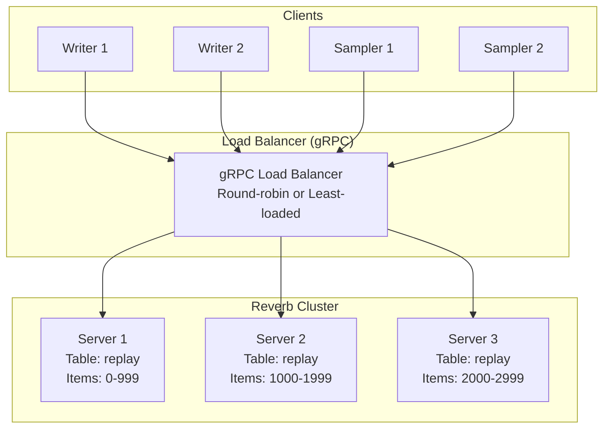

**Key characteristics:**
- **No replication:** Each item exists on exactly one server
- **No coordination:** Servers don't communicate with each other
- **Acceptable data loss:** If a server fails, its data is lost
- **Simple scaling:** Add more servers to increase capacity

**Sources:** [README.md:310-327]()

### Load Balancing Approaches

**Option 1: gRPC Load Balancer (Recommended)**
```python
# Clients connect to a load-balanced endpoint
client = reverb.Client('load-balancer.example.com:8000')
```

The gRPC load balancer distributes operations across servers automatically. This is transparent to clients.

**Option 2: Manual Sharding**
```python
# Create separate clients for each server
servers = [
    reverb.Client('reverb-0.example.com:8000'),
    reverb.Client('reverb-1.example.com:8000'),
    reverb.Client('reverb-2.example.com:8000'),
]

# Insert to random server
server = random.choice(servers)
server.insert(data, {'table': priority})

# Sample from all servers
samples = []
for server in servers:
    samples.extend(server.sample('table', num_samples=10))
```

Manual sharding provides more control but requires application-level distribution logic.

**Sources:** [README.md:310-327]()

### Failure Modes and Recovery

| Failure Type | Impact | Recovery |
|--------------|--------|----------|
| Server crash | Data on that server is lost | Restart server (empty) or restore from checkpoint |
| Network partition | Affected server becomes unreachable | Load balancer routes to healthy servers |
| Disk full | Checkpoint writes fail | Monitor disk usage; old checkpoints auto-deleted |
| Memory exhaustion | Server OOM killed | Reduce `max_size` per table or add more servers |

**Checkpointing for warm restart:**
```python
# Periodically save checkpoint
checkpoint_path = client.checkpoint()

# Restore server from checkpoint
checkpointer = reverb.checkpointers.DefaultCheckpointer(checkpoint_path)
server = reverb.Server(tables=[...], checkpointer=checkpointer)
```

Checkpoints enable warm-starting servers after failure, reducing training disruption.

**Sources:** [README.md:328-359](), [reverb/cc/platform/tfrecord_checkpointer.cc:171-278]()

### Deployment Configurations

**Single-Process (Development/Testing):**
```python
server = reverb.Server(tables=[...], port=8000)
client = reverb.Client(f'localhost:{server.port}')
# In-process optimization active
```

**Multi-Server (Production):**
```python
# On each server machine
server = reverb.Server(
    tables=[reverb.Table('replay', ...)],
    port=8000,
    checkpointer=reverb.checkpointers.DefaultCheckpointer('/mnt/checkpoints')
)

# Clients connect via load balancer
client = reverb.Client('reverb-lb.example.com:8000')
```

**Sources:** [README.md:86-151]()

### Monitoring and Observability

Use `TableInfo` to monitor distributed deployment health:

```python
info = client.server_info()
for table_info in info.table_info:
    print(f"Table: {table_info.name}")
    print(f"  Current size: {table_info.current_size}")
    print(f"  Rate limiter info: {table_info.rate_limiter_info}")
    print(f"  Worker time: {table_info.table_worker_time}")
```

**Key metrics to monitor:**
- `current_size` / `max_size`: Capacity utilization
- `rate_limiter_info.insert_count` / `sample_count`: Operation throughput
- `table_worker_time.sleeping_ms`: Worker idle time (should be high if system is balanced)
- `table_worker_time.waiting_for_*_ms`: Bottleneck identification

**Sources:** [reverb/cc/table.cc:757-800]()

### Consistency Considerations

Reverb provides **eventual consistency** at best in distributed deployments:

- **No ordering guarantees:** Items inserted to different servers have no ordering relationship
- **No atomicity:** Multi-table operations across servers are not atomic
- **No isolation:** Concurrent operations on different servers don't coordinate
- **Durability:** Only checkpointed data survives server restarts

This design trades consistency for:
- **High throughput:** No coordination overhead
- **Low latency:** No consensus protocols
- **Simple operations:** No distributed transactions
- **Horizontal scalability:** Linear scaling with server count

For RL workloads, this trade-off is acceptable because:
- Sample order doesn't significantly impact learning
- Approximate replay ratios are sufficient
- High throughput is more important than exact semantics

**Sources:** [README.md:310-327]()

---

