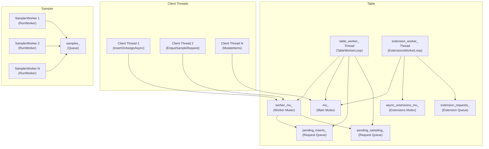
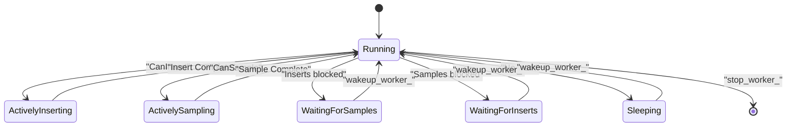
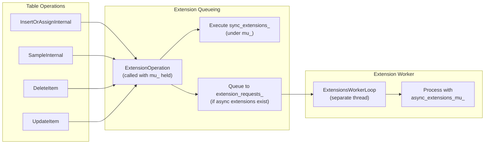
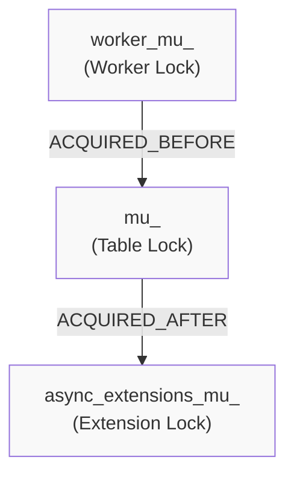
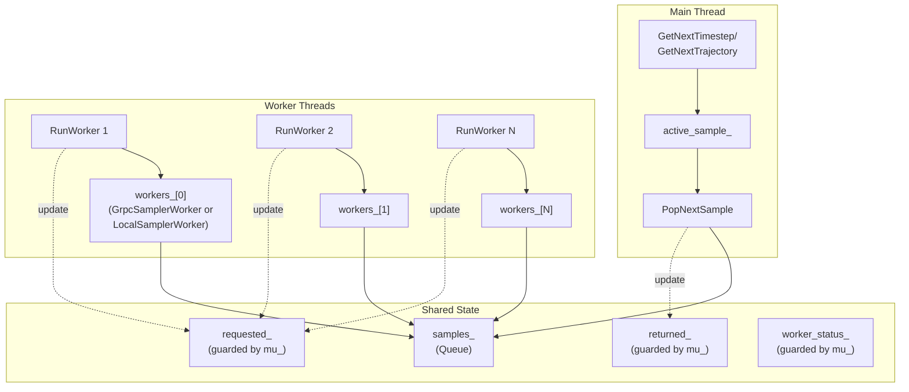
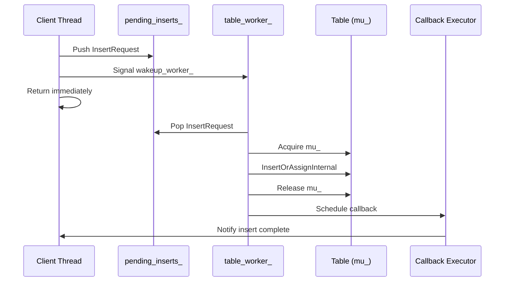
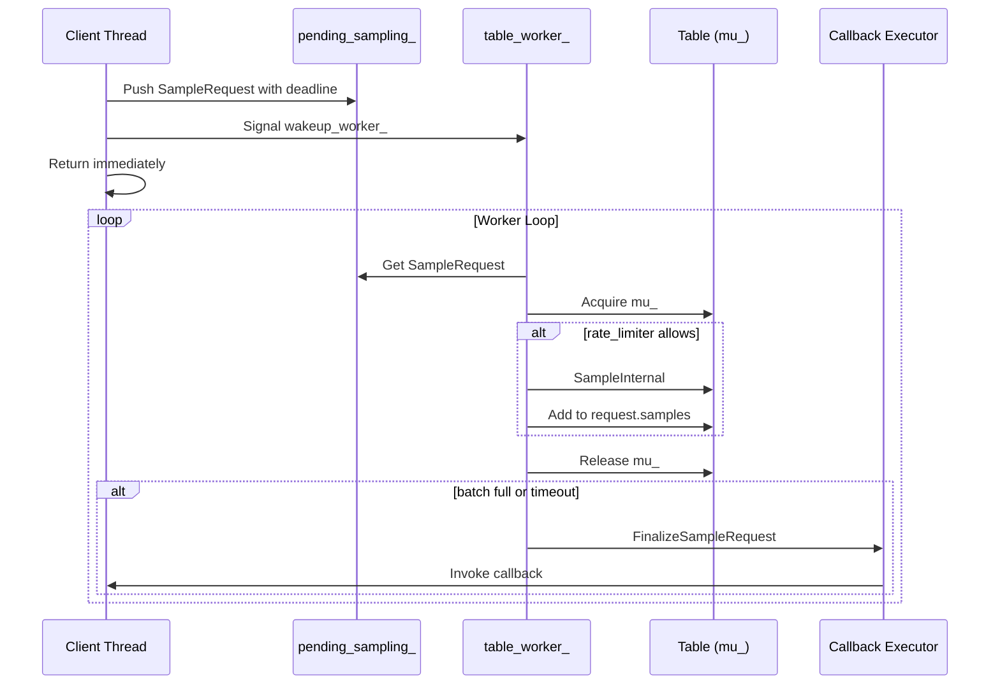

<!-- source: DeepWiki mcp.deepwiki.com · repo google-deepmind/reverb · page 7.1 Concurrency and Threading · fetched 2026-10-26 -->

# Concurrency and Threading

<details>
<summary>Relevant source files</summary>

The following files were used as context for generating this wiki page:

- [reverb/cc/platform/tfrecord_checkpointer.cc](reverb/cc/platform/tfrecord_checkpointer.cc)
- [reverb/cc/sampler.cc](reverb/cc/sampler.cc)
- [reverb/cc/sampler.h](reverb/cc/sampler.h)
- [reverb/cc/sampler_test.cc](reverb/cc/sampler_test.cc)
- [reverb/cc/table.cc](reverb/cc/table.cc)
- [reverb/cc/table.h](reverb/cc/table.h)
- [reverb/cc/table_test.cc](reverb/cc/table_test.cc)

</details>


## Purpose and Scope

This document explains the concurrency and threading model used throughout Reverb's C++ implementation. It covers the multi-threaded architecture of the `Table` and `Sampler` components, the synchronization primitives used, lock ordering guarantees, and the thread safety annotations that enforce correct concurrent access patterns.

For information about the `Table` system's overall architecture and data structures, see [Table System](#3.1). For details on asynchronous gRPC communication patterns, see [Client-Server Communication](#2.1).

## Threading Architecture Overview

Reverb employs a multi-threaded architecture to maximize throughput and minimize blocking operations. The system uses dedicated worker threads for performance-critical operations, allowing client operations to return quickly while work is processed asynchronously in the background.

**System Threading Overview**



Sources: [reverb/cc/table.h:444-656](), [reverb/cc/table.cc:236-538](), [reverb/cc/sampler.h:304-384](), [reverb/cc/sampler.cc:651-700]()

## Table Threading Model

The `Table` class implements a sophisticated multi-threaded architecture with three distinct mutex domains and two dedicated worker threads.

### Main Mutex (mu_)

The `mu_` mutex protects the core table state including the data structure containing all items, the sampling and removal selectors, and the rate limiter state. This is the most frequently acquired lock in the system.

**Protected Resources:**
- `data_` - The hash map of all items in the table
- `sampler_` and `remover_` - Item selection strategies
- `rate_limiter_` - Flow control mechanism
- `sync_extensions_` - Synchronous table extensions
- `extension_requests_` - Queue of pending extension operations

The main mutex is acquired during:
- Actual item insertion/deletion operations (performed by table worker)
- Priority updates
- Sampling operations (performed by table worker)
- Table reset and checkpoint operations

Sources: [reverb/cc/table.h:532-558](), [reverb/cc/table.cc:593-632]()

### Worker Mutex (worker_mu_)

The `worker_mu_` mutex protects the asynchronous request queues and worker state. This mutex has a critical lock ordering constraint: it must be acquired **before** `mu_` to prevent deadlocks.

**Lock Ordering Rule:**
```
worker_mu_ → mu_  (SAFE)
mu_ → worker_mu_  (DEADLOCK RISK)
```

This ordering is enforced through thread annotations: `ABSL_ACQUIRED_BEFORE(mu_)` on `worker_mu_`.

**Protected Resources:**
- `pending_inserts_` - Queue of insert requests waiting for processing
- `pending_sampling_` - Queue of sample requests waiting for processing
- `deleted_items_` - Items awaiting memory deallocation
- `stop_worker_` - Worker shutdown flag
- `worker_time_distribution_` - Worker performance statistics

Sources: [reverb/cc/table.h:614](), [reverb/cc/table.cc:236-423]()

### Table Worker Thread

The table worker thread runs `TableWorkerLoop()` and processes asynchronous insert and sample requests. It implements a sophisticated state machine that alternates between processing inserts and samples based on rate limiter constraints.

**Table Worker States**



**Worker Loop Algorithm:**

1. Acquire `worker_mu_` to fetch pending requests
2. Release `worker_mu_` and acquire `mu_` to process operations
3. Process inserts while `rate_limiter_->CanInsert()` returns true
4. Process samples while `rate_limiter_->MaybeCommitSample()` returns true
5. If no progress made, wait on `wakeup_worker_` condition variable
6. Handle sample request timeouts by checking deadlines

Sources: [reverb/cc/table.cc:236-423](), [reverb/cc/table.h:445-463]()

### Extension Worker Thread

The extension worker thread runs `ExtensionsWorkerLoop()` and processes callbacks for asynchronous table extensions. This design allows extensions to perform expensive operations (like logging, metrics) without blocking the main table operations.

**Extension Processing Flow**



The worker processes four types of extension requests:
- `kInsert` - New item added to table
- `kSample` - Item sampled from table
- `kUpdate` - Item priority updated
- `kDelete` - Item deleted from table
- `kMemoryRelease` - Memory deallocation for deleted items

Sources: [reverb/cc/table.cc:425-502](), [reverb/cc/table.h:465-470](), [reverb/cc/table.cc:845-886]()

### Lock Ordering and Deadlock Prevention

Reverb enforces a strict lock ordering hierarchy to prevent deadlocks:



**Lock Ordering Rules:**
1. `worker_mu_` must be acquired before `mu_` if both are needed
2. `async_extensions_mu_` must be acquired after `mu_` if both are needed
3. Never acquire `mu_` while holding `async_extensions_mu_`

These rules are enforced using Abseil thread annotations:
- `worker_mu_` has `ABSL_ACQUIRED_BEFORE(mu_)`
- `async_extensions_mu_` has `ABSL_ACQUIRED_AFTER(mu_)`

Sources: [reverb/cc/table.h:532-656]()

## Sampler Threading Model

The `Sampler` class uses multiple worker threads to maximize sampling throughput by maintaining parallel gRPC streams or parallel table access.

**Sampler Worker Architecture**



### Worker Threads

Each `Sampler` creates a configurable number of worker threads (default: 1, auto-selected via `Options::num_workers`). Each worker runs the `RunWorker()` method which:

1. Waits for progress condition (requested < max_samples)
2. Calculates batch size to stream
3. Calls `worker->FetchSamples()` to retrieve samples
4. Pushes samples into the shared `samples_` queue
5. Handles transient errors with exponential backoff retry
6. Reports fatal errors through `worker_status_`

The number of workers is automatically limited based on `max_samples` and `max_in_flight_samples_per_worker` to avoid creating unnecessary threads.

Sources: [reverb/cc/sampler.cc:651-700](), [reverb/cc/sampler.cc:444-487]()

### GrpcSamplerWorker vs LocalSamplerWorker

Reverb provides two `SamplerWorker` implementations:

**GrpcSamplerWorker** - Used for remote sampling via gRPC:
- Manages gRPC `ClientContext` and bidirectional streams
- Handles chunk unpacking and decompression
- Supports stream cancellation via `Cancel()`
- Implements retry logic for transient network errors

**LocalSamplerWorker** - Used for in-process sampling:
- Calls `Table::SampleFlexibleBatch()` directly
- Avoids gRPC serialization overhead
- Respects `max_in_flight_samples` to control memory usage
- Implements periodic wakeup to check for cancellation

Sources: [reverb/cc/sampler.cc:172-323](), [reverb/cc/sampler.cc:325-442]()

### Thread-Safe Queue

The `samples_` queue is a thread-safe `internal::Queue<std::unique_ptr<Sample>>` that supports:
- `Reserve(n)` - Reserve space for n items (blocks if insufficient capacity)
- `PushBatch(vector)` - Push multiple items atomically
- `Pop(item)` - Pop single item (blocks if queue empty)
- `Close()` - Mark queue as closed (unblocks all waiters)

Workers push samples concurrently while the main thread pops them sequentially.

Sources: [reverb/cc/sampler.cc:228-231](), [reverb/cc/sampler.cc:284-285]()

## Synchronization Primitives

### Mutexes

Reverb uses `absl::Mutex` for mutual exclusion:

```cpp
absl::Mutex mu_;                              // Basic mutex
absl::MutexLock lock(mu_);                    // RAII lock
absl::WriterMutexLock lock(mu_);              // Reader-writer lock (write)
absl::ReaderMutexLock lock(mu_);              // Reader-writer lock (read)
```

Sources: [reverb/cc/table.h:532](), [reverb/cc/sampler.h:383]()

### Condition Variables

Reverb uses `absl::CondVar` for thread signaling:

**Table Worker Coordination:**
- `wakeup_worker_` - Signals table worker when new requests arrive
- `extension_work_available_cv_` - Signals extension worker when work available
- `extension_buffer_available_cv_` - Signals clients when extension queue has space

**Usage Pattern:**
```cpp
// Waiting thread
absl::MutexLock lock(worker_mu_);
wakeup_worker_.Wait(&worker_mu_);

// Signaling thread
absl::MutexLock lock(worker_mu_);
pending_inserts_.push_back(request);
wakeup_worker_.Signal();
```

Sources: [reverb/cc/table.h:611-631](), [reverb/cc/table.cc:384](), [reverb/cc/table.cc:583]()

### Await Conditions

Abseil mutexes support `Await()` for complex waiting conditions:

```cpp
// Wait for extension worker to complete
auto extension_worker_done = [this]() ABSL_EXCLUSIVE_LOCKS_REQUIRED(mu_) {
  return extension_worker_sleeps_ && extension_requests_.empty();
};
mu_.Await(absl::Condition(&extension_worker_done));
```

This provides deadlock-free waiting on arbitrary predicates.

Sources: [reverb/cc/table.cc:913-916]()

### Notifications

For one-time signaling, Reverb uses `absl::Notification`:

```cpp
absl::Notification insert_done_c;
auto insert_done = std::make_shared<InsertCallback>(
    [&](uint64_t) { insert_done_c.Notify(); });
// ... enqueue work ...
insert_done_c.WaitForNotificationWithTimeout(timeout);
```

Sources: [reverb/cc/table.cc:557-562]()

## Thread Annotations

Reverb extensively uses Abseil thread safety annotations to enforce correct locking at compile time.

### Common Annotations

| Annotation | Purpose | Example |
|------------|---------|---------|
| `ABSL_GUARDED_BY(mu)` | Variable must be accessed with `mu` held | `int64_t size_ ABSL_GUARDED_BY(mu_)` |
| `ABSL_EXCLUSIVE_LOCKS_REQUIRED(mu)` | Function must be called with `mu` held | `void InsertInternal() ABSL_EXCLUSIVE_LOCKS_REQUIRED(mu_)` |
| `ABSL_LOCKS_EXCLUDED(mu)` | Function must NOT hold `mu` | `int size() const ABSL_LOCKS_EXCLUDED(mu_)` |
| `ABSL_ACQUIRED_BEFORE(mu)` | This mutex acquired before `mu` | `absl::Mutex worker_mu_ ABSL_ACQUIRED_BEFORE(mu_)` |
| `ABSL_ACQUIRED_AFTER(mu)` | This mutex acquired after `mu` | `absl::Mutex ext_mu_ ABSL_ACQUIRED_AFTER(mu_)` |
| `ABSL_SHARED_LOCKS_REQUIRED(mu)` | Reader lock on `mu` required | `bool check() const ABSL_SHARED_LOCKS_REQUIRED(mu_)` |

### Example Annotated Code

```cpp
class Table {
 private:
  // Mutex ordering enforced
  mutable absl::Mutex worker_mu_ ABSL_ACQUIRED_BEFORE(mu_);
  mutable absl::Mutex mu_ ABSL_ACQUIRED_AFTER(worker_mu_);
  
  // Protected data
  flat_hash_map<Key, Item> data_ ABSL_GUARDED_BY(mu_);
  std::vector<InsertRequest> pending_inserts_ ABSL_GUARDED_BY(worker_mu_);
  
  // Annotated methods
  absl::Status InsertOrAssignInternal(Item item)
      ABSL_EXCLUSIVE_LOCKS_REQUIRED(mu_);
      
  int64_t size() const ABSL_LOCKS_EXCLUDED(mu_);
};
```

These annotations are checked by Clang's thread safety analysis during compilation.

Sources: [reverb/cc/table.h:532-656](), [reverb/cc/table.cc:593-906]()

## Asynchronous Operations

### InsertOrAssignAsync

Asynchronous insertion enqueues the request and returns immediately without blocking:

**Async Insert Flow**



**Key Properties:**
- Non-blocking for client
- Respects `max_enqueued_inserts_` backpressure limit
- Callback executed on separate executor thread
- Memory for deleted items freed by clients asynchronously

Sources: [reverb/cc/table.cc:568-591](), [reverb/cc/table.cc:593-632]()

### EnqueSampleRequest

Asynchronous sampling enqueues the request with a deadline and callback:

**Async Sample Flow**



**Timeout Handling:**
- Worker checks deadlines periodically
- Timed-out requests finalized with partial results or error
- Allows graceful degradation under load

Sources: [reverb/cc/table.cc:660-714](), [reverb/cc/table.cc:716-748](), [reverb/cc/table.cc:124-140]()

## Memory Management and Progressive Deallocation

### Delayed Memory Release

The table worker doesn't deallocate deleted item memory directly. Instead, items are added to `deleted_items_` queue for clients to free asynchronously:

```cpp
// In InsertOrAssignAsync
std::shared_ptr<Item> to_delete;
{
  absl::MutexLock lock(worker_mu_);
  if (!deleted_items_.empty()) {
    to_delete = std::move(deleted_items_.back());
    deleted_items_.pop_back();
  }
}
// to_delete destructor runs here, outside lock
```

This prevents expensive deallocation operations from blocking the table worker.

Sources: [reverb/cc/table.cc:574-590](), [reverb/cc/table.cc:425-502]()

### Extension Memory Release

The extension worker also participates in memory management by processing `kMemoryRelease` requests, ensuring deleted items are freed without holding table locks.

Sources: [reverb/cc/table.cc:488-496]()

## Testing Concurrent Behavior

### Test Utilities

Reverb's test suite includes utilities for testing concurrent operations:

```cpp
// Wait for table to reach expected size
void WaitForTableSize(Table* table, int size) {
  for (int retry = 0; retry < 100 && size != 0; retry++) {
    absl::SleepFor(absl::Milliseconds(1));
  }
  EXPECT_EQ(table->size(), size);
}
```

Sources: [reverb/cc/table_test.cc:102-107]()

### Concurrent Call Tests

Tests verify correct behavior under concurrent access:

```cpp
TEST(TableTest, ConcurrentCalls) {
  auto table = MakeUniformTable("dist", 1000);
  std::vector<std::unique_ptr<internal::Thread>> bundle;
  std::atomic<int> count(0);
  
  for (Table::Key i = 0; i < 1000; i++) {
    bundle.push_back(internal::StartThread("", [i, &table, &count] {
      REVERB_EXPECT_OK(table->InsertOrAssign(MakeItem(i, 123)));
      Table::SampledItem item;
      REVERB_EXPECT_OK(table->Sample(&item));
      REVERB_EXPECT_OK(table->InsertOrAssign(MakeItem(i, 456)));
      count++;
    }));
  }
  bundle.clear();  // Joins all threads
  EXPECT_EQ(count, 1000);
}
```

Sources: [reverb/cc/table_test.cc:315-331]()

### Race Condition Tests

Tests verify correct handling of concurrent updates to the same key:

```cpp
TEST(TableTest, ConcurrentInsertOfTheSameKey) {
  // Multiple threads try to insert the same key
  // Verifies that all inserts complete correctly even when
  // some become updates after acquiring the lock
}
```

Sources: [reverb/cc/table_test.cc:389-432]()

## Best Practices

### Avoid Deadlocks

1. **Always follow lock ordering**: `worker_mu_` → `mu_` → `async_extensions_mu_`
2. **Never acquire locks in reverse order**
3. **Use `ABSL_LOCKS_EXCLUDED` annotations** on public methods to prevent recursive locking

### Minimize Lock Contention

1. **Release locks before expensive operations**: Deallocation, callbacks, I/O
2. **Use separate mutexes for independent resources**: Worker queues vs. table data
3. **Prefer lock-free data structures** where appropriate (e.g., atomics)

### Ensure Progress

1. **Signal condition variables** after modifying wait conditions
2. **Check for spurious wakeups** in wait loops
3. **Implement timeouts** for user-facing operations

### Test Thoroughly

1. **Use thread sanitizers** (TSan) to detect races
2. **Write stress tests** with many concurrent operations
3. **Test with varying thread counts** and timing conditions

Sources: [reverb/cc/table.h:614](), [reverb/cc/table.cc:236-423](), [reverb/cc/sampler.cc:651-700]()

---

