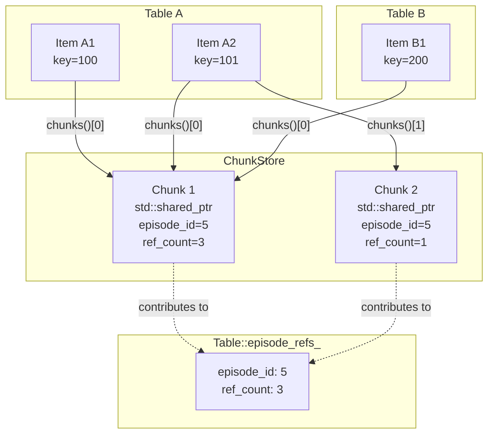
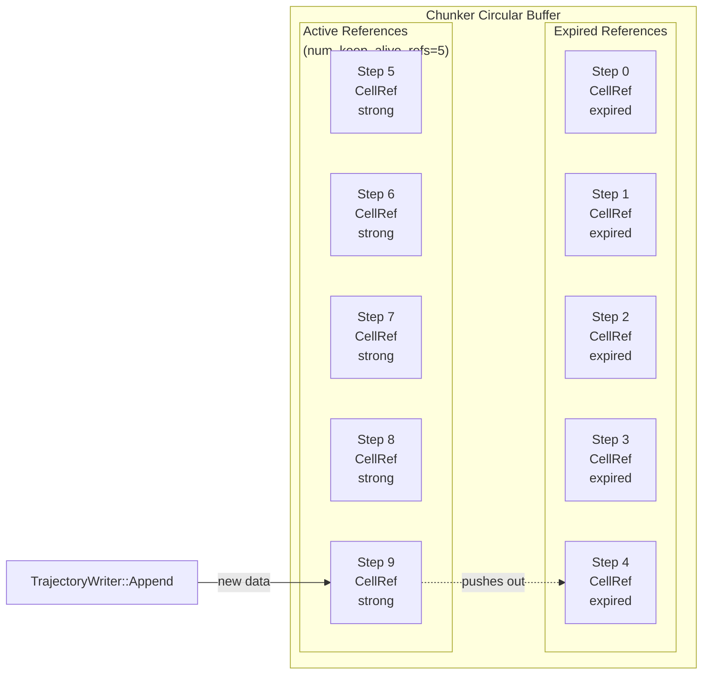
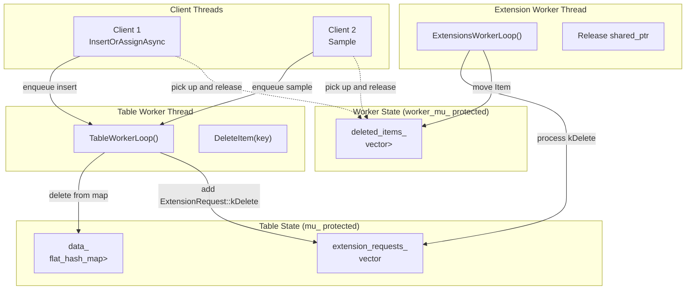
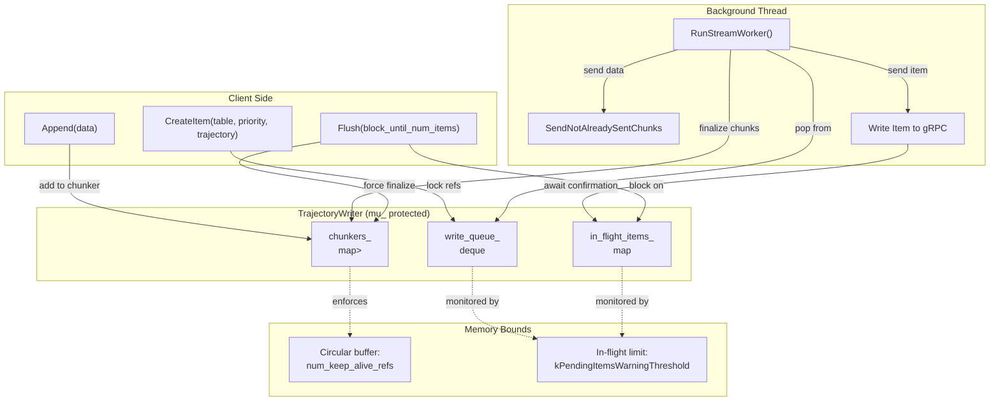

<!-- source: DeepWiki mcp.deepwiki.com · repo google-deepmind/reverb · page 7.2 Memory Management · fetched 2026-10-26 -->

# Memory Management

<details>
<summary>Relevant source files</summary>

The following files were used as context for generating this wiki page:

- [reverb/cc/platform/tfrecord_checkpointer.cc](reverb/cc/platform/tfrecord_checkpointer.cc)
- [reverb/cc/table.cc](reverb/cc/table.cc)
- [reverb/cc/table.h](reverb/cc/table.h)
- [reverb/cc/table_test.cc](reverb/cc/table_test.cc)
- [reverb/cc/trajectory_writer.cc](reverb/cc/trajectory_writer.cc)
- [reverb/cc/trajectory_writer.h](reverb/cc/trajectory_writer.h)
- [reverb/cc/trajectory_writer_test.cc](reverb/cc/trajectory_writer_test.cc)
- [reverb/trajectory_dataset_test.py](reverb/trajectory_dataset_test.py)
- [reverb/trajectory_writer.py](reverb/trajectory_writer.py)
- [reverb/trajectory_writer_test.py](reverb/trajectory_writer_test.py)

</details>


This page describes Reverb's memory management strategies, including reference counting for shared data chunks, circular buffers for bounding memory usage, and progressive deallocation to avoid blocking critical paths. These mechanisms ensure that Reverb can operate efficiently with bounded memory even when handling large-scale replay buffers.

For information about the Table system that implements many of these strategies, see [Table System](#3.1). For details on how data is written and chunked, see [Data Ingestion System](#3.2).

## Overview

Reverb faces several memory management challenges:

1. **Shared Data**: Multiple items across tables reference the same data chunks, requiring careful lifecycle management
2. **Unbounded Growth**: Writers can produce data faster than samplers consume it, risking out-of-memory (OOM) errors
3. **Blocking Prevention**: Memory cleanup must not block critical sampling or insertion operations
4. **Distributed System**: Client and server must coordinate to prevent memory exhaustion on either side

Reverb addresses these challenges through three primary mechanisms:

| Mechanism | Purpose | Key Components |
|-----------|---------|----------------|
| Reference Counting | Track chunk usage across items and tables | `std::shared_ptr<Chunk>`, `episode_refs_` map |
| Circular Buffers | Bound writer memory by expiring old references | `num_keep_alive_refs`, `Chunker` |
| Progressive Deallocation | Asynchronously release memory without blocking | `extension_worker_`, `deleted_items_` |

Sources: [reverb/cc/table.cc:1-1518](), [reverb/cc/trajectory_writer.cc:1-750]()

## Reference Counting Architecture

Reverb uses C++ `std::shared_ptr` for automatic reference counting of chunk data. This ensures chunks are only deallocated when no items reference them, even across multiple tables.



**Chunk Lifecycle**:

1. **Creation**: Writer creates chunk via `Chunker` and wraps in `std::shared_ptr<ChunkStore::Chunk>`
2. **Item Reference**: `TableItem` stores vector of shared pointers: `std::vector<std::shared_ptr<ChunkStore::Chunk>> chunks_`
3. **Insertion**: When item inserted into table, episode reference count incremented
4. **Deletion**: When item deleted, episode reference count decremented
5. **Cleanup**: When episode ref count reaches 0, episode is marked as deleted

Sources: [reverb/cc/table.cc:814-843](), [reverb/cc/table.h:102-113](), [reverb/cc/chunk_store.h]()

### Episode Reference Tracking

The `Table` maintains an `episode_refs_` map that tracks how many items reference data from each episode:

```cpp
// From table.cc
internal::flat_hash_map<uint64_t, int> episode_refs_;  // episode_id -> count
```

When an item is inserted:

```cpp
// Increment references to the episode/s the item is referencing.
for (const auto& chunk : it->second->chunks()) {
  ++episode_refs_[chunk->episode_id()];
}
```

When an item is deleted:

```cpp
// Decrement counts to the episodes the item is referencing.
for (const auto& chunk : it->second->chunks()) {
  auto ep_it = episode_refs_.find(chunk->episode_id());
  if (--(ep_it->second) == 0) {
    episode_refs_.erase(ep_it);
    num_deleted_episodes_++;
  }
}
```

This two-level reference counting (shared_ptr for chunks, explicit counting for episodes) allows tracking both individual chunk usage and aggregate episode statistics.

Sources: [reverb/cc/table.cc:612-631](), [reverb/cc/table.cc:814-843]()

## Circular Buffers and Reference Expiration

Writers use circular buffers via the `Chunker` class to prevent unbounded memory growth. The `num_keep_alive_refs` parameter controls the buffer size.



**Reference Lifecycle**:

| State | Description | Behavior |
|-------|-------------|----------|
| **Active** | Within `num_keep_alive_refs` window | `std::weak_ptr` can be locked to `std::shared_ptr` |
| **Expired** | Beyond window, no items reference it | `std::weak_ptr::expired()` returns true, chunk deallocated |
| **Item-Referenced** | Beyond window but item references it | `std::weak_ptr` promoted to `std::shared_ptr`, kept alive |

The Python `TrajectoryWriter` exposes this via the `configure` method:

```python
def configure(self, path: Tuple[Union[int, str], ...], *,
              num_keep_alive_refs: int, max_chunk_length: Optional[int]):
    """Override chunking options for a single column."""
```

Sources: [reverb/cc/chunker.h](), [reverb/trajectory_writer.py:197-237](), [reverb/cc/trajectory_writer.cc:370-424]()

### Weak Pointer Usage Pattern

Writers use `std::weak_ptr<CellRef>` to allow references to expire automatically:

```cpp
// Writer stores weak pointers
std::vector<absl::optional<std::weak_ptr<CellRef>>>* refs

// When creating item, attempt to lock:
std::shared_ptr<CellRef> ref_sp = ref.lock();
if (!ref_sp) {
  return absl::InternalError("CellRef unexpectedly expired in CreateItem.");
}
```

This pattern allows the `Chunker` to control memory bounds while still enabling item creation from recent data.

Sources: [reverb/cc/trajectory_writer.h:166-183](), [reverb/cc/trajectory_writer.cc:443-456]()

## Progressive Deallocation in Table

The `Table` uses a dedicated `extension_worker_` thread to progressively deallocate items without blocking the main table operations.



**Deallocation Flow**:

1. **Table Worker** (in `TableWorkerLoop`) calls `DeleteItem` which removes from `data_` map
2. **Extension Operation** creates `ExtensionRequest::CallType::kDelete` 
3. **Extension Worker** processes request and moves `shared_ptr<Item>` to `deleted_items_`
4. **Client Threads** pick up items from `deleted_items_` when they interact with table
5. **Destructor** runs on client thread when `shared_ptr` goes out of scope

Sources: [reverb/cc/table.cc:425-502](), [reverb/cc/table.cc:814-843](), [reverb/cc/table.cc:574-591]()

### Spreading Deletion Load

The progressive deallocation pattern spreads the cost of memory cleanup:

```cpp
// Table worker doesn't release memory of removed items, clients do that
// asynchronously.
std::shared_ptr<Item> to_delete;
{
  absl::MutexLock lock(worker_mu_);
  if (!deleted_items_.empty()) {
    to_delete = std::move(deleted_items_.back());
    deleted_items_.pop_back();
  }
}
// to_delete destructor runs outside lock, on client thread
```

This ensures:
- **No blocking**: Table worker doesn't pause for expensive deallocations
- **Load distribution**: Multiple clients share cleanup work
- **Bounded buffers**: `max_enqueued_extension_ops_` limits queue size

Sources: [reverb/cc/table.cc:574-591](), [reverb/cc/table.cc:669-688](), [reverb/cc/table.cc:425-502]()

## TrajectoryWriter Memory Management

The `TrajectoryWriter` manages memory through streaming chunks and maintaining bounded in-flight items.



**Memory Control Mechanisms**:

| Mechanism | Configuration | Purpose |
|-----------|---------------|---------|
| Chunker Buffer | `num_keep_alive_refs` | Bounds per-column memory |
| Pending Items Limit | `kPendingItemsWarningThreshold = 50` | Warns on excessive in-flight items |
| Request Size Limit | `kMaxRequestSizeBytes = 40MB` | Splits large messages |
| Flush API | `ignore_last_num_items` | Manual backpressure control |

Sources: [reverb/cc/trajectory_writer.cc:49-91](), [reverb/cc/trajectory_writer.cc:595-700](), [reverb/cc/trajectory_writer.h:235-239]()

### Stream Worker Memory Flow

The `RunStreamWorker` method manages memory by streaming data progressively:

```cpp
// Send referenced chunks which haven't already been sent
if (!SendNotAlreadySentChunks(&streamed_chunk_keys, item_and_refs->refs,
                               &request)) {
  return Finish();
}

// Add item to request
request.AddItem(item_and_refs->item);

// Move from write_queue_ to in_flight_items_
in_flight_items_[item_and_refs->item.key()] = std::move(write_queue_.front());
write_queue_.pop_front();

// Remove keys of expired chunks from streamed_chunk_keys to avoid OOM
streamed_chunk_keys = GetKeepKeys(streamed_chunk_keys);
```

The `GetKeepKeys` method prevents `streamed_chunk_keys` from growing indefinitely:

```cpp
internal::flat_hash_set<uint64_t> TrajectoryWriter::GetKeepKeys(
    const internal::flat_hash_set<uint64_t>& streamed_chunk_keys) const {
  internal::flat_hash_set<uint64_t> keys;
  
  // Include chunks still alive in chunkers
  for (const auto& it : chunkers_) {
    for (uint64_t key : it.second->GetKeepKeys()) {
      if (streamed_chunk_keys.contains(key)) {
        keys.insert(key);
      }
    }
  }
  
  // Include chunks referenced by pending items
  for (auto it = write_queue_.begin(); it != write_queue_.end(); it++) {
    if (it == write_queue_.begin()) continue;  // Skip front item
    for (const std::shared_ptr<CellRef>& ref : (*it)->refs) {
      if (streamed_chunk_keys.contains(ref->chunk_key())) {
        keys.insert(ref->chunk_key());
      }
    }
  }
  
  return keys;
}
```

This ensures only chunks that are actually needed are tracked, preventing memory leaks in long-running writers.

Sources: [reverb/cc/trajectory_writer.cc:595-700](), [reverb/cc/trajectory_writer.cc:568-593](), [reverb/cc/trajectory_writer.cc:643-667]()

### Flush and Backpressure

The `Flush` method provides explicit memory backpressure control:

```cpp
absl::Status TrajectoryWriter::FlushLocked(int ignore_last_num_items,
                                           absl::Duration timeout) {
  // Force finalization of chunks referenced by items
  int num_items_to_force_flush = write_queue_.size() - ignore_last_num_items;
  for (const auto& item : write_queue_) {
    if (num_items_to_force_flush-- <= 0) break;
    
    for (const std::shared_ptr<CellRef>& ref : item->refs) {
      if (!ref->IsReady()) {
        REVERB_RETURN_IF_ERROR(ref->chunker().lock()->Flush());
      }
    }
  }
  
  // Wait for confirmations
  auto trigger = [&]() {
    return write_queue_.size() <= ignore_last_num_items &&
           in_flight_items_.size() <= ignore_last_num_items;
  };
  if (!mu_.AwaitWithTimeout(absl::Condition(&trigger), timeout)) {
    return errors::DeadlineExceededError(...);
  }
}
```

This allows callers to:
- Prevent unbounded memory growth on the client
- Synchronize with the server's processing rate
- Avoid OOM when writing faster than the rate limiter allows

Sources: [reverb/cc/trajectory_writer.cc:708-750](), [reverb/trajectory_writer.py:377-435]()

## Memory Leak Prevention

Reverb employs several mechanisms to prevent memory leaks in long-running systems:

### 1. Streamed Chunk Key Cleanup

As shown above, `GetKeepKeys` prevents the `streamed_chunk_keys` set from growing indefinitely by only retaining keys that are still referenced.

### 2. Extension Request Bounded Queue

The table limits the number of pending extension operations:

```cpp
// Maximum number of allowed enqueued extension operations
static constexpr int64_t kMaxPendingExtensionOps = 1000;
static constexpr float kMaxPendingExtensionOpsPerc = 0.1;

max_enqueued_extension_ops_ =
    std::max(static_cast<int64_t>(1L),
             std::min<int64_t>(max_size * kMaxPendingExtensionOpsPerc,
                               kMaxPendingExtensionOps));
```

When the limit is reached, operations block:

```cpp
void Table::WaitForBackgroundWork() {
  while (extension_worker_ &&
         extension_requests_.size() > max_enqueued_extension_ops_) {
    extension_buffer_available_cv_.Wait(&mu_);
  }
}
```

Sources: [reverb/cc/table.h:165-169](), [reverb/cc/table.cc:888-893]()

### 3. Insert Queue Limits

Similarly, the table bounds the number of pending inserts:

```cpp
static constexpr int64_t kMaxEnqueuedInserts = 1000;
static constexpr float kMaxEnqueuedInsertsPerc = 0.1;

max_enqueued_inserts_ =
    std::max(static_cast<int64_t>(1L),
             std::min<int64_t>(max_size * kMaxEnqueuedInsertsPerc,
                               kMaxEnqueuedInserts));
```

The `InsertOrAssignAsync` returns `can_insert_more` to signal backpressure:

```cpp
*can_insert_more = pending_inserts_.size() < max_enqueued_inserts_;
```

Sources: [reverb/cc/table.h:158-163](), [reverb/cc/table.cc:588-589]()

## Checkpointing and Memory

Checkpointing creates a point-in-time snapshot without disrupting ongoing operations by using reference counting:

```cpp
Table::CheckpointAndChunks Table::Checkpoint() {
  // ...
  internal::flat_hash_set<std::shared_ptr<ChunkStore::Chunk>> chunks;
  std::vector<PrioritizedItem> items;
  
  for (const auto& entry : data_) {
    items.push_back(entry.second->AsPrioritizedItem());
    chunks.insert(entry.second->chunks().begin(), entry.second->chunks().end());
  }
  
  return {std::move(checkpoint), std::move(items), std::move(chunks)};
}
```

The returned `CheckpointAndChunks` holds `shared_ptr<Chunk>` references, ensuring chunks remain alive during serialization even if items are deleted from the table.

Sources: [reverb/cc/table.cc:949-984](), [reverb/cc/platform/tfrecord_checkpointer.cc:171-278]()

## Summary

Reverb's memory management combines multiple strategies:

1. **Reference Counting**: Automatic chunk lifecycle management via `std::shared_ptr`
2. **Circular Buffers**: Bounded writer memory via `num_keep_alive_refs` 
3. **Progressive Deallocation**: Async cleanup in extension worker to prevent blocking
4. **Streaming**: TrajectoryWriter streams data to prevent client-side OOM
5. **Backpressure**: Explicit flush controls and bounded queues
6. **Cleanup**: Proactive removal of expired keys and items

These mechanisms work together to ensure Reverb can operate with bounded, predictable memory usage even in high-throughput, long-running deployments.

Sources: [reverb/cc/table.cc:1-1518](), [reverb/cc/trajectory_writer.cc:1-750](), [reverb/cc/table.h:1-520]()

---

