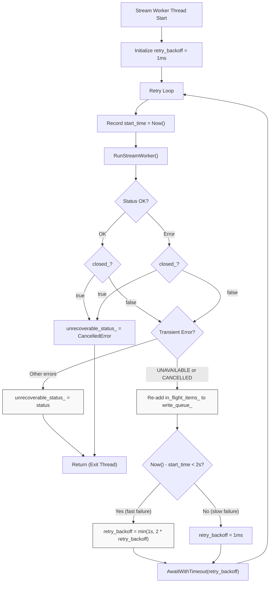
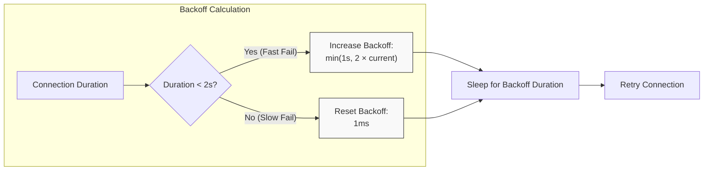
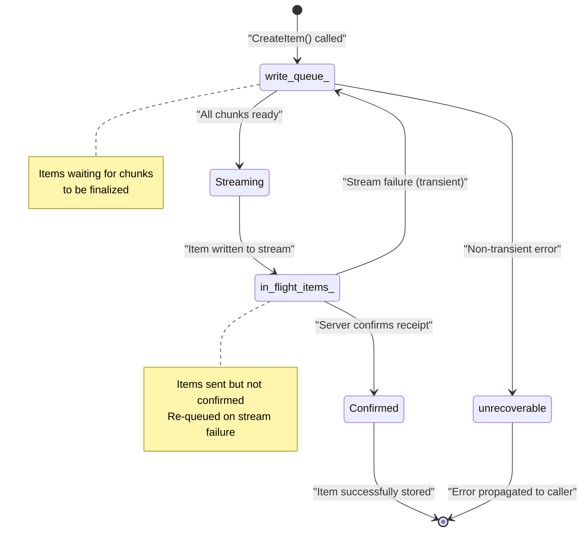
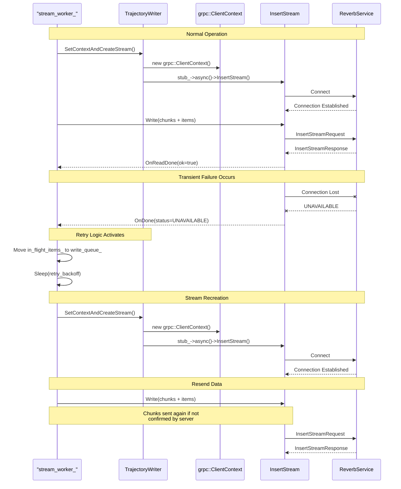
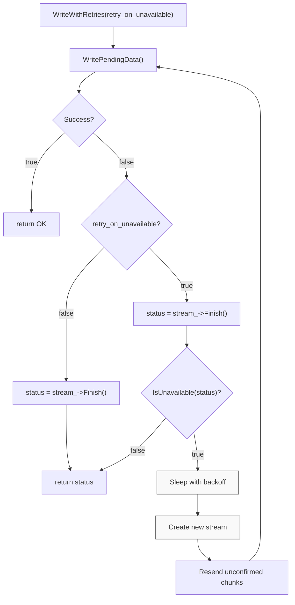
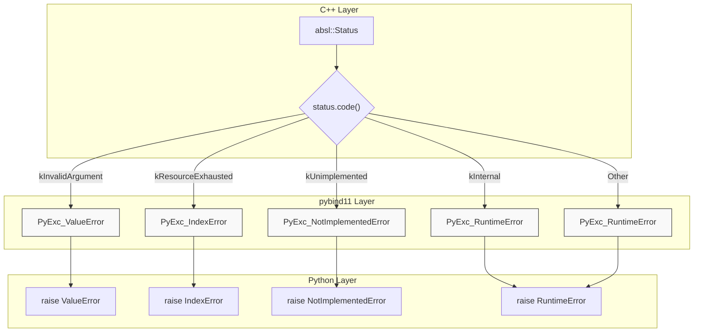
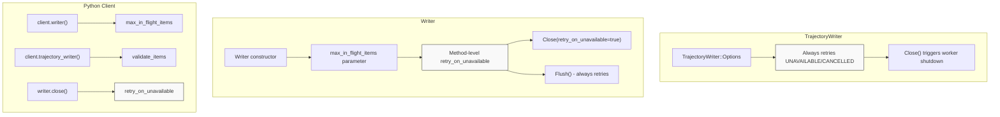
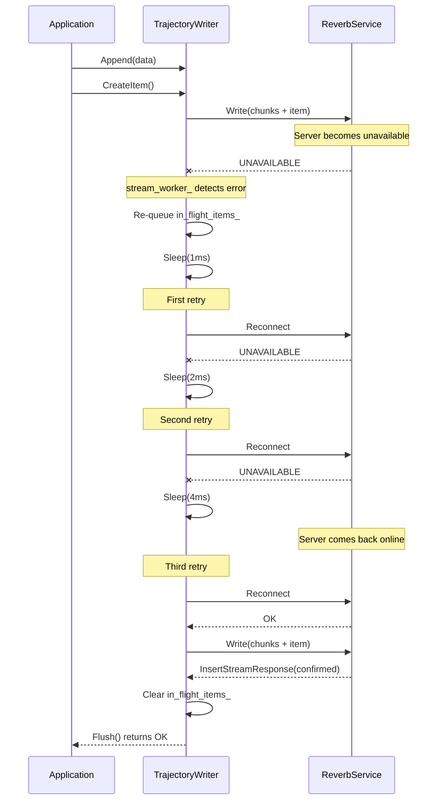
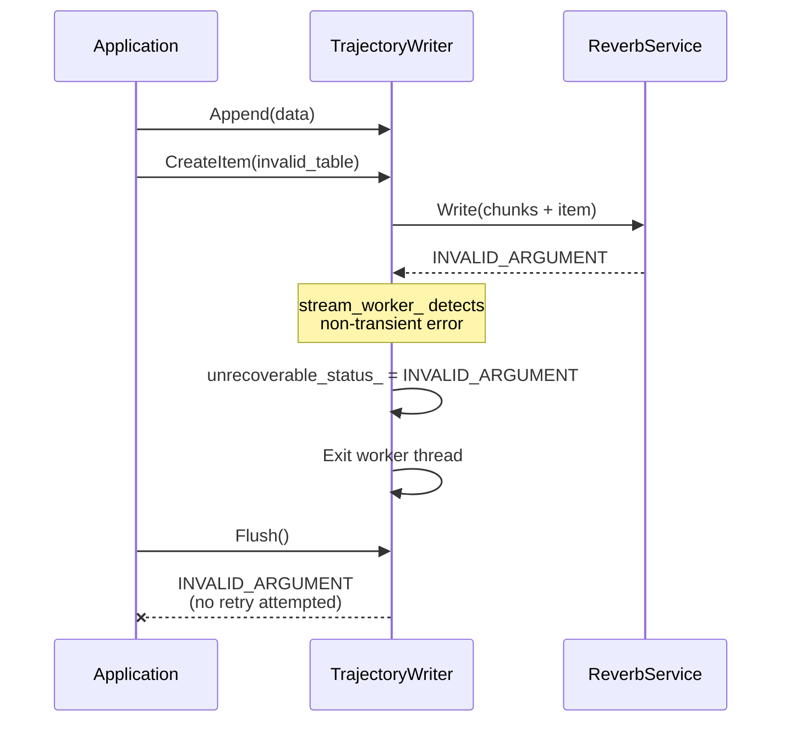

<!-- source: DeepWiki mcp.deepwiki.com · repo google-deepmind/reverb · page 7.3 Error Handling and Retry Logic · fetched 2026-10-26 -->

# Error Handling and Retry Logic

<details>
<summary>Relevant source files</summary>

The following files were used as context for generating this wiki page:

- [reverb/cc/trajectory_writer.cc](reverb/cc/trajectory_writer.cc)
- [reverb/cc/trajectory_writer.h](reverb/cc/trajectory_writer.h)
- [reverb/cc/trajectory_writer_test.cc](reverb/cc/trajectory_writer_test.cc)
- [reverb/cc/writer.cc](reverb/cc/writer.cc)
- [reverb/cc/writer.h](reverb/cc/writer.h)
- [reverb/cc/writer_test.cc](reverb/cc/writer_test.cc)
- [reverb/client.py](reverb/client.py)
- [reverb/pybind.cc](reverb/pybind.cc)
- [reverb/pybind.pyi](reverb/pybind.pyi)

</details>


This document describes how Reverb handles errors and implements retry logic for transient failures, focusing on the write path where data is sent from clients to the server. For general information about the data ingestion pipeline, see [Data Ingestion System](#3.2). For server-side error handling, see [gRPC Service Implementation](#3.4).

## Purpose and Scope

Reverb implements sophisticated error handling and automatic retry mechanisms to ensure data durability and fault tolerance when network failures or server unavailability occur. The retry system primarily operates in two writer implementations:

- **TrajectoryWriter** ([reverb/cc/trajectory_writer.cc]()): Asynchronous writer with automatic retry and exponential backoff
- **Writer** ([reverb/cc/writer.cc]()): Simpler writer with configurable retry behavior

This page covers error classification, retry strategies, backoff algorithms, item state management during failures, and error propagation across language boundaries.

Sources: [reverb/cc/trajectory_writer.cc](), [reverb/cc/writer.cc](), [reverb/cc/trajectory_writer.h](), [reverb/cc/writer.h]()

## Error Classification

Reverb distinguishes between transient and non-transient errors to determine retry behavior:

### Transient Errors (Retryable)

| Error Type | gRPC Status Code | Retry Behavior |
|------------|------------------|----------------|
| Server Unavailable | `UNAVAILABLE` | Automatically retried with exponential backoff |
| Connection Cancelled | `CANCELLED` | Automatically retried with exponential backoff |

### Non-Transient Errors (Terminal)

| Error Type | Status Code | Behavior |
|------------|-------------|----------|
| Invalid Arguments | `INVALID_ARGUMENT` | Propagated immediately, no retry |
| Internal Errors | `INTERNAL` | Propagated immediately, no retry |
| Failed Precondition | `FAILED_PRECONDITION` | Propagated immediately, no retry |
| Resource Exhausted | `RESOURCE_EXHAUSTED` | Propagated immediately, no retry |

The classification logic is implemented in [reverb/cc/trajectory_writer.cc:302-306]():

```cpp
if (!status.ok() && !absl::IsUnavailable(status) &&
    !absl::IsCancelled(status)) {
  unrecoverable_status_ = status;
  return;
}
```

Sources: [reverb/cc/trajectory_writer.cc:288-327](), [reverb/cc/trajectory_writer_test.cc:897-925]()

## TrajectoryWriter Retry Architecture

### Stream Worker Thread and Retry Loop



**Figure 1: TrajectoryWriter Retry State Machine**

The retry loop is implemented in [reverb/cc/trajectory_writer.cc:287-328]() as an anonymous function executed by the `stream_worker_` thread.

Sources: [reverb/cc/trajectory_writer.cc:287-328](), [reverb/cc/trajectory_writer.h:446-449]()

### Exponential Backoff Implementation

The backoff strategy adapts based on how quickly connections fail:



**Figure 2: Exponential Backoff Logic**

Implementation details from [reverb/cc/trajectory_writer.cc:318-326]():

```cpp
if (absl::Now() - start_time < absl::Seconds(2)) {
  retry_backoff = std::min(absl::Seconds(1), 2 * retry_backoff);
} else {
  retry_backoff = absl::Milliseconds(1);
}
```

The logic distinguishes between:
- **Fast failures** (< 2 seconds): Likely server/network issues → increase backoff
- **Slow failures** (≥ 2 seconds): Connection was stable → reset backoff

Sources: [reverb/cc/trajectory_writer.cc:318-326](), [reverb/cc/trajectory_writer.cc:289]()

## Item State Management During Retries

### Item Lifecycle and Queue Management



**Figure 3: Item State Transitions**

The item state management is implemented through three key data structures in [reverb/cc/trajectory_writer.h:426-434]():

- **`write_queue_`**: Items waiting to be sent (chunks may be incomplete)
- **`in_flight_items_`**: Items sent to server but not yet confirmed
- **`unrecoverable_status_`**: Stores terminal errors that prevent recovery

When a stream fails with a transient error, all `in_flight_items_` are moved back to `write_queue_` for retry [reverb/cc/trajectory_writer.cc:308-316]():

```cpp
// If we lose the connection then we'll never receive the item
// confirmations so we add them back to the front of the queue.
// Note that the internal ordering of the items added to the front
// of the queue is undefined and thus may differ from how they
// were originally transmitted.
for (auto& [_, item_and_refs] : in_flight_items_) {
  write_queue_.push_front(std::move(item_and_refs));
}
in_flight_items_.clear();
```

Sources: [reverb/cc/trajectory_writer.h:426-434](), [reverb/cc/trajectory_writer.cc:308-316](), [reverb/cc/trajectory_writer.cc:643-649]()

## Stream Management and Recreation

### gRPC Stream Lifecycle with Failures



**Figure 4: Stream Failure and Recreation Flow**

Key implementation details:

1. **Context Creation** [reverb/cc/trajectory_writer.cc:541-557](): A new `grpc::ClientContext` is created for each stream attempt
2. **Stream Recreation** [reverb/cc/trajectory_writer.cc:549](): `stub_->async()->InsertStream()` creates new bidirectional stream
3. **Chunk Resending** [reverb/cc/trajectory_writer.cc:186-210](): `SendNotAlreadySentChunks()` tracks which chunks were confirmed and only resends unconfirmed ones
4. **Keep-Alive Keys** [reverb/cc/trajectory_writer.cc:568-593](): `GetKeepKeys()` tells server which chunks to retain across requests

Sources: [reverb/cc/trajectory_writer.cc:541-557](), [reverb/cc/trajectory_writer.cc:595-700](), [reverb/cc/trajectory_writer.cc:186-210]()

## Writer Class Retry Logic

The simpler `Writer` class implements retry logic differently, with explicit retry methods rather than a background worker thread.

### WriteWithRetries Method



**Figure 5: Writer::WriteWithRetries Flow**

Implementation in [reverb/cc/writer.cc:473-539]().

### Key Differences from TrajectoryWriter

| Feature | TrajectoryWriter | Writer |
|---------|------------------|--------|
| Threading | Background worker thread | Synchronous on calling thread |
| Retry Loop | Automatic, infinite (until close) | Manual, within method call |
| Backoff | Exponential with reset | Not explicitly shown in code |
| State Management | `write_queue_` + `in_flight_items_` | `pending_items_` + `chunks_` |
| Configuration | Always retries transient errors | `retry_on_unavailable` parameter |

Sources: [reverb/cc/writer.cc:473-539](), [reverb/cc/writer.cc:376-418](), [reverb/cc/writer_test.cc:376-421]()

## Error Propagation to Python

### C++ to Python Exception Mapping



**Figure 6: Error Conversion Across Language Boundaries**

The conversion is implemented in [reverb/pybind.cc:58-83]():

```cpp
inline void MaybeRaiseFromStatus(const absl::Status &status) {
  if (status.ok()) return;
  
  switch (status.code()) {
    case absl::StatusCode::kInvalidArgument:
      PyErr_SetString(PyExc_ValueError, std::string(status.message()).data());
      break;
    case absl::StatusCode::kResourceExhausted:
      PyErr_SetString(PyExc_IndexError, std::string(status.message()).data());
      break;
    // ... other mappings
    default:
      PyErr_SetString(PyExc_RuntimeError, std::string(status.message()).data());
  }
  throw pybind11::error_already_set();
}
```

This function is called throughout the Python bindings to convert C++ errors into Python exceptions [reverb/pybind.cc:313](), [reverb/pybind.cc:335](), [reverb/pybind.cc:443]().

Sources: [reverb/pybind.cc:58-83](), [reverb/pybind.cc:313](), [reverb/pybind.cc:335]()

## Configuration and Control Flow

### Retry Configuration Options



**Figure 7: Configuration Points for Retry Behavior**

### Python API Retry Control

The Python `Client` class exposes retry configuration through the `close()` method [reverb/client.py:189-208]():

```python
def close(self, retry_on_unavailable=True):
  """Closes the stream to the ReverbService.
  
  Args:
    retry_on_unavailable: if true, it will keep trying to connect to the
      server if it's unavailable.
  """
  if self._closed:
    raise ValueError('close() has already been called on Writer.')
  self._closed = True
  self._writer.Close(retry_on_unavailable)
```

This parameter is passed through to the C++ `Writer::Close()` method [reverb/cc/writer.cc:376]().

Sources: [reverb/client.py:189-208](), [reverb/cc/writer.cc:376-418](), [reverb/cc/writer.h:83]()

## Failure Scenarios and Recovery

### Scenario 1: Server Temporarily Unavailable



**Figure 8: Recovery from Temporary Server Unavailability**

Sources: [reverb/cc/trajectory_writer.cc:287-328](), [reverb/cc/trajectory_writer_test.cc:897-925]()

### Scenario 2: Non-Transient Error



**Figure 9: Immediate Failure on Non-Transient Error**

Sources: [reverb/cc/trajectory_writer.cc:302-306](), [reverb/cc/trajectory_writer_test.cc:398-409]()

### Scenario 3: Item Confirmation Tracking

The `Writer` class implements an additional confirmation tracking mechanism with a dedicated worker thread [reverb/cc/writer.cc:335-374]():

```cpp
void Writer::ItemConfirmationWorker() {
  absl::MutexLock lock(mu_);
  item_confirmation_worker_running_ = true;
  
  while (true) {
    // Wait for items to be in flight or stop requested
    mu_.Await(absl::Condition(/* ... */));
    
    if (item_confirmation_worker_stop_requested_) {
      break;
    }
    
    // Read confirmations from stream
    InsertStreamResponse response;
    if (stream_->Read(&response)) {
      num_items_in_flight_ -= response.keys_size();
    } else {
      break;  // Stream error
    }
  }
  
  item_confirmation_worker_running_ = false;
}
```

This worker continuously reads confirmation responses, allowing the main thread to continue writing without blocking [reverb/cc/writer.h:122-135]().

Sources: [reverb/cc/writer.cc:335-374](), [reverb/cc/writer.h:122-135](), [reverb/cc/writer_test.cc:529-564]()

## Best Practices and Recommendations

### For Application Developers

1. **Use TrajectoryWriter for production**: The automatic retry and background worker provide better fault tolerance [reverb/cc/trajectory_writer.h:133-135]()

2. **Call Flush() regularly**: Prevents unbounded memory growth from pending items [reverb/cc/trajectory_writer.cc:655-661]():
   ```cpp
   if (in_flight_items_.size() + write_queue_.size() >=
       kPendingItemsWarningThreshold) {
     REVERB_LOG_EVERY_N(REVERB_WARNING, 10) << 
         "The number of pending items is alarmingly high...";
   }
   ```

3. **Handle deadline exceeded errors**: Set appropriate timeouts for `server_info()` calls [reverb/client.py:499-506]()

4. **Don't disable retries in production**: Use `retry_on_unavailable=True` (default) except during shutdown [reverb/client.py:189]()

### For System Operators

1. **Monitor retry metrics**: High retry rates indicate network or server issues
2. **Tune backoff parameters**: Maximum backoff is capped at 1 second [reverb/cc/trajectory_writer.cc:319]()
3. **Avoid abrupt server shutdowns**: Gives clients time to complete in-flight requests

Sources: [reverb/cc/trajectory_writer.cc:655-661](), [reverb/client.py:189-208](), [reverb/cc/trajectory_writer.cc:319]()

---

