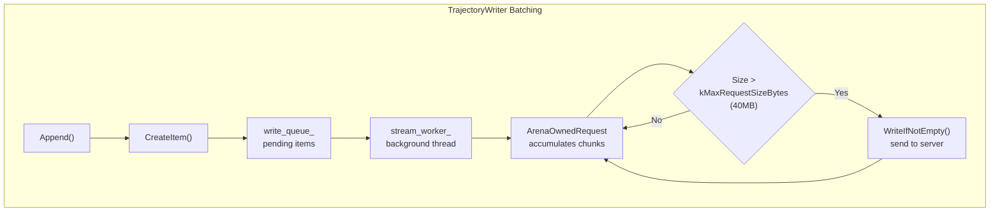
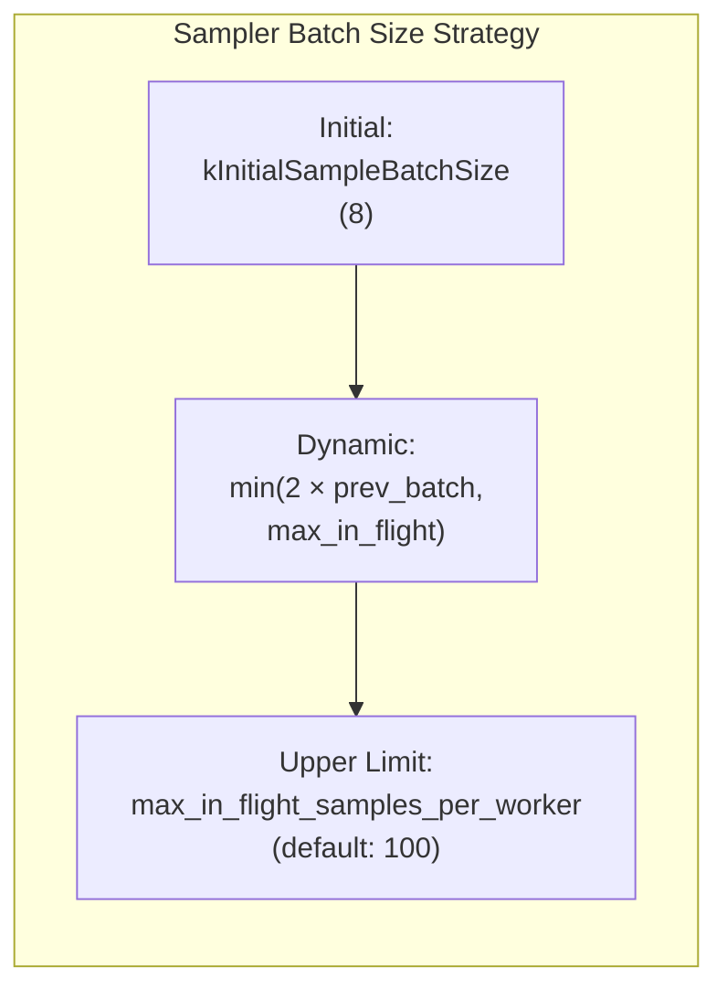
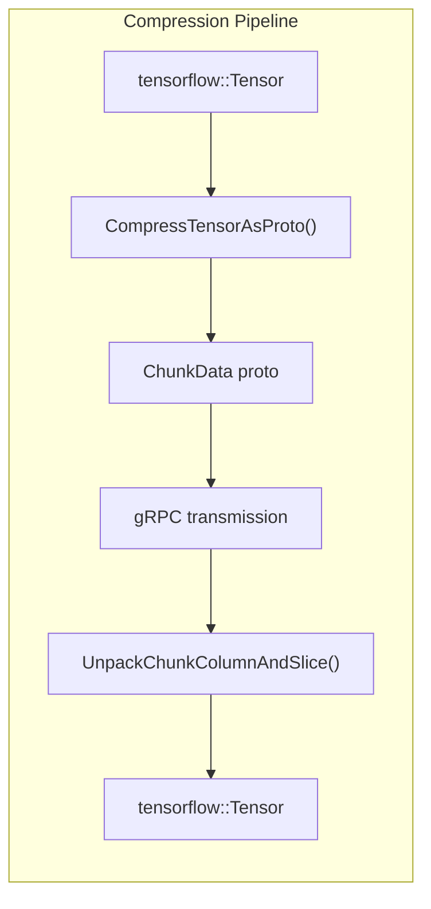
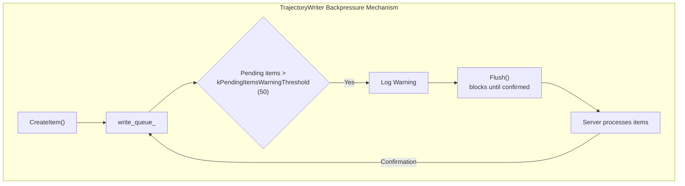
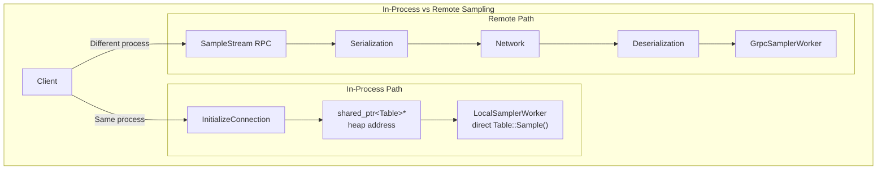
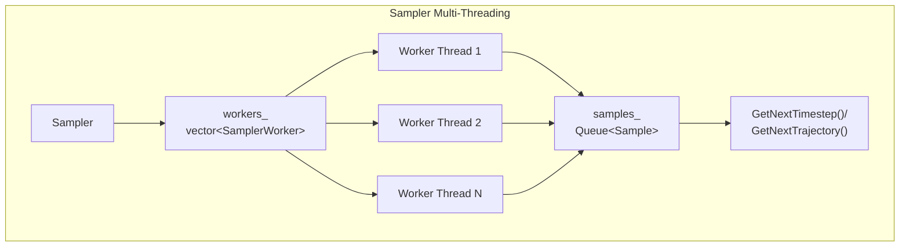
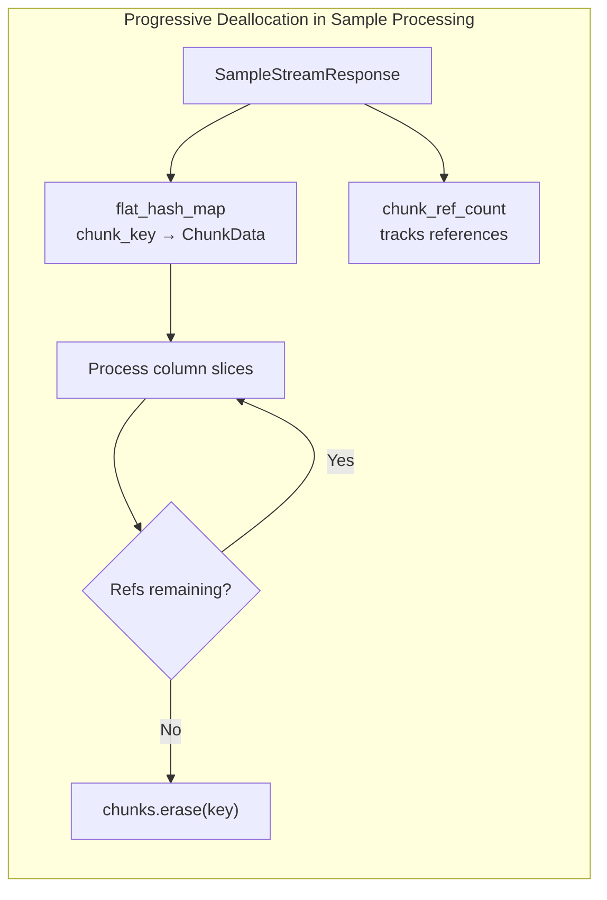

<!-- source: DeepWiki mcp.deepwiki.com · repo google-deepmind/reverb · page 7.4 Performance Optimization · fetched 2026-10-26 -->

# Performance Optimization

<details>
<summary>Relevant source files</summary>

The following files were used as context for generating this wiki page:

- [reverb/cc/reverb_service.proto](reverb/cc/reverb_service.proto)
- [reverb/cc/reverb_service_impl.cc](reverb/cc/reverb_service_impl.cc)
- [reverb/cc/reverb_service_impl.h](reverb/cc/reverb_service_impl.h)
- [reverb/cc/reverb_service_impl_test.cc](reverb/cc/reverb_service_impl_test.cc)
- [reverb/cc/sampler.cc](reverb/cc/sampler.cc)
- [reverb/cc/sampler.h](reverb/cc/sampler.h)
- [reverb/cc/sampler_test.cc](reverb/cc/sampler_test.cc)
- [reverb/cc/trajectory_writer.cc](reverb/cc/trajectory_writer.cc)
- [reverb/cc/trajectory_writer.h](reverb/cc/trajectory_writer.h)
- [reverb/cc/trajectory_writer_test.cc](reverb/cc/trajectory_writer_test.cc)

</details>


## Purpose and Scope

This document covers performance optimization techniques and considerations in the Reverb system. It focuses on strategies for maximizing throughput and minimizing latency in data ingestion, sampling, and server-side operations. For information about the overall system architecture, see [System Architecture](#2). For details on the data flow pipeline, see [Data Flow Pipeline](#2.2).

## Overview of Performance-Critical Components

Reverb employs several layers of optimization to achieve high-performance replay buffer operations. The most performance-sensitive components are:

| Component | Primary Role | Key Performance Impact |
|-----------|-------------|----------------------|
| `TrajectoryWriter` | Data ingestion | Network I/O, serialization, chunking |
| `Sampler` | Data retrieval | Multi-threaded sampling, decompression |
| `Table` | Data storage/selection | Lock contention, rate limiting |
| `ReverbServiceImpl` | gRPC server | Request processing, backpressure |

Sources: [reverb/cc/trajectory_writer.cc](), [reverb/cc/sampler.cc](), [reverb/cc/reverb_service_impl.cc]()

## Batching Strategies

### Request Batching in TrajectoryWriter

The `TrajectoryWriter` batches multiple chunks into a single gRPC message to reduce network overhead. Messages are sent when they exceed a size threshold to balance latency and throughput.



**Figure 1: TrajectoryWriter Request Batching**

The `kMaxRequestSizeBytes` constant defines the maximum message size before transmission [reverb/cc/trajectory_writer.h:238](). The batching logic accumulates chunks until this threshold is reached [reverb/cc/trajectory_writer.cc:198-209]().

Sources: [reverb/cc/trajectory_writer.cc:158-210](), [reverb/cc/trajectory_writer.h:238]()

### Sample Batching in Sampler

The `Sampler` requests samples in batches to minimize RPC overhead and improve throughput. Batch sizes are dynamically adjusted based on availability.



**Figure 2: Sampler Batch Size Adjustment**

The initial batch size is conservative (`kInitialSampleBatchSize = 8`) to avoid allocating excessive memory when tables are nearly empty [reverb/cc/sampler.cc:56](). The batch size doubles with each successful request up to the configured limit [reverb/cc/sampler.cc:368-371]().

Sources: [reverb/cc/sampler.cc:56, 218-223, 348-371]()

### Server-Side Batch Processing

The `ReverbServiceImpl` processes sample requests in batches with a size limit to control memory usage and response latency.

| Configuration | Value | Purpose |
|--------------|-------|---------|
| `kMaxSampleResponseSizeBytes` | 80MB (2× table limit) | Maximum size per response message |
| `kInitialGrpcSampleBatchSize` | 64 | Initial samples per batch |

The doubled size limit allows for flexibility when table responses slightly exceed the per-item limit, avoiding inefficient message splits [reverb/cc/reverb_service_impl.cc:52-60]().

Sources: [reverb/cc/reverb_service_impl.cc:52-66]()

## Compression and Encoding

### Delta Encoding

Reverb supports delta encoding for temporal data where consecutive timesteps have similar values. This reduces the size of transmitted and stored data.

Delta encoding is configured per-column via `ChunkerOptions::GetDeltaEncode()` [reverb/cc/chunker.h](). When enabled, tensors are encoded as differences from the previous timestep [reverb/cc/trajectory_writer_test.cc:186-223]().

### Chunk Compression

All chunk data uses Snappy compression during serialization. The compression is controlled by the `CompressionDisabled` option in `ChunkerOptions`.



**Figure 3: Compression and Decompression Pipeline**

Compression is applied during chunk creation and decompression occurs during sampling [reverb/cc/sampler.cc:112-122]().

Sources: [reverb/cc/trajectory_writer_test.cc:186-223](), [reverb/cc/sampler.cc:112-122]()

## Backpressure and Flow Control

### Writer-Side Backpressure

The `TrajectoryWriter` implements backpressure to prevent unbounded memory growth when the server cannot keep up with insertion rate.



**Figure 4: Writer Backpressure Mechanism**

When pending items (in `write_queue_` and `in_flight_items_`) exceed the threshold, warnings are logged [reverb/cc/trajectory_writer.cc:649-662](). The `Flush()` method blocks until items are confirmed, preventing runaway memory usage [reverb/cc/trajectory_writer.cc:702-750]().

The threshold is defined as [reverb/cc/trajectory_writer.cc:49-52]():
```cpp
const int kPendingItemsWarningThreshold = 50;
```

Sources: [reverb/cc/trajectory_writer.cc:49-52, 649-662, 702-750]()

### Server-Side Backpressure

The `InsertStream` reactor in `ReverbServiceImpl` applies backpressure by pausing reads when the table's internal buffer is full.

The reactor checks `can_insert` after each insertion [reverb/cc/reverb_service_impl.cc:227-256](). When `false`, new reads are suspended until the insertion completes and space becomes available.

Sources: [reverb/cc/reverb_service_impl.cc:210-257]()

### Rate Limiter Flow Control

The `RateLimiter` enforces desired ratios between insert and sample operations, blocking operations when limits are reached. This is covered in detail in [Rate Limiting](#3.1.2).

## In-Process Optimization

### Zero-Copy Local Sampling

When the client and server run in the same process, Reverb bypasses gRPC serialization entirely through the `InitializeConnection` RPC.



**Figure 5: In-Process vs Remote Sampling Paths**

The in-process optimization works as follows:

1. Client calls `InitializeConnection` with its process ID [reverb/cc/reverb_service.proto:60-71]()
2. Server verifies matching PIDs and allocates a `shared_ptr<Table>` on the heap [reverb/cc/reverb_service_impl.cc:362-378]()
3. Server transmits the memory address to the client [reverb/cc/reverb_service_impl.cc:377]()
4. Client dereferences and copies the pointer, then confirms ownership transfer [reverb/cc/reverb_service_impl.cc:382-386]()
5. `LocalSamplerWorker` directly calls `Table::SampleFlexibleBatch()` [reverb/cc/sampler.cc:380]()

This eliminates all serialization, compression, and network overhead for co-located clients.

Sources: [reverb/cc/reverb_service_impl.cc:332-423](), [reverb/cc/sampler.cc:325-442](), [reverb/cc/reverb_service.proto:54-84]()

## Multi-Threading Architecture

### Sampler Worker Threads

The `Sampler` uses multiple worker threads to parallelize sampling and improve throughput.



**Figure 6: Sampler Multi-Threading Architecture**

The number of workers is configurable via `Options::num_workers` (default: 1 for FIFO compatibility) [reverb/cc/sampler.h:188, 222](). Workers are created and started in the constructor [reverb/cc/sampler.cc:518-522]().

The worker count is automatically limited to avoid creating unnecessary threads:
```cpp
num_workers = std::min<int64_t>(
    num_workers,
    std::max<int64_t>(1, max_samples / options.max_in_flight_samples_per_worker));
```

Sources: [reverb/cc/sampler.cc:444-458, 518-522](), [reverb/cc/sampler.h:188, 222]()

### TrajectoryWriter Background Thread

The `TrajectoryWriter` uses a dedicated background thread (`stream_worker_`) to handle all network I/O asynchronously, keeping the main thread non-blocking.

The worker thread [reverb/cc/trajectory_writer.cc:287-328]():
- Creates and manages gRPC streams
- Sends chunks and items from `write_queue_`
- Handles retries with exponential backoff
- Signals completion via condition variables

This design ensures that `Append()` and `CreateItem()` calls never block on network I/O.

Sources: [reverb/cc/trajectory_writer.cc:287-328, 595-700]()

### Server Callback Executor

The `ReverbServiceImpl` uses a shared thread pool for executing table callbacks asynchronously.

```cpp
auto executor = std::make_shared<TaskExecutor>(
    absl::GetFlag(FLAGS_reverb_callback_executor_num_threads),
    "TableCallbackExecutor");
```

The thread pool size is configurable via the `--reverb_callback_executor_num_threads` flag (default: 32) [reverb/cc/reverb_service_impl.cc:45-46, 130-135]().

Sources: [reverb/cc/reverb_service_impl.cc:45-46, 130-135]()

## Memory Management Optimizations

### Progressive Chunk Deallocation

The `Sampler` deallocates chunk memory as soon as all references within a sample have been processed, reducing peak memory usage.



**Figure 7: Progressive Chunk Deallocation**

The implementation counts references for each chunk [reverb/cc/sampler.cc:84-92]() and erases chunks from the map after their last use [reverb/cc/sampler.cc:116-120]().

Sources: [reverb/cc/sampler.cc:73-129]()

### Arena Allocation for Requests

The `TrajectoryWriter` uses a custom `ArenaOwnedRequest` class to manage proto messages efficiently, avoiding repeated allocations.

Key methods [reverb/cc/trajectory_writer.cc:54-91]():
- `AddAllocatedChunks()`: Uses `UnsafeArenaAddAllocated()` to avoid copying
- `Clear()`: Manually releases arena-allocated messages
- `RequestSize()`: Tracks cumulative size for batching decisions

This reduces allocation overhead in the hot path of item insertion.

Sources: [reverb/cc/trajectory_writer.cc:54-91, 158-183]()

### Chunk Reference Management

The `TrajectoryWriter` maintains references to chunks until they're confirmed by the server or explicitly released via `keep_chunk_keys`.

The `GetKeepKeys()` method calculates which chunks need to remain in memory [reverb/cc/trajectory_writer.cc:568-593]():
1. Chunks referenced by active `Chunker`s
2. Chunks referenced by pending items (except the front item)
3. Filtered by chunks already sent to the server

This minimizes memory usage while ensuring data availability.

Sources: [reverb/cc/trajectory_writer.cc:568-593, 664-667]()

## Retry and Error Handling

### Exponential Backoff

Both `Sampler` and `TrajectoryWriter` implement exponential backoff when encountering transient errors.

| Component | Initial Backoff | Max Backoff | Reset Threshold |
|-----------|----------------|-------------|-----------------|
| Sampler | 1ms | 1s | 2s connection duration |
| TrajectoryWriter | 1ms | 1s | 2s connection duration |

The backoff is reset if a connection stays alive for more than the threshold [reverb/cc/sampler.cc:57-60](), [reverb/cc/trajectory_writer.cc:318-322]().

```cpp
// Sampler
if (absl::Now() - start_time < kResetBackoffThreshold) {
  retry_backoff = std::min(kMaxRetryBackoff, 2 * retry_backoff);
} else {
  retry_backoff = kMinRetryBackoff;
}
```

Sources: [reverb/cc/sampler.cc:57-60, 656-673](), [reverb/cc/trajectory_writer.cc:289-327]()

### Retry Logic for TrajectoryWriter

The `TrajectoryWriter` retries on transient errors (`UNAVAILABLE`, `CANCELLED`) without data loss by re-enqueueing unconfirmed items.

When a stream fails [reverb/cc/trajectory_writer.cc:302-316]():
1. Items in `in_flight_items_` are moved back to `write_queue_`
2. Previously sent chunks are resent (no guarantee of same server)
3. A new stream is created after backoff delay

This ensures at-least-once delivery semantics for items.

Sources: [reverb/cc/trajectory_writer.cc:289-327, 897-925](), [reverb/cc/trajectory_writer_test.cc:897-925]()

## Performance Tuning Parameters

### Key Configuration Options

The following parameters significantly impact performance:

#### TrajectoryWriter Options

| Parameter | Type | Default | Impact |
|-----------|------|---------|--------|
| `max_chunk_length` | int | Varies | Larger = better compression, higher latency |
| `num_keep_alive_refs` | int | Varies | Larger = more memory, more flexibility |
| `kMaxRequestSizeBytes` | const | 40MB | Controls message size vs RPC count |

#### Sampler Options

| Parameter | Type | Default | Impact |
|-----------|------|---------|--------|
| `max_in_flight_samples_per_worker` | int | 100 | Larger = better throughput, more memory |
| `num_workers` | int | 1 | More = better throughput (if not FIFO) |
| `max_samples_per_stream` | int | 10000 | Larger = fewer reconnections, potential bias |
| `rate_limiter_timeout` | Duration | ∞ | Controls blocking behavior |

#### Server Options

| Parameter | Type | Default | Impact |
|-----------|------|---------|--------|
| `reverb_callback_executor_num_threads` | int | 32 | More = better callback parallelism |
| `kMaxSampleResponseSizeBytes` | const | 80MB | Controls response size |

Sources: [reverb/cc/trajectory_writer.h:240-253](), [reverb/cc/sampler.h:209-243](), [reverb/cc/reverb_service_impl.cc:45-46]()

## Performance Monitoring

### Warning Indicators

The system logs warnings when performance issues are detected:

1. **Excessive Pending Items** (TrajectoryWriter): Logged when pending items exceed 50 [reverb/cc/trajectory_writer.cc:655-661]()
2. **Rate Limiter Timeouts**: Indicated in `SampleInfo::rate_limited` field
3. **Stream Reconnections**: Frequent reconnections suggest network issues or server overload

### Key Metrics to Monitor

- **Insertion Rate**: Items/second inserted into tables
- **Sample Rate**: Samples/second retrieved from tables
- **Pending Item Count**: `write_queue_.size() + in_flight_items_.size()`
- **Worker Utilization**: Active vs idle worker threads
- **Memory Usage**: Peak and steady-state memory consumption
- **RPC Latency**: Time per gRPC call

Sources: [reverb/cc/trajectory_writer.cc:649-662]()

---

