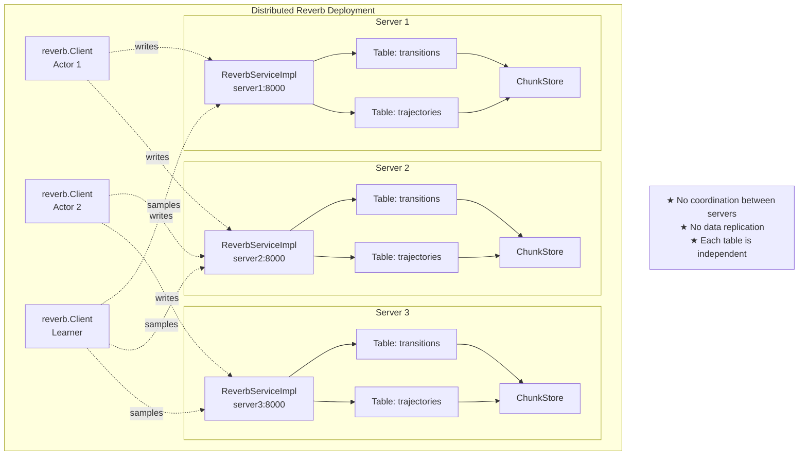
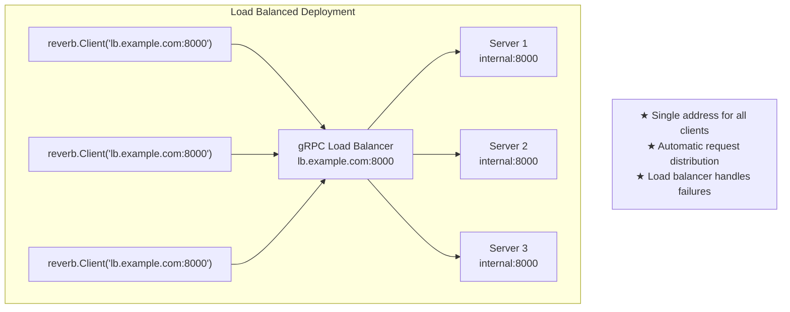
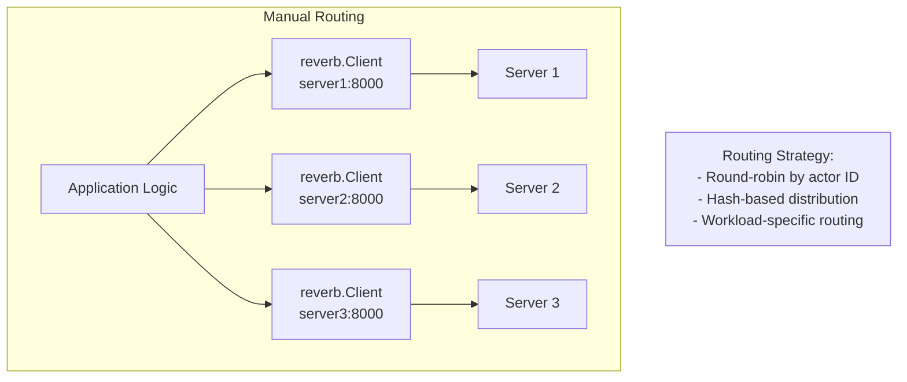
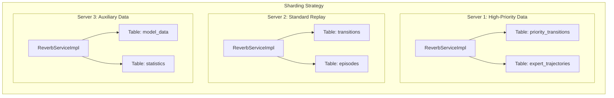
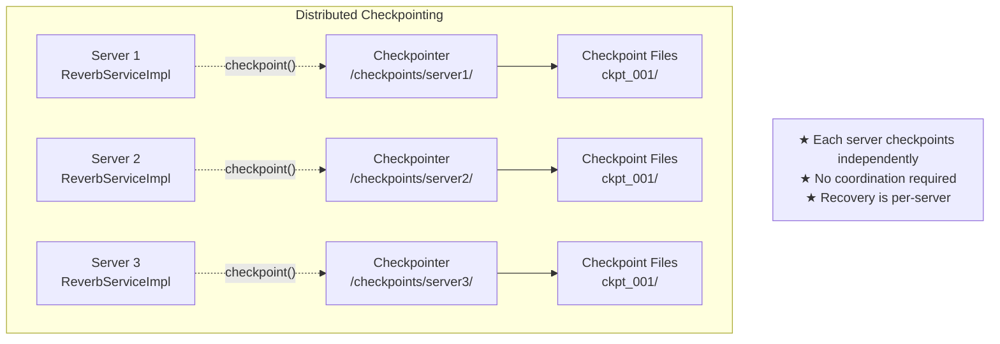
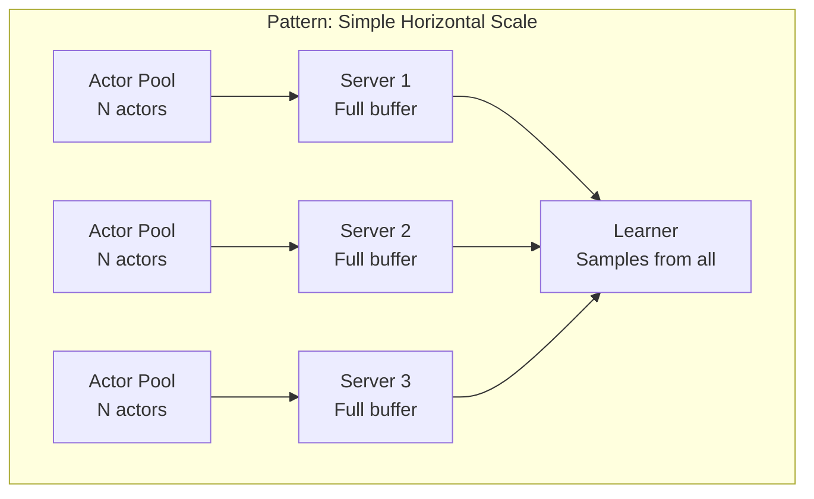
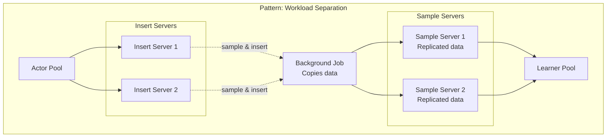
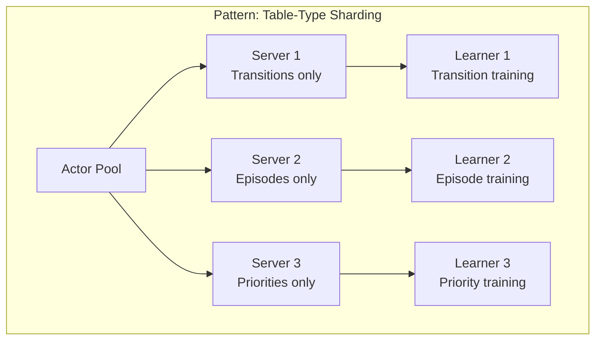
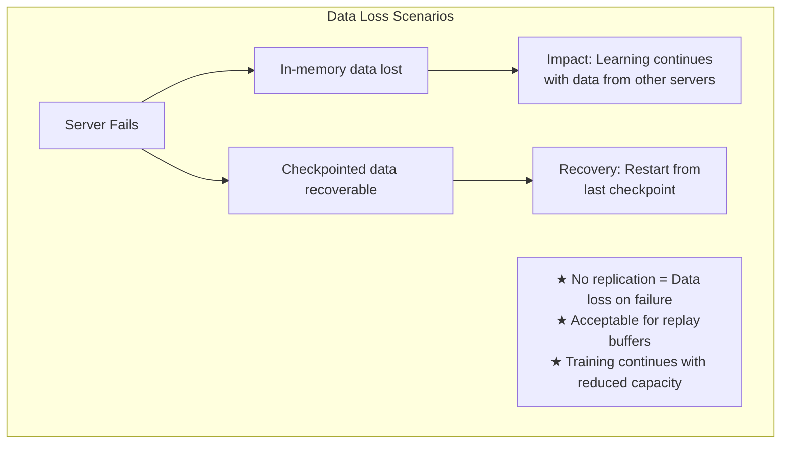

<!-- source: DeepWiki mcp.deepwiki.com · repo google-deepmind/reverb · page 7.5 Distributed Deployment · fetched 2026-10-26 -->

# Distributed Deployment

<details>
<summary>Relevant source files</summary>

The following files were used as context for generating this wiki page:

- [README.md](README.md)
- [docs/images/multiple_tables_example.png](docs/images/multiple_tables_example.png)
- [reverb/cc/reverb_service.proto](reverb/cc/reverb_service.proto)
- [reverb/cc/reverb_service_impl.cc](reverb/cc/reverb_service_impl.cc)
- [reverb/cc/reverb_service_impl.h](reverb/cc/reverb_service_impl.h)
- [reverb/cc/reverb_service_impl_test.cc](reverb/cc/reverb_service_impl_test.cc)
- [reverb/pip_package/reverb_version.py](reverb/pip_package/reverb_version.py)
- [reverb/pip_package/setup.py](reverb/pip_package/setup.py)

</details>


## Purpose and Scope

This document explains strategies for deploying Reverb at scale across multiple servers, including sharding approaches, load balancing techniques, fault tolerance through checkpointing, and the trade-offs inherent to Reverb's distributed architecture. 

For details on checkpointing individual servers, see [Checkpointing and Persistence](#3.5). For the client-server communication model, see [Client-Server Communication](#2.1). For server configuration, see [Server Configuration](#4.4).

**Key Characteristic**: Reverb servers operate independently without coordination or replication. This design prioritizes scalability and simplicity over strong consistency, making it suitable for systems where some data loss is acceptable (such as experience replay buffers in reinforcement learning).

Sources: [README.md:310-327]()

## Server Independence Architecture



**Key Properties of Reverb's Distributed Model**:

| Property | Description | Implication |
|----------|-------------|-------------|
| **No Coordination** | Servers are unaware of each other | Infinite horizontal scalability |
| **No Replication** | Data exists on exactly one server | Server failure means data loss |
| **Independent Tables** | Each `Table` instance exists on one server | Tables with same name on different servers are distinct |
| **Stateless Clients** | `reverb.Client` instances connect to one server | Application manages multi-server routing |

Each `ReverbServiceImpl` instance maintains its own collection of tables in a `flat_hash_map<std::string, std::shared_ptr<Table>>`, completely independent from other servers. There is no distributed consensus, no data synchronization, and no coordination protocol.

Sources: [README.md:310-327](), [reverb/cc/reverb_service_impl.h:136](), [reverb/cc/reverb_service_impl.cc:83-141]()

## Horizontal Scaling Strategies

### Adding Servers

Scaling Reverb horizontally is straightforward due to server independence:

```python
# Start multiple independent servers
servers = []
for port in range(8000, 8003):
    server = reverb.Server(
        tables=[
            reverb.Table(
                name='experience_buffer',
                sampler=reverb.selectors.Uniform(),
                remover=reverb.selectors.Fifo(),
                max_size=100000,
                rate_limiter=reverb.rate_limiters.MinSize(1000)
            )
        ],
        port=port
    )
    servers.append(server)
```

Each server operates independently with its own:
- **Table collection** managed by `ReverbServiceImpl::tables_` 
- **ChunkStore** for data storage
- **gRPC service endpoints** (`InsertStream`, `SampleStream`, etc.)
- **Checkpointing** system (if configured)

### Capacity Planning

When scaling out, consider:

| Factor | Calculation | Notes |
|--------|-------------|-------|
| **Total Capacity** | `num_servers × max_size_per_table` | No replication overhead |
| **Insert Throughput** | Scales linearly with servers | Limited by client distribution |
| **Sample Throughput** | Scales linearly with servers | Requires balanced sampling |
| **Memory Usage** | `num_servers × (table_size + chunk_overhead)` | Each server independent |

Sources: [README.md:310-327](), [reverb/cc/reverb_service_impl.cc:86-141]()

## Load Balancing and Client Routing

### gRPC Load Balancer Approach



When using a gRPC-compatible load balancer, clients connect to a single address and operations are automatically distributed:

```python
# All clients connect to load balancer address
client = reverb.Client('lb.example.com:8000')

# Inserts automatically distributed across servers
with client.trajectory_writer(num_keep_alive_refs=3) as writer:
    writer.append({'observation': obs, 'action': action})
    writer.create_item(table='experience_buffer', priority=1.0, 
                       trajectory={'obs': writer.history['observation'][-1:]})

# Samples automatically distributed across servers  
for sample in client.sample('experience_buffer', num_samples=32):
    # May come from any backend server
    process_sample(sample)
```

**Behavior by RPC Type**:

| RPC Method | Load Balancing Behavior |
|------------|-------------------------|
| `InsertStream` | Each stream pinned to one server |
| `SampleStream` | Each stream pinned to one server |
| `MutatePriorities` | Routed to any available server |
| `ServerInfo` | Returns info from one server only |
| `Checkpoint` | Checkpoints one server only |

**Important**: Operations like `MutatePriorities` and `ServerInfo` only affect the server they're routed to, not all servers in the pool.

Sources: [README.md:317-322](), [reverb/cc/reverb_service.proto:9-58]()

### Manual Client-Side Routing

When a load balancer is unavailable or more control is required:



Application-level routing example:

```python
# Create clients for each server
servers = [f'server{i}:8000' for i in range(1, 4)]
clients = [reverb.Client(addr) for addr in servers]

# Round-robin routing for inserts
def get_writer_client(actor_id: int) -> reverb.Client:
    """Route actor to consistent server."""
    return clients[actor_id % len(clients)]

# Uniform sampling across all servers
def sample_batch(table_name: str, batch_size: int):
    """Sample from all servers equally."""
    samples_per_server = batch_size // len(clients)
    all_samples = []
    
    for client in clients:
        samples = list(client.sample(table_name, num_samples=samples_per_server))
        all_samples.extend(samples)
    
    return all_samples
```

**Common Routing Strategies**:

| Strategy | Use Case | Implementation |
|----------|----------|----------------|
| **Round-robin** | Uniform load distribution | `clients[counter % N]` |
| **Hash-based** | Consistent actor→server mapping | `clients[hash(actor_id) % N]` |
| **Workload-specific** | Separate insert/sample servers | Writers→servers[0:K], Samplers→servers[K:N] |
| **Priority-based** | Different priorities on different servers | High-priority table on dedicated servers |

Sources: [README.md:324-327]()

## Table Name Sharding



Different tables can be hosted on different servers for workload separation:

```python
# Server 1: High-throughput priority replay
server1 = reverb.Server(
    tables=[reverb.Table(
        name='priority_transitions',
        sampler=reverb.selectors.Prioritized(0.8),
        remover=reverb.selectors.Fifo(),
        max_size=1000000
    )],
    port=8001
)

# Server 2: FIFO queue for trajectories
server2 = reverb.Server(
    tables=[reverb.Table(
        name='trajectory_queue',
        sampler=reverb.selectors.Fifo(),
        remover=reverb.selectors.Fifo(),
        max_size=10000,
        max_times_sampled=1
    )],
    port=8002
)

# Client routing by table name
client_map = {
    'priority_transitions': reverb.Client('server1:8001'),
    'trajectory_queue': reverb.Client('server2:8002')
}

# Insert to appropriate server
def insert_experience(table: str, data):
    client = client_map[table]
    client.insert(data, priorities={table: 1.0})
```

Sources: [reverb/cc/reverb_service_impl.cc:86-141]()

## Checkpointing in Distributed Deployments

### Per-Server Checkpointing

Each `ReverbServiceImpl` instance supports independent checkpointing:



**Checkpointing Each Server**:

```python
# Each server with its own checkpointer
servers = []
for i in range(3):
    checkpointer = reverb.platform.checkpointers_lib.DefaultCheckpointer(
        path=f'/checkpoints/server{i}'
    )
    server = reverb.Server(
        tables=[...],
        port=8000 + i,
        checkpointer=checkpointer
    )
    servers.append(server)

# Checkpoint individual servers via their clients
clients = [reverb.Client(f'localhost:{8000+i}') for i in range(3)]

# Trigger checkpoints (e.g., periodically)
for client in clients:
    checkpoint_path = client.checkpoint()
    print(f'Checkpoint saved: {checkpoint_path}')
```

The `ReverbServiceImpl::Checkpoint` method serializes all tables and their data to disk. During checkpointing, the server blocks all insert, sample, update, and delete operations to ensure consistency.

### Recovery Strategies

| Scenario | Recovery Approach | Data Loss |
|----------|-------------------|-----------|
| **Single server failure** | Restart server with checkpointer | Data since last checkpoint |
| **Multiple server failure** | Restart each independently | Per-server data loss |
| **Complete deployment restart** | Load each server from checkpoint | Coordinated but independent |
| **Server replacement** | Start new server with checkpoint path | None if checkpoint current |

**Recovery Example**:

```python
# Restart server from checkpoint
checkpointer = reverb.platform.checkpointers_lib.DefaultCheckpointer(
    path='/checkpoints/server1'
)

# Tables configuration must match original server
server = reverb.Server(
    tables=[
        reverb.Table(
            name='experience_buffer',
            sampler=reverb.selectors.Uniform(),
            remover=reverb.selectors.Fifo(),
            max_size=100000,
            rate_limiter=reverb.rate_limiters.MinSize(1000)
        )
    ],
    port=8001,
    checkpointer=checkpointer  # Loads latest checkpoint during initialization
)
```

The `Initialize` method in `ReverbServiceImpl` attempts to load the latest checkpoint from the configured path, falling back to a fallback checkpoint if configured, or starting empty if no checkpoints exist.

Sources: [reverb/cc/reverb_service_impl.cc:98-123](), [reverb/cc/reverb_service_impl.cc:143-165](), [README.md:328-360]()

## Deployment Patterns

### Pattern 1: Simple Horizontal Scale



**Use Case**: Basic scaling when single server capacity is insufficient

**Configuration**:
- Identical table configuration on all servers
- Actors hash-distributed to servers
- Learner samples uniformly from all servers

**Advantages**: Simple, predictable, fault-tolerant
**Disadvantages**: Sampling may be unbalanced if servers fill at different rates

### Pattern 2: Workload Separation



**Use Case**: High insert and sample rates that would interfere

**Implementation Sketch**:
```python
# Actors write to insert-dedicated servers
insert_clients = [reverb.Client(f'insert-server{i}:8000') for i in range(2)]

# Background job copies to sample servers
for insert_client in insert_clients:
    for sample in insert_client.sample('buffer', num_samples=1000):
        # Re-insert to sample servers with same priority
        sample_client.insert(sample.data, priorities={'buffer': sample.info.priority})

# Learners only read from sample servers
sample_clients = [reverb.Client(f'sample-server{i}:8000') for i in range(2)]
```

**Advantages**: Isolates write and read load
**Disadvantages**: Complex, requires manual replication, data lag

### Pattern 3: Table-Type Sharding



**Use Case**: Different table types with different requirements

**Configuration**:
```python
# Server 1: High-frequency transitions
server1 = reverb.Server(
    tables=[reverb.Table(
        name='transitions',
        max_size=1000000,
        sampler=reverb.selectors.Uniform()
    )],
    port=8001
)

# Server 2: Lower-frequency full episodes
server2 = reverb.Server(
    tables=[reverb.Table(
        name='episodes', 
        max_size=10000,
        sampler=reverb.selectors.Fifo()
    )],
    port=8002
)

# Server 3: Prioritized high-value experiences
server3 = reverb.Server(
    tables=[reverb.Table(
        name='priority_buffer',
        max_size=100000,
        sampler=reverb.selectors.Prioritized(0.8)
    )],
    port=8003
)
```

**Advantages**: Optimized per workload, clear separation
**Disadvantages**: Requires application-level routing logic

Sources: [README.md:310-327](), [reverb/cc/reverb_service_impl.cc:86-141]()

## Trade-offs and Considerations

### Acceptable Data Loss



**Key Trade-off**: Reverb prioritizes **scalability** and **simplicity** over **durability**

| Aspect | Reverb's Approach | Traditional DB Approach |
|--------|-------------------|------------------------|
| **Replication** | None | Multi-replica with consensus |
| **Data Loss on Failure** | All in-memory data | None (if quorum survives) |
| **Write Latency** | Low (no coordination) | Higher (consensus required) |
| **Horizontal Scaling** | Unlimited | Limited by coordination overhead |
| **Consistency** | None across servers | Strong consistency guarantees |

**When Reverb's Model Works Well**:
- Experience replay in RL (data is continuously regenerated)
- Temporary data buffers
- High-throughput streaming systems
- Systems where sampling diversity > completeness

**When to Use Alternative Approaches**:
- Data must not be lost
- Strong consistency required across replicas
- Coordinated transactions needed

Sources: [README.md:310-316]()

### Operational Considerations

| Consideration | Recommendation | Implementation |
|---------------|----------------|----------------|
| **Monitoring** | Monitor each server independently | Use `ServerInfo` RPC per server |
| **Health Checks** | Implement application-level health checks | Periodic sampling from each server |
| **Capacity Planning** | Plan for N-1 redundancy | Size servers to handle full load with one down |
| **Checkpoint Frequency** | Balance durability vs. performance | Checkpoint during training checkpoints |
| **Load Balancer Configuration** | Use least-connections or round-robin | Avoid session affinity (stateless) |
| **Network Partitions** | Clients will see timeouts | Implement retry logic in application |
| **Version Compatibility** | Ensure all servers use same Reverb version | Coordinate deployments |

### Performance Characteristics

| Metric | Single Server | N Servers (Load Balanced) | N Servers (Manual Routing) |
|--------|---------------|---------------------------|----------------------------|
| **Insert Throughput** | Baseline | ~N× (limited by client dist.) | N× (with good routing) |
| **Sample Throughput** | Baseline | ~N× | N× |
| **Sample Diversity** | All data | All data (if balanced) | Depends on routing |
| **Latency (p50)** | Baseline | Similar | Similar |
| **Latency (p99)** | Baseline | May be higher (slowest server) | Controllable with routing |
| **Memory per Sample** | Baseline | Baseline | Baseline |

The `ReverbServiceImpl` uses workerless reactors for both insert and sample streams, allowing high concurrency without thread-per-request overhead. Each server scales independently with its configured thread pool size (controlled by `FLAGS_reverb_callback_executor_num_threads`).

Sources: [reverb/cc/reverb_service_impl.cc:45-46](), [reverb/cc/reverb_service_impl.cc:130-135]()

## ServerInfo in Distributed Context

The `ServerInfo` RPC returns metadata about a single server:

```python
# With load balancer: returns info from ONE server
client = reverb.Client('lb.example.com:8000')
info = client.server_info()  # Info from whichever server handled this request

# To get info from all servers with manual routing:
all_info = []
for addr in ['server1:8000', 'server2:8000', 'server3:8000']:
    client = reverb.Client(addr)
    all_info.append(client.server_info())

# Aggregate statistics
total_size = sum(info['tables']['experience_buffer']['current_size'] 
                 for info in all_info)
print(f'Total items across all servers: {total_size}')
```

The `ServerInfoResponse` includes a `tables_state_id` field - a random 128-bit identifier generated when the server starts. This ID changes when tables are added, removed, or modified, and is unique per server instance.

Sources: [reverb/cc/reverb_service_impl.cc:705-715](), [reverb/cc/reverb_service_impl.h:141-142](), [reverb/cc/reverb_service.proto:132-137]()

## Summary

Reverb's distributed deployment model is characterized by:

1. **Server Independence**: No coordination between servers
2. **Horizontal Scalability**: Add servers to increase capacity linearly
3. **Client-Side Logic**: Applications manage multi-server routing
4. **Acceptable Data Loss**: No replication, failures lose in-memory data
5. **Per-Server Checkpointing**: Each server independently persists state
6. **Simple Operations**: No distributed transactions or consensus protocols

This architecture is well-suited for machine learning workloads like experience replay where high throughput and scalability are more important than durability, and where data is continuously regenerated by the learning process.

Sources: [README.md:310-327](), [reverb/cc/reverb_service_impl.cc:83-141]()