# Page: Overview

# Overview

<details>
<summary>Relevant source files</summary>

The following files were used as context for generating this wiki page:

- [README.md](README.md)
- [docs/images/multiple_tables_example.png](docs/images/multiple_tables_example.png)
- [reverb/BUILD](reverb/BUILD)
- [reverb/__init__.py](reverb/__init__.py)
- [reverb/cc/ops/BUILD](reverb/cc/ops/BUILD)
- [reverb/pip_package/reverb_version.py](reverb/pip_package/reverb_version.py)
- [reverb/pip_package/setup.py](reverb/pip_package/setup.py)

</details>


## Purpose and Scope

This document provides a comprehensive overview of Reverb, an efficient and easy-to-use data storage and transport system designed for machine learning research. Reverb serves primarily as an experience replay system for distributed reinforcement learning algorithms, but its flexibility allows it to function as a general-purpose data structure system supporting FIFO, LIFO, priority queues, and custom sampling strategies.

This overview covers:
- The fundamental architecture and design philosophy
- Core components and their relationships
- Data flow from ingestion to sampling
- Technology stack and language bindings
- Basic usage patterns and installation

For detailed information about specific subsystems, see:
- System Architecture - [#2]()
- Core Components - [#3]()
- Python Client API - [#4]()
- TensorFlow Integration - [#5]()
- Build System - [#6]()
- Advanced Topics - [#7]()

**Sources:** [README.md:1-172](), [reverb/__init__.py:1-56]()

## What is Reverb?

Reverb is a C++-based, high-performance replay buffer system with Python bindings and native TensorFlow integration. It implements a client-server architecture where:

- **Servers** host one or more `Table` instances that store and manage data items
- **Clients** insert data and sample from tables via gRPC or in-process connections
- **Items** reference one or more data chunks, allowing efficient memory sharing
- **Selectors** control how items are sampled and removed (uniform, prioritized, FIFO, LIFO, etc.)
- **Rate Limiters** enforce flow control between data producers and consumers

The system is optimized for scenarios where data is produced by one set of processes (e.g., environment actors) and consumed by another (e.g., training loops), with support for distributed deployments across multiple machines.

**Key Features:**
- Efficient chunked storage with compression and delta encoding
- Multiple item selection strategies (uniform, prioritized, FIFO, LIFO, heap-based)
- Rate limiting for balanced producer-consumer dynamics
- Checkpointing for fault tolerance
- TensorFlow dataset integration for seamless training pipelines
- gRPC-based remote access with in-process optimization

**Sources:** [README.md:5-21](), [README.md:152-172]()

## Core Concepts

### Tables

A `Table` is the fundamental storage unit in Reverb. Each table maintains:
- A collection of items (each with a priority and metadata)
- A `sampler` selector that determines which items to return on sample requests
- A `remover` selector that determines which items to delete when capacity is reached
- A `RateLimiter` that controls insert and sample operations
- Optional `TableExtension` hooks for custom behavior

**Code Mapping:**
- Python: `reverb.Table` class in [reverb/server.py]()
- C++: `Table` class in [reverb/cc/table.h]() and [reverb/cc/table.cc]()
- pybind11 binding: [reverb/pybind.cc]()

### Items and Chunks

Items and chunks implement a separation of concerns:
- **Chunks**: Raw data elements (tensors) stored in a `ChunkStore`
- **Items**: References to one or more chunks, with priority and metadata

Multiple items can reference the same chunks, enabling memory-efficient storage of overlapping trajectories. Chunks are automatically garbage-collected when no items reference them.

**Code Mapping:**
- C++ ChunkStore: [reverb/cc/chunk_store.h]() and [reverb/cc/chunk_store.cc]()
- C++ Item representation: Internal to `Table` implementation

### Writers

Writers stream data to Reverb servers:
- `Writer`: Low-level interface for inserting pre-formed items
- `TrajectoryWriter`: High-level interface for building trajectories incrementally
- `StructuredWriter`: Pattern-based writer for complex data structures

**Code Mapping:**
- Python: `reverb.TrajectoryWriter` in [reverb/trajectory_writer.py]()
- Python: `reverb.Client.Writer` context manager in [reverb/client.py]()
- C++: `TrajectoryWriter` in [reverb/cc/trajectory_writer.h]()
- C++: `Writer` in [reverb/cc/writer.h]()

### Samplers

Samplers retrieve items from tables with multi-threaded workers for high throughput:
- Requests batches of items from one or more tables
- Decompresses and decodes chunks
- Returns structured `ReplaySample` objects with data and metadata

**Code Mapping:**
- Python: `reverb.Client.sample()` method in [reverb/client.py]()
- C++: `Sampler` class in [reverb/cc/sampler.h]()
- TensorFlow ops: Custom ops in [reverb/cc/ops/]()

**Sources:** [README.md:173-203](), [reverb/__init__.py:24-56]()

## System Architecture

The following diagram shows the layered architecture of Reverb, mapping high-level concepts to concrete code entities:

**Reverb Architecture: Natural Language to Code Mapping**

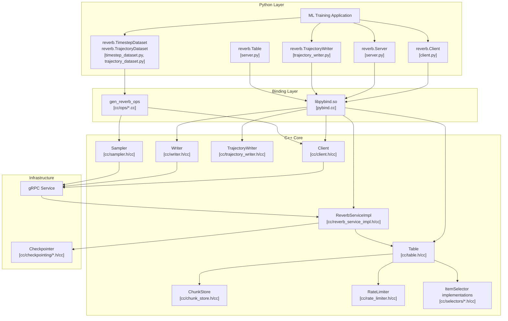

**Sources:** [reverb/BUILD:1-348](), [reverb/__init__.py:15-56](), [reverb/pybind.cc]()

### Architecture Characteristics

**Four-Tier Design:**

1. **Python Application Layer** - User-facing API with Pythonic interfaces
2. **Binding Layer** - pybind11 for imperative code, TensorFlow ops for graph execution
3. **C++ Core Layer** - Performance-critical implementations in C++
4. **Infrastructure Layer** - gRPC, checkpointing, and TensorFlow integration

**Client-Server Model:**

Reverb uses a client-server architecture with three connection modes:

| Mode | Description | Use Case |
|------|-------------|----------|
| **Remote** | Client connects to server via gRPC over network | Distributed training across machines |
| **Local** | Client and server in same process via gRPC loopback | Single-machine training with isolation |
| **In-Process** | Direct C++ function calls, bypassing gRPC | Single-machine training with zero-copy optimization |

**Sources:** [README.md:86-172](), Diagram 1 from provided context

## Data Flow Architecture

The following diagram maps the complete data lifecycle to specific code entities:

**Data Flow: Write → Store → Sample (Code-Level View)**

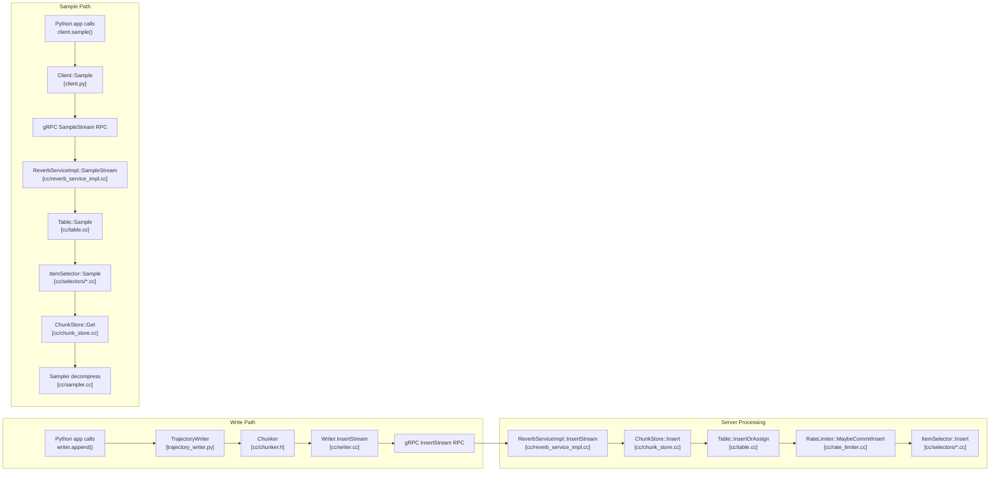

**Write Path Details:**
1. Application calls `TrajectoryWriter.append(data)` with step data
2. `Chunker` groups tensors into chunks, optionally applying delta encoding
3. `Writer` streams chunks to server via bidirectional gRPC `InsertStream`
4. Server's `ReverbServiceImpl` stores chunks in `ChunkStore`
5. `Table.InsertOrAssign` creates item referencing chunks
6. `RateLimiter` validates insert (may block if rate exceeded)
7. `ItemSelector` adds item to sampling data structure

**Sample Path Details:**
1. Application calls `Client.sample(table_name, num_samples)`
2. Python `Client` initiates gRPC `SampleStream` request
3. Server's `ReverbServiceImpl` forwards to `Table.Sample`
4. `Table` checks `RateLimiter` and calls `ItemSelector.Sample`
5. Selected items' chunks retrieved from `ChunkStore`
6. `Sampler` decompresses chunks and constructs `ReplaySample` objects
7. Samples returned to client

**Sources:** [reverb/client.py](), [reverb/trajectory_writer.py](), [reverb/cc/writer.cc](), [reverb/cc/sampler.cc](), [reverb/cc/table.cc](), Diagram 2 from provided context

## Key Components and Code Structure

### Component Table

| Component | Python Module | C++ Implementation | Primary Role |
|-----------|--------------|-------------------|--------------|
| **Server** | `reverb.Server` | `ReverbServiceImpl` | Hosts tables, handles gRPC requests |
| **Client** | `reverb.Client` | `Client` | Connects to server, inserts/samples data |
| **Table** | `reverb.Table` | `Table` | Stores items, manages sampling/removal |
| **TrajectoryWriter** | `reverb.TrajectoryWriter` | `TrajectoryWriter` | Builds trajectories incrementally |
| **Sampler** | (internal to Client) | `Sampler` | Multi-threaded sampling with decompression |
| **ItemSelector** | `reverb.selectors.*` | `ItemSelector` subclasses | Sampling/removal strategies |
| **RateLimiter** | `reverb.rate_limiters.*` | `RateLimiter` subclasses | Flow control |
| **ChunkStore** | (internal) | `ChunkStore` | Stores compressed data chunks |
| **TFClient** | `reverb.TFClient` | TensorFlow custom ops | TensorFlow-native operations |

### Python Package Structure

The `dm-reverb` package exports the following from `reverb/__init__.py`:

```python
# Main classes
reverb.Server          # Server hosting tables
reverb.Client          # Client for remote/local access
reverb.Table           # Table configuration

# Writers
reverb.TrajectoryWriter  # Incremental trajectory building
reverb.Writer            # Low-level writer (via Client context)

# Datasets (TensorFlow integration)
reverb.TimestepDataset     # tf.data.Dataset for timesteps
reverb.TrajectoryDataset   # tf.data.Dataset for trajectories
reverb.PatternDataset      # Pattern-based dataset

# TensorFlow client
reverb.TFClient           # TensorFlow-native operations

# Item selectors (in reverb.selectors)
reverb.selectors.Uniform()
reverb.selectors.Prioritized(priority_exponent)
reverb.selectors.Fifo()
reverb.selectors.Lifo()
reverb.selectors.MinHeap()
reverb.selectors.MaxHeap()

# Rate limiters (in reverb.rate_limiters)
reverb.rate_limiters.MinSize(min_size)
reverb.rate_limiters.SampleToInsertRatio(...)
reverb.rate_limiters.Queue(size)
reverb.rate_limiters.Stack(size)

# Data structures
reverb.ReplaySample      # Sample with data and metadata
reverb.SampleInfo        # Sample metadata

# Checkpointing
reverb.checkpointers.*   # Checkpointer implementations

# Errors
reverb.ReverbError
reverb.DeadlineExceededError
```

**Sources:** [reverb/__init__.py:27-56](), [reverb/BUILD:22-41]()

### C++ Core Structure

The C++ implementation is organized under `reverb/cc/`:

```
reverb/cc/
├── table.h/cc              # Core Table implementation
├── client.h/cc             # Client implementation
├── writer.h/cc             # Low-level writer
├── trajectory_writer.h/cc  # Trajectory building
├── sampler.h/cc            # Multi-threaded sampler
├── chunk_store.h/cc        # Chunk storage
├── reverb_service_impl.h/cc # gRPC service
├── rate_limiter.h/cc       # Rate limiting base
├── chunker.h/cc            # Data chunking
├── selectors/              # Item selection strategies
│   ├── fifo.h/cc
│   ├── lifo.h/cc
│   ├── uniform.h/cc
│   ├── prioritized.h/cc
│   └── heap.h/cc
├── ops/                    # TensorFlow custom ops
│   ├── client.cc
│   ├── timestep_dataset.cc
│   └── trajectory_dataset.cc
└── checkpointing/          # Persistence
    └── interface.h
```

**Sources:** [reverb/BUILD:92-121](), [reverb/cc/ops/BUILD:1-88]()

## Technology Stack

### Core Dependencies

| Technology | Version | Purpose |
|-----------|---------|---------|
| **TensorFlow** | ~2.14.0 | Tensor operations, custom ops, dataset integration |
| **gRPC** | Latest | Remote procedure calls for client-server communication |
| **Protocol Buffers** | Latest | Serialization format for RPC messages |
| **pybind11** | Latest | C++ to Python bindings |
| **Abseil** | Latest | C++ utilities and data structures |
| **Snappy** | Latest | Fast compression for chunks |

### Python Support

- Python 3.9, 3.10, 3.11
- No Python 3.8 support from version 0.13.0+
- No Python 3.7 support from version 0.10.0+

### Build System

- **Bazel**: Primary build system for C++ and Python
- **Docker**: Hermetic build environments
- **setup.py**: Python package distribution

**Sources:** [reverb/pip_package/setup.py:30-105](), [README.md:62-85]()

## Installation

### Via pip (Recommended)

```bash
# Install with TensorFlow dependency
pip install dm-reverb[tensorflow]

# Install without TensorFlow (must install compatible version separately)
pip install dm-reverb

# Nightly builds
pip install dm-reverb-nightly[tensorflow]
```

### Version Compatibility

Reverb releases are paired with specific TensorFlow versions:

| Reverb Version | TensorFlow Version | Python Support |
|----------------|-------------------|----------------|
| 0.14.0 | 2.14.0 | 3.9, 3.10, 3.11 |
| 0.13.0 | 2.14.0 | 3.9, 3.10, 3.11 |
| 0.12.0 | 2.13.0 | 3.8, 3.9, 3.10, 3.11 |
| 0.11.0 | 2.12.0 | 3.8, 3.9, 3.10, 3.11 |
| 0.10.0 | 2.11.0 | 3.7, 3.8, 3.9, 3.10 |

**Operating System Support:**
- ⚠️ Linux only (Ubuntu, Debian, etc.)
- No Windows or macOS support

**Sources:** [README.md:23-85](), [reverb/pip_package/reverb_version.py:18-38]()

## Basic Usage

### Starting a Server

```python
import reverb

# Create server with a table
server = reverb.Server(
    tables=[
        reverb.Table(
            name='my_table',
            sampler=reverb.selectors.Uniform(),  # Sample uniformly
            remover=reverb.selectors.Fifo(),     # Remove oldest first
            max_size=1000,                       # Max 1000 items
            rate_limiter=reverb.rate_limiters.MinSize(100)  # Block until 100 items
        )
    ],
    port=8000  # Optional, defaults to random port
)

print(f"Server running on port {server.port}")
```

### Creating a Client

```python
# Connect to server
client = reverb.Client(f'localhost:{server.port}')

# View server info
print(client.server_info())
```

### Inserting Simple Data

```python
# Insert single item
client.insert([1, 2, 3], priorities={'my_table': 1.0})
```

### Inserting Trajectories

```python
# Build trajectory incrementally
with client.trajectory_writer(num_keep_alive_refs=5) as writer:
    for i in range(10):
        writer.append({'obs': i, 'action': i * 2})
    
    # Create item referencing last 5 steps
    writer.create_item(
        table='my_table',
        priority=1.0,
        trajectory={
            'obs': writer.history['obs'][-5:],
            'action': writer.history['action'][-5:],
        }
    )
    
    writer.flush()  # Wait for confirmation
```

### Sampling Data

```python
# Sample items
for sample in client.sample('my_table', num_samples=10):
    print(sample.data)      # The trajectory data
    print(sample.info.key)  # Unique item key
    print(sample.info.probability)  # Sample probability
```

### Using with TensorFlow

```python
import tensorflow as tf

# Create dataset
dataset = reverb.TrajectoryDataset(
    server_address=f'localhost:{server.port}',
    table='my_table',
    dtypes={'obs': tf.int32, 'action': tf.int32},
    shapes={'obs': tf.TensorShape([None]), 'action': tf.TensorShape([None])}
)

# Use in training loop
for sample in dataset:
    # sample is a reverb.ReplaySample with .data and .info
    obs = sample.data['obs']
    action = sample.data['action']
    # Train model...
```

**Sources:** [README.md:86-150](), [reverb/client.py](), [reverb/trajectory_writer.py](), [reverb/trajectory_dataset.py]()

## Common Use Cases

### Uniform Experience Replay (e.g., SAC, DDPG)

Maintains N most recent items with uniform sampling:

```python
reverb.Table(
    name='uniform_replay',
    sampler=reverb.selectors.Uniform(),    # Equal probability for all items
    remover=reverb.selectors.Fifo(),       # Remove oldest when full
    max_size=1000000,
    rate_limiter=reverb.rate_limiters.MinSize(10000)  # Require 10k items before sampling
)
```

### Prioritized Experience Replay (e.g., DQN, D4PG)

Samples items proportionally to priority:

```python
reverb.Table(
    name='prioritized_replay',
    sampler=reverb.selectors.Prioritized(priority_exponent=0.8),  # Priority-based sampling
    remover=reverb.selectors.Fifo(),
    max_size=1000000,
    rate_limiter=reverb.rate_limiters.MinSize(10000)
)

# Update priorities based on TD-error
client.mutate_priorities(
    table='prioritized_replay',
    updates={item_key: new_priority}
)
```

### FIFO Queue (e.g., IMPALA, PPO)

Items sampled exactly once in order:

```python
reverb.Table(
    name='fifo_queue',
    sampler=reverb.selectors.Fifo(),       # Sample oldest first
    remover=reverb.selectors.Fifo(),       # Remove oldest first
    max_size=1000,
    max_times_sampled=1,                   # Remove after one sample
    rate_limiter=reverb.rate_limiters.Queue(size=1000)  # Block on full/empty
)

# Or use helper method
reverb.Table.queue(name='fifo_queue', max_size=1000)
```

### Multiple Tables for Different Data Types

```python
server = reverb.Server(tables=[
    # Transitions for DQN
    reverb.Table(
        name='transitions',
        sampler=reverb.selectors.Prioritized(0.8),
        remover=reverb.selectors.Fifo(),
        max_size=100000
    ),
    # Trajectories for model training
    reverb.Table(
        name='trajectories',
        sampler=reverb.selectors.Uniform(),
        remover=reverb.selectors.Fifo(),
        max_size=10000
    )
])
```

**Sources:** [README.md:204-280](), [README.md:281-309]()

## Distributed Deployment

Reverb supports horizontal scaling through multiple deployment patterns:

### With Load Balancer

```python
# Start multiple servers on different machines
# Server 1: machine1:8000
# Server 2: machine2:8000
# Server 3: machine3:8000

# Configure gRPC load balancer pointing to: load_balancer:8000

# Clients automatically distribute across servers
client = reverb.Client('load_balancer:8000')
```

### Manual Sharding

```python
# Create separate clients for each server
clients = [
    reverb.Client('machine1:8000'),
    reverb.Client('machine2:8000'),
    reverb.Client('machine3:8000')
]

# Manually distribute operations
import random
client = random.choice(clients)
client.insert(data, priorities={'table': 1.0})
```

**Note:** Reverb servers are independent—data is NOT replicated. This makes the system tolerant to some data loss but unsuitable as a traditional database.

**Sources:** [README.md:310-327]()

## Checkpointing

Save and restore server state:

```python
# Save checkpoint
checkpoint_path = client.checkpoint()
print(f"Checkpoint saved to: {checkpoint_path}")

# Restore from checkpoint
from reverb.platform.default import checkpointers

checkpointer = checkpointers.DefaultCheckpointer(
    path=checkpoint_path.rsplit('/', 1)[0]  # Root directory
)

# Create new server with same table configuration
server = reverb.Server(
    tables=[...],  # Must match original configuration
    checkpointer=checkpointer
)
```

**Checkpoint Behavior:**
- Blocks all insert, sample, update, delete requests during save
- Serializes all data and metadata
- Can be restored to a new server instance
- Useful for warm-starting training or fault recovery

**Sources:** [README.md:328-360]()

## Project Status and Caveats

**Production Readiness:**
- ⚠️ Not hardened for production use
- Potential for crashes or segfaults
- Best suited for research and experimentation

**Platform Support:**
- ✅ Linux (Ubuntu, Debian, etc.)
- ❌ Windows
- ❌ macOS

**Open Source:**
- GitHub: https://github.com/google-deepmind/reverb
- Apache 2.0 License
- Active development and community support

**Citation:**
```bibtex
@misc{cassirer2021reverb,
    title={Reverb: A Framework For Experience Replay},
    author={Albin Cassirer and Gabriel Barth-Maron and Eugene Brevdo and 
            Sabela Ramos and Toby Boyd and Thibault Sottiaux and Manuel Kroiss},
    year={2021},
    eprint={2102.04736},
    archivePrefix={arXiv},
    primaryClass={cs.LG}
}
```

**Sources:** [README.md:25-28](), [README.md:391-405]()

## Next Steps

To dive deeper into Reverb:

- **System Architecture** [#2]() - Detailed architecture including client-server communication and data flow
- **Core Components** [#3]() - In-depth coverage of Table, selectors, rate limiters, writers, samplers
- **Python Client API** [#4]() - Complete Python API reference with examples
- **TensorFlow Integration** [#5]() - Custom ops and dataset integration
- **Build System** [#6]() - Building from source and development workflows
- **Advanced Topics** [#7]() - Concurrency, memory management, performance optimization

**Sources:** [README.md:1-415](), [reverb/__init__.py:1-56]()

---

# Page: System Architecture

# System Architecture

<details>
<summary>Relevant source files</summary>

The following files were used as context for generating this wiki page:

- [README.md](README.md)
- [docs/images/multiple_tables_example.png](docs/images/multiple_tables_example.png)
- [reverb/cc/BUILD](reverb/cc/BUILD)
- [reverb/cc/reverb_service.proto](reverb/cc/reverb_service.proto)
- [reverb/cc/reverb_service_impl.cc](reverb/cc/reverb_service_impl.cc)
- [reverb/cc/reverb_service_impl.h](reverb/cc/reverb_service_impl.h)
- [reverb/cc/reverb_service_impl_test.cc](reverb/cc/reverb_service_impl_test.cc)
- [reverb/pip_package/reverb_version.py](reverb/pip_package/reverb_version.py)
- [reverb/pip_package/setup.py](reverb/pip_package/setup.py)

</details>


## Purpose and Scope

This page describes the overall architecture of Reverb, including its layered design, client-server model, and how major components interact. For details on specific aspects:
- For gRPC communication protocols and streaming patterns, see [Client-Server Communication](#2.1)
- For the complete data lifecycle from ingestion to sampling, see [Data Flow Pipeline](#2.2)
- For deep dives into individual components like Table, Writers, and Samplers, see [Core Components](#3)

## Architectural Overview

Reverb implements a **client-server architecture** with four distinct layers: a Python application layer for user interaction, a Python binding layer for language interoperability, a C++ core layer for performance-critical operations, and an infrastructure layer for communication and persistence. The system is designed for high-performance distributed machine learning, with all data management operations implemented in C++ while maintaining ease of use through comprehensive Python APIs.

Sources: [README.md:1-174](), [reverb/cc/BUILD:1-546]()

## Layered Architecture

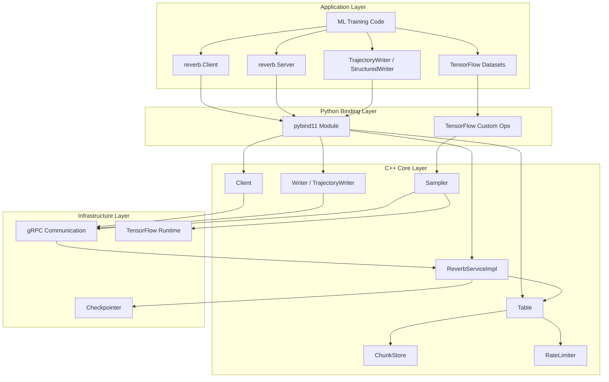

### Application Layer
The top layer provides the user-facing Python API. Users interact with `reverb.Client` to connect to servers, `reverb.Server` to start server instances, and `TrajectoryWriter` or `StructuredWriter` to insert data. TensorFlow users can leverage specialized datasets like `TimestepDataset` and `TrajectoryDataset` for efficient integration with `tf.data` pipelines.

### Python Binding Layer
This layer bridges Python and C++ through two mechanisms:
- **pybind11**: Provides general-purpose Python bindings for all C++ classes and functions
- **TensorFlow Custom Ops**: Implements TensorFlow-native operations (`ReverbClientInsert`, `ReverbClientSample`) that enable zero-copy integration with TensorFlow graphs

### C++ Core Layer
The performance-critical implementation layer written in C++:
- **ReverbServiceImpl**: gRPC service implementation handling all RPC endpoints [reverb/cc/reverb_service_impl.h:37]()
- **Table**: Central data structure managing items, sampling/removal strategies, and rate limiting [reverb/cc/table.h]()
- **ChunkStore**: Reference-counted storage for data chunks [reverb/cc/chunk_store.h]()
- **Writer/TrajectoryWriter**: Client-side components for data ingestion with chunking and compression [reverb/cc/writer.h](), [reverb/cc/trajectory_writer.h]()
- **Sampler**: Multi-threaded sampling component [reverb/cc/sampler.h]()
- **RateLimiter**: Flow control between inserts and samples [reverb/cc/rate_limiter.h]()

### Infrastructure Layer
Foundational technologies:
- **gRPC**: Provides efficient bidirectional streaming communication between clients and servers
- **Checkpointer**: Handles persistence of server state to disk
- **TensorFlow Runtime**: Required for tensor operations and compression

Sources: [reverb/cc/BUILD:133-546](), [reverb/cc/reverb_service_impl.h:15-149](), [README.md:152-172]()

## Client-Server Model

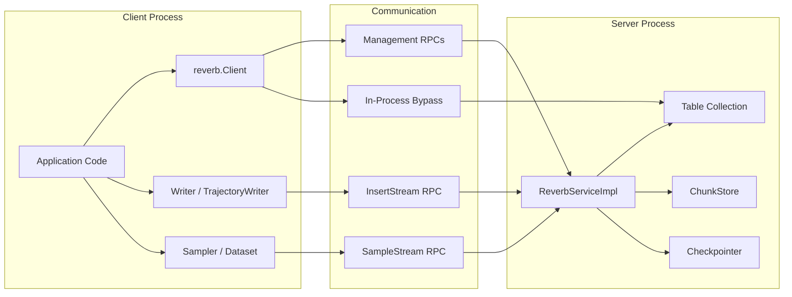

Reverb operates as a **client-server system** where multiple clients can connect to one or more servers. The server hosts one or more `Table` instances, each with its own sampling and removal strategies. Clients communicate with servers through gRPC, using bidirectional streaming for high-throughput insert and sample operations.

### Server Components

| Component | File | Purpose |
|-----------|------|---------|
| `ReverbServiceImpl` | [reverb/cc/reverb_service_impl.cc]() | Implements all gRPC endpoints defined in the service proto |
| `Table` | [reverb/cc/table.cc]() | Core data structure storing items and managing their lifecycle |
| `ChunkStore` | [reverb/cc/chunk_store.cc]() | Shared storage for data chunks with reference counting |
| `Checkpointer` | [reverb/cc/checkpointing/interface.h]() | Interface for persistence and recovery |

### Client Components

| Component | File | Purpose |
|-----------|------|---------|
| `Client` | [reverb/cc/client.cc]() | Main client interface for all operations |
| `Writer` | [reverb/cc/writer.cc]() | Low-level writer with chunking and compression |
| `TrajectoryWriter` | [reverb/cc/trajectory_writer.cc]() | High-level trajectory-oriented writer |
| `Sampler` | [reverb/cc/sampler.cc]() | Multi-threaded sampling component |

Sources: [reverb/cc/reverb_service_impl.h:35-149](), [reverb/cc/BUILD:133-273](), [reverb/cc/reverb_service.proto:1-178]()

## Communication Patterns

Reverb uses **gRPC** for client-server communication with three primary patterns:

### Bidirectional Streaming RPCs

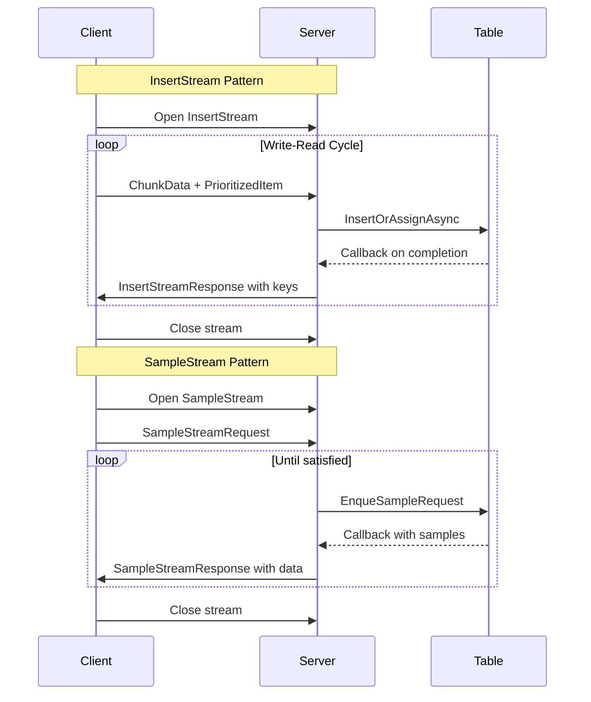

- **InsertStream** [reverb/cc/reverb_service.proto:29-30](): Bidirectional streaming for efficient data ingestion with asynchronous confirmations
- **SampleStream** [reverb/cc/reverb_service.proto:48-49](): Bidirectional streaming for batch sampling with adaptive batching

### Unary RPCs

Used for management operations:
- **Checkpoint** [reverb/cc/reverb_service.proto:14](): Trigger server state persistence
- **MutatePriorities** [reverb/cc/reverb_service.proto:34-35](): Update or delete items
- **Reset** [reverb/cc/reverb_service.proto:38](): Clear table contents
- **ServerInfo** [reverb/cc/reverb_service.proto:52](): Query table statistics

### In-Process Optimization

When client and server run in the same process, `InitializeConnection` [reverb/cc/reverb_service.proto:56-57]() enables direct memory access to `Table` objects, bypassing gRPC serialization for zero-copy operations. The process ID is verified to ensure safety [reverb/cc/reverb_service_impl.cc:354-360]().

Sources: [reverb/cc/reverb_service.proto:1-178](), [reverb/cc/reverb_service_impl.cc:167-676]()

## Major Components

### Table: The Central Data Store

The `Table` class [reverb/cc/table.h]() is the most critical component in Reverb (importance score 141.63 from cluster analysis). It manages:

- **Item Storage**: Hash map of keys to items, where each item references chunks in the `ChunkStore`
- **Sampling Strategy**: Pluggable `ItemSelector` determining which items to sample (FIFO, LIFO, Uniform, Prioritized, Heap)
- **Removal Strategy**: Separate `ItemSelector` for removal decisions
- **Rate Limiting**: `RateLimiter` enforcing insert/sample ratios
- **Extensions**: Hooks for custom behavior via `TableExtension` interface
- **Concurrency**: Worker threads for asynchronous operations

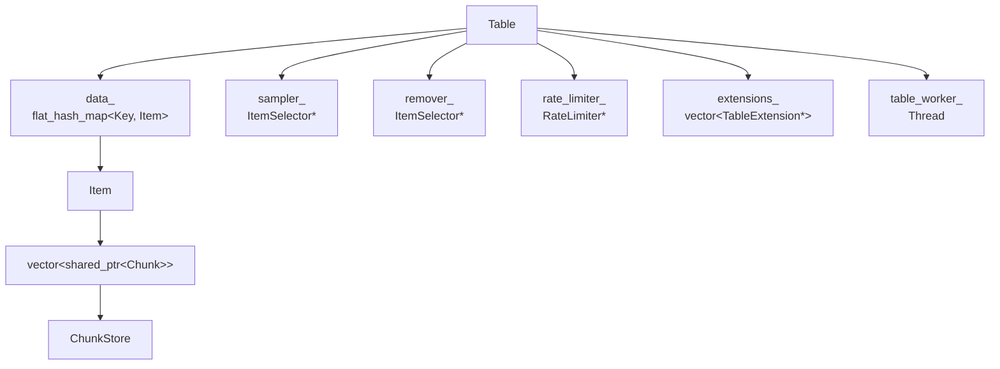

Sources: [reverb/cc/table.h](), [reverb/cc/BUILD:160-187]()

### ChunkStore: Shared Data Repository

The `ChunkStore` [reverb/cc/chunk_store.h]() maintains weak pointers to all data chunks. Chunks are kept alive by items that reference them. When the last reference is removed, the chunk is automatically deallocated. This design allows multiple items (even across different tables) to reference the same underlying data without duplication.

Sources: [reverb/cc/chunk_store.cc](), [reverb/cc/BUILD:150-158]()

### Writers: Data Ingestion

**Writer** [reverb/cc/writer.h]() provides low-level data insertion with:
- Automatic chunking based on size thresholds
- Optional delta encoding for temporal sequences
- Snappy compression
- Streaming over gRPC

**TrajectoryWriter** [reverb/cc/trajectory_writer.h]() builds on Writer for trajectory data:
- Column-based organization
- Configurable chunking strategies per column
- Automatic batch creation from sequential data

Sources: [reverb/cc/writer.cc](), [reverb/cc/trajectory_writer.cc](), [reverb/cc/BUILD:229-273]()

### Sampler: Multi-threaded Sampling

The `Sampler` [reverb/cc/sampler.h]() implements efficient batch sampling:
- Thread pool for parallel chunk decompression
- Adaptive batch sizing based on table response time
- Rate limiter timeout support
- Both remote (gRPC) and local (direct Table access) modes

Sources: [reverb/cc/sampler.cc](), [reverb/cc/BUILD:204-227]()

### ReverbServiceImpl: gRPC Service

`ReverbServiceImpl` [reverb/cc/reverb_service_impl.h:37]() implements the gRPC service interface:
- **InsertStream**: Handles bidirectional insert streams with chunk caching and async callbacks [reverb/cc/reverb_service_impl.cc:167-330]()
- **SampleStream**: Manages bidirectional sample streams with adaptive batching [reverb/cc/reverb_service_impl.cc:458-676]()
- **Table Lookup**: Maintains hash map of table names to Table instances [reverb/cc/reverb_service_impl.cc:678-683]()
- **Initialization**: Supports checkpoint restoration on startup [reverb/cc/reverb_service_impl.cc:98-141]()

Sources: [reverb/cc/reverb_service_impl.h:15-149](), [reverb/cc/reverb_service_impl.cc:1-724](), [reverb/cc/BUILD:430-452]()

## Technology Stack

### Core Technologies

| Technology | Purpose | Key Files |
|------------|---------|-----------|
| **C++17** | Performance-critical implementation | All files in `reverb/cc/` |
| **Python 3.9-3.11** | User-facing API | All files in `reverb/` Python modules |
| **TensorFlow 2.14.0** | Tensor operations, compression, custom ops | [reverb/pip_package/setup.py:31]() |
| **gRPC** | Client-server communication | [reverb/cc/reverb_service.proto]() |
| **Protocol Buffers** | Data serialization | `*.proto` files |
| **pybind11** | Python-C++ bindings | Binding code in `reverb/pybind/` |
| **Bazel** | Build system | [reverb/cc/BUILD](), `WORKSPACE` |
| **Abseil** | C++ utility libraries | Used throughout C++ code |
| **Snappy** | Fast compression | Used in tensor compression |

### Build System Architecture

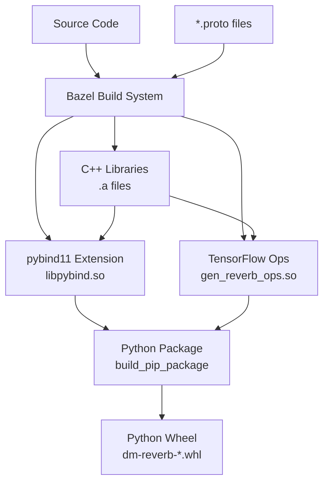

The build system uses **Bazel** to manage complex dependencies and build both C++ libraries and Python extensions. Custom Bazel rules [reverb/cc/BUILD:3-14]() handle compilation of protocol buffers, gRPC services, and pybind11 modules. The final output is a platform-specific Python wheel that includes all compiled extensions.

Sources: [reverb/cc/BUILD:1-546](), [reverb/pip_package/setup.py:1-186]()

## Design Principles

### Performance Through C++
All performance-critical operations (sampling, insertion, rate limiting, data compression) are implemented in C++ for maximum efficiency. The Python layer provides convenience and flexibility without sacrificing speed.

### Zero-Copy Where Possible
When clients and servers share a process, the `InitializeConnection` RPC enables direct memory access to Table objects, eliminating serialization overhead [reverb/cc/reverb_service_impl.cc:334-423]().

### Asynchronous by Default
Most operations use asynchronous patterns:
- `Table::InsertOrAssignAsync` with callbacks [reverb/cc/reverb_service_impl.cc:241-245]()
- `Table::EnqueSampleRequest` with callbacks [reverb/cc/reverb_service_impl.cc:604-605]()
- Bidirectional streaming for insert and sample operations

### Reference Counting for Memory Management
Data chunks use reference counting (via `shared_ptr`) so that multiple items can reference the same data. The `ChunkStore` maintains only weak references, allowing automatic cleanup when no items reference a chunk.

### Pluggable Strategies
Key behaviors are implemented through interfaces:
- `ItemSelector` for sampling and removal strategies [reverb/cc/selectors/interface.h]()
- `RateLimiter` for flow control policies [reverb/cc/rate_limiter.h]()
- `TableExtension` for custom hooks [reverb/cc/table_extensions/interface.h]()

Sources: [reverb/cc/reverb_service_impl.cc:1-724](), [README.md:152-203]()

---

# Page: Client-Server Communication

# Client-Server Communication

<details>
<summary>Relevant source files</summary>

The following files were used as context for generating this wiki page:

- [reverb/cc/BUILD](reverb/cc/BUILD)
- [reverb/cc/reverb_service.proto](reverb/cc/reverb_service.proto)
- [reverb/cc/reverb_service_impl.cc](reverb/cc/reverb_service_impl.cc)
- [reverb/cc/reverb_service_impl.h](reverb/cc/reverb_service_impl.h)
- [reverb/cc/reverb_service_impl_test.cc](reverb/cc/reverb_service_impl_test.cc)

</details>


## Purpose and Scope

This document describes the gRPC-based communication layer between Reverb clients and servers. It covers the RPC service definition, streaming protocols, reactor implementations, and the in-process optimization path. For information about the client-side API and Python bindings, see [Python Client API](#4). For details about the server-side data storage and processing, see [Table System](#3.1) and [gRPC Service Implementation](#3.4).

## Communication Architecture Overview

Reverb uses gRPC as its communication protocol, implementing both bidirectional streaming RPCs for high-throughput data operations and unary RPCs for management operations. The service is defined in protocol buffers and implemented using gRPC's callback-based (asynchronous) API.

**Core Communication Patterns:**
- **Bidirectional Streaming**: Used for `InsertStream` and `SampleStream` to support high-throughput data transfer with pipelining
- **Unary RPCs**: Used for `Checkpoint`, `MutatePriorities`, `Reset`, and `ServerInfo` for management operations
- **In-Process Optimization**: `InitializeConnection` enables zero-copy access when client and server are co-located

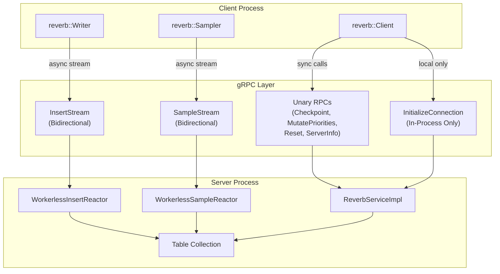

Sources: [reverb/cc/reverb_service.proto:1-178](), [reverb/cc/reverb_service_impl.h:15-149]()

## RPC Service Definition

The `ReverbService` is defined in protocol buffers with seven RPC methods:

| RPC Method | Type | Purpose | Request | Response |
|------------|------|---------|---------|----------|
| `InsertStream` | Bidirectional Streaming | Insert chunks and items into tables | `InsertStreamRequest` | `InsertStreamResponse` |
| `SampleStream` | Bidirectional Streaming | Sample items from tables | `SampleStreamRequest` | `SampleStreamResponse` |
| `MutatePriorities` | Unary | Update or delete items | `MutatePrioritiesRequest` | `MutatePrioritiesResponse` |
| `Reset` | Unary | Clear table contents | `ResetRequest` | `ResetResponse` |
| `Checkpoint` | Unary | Save tables to disk | `CheckpointRequest` | `CheckpointResponse` |
| `ServerInfo` | Unary | Get table metadata | `ServerInfoRequest` | `ServerInfoResponse` |
| `InitializeConnection` | Bidirectional Streaming | Get in-process table pointer | `InitializeConnectionRequest` | `InitializeConnectionResponse` |

Sources: [reverb/cc/reverb_service.proto:9-58]()

## Bidirectional Streaming RPCs

### InsertStream Protocol

`InsertStream` is a bidirectional streaming RPC that allows clients to continuously insert data into Reverb tables with flow control and confirmation.

**Message Flow Diagram**

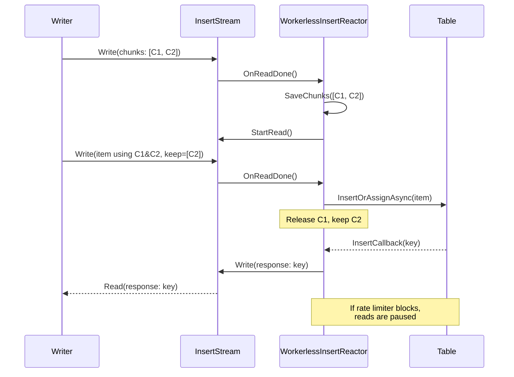

**Request Message Structure:**
```
InsertStreamRequest {
  repeated ChunkData chunks = 1;        // Data chunks to store
  repeated PrioritizedItem items = 2;   // Items referencing chunks
  repeated uint64 keep_chunk_keys = 3;  // Chunks needed for next request
}
```

**Key Protocol Features:**

1. **Chunk Management**: Chunks are sent before items that reference them. The reactor maintains a map of chunks until they are no longer needed.
   - [reverb/cc/reverb_service_impl.cc:260-269]()

2. **Keep-Alive Mechanism**: `keep_chunk_keys` specifies which chunks should be retained for subsequent requests.
   - [reverb/cc/reverb_service_impl.cc:287-305]()

3. **Asynchronous Insertion**: Items are inserted asynchronously with callbacks to notify completion.
   - [reverb/cc/reverb_service_impl.cc:241-246]()

4. **Backpressure**: If rate limiter blocks or table buffer is full, reads are paused until space is available.
   - [reverb/cc/reverb_service_impl.cc:251-255]()

Sources: [reverb/cc/reverb_service.proto:29-30](), [reverb/cc/reverb_service.proto:93-113](), [reverb/cc/reverb_service_impl.cc:167-330]()

### SampleStream Protocol

`SampleStream` is a bidirectional streaming RPC that allows clients to continuously sample items from tables with automatic batching and response splitting.

**Message Flow Diagram**

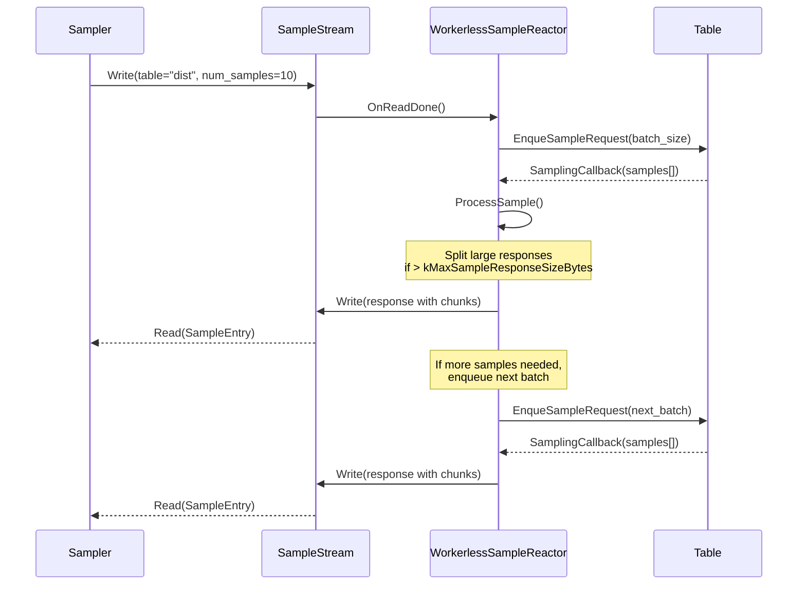

**Request Message Structure:**
```
SampleStreamRequest {
  string table = 1;
  int64 num_samples = 2;
  Timeout rate_limiter_timeout = 3;
}
```

**Response Message Structure:**
```
SampleStreamResponse {
  repeated SampleEntry entries = 1;
  
  message SampleEntry {
    SampleInfo info = 1;           // Metadata (first message only)
    repeated ChunkData data = 2;   // Chunk data
    bool end_of_sequence = 3;      // Last chunk marker
  }
}
```

**Key Protocol Features:**

1. **Adaptive Batching**: Batch size starts at `kInitialGrpcSampleBatchSize` (64) and doubles until reaching request limit.
   - [reverb/cc/reverb_service_impl.cc:66](), [reverb/cc/reverb_service_impl.cc:586-588]()

2. **Response Splitting**: Large samples are split across multiple responses if they exceed `kMaxSampleResponseSizeBytes`.
   - [reverb/cc/reverb_service_impl.cc:59-60](), [reverb/cc/reverb_service_impl.cc:643-650]()

3. **Queue Management**: Maximum of `kMaxQueuedResponses` (3) responses queued to cap memory usage.
   - [reverb/cc/reverb_service_impl.cc:495](), [reverb/cc/reverb_service_impl.cc:598-602]()

4. **Zero-Copy Optimization**: ChunkData is attached to responses without copying using `UnsafeArenaAddAllocated`.
   - [reverb/cc/reverb_service_impl.cc:642]()

Sources: [reverb/cc/reverb_service.proto:48-49](), [reverb/cc/reverb_service.proto:139-170](), [reverb/cc/reverb_service_impl.cc:458-676]()

## Unary RPCs

### Checkpoint

Saves all table state to disk for persistence and recovery.

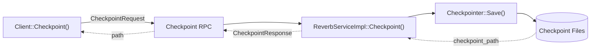

**Implementation:**
- Collects all tables and passes them to the configured `Checkpointer`
- Returns the checkpoint path on success
- Returns `INVALID_ARGUMENT` if no checkpointer is configured
- [reverb/cc/reverb_service_impl.cc:143-165]()

Sources: [reverb/cc/reverb_service.proto:14](), [reverb/cc/reverb_service_impl.cc:143-165]()

### MutatePriorities

Updates priorities or deletes items in a specific table.

**Request Message:**
```
MutatePrioritiesRequest {
  string table = 1;
  repeated KeyWithPriority updates = 2;    // Priority updates
  repeated uint64 delete_keys = 3;         // Items to delete
}
```

**Implementation:**
- Validates table exists, returns `NOT_FOUND` if missing
- Calls `Table::MutateItems()` with updates and deletes
- Operations are atomic per table
- [reverb/cc/reverb_service_impl.cc:425-442]()

Sources: [reverb/cc/reverb_service.proto:33-35](), [reverb/cc/reverb_service.proto:115-130](), [reverb/cc/reverb_service_impl.cc:425-442]()

### Reset

Clears all items from a table and resets its rate limiter.

**Implementation:**
- Validates table exists
- Calls `Table::Reset()` which clears all items and resets internal state
- [reverb/cc/reverb_service_impl.cc:444-456]()

Sources: [reverb/cc/reverb_service.proto:38](), [reverb/cc/reverb_service.proto:172-177](), [reverb/cc/reverb_service_impl.cc:444-456]()

### ServerInfo

Returns metadata about all tables on the server.

**Response Message:**
```
ServerInfoResponse {
  Uint128 tables_state_id = 1;         // Unique ID for table configuration
  repeated TableInfo table_info = 2;   // Metadata for each table
}
```

**Returned Information Per Table:**
- Table name, current size, max size
- Sampler and remover options
- Rate limiter configuration
- Table signature (data schema)
- Worker thread statistics

**Implementation:**
- Iterates through all tables and collects `table->info()`
- Generates random `tables_state_id` on service initialization
- [reverb/cc/reverb_service_impl.cc:705-715]()

Sources: [reverb/cc/reverb_service.proto:52](), [reverb/cc/reverb_service.proto:132-137](), [reverb/cc/reverb_service_impl.cc:705-715]()

## In-Process Optimization

### InitializeConnection Protocol

`InitializeConnection` is a special RPC that enables zero-copy access to tables when the client and server run in the same process. This bypasses gRPC serialization overhead for significantly improved performance.

**In-Process Connection Handshake**

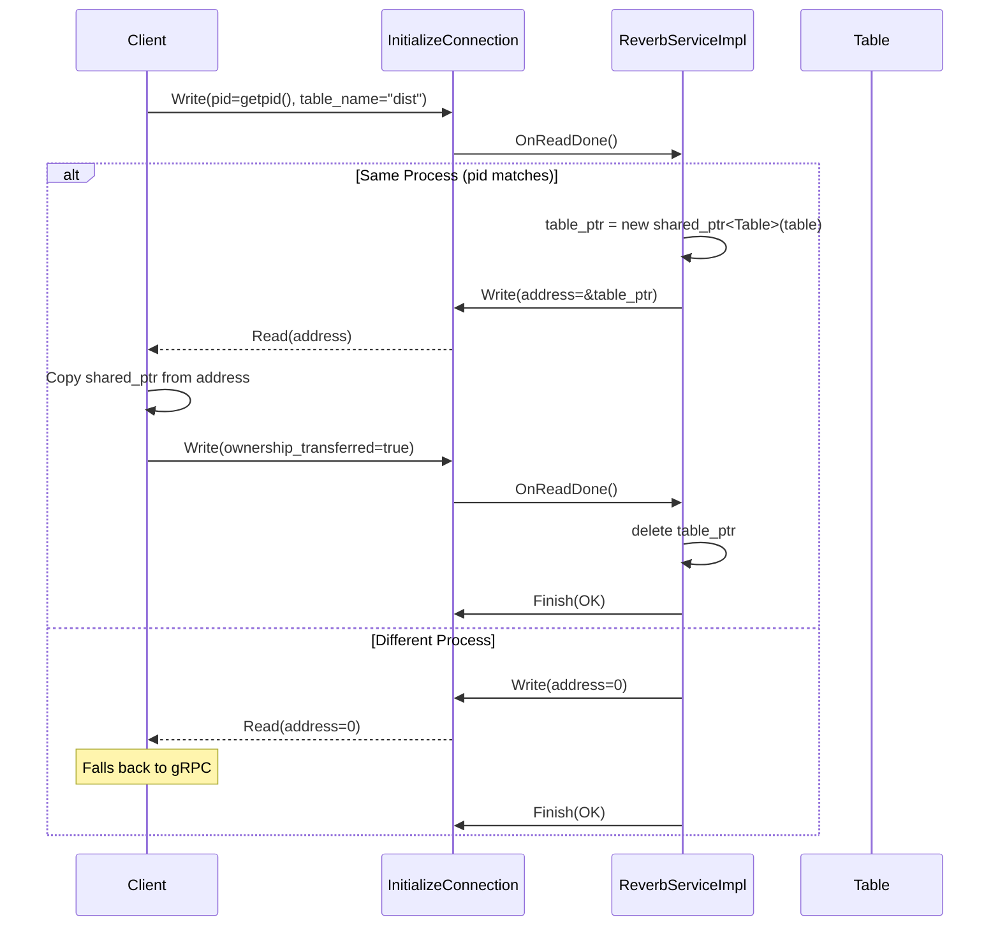

**Protocol Steps:**

1. **Process Verification**: Client sends its process ID (PID)
   - [reverb/cc/reverb_service.proto:60-71]()
   
2. **Address Transmission**: If PIDs match, server allocates `shared_ptr<Table>` on heap and sends its memory address
   - [reverb/cc/reverb_service_impl.cc:354-379]()

3. **Ownership Transfer**: Client copies the `shared_ptr`, then confirms transfer so server can delete the heap object
   - [reverb/cc/reverb_service_impl.cc:382-386]()

4. **Fallback**: If PIDs don't match, server returns address=0 and client uses normal gRPC communication
   - [reverb/cc/reverb_service_impl.cc:354-360]()

**Security Consideration:**
- Only works for localhost or in-process connections
- Server checks `context->peer()` to ensure local connection
- [reverb/cc/reverb_service_impl.cc:340-343]()

Sources: [reverb/cc/reverb_service.proto:56-57](), [reverb/cc/reverb_service.proto:60-84](), [reverb/cc/reverb_service_impl.cc:332-423]()

## Reactor Implementation Pattern

Reverb uses gRPC's callback-based reactor API for asynchronous, high-performance operation. All streaming RPCs are implemented using custom reactor classes that inherit from `grpc::ServerBidiReactor`.

### ReverbServerReactor Base Class

The base template provides common functionality for all streaming reactors:

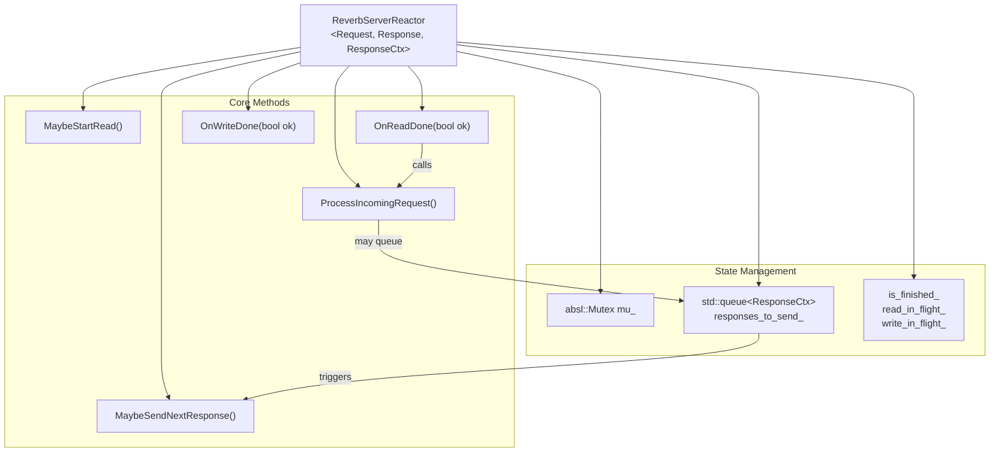

**Key Design Features:**

1. **Single-Threaded Request Processing**: Only one read is in-flight at a time to simplify state management
   - Tracked by `read_in_flight_` flag

2. **Response Queue**: Responses are queued and sent sequentially
   - `responses_to_send_` queue manages pending responses
   - Only one write is in-flight at a time

3. **Mutex Protection**: All reactor state is protected by `mu_`
   - Callbacks from different threads (table workers, gRPC threads) require synchronization

4. **Graceful Shutdown**: Reactor waits for all operations to complete before destroying
   - Weak pointers track outstanding callbacks

Sources: [reverb/cc/reverb_server_reactor.h:1-150]()

### WorkerlessInsertReactor

Handles `InsertStream` requests with chunk management and asynchronous table insertion.

**State Diagram**

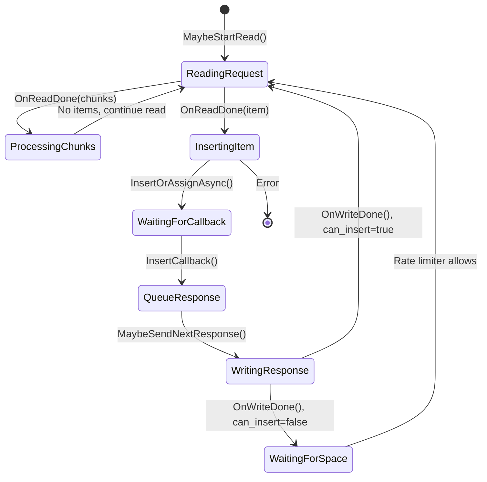

**Chunk Lifecycle:**
- Chunks stored in `chunks_` map when received
- Referenced by items via `chunk_key`
- Released based on `keep_chunk_keys` field
- [reverb/cc/reverb_service_impl.cc:260-305]()

**Flow Control:**
- If `InsertOrAssignAsync` returns `can_insert=false`, reads pause
- Resumed when `InsertCallback` fires (indicating space available)
- [reverb/cc/reverb_service_impl.cc:251-256]()

Sources: [reverb/cc/reverb_service_impl.cc:173-327]()

### WorkerlessSampleReactor

Handles `SampleStream` requests with adaptive batching and response splitting.

**State Machine**

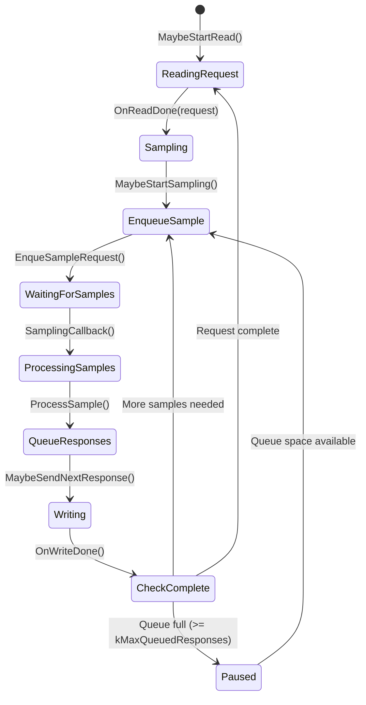

**Batching Strategy:**
- Initial batch size: 64 (`kInitialGrpcSampleBatchSize`)
- Doubles each iteration: `next_batch_size = min(2 * last_batch_size, remaining)`
- [reverb/cc/reverb_service_impl.cc:586-588]()

**Response Splitting:**
- If current response exceeds `kMaxSampleResponseSizeBytes` (2 * 1MB), start new response
- Info metadata only sent in first chunk of each sample
- [reverb/cc/reverb_service_impl.cc:610-650]()

**Memory Management:**
- Custom destructor releases protobuf fields without destroying them (they're owned by `TableItem`)
- [reverb/cc/reverb_service_impl.cc:468-481]()

Sources: [reverb/cc/reverb_service_impl.cc:497-673]()

## Backpressure and Flow Control

Reverb implements sophisticated flow control mechanisms to prevent memory exhaustion and maintain balanced operation.

### InsertStream Backpressure

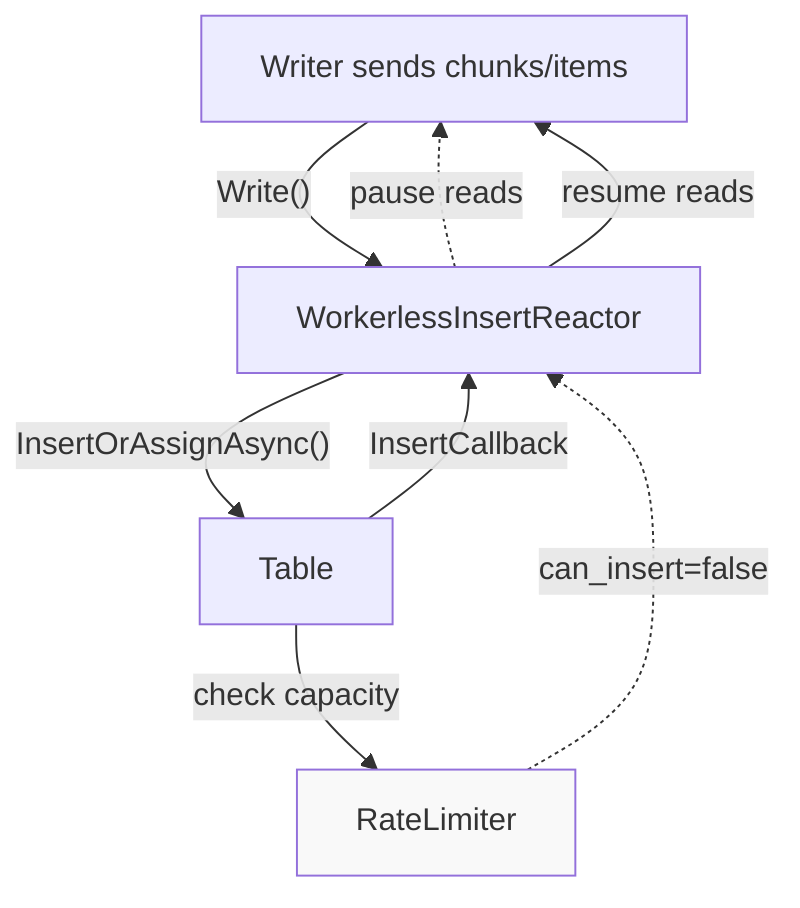

**Mechanism:**
1. `Table::InsertOrAssignAsync()` returns `can_insert` flag indicating if buffer has space
2. If `false`, reactor stops calling `StartRead()` 
3. When insertion completes, `InsertCallback` fires and reads resume
4. This prevents unbounded chunk accumulation in the reactor

Sources: [reverb/cc/reverb_service_impl.cc:240-256]()

### SampleStream Backpressure

**Queue-Based Flow Control:**

| Condition | Action |
|-----------|--------|
| `responses_to_send_.size() >= kMaxQueuedResponses` | Pause sampling |
| Response queue has space | Resume sampling via `OnWriteDone()` |
| `waiting_for_enqueued_sample_ == true` | Wait for current batch to complete |

**Implementation:**
```cpp
// Don't enqueue more samples if queue is full
if (responses_to_send_.size() >= kMaxQueuedResponses) {
  return;  // Sampling triggered by OnWriteDone callback
}
```
[reverb/cc/reverb_service_impl.cc:598-602]()

Sources: [reverb/cc/reverb_service_impl.cc:581-606]()

## Error Handling

### Error Propagation

All errors are converted to gRPC status codes:

| Error Type | gRPC Status Code | Example |
|------------|------------------|---------|
| Table not found | `NOT_FOUND` | Invalid table name in request |
| Missing chunks | `INTERNAL` | Item references non-existent chunk |
| Invalid argument | `INVALID_ARGUMENT` | Empty request, invalid parameters |
| Rate limit timeout | `DEADLINE_EXCEEDED` | Sample blocked too long |

**Conversion Function:**
```cpp
grpc::Status ToGrpcStatus(const absl::Status& status);
```

Sources: [reverb/cc/support/grpc_util.h:1-50]()

### Reactor Cancellation

When a reactor is cancelled or encounters an error:

1. `SetReactorAsFinished()` sets `is_finished_ = true`
2. No new reads or writes are started
3. Pending callbacks are ignored (checked via `is_finished_` flag)
4. Reactor waits for in-flight operations to complete before destroying
5. Weak pointers ensure callbacks don't access destroyed reactor

Sources: [reverb/cc/reverb_server_reactor.h:60-80]()

## Performance Characteristics

### Message Size Limits

| Constant | Value | Purpose |
|----------|-------|---------|
| `Table::kMaxSampleResponseSizeBytes` | 1 MB | Max size of single table sample response |
| `kMaxSampleResponseSizeBytes` | 2 MB | Max size of single gRPC sample response |
| `kInitialGrpcSampleBatchSize` | 64 | Initial sampling batch size |
| `kMaxQueuedResponses` | 3 | Max queued responses per reactor |

Sources: [reverb/cc/reverb_service_impl.cc:59-66](), [reverb/cc/reverb_service_impl.cc:495]()

### Thread Model

**Server-Side Threading:**
- gRPC threads handle network I/O and callbacks
- Table worker threads process insert/sample operations
- Callback executor threads run table extensions
- Reactors coordinate across threads using mutexes

**No Dedicated Reactor Threads:**
- Reactors are "workerless" - they don't spawn threads
- All work delegated to existing thread pools
- Callbacks may execute on any thread

Sources: [reverb/cc/reverb_service_impl.cc:45-46](), [reverb/cc/reverb_service_impl.h:35-37]()

### In-Process Performance

When using `InitializeConnection`:
- **Zero serialization overhead**: Direct memory access to table
- **No gRPC overhead**: Bypasses network stack entirely  
- **Shared memory**: No data copying between client and server
- **Use case**: TensorFlow datasets in same process as server

Sources: [reverb/cc/reverb_service_impl.cc:332-423]()

---

# Page: Data Flow Pipeline

# Data Flow Pipeline

<details>
<summary>Relevant source files</summary>

The following files were used as context for generating this wiki page:

- [reverb/cc/platform/tfrecord_checkpointer.cc](reverb/cc/platform/tfrecord_checkpointer.cc)
- [reverb/cc/sampler.cc](reverb/cc/sampler.cc)
- [reverb/cc/sampler.h](reverb/cc/sampler.h)
- [reverb/cc/sampler_test.cc](reverb/cc/sampler_test.cc)
- [reverb/cc/table.cc](reverb/cc/table.cc)
- [reverb/cc/table.h](reverb/cc/table.h)
- [reverb/cc/table_test.cc](reverb/cc/table_test.cc)
- [reverb/cc/trajectory_writer.cc](reverb/cc/trajectory_writer.cc)
- [reverb/cc/trajectory_writer.h](reverb/cc/trajectory_writer.h)
- [reverb/cc/trajectory_writer_test.cc](reverb/cc/trajectory_writer_test.cc)
- [reverb/cc/writer.cc](reverb/cc/writer.cc)
- [reverb/cc/writer.h](reverb/cc/writer.h)
- [reverb/cc/writer_test.cc](reverb/cc/writer_test.cc)

</details>


This document describes the complete lifecycle of data in Reverb, from ingestion through storage to sampling. It covers how data flows through the system's three main stages: the **Write Path** (client-side data ingestion), the **Storage Layer** (server-side table management), and the **Sample Path** (data retrieval). For details about specific components mentioned here, see [Table System](#3.1), [Data Ingestion System](#3.2), and [Sampling System](#3.3).

## Overview

Data flows through Reverb in three distinct stages:

| Stage | Primary Components | Data Format |
|-------|-------------------|-------------|
| Write Path | `TrajectoryWriter`, `Chunker`, `InsertStream` | Tensors → ChunkData (compressed) |
| Storage Layer | `Table`, `ChunkStore`, `RateLimiter`, `ItemSelector` | ChunkData + PrioritizedItem |
| Sample Path | `Sampler`, `SamplerWorker`, `SampleStream` | ChunkData (compressed) → Tensors |

## Write Path: Data Ingestion

### Client-Side Chunking and Compression

The write path begins when application code appends data to a writer. The `TrajectoryWriter` manages multiple column `Chunker` instances, one per data column. Each chunker accumulates timesteps and creates compressed chunks when configured thresholds are reached.

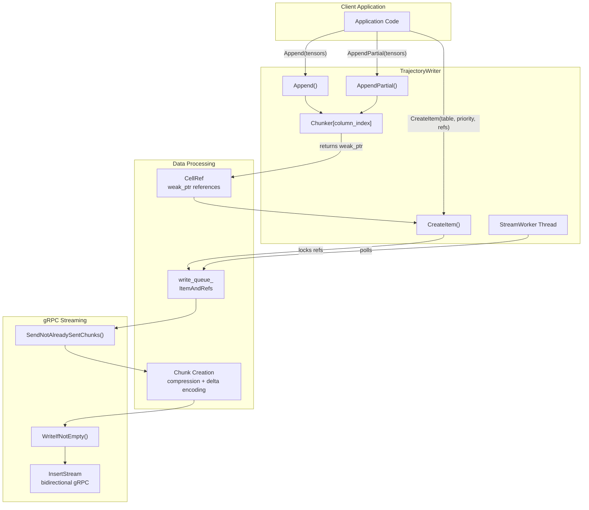

**Key Operations:**

- **`TrajectoryWriter::Append(data, refs)`** [reverb/cc/trajectory_writer.cc:347-351](): Appends a complete timestep across all columns. Each tensor in `data` is passed to its corresponding `Chunker`, which returns a `CellRef` - a weak pointer to the data location.

- **`TrajectoryWriter::AppendPartial(data, refs)`** [reverb/cc/trajectory_writer.cc:353-358](): Appends partial timesteps without incrementing the episode step counter, allowing multi-stage step construction.

- **`Chunker::Append(tensor, episode_info, ref)`**: Accumulates tensors and triggers chunk creation when `max_chunk_length` is reached. Chunks are compressed using Snappy and optionally delta-encoded [reverb/cc/trajectory_writer.cc:382-386]().

- **`TrajectoryWriter::CreateItem(table, priority, trajectory)`** [reverb/cc/trajectory_writer.cc:426-475](): Locks all `CellRef` weak pointers to prevent premature deallocation, constructs a `PrioritizedItem` proto referencing the chunks, and queues it for transmission.

Sources: reverb/cc/trajectory_writer.cc, reverb/cc/trajectory_writer.h, reverb/cc/chunker.h

### Streaming Protocol

Data transmission to the server occurs asynchronously on a background worker thread that manages the gRPC `InsertStream`.

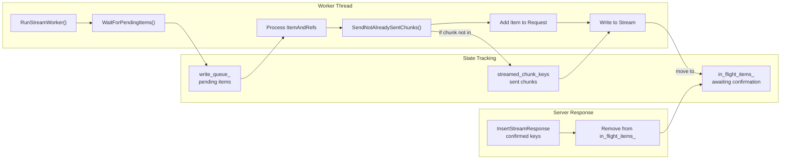

**Key Mechanisms:**

- **`TrajectoryWriter::RunStreamWorker()`** [reverb/cc/trajectory_writer.cc:595-700](): The background thread's main loop. It continuously:
  1. Waits for items in `write_queue_`
  2. Sends unreferenced chunks via `SendNotAlreadySentChunks()`
  3. Waits if any referenced chunks are incomplete (blocks on `data_cv_`)
  4. Sends the item when all chunks are ready
  5. Moves item to `in_flight_items_` awaiting server confirmation

- **`TrajectoryWriter::SendNotAlreadySentChunks()`** [reverb/cc/trajectory_writer.cc:185-210](): Iterates through `CellRef`s, checks if chunks are ready and not yet sent (tracked in `streamed_chunk_keys`), then adds them to the current request. Respects the `kMaxRequestSizeBytes` limit (40MB), splitting into multiple writes if needed.

- **Retry Logic**: If the stream fails, `RunStreamWorker()` re-enqueues all `in_flight_items_` back to the front of `write_queue_` and retries with exponential backoff [reverb/cc/trajectory_writer.cc:308-316]().

- **Keep Keys**: To prevent premature server-side chunk deletion, each request includes `keep_chunk_keys` listing chunks referenced by pending items [reverb/cc/trajectory_writer.cc:568-593]().

Sources: reverb/cc/trajectory_writer.cc:595-700, reverb/cc/trajectory_writer.cc:185-210, reverb/cc/trajectory_writer.cc:568-593

## Storage Layer: Table Management

### Insert Processing

Server-side insert processing is handled by the `Table` class through its worker thread architecture.

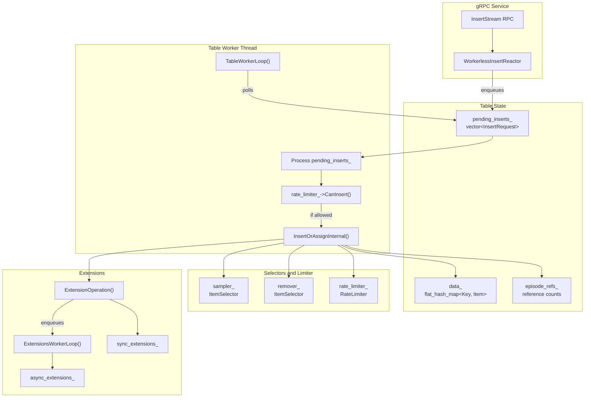

**Core Insert Flow:**

- **`Table::InsertOrAssignAsync(item, can_insert_more, callback)`** [reverb/cc/table.cc:568-591](): The entry point for inserts. Creates an `InsertRequest` containing the `Item` and callback, pushes it to `pending_inserts_`, and signals the worker thread. Returns immediately with `can_insert_more` indicating if the queue has capacity.

- **`Table::TableWorkerLoop()`** [reverb/cc/table.cc:236-423](): The worker thread's main loop processes both inserts and samples. For inserts:
  1. Checks `rate_limiter_->CanInsert()` [reverb/cc/table.cc:270]()
  2. Calls `InsertOrAssignInternal()` if allowed
  3. Executes the insert callback asynchronously via `callback_executor_`
  4. Alternates with sample processing for fairness

- **`Table::InsertOrAssignInternal(item)`** [reverb/cc/table.cc:593-632](): Performs the actual insert:
  1. Sets insertion timestamp [reverb/cc/table.cc:605]()
  2. Inserts into `data_` hash map [reverb/cc/table.cc:606]()
  3. Updates `sampler_->Insert()` and `remover_->Insert()` [reverb/cc/table.cc:608-609]()
  4. Increments `episode_refs_` for referenced chunks [reverb/cc/table.cc:616-618]()
  5. Invokes extensions via `ExtensionOperation()` [reverb/cc/table.cc:620]()
  6. Deletes oldest item if `data_.size() > max_size_` [reverb/cc/table.cc:623-625]()
  7. Notifies `rate_limiter_->Insert()` [reverb/cc/table.cc:629]()

Sources: reverb/cc/table.cc:568-632, reverb/cc/table.cc:236-423, reverb/cc/table.h:152-241

### Item Lifecycle and Rate Limiting

Items progress through multiple states from insertion to deletion, with the `RateLimiter` controlling flow.

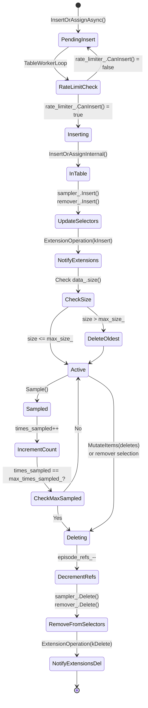

**Rate Limiter Integration:**

The `RateLimiter` enforces desired insert-to-sample ratios and minimum/maximum table sizes [reverb/cc/table.cc:152-182]():

- **`CanInsert(mu, count)`**: Returns true if inserts are currently allowed based on configured ratios and table state
- **`Insert(mu)`**: Called after successful insert to update limiter state [reverb/cc/table.cc:629]()
- **`MaybeCommitSample(mu)`**: Returns true if sampling is allowed and decrements available sample budget [reverb/cc/table.cc:295]()
- **`Delete(mu)`**: Called when item deleted to update state [reverb/cc/table.cc:834]()

When rate limiting blocks, the worker thread sleeps on condition variables (`wakeup_worker_`) until state changes [reverb/cc/table.cc:384]().

Sources: reverb/cc/table.cc:593-632, reverb/cc/table.cc:814-843, reverb/cc/rate_limiter.h

## Sample Path: Data Retrieval

### Sampler Architecture

The `Sampler` uses multiple worker threads to fetch samples from tables, with each worker managing its own gRPC stream.

```mermaid
graph TB
    subgraph "Client Application"
        GetNext["GetNextTimestep()<br/>or GetNextTrajectory()"]
    end
    
    subgraph "Sampler Coordination"
        Queue["internal::Queue&lt;Sample&gt;<br/>shared buffer"]
        Workers["SamplerWorker threads"]
    end
    
    subgraph "SamplerWorker (per thread)"
        FetchSamples["FetchSamples()"]
        CreateStream["Open SampleStream"]
        WriteRequest["Write SampleStreamRequest"]
        ReadResponse["Read SampleStreamResponse"]
        AsSample["AsSample()<br/>unpack and decompress"]
    end
    
    subgraph "Server (Table)"
        SampleStream["SampleStream RPC"]
        TableWorker["TableWorkerLoop()"]
        SampleInternal["SampleInternal()"]
        RetrieveChunks["Retrieve chunks from ChunkStore"]
    end
    
    GetNext -->|"Pop from"| Queue
    Workers -->|"Push to"| Queue
    
    Workers --> FetchSamples
    FetchSamples --> CreateStream
    CreateStream --> WriteRequest
    WriteRequest --> SampleStream
    SampleStream --> TableWorker
    TableWorker --> SampleInternal
    SampleInternal --> RetrieveChunks
    RetrieveChunks --> ReadResponse
    ReadResponse --> AsSample
    AsSample --> Queue
```

**Key Components:**

- **`Sampler` Class** [reverb/cc/sampler.cc:444-551](): Coordinates multiple `SamplerWorker` threads and a shared `internal::Queue<Sample>`. Workers continuously fetch samples and push to the queue; client calls pop from the queue.

- **Worker Implementations**:
  - **`GrpcSamplerWorker`** [reverb/cc/sampler.cc:172-302](): Fetches samples via gRPC `SampleStream`. Manages stream lifecycle, handles rate limiter timeouts, and implements retry logic.
  - **`LocalSamplerWorker`** [reverb/cc/sampler.cc:325-434](): For in-process optimization, directly calls `Table::SampleFlexibleBatch()` to avoid gRPC serialization overhead.

Sources: reverb/cc/sampler.cc:444-551, reverb/cc/sampler.cc:172-434, reverb/cc/sampler.h:116-169

### Sample Processing and Decompression

Server-side sample processing retrieves items and their referenced chunks, then streams them to the client for unpacking.

```mermaid
graph LR
    subgraph "Table Sample Processing"
        SampleReq["EnqueSampleRequest()"]
        WorkerPoll["TableWorkerLoop polls"]
        CheckRate["rate_limiter_<br/>.MaybeCommitSample()"]
        SelectItem["sampler_.Sample()"]
        GetItem["data_[key]"]
        IncrementCount["times_sampled++"]
        GetChunks["item->chunks()"]
    end
    
    subgraph "Stream Response"
        BuildEntry["SampleStreamResponse<br/>.SampleEntry"]
        AddChunks["entry.add_data()<br/>ChunkData protos"]
        MarkEnd["entry.set_end_of_sequence()"]
        Stream["Write to SampleStream"]
    end
    
    subgraph "Client Unpacking"
        Receive["Read SampleStreamResponse"]
        AsSample["AsSample()"]
        Decompress["Decompress chunks"]
        UnpackSlices["UnpackChunkColumnAndSlice()"]
        BuildTensors["Reconstruct tensors"]
        CreateSample["Create Sample object"]
    end
    
    SampleReq --> WorkerPoll
    WorkerPoll --> CheckRate
    CheckRate -->|"allowed"| SelectItem
    SelectItem --> GetItem
    GetItem --> IncrementCount
    IncrementCount --> GetChunks
    GetChunks --> BuildEntry
    BuildEntry --> AddChunks
    AddChunks --> MarkEnd
    MarkEnd --> Stream
    
    Stream --> Receive
    Receive --> AsSample
    AsSample --> Decompress
    Decompress --> UnpackSlices
    UnpackSlices --> BuildTensors
    BuildTensors --> CreateSample
```

**Server-Side Sampling:**

- **`Table::EnqueSampleRequest(num_samples, callback, timeout)`** [reverb/cc/table.cc:660-689](): Enqueues an asynchronous sample request. Creates a `SampleRequest` with deadline, reserves space for samples, and signals the worker thread.

- **`Table::SampleInternal(rate_limited, result)`** [reverb/cc/table.cc:716-748](): The core sampling logic:
  1. Calls `sampler_->Sample()` to select an item based on configured strategy [reverb/cc/table.cc:717]()
  2. Retrieves item from `data_` hash map [reverb/cc/table.cc:718]()
  3. Increments `times_sampled` counter [reverb/cc/table.cc:725]()
  4. Constructs `SampledItem` with metadata and chunk pointers [reverb/cc/table.cc:728-735]()
  5. Invokes extensions [reverb/cc/table.cc:738]()
  6. Deletes item if `max_times_sampled_` reached [reverb/cc/table.cc:743-745]()

**Client-Side Unpacking:**

- **`AsSample(responses, sample)`** [reverb/cc/sampler.cc:73-129](): Processes one or more `SampleStreamResponse::SampleEntry` protos:
  1. Collects all `ChunkData` from entries into a hash map keyed by `chunk_key`
  2. Counts chunk references to enable progressive memory release
  3. For each column, iterates through `chunk_slices`, calls `UnpackChunkColumnAndSlice()` to decompress and extract the relevant portion
  4. Releases chunk memory as soon as all references processed
  5. Returns a `Sample` object with unpacked tensors organized by column

- **`Sample::GetNextTimestep()`**: Decomposes trajectory samples into individual timesteps, sub-slicing column tensors one step at a time. The `Sample` tracks `next_timestep_index_` and progressively deallocates chunks as they're consumed.

Sources: reverb/cc/table.cc:660-748, reverb/cc/sampler.cc:73-171, reverb/cc/sampler.h:54-114

## End-to-End Data Flow

The following diagram shows the complete journey of a single data item from application code to sampling.

```mermaid
graph TB
    subgraph "1. Application Layer"
        AppCode["Training Loop"]
        AppendData["writer.Append(tensors)"]
        CreateItemCall["writer.CreateItem(table, priority, refs)"]
    end
    
    subgraph "2. Client-Side Processing"
        ChunkerAppend["Chunker.Append()"]
        CellRefCreate["Create CellRef weak_ptr"]
        ChunkComplete["Chunk complete at max_chunk_length"]
        Compress["Compress with Snappy"]
        QueueItem["Queue ItemAndRefs"]
    end
    
    subgraph "3. Client Worker Thread"
        StreamWorker["TrajectoryWriter.RunStreamWorker()"]
        SendChunk["Send ChunkData via InsertStream"]
        SendItem["Send PrioritizedItem via InsertStream"]
        AwaitConfirm["Await InsertStreamResponse"]
    end
    
    subgraph "4. Server gRPC Handler"
        InsertReactor["WorkerlessInsertReactor"]
        EnqueueInsert["Enqueue to pending_inserts_"]
        SignalWorker["Signal table worker"]
    end
    
    subgraph "5. Table Worker Thread"
        WorkerLoop["Table.TableWorkerLoop()"]
        RateLimitCheck["RateLimiter.CanInsert()"]
        InsertOp["Table.InsertOrAssignInternal()"]
        UpdateState["Update data_, selectors, extensions"]
        SendConfirm["Send confirmation key"]
    end
    
    subgraph "6. Storage"
        ChunkStoreAdd["ChunkStore stores ChunkData"]
        DataMap["data_[key] = Item"]
        SamplerUpdate["sampler_.Insert(key, priority)"]
        RemoverUpdate["remover_.Insert(key, priority)"]
    end
    
    subgraph "7. Sampling"
        SamplerRequest["Sampler.GetNextTimestep()"]
        WorkerFetch["SamplerWorker.FetchSamples()"]
        SampleRequest["Send SampleStreamRequest"]
        TableSample["Table.SampleInternal()"]
        SelectItem["sampler_.Sample() chooses item"]
        RetrieveChunks["Retrieve chunks from ChunkStore"]
        StreamResponse["Stream SampleStreamResponse"]
    end
    
    subgraph "8. Client-Side Unpacking"
        ReceiveResponse["Receive SampleStreamResponse"]
        UnpackAsSample["AsSample() unpacks"]
        Decompress2["Decompress chunks"]
        SliceData["UnpackChunkColumnAndSlice()"]
        PushQueue["Push Sample to queue"]
        ReturnToApp["Return tensors to app"]
    end
    
    AppCode --> AppendData
    AppendData --> ChunkerAppend
    ChunkerAppend --> CellRefCreate
    CellRefCreate --> ChunkComplete
    ChunkComplete --> Compress
    
    AppCode --> CreateItemCall
    CreateItemCall --> QueueItem
    
    QueueItem --> StreamWorker
    StreamWorker --> SendChunk
    SendChunk --> SendItem
    SendItem --> InsertReactor
    
    InsertReactor --> EnqueueInsert
    EnqueueInsert --> SignalWorker
    SignalWorker --> WorkerLoop
    
    WorkerLoop --> RateLimitCheck
    RateLimitCheck --> InsertOp
    InsertOp --> UpdateState
    UpdateState --> ChunkStoreAdd
    UpdateState --> DataMap
    UpdateState --> SamplerUpdate
    UpdateState --> RemoverUpdate
    UpdateState --> SendConfirm
    SendConfirm --> AwaitConfirm
    
    SamplerRequest --> WorkerFetch
    WorkerFetch --> SampleRequest
    SampleRequest --> TableSample
    TableSample --> SelectItem
    SelectItem --> RetrieveChunks
    RetrieveChunks --> StreamResponse
    
    StreamResponse --> ReceiveResponse
    ReceiveResponse --> UnpackAsSample
    UnpackAsSample --> Decompress2
    Decompress2 --> SliceData
    SliceData --> PushQueue
    PushQueue --> ReturnToApp
```

**Data Transformations:**

| Stage | Input Format | Transformation | Output Format |
|-------|--------------|----------------|---------------|
| Append | `vector<Tensor>` | Chunker accumulation | `CellRef` weak_ptr |
| Chunk Creation | Accumulated tensors | Compression (Snappy), optional delta encoding | `ChunkData` proto |
| Item Creation | `vector<CellRef>`, priority | Lock refs, build trajectory proto | `PrioritizedItem` proto |
| gRPC Write | `PrioritizedItem`, `ChunkData` | Serialization | `InsertStreamRequest` bytes |
| Table Insert | `InsertStreamRequest` | Deserialization, indexing | In-memory `Item`, `Chunk` objects |
| Sample Selection | Sample request | ItemSelector algorithm | `SampledItem` with chunk refs |
| gRPC Sample | `SampledItem` | Serialization | `SampleStreamResponse` bytes |
| Unpacking | `SampleStreamResponse` | Decompression, slicing | `Sample` with `vector<Tensor>` |

Sources: reverb/cc/trajectory_writer.cc, reverb/cc/table.cc, reverb/cc/sampler.cc, reverb/cc/tensor_compression.h

## Performance Considerations

### Chunking Strategy

Chunk length affects both memory usage and latency:
- **Larger chunks** (e.g., 200+ timesteps): Reduce overhead from compression and network transmission, but increase memory usage and delay before chunks can be sent
- **Smaller chunks** (e.g., 10-50 timesteps): Lower memory overhead and latency, but more compression/decompression work

The `TrajectoryWriter` supports per-column chunking configuration via `ConfigureChunker()` [reverb/cc/trajectory_writer.h:313-314]().

### Asynchronous Operations

The pipeline is designed to be non-blocking:
- **Client-side**: `CreateItem()` returns immediately; streaming happens on background thread [reverb/cc/trajectory_writer.cc:426-475]()
- **Server-side**: `InsertOrAssignAsync()` returns immediately; processing happens on table worker thread [reverb/cc/table.cc:568-591]()
- **Sampling**: Multi-threaded workers pre-fetch samples into queue, decoupling fetch latency from application [reverb/cc/sampler.cc:444-551]()

### Backpressure Mechanisms

Multiple backpressure mechanisms prevent resource exhaustion:
- **Write queue limit**: `max_enqueued_inserts_` limits pending client items (default: 10% of `max_size`) [reverb/cc/table.h:162-163]()
- **Rate limiter**: Blocks inserts/samples to maintain configured ratios [reverb/cc/rate_limiter.h]()
- **Extension queue**: `max_enqueued_extension_ops_` limits pending extension operations [reverb/cc/table.h:165-169]()
- **Sample queue**: Worker reserves space before fetching to prevent unbounded growth [reverb/cc/sampler.cc:228-232]()

Sources: reverb/cc/trajectory_writer.cc, reverb/cc/table.cc, reverb/cc/sampler.cc, reverb/cc/rate_limiter.h

---

# Page: Core Components

# Core Components

<details>
<summary>Relevant source files</summary>

The following files were used as context for generating this wiki page:

- [reverb/cc/BUILD](reverb/cc/BUILD)
- [reverb/cc/platform/tfrecord_checkpointer.cc](reverb/cc/platform/tfrecord_checkpointer.cc)
- [reverb/cc/table.cc](reverb/cc/table.cc)
- [reverb/cc/table.h](reverb/cc/table.h)
- [reverb/cc/table_test.cc](reverb/cc/table_test.cc)

</details>


This page provides an overview of Reverb's fundamental building blocks and their interactions. Each component is introduced at a high level, with links to detailed documentation in subsequent sections.

**Scope**: This page covers the five major subsystems that form Reverb's core: the Table system, Data Ingestion, Sampling, gRPC Service, and Checkpointing. For information about the overall architecture and client-server communication patterns, see [System Architecture](#2). For Python-specific APIs, see [Python Client API](#4).

## Component Overview

Reverb's core consists of five primary components that work together to provide prioritized experience replay:

| Component | Primary Class | Purpose |
|-----------|--------------|---------|
| **Table System** | `Table` | Central data store that manages items, enforces capacity limits, and coordinates sampling/insertion operations |
| **Data Ingestion** | `Writer`, `TrajectoryWriter` | Handles chunking, compression, and streaming of trajectory data to the server |
| **Sampling System** | `Sampler` | Multi-threaded component that retrieves and decompresses data for training |
| **gRPC Service** | `ReverbServiceImpl` | Server-side RPC handler that routes requests to appropriate tables |
| **Checkpointing** | `TFRecordCheckpointer` | Persists and restores table state for fault tolerance |

Each component is described in detail in sections [3.1](#3.1) through [3.5](#3.5).

## Core Component Architecture

The following diagram shows how the five core components interact:

```mermaid
graph TB
    subgraph "Data Ingestion [3.2]"
        Writer["Writer"]
        TrajWriter["TrajectoryWriter"]
        Chunker["Chunker"]
    end
    
    subgraph "gRPC Service [3.4]"
        Service["ReverbServiceImpl"]
        InsertReactor["InsertStreamReactor"]
        SampleReactor["SampleStreamReactor"]
    end
    
    subgraph "Table System [3.1]"
        Table["Table"]
        RateLimiter["RateLimiter"]
        ItemSelector["ItemSelector<br/>(sampler/remover)"]
        ChunkStore["ChunkStore"]
        TableExtension["TableExtension[]"]
    end
    
    subgraph "Sampling System [3.3]"
        Sampler["Sampler"]
        SampleWorkers["Worker Threads"]
    end
    
    subgraph "Checkpointing [3.5]"
        Checkpointer["TFRecordCheckpointer"]
    end
    
    Writer --> Chunker
    TrajWriter --> Chunker
    Chunker --> InsertReactor
    
    InsertReactor --> Service
    SampleReactor --> Service
    
    Service --> Table
    Table --> ChunkStore
    Table --> RateLimiter
    Table --> ItemSelector
    Table --> TableExtension
    
    Sampler --> SampleReactor
    SampleWorkers --> Sampler
    
    Checkpointer --> Table
    Checkpointer --> ChunkStore
    
    Table --> SampleReactor
```

**Sources**: [reverb/cc/table.h:156-656](), [reverb/cc/BUILD:430-452]()

## Code Entity Mapping

This diagram maps high-level concepts to specific C++ classes and files:

```mermaid
graph LR
    subgraph "Concept Layer"
        C1["Priority-based<br/>Storage"]
        C2["Data<br/>Ingestion"]
        C3["Data<br/>Sampling"]
        C4["RPC<br/>Interface"]
        C5["State<br/>Persistence"]
    end
    
    subgraph "Implementation Layer"
        I1["Table<br/>reverb/cc/table.cc<br/>reverb/cc/table.h"]
        I2["Writer<br/>reverb/cc/writer.cc<br/>TrajectoryWriter<br/>reverb/cc/trajectory_writer.cc"]
        I3["Sampler<br/>reverb/cc/sampler.cc"]
        I4["ReverbServiceImpl<br/>reverb/cc/reverb_service_impl.cc"]
        I5["TFRecordCheckpointer<br/>reverb/cc/platform/tfrecord_checkpointer.cc"]
    end
    
    subgraph "Supporting Classes"
        S1["RateLimiter<br/>reverb/cc/rate_limiter.cc"]
        S2["ItemSelector<br/>reverb/cc/selectors/interface.h"]
        S3["ChunkStore<br/>reverb/cc/chunk_store.cc"]
        S4["TableExtension<br/>reverb/cc/table_extensions/interface.h"]
        S5["Chunker<br/>reverb/cc/chunker.cc"]
    end
    
    C1 --> I1
    C2 --> I2
    C3 --> I3
    C4 --> I4
    C5 --> I5
    
    I1 --> S1
    I1 --> S2
    I1 --> S3
    I1 --> S4
    I2 --> S5
```

**Sources**: [reverb/cc/BUILD:133-545](), [reverb/cc/table.h:1-661]()

## Table System

The `Table` class [reverb/cc/table.h:156-656]() is the central data structure in Reverb, managing all stored items and coordinating operations. Each table maintains:

- **`data_`**: A hash map storing all items indexed by key [reverb/cc/table.h:542-543]()
- **`sampler_`**: An `ItemSelector` that determines which items to return during sampling [reverb/cc/table.h:535]()
- **`remover_`**: An `ItemSelector` that determines which items to evict when capacity is reached [reverb/cc/table.h:538]()
- **`rate_limiter_`**: Controls the ratio of insert to sample operations [reverb/cc/table.h:581]()
- **`sync_extensions_`** and **`async_extensions_`**: Hooks for custom behavior [reverb/cc/table.h:642-655]()

The table uses two dedicated worker threads:
- **`table_worker_`**: Processes asynchronous insert and sample requests [reverb/cc/table.h:587]()
- **`extension_worker_`**: Executes extension callbacks asynchronously [reverb/cc/table.h:620]()

For detailed information about table operations, concurrency, and lifecycle management, see [Table System](#3.1).

**Sources**: [reverb/cc/table.h:156-656](), [reverb/cc/table.cc:152-234]()

## Data Ingestion System

The data ingestion system consists of two main components:

**Writer** [reverb/cc/writer.h]() provides low-level functionality for:
- Buffering tensors and creating chunks
- Delta encoding for compression efficiency
- Streaming chunks to the server via bidirectional gRPC

**TrajectoryWriter** [reverb/cc/trajectory_writer.h]() builds on `Writer` to provide:
- Management of trajectory history with configurable column specifications
- Automatic chunking based on data patterns
- Episode lifecycle management

Both writers use the **Chunker** [reverb/cc/chunker.h]() class to:
- Group tensors into compressed chunks
- Apply optional delta encoding
- Generate `ChunkData` protobuf messages for transmission

The ingestion process streams data through the `InsertStream` RPC, which is a bidirectional stream handled by server-side reactors.

For implementation details including chunking strategies and compression, see [Data Ingestion System](#3.2).

**Sources**: [reverb/cc/BUILD:229-293](), [reverb/cc/table.cc:568-631]()

## Sampling System

The `Sampler` class [reverb/cc/sampler.h]() provides multi-threaded data retrieval with the following architecture:

```mermaid
graph TB
    Client["Client Request"]
    Sampler["Sampler"]
    Workers["Worker Thread Pool"]
    Queue["Request Queue"]
    Table["Table"]
    ChunkStore["ChunkStore"]
    
    Client --> Sampler
    Sampler --> Queue
    Queue --> Workers
    Workers --> Table
    Table --> ChunkStore
    ChunkStore --> Workers
    Workers --> Sampler
    Sampler --> Client
```

Key features:
- **Parallel workers**: Multiple threads process sample requests concurrently [reverb/cc/sampler.cc]()
- **Batch sampling**: `SampleFlexibleBatch` returns multiple items efficiently [reverb/cc/table.cc:691-714]()
- **Decompression**: Chunk data is decompressed before returning to client
- **Rate limiting integration**: Respects table rate limiter constraints

The sampler uses the `SampleStream` bidirectional gRPC to maintain persistent connections with low latency.

For details on sampling strategies, worker coordination, and local vs. remote modes, see [Sampling System](#3.3).

**Sources**: [reverb/cc/BUILD:204-227](), [reverb/cc/table.cc:653-748]()

## gRPC Service Implementation

The **ReverbServiceImpl** class [reverb/cc/reverb_service_impl.h]() implements all server-side RPC endpoints:

| RPC Method | Type | Purpose |
|------------|------|---------|
| `InsertStream` | Bidirectional Stream | Receives chunked trajectory data and inserts items |
| `SampleStream` | Bidirectional Stream | Returns sampled items with chunks |
| `MutatePriorities` | Unary | Updates item priorities or deletes items |
| `Reset` | Unary | Clears table contents |
| `Checkpoint` | Unary | Triggers checkpoint creation |
| `ServerInfo` | Unary | Returns metadata about tables and server state |
| `InitializeConnection` | Special | In-process optimization for co-located clients |

The service uses **reactor pattern** for streaming RPCs:
- **WorkerlessInsertReactor**: Handles incoming insert streams without blocking
- **WorkerlessSampleReactor**: Manages outgoing sample streams with backpressure

The `InitializeConnection` method provides zero-copy access when client and server are in the same process, bypassing serialization overhead.

For RPC implementation details, backpressure management, and streaming protocols, see [gRPC Service Implementation](#3.4).

**Sources**: [reverb/cc/BUILD:430-452](), [reverb/cc/reverb_service_impl.h]()

## Checkpointing and Persistence

The **TFRecordCheckpointer** class [reverb/cc/platform/tfrecord_checkpointer.cc:156-169]() provides fault tolerance by saving and restoring table state:

### Checkpoint Structure

A checkpoint directory contains three TFRecord files:
- **`tables.tfrecord`**: Serialized `PriorityTableCheckpoint` messages containing table metadata [reverb/cc/platform/tfrecord_checkpointer.cc:57]()
- **`items.tfrecord`**: All `PrioritizedItem` messages currently in tables [reverb/cc/platform/tfrecord_checkpointer.cc:58]()
- **`chunks.tfrecord`**: All `ChunkData` referenced by items [reverb/cc/platform/tfrecord_checkpointer.cc:59]()
- **`DONE`**: Marker file indicating checkpoint completion [reverb/cc/platform/tfrecord_checkpointer.cc:60]()

### Save Operation

The save process [reverb/cc/platform/tfrecord_checkpointer.cc:171-278]():
1. Calls `Table::Checkpoint()` on each table to capture consistent snapshots [reverb/cc/table.cc:949-984]()
2. Collects all referenced chunks across tables
3. Writes table metadata, items, and chunks to compressed TFRecords
4. Writes `DONE` marker to indicate successful completion
5. Deletes old checkpoints based on `keep_latest` parameter

### Load Operation

The load process [reverb/cc/platform/tfrecord_checkpointer.cc:541-554]():
1. Verifies `DONE` file exists in checkpoint directory [reverb/cc/platform/tfrecord_checkpointer.cc:287-290]()
2. Loads table metadata and validates against server configuration
3. Reads all chunks into `ChunkStore` [reverb/cc/platform/tfrecord_checkpointer.cc:416-456]()
4. Reconstructs items by resolving chunk references
5. Uses `Table::InitializeFromCheckpoint()` to restore table state [reverb/cc/table.cc:184-213]()
6. Inserts items with `Table::InsertCheckpointItem()` bypassing rate limiting [reverb/cc/table.cc:986-1011]()

The checkpointer supports both compressed (zlib) and uncompressed formats for backward compatibility [reverb/cc/platform/tfrecord_checkpointer.cc:544-552]().

For details on checkpoint lifecycle, format evolution, and extension coordination, see [Checkpointing and Persistence](#3.5).

**Sources**: [reverb/cc/platform/tfrecord_checkpointer.cc:156-595](), [reverb/cc/table.cc:949-1011]()

## Component Interaction Flow

The following diagram illustrates a complete cycle of data insertion and sampling:

```mermaid
sequenceDiagram
    participant TW as TrajectoryWriter
    participant IS as InsertStream RPC
    participant RS as ReverbServiceImpl
    participant T as Table
    participant CS as ChunkStore
    participant RL as RateLimiter
    participant SS as SampleStream RPC
    participant S as Sampler
    
    Note over TW,IS: Data Ingestion Phase
    TW->>TW: Chunk tensors
    TW->>IS: Stream ChunkData
    IS->>RS: InsertStreamRequest
    RS->>CS: Store chunks
    RS->>T: InsertOrAssignAsync
    T->>RL: Check insert quota
    T->>T: Add to data_
    T->>T: Update sampler/remover
    
    Note over S,T: Sampling Phase
    S->>SS: Sample request
    SS->>RS: SampleStreamRequest
    RS->>T: EnqueSampleRequest
    T->>RL: Check sample quota
    T->>T: Select item via sampler_
    T->>CS: Retrieve chunks
    CS->>RS: ChunkData
    RS->>SS: SampleStreamResponse
    SS->>S: Sampled item + chunks
```

**Sources**: [reverb/cc/table.cc:568-631](), [reverb/cc/table.cc:660-748](), [reverb/cc/reverb_service_impl.cc]()

## Thread Safety and Concurrency

All core components are designed for concurrent access:

- **Table**: Uses `mu_` mutex to protect shared state; worker threads process queued operations asynchronously [reverb/cc/table.h:532]()
- **ChunkStore**: Thread-safe hash map allows concurrent chunk lookups [reverb/cc/chunk_store.h]()
- **RateLimiter**: Coordinates insert/sample operations across multiple threads [reverb/cc/rate_limiter.h]()
- **Extensions**: Separated into synchronous (holding `mu_`) and asynchronous (background worker) execution [reverb/cc/table.h:642-655]()

The table worker architecture avoids holding locks during expensive operations (memory deallocation, extension callbacks) to maximize throughput. See [Concurrency and Threading](#7.1) for detailed analysis.

**Sources**: [reverb/cc/table.h:532-656](), [reverb/cc/table.cc:236-502]()

## Summary

Reverb's core components form a cohesive system:

1. **Table** acts as the central coordinator, managing data lifecycle and enforcing policies
2. **Writers** handle data ingestion with efficient chunking and compression
3. **Sampler** provides high-throughput retrieval with parallel workers
4. **ReverbServiceImpl** exposes all functionality via gRPC with optimized streaming
5. **TFRecordCheckpointer** ensures state can be saved and restored reliably

The following sections ([3.1](#3.1) through [3.5](#3.5)) provide detailed documentation for each component.

**Sources**: [reverb/cc/table.h:1-661](), [reverb/cc/BUILD:1-546]()

---

# Page: Table System

# Table System

<details>
<summary>Relevant source files</summary>

The following files were used as context for generating this wiki page:

- [reverb/cc/platform/tfrecord_checkpointer.cc](reverb/cc/platform/tfrecord_checkpointer.cc)
- [reverb/cc/table.cc](reverb/cc/table.cc)
- [reverb/cc/table.h](reverb/cc/table.h)
- [reverb/cc/table_test.cc](reverb/cc/table_test.cc)

</details>


**Purpose**: This document describes the `Table` class, which is the core data structure in Reverb responsible for storing, sampling, and managing the lifecycle of replay buffer items. For information about how sampling strategies work, see [Item Selection Strategies](#3.1.1). For rate limiting behavior, see [Rate Limiting](#3.1.2). For extension hooks, see [Table Extensions](#3.1.3).

**Scope**: This page covers the `Table` class implementation in C++, including its data structures, operations, concurrency model, and item lifecycle management. It does not cover the Python API (see [Python Client API](#4)) or how data is ingested (see [Data Ingestion System](#3.2)).

## Overview

The `Table` is a prioritized container that stores `TableItem` objects and uses `ItemSelector` instances to control sampling and removal behavior. It integrates with a `RateLimiter` to maintain desired insert-to-sample ratios and supports extension hooks for custom behavior. The implementation uses multiple worker threads to handle asynchronous operations efficiently.

**Key Characteristics**:
- Maximum capacity enforced by automatic removal of items
- Configurable sampling and removal strategies via `ItemSelector` instances
- Rate-limited insert and sample operations
- Support for both synchronous and asynchronous extensions
- Thread-safe concurrent access
- Checkpoint/restore capability for fault tolerance

Sources: [reverb/cc/table.h:128-156](), [reverb/cc/table.cc:152-182]()

## Core Concepts

### TableItem Structure

A `TableItem` represents a single entry in the table and contains:

```mermaid
classDiagram
    class TableItem {
        +uint64_t key()
        +double priority()
        +int32_t times_sampled()
        +Timestamp inserted_at()
        +FlatTrajectory flat_trajectory()
        +vector~Chunk~ chunks()
        +PrioritizedItem AsPrioritizedItem()
    }
    class PrioritizedItem {
        -key
        -table_name
        -priority
        -times_sampled
        -inserted_at
        -flat_trajectory
    }
    class Chunk {
        -episode_id
        -chunk_key
        -ChunkData
    }
    
    TableItem --> PrioritizedItem : wraps
    TableItem --> Chunk : references*
```

**Field Details**:
- `key`: Unique identifier (64-bit unsigned integer)
- `priority`: Double value used by selectors for sampling/removal decisions
- `times_sampled`: Counter incremented on each sample (mutable)
- `inserted_at`: Timestamp when item was added to the table
- `flat_trajectory`: Flattened representation of trajectory data
- `chunks`: Vector of shared pointers to compressed data chunks

The `TableItem` class wraps a `PrioritizedItem` proto but extracts mutable fields (`times_sampled`, `priority`) to avoid protobuf thread-safety issues when concurrent readers access the immutable trajectory while sampling increments counters.

Sources: [reverb/cc/table.h:62-113](), [reverb/cc/table.cc:1149-1194]()

### Table Configuration

Tables are configured with the following parameters:

| Parameter | Type | Purpose |
|-----------|------|---------|
| `name` | string | Unique identifier for the table |
| `sampler` | ItemSelector | Strategy for selecting items to sample |
| `remover` | ItemSelector | Strategy for selecting items to remove when at capacity |
| `max_size` | int64_t | Maximum number of items the table can hold |
| `max_times_sampled` | int32_t | Maximum times an item can be sampled (≤0 = unlimited) |
| `rate_limiter` | RateLimiter | Controls insert/sample operation flow |
| `extensions` | vector\<TableExtension\> | Custom hooks for observability/behavior |
| `signature` | StructuredValue (optional) | Schema declaration for stored data |

Sources: [reverb/cc/table.h:222-239](), [reverb/cc/table.cc:152-182]()

## Internal Data Structures

```mermaid
graph TB
    Table["Table Instance"]
    
    subgraph "Core State (protected by mu_)"
        data_["data_<br/>flat_hash_map&lt;Key, shared_ptr&lt;Item&gt;&gt;<br/>★ Primary storage ★"]
        sampler_["sampler_<br/>shared_ptr&lt;ItemSelector&gt;"]
        remover_["remover_<br/>shared_ptr&lt;ItemSelector&gt;"]
        rate_limiter_["rate_limiter_<br/>shared_ptr&lt;RateLimiter&gt;"]
        episode_refs_["episode_refs_<br/>flat_hash_map&lt;episode_id, refcount&gt;"]
        extension_requests_["extension_requests_<br/>vector&lt;ExtensionRequest&gt;"]
        sync_extensions_["sync_extensions_<br/>vector&lt;shared_ptr&lt;TableExtension&gt;&gt;"]
    end
    
    subgraph "Worker State (protected by worker_mu_)"
        pending_inserts_["pending_inserts_<br/>vector&lt;InsertRequest&gt;"]
        pending_sampling_["pending_sampling_<br/>vector&lt;unique_ptr&lt;SampleRequest&gt;&gt;"]
        deleted_items_["deleted_items_<br/>vector&lt;shared_ptr&lt;Item&gt;&gt;"]
    end
    
    subgraph "Async Extension State (protected by async_extensions_mu_)"
        async_extensions_["async_extensions_<br/>vector&lt;shared_ptr&lt;TableExtension&gt;&gt;"]
    end
    
    Table --> data_
    Table --> sampler_
    Table --> remover_
    Table --> rate_limiter_
    Table --> episode_refs_
    Table --> pending_inserts_
    Table --> pending_sampling_
    Table --> async_extensions_
```

**Key Data Structures**:

- **`data_`**: Hash map from item key to `TableItem`. This is the primary storage container holding all active items in the table.

- **`sampler_` / `remover_`**: Separate `ItemSelector` instances that maintain their own priority distributions. Both are updated on insert/update/delete operations.

- **`episode_refs_`**: Reference counter tracking how many items reference each episode ID. When the count reaches zero, the episode is considered deleted.

- **`pending_inserts_` / `pending_sampling_`**: Queues of operations waiting to be processed by the table worker thread.

- **`deleted_items_`**: Items removed from the table but not yet deallocated. Clients consume from this list to spread deallocation load.

- **`sync_extensions_` / `async_extensions_`**: Extensions are split into synchronous (executed while holding `mu_`) and asynchronous (executed by extension worker without lock).

Sources: [reverb/cc/table.h:532-655](), [reverb/cc/table.cc:152-182]()

## Operations

### Insert Operations

**InsertOrAssign (Synchronous)**
```cpp
absl::Status InsertOrAssign(Item item, 
                           absl::Duration timeout = absl::InfiniteDuration())
```

Legacy synchronous insertion that blocks until the rate limiter allows the operation or timeout expires. Returns `DeadlineExceededError` on timeout.

**InsertOrAssignAsync (Asynchronous)**
```cpp
absl::Status InsertOrAssignAsync(
    Item item, 
    bool* can_insert_more,
    std::weak_ptr<InsertCallback> insert_completed)
```

Enqueues an insert request for the table worker. Returns immediately with:
- `can_insert_more`: false if the pending queue is near capacity (slows down producer)
- `insert_completed`: callback invoked when insertion completes

The table worker processes inserts through `InsertOrAssignInternal`:

```mermaid
stateDiagram-v2
    [*] --> CheckValidity
    CheckValidity --> CheckExists
    CheckExists --> UpdateExisting : item key exists
    CheckExists --> InsertNew : new key
    UpdateExisting --> CallExtension
    InsertNew --> SetTimestamp
    SetTimestamp --> AddToData
    AddToData --> UpdateSelectors
    UpdateSelectors --> IncrementEpisodeRefs
    IncrementEpisodeRefs --> CallExtension
    CallExtension --> CheckCapacity
    CheckCapacity --> RemoveOldest : size > max_size
    CheckCapacity --> NotifyRateLimiter : size <= max_size
    RemoveOldest --> NotifyRateLimiter
    NotifyRateLimiter --> [*]
```

**Insert Workflow**:
1. Validate item (trajectory not empty, chunks match references)
2. Check if key exists - if yes, update priority and return
3. Set `inserted_at` timestamp (after acquiring lock to maintain ordering)
4. Insert into `data_` map
5. Insert into both `sampler_` and `remover_`
6. Increment episode reference counts
7. Call extensions with `kInsert` event
8. If `size() > max_size`, delete oldest item via `remover_->Sample()`
9. Notify rate limiter of successful insert

Sources: [reverb/cc/table.cc:551-632](), [reverb/cc/table.h:275-286]()

### Sample Operations

**Sample (Synchronous)**
```cpp
absl::Status Sample(SampledItem* item, 
                   absl::Duration timeout = kDefaultTimeout)
```

Blocks until rate limiter allows sampling or timeout expires.

**EnqueSampleRequest (Asynchronous)**
```cpp
void EnqueSampleRequest(int num_samples,
                       std::weak_ptr<SamplingCallback> callback,
                       absl::Duration timeout = kDefaultTimeout)
```

Enqueues a batch sampling request for the table worker to process asynchronously. The worker calls `SampleInternal` for each sample:

```mermaid
sequenceDiagram
    participant Client
    participant Worker as Table Worker
    participant RL as RateLimiter
    participant Sampler as ItemSelector
    participant Data as data_
    
    Client->>Worker: EnqueSampleRequest(num_samples, callback)
    activate Worker
    Worker->>RL: MaybeCommitSample()
    alt rate limited
        RL-->>Worker: false
        Worker->>Worker: Sleep / wait for insert
    else allowed
        RL-->>Worker: true
        Worker->>Sampler: Sample()
        Sampler-->>Worker: {key, probability}
        Worker->>Data: Get item by key
        Data-->>Worker: shared_ptr<Item>
        Worker->>Worker: Increment times_sampled
        Worker->>Worker: Call extensions (kSample)
        alt times_sampled == max_times_sampled
            Worker->>Worker: DeleteItem(key)
        end
        Worker->>Client: callback({samples})
    end
    deactivate Worker
```

**SampleFlexibleBatch**:
Samples up to `batch_size` items without releasing the lock. Only waits for the rate limiter on the first sample; remaining samples are added if immediately available. This minimizes lock contention while maximizing throughput.

Sources: [reverb/cc/table.cc:653-748](), [reverb/cc/table.h:308-341]()

### Mutation Operations

**MutateItems**
```cpp
absl::Status MutateItems(absl::Span<const KeyWithPriority> updates,
                        absl::Span<const Key> deletes)
```

Atomically applies priority updates and deletions. Operations are applied in order within a single lock acquisition.

**UpdateItem**:
- Updates priority in `data_`, `sampler_`, and `remover_`
- Calls extensions with `kUpdate` event
- Ignores non-existent keys

**DeleteItem**:
1. Remove from `data_`
2. Decrement episode reference counts (track `num_deleted_episodes_`)
3. Notify rate limiter
4. Remove from `sampler_` and `remover_`
5. Call extensions with `kDelete` event
6. Optionally return deleted item for deferred deallocation

Sources: [reverb/cc/table.cc:634-906]()

### Management Operations

**Reset**:
- Clears all items from `data_`, `sampler_`, `remover_`
- Resets rate limiter state
- Clears episode reference counts
- Calls `OnReset` on all extensions
- Waits for extension worker to finish pending operations

**Checkpoint**:
Returns a `CheckpointAndChunks` struct containing:
- `PriorityTableCheckpoint`: Table configuration and metadata
- `vector<PrioritizedItem>`: All items sorted by insertion time
- `flat_hash_set<Chunk>`: All chunks referenced by items (prevents premature cleanup)

**InsertCheckpointItem**:
Special insertion path that bypasses rate limiter (used during checkpoint restore).

Sources: [reverb/cc/table.cc:908-1011]()

## Concurrency Model

### Worker Threads

The Table uses three execution contexts:

```mermaid
graph LR
    subgraph "Client Threads"
        API["API Calls<br/>(InsertOrAssignAsync,<br/>EnqueSampleRequest)"]
    end
    
    subgraph "Table Worker Thread"
        TW["TableWorkerLoop()"]
        TW_Insert["Process Inserts"]
        TW_Sample["Process Samples"]
        TW --> TW_Insert
        TW --> TW_Sample
    end
    
    subgraph "Extension Worker Thread"
        EW["ExtensionsWorkerLoop()"]
        EW_Async["Call Async Extensions"]
        EW_Delete["Deferred Deletion"]
        EW --> EW_Async
        EW --> EW_Delete
    end
    
    subgraph "Callback Executor"
        CE["TaskExecutor<br/>(runs callbacks)"]
    end
    
    API -->|Enqueue| TW
    API -->|Enqueue| TW
    TW -->|Extension Events| EW
    TW -->|Schedule| CE
```

**Table Worker (`TableWorkerLoop`)**:

Located at [reverb/cc/table.cc:236-423](), this worker:
- Processes `pending_inserts_` and `pending_sampling_` queues
- Alternates between insert and sample operations for fairness
- Sleeps when no work is available or rate limited
- Tracks time spent in different states (`TableWorkerState` enum)
- Handles timeouts for sample requests

**Extension Worker (`ExtensionsWorkerLoop`)**:

Located at [reverb/cc/table.cc:425-502](), this worker:
- Processes `extension_requests_` queue
- Calls asynchronous extensions without holding `mu_`
- Performs deferred memory deallocation for deleted items
- Allows clients to pull items from `deleted_items_` for distributed deallocation load

**Callback Executor**:

A `TaskExecutor` instance that runs completion callbacks on a separate thread pool to avoid blocking the table worker.

Sources: [reverb/cc/table.cc:236-502](), [reverb/cc/table.h:443-477]()

### Locking Strategy

Three mutexes protect different parts of the table state:

```mermaid
graph TD
    worker_mu_["worker_mu_<br/>(acquired first)"]
    mu_["mu_<br/>(acquired second)"]
    async_extensions_mu_["async_extensions_mu_<br/>(acquired last)"]
    
    worker_mu_ -->|"ACQUIRED_BEFORE"| mu_
    mu_ -->|"ACQUIRED_AFTER"| async_extensions_mu_
    
    worker_mu_ -.->|protects| WS["Worker State:<br/>pending_inserts_<br/>pending_sampling_<br/>deleted_items_"]
    
    mu_ -.->|protects| TS["Table State:<br/>data_<br/>sampler_, remover_<br/>rate_limiter_<br/>episode_refs_<br/>extension_requests_"]
    
    async_extensions_mu_ -.->|protects| ES["Extension State:<br/>async_extensions_"]
```

**Lock Ordering** (enforced by Abseil thread annotations):
1. `worker_mu_` - Must be acquired before `mu_` if both are needed
2. `mu_` - Main table lock for data access
3. `async_extensions_mu_` - Must be acquired after `mu_` if both are needed

**Critical Sections**:
- API calls briefly hold `worker_mu_` to enqueue operations
- Table worker holds `mu_` while processing inserts/samples
- Extension worker holds `async_extensions_mu_` while calling extensions
- Synchronous extensions execute while holding `mu_`
- Asynchronous extensions execute while holding `async_extensions_mu_` (not `mu_`)

**Backpressure Mechanism**:
- `max_enqueued_inserts_` = min(1000, 10% of `max_size`)
- `max_enqueued_extension_ops_` = min(1000, 10% of `max_size`)
- `WaitForBackgroundWork()` blocks while extension queue is full

Sources: [reverb/cc/table.h:532-655](), [reverb/cc/table.cc:888-893]()

## Item Lifecycle

```mermaid
stateDiagram-v2
    [*] --> PendingInsert : InsertOrAssignAsync()
    PendingInsert --> RateLimitCheck : Worker picks up
    RateLimitCheck --> Inserted : rate_limiter_.CanInsert()
    RateLimitCheck --> PendingInsert : blocked, wait
    
    Inserted --> InTable : Add to data_, selectors
    InTable --> Sampled : Sample()
    Sampled --> InTable : times_sampled < max
    Sampled --> PendingDelete : times_sampled == max
    InTable --> PendingDelete : Explicit delete / capacity eviction
    
    PendingDelete --> ExtensionCleanup : Call extensions (kDelete)
    ExtensionCleanup --> MemoryRelease : Push to deleted_items_
    MemoryRelease --> [*] : Client pulls for deallocation
    
    note right of Inserted
        - inserted_at timestamp set
        - episode refs incremented
        - extensions notified (OnInsert)
    end note
    
    note right of Sampled
        - times_sampled incremented
        - num_unique_samples updated (first time)
        - extensions notified (OnSample)
    end note
    
    note right of PendingDelete
        - removed from data_, selectors
        - episode refs decremented
        - rate_limiter notified
        - extensions notified (OnDelete)
    end note
```

**Key Lifecycle Events**:

1. **Insertion**: Item added to table after rate limiter approval
2. **Sampling**: Item selected by sampler, `times_sampled` incremented
3. **Auto-deletion**: Item removed when `times_sampled == max_times_sampled`
4. **Capacity eviction**: Oldest item removed when `size() > max_size`
5. **Explicit deletion**: Item removed via `MutateItems`
6. **Memory release**: Item deallocation deferred to clients to avoid blocking

**Episode Reference Counting**:
Each chunk has an `episode_id`. The table tracks how many items reference each episode in `episode_refs_`. When the reference count drops to zero, `num_deleted_episodes_` is incremented.

Sources: [reverb/cc/table.cc:593-632](), [reverb/cc/table.cc:716-748](), [reverb/cc/table.cc:814-843]()

## Memory Management

The table uses a deferred deallocation strategy to avoid blocking critical sections:

```mermaid
sequenceDiagram
    participant TW as Table Worker
    participant EW as Extension Worker
    participant Client
    
    TW->>TW: DeleteItem(key)
    TW->>TW: Remove from data_, selectors
    TW->>EW: Enqueue kDelete extension event
    
    Note over EW: Async, no lock held
    EW->>EW: Call async extensions OnDelete()
    EW->>EW: Push item to deleted_items_
    
    Client->>Client: InsertOrAssignAsync()
    Client->>Client: Pop from deleted_items_
    Note over Client: Item destructor runs<br/>on client thread
```

**Key Mechanisms**:

1. **Shared Pointers**: Items stored as `shared_ptr<Item>` allow multiple references during sampling
2. **Deleted Items Queue**: Items moved to `deleted_items_` (protected by `worker_mu_`)
3. **Client Deallocation**: Clients pull from `deleted_items_` during insert/sample operations
4. **Progressive Cleanup**: At most one item deallocated per client operation to spread load

**Chunk Lifetime**:
- Chunks are managed by `ChunkStore` (see [Data Ingestion System](#3.2))
- Each `TableItem` holds `shared_ptr<Chunk>` references
- Chunks remain in memory as long as any item references them
- When an item is deleted, chunk reference counts decrement automatically

Sources: [reverb/cc/table.cc:425-502](), [reverb/cc/table.cc:568-591]()

## Checkpointing

The table supports full state serialization for fault tolerance:

```mermaid
graph LR
    subgraph "Checkpoint Creation"
        T1["Table::Checkpoint()"]
        T1 --> C1["Collect Configuration"]
        T1 --> C2["Copy All Items"]
        T1 --> C3["Gather Referenced Chunks"]
        C1 --> Proto["PriorityTableCheckpoint"]
        C2 --> Items["vector&lt;PrioritizedItem&gt;<br/>(sorted by inserted_at)"]
        C3 --> Chunks["flat_hash_set&lt;Chunk&gt;"]
    end
    
    subgraph "Checkpoint Restoration"
        Load["TFRecordCheckpointer::Load()"]
        Load --> R1["Read Tables Metadata"]
        Load --> R2["Read Items"]
        Load --> R3["Read Chunks"]
        R1 --> Init["InitializeFromCheckpoint()"]
        R2 --> Insert["InsertCheckpointItem()"]
        R3 --> CS["ChunkStore"]
    end
```

**Checkpoint Contents**:
- Table name, max_size, max_times_sampled
- Sampler and remover options
- Rate limiter state
- Table signature (optional)
- All items sorted by insertion time (maintains FIFO order)
- All chunks referenced by items
- Metadata: `num_deleted_episodes`, `num_unique_samples`

**InitializeFromCheckpoint**:
- Only callable on empty tables (enforced by REVERB_CHECK)
- Replaces sampler, remover, rate_limiter
- Must be called before any items are inserted
- Extensions are retained from original table configuration

**InsertCheckpointItem**:
- Bypasses rate limiter to allow unconditional insertion
- Calls extensions normally to maintain consistency
- Items inserted in sorted order preserve selection strategy state

Sources: [reverb/cc/table.cc:949-1011](), [reverb/cc/platform/tfrecord_checkpointer.cc:280-538]()

---

# Page: Item Selection Strategies

# Item Selection Strategies

<details>
<summary>Relevant source files</summary>

The following files were used as context for generating this wiki page:

- [reverb/BUILD](reverb/BUILD)
- [reverb/__init__.py](reverb/__init__.py)
- [reverb/cc/ops/BUILD](reverb/cc/ops/BUILD)
- [reverb/cc/platform/tfrecord_checkpointer.cc](reverb/cc/platform/tfrecord_checkpointer.cc)
- [reverb/cc/table.cc](reverb/cc/table.cc)
- [reverb/cc/table.h](reverb/cc/table.h)
- [reverb/cc/table_test.cc](reverb/cc/table_test.cc)

</details>


## Purpose and Scope

This document explains the **ItemSelector** implementations in Reverb, which control how items are selected for sampling and removal from tables. Item selection strategies are fundamental to the Table system's behavior, determining both which items are returned when sampling and which items are evicted when the table reaches capacity.

For information about the broader Table system architecture, see [Table System](#3.1). For details on how rate limiting interacts with sampling, see [Rate Limiting](#3.1.2).

## Overview

An **ItemSelector** is an abstract interface that manages a distribution of items and supports selection operations. Each Table instance uses **two** separate ItemSelector instances:

- **Sampler**: Determines which items are returned when `Sample()` is called
- **Remover**: Determines which items are deleted when the table exceeds `max_size`

Both selectors maintain parallel views of the same items in the table, receiving identical `Insert`, `Update`, and `Delete` operations but serving different purposes. The sampler controls what users observe, while the remover controls the eviction policy.

**Sources:** [reverb/cc/table.h:128-148](), [reverb/cc/selectors/interface.h]()

### ItemSelector Interface

```mermaid
classDiagram
    class ItemSelector {
        <<interface>>
        +Insert(key, priority) Status
        +Delete(key) Status
        +Update(key, priority) Status
        +Sample() KeyWithProbability
        +Clear() void
        +options() SelectorOptions
    }
    
    class FifoSelector {
        +Insert(key, priority) Status
        +Sample() KeyWithProbability
    }
    
    class LifoSelector {
        +Insert(key, priority) Status
        +Sample() KeyWithProbability
    }
    
    class UniformSelector {
        +Insert(key, priority) Status
        +Sample() KeyWithProbability
    }
    
    class PrioritizedSelector {
        +Insert(key, priority) Status
        +Update(key, priority) Status
        +Sample() KeyWithProbability
    }
    
    class HeapSelector {
        +Insert(key, priority) Status
        +Update(key, priority) Status
        +Sample() KeyWithProbability
    }
    
    ItemSelector <|-- FifoSelector
    ItemSelector <|-- LifoSelector
    ItemSelector <|-- UniformSelector
    ItemSelector <|-- PrioritizedSelector
    ItemSelector <|-- HeapSelector
```

**Diagram: ItemSelector interface and concrete implementations**

**Sources:** [reverb/cc/selectors/interface.h](), [reverb/BUILD:112-117]()

## Available Selector Implementations

### FIFO (First-In-First-Out)

The **FifoSelector** returns items in the order they were inserted. When `Sample()` is called, it returns the oldest item in the table. This is the most common choice for the **remover** selector, as it implements a natural eviction policy where old data is replaced by new data.

**Typical Use Case:** Remover for standard replay buffers, or sampler for queue-like behavior.

**Sources:** [reverb/cc/selectors/fifo.h](), [reverb/cc/table_test.cc:333-344]()

### LIFO (Last-In-First-Out)

The **LifoSelector** returns the most recently inserted item when `Sample()` is called. This implements stack-like behavior.

**Typical Use Case:** Specialized scenarios requiring recent data emphasis, or testing different memory patterns.

**Sources:** [reverb/cc/selectors/lifo.h]()

### Uniform (Random Uniform)

The **UniformSelector** samples items with equal probability, regardless of their priority values. Each item has probability `1/N` where `N` is the current table size.

**Typical Use Case:** Uniform experience replay where all items should be sampled equally.

**Sources:** [reverb/cc/selectors/uniform.h](), [reverb/cc/table_test.cc:93-100]()

### Prioritized (Weighted Random Sampling)

The **PrioritizedSelector** implements weighted random sampling where the probability of selecting an item is proportional to its priority. The sampling probability for item `i` is:

```
P(i) = priority(i) / sum(priority(j) for all j)
```

This selector supports dynamic priority updates via the `Update(key, priority)` operation, which is commonly used in Prioritized Experience Replay to update priorities based on TD-error.

**Typical Use Case:** Prioritized Experience Replay (PER) where important transitions are sampled more frequently.

**Sources:** [reverb/cc/selectors/prioritized.h]()

### Heap (Priority-Based with Custom Comparison)

The **HeapSelector** maintains items in a heap data structure and returns the item with the highest (or lowest) priority based on a configurable comparator. Unlike PrioritizedSelector which samples probabilistically, HeapSelector deterministically returns the extreme priority item.

**Typical Use Case:** Always sample the highest-priority item, or implement custom priority-based strategies.

**Sources:** [reverb/cc/selectors/heap.h]()

## Integration with Table

The Table class maintains two ItemSelector instances and ensures they stay synchronized through all table operations:

```mermaid
graph TB
    subgraph "Table Internal State"
        data["data_<br/>flat_hash_map&lt;Key, Item&gt;"]
        sampler["sampler_<br/>shared_ptr&lt;ItemSelector&gt;"]
        remover["remover_<br/>shared_ptr&lt;ItemSelector&gt;"]
    end
    
    subgraph "Table Operations"
        InsertOrAssign["InsertOrAssign(item)"]
        Sample["Sample() → SampledItem"]
        UpdateItem["UpdateItem(key, priority)"]
        DeleteItem["DeleteItem(key)"]
    end
    
    InsertOrAssign -->|"1. Add to data_"| data
    InsertOrAssign -->|"2. sampler_->Insert()"| sampler
    InsertOrAssign -->|"3. remover_->Insert()"| remover
    InsertOrAssign -->|"4. if size > max_size<br/>DeleteItem(remover_->Sample())"| DeleteItem
    
    Sample -->|"1. key = sampler_->Sample()"| sampler
    Sample -->|"2. Retrieve from data_"| data
    Sample -->|"3. if max_times_sampled<br/>DeleteItem(key)"| DeleteItem
    
    UpdateItem -->|"1. Update in data_"| data
    UpdateItem -->|"2. sampler_->Update()"| sampler
    UpdateItem -->|"3. remover_->Update()"| remover
    
    DeleteItem -->|"1. Remove from data_"| data
    DeleteItem -->|"2. sampler_->Delete()"| sampler
    DeleteItem -->|"3. remover_->Delete()"| remover
```

**Diagram: Selector operations synchronized by Table**

**Sources:** [reverb/cc/table.cc:593-631](), [reverb/cc/table.cc:716-748](), [reverb/cc/table.cc:814-843](), [reverb/cc/table.cc:895-906]()

### Key Operations

| Table Operation | Selector Interaction | Purpose |
|----------------|---------------------|---------|
| `InsertOrAssign` | Calls `sampler_->Insert()` and `remover_->Insert()` | Register new item with both selectors |
| `Sample` | Calls `sampler_->Sample()` | Get key to sample from distribution |
| `DeleteItem` | Calls `sampler_->Delete()` and `remover_->Delete()` | Remove item from both selectors |
| `UpdateItem` | Calls `sampler_->Update()` and `remover_->Update()` | Update priority in both selectors |
| `Reset` | Calls `sampler_->Clear()` and `remover_->Clear()` | Clear all items from selectors |
| Capacity enforcement | Calls `remover_->Sample()` to select victim | Evict item when table exceeds max_size |

**Sources:** [reverb/cc/table.cc:593-631](), [reverb/cc/table.cc:716-748](), [reverb/cc/table.cc:814-843](), [reverb/cc/table.cc:895-906](), [reverb/cc/table.cc:927-936]()

## Common Configuration Patterns

### Pattern 1: Uniform Replay Buffer

```
Sampler: UniformSelector
Remover: FifoSelector
```

This is the classic uniform experience replay configuration. Items are sampled uniformly at random, and the oldest items are removed when the buffer is full.

**Sources:** [reverb/cc/table_test.cc:93-100]()

### Pattern 2: FIFO Queue

```
Sampler: FifoSelector
Remover: FifoSelector
Max Times Sampled: 1
```

Using FifoSelector for both sampling and removal, combined with `max_times_sampled=1`, implements a strict FIFO queue where items are sampled once in insertion order and then automatically removed.

**Sources:** [reverb/cc/table_test.cc:333-387]()

### Pattern 3: Prioritized Experience Replay

```
Sampler: PrioritizedSelector
Remover: FifoSelector or PrioritizedSelector
```

The sampler uses priorities for weighted sampling, while the remover can either use FIFO (keeping recent data) or also use priorities (removing low-priority items).

**Sources:** [reverb/cc/selectors/prioritized.h]()

### Pattern 4: Most Recent Data Priority

```
Sampler: UniformSelector or PrioritizedSelector
Remover: LifoSelector
```

**Warning:** This is generally an anti-pattern. Using LifoSelector as the remover causes the newest items to be removed first, which means items may be deleted before they can be sampled. This configuration is dangerous when multiple tables share chunks, as mentioned in the Table documentation.

**Sources:** [reverb/cc/table.h:150-155]()

## Python Configuration

In Python, selectors are configured when creating a Table:

```python
import reverb

# Create a server with a uniform replay buffer
server = reverb.Server(tables=[
    reverb.Table(
        name='uniform_replay',
        sampler=reverb.selectors.Uniform(),  # Uniform sampling
        remover=reverb.selectors.Fifo(),     # FIFO removal
        max_size=10000,
        rate_limiter=reverb.rate_limiters.MinSize(100),
    ),
])

# Prioritized Experience Replay configuration
per_table = reverb.Table(
    name='prioritized_replay',
    sampler=reverb.selectors.Prioritized(priority_exponent=0.6),
    remover=reverb.selectors.Fifo(),
    max_size=50000,
    rate_limiter=reverb.rate_limiters.MinSize(1000),
)

# FIFO Queue configuration
queue_table = reverb.Table(
    name='fifo_queue',
    sampler=reverb.selectors.Fifo(),
    remover=reverb.selectors.Fifo(),
    max_size=1000,
    max_times_sampled=1,
    rate_limiter=reverb.rate_limiters.SampleToInsertRatio(
        samples_per_insert=1.0,
        min_size_to_sample=1,
    ),
)
```

**Sources:** [reverb/__init__.py:27](), [reverb/item_selectors.py](), [reverb/server.py]()

## Selector Lifecycle in Table Operations

```mermaid
sequenceDiagram
    participant Client
    participant Table
    participant sampler_ as sampler_<br/>(ItemSelector)
    participant remover_ as remover_<br/>(ItemSelector)
    participant data_ as data_<br/>(hash_map)
    
    Note over Client,data_: Insert Operation
    Client->>Table: InsertOrAssign(item)
    Table->>data_: data_[key] = item
    Table->>sampler_: Insert(key, priority)
    Table->>remover_: Insert(key, priority)
    
    alt size > max_size
        Table->>remover_: Sample() → victim_key
        Table->>sampler_: Delete(victim_key)
        Table->>remover_: Delete(victim_key)
        Table->>data_: erase(victim_key)
    end
    
    Note over Client,data_: Sample Operation
    Client->>Table: Sample()
    Table->>sampler_: Sample() → {key, probability}
    Table->>data_: item = data_[key]
    Table-->>Client: SampledItem{item, probability}
    
    alt times_sampled == max_times_sampled
        Table->>sampler_: Delete(key)
        Table->>remover_: Delete(key)
        Table->>data_: erase(key)
    end
    
    Note over Client,data_: Update Operation
    Client->>Table: MutateItems([{key, new_priority}], [])
    Table->>data_: data_[key].set_priority(new_priority)
    Table->>sampler_: Update(key, new_priority)
    Table->>remover_: Update(key, new_priority)
```

**Diagram: Sequence of selector operations during table interactions**

**Sources:** [reverb/cc/table.cc:593-631](), [reverb/cc/table.cc:716-748](), [reverb/cc/table.cc:895-906]()

## Checkpointing and Persistence

Selectors are checkpointed as part of the Table checkpoint process. The selector configuration is stored in the `PriorityTableCheckpoint` proto:

```mermaid
graph LR
    subgraph "Table::Checkpoint()"
        T[Table]
        CP[PriorityTableCheckpoint]
    end
    
    subgraph "Selector Options"
        SO_sampler["sampler_->options()"]
        SO_remover["remover_->options()"]
    end
    
    T -->|"sampler_->options()"| SO_sampler
    T -->|"remover_->options()"| SO_remover
    SO_sampler -->|"mutable_sampler()"| CP
    SO_remover -->|"mutable_remover()"| CP
    
    subgraph "Restoration"
        MakeS["MakeSelector(checkpoint.sampler())"]
        MakeR["MakeSelector(checkpoint.remover())"]
        NewTable["InitializeFromCheckpoint()"]
    end
    
    CP -->|"checkpoint.sampler()"| MakeS
    CP -->|"checkpoint.remover()"| MakeR
    MakeS --> NewTable
    MakeR --> NewTable
```

**Diagram: Checkpoint serialization and restoration of selectors**

Each selector type serializes its configuration into a `SelectorOptions` proto containing:

- **FIFO**: `fifo: true`
- **LIFO**: `lifo: true`
- **Uniform**: `uniform: true`
- **Prioritized**: `prioritized: { priority_exponent: value }`
- **Heap**: `heap: { min_heap: bool }`

When loading from a checkpoint, `MakeSelector()` reconstructs the appropriate selector type from the `SelectorOptions` proto.

**Sources:** [reverb/cc/table.cc:949-984](), [reverb/cc/platform/tfrecord_checkpointer.cc:470-490](), [reverb/cc/checkpointing/checkpoint.proto]()

## Performance Considerations

| Selector Type | Insert | Delete | Update | Sample | Memory Overhead |
|--------------|--------|--------|--------|--------|----------------|
| FifoSelector | O(1) | O(1) | O(1) | O(1) | O(N) |
| LifoSelector | O(1) | O(1) | O(1) | O(1) | O(N) |
| UniformSelector | O(1) | O(log N) | O(1) | O(1) | O(N) |
| PrioritizedSelector | O(log N) | O(log N) | O(log N) | O(log N) | O(N) |
| HeapSelector | O(log N) | O(log N) | O(log N) | O(1) | O(N) |

Notes:
- All selectors maintain an index mapping keys to internal positions, resulting in O(N) memory overhead
- PrioritizedSelector uses a sum tree data structure for efficient weighted sampling
- HeapSelector provides O(1) sampling of the extreme element but requires heap rebalancing for other operations
- FIFO/LIFO use simple queue/stack structures with constant-time operations

**Sources:** [reverb/cc/selectors/uniform.h](), [reverb/cc/selectors/prioritized.h](), [reverb/cc/selectors/heap.h](), [reverb/cc/selectors/fifo.h](), [reverb/cc/selectors/lifo.h]()

---

# Page: Rate Limiting

# Rate Limiting

<details>
<summary>Relevant source files</summary>

The following files were used as context for generating this wiki page:

- [README.md](README.md)
- [docs/images/multiple_tables_example.png](docs/images/multiple_tables_example.png)
- [reverb/cc/platform/tfrecord_checkpointer.cc](reverb/cc/platform/tfrecord_checkpointer.cc)
- [reverb/cc/table.cc](reverb/cc/table.cc)
- [reverb/cc/table.h](reverb/cc/table.h)
- [reverb/cc/table_test.cc](reverb/cc/table_test.cc)
- [reverb/pip_package/reverb_version.py](reverb/pip_package/reverb_version.py)
- [reverb/pip_package/setup.py](reverb/pip_package/setup.py)

</details>


## Purpose and Scope

Rate limiting in Reverb controls the flow of insert and sample operations to maintain desired relationships between data production and consumption. The `RateLimiter` component enforces constraints on when items can be inserted into or sampled from a table, enabling backpressure mechanisms that prevent resource exhaustion and ensure balanced operation.

This page covers the rate limiting system's architecture, available implementations, and how it integrates with the Table system. For information about item selection strategies that determine *which* items to sample or remove, see [Item Selection Strategies](#3.1.1). For the broader Table system context, see [Table System](#3.1).

## Core Concepts

The rate limiter operates on three fundamental principles:

1. **Insert/Sample Ratio**: Maintains a target ratio between the number of insert and sample operations
2. **Minimum Size**: Ensures a minimum number of items exist before allowing samples
3. **Differential Limits**: Controls the difference between insert and sample counts to prevent unbounded growth or starvation

The rate limiter can **block** operations when constraints are not satisfied, providing natural backpressure to producers and consumers.

**Sources:** [README.md:296-309](), [reverb/cc/table.h:227-230]()

## RateLimiter Integration with Table

The `RateLimiter` is a core component of the `Table` class, consulted for every insert and sample operation.

```mermaid
graph TB
    subgraph "Table Operations"
        Insert["InsertOrAssignAsync"]
        Sample["Sample/SampleFlexibleBatch"]
    end
    
    subgraph "Table Worker Loop"
        Worker["TableWorkerLoop"]
        ProcessInsert["Process Insert Request"]
        ProcessSample["Process Sample Request"]
    end
    
    subgraph "RateLimiter"
        CanInsert["CanInsert(&mu_, count)"]
        MaybeCommitSample["MaybeCommitSample(&mu_)"]
        InsertComplete["Insert(&mu_)"]
        Delete["Delete(&mu_)"]
        Reset["Reset(&mu_)"]
    end
    
    Insert --> Worker
    Sample --> Worker
    
    Worker --> ProcessInsert
    Worker --> ProcessSample
    
    ProcessInsert --> CanInsert
    CanInsert -->|true| InsertComplete
    CanInsert -->|false| Block1["Block/Queue"]
    
    ProcessSample --> MaybeCommitSample
    MaybeCommitSample -->|true| ProcessSample
    MaybeCommitSample -->|false| Block2["Block/Wait"]
    
    ProcessInsert --> Delete
    
    style CanInsert fill:#f9f9f9
    style MaybeCommitSample fill:#f9f9f9
    style InsertComplete fill:#f9f9f9
```

**Diagram: RateLimiter Integration Points in Table Operations**

The rate limiter provides mutual exclusion through the table's mutex (`mu_`), ensuring thread-safe state updates.

**Sources:** [reverb/cc/table.cc:270](), [reverb/cc/table.cc:295](), [reverb/cc/table.cc:629](), [reverb/cc/table.cc:834]()

## Key RateLimiter Methods

The `RateLimiter` class (defined in `reverb/cc/rate_limiter.h`) provides these critical methods called by the Table:

| Method | Purpose | Called From |
|--------|---------|-------------|
| `CanInsert(&mu_, count)` | Checks if `count` inserts are allowed | [reverb/cc/table.cc:270]() |
| `MaybeCommitSample(&mu_)` | Attempts to commit a sample operation | [reverb/cc/table.cc:295]() |
| `Insert(&mu_)` | Records a completed insert | [reverb/cc/table.cc:629]() |
| `Delete(&mu_)` | Records a deleted item | [reverb/cc/table.cc:834]() |
| `Reset(&mu_)` | Resets to initial state | [reverb/cc/table.cc:936]() |
| `RegisterTable(table)` | Registers with a table | [reverb/cc/table.cc:175]() |
| `UnregisterTable(&mu_, table)` | Unregisters from a table | [reverb/cc/table.cc:190](), [reverb/cc/table.cc:227]() |
| `Info(&mu_)` | Returns current state info | [reverb/cc/table.cc:770]() |
| `CheckpointReader(&mu_)` | Serializes state for checkpointing | [reverb/cc/table.cc:969]() |

**Sources:** [reverb/cc/table.h:40](), [reverb/cc/table.cc:175](), [reverb/cc/table.cc:270](), [reverb/cc/table.cc:295]()

## Table Worker Loop Integration

The table worker loop coordinates with the rate limiter to process queued operations:

```mermaid
sequenceDiagram
    participant Client
    participant Worker as TableWorkerLoop
    participant RL as RateLimiter
    participant Table as Table State
    
    Client->>Worker: InsertOrAssignAsync(item)
    Note over Worker: pending_inserts_.push_back(request)
    
    loop Worker Processing
        Worker->>RL: CanInsert(&mu_, 1)
        alt Insert Allowed
            RL-->>Worker: true
            Worker->>Table: InsertOrAssignInternal(item)
            Table->>RL: Insert(&mu_)
            Worker->>Client: callback(item_key)
        else Insert Blocked
            RL-->>Worker: false
            Note over Worker: Continue to samples
        end
        
        Worker->>RL: MaybeCommitSample(&mu_)
        alt Sample Allowed
            RL-->>Worker: true
            Worker->>Table: SampleInternal()
            Note over Worker: Continue sampling
        else Sample Blocked
            RL-->>Worker: false
            Note over Worker: Wait or process other work
        end
    end
```

**Diagram: RateLimiter Coordination in Worker Loop**

The worker alternates between processing inserts and samples, checking with the rate limiter before each operation.

**Sources:** [reverb/cc/table.cc:236-423](), [reverb/cc/table.cc:268-285](), [reverb/cc/table.cc:292-319]()

## Available Rate Limiter Types

Reverb provides several rate limiter implementations in Python (exposed via `reverb.rate_limiters`):

### MinSize

Ensures a minimum number of items exist before allowing sampling. Does not restrict inserts.

```python
# Python API
reverb.rate_limiters.MinSize(min_size_to_sample)
```

**Configuration:**
- `min_size_to_sample`: Minimum items required before samples proceed
- `samples_per_insert`: Typically 1.0 (no specific ratio)
- `min_diff`: -∞ (no lower bound)
- `max_diff`: +∞ (no upper bound)

**Use Case:** Cold-start protection for replay buffers

**Sources:** [README.md:302-303]()

### SampleToInsertRatio

Maintains a target ratio between samples and inserts by blocking operations that would violate the ratio.

**Configuration:**
- `samples_per_insert`: Target ratio (e.g., 2.0 means 2 samples per insert)
- `min_size_to_sample`: Minimum table size before sampling
- `min_diff`: Minimum allowed (inserts - samples)
- `max_diff`: Maximum allowed (inserts - samples)

**Use Case:** Controlling sample reuse in off-policy RL

**Sources:** [README.md:304-306]()

### Queue

Configures table as a FIFO queue where each item is sampled exactly once.

```python
# Python API
reverb.rate_limiters.Queue(size)
```

**Equivalent Configuration:**
- `samples_per_insert`: 1.0
- `min_size_to_sample`: 1
- `min_diff`: 0
- `max_diff`: queue_size

Blocks inserts when full, blocks samples when empty.

**Use Case:** On-policy data collection (e.g., IMPALA)

**Sources:** [README.md:307](), [reverb/cc/table_test.cc:334-344]()

### Stack

Configures table as a LIFO stack where each item is sampled exactly once.

**Use Case:** Specialized queue behaviors

**Sources:** [README.md:308]()

## Blocking Behavior and Flow Control

```mermaid
stateDiagram-v2
    [*] --> CheckInsert: Insert Request
    CheckInsert --> Allowed: CanInsert() returns true
    CheckInsert --> Blocked: CanInsert() returns false
    
    Blocked --> Queued: Add to pending_inserts_
    Queued --> CheckInsert: Worker retry
    
    Allowed --> ExecuteInsert: InsertOrAssignInternal()
    ExecuteInsert --> NotifyRL: rate_limiter_->Insert()
    NotifyRL --> [*]
    
    [*] --> CheckSample: Sample Request
    CheckSample --> SampleOK: MaybeCommitSample() returns true
    CheckSample --> WaitSample: MaybeCommitSample() returns false
    
    WaitSample --> Sleep: No progress possible
    Sleep --> CheckSample: Wakeup on state change
    
    SampleOK --> ExecuteSample: SampleInternal()
    ExecuteSample --> [*]
```

**Diagram: Rate Limiter State Flow for Insert and Sample Operations**

### Blocking Mechanisms

**Insert Blocking:**
- Inserts are queued in `pending_inserts_` when rate limiter blocks
- Worker retries when conditions change (e.g., after samples)
- Maximum queue size: `max_enqueued_inserts_` (min of 1000 or 10% of table size)

**Sample Blocking:**
- Sample requests wait in `pending_sampling_` 
- Worker sleeps if no progress can be made
- Wakes up when inserts occur or conditions change
- Timeout mechanism via `deadline` field in `SampleRequest`

**Sources:** [reverb/cc/table.cc:268-285](), [reverb/cc/table.cc:287-319](), [reverb/cc/table.cc:358-386](), [reverb/cc/table.h:162-163]()

## Timeout Handling

Sample requests include a timeout mechanism to prevent indefinite blocking:

```mermaid
graph LR
    Request["SampleRequest"] --> Deadline["deadline = now + timeout"]
    Deadline --> Worker["Worker processes request"]
    
    Worker --> Check1{"deadline <= now?"}
    Check1 -->|Yes| Timeout["FinalizeSampleRequest(RateLimiterTimeout)"]
    Check1 -->|No| Continue["Continue processing"]
    
    Continue --> Check2{"Samples acquired?"}
    Check2 -->|Yes| Success["FinalizeSampleRequest(OK)"]
    Check2 -->|No| Worker
```

**Diagram: Sample Request Timeout Flow**

If a sample request cannot be satisfied within the timeout period, it completes with either:
- An error status (`RateLimiterTimeout`) if no samples were acquired
- Success with partial results if some samples were acquired

**Sources:** [reverb/cc/table.cc:124-140](), [reverb/cc/table.cc:358-399]()

## Configuration Examples

### Uniform Experience Replay Buffer

```python
reverb.Table(
    name='uniform_replay',
    sampler=reverb.selectors.Uniform(),
    remover=reverb.selectors.Fifo(),
    max_size=1000,
    rate_limiter=reverb.rate_limiters.MinSize(100)
)
```

**Behavior:**
- Samples blocked until 100 items inserted
- No restrictions on insert rate
- Uniform sampling probability

**Sources:** [README.md:211-228]()

### Prioritized Experience Replay

```python
reverb.Table(
    name='prioritized_replay',
    sampler=reverb.selectors.Prioritized(0.8),
    remover=reverb.selectors.Fifo(),
    max_size=1000,
    rate_limiter=reverb.rate_limiters.MinSize(100)
)
```

**Behavior:**
- Samples blocked until 100 items
- Priority-based sampling once ready
- Standard FIFO removal

**Sources:** [README.md:233-250]()

### Queue (FIFO with Exact-Once Sampling)

```python
reverb.Table.queue(name='my_queue', max_size=1000)

# Equivalent explicit configuration:
reverb.Table(
    name='my_queue',
    sampler=reverb.selectors.Fifo(),
    remover=reverb.selectors.Fifo(),
    max_size=1000,
    max_times_sampled=1,
    rate_limiter=reverb.rate_limiters.Queue(size=1000)
)
```

**Behavior:**
- Inserts blocked when full (1000 items)
- Samples blocked when empty
- Each item sampled exactly once then removed

**Sources:** [README.md:256-274](), [reverb/cc/table_test.cc:334-387]()

### Custom Ratio Control

```python
# 2 samples per insert allowed, table size 10-1000
Table(
    name='custom',
    sampler=reverb.selectors.Uniform(),
    remover=reverb.selectors.Fifo(),
    max_size=1000,
    max_times_sampled=0,  # unlimited
    rate_limiter=RateLimiter(
        samples_per_insert=2.0,
        min_size_to_sample=10,
        min_diff=-100,
        max_diff=100
    )
)
```

**Behavior:**
- Minimum 10 items before sampling
- Can sample ~2x as fast as inserts
- Blocks if difference exceeds ±100

**Sources:** [reverb/cc/table_test.cc:396-400]()

## RateLimiter State and Checkpointing

The rate limiter maintains internal state that must be preserved during checkpointing:

**State Components:**
- `samples_per_insert`: Target ratio
- `min_size_to_sample`: Minimum table size
- `min_diff` and `max_diff`: Differential bounds
- `insert_count`: Total inserts committed
- `sample_count`: Total samples committed

**Checkpointing Process:**

```mermaid
graph TB
    subgraph "Checkpoint Creation"
        A["table->Checkpoint()"] --> B["rate_limiter_->CheckpointReader(&mu_)"]
        B --> C["RateLimiterInfo proto"]
        C --> D["Write to checkpoint file"]
    end
    
    subgraph "Checkpoint Restoration"
        E["Load checkpoint"] --> F["Parse RateLimiterInfo"]
        F --> G["Create RateLimiter(info)"]
        G --> H["table->InitializeFromCheckpoint(...)"]
    end
    
    style C fill:#f9f9f9
    style G fill:#f9f9f9
```

**Diagram: RateLimiter Checkpointing Flow**

The rate limiter state is serialized as part of the `PriorityTableCheckpoint` proto and restored during table initialization.

**Sources:** [reverb/cc/table.cc:969](), [reverb/cc/table.cc:184-213](), [reverb/cc/platform/tfrecord_checkpointer.cc:464-491]()

## Reset Behavior

When `Table::Reset()` is called, the rate limiter is reset to its initial state:

```cpp
// reverb/cc/table.cc
absl::Status Table::Reset() {
  // ... clear table data ...
  rate_limiter_->Reset(&mu_);
  // ... signal worker ...
}
```

This resets insert/sample counts and allows blocked operations to proceed with a fresh start.

**Test Example:**
```cpp
// Insert makes new inserts block due to rate limiter
table->InsertOrAssign(MakeItem(1, 123));  // diff = 1.0

// Thread attempting insert is blocked...

// Reset unblocks the insert
table->Reset();
```

**Sources:** [reverb/cc/table.cc:908-946](), [reverb/cc/table_test.cc:467-497]()

## Rate Limiter Info and Monitoring

The rate limiter exposes its current state via `Info(&mu_)`:

```cpp
TableInfo info = table->info();
RateLimiterInfo rl_info = info.rate_limiter_info();

// Available fields:
// - samples_per_insert
// - min_size_to_sample  
// - min_diff, max_diff
// - sample_count, insert_count
```

This information is included in the `TableInfo` returned by `table->info()` and can be used for monitoring and debugging.

**Sources:** [reverb/cc/table.cc:757-800](), [reverb/cc/table.cc:770]()

## Interaction with max_times_sampled

The rate limiter works in conjunction with `max_times_sampled` to control item lifecycle:

```mermaid
graph TB
    Sample["Sample Item"] --> Increment["times_sampled++"]
    Increment --> Check{"times_sampled == max_times_sampled?"}
    Check -->|Yes| Delete["DeleteItem()"]
    Check -->|No| Keep["Keep in table"]
    
    Delete --> NotifyRL["rate_limiter_->Delete(&mu_)"]
    NotifyRL --> UpdateCounts["Adjust insert/sample counts"]
```

**Diagram: Automatic Deletion and Rate Limiter Updates**

When items are automatically deleted (due to `max_times_sampled`), the rate limiter is notified via `Delete(&mu_)`, which may unblock pending insert operations.

**Sources:** [reverb/cc/table.cc:743-744](), [reverb/cc/table.cc:834](), [reverb/cc/table_test.cc:600-641]()

## Implementation Notes

### Thread Safety

All rate limiter methods require the table's mutex (`mu_`) to be held, ensuring thread-safe operation. The mutex is passed by pointer to enforce this requirement at the API level.

### Worker Coordination

The table worker loop calls `wakeup_worker_.Signal()` when conditions change that might unblock operations:
- After inserting items
- After sampling items  
- On explicit mutations
- On reset

**Sources:** [reverb/cc/table.cc:583](), [reverb/cc/table.cc:649](), [reverb/cc/table.cc:687](), [reverb/cc/table.h:611]()

### Asynchronous Insert Queue

To avoid blocking clients, inserts are queued asynchronously:

```cpp
absl::Status Table::InsertOrAssignAsync(
    Item item, bool* can_insert_more,
    std::weak_ptr<InsertCallback> insert_completed) {
  // Queue the insert request
  pending_inserts_.push_back(request);
  
  // Indicate if more inserts can be accepted without slowing down
  *can_insert_more = pending_inserts_.size() < max_enqueued_inserts_;
  
  wakeup_worker_.Signal();
  return absl::OkStatus();
}
```

The `can_insert_more` flag provides backpressure feedback to clients without blocking.

**Sources:** [reverb/cc/table.cc:568-591](), [reverb/cc/table.h:283-286]()

## Advanced: Rate Limiter Registration

The rate limiter can be shared across multiple tables and maintains references to all registered tables:

```cpp
// Constructor
Table::Table(..., std::shared_ptr<RateLimiter> rate_limiter, ...) {
  rate_limiter_->RegisterTable(this);
  // ...
}

// Destructor  
Table::~Table() {
  rate_limiter_->UnregisterTable(&mu_, this);
  // ...
}
```

This allows the rate limiter to coordinate behavior across multiple tables if needed, though most use cases employ one rate limiter per table.

**Sources:** [reverb/cc/table.cc:175](), [reverb/cc/table.cc:190](), [reverb/cc/table.cc:227]()

---

# Page: Table Extensions

# Table Extensions

<details>
<summary>Relevant source files</summary>

The following files were used as context for generating this wiki page:

- [reverb/cc/platform/tfrecord_checkpointer.cc](reverb/cc/platform/tfrecord_checkpointer.cc)
- [reverb/cc/table.cc](reverb/cc/table.cc)
- [reverb/cc/table.h](reverb/cc/table.h)
- [reverb/cc/table_test.cc](reverb/cc/table_test.cc)

</details>


This document describes the **Table Extension System** in Reverb, which provides customizable hooks into table operations for implementing metrics collection, logging, and other custom behavior. For information about the Table's core data management functionality, see [Table System](#3.1). For details on the rate limiter that controls table operations, see [Rate Limiting](#3.1.2).

## Overview

Table Extensions allow users to inject custom logic into the lifecycle of items stored in Reverb tables. Extensions receive notifications when items are inserted, sampled, updated, or deleted, enabling use cases such as:

- **Metrics collection**: Track sampling frequencies, insertion rates, or custom statistics
- **Logging and monitoring**: Record table operations for debugging or analysis
- **Custom data structures**: Maintain auxiliary indices or metadata alongside table items
- **Conditional logic**: Implement specialized behavior based on item properties

Extensions operate through a callback-based interface, with support for both synchronous (blocking) and asynchronous (non-blocking) execution models.

**Sources:** [reverb/cc/table.h:156-239](), [reverb/cc/table.cc:52]()

## Extension Interface

Extensions implement the `TableExtension` interface, which defines lifecycle hooks called at specific points during table operations:

```mermaid
graph TB
    subgraph "TableExtension Interface"
        Interface["TableExtension<br/>(Abstract Base)"]
        
        Interface --> OnInsert["OnInsert(&mu, ExtensionItem)<br/>Called after item inserted"]
        Interface --> OnSample["OnSample(&mu, ExtensionItem)<br/>Called after item sampled"]
        Interface --> OnUpdate["OnUpdate(&mu, ExtensionItem)<br/>Called after priority updated"]
        Interface --> OnDelete["OnDelete(&mu, ExtensionItem)<br/>Called after item deleted"]
        Interface --> OnReset["OnReset(&mu)<br/>Called when table reset"]
        Interface --> OnCheckpointLoaded["OnCheckpointLoaded(tables)<br/>Called after checkpoint restored"]
        Interface --> CanRunAsync["CanRunAsync() -> bool<br/>Indicates async capability"]
        Interface --> RegisterTable["RegisterTable(&mu, Table*)<br/>Called during registration"]
        Interface --> UnregisterTable["UnregisterTable(&mu, Table*)<br/>Called during cleanup"]
    end
    
    subgraph "Execution Context"
        Sync["Synchronous Execution<br/>Holds table mutex"]
        Async["Asynchronous Execution<br/>No table mutex held"]
    end
    
    CanRunAsync -.->|"false"| Sync
    CanRunAsync -.->|"true"| Async
```

Each hook receives an `ExtensionItem` wrapper containing:
- `ref`: Shared pointer to the `TableItem`
- `times_sampled`: Current sample count snapshot
- `priority`: Current priority value snapshot

**Sources:** [reverb/cc/table_extensions/interface.h](), [reverb/cc/table.h:118-126]()

## Synchronous vs Asynchronous Extensions

Extensions can operate in two execution modes, determined by the `CanRunAsync()` method:

| Aspect | Synchronous Extensions | Asynchronous Extensions |
|--------|------------------------|-------------------------|
| **Execution** | Inline during table operation | Separate extension worker thread |
| **Mutex** | Holds `Table::mu_` during execution | Holds `Table::async_extensions_mu_` |
| **Ordering** | Strict FIFO order guaranteed | FIFO order relative to other async operations |
| **Performance** | Blocks table operations | Non-blocking for table operations |
| **Use Cases** | Critical operations, data consistency | Metrics, logging, monitoring |

```mermaid
graph LR
    subgraph "Table Operation Flow"
        Operation["Table Operation<br/>(Insert/Sample/Update/Delete)"]
        
        Operation --> SyncCheck{{"Synchronous<br/>Extensions?"}}
        SyncCheck -->|Yes| SyncExec["Execute Sync Extensions<br/>While Holding mu_"]
        SyncCheck -->|No| AsyncCheck
        
        SyncExec --> AsyncCheck{{"Async Extensions<br/>or Delete?"}}
        AsyncCheck -->|Yes| Enqueue["Enqueue ExtensionRequest<br/>to extension_requests_"]
        AsyncCheck -->|No| Complete["Operation Complete"]
        
        Enqueue --> WaitCheck{{"Queue > max?"}}
        WaitCheck -->|Yes| Wait["Wait for<br/>BackgroundWork"]
        WaitCheck -->|No| Complete
        Wait --> Complete
    end
    
    subgraph "Extension Worker Thread"
        Worker["ExtensionsWorkerLoop()"]
        Worker --> Dequeue["Dequeue ExtensionRequest"]
        Dequeue --> AsyncExec["Execute Async Extensions<br/>While Holding async_extensions_mu_"]
        AsyncExec --> Worker
    end
    
    Enqueue -.->|"Signals"| Worker
```

**Sources:** [reverb/cc/table.cc:512-537](), [reverb/cc/table.cc:845-886]()

## Extension Lifecycle Hooks

Extensions receive notifications at the following table lifecycle events:

### OnInsert

Called immediately after an item is successfully inserted into the table. This occurs:
- After the item is added to `data_`, `sampler_`, and `remover_`
- After the insertion timestamp is set
- Before any item is potentially removed due to `max_size_` overflow
- After `rate_limiter_->Insert()` is called

**Sources:** [reverb/cc/table.cc:593-631](), [reverb/cc/table.cc:620]()

### OnSample

Called after an item is sampled from the table. This occurs:
- After `times_sampled` is incremented
- Before the item is potentially deleted due to `max_times_sampled_`
- The `ExtensionItem` contains the updated `times_sampled` value

**Sources:** [reverb/cc/table.cc:716-747](), [reverb/cc/table.cc:738]()

### OnUpdate

Called when an item's priority is modified via `MutateItems()` or during an overwrite in `InsertOrAssign()`. This occurs:
- After priority is updated in `data_`, `sampler_`, and `remover_`
- When an existing key is re-inserted with a different priority

**Sources:** [reverb/cc/table.cc:895-906](), [reverb/cc/table.cc:903]()

### OnDelete

Called when an item is removed from the table. This occurs during:
- Automatic removal when `max_size_` is exceeded
- Explicit deletion via `MutateItems()`
- Automatic deletion when `max_times_sampled_` is reached
- After the item is removed from `data_`, `sampler_`, and `remover_`
- After `rate_limiter_->Delete()` is called

**Sources:** [reverb/cc/table.cc:814-843](), [reverb/cc/table.cc:837]()

### OnReset

Called when the table is reset, clearing all items. This occurs:
- After the extension worker completes all pending operations
- Before `data_`, `sampler_`, and `remover_` are cleared
- Both sync and async extensions are notified

**Sources:** [reverb/cc/table.cc:908-947](), [reverb/cc/table.cc:920-925]()

### OnCheckpointLoaded

Called after a checkpoint is restored. This allows extensions to:
- Update internal pointers to reconstructed tables
- Reinitialize state based on restored items
- Called before items are inserted into the restored tables

**Sources:** [reverb/cc/platform/tfrecord_checkpointer.cc:497-499]()

## Extension Worker Thread

Asynchronous extensions execute in a dedicated thread managed by `ExtensionsWorkerLoop()`:

```mermaid
graph TB
    subgraph "Extension Worker Lifecycle"
        Start["Worker Thread Started<br/>via EnableTableWorker()"]
        
        Start --> Wait["Wait on<br/>extension_work_available_cv_"]
        Wait --> Check{{"Pending<br/>Requests?"}}
        Check -->|No| Sleep{{"stop_extension_worker_?"}}
        Sleep -->|No| Wait
        Sleep -->|Yes| Exit["Thread Exit"]
        
        Check -->|Yes| Swap["Swap extension_requests_<br/>into local vector"]
        Swap --> Signal["Signal<br/>extension_buffer_available_cv_"]
        Signal --> Process["Process Each Request"]
        Process --> CallType{{"Request<br/>CallType?"}}
        
        CallType -->|Insert| CallInsert["Call OnInsert()<br/>for all async extensions"]
        CallType -->|Sample| CallSample["Call OnSample()<br/>for all async extensions"]
        CallType -->|Update| CallUpdate["Call OnUpdate()<br/>for all async extensions"]
        CallType -->|Delete| CallDelete["Call OnDelete()<br/>for all async extensions"]
        CallType -->|MemoryRelease| Release["Release item memory"]
        
        CallInsert --> NextReq
        CallSample --> NextReq
        CallUpdate --> NextReq
        CallDelete --> ReleaseItem["Add item to deleted_items"]
        Release --> NextReq
        ReleaseItem --> NextReq{{"More<br/>Requests?"}}
        
        NextReq -->|Yes| Process
        NextReq -->|No| Wait
    end
```

**Key properties:**
- **Single-threaded**: One extension worker per table ensures sequential processing
- **FIFO ordering**: Requests are processed in the order they're enqueued
- **Backpressure**: Table operations wait if the queue exceeds `max_enqueued_extension_ops_`
- **Memory management**: Deleted items are deferred to avoid expensive deallocations in critical paths

**Sources:** [reverb/cc/table.cc:425-502](), [reverb/cc/table.cc:512-537]()

## Extension Request Queue

The extension system uses a request queue to decouple table operations from extension execution:

```mermaid
graph TB
    subgraph "Extension Request Structure"
        Request["ExtensionRequest"]
        Request --> CallType["call_type: CallType<br/>kInsert | kSample | kUpdate | kDelete | kMemoryRelease"]
        Request --> Item["item: ExtensionItem<br/>{ref, times_sampled, priority}"]
    end
    
    subgraph "Queue Management"
        Enqueue["ExtensionOperation()<br/>Enqueues Request"]
        Enqueue --> QueueCheck{{"extension_requests_.size()<br/>> max_enqueued_extension_ops_?"}}
        QueueCheck -->|Yes| Block["WaitForBackgroundWork()<br/>Blocks on extension_buffer_available_cv_"]
        QueueCheck -->|No| Continue["Continue"]
        Block --> Continue
        
        Continue --> Signal["Signal<br/>extension_work_available_cv_"]
    end
    
    subgraph "Queue Configuration"
        MaxOps["max_enqueued_extension_ops_<br/>= max(1, min(max_size * 0.1, 1000))"]
    end
```

**Queue limits:**
- **Absolute limit**: 1000 operations (`kMaxPendingExtensionOps`)
- **Relative limit**: 10% of table `max_size` (`kMaxPendingExtensionOpsPerc`)
- **Minimum**: Always at least 1 operation allowed

When the queue is full, table operations block until the extension worker processes enough requests to create space. This provides backpressure to prevent unbounded memory growth.

**Sources:** [reverb/cc/table.h:465-469](), [reverb/cc/table.cc:162-169](), [reverb/cc/table.cc:888-893]()

## Registration and Management

Extensions must be registered with tables before any items are inserted:

### UnsafeAddExtension

```mermaid
graph LR
    Add["table->UnsafeAddExtension(extension)"]
    Add --> Register["extension->RegisterTable(&mu_, table)"]
    Register --> Check{{"extension_worker_<br/>enabled?"}}
    Check -->|Yes & CanRunAsync| AddAsync["Add to async_extensions_"]
    Check -->|Otherwise| AddSync["Add to sync_extensions_"]
    
    AddAsync --> SetFlag["has_async_extensions_ = true"]
```

**Requirements:**
- Must be called before any items are inserted (enforced by `REVERB_CHECK(data_.empty())`)
- Not thread-safe; caller must ensure no concurrent access
- Extension's `RegisterTable()` is called immediately

**Sources:** [reverb/cc/table.cc:1028-1039]()

### UnsafeClearExtensions

Removes and unregisters all extensions:

```mermaid
graph LR
    Clear["table->UnsafeClearExtensions()"]
    Clear --> Check["REVERB_CHECK(data_.empty())"]
    Check --> Swap["Swap out sync_extensions_<br/>and async_extensions_"]
    Swap --> Unregister["Call UnregisterTable()<br/>for each extension"]
    Unregister --> Return["Return vector<br/>of extensions"]
```

**Requirements:**
- Must be called when table is empty (enforced by `REVERB_CHECK(data_.empty())`)
- Returns all extensions for potential reuse
- Calls `UnregisterTable()` on each extension

**Sources:** [reverb/cc/table.cc:1065-1083]()

### GetExtensions

Retrieves a copy of all registered extensions without removing them:

```mermaid
graph LR
    Get["table->GetExtensions()"]
    Get --> Lock["Lock mu_ and async_extensions_mu_"]
    Lock --> CheckEmpty["REVERB_CHECK(data_.empty())"]
    CheckEmpty --> Copy["Copy sync_extensions_<br/>and async_extensions_"]
    Copy --> Return["Return combined vector"]
```

**Sources:** [reverb/cc/table.cc:1085-1093]()

## Threading and Concurrency Model

The extension system uses a multi-mutex design to minimize contention:

```mermaid
graph TB
    subgraph "Mutex Hierarchy"
        WorkerMu["worker_mu_<br/>(Outer)"]
        TableMu["mu_<br/>(Middle)"]
        AsyncMu["async_extensions_mu_<br/>(Inner)"]
    end
    
    subgraph "Protected Resources"
        WorkerMu --> PendingInserts["pending_inserts_<br/>pending_sampling_"]
        WorkerMu --> DeletedItems["deleted_items_"]
        WorkerMu --> WorkerState["worker_time_distribution_"]
        
        TableMu --> Data["data_<br/>sampler_<br/>remover_"]
        TableMu --> SyncExt["sync_extensions_"]
        TableMu --> ExtRequests["extension_requests_"]
        TableMu --> ExtWorkerState["extension_worker_sleeps_"]
        
        AsyncMu --> AsyncExt["async_extensions_"]
    end
    
    subgraph "Lock Ordering"
        Order["worker_mu_ ACQUIRED_BEFORE mu_<br/>mu_ ACQUIRED_BEFORE async_extensions_mu_"]
    end
```

**Lock acquisition patterns:**

1. **Synchronous extension execution**: Holds `mu_` throughout
2. **Asynchronous extension execution**: Holds `async_extensions_mu_` only
3. **Extension registration**: Holds both `mu_` and `async_extensions_mu_` briefly
4. **Reset operation**: Acquires locks in order, waits for extension worker to finish

**Sources:** [reverb/cc/table.h:532](), [reverb/cc/table.h:614](), [reverb/cc/table.h:650]()

## ExtensionItem Wrapper

The `ExtensionItem` struct provides a safe interface for extensions to access item data:

```mermaid
graph LR
    subgraph "ExtensionItem Structure"
        ExtItem["ExtensionItem"]
        ExtItem --> Ref["ref: shared_ptr<TableItem>"]
        ExtItem --> TimesSampled["times_sampled: int32_t"]
        ExtItem --> Priority["priority: double"]
    end
    
    subgraph "Rationale"
        R1["Avoids races on mutable fields<br/>(times_sampled, priority)"]
        R2["Provides snapshot of values<br/>at call time"]
        R3["Allows safe concurrent access<br/>to immutable fields (chunks, trajectory)"]
    end
```

**Design rationale:**

The `TableItem` class contains both immutable fields (e.g., `flat_trajectory`, `chunks`) and mutable fields (e.g., `times_sampled`, `priority`). Protocol buffers invalidate ALL fields for concurrent access when ANY field is modified. To safely access immutable fields while allowing concurrent modifications to mutable ones, `ExtensionItem` extracts snapshots of the mutable fields at the time of the hook call.

Extensions can:
- Read `times_sampled` and `priority` from the snapshot values
- Access immutable fields like `chunks()` and `flat_trajectory()` from `ref`
- Store `ref` for later use (maintaining shared ownership)

**Sources:** [reverb/cc/table.h:115-126](), [reverb/cc/table.h:51-61]()

## Checkpointing Integration

Extensions participate in the checkpoint restoration process:

```mermaid
sequenceDiagram
    participant CP as TFRecordCheckpointer
    participant T as Table
    participant E as TableExtension
    
    Note over CP: Load checkpoint metadata
    CP->>T: InitializeFromCheckpoint()
    Note over T: Reconstruct selectors, rate limiter
    
    CP->>T: GetExtensions()
    T-->>CP: Return vector of extensions
    
    loop For each extension
        CP->>E: OnCheckpointLoaded(tables)
        Note over E: Update internal table pointers<br/>Reinitialize state
    end
    
    loop For each item in checkpoint
        CP->>T: InsertCheckpointItem(item)
        T->>E: OnInsert() called for each extension
    end
```

**Key points:**

1. **OnCheckpointLoaded is called first**: This allows extensions to update internal pointers to the reconstructed tables before any items are inserted
2. **OnInsert is called for each restored item**: Extensions receive normal insertion notifications for checkpoint items
3. **Extension list is preserved**: Extensions registered before checkpoint loading remain registered after restoration

**Sources:** [reverb/cc/platform/tfrecord_checkpointer.cc:462-499]()

## Implementation Details

### Extension Operation Call Sites

Extensions are notified at the following code locations:

| Hook | Call Site | Context |
|------|-----------|---------|
| `OnInsert` | [reverb/cc/table.cc:620]() | After inserting into data/sampler/remover |
| `OnSample` | [reverb/cc/table.cc:738]() | After incrementing times_sampled |
| `OnUpdate` | [reverb/cc/table.cc:903]() | After updating priority in data/sampler/remover |
| `OnDelete` | [reverb/cc/table.cc:837]() | After removing from data/sampler/remover |
| `OnReset` | [reverb/cc/table.cc:920-925]() | Before clearing data structures |

**Sources:** [reverb/cc/table.cc:620](), [reverb/cc/table.cc:738](), [reverb/cc/table.cc:837](), [reverb/cc/table.cc:903](), [reverb/cc/table.cc:920-925]()

### Memory Management for Deleted Items

When items are deleted, the table employs a deferred deallocation strategy:

```mermaid
graph TB
    Delete["DeleteItem(key)"]
    Delete --> Remove["Remove from data_/sampler_/remover_"]
    Remove --> ExtOp["ExtensionOperation(kDelete, item)"]
    
    ExtOp --> SyncExec["Execute sync extensions"]
    SyncExec --> AsyncCheck{{"Has async extensions<br/>or extension worker?"}}
    
    AsyncCheck -->|Yes| Enqueue["Enqueue ExtensionRequest"]
    Enqueue --> ExtWorker["Extension Worker Processes"]
    ExtWorker --> AddDeleted["Add to deleted_items"]
    AddDeleted --> WorkerPoll["deleted_items_ polled by<br/>InsertOrAssignAsync() and<br/>EnqueSampleRequest()"]
    
    AsyncCheck -->|No| DirectFree["Item deallocated immediately"]
    
    WorkerPoll --> ClientFree["Client thread deallocates"]
```

This design spreads the cost of memory deallocation across multiple threads and prevents expensive operations from blocking the table worker or extension worker.

**Sources:** [reverb/cc/table.cc:469-500](), [reverb/cc/table.cc:576-590](), [reverb/cc/table.cc:669-688]()

### Waiting for Extension Work Completion

Several operations require waiting for all extension work to complete:

**Reset operation:**
```mermaid
graph LR
    Reset["Reset()"]
    Reset --> Wait["Await extension_worker_sleeps_<br/>&& extension_requests_.empty()"]
    Wait --> CallReset["Call OnReset() on all extensions"]
    CallReset --> Clear["Clear data structures"]
```

**Purpose:** Ensures all pending extension operations complete before the table state is cleared, preventing use-after-free errors.

**Sources:** [reverb/cc/table.cc:908-947]()

## Testing Extensions

The codebase includes tests demonstrating proper extension usage:

**Death test for late registration:**
```cpp
TEST(PriorityTableDeathTest, DiesIfUnsafeAddExtensionCalledWhenNonEmpty) {
  auto table = MakeUniformTable("dist");
  REVERB_EXPECT_OK(table->InsertOrAssign(MakeItem(1, 1)));
  ASSERT_DEATH(table->UnsafeAddExtension(nullptr), "");
}
```

This verifies that extensions cannot be added after items are inserted, ensuring consistent state across all extensions.

**Sources:** [reverb/cc/table_test.cc:720-725]()

---

**Summary:** Table Extensions provide a flexible mechanism for injecting custom behavior into Reverb's table lifecycle. The system supports both synchronous and asynchronous execution models, with a dedicated worker thread managing async operations to minimize impact on table performance. Extensions must be registered before any items are inserted and receive notifications at all critical lifecycle events. The design carefully manages threading and memory to ensure safety and performance.

---

# Page: Data Ingestion System

# Data Ingestion System

<details>
<summary>Relevant source files</summary>

The following files were used as context for generating this wiki page:

- [reverb/cc/trajectory_writer.cc](reverb/cc/trajectory_writer.cc)
- [reverb/cc/trajectory_writer.h](reverb/cc/trajectory_writer.h)
- [reverb/cc/trajectory_writer_test.cc](reverb/cc/trajectory_writer_test.cc)
- [reverb/cc/writer.cc](reverb/cc/writer.cc)
- [reverb/cc/writer.h](reverb/cc/writer.h)
- [reverb/cc/writer_test.cc](reverb/cc/writer_test.cc)

</details>


## Purpose and Scope

The Data Ingestion System is responsible for efficiently writing experience data to Reverb's replay buffer. It handles the complete pipeline from raw tensors provided by the user through chunking, compression, streaming to the server, and confirmation of insertion. This system provides two primary writer implementations—`Writer` and `TrajectoryWriter`—that offer different trade-offs between simplicity and flexibility.

This page provides an overview of the data ingestion architecture, the writer implementations, and the streaming protocol. For detailed information on specific components, see:
- C++ Writer implementation details: [3.2.1](#3.2.1)
- C++ TrajectoryWriter implementation details: [3.2.2](#3.2.2)
- Chunking and compression mechanisms: [3.2.3](#3.2.3)
- Python client APIs: [4.2](#4.2)

## System Architecture

The Data Ingestion System consists of two parallel implementations with different design goals:

```mermaid
graph TB
    subgraph "User Application"
        UserCode["User Code"]
    end
    
    subgraph "Writer Implementations"
        Writer["Writer<br/>(reverb/cc/writer.h)"]
        TrajWriter["TrajectoryWriter<br/>(reverb/cc/trajectory_writer.h)"]
    end
    
    subgraph "Core Components"
        Chunker["Chunker<br/>(reverb/cc/chunker.h)"]
        Compression["Tensor Compression<br/>(reverb/cc/tensor_compression.h)"]
    end
    
    subgraph "Transport Layer"
        InsertStream["InsertStream gRPC<br/>Bidirectional Streaming"]
    end
    
    subgraph "Server"
        ReverbService["ReverbServiceImpl"]
        Table["Table"]
    end
    
    UserCode -->|"Append()<br/>CreateItem()"| Writer
    UserCode -->|"Append()<br/>AppendPartial()<br/>CreateItem()"| TrajWriter
    
    Writer -->|"batch tensors"| Compression
    TrajWriter -->|"per-column"| Chunker
    Chunker -->|"ChunkData"| Compression
    
    Compression -->|"InsertStreamRequest"| InsertStream
    InsertStream -->|"InsertStreamResponse"| Writer
    InsertStream -->|"InsertStreamResponse"| TrajWriter
    
    InsertStream --> ReverbService
    ReverbService --> Table
```

**Writer vs TrajectoryWriter Design Philosophy**

| Aspect | Writer | TrajectoryWriter |
|--------|--------|------------------|
| **Use Case** | Simple sequential trajectories | Complex, sparse, or partial trajectories |
| **API Complexity** | Simple: `Append()`, `CreateItem()` | Advanced: `AppendPartial()`, `CellRef` references |
| **Trajectory Type** | Dense, continuous ranges | Sparse, arbitrary cell references |
| **Chunking** | Automatic at fixed intervals | Configurable per-column with auto-tuning |
| **Concurrency** | Synchronous with blocking reads | Asynchronous with worker thread |
| **Recovery** | Retries on UNAVAILABLE errors | Full recovery with item re-queuing |
| **Memory** | Fixed buffer size | Dynamic with reference counting |

Sources: [reverb/cc/writer.h](), [reverb/cc/trajectory_writer.h]()

## Writer Implementation

The `Writer` class provides a simple, stateful API for inserting dense trajectories:

```mermaid
graph LR
    Append["Append()"] -->|"fills buffer"| Buffer["buffer_<br/>vector&lt;vector&lt;Tensor&gt;&gt;"]
    Buffer -->|"when full"| Finish["Finish()"]
    Finish --> BatchTensors["Batch Tensors<br/>Concatenate along dim 0"]
    BatchTensors --> CreateChunk["Create ChunkData"]
    CreateChunk --> DeltaEncode["Delta Encode<br/>(optional)"]
    DeltaEncode --> Compress["Compress"]
    Compress --> AddToChunks["chunks_<br/>list&lt;ChunkData&gt;"]
    
    CreateItem["CreateItem()"] --> BuildTrajectory["Build FlatTrajectory<br/>from last N timesteps"]
    BuildTrajectory --> PendingItems["pending_items_<br/>list&lt;PrioritizedItem&gt;"]
    
    AddToChunks --> WriteData["WritePendingData()"]
    PendingItems --> WriteData
    WriteData --> Stream["InsertStream gRPC"]
```

**Key Characteristics:**

1. **Fixed Chunk Length**: All chunks have exactly `chunk_length_` timesteps (except potentially the last chunk in an episode).

2. **Automatic Batching**: When `Append()` fills the buffer to `chunk_length_`, the writer automatically:
   - Concatenates tensors along the first dimension
   - Optionally delta-encodes the batch
   - Compresses using Snappy
   - Creates a `ChunkData` message

3. **Item Creation**: `CreateItem(table, num_timesteps, priority)` creates a trajectory from the most recent `num_timesteps` timesteps by referencing the appropriate chunks.

4. **Stream Management**: A single gRPC `InsertStream` is maintained, with automatic retry on transient errors.

Sources: [reverb/cc/writer.h:43-249](), [reverb/cc/writer.cc:73-644]()

## TrajectoryWriter Implementation

The `TrajectoryWriter` provides a more powerful but complex API for advanced use cases:

```mermaid
graph TB
    subgraph "Append Pipeline"
        Append["Append()/<br/>AppendPartial()"]
        Append --> ValidateSchema["Validate dtype/shape<br/>against column spec"]
        ValidateSchema --> CreateChunker["Create Chunker<br/>(if new column)"]
        CreateChunker --> ChunkerAppend["chunker.Append()"]
        ChunkerAppend --> ReturnRef["Return CellRef<br/>weak_ptr"]
    end
    
    subgraph "Item Creation"
        CreateItem["CreateItem()"] --> LockRefs["Lock all CellRef<br/>weak_ptrs"]
        LockRefs --> Validate["Validate trajectory<br/>against table signature"]
        Validate --> EnqueueItem["Enqueue ItemAndRefs<br/>to write_queue_"]
    end
    
    subgraph "Worker Thread (stream_worker_)"
        WaitItems["Wait for items<br/>in write_queue_"]
        WaitItems --> CheckChunks["Check if all<br/>chunks ready"]
        CheckChunks -->|"not ready"| WaitData["Wait on data_cv_"]
        CheckChunks -->|"ready"| StreamChunks["Stream new chunks"]
        StreamChunks --> StreamItem["Stream item"]
        StreamItem --> MoveToInflight["Move to<br/>in_flight_items_"]
        MoveToInflight --> WaitItems
        WaitData --> WaitItems
    end
    
    subgraph "Confirmation Handler"
        OnReadDone["OnReadDone()"] --> RemoveInflight["Remove from<br/>in_flight_items_"]
    end
    
    ReturnRef -.->|"referenced by"| CreateItem
    EnqueueItem -.-> WaitItems
    StreamItem -.-> OnReadDone
```

**Key Characteristics:**

1. **Column-Based Chunking**: Each column has its own `Chunker` with independent configuration for:
   - `max_chunk_length`: Number of steps before finalizing
   - `num_keep_alive_refs`: How many recent steps to keep in memory
   - Delta encoding and compression settings

2. **Cell References**: `Append()` returns `std::vector<absl::optional<std::weak_ptr<CellRef>>>`, allowing users to reference specific timesteps when creating items. This enables:
   - Sparse trajectories (skip timesteps)
   - Non-contiguous trajectories (reference arbitrary timesteps)
   - Sharing data across multiple items

3. **Asynchronous Architecture**: A dedicated `stream_worker_` thread handles all I/O:
   - Waits for items in `write_queue_`
   - Streams chunks and items when ready
   - Manages `in_flight_items_` until confirmed
   - Re-queues items on connection failure

4. **Partial Steps**: `AppendPartial()` allows writing to a subset of columns without incrementing the episode step counter, enabling incremental step construction (e.g., action selection after observation).

Sources: [reverb/cc/trajectory_writer.h:230-465](), [reverb/cc/trajectory_writer.cc:278-858]()

## Data Flow Pipeline

The complete data ingestion flow involves multiple stages from user data to confirmed insertion:

```mermaid
graph TB
    subgraph "1. Data Preparation"
        UserData["User provides<br/>vector&lt;Tensor&gt;"] --> Append["Append()"]
        Append --> ValidateDtype["Validate dtype/shape<br/>consistency"]
        ValidateDtype --> StoreBuffer["Store in buffer"]
    end
    
    subgraph "2. Chunking"
        StoreBuffer --> CheckComplete["Buffer size ==<br/>chunk_length?"]
        CheckComplete -->|"yes"| BatchTensors["Batch tensors<br/>Concat along dim 0"]
        CheckComplete -->|"no"| WaitMore["Wait for more data"]
        BatchTensors --> CreateChunkData["Create ChunkData<br/>+ sequence_range"]
    end
    
    subgraph "3. Compression"
        CreateChunkData --> DeltaEncode["Delta Encode<br/>(if enabled)"]
        DeltaEncode --> CompressTensors["Compress with Snappy<br/>CompressTensorAsProto()"]
        CompressTensors --> SetMetadata["Set data_uncompressed_size<br/>+ chunk_key"]
    end
    
    subgraph "4. Item Assembly"
        UserCreateItem["CreateItem(table,<br/>num_timesteps, priority)"] --> BuildFlatTrajectory["Build FlatTrajectory<br/>ChunkSlices"]
        BuildFlatTrajectory --> ValidateSignature["Validate against<br/>table signature"]
        ValidateSignature --> CreatePrioritizedItem["Create PrioritizedItem<br/>+ unique key"]
    end
    
    subgraph "5. Streaming"
        SetMetadata --> ArenaRequest["Add to<br/>ArenaOwnedRequest"]
        CreatePrioritizedItem --> ArenaRequest
        ArenaRequest --> CheckSize["Request size ><br/>40MB?"]
        CheckSize -->|"yes"| SendRequest["stream-&gt;Write()"]
        CheckSize -->|"no"| AddMore["Add more chunks/items"]
        SendRequest --> WaitConfirm["Wait for<br/>InsertStreamResponse"]
    end
    
    subgraph "6. Confirmation"
        WaitConfirm --> OnReadDone["OnReadDone(bool ok)"]
        OnReadDone --> RemoveInflight["Remove from<br/>in_flight_items_"]
        RemoveInflight --> Complete["Item confirmed"]
    end
    
    WaitMore -.-> UserCreateItem
    AddMore -.-> SendRequest
```

Sources: [reverb/cc/writer.cc:420-485](), [reverb/cc/trajectory_writer.cc:595-700]()

## Streaming Protocol

Both writers use the bidirectional `InsertStream` gRPC method to communicate with the server:

### Message Structure

**InsertStreamRequest** ([reverb/cc/schema.proto]()):
```
message InsertStreamRequest {
  repeated ChunkData chunks = 1;          // New chunks to store
  repeated PrioritizedItem items = 2;     // Items to insert
  repeated uint64 keep_chunk_keys = 3;    // Chunks server should retain
}
```

**InsertStreamResponse** ([reverb/cc/schema.proto]()):
```
message InsertStreamResponse {
  repeated uint64 keys = 1;  // Confirmed item keys
}
```

### Protocol Flow

```mermaid
sequenceDiagram
    participant W as Writer
    participant S as InsertStream
    participant T as Table
    
    Note over W,S: Stream Creation
    W->>S: Open bidirectional stream
    S->>W: Stream ready
    
    Note over W,S: Write Chunks + Item
    W->>S: InsertStreamRequest<br/>{chunks: [chunk1],<br/>items: [item1],<br/>keep_chunk_keys: []}
    
    Note over S,T: Server Processing
    S->>T: Store chunk1
    S->>T: Insert item1
    
    S->>W: InsertStreamResponse<br/>{keys: [item1_key]}
    
    Note over W,S: Write Item Using Cached Chunk
    W->>S: InsertStreamRequest<br/>{chunks: [],<br/>items: [item2],<br/>keep_chunk_keys: [chunk1_key]}
    
    S->>T: Insert item2<br/>(references chunk1)
    S->>W: InsertStreamResponse<br/>{keys: [item2_key]}
    
    Note over W,S: Chunk Cleanup
    W->>S: InsertStreamRequest<br/>{chunks: [chunk3],<br/>items: [item3],<br/>keep_chunk_keys: [chunk3_key]}
    
    Note over S,T: Server discards chunk1<br/>(not in keep_chunk_keys)
    S->>T: Delete chunk1
    S->>T: Store chunk3
    S->>T: Insert item3
    
    S->>W: InsertStreamResponse<br/>{keys: [item3_key]}
```

### Chunk Keep-Alive Management

The `keep_chunk_keys` field tells the server which chunks to retain:

**Writer** ([reverb/cc/writer.cc:525-555]()):
- Sends all chunk keys that are:
  1. Referenced by pending items
  2. Still within the `max_timesteps_` window

**TrajectoryWriter** ([reverb/cc/trajectory_writer.cc:568-593]()):
- Sends chunk keys that are:
  1. Referenced by items in `write_queue_` (except the first item)
  2. Referenced by any column `Chunker` via `GetKeepKeys()`

This allows the server to garbage collect chunks that are no longer needed, preventing memory leaks while ensuring all required data remains available.

Sources: [reverb/cc/writer.cc:500-575](), [reverb/cc/trajectory_writer.cc:158-210]()

## Error Handling and Retries

Both writers implement robust error handling with different recovery strategies:

### Writer Error Handling

**Retry Logic** ([reverb/cc/writer.cc:487-498]()):
```cpp
absl::Status Writer::WriteWithRetries(bool retry_on_unavailable) {
  while (true) {
    if (WritePendingData()) return absl::OkStatus();
    stream_->WritesDone();
    REVERB_RETURN_IF_ERROR(StopItemConfirmationWorker());
    auto status = FromGrpcStatus(stream_->Finish());
    stream_ = nullptr;
    if (!absl::IsUnavailable(status) || !retry_on_unavailable) {
      return status;
    }
    // Retry: create new stream and resend all data
  }
}
```

**Error Categories**:
- **Transient (UNAVAILABLE)**: Retried automatically by opening a new stream and resending all chunks and pending items
- **Non-transient (other errors)**: Returned immediately to the caller

### TrajectoryWriter Error Handling

**Stream Worker Recovery** ([reverb/cc/trajectory_writer.cc:286-328]()):
```cpp
stream_worker_ = internal::StartThread("TrajectoryWriter_StreamWorker", [this] {
  absl::Duration retry_backoff = absl::Milliseconds(1);
  while (true) {
    absl::Status status = RunStreamWorker();
    
    if (closed_) {
      unrecoverable_status_ = absl::CancelledError(...);
      return;
    }
    
    if (!status.ok() && !absl::IsUnavailable(status)) {
      unrecoverable_status_ = status;
      return;
    }
    
    // Re-queue all in-flight items
    for (auto& [_, item_and_refs] : in_flight_items_) {
      write_queue_.push_front(std::move(item_and_refs));
    }
    in_flight_items_.clear();
    
    // Exponential backoff
    if (absl::Now() - start_time < absl::Seconds(2)) {
      retry_backoff = std::min(absl::Seconds(1), 2 * retry_backoff);
    }
  }
});
```

**Recovery Features**:
- **Item Re-queuing**: Items sent but not confirmed are automatically re-queued to `write_queue_`
- **Chunk Re-transmission**: All chunks referenced by re-queued items are sent again (server may not have received them)
- **Exponential Backoff**: Prevents rapid retry loops on persistent failures
- **Unrecoverable Errors**: Non-transient errors stop the worker and fail all future operations

### Backpressure Management

**Writer** ([reverb/cc/writer.cc:581-588]()):
```cpp
bool Writer::ConfirmItems(int limit) {
  absl::ReaderMutexLock lock(mu_);
  auto done = [limit, this]() { 
    return num_items_in_flight_ <= limit || !item_confirmation_worker_running_;
  };
  mu_.Await(absl::Condition(&done));
  return num_items_in_flight_ <= limit;
}
```

The writer blocks when `num_items_in_flight_` exceeds `max_in_flight_items_` (default 25), preventing unbounded memory growth.

**TrajectoryWriter** ([reverb/cc/trajectory_writer.cc:651-662]()):
```cpp
if (in_flight_items_.size() + write_queue_.size() >= 
    kPendingItemsWarningThreshold) {
  REVERB_LOG_EVERY_N(REVERB_WARNING, 10) << absl::StrFormat(
      "The number of pending items is alarmingly high...");
}
```

The trajectory writer logs warnings at 50 pending items but does not block. Users should call `Flush()` regularly to prevent unbounded memory growth.

Sources: [reverb/cc/writer.cc:376-418](), [reverb/cc/writer.cc:487-498](), [reverb/cc/trajectory_writer.cc:286-328](), [reverb/cc/trajectory_writer.cc:595-700]()

## Request Size Management

Both writers split large requests to avoid exceeding gRPC message size limits:

**Maximum Request Size** ([reverb/cc/writer.h:45](), [reverb/cc/trajectory_writer.h:238]()):
```cpp
static constexpr int64_t kMaxRequestSizeBytes = 40 * 1024 * 1024;  // 40MB
```

**Writer** ([reverb/cc/writer.cc:542-551]()):
```cpp
if (request.r.ByteSizeLong() >= Writer::kMaxRequestSizeBytes) {
  if (!stream_->Write(request.r, options)) {
    return false;
  }
  // Continue with remaining chunks
  request.Clear();
}
```

**TrajectoryWriter** ([reverb/cc/trajectory_writer.cc:199-207]()):
```cpp
if (request->RequestSize() >= TrajectoryWriter::kMaxRequestSizeBytes) {
  if (!WriteIfNotEmpty(*streamed_chunk_keys, request)) {
    return false;
  }
  // Continue with remaining chunks
}
```

This ensures that even very large trajectories with many chunks can be transmitted without exceeding gRPC limits.

Sources: [reverb/cc/writer.cc:500-575](), [reverb/cc/trajectory_writer.cc:158-210]()

## Performance Considerations

### Writer Performance

**Advantages**:
- **Simple synchronous API**: Minimal thread overhead
- **Batched tensors**: Efficient concatenation and compression
- **Fixed chunk size**: Predictable memory usage

**Limitations**:
- **Blocking I/O**: Network operations block the calling thread
- **Dense trajectories only**: Cannot represent sparse data efficiently
- **Fixed chunking**: No per-column optimization

### TrajectoryWriter Performance

**Advantages**:
- **Asynchronous I/O**: Background worker handles all network operations without blocking
- **Sparse data support**: Only stores and transmits referenced cells
- **Configurable chunking**: Per-column optimization based on data patterns
- **Better pipelining**: Can create items while previous items are being confirmed

**Optimizations**:
- **Arena-allocated requests** ([reverb/cc/trajectory_writer.cc:54-91]()): Avoids proto copy overhead
- **Chunk deduplication**: Only sends each chunk once, even if referenced by multiple items
- **Progressive deallocation**: Old chunks are freed as soon as they're no longer referenced

### Memory Management

**Writer** ([reverb/cc/writer.cc:477-480]()):
```cpp
while ((chunks_.size() - 1) * chunk_length_ >= max_timesteps_) {
  streamed_chunk_keys_.erase(chunks_.front().chunk_key());
  chunks_.pop_front();
}
```

Maintains a sliding window of `max_timesteps_` timesteps.

**TrajectoryWriter** ([reverb/cc/chunker.cc]()):
Uses reference counting via `std::shared_ptr<CellRef>` to automatically free chunks when no items reference them. The `num_keep_alive_refs` parameter controls how many recent steps remain accessible for new items.

Sources: [reverb/cc/writer.cc:420-485](), [reverb/cc/trajectory_writer.cc:595-700](), [reverb/cc/trajectory_writer.cc:54-91]()

---

# Page: C++ Writer Implementation

# C++ Writer Implementation

<details>
<summary>Relevant source files</summary>

The following files were used as context for generating this wiki page:

- [reverb/cc/writer.cc](reverb/cc/writer.cc)
- [reverb/cc/writer.h](reverb/cc/writer.h)
- [reverb/cc/writer_test.cc](reverb/cc/writer_test.cc)

</details>


## Purpose and Scope

This document details the C++ `Writer` class, which is the low-level implementation for writing data to Reverb tables. The `Writer` handles buffering timesteps, chunking data, compressing and streaming chunks via gRPC, and confirming item insertions asynchronously.

For the Python wrapper around this class, see [Python Client API](#4). For the higher-level trajectory writing abstraction, see [C++ TrajectoryWriter](#3.2.2). For details on compression and delta encoding, see [Chunking and Compression](#3.2.3).

**Sources:** [reverb/cc/writer.h:1-254](), [reverb/cc/writer.cc:1-644]()

## Overview

The `Writer` class provides a low-level interface for streaming timestep data to a Reverb server and creating items that reference sequences of timesteps. It operates in a batched, chunked manner to optimize network transmission and memory usage.

```mermaid
graph TB
    subgraph "Writer Components"
        Buffer["buffer_<br/>(vector of timestep vectors)"]
        Chunks["chunks_<br/>(list of ChunkData)"]
        PendingItems["pending_items_<br/>(list of PrioritizedItem)"]
        Stream["stream_<br/>(gRPC InsertStream)"]
        Worker["ItemConfirmationWorker<br/>(background thread)"]
    end
    
    subgraph "External"
        App["Application Code"]
        Server["ReverbService"]
    end
    
    App -->|"Append()"| Buffer
    App -->|"CreateItem()"| PendingItems
    
    Buffer -->|"Finish() when full"| Chunks
    Chunks -->|"WritePendingData()"| Stream
    PendingItems -->|"WritePendingData()"| Stream
    
    Stream -->|"InsertStreamRequest"| Server
    Server -->|"InsertStreamResponse"| Stream
    
    Stream -->|"Read()"| Worker
    Worker -->|"updates num_items_in_flight_"| App
```

**Sources:** [reverb/cc/writer.h:42-249](), [reverb/cc/writer.cc:73-90]()

## Core Architecture

### Key Data Structures

The `Writer` maintains several internal buffers and queues:

| Member | Type | Purpose |
|--------|------|---------|
| `buffer_` | `vector<vector<Tensor>>` | Unbatched timesteps awaiting chunking |
| `chunks_` | `list<ChunkData>` | Batched and compressed chunks that can be referenced |
| `pending_items_` | `list<PrioritizedItem>` | Items awaiting transmission to server |
| `streamed_chunk_keys_` | `flat_hash_set<uint64_t>` | Keys of chunks already sent to server |
| `inserted_dtypes_and_shapes_` | `vector<DtypesAndShapes>` | Circular buffer of signatures for validation |

**Sources:** [reverb/cc/writer.h:214-240]()

### Configuration Parameters

```mermaid
graph LR
    subgraph "Writer Constructor Parameters"
        stub["stub<br/>(gRPC stub)"]
        chunk_length["chunk_length<br/>(timesteps per chunk)"]
        max_timesteps["max_timesteps<br/>(max history retained)"]
        delta_encoded["delta_encoded<br/>(compression flag)"]
        signatures["signatures<br/>(table schemas)"]
        max_in_flight["max_in_flight_items<br/>(backpressure limit)"]
    end
    
    chunk_length -->|"controls"| Batching["Batching Frequency"]
    max_timesteps -->|"controls"| History["History Window Size"]
    delta_encoded -->|"enables"| Compression["Delta Encoding"]
    max_in_flight -->|"controls"| Backpressure["Flow Control"]
    signatures -->|"enables"| Validation["Type Validation"]
```

| Parameter | Default | Purpose |
|-----------|---------|---------|
| `chunk_length` | User-defined | Number of timesteps batched per chunk |
| `max_timesteps` | User-defined | Maximum history window for item references |
| `delta_encoded` | `false` | Enable delta encoding before compression |
| `max_in_flight_items` | `25` | Maximum unconfirmed items for backpressure |

**Sources:** [reverb/cc/writer.h:45-52](), [reverb/cc/writer.cc:73-90]()

## Buffering and Chunking

### Append Operation Flow

The `Append()` method buffers timesteps and triggers chunking when the buffer reaches `chunk_length_`:

```mermaid
graph TD
    A["Append(data)"] --> B{"closed_?"}
    B -->|Yes| C["Return FailedPreconditionError"]
    B -->|No| D{"buffer_ size matches?"}
    D -->|No| E["Return InvalidArgumentError"]
    D -->|Yes| F["Store dtypes/shapes"]
    F --> G["buffer_.push_back(data)"]
    G --> H{"buffer_.size() >= chunk_length_?"}
    H -->|No| I["Return OK"]
    H -->|Yes| J["Finish(retry=true)"]
    J --> K{"Success?"}
    K -->|No| L["Undo buffer_.push_back()"]
    K -->|Yes| M["Return OK"]
    L --> N["Return error"]
```

**Sources:** [reverb/cc/writer.cc:96-133]()

### Chunk Creation

The `Finish()` method converts buffered timesteps into a `ChunkData`:

```mermaid
graph TB
    subgraph "Finish() Process"
        A["buffer_<br/>(timesteps)"] --> B["Batch tensors<br/>by column"]
        B --> C{"delta_encoded_?"}
        C -->|Yes| D["DeltaEncodeList()"]
        C -->|No| E["Skip encoding"]
        D --> F["CompressTensorAsProto()"]
        E --> F
        F --> G["Create ChunkData"]
        G --> H["Set sequence_range<br/>(episode_id, start, end)"]
        H --> I["chunks_.push_back()"]
        I --> J["WriteWithRetries()"]
        J --> K{"Success?"}
        K -->|Yes| L["Clear buffer_<br/>Increment index_within_episode_<br/>Remove old chunks"]
        K -->|No| M["Pop chunk from chunks_"]
    end
```

The batching process at line [reverb/cc/writer.cc:421-443]() concatenates tensors column-wise:

1. For each column index `i` in `[0, num_columns)`:
   - Extract tensor at column `i` from each timestep in `buffer_`
   - Insert a dimension at position 0 with size 1
   - Concatenate all tensors along dimension 0

**Sources:** [reverb/cc/writer.cc:420-485]()

### Sequence Range Tracking

Each chunk is tagged with a `SequenceRange` that identifies its position within an episode:

```cpp
chunk_data.mutable_sequence_range()->set_episode_id(episode_id_);
chunk_data.mutable_sequence_range()->set_start(index_within_episode_);
chunk_data.mutable_sequence_range()->set_end(index_within_episode_ + buffer_.size() - 1);
```

This enables the server to track temporal relationships and detect sequence gaps.

**Sources:** [reverb/cc/writer.cc:447-450]()

## gRPC Streaming Protocol

### Stream Lifecycle

```mermaid
stateDiagram-v2
    [*] --> NoStream: Writer created
    NoStream --> StreamActive: WritePendingData() called
    StreamActive --> NoStream: Stream error / Close()
    StreamActive --> StreamActive: Write chunks/items
    NoStream --> [*]: Close() with no pending data
    
    note right of StreamActive
        - InsertStream bidirectional stream
        - ItemConfirmationWorker active
        - Reads responses async
    end note
```

The stream is lazily initialized on first write at [reverb/cc/writer.cc:514-519]():

```cpp
if (!stream_) {
  streamed_chunk_keys_.clear();
  context_ = std::make_unique<grpc::ClientContext>();
  stream_ = stub_->InsertStream(context_.get());
  StartItemConfirmationWorker();
}
```

**Sources:** [reverb/cc/writer.cc:500-575](), [reverb/cc/writer.h:153-157]()

### Write Protocol

The `WritePendingData()` method implements the write protocol:

```mermaid
graph TB
    A["WritePendingData()"] --> B["Collect chunk keys<br/>referenced by pending_items_"]
    B --> C["For each chunk in chunks_"]
    C --> D{"chunk referenced<br/>AND not streamed?"}
    D -->|Yes| E["Add to request.chunks"]
    D -->|No| F["Skip or add to keep_keys"]
    E --> G{"request.ByteSizeLong()<br/>>= 40MB?"}
    G -->|Yes| H["stream_->Write(request)"]
    G -->|No| C
    H --> C
    F --> C
    C --> I["For each pending_item"]
    I --> J["ConfirmItems(max_in_flight - 1)"]
    J --> K["Add item to request"]
    K --> L["Add keep_chunk_keys to request"]
    L --> M["stream_->Write(request)"]
    M --> N["Increment num_items_in_flight_"]
    N --> I
```

Key aspects:
- **Chunk deduplication**: Only sends chunks not yet streamed (tracked in `streamed_chunk_keys_`)
- **Size limiting**: Splits large requests at 40MB boundary ([reverb/cc/writer.cc:543]())
- **Keep-alive**: Sends `keep_chunk_keys` to prevent server from garbage collecting chunks
- **No compression**: Uses `WriteOptions.set_no_compression()` since data is already compressed

**Sources:** [reverb/cc/writer.cc:500-575]()

### Keep-Alive Protocol

The `keep_chunk_keys` field in `InsertStreamRequest` tells the server which chunks to retain:

```mermaid
sequenceDiagram
    participant W as Writer
    participant S as Server
    
    Note over W: buffer_=[t0,t1], creates chunk0
    W->>S: InsertStreamRequest<br/>{chunks: [chunk0], keep_keys: [chunk0.key]}
    
    Note over W: buffer_=[t2,t3], creates chunk1
    W->>S: InsertStreamRequest<br/>{chunks: [chunk1], keep_keys: [chunk0.key, chunk1.key]}
    
    Note over W: chunk0 goes out of scope<br/>(> max_timesteps)
    W->>S: InsertStreamRequest<br/>{chunks: [chunk2], keep_keys: [chunk1.key, chunk2.key]}
    
    Note over S: Garbage collects chunk0
```

**Sources:** [reverb/cc/writer.cc:535-562]()

## Item Creation and Confirmation

### CreateItem Operation

The `CreateItem()` method builds a `PrioritizedItem` that references a trajectory of timesteps:

```mermaid
graph TB
    A["CreateItem(table, num_timesteps, priority)"] --> B["Validate num_timesteps <= buffered"]
    B --> C["GetFlatSignature(table)"]
    C --> D{"Has signature?"}
    D -->|Yes| E["Validate each timestep<br/>against signature"]
    E --> F{"Valid?"}
    F -->|No| G["Return InvalidArgumentError"]
    D -->|No| H["Skip validation"]
    F -->|Yes| I["Create PrioritizedItem"]
    H --> I
    I --> J["Build FlatTimestepTrajectory"]
    J --> K["Calculate chunk_keys and chunk_lengths"]
    K --> L["pending_items_.push_back(item)"]
    L --> M{"buffer_.empty()?"}
    M -->|Yes| N["WriteWithRetries(true)"]
    M -->|No| O["Return OK (item pending)"]
```

The trajectory construction at [reverb/cc/writer.cc:266-296]() works backwards from the most recent timestep:

1. If `buffer_` is not empty, include it as the last chunk
2. Traverse `chunks_` in reverse until `num_timesteps` is satisfied
3. Reverse the order to get chronological ordering
4. Create `FlatTimestepTrajectory` with offset to handle partial chunk inclusion

**Sources:** [reverb/cc/writer.cc:168-307]()

### Signature Validation

When table signatures are provided, `CreateItem()` validates each timestep against the expected schema:

```mermaid
graph TB
    A["For each timestep offset t"] --> B["Get dtypes_and_shapes_t from<br/>inserted_dtypes_and_shapes_"]
    B --> C{"Size matches signature?"}
    C -->|No| D["Return InvalidArgumentError"]
    C -->|Yes| E["For each column c"]
    E --> F{"Dtype matches?"}
    F -->|No| G["Return InvalidArgumentError"]
    F -->|Yes| H{"Shape compatible with<br/>signature OR trajectory?"}
    H -->|No| I["Return InvalidArgumentError"]
    H -->|Yes| J{"More columns?"}
    J -->|Yes| E
    J -->|No| K{"More timesteps?"}
    K -->|Yes| A
    K -->|No| L["Validation passed"]
```

The validation supports two modes:
- **Per-timestep**: Shape matches signature directly
- **Per-trajectory**: Shape matches `[num_timesteps] + signature_shape`

This flexibility allows the writer to work with tables that expect either individual timesteps or full trajectories.

**Sources:** [reverb/cc/writer.cc:186-259]()

## Asynchronous Item Confirmation

### Confirmation Worker Thread

The `ItemConfirmationWorker` thread reads `InsertStreamResponse` messages asynchronously:

```mermaid
graph TB
    subgraph "Main Thread"
        A["WritePendingData()"] --> B["stream_->Write(item)"]
        B --> C["num_items_in_flight_++"]
        C --> D["ConfirmItems(limit)"]
        D --> E{"num_items_in_flight_<br/><= limit?"}
        E -->|No| F["mu_.Await()"]
        E -->|Yes| G["Continue"]
        F --> E
    end
    
    subgraph "ItemConfirmationWorker Thread"
        H["mu_.Await(num_items_in_flight_ > 0)"] --> I["stream_->Read(&response)"]
        I --> J{"Read successful?"}
        J -->|Yes| K["num_items_in_flight_ -= response.keys_size()"]
        J -->|No| L["item_confirmation_worker_running_ = false"]
        K --> M["Wake waiting threads"]
        M --> H
        L --> N["Thread exits"]
    end
    
    M -.notifies.-> F
```

The worker provides **backpressure control**: when `num_items_in_flight_` reaches `max_in_flight_items_`, the main thread blocks in `ConfirmItems()` until the worker decrements the count.

**Sources:** [reverb/cc/writer.cc:615-641](), [reverb/cc/writer.h:124-148]()

### Thread Lifecycle

```mermaid
sequenceDiagram
    participant M as Main Thread
    participant W as Worker Thread
    participant S as Stream
    
    Note over M: First WritePendingData()
    M->>M: Create stream
    M->>W: StartItemConfirmationWorker()
    activate W
    W->>W: item_confirmation_worker_running_ = true
    W->>M: Notify started
    
    loop While items in flight
        M->>S: Write(item)
        M->>M: num_items_in_flight_++
        W->>S: Read(response)
        S-->>W: Response
        W->>W: num_items_in_flight_ -= N
    end
    
    Note over M: Close() or error
    M->>W: item_confirmation_worker_stop_requested_ = true
    W->>W: item_confirmation_worker_running_ = false
    deactivate W
    M->>M: Join worker thread
```

**Sources:** [reverb/cc/writer.cc:357-374](), [reverb/cc/writer.cc:335-355]()

## Error Handling and Retry Logic

### Retry Strategy

The `WriteWithRetries()` method implements retry logic for transient errors:

```mermaid
graph TD
    A["WriteWithRetries(retry_on_unavailable)"] --> B["WritePendingData()"]
    B --> C{"Success?"}
    C -->|Yes| D["Return OK"]
    C -->|No| E["stream_->WritesDone()"]
    E --> F["StopItemConfirmationWorker()"]
    F --> G["status = stream_->Finish()"]
    G --> H["stream_ = nullptr"]
    H --> I{"IsUnavailable(status)<br/>AND retry_on_unavailable?"}
    I -->|Yes| J["Loop: retry"]
    I -->|No| K["Return error"]
    J --> B
```

Only `UNAVAILABLE` errors are retried, indicating transient server issues. Other errors (e.g., `INVALID_ARGUMENT`) are permanent and returned immediately.

**Sources:** [reverb/cc/writer.cc:487-498]()

### Error Recovery on Append

When `Append()` triggers `Finish()` and an error occurs, the operation is **fully rolled back**:

```cpp
auto status = Finish(/*retry_on_unavailable=*/true);
if (!status.ok()) {
  // Undo adding stuff to the buffer and undo the dtypes_and_shapes_ changes.
  buffer_.pop_back();
  insert_dtypes_and_shapes_location_ =
      PositiveModulo(insert_dtypes_and_shapes_location_ - 1, max_timesteps_);
  std::swap(dtypes_and_shapes_t,
            inserted_dtypes_and_shapes_[insert_dtypes_and_shapes_location_]);
}
```

This ensures that `buffer_` and `inserted_dtypes_and_shapes_` remain consistent even if network errors occur.

**Sources:** [reverb/cc/writer.cc:123-132]()

### Close Error Handling

The `Close()` method has special handling for unavailable servers:

```mermaid
graph TD
    A["Close(retry_on_unavailable)"] --> B{"pending_items_ empty?"}
    B -->|No| C["Finish(retry_on_unavailable)"]
    C --> D{"Success?"}
    D -->|Yes| E["Continue"]
    D -->|No| F{"IsUnavailable AND<br/>!retry_on_unavailable?"}
    F -->|Yes| G["Log warning,<br/>set server_unavailable=true"]
    F -->|No| H["Return error"]
    B -->|Yes| E
    G --> E
    E --> I{"stream_ exists?"}
    I -->|Yes| J{"server_unavailable?"}
    J -->|No| K["stream_->WritesDone()"]
    K --> L["ConfirmItems(0)"]
    J -->|Yes| M["Skip WritesDone"]
    L --> N["StopItemConfirmationWorker()"]
    M --> N
    N --> O["stream_->Finish()"]
    O --> P["closed_ = true"]
    I -->|No| P
```

When `retry_on_unavailable=false` and the server is unavailable, the writer logs a warning but still closes successfully, preventing hangs when the server is down.

**Sources:** [reverb/cc/writer.cc:376-418]()

## State Management

### Episode and Index Tracking

```mermaid
graph LR
    subgraph "Writer State"
        episode_id["episode_id_<br/>(random uint64)"]
        index["index_within_episode_<br/>(int32)"]
        next_key["next_chunk_key_<br/>(random uint64)"]
    end
    
    episode_id -->|"identifies"| Episode["Episode boundary"]
    index -->|"tracks"| Position["Position in episode"]
    next_key -->|"identifies"| Buffer["Current buffer"]
    
    Finish["Finish()"] -->|"increments"| index
    Finish -->|"generates new"| next_key
```

Each `ChunkData` is tagged with:
- `episode_id_`: A randomly generated ID that persists for the lifetime of the writer
- `start`/`end`: Indices within the episode (from `index_within_episode_`)

This enables the server to detect episode boundaries and sequence continuity.

**Sources:** [reverb/cc/writer.cc:84-86](), [reverb/cc/writer.cc:447-450](), [reverb/cc/writer.cc:474]()

### Circular Buffer for Signature Validation

The `inserted_dtypes_and_shapes_` circular buffer stores signatures of recently appended timesteps:

```mermaid
graph TB
    A["Append(data)"] --> B["Store dtypes/shapes<br/>at insert_dtypes_and_shapes_location_"]
    B --> C["insert_dtypes_and_shapes_location_ =<br/>(location + 1) % max_timesteps_"]
    
    D["CreateItem(table, num_timesteps)"] --> E["For timestep offset t"]
    E --> F["check_offset = (location - 1 - t) % max_timesteps_"]
    F --> G["Validate inserted_dtypes_and_shapes_[check_offset]"]
    G --> H{"More timesteps?"}
    H -->|Yes| E
    H -->|No| I["Validation complete"]
```

This design allows validation of any trajectory within the last `max_timesteps_` without storing full tensors.

**Sources:** [reverb/cc/writer.cc:108-118](), [reverb/cc/writer.cc:191-218](), [reverb/cc/writer.h:235-240]()

## Usage Pattern

### Typical Usage Flow

```mermaid
sequenceDiagram
    participant App
    participant Writer
    participant Buffer
    participant Chunks
    participant Server
    
    App->>Writer: Writer(stub, chunk_length=3, max_timesteps=10)
    
    loop Episode
        App->>Writer: Append(timestep_0)
        Writer->>Buffer: Store timestep
        App->>Writer: Append(timestep_1)
        Writer->>Buffer: Store timestep
        App->>Writer: Append(timestep_2)
        Writer->>Buffer: Store timestep
        Note over Writer: buffer_.size() == chunk_length
        Writer->>Chunks: Create chunk_0
        Writer->>Server: Write chunk_0
        
        App->>Writer: CreateItem("table", num_timesteps=3, priority=1.0)
        Writer->>Server: Write item referencing chunk_0
        
        App->>Writer: Append(timestep_3)
        Writer->>Buffer: Store timestep
        App->>Writer: CreateItem("table", num_timesteps=1, priority=2.0)
        Note over Writer: Item pending (buffer not full)
        
        App->>Writer: Flush()
        Writer->>Chunks: Create chunk_1
        Writer->>Server: Write chunk_1 + pending item
    end
    
    App->>Writer: Close()
    Writer->>Server: WritesDone()
    Note over Writer: Wait for confirmations
    Writer->>Server: Finish()
```

**Sources:** [reverb/cc/writer_test.cc:275-433]()

## Memory Management

### Chunk Lifecycle

Chunks are retained in `chunks_` only while they may be referenced:

```cpp
while ((chunks_.size() - 1) * chunk_length_ >= max_timesteps_) {
  streamed_chunk_keys_.erase(chunks_.front().chunk_key());
  chunks_.pop_front();
}
```

This ensures memory usage is bounded by `(max_timesteps_ / chunk_length_ + 1) * chunk_size`.

**Sources:** [reverb/cc/writer.cc:477-480]()

### Arena-Owned Requests

To avoid memory leaks from protobuf arena allocation, `WritePendingData()` uses a custom `ArenaOwnedRequest` wrapper:

```cpp
class ArenaOwnedRequest {
 public:
  ~ArenaOwnedRequest() { Clear(); }
  void Clear() {
    while (!r.chunks().empty()) {
      r.mutable_chunks()->UnsafeArenaReleaseLast();
    }
  }
  InsertStreamRequest r;
};
```

This ensures chunks added to the request via `UnsafeArenaAddAllocated()` are properly released.

**Sources:** [reverb/cc/writer.cc:501-513]()

## Key Implementation Details

### Random ID Generation

```cpp
uint64_t Writer::NewID() {
  return absl::Uniform<uint64_t>(bit_gen_, 0, UINT64_MAX);
}
```

Uses Abseil's high-quality random number generator to generate unique IDs for episodes, chunks, and items.

**Sources:** [reverb/cc/writer.cc:577-579]()

### Positive Modulo Helper

```cpp
int PositiveModulo(int value, int divisor) {
  if (divisor == 0) return value;
  if ((value > 0) == (divisor > 0)) {
    return value % divisor;
  } else {
    return (value % divisor + divisor) % divisor;
  }
}
```

Ensures modulo operations always return non-negative results, critical for circular buffer indexing.

**Sources:** [reverb/cc/writer.cc:59-69]()

### AppendSequence Batching

`AppendSequence()` efficiently appends batched timesteps by slicing along the batch dimension:

```cpp
for (int i = 0; i < sequence[0].dim_size(0); i++) {
  std::vector<tensorflow::Tensor> step;
  step.reserve(sequence.size());
  for (const auto& column : sequence) {
    auto slice = column.SubSlice(i);
    if (!slice.IsAligned()) {
      slice = tensorflow::tensor::DeepCopy(slice);
    }
    step.push_back(std::move(slice));
  }
  REVERB_RETURN_IF_ERROR(Append(std::move(step)));
}
```

This allows batch-first data formats common in ML to be efficiently written without manual unbatching.

**Sources:** [reverb/cc/writer.cc:135-166]()

---

# Page: C++ TrajectoryWriter

# C++ TrajectoryWriter

<details>
<summary>Relevant source files</summary>

The following files were used as context for generating this wiki page:

- [reverb/cc/trajectory_writer.cc](reverb/cc/trajectory_writer.cc)
- [reverb/cc/trajectory_writer.h](reverb/cc/trajectory_writer.h)
- [reverb/cc/trajectory_writer_test.cc](reverb/cc/trajectory_writer_test.cc)

</details>


## Purpose and Scope

The `TrajectoryWriter` is a C++ implementation of the `ColumnWriter` interface that enables efficient writing of sparse, non-contiguous trajectory data to Reverb tables. Unlike the traditional `Writer` (see [3.2.1](#3.2.1)), which requires dense timestep data where all columns must be specified, `TrajectoryWriter` allows:

- **Sparse column specification**: Write data to only a subset of columns at each timestep
- **Partial step construction**: Build timesteps incrementally using `AppendPartial()`
- **Non-contiguous trajectories**: Create items that reference arbitrary cells across timesteps, not just continuous ranges
- **Asynchronous operation**: All network I/O occurs on a background thread with automatic retry on transient failures

This class is particularly useful for complex RL scenarios where different data types (observations, hidden states, metrics) have different temporal frequencies.

**Related pages**: For the Python API wrapper, see [4.2](#4.2). For low-level chunking details, see [3.2.3](#3.2.3).

Sources: [reverb/cc/trajectory_writer.h:47-145]()

## Class Architecture

### Inheritance and Core Structure

```mermaid
classDiagram
    class ColumnWriter {
        <<interface>>
        +Append(data, refs)*
        +AppendPartial(data, refs)*
        +CreateItem(table, priority, trajectory)*
        +Flush(ignore_last_num_items, timeout)*
        +EndEpisode(clear_buffers, timeout)*
    }
    
    class ClientBidiReactor {
        <<grpc>>
        +OnReadDone(ok)*
        +OnWriteDone(ok)*
        +OnDone(status)*
        +StartCall()*
        +StartRead()*
        +StartWrite()*
    }
    
    class TrajectoryWriter {
        -stub_: ReverbService::StubInterface
        -options_: Options
        -chunkers_: flat_hash_map~int,Chunker~
        -write_queue_: deque~ItemAndRefs~
        -in_flight_items_: flat_hash_map~uint64,ItemAndRefs~
        -stream_worker_: Thread
        -episode_id_: uint64
        -episode_step_: int
        +Append(data, refs)
        +AppendPartial(data, refs)
        +CreateItem(table, priority, trajectory)
        +Flush(ignore_last_num_items, timeout)
        +EndEpisode(clear_buffers, timeout)
        +ConfigureChunker(column, options)
        -RunStreamWorker()
        -SendNotAlreadySentChunks()
        -WaitForPendingItems()
    }
    
    class Chunker {
        +Append(tensor, episode_info, ref)
        +Flush()
        +OnItemFinalized(item, refs)
        +GetKeepKeys()
    }
    
    class TrajectoryColumn {
        -refs_: vector~weak_ptr~CellRef~~
        -squeeze_: bool
        +Validate()
        +LockReferences(locked_refs)
        +ToProto(proto)
    }
    
    ColumnWriter <|-- TrajectoryWriter
    ClientBidiReactor <|-- TrajectoryWriter
    TrajectoryWriter --> Chunker : manages per column
    TrajectoryWriter --> TrajectoryColumn : creates items with
    Chunker --> CellRef : creates
```

Sources: [reverb/cc/trajectory_writer.h:146-229](), [reverb/cc/trajectory_writer.h:231-465](), [reverb/cc/trajectory_writer.h:467-503]()

### Key Data Structures

**ItemAndRefs**

Represents a pending item with its data references:

```mermaid
graph LR
    ItemAndRefs["ItemAndRefs"] --> PrioritizedItem["item: PrioritizedItem<br/>(key, table, priority, trajectory)"]
    ItemAndRefs --> refs["refs: vector&lt;shared_ptr&lt;CellRef&gt;&gt;<br/>(keeps data alive)"]
    
    refs --> CellRef1["CellRef 1<br/>(chunk_key, offset)"]
    refs --> CellRef2["CellRef 2<br/>(chunk_key, offset)"]
    refs --> CellRefN["CellRef N<br/>(chunk_key, offset)"]
```

Sources: [reverb/cc/trajectory_writer.h:255-267]()

**Options**

Configuration for TrajectoryWriter behavior:

| Field | Type | Purpose |
|-------|------|---------|
| `chunker_options` | `shared_ptr<ChunkerOptions>` | Default chunking configuration (max_chunk_length, num_keep_alive_refs, delta_encode, compression) |
| `flat_signature_map` | `optional<FlatSignatureMap>` | Optional table signatures for validation |

Sources: [reverb/cc/trajectory_writer.h:240-253]()

## Data Model: Sparse Trajectories

### Conceptual Model

The TrajectoryWriter treats episodes as sparse tables where:
- **Rows** = timesteps (identified by episode_step)
- **Columns** = tensor streams (e.g., observations, actions, rewards)
- **Cells** = individual tensor values

```mermaid
graph TB
    subgraph "Sparse Trajectory Table"
        direction TB
        R0["Step 0: {C0, C1, C4}"]
        R1["Step 1: {C0, C1, C2, C3, C4}"]
        R2["Step 2: {C0, C1}"]
        R3["Step 3: {C0, C1, C3}"]
    end
    
    subgraph "Item Example"
        direction TB
        I["Item 'trajectory'"]
        Col0["Column 0: [Step0.C0, Step1.C0]"]
        Col1["Column 1: [Step1.C4]"]
        Col2["Column 2: [Step3.C3]"]
    end
    
    R0 -.-> Col0
    R1 -.-> Col0
    R1 -.-> Col1
    R3 -.-> Col2
```

Unlike dense trajectories where all columns must be present at every step, sparse trajectories allow:
- Missing columns in a step (not all tensors need to be written)
- Items that reference non-contiguous steps
- Items where different columns have different lengths

Sources: [reverb/cc/trajectory_writer.h:47-144]()

### Column Management with Chunkers

Each column is managed by a `Chunker` object:

```mermaid
graph LR
    subgraph "TrajectoryWriter State"
        chunkers["chunkers_<br/>flat_hash_map&lt;int, shared_ptr&lt;Chunker&gt;&gt;"]
        override["options_override_<br/>flat_hash_map&lt;int, ChunkerOptions&gt;"]
    end
    
    subgraph "Column 0"
        C0["Chunker 0<br/>(observations)"]
        C0_spec["TensorSpec<br/>(dtype, shape)"]
        C0_opts["ChunkerOptions<br/>(max_chunk_length=10)"]
    end
    
    subgraph "Column 1"
        C1["Chunker 1<br/>(actions)"]
        C1_spec["TensorSpec<br/>(dtype, shape)"]
        C1_opts["ChunkerOptions<br/>(max_chunk_length=20)"]
    end
    
    chunkers --> C0
    chunkers --> C1
    override --> C1_opts
    C0 --> C0_spec
    C0 --> C0_opts
    C1 --> C1_spec
    C1 --> C1_opts
```

Sources: [reverb/cc/trajectory_writer.h:401-408](), [reverb/cc/trajectory_writer.cc:373-386]()

## Core Operations

### Append: Adding Data to Columns

The `Append()` method adds data to column chunkers and increments the episode step:

```mermaid
sequenceDiagram
    participant User
    participant TrajectoryWriter
    participant Chunker0
    participant Chunker1
    
    User->>TrajectoryWriter: Append({tensor0, nullopt, tensor2})
    
    Note over TrajectoryWriter: Check unrecoverable_status_
    Note over TrajectoryWriter: Get episode_info (id, step)
    
    TrajectoryWriter->>TrajectoryWriter: Create Chunker0 if first time
    TrajectoryWriter->>Chunker0: Append(tensor0, episode_info)
    Chunker0-->>TrajectoryWriter: weak_ptr<CellRef>
    
    Note over TrajectoryWriter: Skip index 1 (nullopt)
    
    TrajectoryWriter->>TrajectoryWriter: Create Chunker2 if first time
    TrajectoryWriter->>TrajectoryWriter: Append(tensor2, episode_info)
    TrajectoryWriter-->>User: {ref0, nullopt, ref2}
    
    Note over TrajectoryWriter: Increment episode_step_
    Note over TrajectoryWriter: Signal data_cv_
```

Key behaviors:
- Creates chunkers on-demand when a column is first seen
- Uses `options_override_` if `ConfigureChunker()` was called for that column
- Returns weak_ptr references that must be used in `CreateItem()`
- Thread-safe: acquires mutex for episode_step management

Sources: [reverb/cc/trajectory_writer.cc:347-424]()

### AppendPartial: Incremental Step Construction

`AppendPartial()` enables building steps across multiple calls without incrementing episode_step:

```mermaid
graph TD
    A["User: AppendPartial({obs})"] --> B["episode_step = 5<br/>Column 0: obs"]
    B --> C["User: AppendPartial({nullopt, action})"]
    C --> D["episode_step = 5<br/>Column 1: action"]
    D --> E["User: Append({nullopt, nullopt, reward})"]
    E --> F["episode_step = 6<br/>Column 2: reward"]
    
    style B fill:#f9f9f9
    style D fill:#f9f9f9
    style F fill:#e0e0e0
```

**Validation**: The implementation prevents writing to the same column twice in a partial step sequence:

Sources: [reverb/cc/trajectory_writer.cc:353-424](), [reverb/cc/trajectory_writer_test.cc:519-606]()

### CreateItem: Defining Trajectories

`CreateItem()` constructs a `PrioritizedItem` from trajectory columns:

```mermaid
flowchart TD
    Start["CreateItem(table, priority, trajectory)"] --> Validate1["Validate: trajectory not empty"]
    Validate1 --> Validate2["Validate: priority not NaN"]
    Validate2 --> Lock["Lock all CellRefs<br/>(converts weak_ptr to shared_ptr)"]
    Lock --> Build["Build ItemAndRefs"]
    Build --> Generate["Generate item key"]
    Generate --> Proto["Convert TrajectoryColumns to proto"]
    Proto --> SigCheck["Validate against table signature<br/>(if flat_signature_map provided)"]
    SigCheck --> Enqueue["Enqueue to write_queue_"]
    Enqueue --> Signal["Return immediately<br/>(async processing)"]
    
    Lock --> Expired{{"Any CellRef<br/>expired?"}}
    Expired -->|Yes| Error1["Return InvalidArgumentError"]
    
    SigCheck --> Invalid{{"Signature<br/>mismatch?"}}
    Invalid -->|Yes| Error2["Return InvalidArgumentError<br/>(wrong dtype/shape/num columns)"]
```

Sources: [reverb/cc/trajectory_writer.cc:426-475](), [reverb/cc/trajectory_writer.cc:219-276]()

**TrajectoryColumn Validation**:

Each `TrajectoryColumn` must satisfy:
- No expired CellRefs
- All CellRefs have compatible dtypes and shapes
- If `squeeze=true`, exactly one row

Sources: [reverb/cc/trajectory_writer.cc:813-846]()

### Flush: Synchronization

`Flush()` blocks until pending items are confirmed by the server:

```mermaid
stateDiagram-v2
    [*] --> AcquireLock
    AcquireLock --> ForceChunks: FlushLocked()
    ForceChunks --> SignalWorker: data_cv_.Signal()
    SignalWorker --> Wait: AwaitWithTimeout()
    
    Wait --> CheckCondition
    CheckCondition --> Success: write_queue + in_flight ≤ ignore_last_num_items
    CheckCondition --> Wait: condition not met
    CheckCondition --> Timeout: timeout expired
    
    Success --> [*]: return unrecoverable_status_
    Timeout --> [*]: return DeadlineExceededError
```

**Parameters**:
- `ignore_last_num_items`: Allows "run-ahead" by not blocking on the last N items
- `timeout`: Maximum time to wait (default: infinite)

**Force Flush**: For each non-ignored item, if any referenced CellRef is not ready (chunk incomplete), calls `Chunker::Flush()` to finalize the chunk prematurely.

Sources: [reverb/cc/trajectory_writer.cc:702-750]()

### EndEpisode: Episode Lifecycle

`EndEpisode()` finalizes the current episode and resets state:

```mermaid
sequenceDiagram
    participant User
    participant TrajectoryWriter
    participant Chunkers
    
    User->>TrajectoryWriter: EndEpisode(clear_buffers=false)
    TrajectoryWriter->>TrajectoryWriter: FlushLocked(0, timeout)
    Note over TrajectoryWriter: Wait for all items confirmed
    
    loop For each chunker
        alt clear_buffers = true
            TrajectoryWriter->>Chunkers: Reset()
            Note over Chunkers: Delete all data
        else clear_buffers = false
            TrajectoryWriter->>Chunkers: Flush()
            Note over Chunkers: Finalize incomplete chunks
        end
    end
    
    Note over TrajectoryWriter: Generate new episode_id_
    Note over TrajectoryWriter: Reset episode_step_ = 0
    TrajectoryWriter-->>User: OkStatus
```

Sources: [reverb/cc/trajectory_writer.cc:752-773]()

## Asynchronous Processing

### Background Thread Architecture

TrajectoryWriter uses a dedicated `stream_worker_` thread to handle all gRPC communication:

```mermaid
graph TB
    subgraph "Main Thread (User)"
        Append["Append()"]
        CreateItem["CreateItem()"]
        Flush["Flush()"]
    end
    
    subgraph "Mutex Protected State"
        write_queue["write_queue_<br/>deque&lt;ItemAndRefs&gt;"]
        in_flight["in_flight_items_<br/>map&lt;key, ItemAndRefs&gt;"]
        data_cv["data_cv_<br/>CondVar"]
    end
    
    subgraph "Background Thread (stream_worker_)"
        RunStreamWorker["RunStreamWorker()"]
        WaitForPending["WaitForPendingItems()"]
        SendChunks["SendNotAlreadySentChunks()"]
        WriteItem["Write Item to Stream"]
        HandleConfirm["OnReadDone(): Remove from in_flight_items_"]
    end
    
    Append --> write_queue
    CreateItem --> write_queue
    CreateItem --> data_cv
    Flush --> data_cv
    
    write_queue --> WaitForPending
    WaitForPending --> SendChunks
    SendChunks --> WriteItem
    WriteItem --> in_flight
    HandleConfirm --> in_flight
    in_flight -.-> Flush
```

Sources: [reverb/cc/trajectory_writer.cc:278-328](), [reverb/cc/trajectory_writer.h:446-449]()

### Item State Machine

Items progress through three states:

```mermaid
stateDiagram-v2
    [*] --> write_queue: CreateItem()
    write_queue --> CheckChunks: stream_worker processes
    
    CheckChunks --> WaitForChunks: chunks not ready
    WaitForChunks --> CheckChunks: data_cv_ signaled
    
    CheckChunks --> SendChunks: all chunks ready
    SendChunks --> in_flight_items: WriteIfNotEmpty()
    
    in_flight_items --> Confirmed: server response
    Confirmed --> [*]: removed from map
    
    in_flight_items --> write_queue: connection lost (retry)
    
    note right of write_queue
        Waiting to be sent
        Mutex: write_queue_
    end note
    
    note right of in_flight_items
        Sent but not confirmed
        Mutex: in_flight_items_
    end note
```

Sources: [reverb/cc/trajectory_writer.cc:595-700]()

### Stream Worker Main Loop

The `RunStreamWorker()` function implements the core processing logic:

```mermaid
flowchart TD
    Start["RunStreamWorker()"] --> CreateStream["SetContextAndCreateStream()"]
    CreateStream --> InitVars["streamed_chunk_keys = {}<br/>add_items_to_batch = 0"]
    
    InitVars --> WaitLoop["WaitForPendingItems()"]
    WaitLoop --> CheckExit{{"closed_ or<br/>!stream_ok_?"}}
    CheckExit -->|Yes| FinishStream["Finish()"]
    
    CheckExit -->|No| GetItem["Get front item from write_queue_"]
    GetItem --> SendNewChunks["SendNotAlreadySentChunks()"]
    
    SendNewChunks --> CheckReady{{"All chunks in<br/>streamed_chunk_keys?"}}
    CheckReady -->|No| WaitChunks["Write ready data<br/>data_cv_.Wait()"]
    WaitChunks --> WaitLoop
    
    CheckReady -->|Yes| MoveToInflight["Move to in_flight_items_"]
    MoveToInflight --> NotifyChunkers["Call OnItemFinalized() on chunkers"]
    NotifyChunkers --> AddToRequest["request.AddItem()"]
    AddToRequest --> DecBatch["Decrement add_items_to_batch"]
    
    DecBatch --> CheckBatch{{"add_items_to_batch<br/>== 0?"}}
    CheckBatch -->|Yes| WriteRequest["WriteIfNotEmpty()"]
    WriteRequest --> WaitLoop
    CheckBatch -->|No| WaitLoop
    
    FinishStream --> Return["Return stream_status_"]
```

**Key optimizations**:
- Batches multiple items into single gRPC message (up to `kMaxRequestSizeBytes` = 40MB)
- Tracks `streamed_chunk_keys` to avoid resending chunks
- Sends `keep_chunk_keys` to tell server which chunks are still needed

Sources: [reverb/cc/trajectory_writer.cc:595-700]()

### Retry Logic

The outer loop in `stream_worker_` handles transient failures:

```mermaid
flowchart TD
    ThreadStart["stream_worker_ thread starts"] --> RetryLoop["while(true)"]
    RetryLoop --> RunWorker["RunStreamWorker()"]
    RunWorker --> CheckClosed{{"closed_?"}}
    
    CheckClosed -->|Yes| SetCancel["unrecoverable_status_ = CancelledError"]
    SetCancel --> ThreadExit["Thread exits"]
    
    CheckClosed -->|No| CheckError{{"Is error<br/>Unavailable or<br/>Cancelled?"}}
    
    CheckError -->|No| SetUnrecoverable["unrecoverable_status_ = status"]
    SetUnrecoverable --> ThreadExit
    
    CheckError -->|Yes| RequeueItems["Move in_flight_items_ to<br/>front of write_queue_"]
    RequeueItems --> AdjustBackoff["Adjust retry_backoff<br/>(exponential backoff)"]
    AdjustBackoff --> Sleep["Sleep(retry_backoff)"]
    Sleep --> RetryLoop
```

**Backoff strategy**:
- If stream lasted < 2 seconds: double backoff (up to 1 second max)
- If stream lasted ≥ 2 seconds: reset backoff to 1ms

Sources: [reverb/cc/trajectory_writer.cc:288-327]()

### gRPC Callbacks

TrajectoryWriter implements `ClientBidiReactor` callbacks:

| Callback | Purpose | Actions |
|----------|---------|---------|
| `OnReadDone(bool ok)` | Server sent confirmation | Remove confirmed keys from `in_flight_items_`, start next read, set `stream_ok_=false` if not ok |
| `OnWriteDone(bool ok)` | Write completed | Clear `write_inflight_` flag, set `stream_ok_=false` if not ok |
| `OnDone(Status s)` | Stream terminated | Set `stream_done_=true`, store `stream_status_` |

Sources: [reverb/cc/trajectory_writer.cc:501-528]()

## Memory Management

### Chunk Lifecycle and Keep-Alive

The TrajectoryWriter manages chunk memory through a keep-alive mechanism:

```mermaid
graph TB
    subgraph "Chunker Buffer"
        direction LR
        OldChunk["Chunk 1<br/>(expired)"]
        MidChunk["Chunk 2<br/>(alive)"]
        NewChunk["Chunk 3<br/>(alive)"]
    end
    
    subgraph "CellRef Ownership"
        direction TB
        WeakRef1["weak_ptr<br/>(user has this)"]
        SharedRef2["shared_ptr<br/>(in ItemAndRefs)"]
        SharedRef3["shared_ptr<br/>(in ItemAndRefs)"]
    end
    
    subgraph "Server State"
        ServerChunk2["ChunkData 2"]
        ServerChunk3["ChunkData 3"]
    end
    
    OldChunk -.expired.-> WeakRef1
    MidChunk --> SharedRef2
    NewChunk --> SharedRef3
    
    SharedRef2 --> ServerChunk2
    SharedRef3 --> ServerChunk3
    
    Note1["num_keep_alive_refs<br/>determines how many<br/>recent chunks stay alive"]
```

**Keep Keys**: After each item is written, TrajectoryWriter sends `keep_chunk_keys` to tell the server which chunks to retain in memory:

```mermaid
sequenceDiagram
    participant TW as TrajectoryWriter
    participant Server
    
    Note over TW: Item 1 references chunks {A, B}
    TW->>Server: InsertStreamRequest<br/>{chunks: [A, B], item: 1, keep_keys: [A, B]}
    
    Note over TW: Item 2 references chunks {B, C}
    TW->>Server: InsertStreamRequest<br/>{chunks: [C], item: 2, keep_keys: [B, C]}
    Note over Server: Can delete chunk A now
    
    Note over TW: Item 3 references chunk {C}
    Note over TW: Chunk B expired locally
    TW->>Server: InsertStreamRequest<br/>{item: 3, keep_keys: [C]}
    Note over Server: Can delete chunk B now
```

Sources: [reverb/cc/trajectory_writer.cc:568-593](), [reverb/cc/trajectory_writer.h:383-390]()

### Progressive Cleanup

To prevent unbounded memory growth, TrajectoryWriter periodically cleans up tracking state:

```mermaid
flowchart LR
    A["After each item written"] --> B["GetKeepKeys(streamed_chunk_keys)"]
    B --> C["Filter to only live chunks"]
    C --> D["streamed_chunk_keys = result"]
    D --> E["Expired chunks removed from tracking"]
```

The `GetKeepKeys()` method:
1. Collects chunk keys from all chunkers' keep-alive windows
2. Collects chunk keys from pending items (except front item)
3. Filters both by presence in `streamed_chunk_keys`

Sources: [reverb/cc/trajectory_writer.cc:664-667]()

### Arena-Allocated Requests

To avoid memory fragmentation, `ArenaOwnedRequest` manages protobuf objects efficiently:

```mermaid
classDiagram
    class ArenaOwnedRequest {
        -r_: InsertStreamRequest
        -request_size_bytes_: int64_t
        +AddAllocatedChunks(ChunkData*)
        +AddItem(PrioritizedItem&)
        +AddKeepChunkKeys(uint64_t)
        +Clear()
        +RequestSize() int64_t
    }
    
    note for ArenaOwnedRequest "Uses UnsafeArenaAddAllocated<br/>to avoid copies and minimize<br/>allocation overhead"
```

Sources: [reverb/cc/trajectory_writer.cc:54-91]()

## Error Handling and Validation

### Input Validation

TrajectoryWriter validates inputs at multiple stages:

**Append/AppendPartial Validation**:

```mermaid
flowchart TD
    Append["Append(data)"] --> CheckStatus["Check unrecoverable_status_"]
    CheckStatus --> CheckDtype{{"Column exists?"}}
    CheckDtype -->|Yes| ValidateDtype{{"Dtype matches?"}}
    CheckDtype -->|No| CreateChunker["Create new Chunker"]
    
    ValidateDtype -->|No| ErrorDtype["InvalidArgumentError:<br/>wrong dtype"]
    ValidateDtype -->|Yes| ValidateShape{{"Shape compatible?"}}
    ValidateShape -->|No| ErrorShape["InvalidArgumentError:<br/>incompatible shape"]
    ValidateShape -->|Yes| AppendToChunker["Chunker.Append()"]
```

Sources: [reverb/cc/trajectory_writer_test.cc:449-496]()

**CreateItem Validation**:

| Check | Error Condition | Error Message |
|-------|----------------|---------------|
| Empty trajectory | All columns empty or no columns | "trajectory must not be empty" |
| NaN priority | `std::isnan(priority)` | "`priority` must not be nan" |
| Expired CellRef | Any `weak_ptr` cannot be locked | "Column contains expired CellRef" |
| Column dtype mismatch | CellRefs in same column have different dtypes | "Column references tensors with different dtypes" |
| Column shape mismatch | CellRefs in same column have incompatible shapes | "Column references tensors with incompatible shapes" |
| Squeeze with multiple rows | `squeeze=true` but column has != 1 rows | "TrajectoryColumn must contain exactly one row when squeeze is set" |

Sources: [reverb/cc/trajectory_writer.cc:426-475](), [reverb/cc/trajectory_writer.cc:813-846]()

### Signature Validation

If `Options.flat_signature_map` is provided, CreateItem validates against table signatures:

```mermaid
flowchart TD
    CreateItem["CreateItem(table, ...)"] --> LookupTable{{"Table in<br/>signature_map?"}}
    LookupTable -->|No| ErrorNotFound["InvalidArgumentError:<br/>table not found"]
    LookupTable -->|Yes| CheckSig{{"Signature<br/>provided?"}}
    
    CheckSig -->|No| AllowAny["Allow any trajectory"]
    CheckSig -->|Yes| CheckNumCols{{"Num columns<br/>matches?"}}
    
    CheckNumCols -->|No| ErrorNumCols["InvalidArgumentError:<br/>wrong number of columns"]
    CheckNumCols -->|Yes| LoopCols["For each column"]
    
    LoopCols --> CheckDtype{{"Dtype<br/>matches?"}}
    CheckDtype -->|No| ErrorDtype["InvalidArgumentError:<br/>dtype mismatch"]
    CheckDtype -->|Yes| CheckShape{{"Shape<br/>compatible?"}}
    
    CheckShape -->|No| ErrorShape["InvalidArgumentError:<br/>shape incompatible"]
    CheckShape -->|Yes| NextCol{{"More<br/>columns?"}}
    
    NextCol -->|Yes| LoopCols
    NextCol -->|No| Success["Validation passed"]
```

Sources: [reverb/cc/trajectory_writer.cc:219-276]()

### Unrecoverable Errors

Certain errors cause the TrajectoryWriter to enter a failed state:

```mermaid
stateDiagram-v2
    [*] --> Operational: Constructor
    Operational --> Operational: Transient errors<br/>(Unavailable, Cancelled)
    Operational --> Failed: Non-transient error<br/>(Internal, InvalidArgument, etc)
    Operational --> Failed: Close() called
    Failed --> [*]
    
    note right of Failed
        unrecoverable_status_ set
        All methods return error
        stream_worker_ exits
    end note
```

All public methods check `unrecoverable_status_` before proceeding.

Sources: [reverb/cc/trajectory_writer.cc:367-368](), [reverb/cc/trajectory_writer.h:421-424]()

## Configuration and Tuning

### ChunkerOptions Per Column

Use `ConfigureChunker()` to customize behavior for specific columns:

```mermaid
flowchart LR
    User["User"] --> ConfigureChunker["ConfigureChunker(column, options)"]
    
    ConfigureChunker --> CheckExists{{"Chunker<br/>exists?"}}
    CheckExists -->|Yes| ApplyNow["Chunker.ApplyConfig(options)"]
    CheckExists -->|No| StoreOverride["options_override_[column] = options"]
    
    StoreOverride --> FutureAppend["Future Append()"]
    FutureAppend --> CreateWithOptions["Create Chunker with overridden options"]
```

**Common use cases**:
- Large observations: increase `max_chunk_length` to reduce overhead
- Frequent sampling: increase `num_keep_alive_refs` to prevent premature expiration
- High-frequency columns: enable `delta_encode` for better compression

Sources: [reverb/cc/trajectory_writer.cc:780-790](), [reverb/cc/trajectory_writer.h:309-314]()

### Request Size Limit

TrajectoryWriter splits large requests to avoid gRPC message size limits:

```cpp
// reverb/cc/trajectory_writer.h:238
static constexpr int64_t kMaxRequestSizeBytes = 40 * 1024 * 1024;  // 40MB
```

When `request.RequestSize() >= kMaxRequestSizeBytes`:
1. Send current request with accumulated chunks
2. Continue with remaining chunks in next request

Sources: [reverb/cc/trajectory_writer.h:235-238](), [reverb/cc/trajectory_writer.cc:199-209]()

### Pending Items Warning

If `in_flight_items_.size() + write_queue_.size() >= 50`, the writer logs warnings:

> "The number of pending items is alarmingly high, did you forget to call Flush?"

This indicates the user should call `Flush()` more frequently to avoid OOM.

Sources: [reverb/cc/trajectory_writer.cc:52-52](), [reverb/cc/trajectory_writer.cc:653-662]()

## Integration Points

### Relationship with Chunker

```mermaid
graph LR
    TW["TrajectoryWriter"] -->|"manages"| Chunkers["flat_hash_map<br/>&lt;int, shared_ptr&lt;Chunker&gt;&gt;"]
    
    Chunkers --> C0["Chunker 0"]
    Chunkers --> C1["Chunker 1"]
    Chunkers --> CN["Chunker N"]
    
    C0 -->|"creates"| Chunks0["ChunkData objects"]
    C1 -->|"creates"| Chunks1["ChunkData objects"]
    CN -->|"creates"| ChunksN["ChunkData objects"]
    
    Chunks0 -->|"sent via"| Stream["gRPC InsertStream"]
    Chunks1 -->|"sent via"| Stream
    ChunksN -->|"sent via"| Stream
```

Each `Chunker`:
- Manages a circular buffer of data for one column
- Creates `CellRef` objects that point into chunks
- Notified via `OnItemFinalized()` when items using its data are written
- Can adapt chunking strategy based on usage patterns

Sources: [reverb/cc/trajectory_writer.h:401-408](), [reverb/cc/trajectory_writer.cc:671-687]()

### Relationship with gRPC Service

```mermaid
sequenceDiagram
    participant TW as TrajectoryWriter
    participant Stub as ReverbService::Stub
    participant Server as ReverbServiceImpl
    
    TW->>Stub: async()->InsertStream(context, reactor)
    Stub->>TW: SetReactor()
    TW->>TW: StartCall()
    TW->>TW: StartRead(&response_)
    
    loop Until closed or error
        TW->>TW: StartWrite(&request)
        Note over TW,Stub: Async write
        Stub-->>TW: OnWriteDone(true)
        
        Server-->>Stub: InsertStreamResponse
        Stub-->>TW: OnReadDone(true)
        TW->>TW: StartRead(&response_)
    end
    
    Note over TW: Close() or error
    TW->>TW: context_->TryCancel()
    Stub-->>TW: OnDone(status)
```

The bidirectional stream enables:
- Async writes of chunks and items
- Async reads of confirmation messages
- Parallel processing: writer can send next item while waiting for previous confirmations

Sources: [reverb/cc/trajectory_writer.cc:541-558](), [reverb/cc/trajectory_writer.cc:501-528]()

---

This completes the documentation for the C++ TrajectoryWriter. For information about the Python wrapper around this class, see [4.2](#4.2). For details about the underlying chunking mechanism, see [3.2.3](#3.2.3).

---

# Page: Chunking and Compression

# Chunking and Compression

<details>
<summary>Relevant source files</summary>

The following files were used as context for generating this wiki page:

- [reverb/cc/BUILD](reverb/cc/BUILD)
- [reverb/cc/trajectory_writer.cc](reverb/cc/trajectory_writer.cc)
- [reverb/cc/trajectory_writer.h](reverb/cc/trajectory_writer.h)
- [reverb/cc/trajectory_writer_test.cc](reverb/cc/trajectory_writer_test.cc)
- [reverb/cc/writer.cc](reverb/cc/writer.cc)
- [reverb/cc/writer.h](reverb/cc/writer.h)
- [reverb/cc/writer_test.cc](reverb/cc/writer_test.cc)

</details>


## Purpose and Scope

This document explains how Reverb chunks data into `ChunkData` protos and compresses them for efficient storage and transmission to the server. Chunking groups multiple timesteps together, while compression reduces the size of tensor data before it is sent over gRPC.

For information about how chunks are created and managed by the `Chunker` class, see the Data Ingestion System documentation [3.2](#3.2). For details on how compressed chunks are stored on the server, see the Table System documentation [3.1](#3.1).

---

## Overview: Chunking and Compression Pipeline

```mermaid
graph LR
    A["Timestep Data<br/>(Tensors)"] --> B["Batching<br/>Group timesteps"]
    B --> C["Delta Encoding<br/>(Optional)"]
    C --> D["Snappy Compression<br/>CompressTensorAsProto"]
    D --> E["ChunkData Proto"]
    E --> F["gRPC Stream<br/>to Server"]
    
    style E fill:#f9f9f9,stroke:#333,stroke-width:2px
```

**Diagram: Data transformation pipeline from raw tensors to compressed chunks**

Sources: [reverb/cc/writer.cc:420-485](), [reverb/cc/trajectory_writer.cc:188-210]()

---

## Why Chunking?

Chunking serves multiple purposes in Reverb:

| Purpose | Benefit |
|---------|---------|
| **Batch Efficiency** | Reduces gRPC overhead by sending multiple timesteps in a single message |
| **Memory Management** | Enables progressive deallocation as chunks expire |
| **Reference Counting** | Items reference chunks rather than individual timesteps |
| **Compression** | Batched data compresses more efficiently than individual timesteps |
| **Network Optimization** | Chunks can be streamed incrementally, up to `kMaxRequestSizeBytes` (40MB) |

A chunk is represented by the `ChunkData` proto, which contains:
- `chunk_key`: Unique identifier (uint64)
- `sequence_range`: Episode ID and timestep range (start/end indices)
- `data`: Compressed tensor data
- `delta_encoded`: Whether delta encoding was applied
- `data_uncompressed_size`: Original size before compression
- `data_tensors_len`: Number of tensors in the chunk

Sources: [reverb/cc/schema.proto](), [reverb/cc/writer.h:43-46](), [reverb/cc/trajectory_writer.h:238]()

---

## Chunking in Writer

The `Writer` class implements a fixed-size chunking strategy controlled by `chunk_length_`.

### Chunk Creation Process

```mermaid
graph TB
    subgraph "Writer Buffering"
        A["Append(timestep)"] --> B{"buffer_.size() >= chunk_length_?"}
        B -->|No| C["Add to buffer_"]
        B -->|Yes| D["Finish()"]
        D --> E["Batch tensors<br/>per column"]
        E --> F["Create ChunkData"]
    end
    
    subgraph "ChunkData Construction"
        F --> G["Set chunk_key"]
        G --> H["Set sequence_range<br/>(episode_id, start, end)"]
        H --> I["Calculate<br/>data_uncompressed_size"]
        I --> J{"delta_encoded_?"}
        J -->|Yes| K["DeltaEncodeList()"]
        J -->|No| L["Skip delta encoding"]
        K --> M["CompressTensorAsProto()"]
        L --> M
        M --> N["chunks_.emplace_back()"]
    end
    
    N --> O["Clear buffer_"]
    O --> P["Generate next_chunk_key_"]
```

**Diagram: Fixed-size chunk creation in Writer class**

Sources: [reverb/cc/writer.cc:96-133](), [reverb/cc/writer.cc:420-485]()

### Code Flow in Writer::Finish

The `Finish` method orchestrates chunk creation:

1. **Tensor Batching** [reverb/cc/writer.cc:421-443]()
   - Concatenates tensors from `buffer_` along a new batch dimension
   - Each column (tensor index) is batched separately
   - Example: 3 timesteps with shape `[H,W]` → batched shape `[3,H,W]`

2. **Metadata Population** [reverb/cc/writer.cc:445-458]()
   ```
   chunk_data.set_chunk_key(next_chunk_key_);
   chunk_data.mutable_sequence_range()->set_episode_id(episode_id_);
   chunk_data.mutable_sequence_range()->set_start(index_within_episode_);
   chunk_data.mutable_sequence_range()->set_end(index_within_episode_ + buffer_.size() - 1);
   chunk_data.set_data_uncompressed_size(total_uncompressed_size);
   ```

3. **Optional Delta Encoding** [reverb/cc/writer.cc:459-462]()
   ```
   if (delta_encoded_) {
     batched_tensors = DeltaEncodeList(batched_tensors, true);
     chunk_data.set_delta_encoded(true);
   }
   ```

4. **Compression** [reverb/cc/writer.cc:464-468]()
   ```
   for (const auto& tensor : batched_tensors) {
     REVERB_RETURN_IF_ERROR(CompressTensorAsProto(
         tensor, chunk_data.mutable_data()->add_tensors()));
   }
   ```

5. **Chunk Storage** [reverb/cc/writer.cc:470-480]()
   - Adds chunk to `chunks_` deque
   - Removes old chunks when buffer exceeds `max_timesteps_`

Sources: [reverb/cc/writer.cc:420-485]()

---

## Chunking in TrajectoryWriter

The `TrajectoryWriter` uses the `Chunker` class for more flexible, column-specific chunking controlled by `ChunkerOptions`.

### Chunker-Based Architecture

```mermaid
graph TB
    subgraph "TrajectoryWriter"
        A["Append(data, refs)"] --> B["For each column i"]
        B --> C{"chunkers_[i] exists?"}
        C -->|No| D["Create Chunker<br/>with ChunkerOptions"]
        C -->|Yes| E["chunkers_[i]->Append()"]
        D --> E
        E --> F["Returns weak_ptr<CellRef>"]
    end
    
    subgraph "Chunker (per column)"
        G["Accumulates data<br/>in internal buffer"] --> H{"Ready to finalize?<br/>(auto or manual)"}
        H -->|Auto| I["max_chunk_length reached"]
        H -->|Manual| J["Flush() called"]
        I --> K["Create ChunkData<br/>with compression"]
        J --> K
        K --> L["Mark CellRef as ready"]
    end
    
    F -.references.-> G
    
    subgraph "CellRef Lifecycle"
        M["weak_ptr<CellRef><br/>(not ready)"] --> N["Chunker finalizes"]
        N --> O["CellRef->IsReady() = true"]
        O --> P["chunk_key available"]
    end
```

**Diagram: Column-specific chunking architecture in TrajectoryWriter**

Sources: [reverb/cc/trajectory_writer.cc:360-424](), [reverb/cc/chunker.h](), [reverb/cc/chunker.cc]()

### Key Differences from Writer

| Aspect | Writer | TrajectoryWriter |
|--------|--------|------------------|
| **Chunking Strategy** | Fixed size for all columns | Configurable per column via `ChunkerOptions` |
| **Chunk Creation** | Synchronous when `chunk_length_` reached | Asynchronous; chunks finalized when ready |
| **Column Independence** | All columns chunked together | Each column has its own `Chunker` instance |
| **Configuration** | Constructor parameters (`chunk_length_`, `delta_encoded_`) | Per-column `ConfigureChunker()` [reverb/cc/trajectory_writer.cc:780-790]() |
| **Reference Model** | Items reference chunk keys directly | Items reference `CellRef` objects that resolve to chunks |

Sources: [reverb/cc/trajectory_writer.h:231-329](), [reverb/cc/writer.h:43-96]()

### Chunker Lifecycle

The `Chunker` class manages data accumulation and chunk finalization:

1. **Data Accumulation**: `Chunker::Append()` adds tensors to an internal buffer
2. **Automatic Finalization**: When buffer reaches `max_chunk_length`, chunk is created
3. **Manual Finalization**: `Chunker::Flush()` forces premature chunk creation
4. **Compression**: Chunks are compressed during finalization
5. **Reference Resolution**: All `CellRef` objects pointing to the chunk become "ready"

Sources: [reverb/cc/chunker.h](), [reverb/cc/chunker.cc]()

---

## Delta Encoding

Delta encoding is an optional pre-compression optimization that stores only the differences between consecutive elements.

### When Delta Encoding Helps

Delta encoding is most effective for:
- **Sequential observations**: Video frames, sensor readings
- **Slowly changing data**: Embeddings, state representations
- **Repetitive patterns**: Similar timesteps in short sequences

### Delta Encoding Algorithm

The `DeltaEncodeList` function implements first-order differencing:

```
For tensor T with shape [N, ...]:
  result[0] = T[0]                    // First element unchanged
  result[i] = T[i] - T[i-1]  for i > 0  // Store differences
```

This is applied per-tensor before compression, allowing the compressor to achieve better ratios on the resulting sparse data.

**Configuration**:
- **Writer**: Set `delta_encoded=true` in constructor [reverb/cc/writer.cc:73-90]()
- **TrajectoryWriter**: Set `GetDeltaEncode()` in `ChunkerOptions` [reverb/cc/chunker.h]()

Sources: [reverb/cc/writer.cc:459-462](), [reverb/cc/tensor_compression.h]()

---

## Compression with Snappy

Reverb uses the Snappy compression library to compress tensor data before transmission.

### Compression Pipeline

```mermaid
graph LR
    A["Tensor Data<br/>(raw bytes)"] --> B["CompressTensorAsProto()"]
    B --> C["Snappy Compress"]
    C --> D["TensorProto<br/>(compressed)"]
    D --> E["ChunkData.data"]
    
    F["Decompression<br/>on server/sampler"] --> G["Snappy Decompress"]
    G --> H["Reconstruct Tensor"]
```

**Diagram: Tensor compression and decompression flow**

Sources: [reverb/cc/tensor_compression.cc](), [reverb/cc/tensor_compression.h](), [reverb/cc/BUILD:189-202]()

### Compression Function

The `CompressTensorAsProto` function [reverb/cc/tensor_compression.cc]():

1. Serializes the tensor to a byte string
2. Applies Snappy compression
3. Stores compressed data in `TensorProto.tensor_content`
4. Records metadata (dtype, shape) for decompression

### Uncompressed Size Tracking

The `data_uncompressed_size` field tracks the original size before compression:

```cpp
int64_t total_uncompressed_size = 0;
for (const auto& tensor : batched_tensors) {
  total_uncompressed_size += tensor.TotalBytes();
}
chunk_data.set_data_uncompressed_size(total_uncompressed_size);
```

This metadata is used for:
- Memory accounting on the server
- Monitoring compression ratios
- Capacity management in `ChunkStore`

Sources: [reverb/cc/writer.cc:452-458]()

---

## Chunk Streaming and Size Limits

Chunks are streamed to the server via the `InsertStream` bidirectional gRPC endpoint, with careful attention to message size limits.

### Request Size Management

Both `Writer` and `TrajectoryWriter` enforce a maximum request size:

```cpp
static constexpr int64_t kMaxRequestSizeBytes = 40 * 1024 * 1024;  // 40MB
```

This prevents excessively large gRPC messages that could cause memory issues or timeouts.

### Chunked Streaming in Writer

[reverb/cc/writer.cc:500-575]():

```mermaid
graph TB
    A["WritePendingData()"] --> B["For each pending_items_"]
    B --> C["Collect referenced chunks"]
    C --> D{"Chunk already<br/>streamed?"}
    D -->|No| E["Add to request"]
    D -->|Yes| F["Add to keep_chunk_keys"]
    E --> G{"Request size >=<br/>kMaxRequestSizeBytes?"}
    G -->|Yes| H["stream_->Write(request)"]
    H --> I["Clear request"]
    I --> E
    G -->|No| E
    F --> J["Add item to request"]
    J --> K["stream_->Write(request)"]
    K --> L["pending_items_.pop_front()"]
```

**Diagram: Chunk streaming with size-based batching in Writer**

Sources: [reverb/cc/writer.cc:500-575]()

### Chunked Streaming in TrajectoryWriter

[reverb/cc/trajectory_writer.cc:158-210]():

The `TrajectoryWriter` uses a similar strategy but with additional complexity:

1. **Incremental Transmission**: `SendNotAlreadySentChunks()` sends chunks as they become ready
2. **Backpressure**: Writer thread blocks if chunks referenced by pending items are not yet finalized
3. **Keep-Alive Keys**: `streamed_chunk_keys` tracks sent chunks; `GetKeepKeys()` tells server which to retain

```cpp
if (request.RequestSize() >= TrajectoryWriter::kMaxRequestSizeBytes) {
  if (!WriteIfNotEmpty(*streamed_chunk_keys, request)) {
    return false;
  }
  // Continue with remaining references
}
```

### gRPC Write Options

Both writers disable gRPC's automatic compression since data is already compressed:

```cpp
grpc::WriteOptions options;
options.set_no_compression();
stream_->Write(request, options);
```

This avoids double-compression overhead.

Sources: [reverb/cc/writer.cc:532-534](), [reverb/cc/trajectory_writer.cc:171-173]()

---

## Chunk Lifecycle Summary

```mermaid
stateDiagram-v2
    [*] --> Buffering: Append timesteps
    Buffering --> Batching: Buffer full
    Batching --> DeltaEncoding: Optional
    DeltaEncoding --> Compression: Snappy
    Batching --> Compression: No delta encoding
    Compression --> ChunkCreated: ChunkData ready
    ChunkCreated --> InMemory: Stored in chunks_
    InMemory --> Streamed: Referenced by item
    Streamed --> ServerStored: InsertStream write
    ServerStored --> Expired: Age > keep_alive_refs
    Expired --> [*]: Deallocated
    
    note right of ChunkCreated
        chunk_key assigned
        sequence_range set
        data_uncompressed_size recorded
    end note
```

**Diagram: Complete lifecycle of a chunk from creation to deallocation**

Sources: [reverb/cc/writer.cc:420-485](), [reverb/cc/trajectory_writer.cc:595-700]()

---

## Key Classes and Functions

| Entity | Location | Purpose |
|--------|----------|---------|
| `ChunkData` | [reverb/cc/schema.proto]() | Proto message containing compressed chunk |
| `Writer::Finish()` | [reverb/cc/writer.cc:420-485]() | Creates chunks with fixed-size batching |
| `Chunker` | [reverb/cc/chunker.h]() | Per-column chunking with configurable options |
| `CompressTensorAsProto()` | [reverb/cc/tensor_compression.cc]() | Compresses tensor data with Snappy |
| `DeltaEncodeList()` | [reverb/cc/tensor_compression.cc]() | Applies delta encoding pre-compression |
| `SendNotAlreadySentChunks()` | [reverb/cc/trajectory_writer.cc:185-210]() | Streams chunks incrementally |
| `kMaxRequestSizeBytes` | [reverb/cc/writer.h:45](), [reverb/cc/trajectory_writer.h:238]() | 40MB request size limit |

Sources: All files listed in table

---

## Configuration Options

### Writer Configuration

```cpp
Writer(stub, 
       chunk_length,        // Timesteps per chunk
       max_timesteps,       // Max history retained
       delta_encoded,       // Enable delta encoding
       signatures,          // Table signatures
       max_in_flight_items) // Flow control
```

### TrajectoryWriter Configuration

```cpp
TrajectoryWriter::Options {
  chunker_options,         // Default ChunkerOptions for all columns
  flat_signature_map       // Optional table signatures
};

// Per-column override
ConfigureChunker(column_index, custom_chunker_options);
```

### ChunkerOptions Interface

```cpp
class ChunkerOptions {
  virtual int GetMaxChunkLength() = 0;      // Chunk size
  virtual int GetNumKeepAliveRefs() = 0;    // How long to keep chunks
  virtual bool GetDeltaEncode() = 0;        // Delta encoding
  virtual bool GetCompressionDisabled() = 0; // Disable compression
  virtual absl::Status OnItemFinalized(...) = 0; // Callback
};
```

Sources: [reverb/cc/writer.h:49-52](), [reverb/cc/trajectory_writer.h:240-253](), [reverb/cc/chunker.h]()

---

# Page: Sampling System

# Sampling System

<details>
<summary>Relevant source files</summary>

The following files were used as context for generating this wiki page:

- [reverb/cc/sampler.cc](reverb/cc/sampler.cc)
- [reverb/cc/sampler.h](reverb/cc/sampler.h)
- [reverb/cc/sampler_test.cc](reverb/cc/sampler_test.cc)

</details>


## Purpose and Scope

The Sampling System is responsible for efficiently retrieving data from Reverb tables and delivering it to consumers (typically ML training loops). This document covers the `Sampler` class, its multi-threaded worker architecture, and the two primary sampling modes: remote sampling via gRPC and local sampling for in-process tables. The system handles sample retrieval, unpacking, and delivery through a queue-based architecture with configurable concurrency and batching.

For information about how data is stored in tables, see [Table System](#3.1). For details on how samples are consumed in TensorFlow pipelines, see [TensorFlow Datasets](#5.2).

## Architecture Overview

The Sampling System employs a producer-consumer architecture where multiple worker threads fetch and unpack samples concurrently, pushing them into a shared queue that the consumer reads from.

```mermaid
graph TB
    subgraph "Consumer Thread"
        Consumer["GetNextTimestep() /<br/>GetNextTrajectory()"]
    end
    
    subgraph "Sampler"
        Queue["internal::Queue<br/>Sample Queue"]
        ActiveSample["active_sample_<br/>Current Sample"]
        Options["Options<br/>Configuration"]
    end
    
    subgraph "Worker Threads"
        W1["Worker 1<br/>SamplerWorker"]
        W2["Worker 2<br/>SamplerWorker"]
        W3["Worker N<br/>SamplerWorker"]
    end
    
    subgraph "Data Sources"
        Remote["GrpcSamplerWorker<br/>→ gRPC SampleStream"]
        Local["LocalSamplerWorker<br/>→ Table::SampleFlexibleBatch()"]
    end
    
    Consumer -->|"Pop sample"| Queue
    Queue -->|"Buffer full"| ActiveSample
    
    W1 -->|"Push samples"| Queue
    W2 -->|"Push samples"| Queue
    W3 -->|"Push samples"| Queue
    
    W1 -.->|"implements"| Remote
    W1 -.->|"implements"| Local
    W2 -.->|"implements"| Remote
    W2 -.->|"implements"| Local
    W3 -.->|"implements"| Remote
    W3 -.->|"implements"| Local
    
    Options -.->|"Configures"| W1
    Options -.->|"Configures"| W2
    Options -.->|"Configures"| W3
```

**Sources:** [reverb/cc/sampler.h:170-384](), [reverb/cc/sampler.cc:491-523]()

## Sampler Class

The `Sampler` class ([reverb/cc/sampler.h:170-384]()) is the main entry point for sampling data from Reverb. It manages worker threads, coordinates sampling requests, and provides two primary interfaces for data retrieval.

### Key Components

| Component | Type | Purpose |
|-----------|------|---------|
| `workers_` | `vector<unique_ptr<SamplerWorker>>` | Pool of worker threads that fetch samples |
| `worker_threads_` | `vector<unique_ptr<Thread>>` | OS threads running workers |
| `samples_` | `internal::Queue<unique_ptr<Sample>>` | Thread-safe queue of fetched samples |
| `active_sample_` | `unique_ptr<Sample>` | Current sample being decomposed into timesteps |
| `max_samples_` | `int64_t` | Maximum samples to return before terminating |
| `max_samples_per_stream_` | `int64_t` | Maximum samples per stream before reconnecting |
| `rate_limiter_timeout_` | `absl::Duration` | Timeout for rate limiter waits |

**Sources:** [reverb/cc/sampler.h:334-383]()

### Construction

The `Sampler` supports two construction modes:

```mermaid
graph LR
    subgraph "Remote Sampling"
        R1["Sampler(stub, table_name, options)"]
        R2["MakeGrpcWorkers()"]
        R3["GrpcSamplerWorker"]
    end
    
    subgraph "Local Sampling"
        L1["Sampler(table, options)"]
        L2["MakeLocalWorkers()"]
        L3["LocalSamplerWorker"]
    end
    
    R1 --> R2 --> R3
    L1 --> L2 --> L3
```

**Sources:** [reverb/cc/sampler.h:249-265](), [reverb/cc/sampler.cc:491-528]()

### Primary Methods

#### GetNextTimestep

```cpp
absl::Status GetNextTimestep(
    std::vector<tensorflow::Tensor>* data,
    bool* end_of_sequence,
    std::shared_ptr<const SampleInfo>* info = nullptr);
```

Retrieves a single timestep from the current sample. If a sample has multiple timesteps, consecutive calls will return subsequent timesteps until `end_of_sequence` is true, then automatically advances to the next sample.

**Sources:** [reverb/cc/sampler.h:279-281](), [reverb/cc/sampler.cc:532-558]()

#### GetNextTrajectory

```cpp
absl::Status GetNextTrajectory(
    std::vector<tensorflow::Tensor>* data,
    std::shared_ptr<const SampleInfo>* info = nullptr);
```

Retrieves an entire sample as a batched trajectory (all timesteps concatenated along the time dimension).

**Sources:** [reverb/cc/sampler.h:291-293](), [reverb/cc/sampler.cc:560-575]()

## Worker Architecture

### SamplerWorker Interface

The `SamplerWorker` abstract interface ([reverb/cc/sampler.h:117-129]()) defines the contract for fetching samples:

```cpp
class SamplerWorker {
 public:
  virtual void Cancel() = 0;
  virtual std::pair<int64_t, absl::Status> FetchSamples(
      internal::Queue<std::unique_ptr<Sample>>* queue,
      int64_t num_samples,
      absl::Duration rate_limiter_timeout) = 0;
};
```

Each worker runs in its own thread executing the `Sampler::RunWorker` method ([reverb/cc/sampler.cc:651-702]()), which:

1. Waits for sampling demand (`requested_ < max_samples_`)
2. Determines batch size (`samples_to_stream`)
3. Calls `FetchSamples` on the worker
4. Handles transient errors with exponential backoff
5. Updates request counters and propagates fatal errors

```mermaid
stateDiagram-v2
    [*] --> WaitForDemand
    WaitForDemand --> CheckStop: Progress trigger
    CheckStop --> [*]: should_stop_workers()
    CheckStop --> FetchSamples: Continue
    FetchSamples --> UpdateCounters: Samples fetched
    UpdateCounters --> HandleError: Check status
    HandleError --> WaitForDemand: Transient error (backoff)
    HandleError --> [*]: Fatal error
    HandleError --> WaitForDemand: OK
```

**Sources:** [reverb/cc/sampler.h:117-129](), [reverb/cc/sampler.cc:651-702]()

### GrpcSamplerWorker

The `GrpcSamplerWorker` ([reverb/cc/sampler.cc:172-323]()) implements remote sampling via gRPC bidirectional streaming:

```mermaid
graph TB
    subgraph "GrpcSamplerWorker::FetchSamples"
        Start["Start"] --> OpenStream["Open SampleStream<br/>via stub_"]
        OpenStream --> Loop["Sample Loop"]
        Loop --> WriteReq["Write SampleStreamRequest<br/>num_samples, timeout"]
        WriteReq --> Reserve["Reserve queue slots"]
        Reserve --> ReadResp["Read SampleStreamResponse"]
        ReadResp --> Unpack["Unpack chunks<br/>AsSample()"]
        Unpack --> Push["PushBatch to queue"]
        Push --> CheckDone{"All samples<br/>fetched?"}
        CheckDone -->|No| WriteReq
        CheckDone -->|Yes| Finish["Finish stream"]
        Finish --> Return["Return (count, status)"]
    end
```

**Key Features:**
- **Streaming Protocol:** Uses `SampleStream` gRPC bidirectional stream
- **Batching:** Requests up to `samples_per_request_` samples per batch
- **Chunk Assembly:** Handles multi-part samples where chunks span multiple responses
- **Early Exit:** Returns OK if rate limiter times out with no waiting consumers
- **Memory Management:** Tracks `reserved_slots_` to prevent queue overflow

**Sources:** [reverb/cc/sampler.cc:172-323](), [reverb/cc/sampler.cc:460-473]()

### LocalSamplerWorker

The `LocalSamplerWorker` ([reverb/cc/sampler.cc:325-442]()) implements in-process sampling directly from a `Table`:

```mermaid
graph TB
    subgraph "LocalSamplerWorker::FetchSamples"
        Start["Start"] --> Loop["Sample Loop"]
        Loop --> CheckClosed{"closed_?"}
        CheckClosed -->|Yes| CancelErr["Return CANCELLED"]
        CheckClosed -->|No| CalcTimeout["Calculate timeout<br/>min(final_deadline, kWakeupTimeout)"]
        CalcTimeout --> CalcBatch["Calculate batch_size<br/>double previous, max=max_in_flight"]
        CalcBatch --> Reserve["Reserve queue slots"]
        Reserve --> Sample["table_->SampleFlexibleBatch()"]
        Sample --> CheckTimeout{"Timeout?"}
        CheckTimeout -->|Yes, final not reached| Loop
        CheckTimeout -->|Yes, final reached, no waiters| ResetDeadline["Reset final_deadline"]
        ResetDeadline --> Loop
        CheckTimeout -->|No| Unpack["Unpack samples<br/>AsSample()"]
        Unpack --> Push["PushBatch to queue"]
        Push --> CheckDone{"All samples<br/>fetched?"}
        CheckDone -->|No| Loop
        CheckDone -->|Yes| Return["Return (count, OK)"]
    end
```

**Key Features:**
- **Direct Access:** Bypasses gRPC, calls `Table::SampleFlexibleBatch` directly
- **Adaptive Batching:** Doubles batch size on success up to `max_in_flight_samples_`
- **Periodic Wakeup:** Uses 3-second wakeup interval to check for cancellation
- **Deadline Management:** Resets timeout when no consumers are waiting

**Sources:** [reverb/cc/sampler.cc:325-442](), [reverb/cc/sampler.cc:475-487]()

## Sample Class

The `Sample` class ([reverb/cc/sampler.h:54-114]()) represents a single sampled item and supports two retrieval modes:

### Internal Structure

```mermaid
graph LR
    subgraph "Sample"
        Info["info_<br/>SampleInfo metadata"]
        Columns["columns_<br/>vector<deque<ColumnChunk>>"]
        Squeeze["squeeze_columns_<br/>vector<bool>"]
        NumTS["num_timesteps_<br/>Total timesteps (if applicable)"]
    end
    
    subgraph "ColumnChunk"
        Tensor["tensor<br/>Unpacked chunk data"]
        Offset["offset<br/>Next timestep index"]
    end
    
    Columns --> Tensor
    Columns --> Offset
```

**Sources:** [reverb/cc/sampler.h:54-114](), [reverb/cc/sampler.cc:704-733]()

### Sample Construction

Samples are constructed from gRPC responses or local `Table::SampledItem` objects through the `AsSample` function:

**From gRPC Response** ([reverb/cc/sampler.cc:73-129]()):
1. Collect all `ChunkData` from response entries
2. Count chunk references for progressive deallocation
3. Unpack each chunk slice using `UnpackChunkColumnAndSlice`
4. Free chunks as soon as all references are processed

**From Local Table** ([reverb/cc/sampler.cc:131-170]()):
1. Access chunks directly from `Table::SampledItem`
2. Unpack slices without decompression overhead (already decompressed)
3. Construct `SampleInfo` from item metadata

### Timestep Decomposition

The `is_composed_of_timesteps()` method ([reverb/cc/sampler.cc:765-782]()) checks if all columns have the same length, which is required for timestep-by-timestep retrieval.

`GetNextTimestep()` ([reverb/cc/sampler.cc:735-758]()) returns the next timestep by:
1. Taking a slice from each column's front chunk
2. Incrementing the offset
3. Popping chunks when fully consumed (progressive memory deallocation)
4. Deep copying unaligned tensors

### Trajectory Assembly

`AsTrajectory()` ([reverb/cc/sampler.cc:784-828]()) returns the entire sample by:
1. Concatenating all chunks in each column along the time dimension
2. Removing batch dimension from squeezed columns
3. Moving tensors efficiently (avoiding copies where possible)

**Sources:** [reverb/cc/sampler.cc:735-828]()

## Configuration Options

The `Sampler::Options` struct ([reverb/cc/sampler.h:209-247]()) controls sampling behavior:

| Option | Default | Description |
|--------|---------|-------------|
| `max_samples` | `kUnlimitedMaxSamples` (-1) | Maximum samples to return before terminating |
| `max_in_flight_samples_per_worker` | 100 | Batch size per worker request |
| `num_workers` | `kAutoSelectValue` → 1 | Number of worker threads |
| `max_samples_per_stream` | `kAutoSelectValue` → 10000 | Maximum samples per stream before reconnection |
| `rate_limiter_timeout` | `InfiniteDuration` | Timeout for waiting on rate limiter |

### Worker Count Selection

The number of workers is automatically computed by `GetNumWorkers` ([reverb/cc/sampler.cc:444-458]()):

```cpp
int64_t num_workers = std::min<int64_t>(
    configured_workers,
    std::max<int64_t>(1, max_samples / max_in_flight_samples_per_worker));
```

This ensures that workers are only created if they can meaningfully contribute to fetching `max_samples`.

**Sources:** [reverb/cc/sampler.h:209-247](), [reverb/cc/sampler.cc:444-458](), [reverb/cc/sampler.cc:830-858]()

## Error Handling and Retry Logic

The Sampling System distinguishes between transient and fatal errors:

### Transient Errors

These errors trigger automatic retry with exponential backoff:
- `UNAVAILABLE`: Server temporarily unavailable
- `CANCELLED`: Stream cancelled (e.g., during shutdown)

**Backoff Configuration** ([reverb/cc/sampler.cc:57-60]()):
```cpp
constexpr absl::Duration kResetBackoffThreshold = absl::Seconds(2);
constexpr absl::Duration kMinRetryBackoff = absl::Milliseconds(1);
constexpr absl::Duration kMaxRetryBackoff = absl::Seconds(1);
```

The backoff resets to minimum if a stream stays open longer than `kResetBackoffThreshold`, otherwise it doubles up to `kMaxRetryBackoff`.

**Sources:** [reverb/cc/sampler.cc:689-699]()

### Fatal Errors

These errors immediately terminate all workers and propagate to the consumer:
- `NOT_FOUND`: Table doesn't exist
- `INVALID_ARGUMENT`: Invalid request
- `DEADLINE_EXCEEDED`: Rate limiter timeout (when consumers are waiting)
- Any other non-transient gRPC error

**Sources:** [reverb/cc/sampler.cc:682-689]()

### Rate Limiter Timeout Handling

When a rate limiter timeout occurs:
- **No waiting consumers:** Worker exits with OK status and will restart with a new stream
- **Waiting consumers:** Timeout error propagates to consumer

This prevents blocking when data isn't actually needed.

**Sources:** [reverb/cc/sampler.cc:242-250](), [reverb/cc/sampler.cc:384-392]()

## Sampling Flow Diagram

```mermaid
sequenceDiagram
    participant Consumer
    participant Sampler
    participant Queue
    participant Worker1
    participant Worker2
    participant DataSource as Data Source<br/>(gRPC or Table)

    Note over Consumer,DataSource: Initialization
    Consumer->>Sampler: new Sampler(options)
    Sampler->>Worker1: Start thread
    Sampler->>Worker2: Start thread
    
    Note over Consumer,DataSource: Sampling Loop
    Worker1->>Sampler: Wait for demand (mu_.Await)
    Worker2->>Sampler: Wait for demand (mu_.Await)
    
    Consumer->>Sampler: GetNextTimestep()
    Sampler->>Sampler: requested_ < max_samples_
    Sampler-->>Worker1: Wake up
    Sampler-->>Worker2: Wake up
    
    Worker1->>DataSource: FetchSamples(batch_size)
    Worker2->>DataSource: FetchSamples(batch_size)
    
    DataSource-->>Worker1: Sample batch 1
    DataSource-->>Worker2: Sample batch 2
    
    Worker1->>Queue: PushBatch(samples)
    Worker2->>Queue: PushBatch(samples)
    
    Queue-->>Sampler: Pop sample
    Sampler->>Sampler: GetNextTimestep() from active_sample_
    Sampler-->>Consumer: Timestep data
    
    Note over Consumer,DataSource: Subsequent calls
    Consumer->>Sampler: GetNextTimestep()
    Sampler-->>Consumer: Next timestep (no blocking)
    
    Note over Consumer,DataSource: End of sample
    Consumer->>Sampler: GetNextTimestep()
    Sampler->>Queue: Pop next sample
    Queue-->>Sampler: New sample
    Sampler-->>Consumer: First timestep of new sample
```

**Sources:** [reverb/cc/sampler.cc:532-575](), [reverb/cc/sampler.cc:651-702]()

## Performance Considerations

### Batch Size Selection

The initial batch size starts small ([reverb/cc/sampler.cc:56]()):
```cpp
constexpr int64_t kInitialSampleBatchSize = 8;
```

For `LocalSamplerWorker`, the batch size doubles on each successful fetch ([reverb/cc/sampler.cc:368-371]()) up to `max_in_flight_samples_per_worker`, providing adaptive performance.

### Memory Management

**Progressive Deallocation:** The `Sample` class uses deques of chunks ([reverb/cc/sampler.h:103]()) so that chunk memory can be freed as soon as all timesteps from that chunk have been consumed ([reverb/cc/sampler.cc:752-754]()).

**Queue Reservation:** Workers reserve queue slots before fetching ([reverb/cc/sampler.cc:228-232](), [reverb/cc/sampler.cc:374-377]()) to prevent unbounded memory growth.

**Chunk Reference Counting:** When unpacking gRPC responses, chunks are freed as soon as all column slices referencing them have been processed ([reverb/cc/sampler.cc:88-120]()).

### Stream Lifecycle

Streams are limited to `max_samples_per_stream` ([reverb/cc/sampler.h:184](), default 10000) to ensure:
- Uniform sampling across multiple backends
- Fresh connections that pick up configuration changes
- Bounded memory per stream

**Sources:** [reverb/cc/sampler.cc:56](), [reverb/cc/sampler.cc:368-371](), [reverb/cc/sampler.cc:752-754](), [reverb/cc/sampler.cc:88-120]()

## Integration Points

### With Table System

Local sampling bypasses gRPC and calls directly:
- `Table::SampleFlexibleBatch()` for batch sampling
- Accesses `Table::SampledItem` with direct chunk references

**Sources:** [reverb/cc/sampler.cc:380]()

### With TensorFlow

The `WithInfoTensors` static method ([reverb/cc/sampler.h:206-207](), [reverb/cc/sampler.cc:860-872]()) prepends metadata tensors (key, probability, table_size, priority, times_sampled) to sampled data for use in TensorFlow pipelines.

### With gRPC Service

Remote sampling uses the `SampleStream` RPC ([reverb/cc/sampler.cc:211]()) defined in `reverb_service.proto`, sending `SampleStreamRequest` messages and receiving `SampleStreamResponse` messages with compressed chunk data.

**Sources:** [reverb/cc/sampler.cc:860-872](), [reverb/cc/sampler.cc:211]()

---

# Page: gRPC Service Implementation

# gRPC Service Implementation

<details>
<summary>Relevant source files</summary>

The following files were used as context for generating this wiki page:

- [reverb/cc/reverb_service.proto](reverb/cc/reverb_service.proto)
- [reverb/cc/reverb_service_impl.cc](reverb/cc/reverb_service_impl.cc)
- [reverb/cc/reverb_service_impl.h](reverb/cc/reverb_service_impl.h)
- [reverb/cc/reverb_service_impl_test.cc](reverb/cc/reverb_service_impl_test.cc)

</details>


## Purpose and Scope

This document details the `ReverbServiceImpl` class, which implements the gRPC server interface for Reverb. This is the primary entry point for all client-server communication, handling both unary and bidirectional streaming RPCs.

For information about the overall client-server communication architecture, see [Client-Server Communication](#2.1). For details on the Table operations that the service coordinates, see [Table System](#3.1). For TensorFlow-specific integration, see [TensorFlow Custom Operations](#5.1).

**Sources:** [reverb/cc/reverb_service_impl.h:35-143](), [reverb/cc/reverb_service_impl.cc:83-141]()

## Service Architecture

The `ReverbServiceImpl` class implements the `ReverbService::CallbackService` interface defined in the protocol buffer specification. It manages a collection of `Table` instances and coordinates all data operations through gRPC reactors.

```mermaid
graph TB
    subgraph "ReverbServiceImpl"
        Service["ReverbServiceImpl<br/>(ReverbService::CallbackService)"]
        Tables["tables_<br/>(flat_hash_map&lt;string, shared_ptr&lt;Table&gt;&gt;)"]
        Checkpointer["checkpointer_<br/>(shared_ptr&lt;Checkpointer&gt;)"]
        StateID["tables_state_id_<br/>(absl::uint128)"]
    end
    
    subgraph "RPC Endpoints"
        Checkpoint["Checkpoint()<br/>ServerUnaryReactor"]
        InsertStream["InsertStream()<br/>ServerBidiReactor"]
        SampleStream["SampleStream()<br/>ServerBidiReactor"]
        MutatePriorities["MutatePriorities()<br/>ServerUnaryReactor"]
        Reset["Reset()<br/>ServerUnaryReactor"]
        ServerInfo["ServerInfo()<br/>ServerUnaryReactor"]
        InitConn["InitializeConnection()<br/>ServerBidiReactor"]
    end
    
    subgraph "Reactor Implementations"
        InsertReactor["WorkerlessInsertReactor"]
        SampleReactor["WorkerlessSampleReactor"]
        InitReactor["InitializeConnection::Reactor"]
    end
    
    Service --> Tables
    Service --> Checkpointer
    Service --> StateID
    
    Service --> Checkpoint
    Service --> InsertStream
    Service --> SampleStream
    Service --> MutatePriorities
    Service --> Reset
    Service --> ServerInfo
    Service --> InitConn
    
    InsertStream --> InsertReactor
    SampleStream --> SampleReactor
    InitConn --> InitReactor
    
    InsertReactor --> Tables
    SampleReactor --> Tables
```

**Diagram: ReverbServiceImpl Class Structure**

**Sources:** [reverb/cc/reverb_service_impl.h:37-143](), [reverb/cc/reverb_service_impl.cc:83-141]()

### Initialization

The service is created through the static factory method `ReverbServiceImpl::Create()`, which performs the following steps:

1. Constructs the service with an optional `Checkpointer`
2. Attempts to load the latest checkpoint from disk (if checkpointer is configured)
3. Falls back to loading a fallback checkpoint if no latest checkpoint exists
4. Populates the `tables_` map with provided `Table` instances
5. Creates a shared `TaskExecutor` with configurable thread pool size (default: 32 threads)
6. Assigns the executor to all tables for callback processing
7. Generates a random `tables_state_id_` for client synchronization

**Sources:** [reverb/cc/reverb_service_impl.cc:86-141]()

```mermaid
sequenceDiagram
    participant Client
    participant Create as "ReverbServiceImpl::Create()"
    participant Init as "Initialize()"
    participant CP as "Checkpointer"
    participant Executor as "TaskExecutor"
    participant Tables as "Table instances"
    
    Client->>Create: tables, checkpointer
    Create->>Init: tables
    
    alt Checkpointer configured
        Init->>CP: LoadLatest(&tables)
        alt No checkpoint in root
            Init->>CP: LoadFallbackCheckpoint(&tables)
        end
    end
    
    Init->>Init: Populate tables_ map
    Init->>Executor: Create (32 threads)
    
    loop For each table
        Init->>Tables: SetCallbackExecutor(executor)
    end
    
    Init->>Init: Generate tables_state_id_
    Init-->>Create: OkStatus
    Create-->>Client: unique_ptr<ReverbServiceImpl>
```

**Diagram: Service Initialization Sequence**

**Sources:** [reverb/cc/reverb_service_impl.cc:86-141]()

## RPC Endpoints

The service exposes seven RPC endpoints, divided into unary and streaming categories:

| RPC Method | Type | Purpose | Reactor Type |
|------------|------|---------|--------------|
| `Checkpoint` | Unary | Persist all tables to disk | `ServerUnaryReactor` |
| `MutatePriorities` | Unary | Update/delete items by key | `ServerUnaryReactor` |
| `Reset` | Unary | Clear table contents | `ServerUnaryReactor` |
| `ServerInfo` | Unary | Query table metadata | `ServerUnaryReactor` |
| `InsertStream` | Bidirectional Stream | Insert chunks and items | `WorkerlessInsertReactor` |
| `SampleStream` | Bidirectional Stream | Sample items from table | `WorkerlessSampleReactor` |
| `InitializeConnection` | Bidirectional Stream | In-process optimization | Custom `Reactor` |

**Sources:** [reverb/cc/reverb_service_impl.h:44-110](), [reverb/cc/reverb_service.proto:9-58]()

### Unary RPCs

#### Checkpoint

Triggers a checkpoint operation to persist all table data to disk. Returns an error if no checkpointer is configured.

**Implementation:** [reverb/cc/reverb_service_impl.cc:143-165]()

```cpp
grpc::ServerUnaryReactor* ReverbServiceImpl::Checkpoint(
    grpc::CallbackServerContext* context, const CheckpointRequest* request,
    CheckpointResponse* response)
```

The method:
1. Validates that a `checkpointer_` is configured
2. Collects raw pointers to all tables
3. Calls `checkpointer_->Save()` with tables and keep count of 1
4. Populates `checkpoint_path` in response
5. Finishes the reactor with appropriate status

#### MutatePriorities

Updates priorities or deletes items in a specified table.

**Implementation:** [reverb/cc/reverb_service_impl.cc:425-442]()

```cpp
grpc::ServerUnaryReactor* ReverbServiceImpl::MutatePriorities(
    grpc::CallbackServerContext* context,
    const MutatePrioritiesRequest* request,
    MutatePrioritiesResponse* response)
```

The method:
1. Looks up the table by name from `request->table()`
2. Returns `NOT_FOUND` if table doesn't exist
3. Calls `table->MutateItems()` with updates and delete keys
4. Converts and returns the status

#### Reset

Clears all items from a table and resets its rate limiter.

**Implementation:** [reverb/cc/reverb_service_impl.cc:444-456]()

#### ServerInfo

Returns metadata about all tables and the current `tables_state_id_`.

**Implementation:** [reverb/cc/reverb_service_impl.cc:705-715]()

The method populates a `ServerInfoResponse` with:
- `tables_state_id`: 128-bit unique identifier for table configuration
- `table_info`: Array of `TableInfo` messages from `table->info()` for each table

**Sources:** [reverb/cc/reverb_service_impl.cc:143-165](), [reverb/cc/reverb_service_impl.cc:425-456](), [reverb/cc/reverb_service_impl.cc:705-715]()

### Bidirectional Streaming RPCs

#### InsertStream

The `InsertStream` RPC handles insertion of chunks and items through a bidirectional stream. It uses a custom `WorkerlessInsertReactor` that extends `ReverbServerReactor`.

```mermaid
graph TB
    Client["Client<br/>(Writer)"]
    Reactor["WorkerlessInsertReactor"]
    
    subgraph "Reactor State"
        Chunks["chunks_<br/>(flat_hash_map&lt;Key, shared_ptr&lt;Chunk&gt;&gt;)"]
        Callback["insert_completed_<br/>(shared_ptr&lt;InsertCallback&gt;)"]
        Responses["responses_to_send_<br/>(queue&lt;InsertStreamResponseCtx&gt;)"]
    end
    
    subgraph "Request Processing"
        SaveChunks["SaveChunks()"]
        GetItemWithChunks["GetItemWithChunks()"]
        ReleaseChunks["ReleaseOutOfRangeChunks()"]
    end
    
    subgraph "Table Operations"
        Table["Table::InsertOrAssignAsync()"]
        TableCallback["Callback: Add key to response"]
    end
    
    Client -->|"InsertStreamRequest<br/>(chunks, items, keep_chunk_keys)"| Reactor
    Reactor --> SaveChunks
    SaveChunks --> Chunks
    
    Reactor --> GetItemWithChunks
    GetItemWithChunks --> Chunks
    GetItemWithChunks --> Table
    
    Table -->|"Async completion"| TableCallback
    TableCallback --> Callback
    Callback --> Responses
    
    Reactor --> ReleaseChunks
    ReleaseChunks --> Chunks
    
    Reactor -->|"InsertStreamResponse<br/>(keys)"| Client
```

**Diagram: InsertStream Data Flow**

**Sources:** [reverb/cc/reverb_service_impl.cc:167-330]()

##### WorkerlessInsertReactor Implementation

The reactor is defined as a nested class within the `InsertStream` method:

**Key components:**

1. **Chunk Storage** [reverb/cc/reverb_service_impl.cc:319-320](): Maintains a `flat_hash_map` of chunks indexed by `ChunkStore::Key`. Chunks are kept alive until explicitly released via `keep_chunk_keys`.

2. **Insert Callback** [reverb/cc/reverb_service_impl.cc:180-195](): A lambda captured in a `shared_ptr` that is called by the table when insertion completes. It adds the item key to the response queue and triggers sending if needed.

3. **Request Processing** [reverb/cc/reverb_service_impl.cc:210-257]():
   - `SaveChunks()`: Stores received chunks in the local map
   - `GetItemWithChunks()`: Constructs `Table::Item` by collecting chunks
   - `ReleaseOutOfRangeChunks()`: Removes chunks not in `keep_chunk_keys`

4. **Backpressure** [reverb/cc/reverb_service_impl.cc:251-255](): Reading is paused when `table->InsertOrAssignAsync()` returns `can_insert=false`, indicating the table's internal buffer is full.

5. **Destructor Safety** [reverb/cc/reverb_service_impl.cc:200-208](): Ensures the callback cannot execute after reactor destruction by waiting for the weak pointer reference count to reach zero.

**Sources:** [reverb/cc/reverb_service_impl.cc:167-330]()

#### SampleStream

The `SampleStream` RPC handles sampling requests through a bidirectional stream using `WorkerlessSampleReactor`.

```mermaid
graph TB
    Client["Client<br/>(Sampler)"]
    Reactor["WorkerlessSampleReactor"]
    
    subgraph "Reactor State"
        TaskInfo["task_info_<br/>(SampleTaskInfo)"]
        Callback["sampling_done_<br/>(shared_ptr&lt;SamplingCallback&gt;)"]
        Responses["responses_to_send_<br/>(queue&lt;SampleStreamResponseCtx&gt;)"]
        ResponseSize["current_response_size_bytes_"]
        Waiting["waiting_for_enqueued_sample_"]
    end
    
    subgraph "Batch Management"
        InitialSize["kInitialGrpcSampleBatchSize<br/>(64)"]
        MaxSize["kMaxSampleResponseSizeBytes<br/>(2 * Table::kMaxSampleResponseSizeBytes)"]
        MaxQueued["kMaxQueuedResponses<br/>(3)"]
    end
    
    subgraph "Sampling Flow"
        MaybeStartSampling["MaybeStartSampling()"]
        ProcessSample["ProcessSample()"]
        TableEnqueue["Table::EnqueSampleRequest()"]
        TableCallback["Callback: Process batch"]
    end
    
    Client -->|"SampleStreamRequest<br/>(table, num_samples, timeout)"| Reactor
    Reactor --> TaskInfo
    Reactor --> MaybeStartSampling
    
    MaybeStartSampling --> InitialSize
    MaybeStartSampling -->|"Check limits"| MaxQueued
    MaybeStartSampling -->|"!waiting"| TableEnqueue
    TableEnqueue --> Waiting
    
    TableEnqueue -->|"Async"| TableCallback
    TableCallback --> Callback
    Callback --> ProcessSample
    
    ProcessSample -->|"Check size"| MaxSize
    ProcessSample --> ResponseSize
    ProcessSample --> Responses
    
    Reactor -->|"SampleStreamResponse<br/>(entries with info + chunks)"| Client
```

**Diagram: SampleStream Data Flow**

**Sources:** [reverb/cc/reverb_service_impl.cc:458-676]()

##### WorkerlessSampleReactor Implementation

The reactor manages adaptive batch sizing and response streaming:

1. **Adaptive Batch Sizing** [reverb/cc/reverb_service_impl.cc:581-606]():
   - Starts with `kInitialGrpcSampleBatchSize` (64 samples)
   - Doubles batch size on each iteration: `2 * task_info_.last_batch_size`
   - Capped by remaining samples: `requested_samples - fetched_samples`

2. **Response Chunking** [reverb/cc/reverb_service_impl.cc:608-655]():
   - Splits samples across multiple response messages if total size exceeds `kMaxSampleResponseSizeBytes` (2x table's limit)
   - Each `SampleEntry` contains item info (first chunk only) and chunk data
   - Sets `end_of_sequence` flag on the last chunk of each item

3. **Backpressure Management** [reverb/cc/reverb_service_impl.cc:598-602]():
   - Limits queued responses to `kMaxQueuedResponses` (3)
   - Pauses sampling when queue is full
   - Resumes on `OnWriteDone()` callback

4. **Callback Processing** [reverb/cc/reverb_service_impl.cc:506-532]():
   - Receives batch of samples from table
   - Processes each sample, potentially creating multiple responses
   - Triggers next batch if more samples needed

5. **Memory Management** [reverb/cc/reverb_service_impl.cc:468-481]():
   - Custom destructor for `SampleStreamResponseCtx` releases proto fields without destroying underlying data
   - Uses `UnsafeArenaReleaseLast()` to avoid copying chunk data
   - Maintains `table_items` vector to keep samples alive

**Sources:** [reverb/cc/reverb_service_impl.cc:458-676]()

## Backpressure and Flow Control

Both streaming reactors implement sophisticated backpressure mechanisms to prevent memory exhaustion:

### InsertStream Backpressure

```mermaid
stateDiagram-v2
    [*] --> Reading
    Reading --> ProcessingChunks: OnReadDone
    ProcessingChunks --> EnqueueingItem: Chunks saved
    EnqueueingItem --> CheckBuffer: InsertOrAssignAsync
    
    CheckBuffer --> Reading: can_insert=true
    CheckBuffer --> Blocked: can_insert=false
    
    Blocked --> Reading: Callback fired<br/>(insert completed)
    
    Reading --> [*]: WritesDone
```

**Diagram: InsertStream Flow Control State Machine**

**Key mechanisms:**

1. **Insert Buffer Check** [reverb/cc/reverb_service_impl.cc:227-246](): `Table::InsertOrAssignAsync()` returns `can_insert` flag indicating whether the table can accept more items immediately.

2. **Read Suspension** [reverb/cc/reverb_service_impl.cc:251-255](): When `can_insert=false`, the reactor does not call `MaybeStartRead()`, effectively pausing incoming requests.

3. **Callback Resume** [reverb/cc/reverb_service_impl.cc:180-195](): The insert callback calls `MaybeStartRead()` when executed, potentially resuming reads if the reactor was blocked.

**Sources:** [reverb/cc/reverb_service_impl.cc:180-257]()

### SampleStream Backpressure

```mermaid
stateDiagram-v2
    [*] --> WaitingForRequest
    WaitingForRequest --> ProcessingRequest: OnReadDone
    ProcessingRequest --> CheckQueue: MaybeStartSampling
    
    CheckQueue --> CheckWaiting: queue < kMaxQueuedResponses
    CheckQueue --> Paused: queue >= kMaxQueuedResponses
    
    CheckWaiting --> EnqueueSample: !waiting_for_enqueued_sample_
    CheckWaiting --> Paused: waiting_for_enqueued_sample_
    
    EnqueueSample --> WaitingForSample: Table::EnqueSampleRequest
    WaitingForSample --> ProcessingSamples: Callback fired
    ProcessingSamples --> CheckRemaining: Add to responses_to_send_
    
    CheckRemaining --> CheckQueue: More samples needed
    CheckRemaining --> WaitingForRequest: Request complete
    
    Paused --> CheckQueue: OnWriteDone
```

**Diagram: SampleStream Flow Control State Machine**

**Key mechanisms:**

1. **Queue Size Limit** [reverb/cc/reverb_service_impl.cc:598-602](): Sampling pauses when `responses_to_send_.size() >= kMaxQueuedResponses` (3 queued responses).

2. **Inflight Request Tracking** [reverb/cc/reverb_service_impl.cc:593-596](): The `waiting_for_enqueued_sample_` flag prevents multiple concurrent sample requests to the same table.

3. **Write Completion Resume** [reverb/cc/reverb_service_impl.cc:549-553](): `OnWriteDone()` calls `MaybeStartSampling()` to potentially queue the next batch.

4. **Adaptive Batch Sizing** [reverb/cc/reverb_service_impl.cc:586-588](): Doubling batch size reduces overhead while capping response size prevents memory spikes.

**Sources:** [reverb/cc/reverb_service_impl.cc:549-606]()

## In-Process Optimization

The `InitializeConnection` RPC provides a zero-copy optimization when the client and server run in the same process.

```mermaid
sequenceDiagram
    participant Client
    participant Reactor as "InitializeConnection::Reactor"
    participant Server as "ReverbServiceImpl"
    participant Table as "shared_ptr<Table>"
    
    Client->>Reactor: InitializeConnectionRequest<br/>(pid, table_name)
    
    alt peer is localhost/inprocess
        Reactor->>Reactor: Check pid == getpid()
        
        alt Same process
            Reactor->>Server: TableByName(table_name)
            Server-->>Reactor: shared_ptr<Table>
            
            Reactor->>Reactor: table_ptr_ = new shared_ptr<Table>*
            Reactor->>Client: InitializeConnectionResponse<br/>(address=table_ptr_)
            
            Client->>Client: Dereference and copy shared_ptr
            Client->>Reactor: InitializeConnectionRequest<br/>(ownership_transferred=true)
            
            Reactor->>Reactor: delete table_ptr_
            Reactor->>Client: Finish(OK)
        else Different process
            Reactor->>Client: InitializeConnectionResponse<br/>(address=0)
            Reactor->>Client: Finish(OK)
        end
    else Not localhost
        Reactor->>Client: Finish(OK)
    end
```

**Diagram: In-Process Optimization Handshake**

**Sources:** [reverb/cc/reverb_service_impl.cc:334-423]()

### Implementation Details

The reactor performs the following steps:

1. **Process Verification** [reverb/cc/reverb_service_impl.cc:340-343]():
   - Checks if connection is from localhost or in-process using `IsLocalhostOrInProcess(context->peer())`
   - Returns immediately if not local

2. **PID Matching** [reverb/cc/reverb_service_impl.cc:354-360]():
   - Compares `request_.pid()` with `getpid()`
   - Returns `address=0` if processes differ

3. **Pointer Transfer** [reverb/cc/reverb_service_impl.cc:362-379]():
   - Allocates a new `shared_ptr<Table>*` on the heap
   - Transmits the memory address as `int64_t`
   - Client dereferences the pointer to copy the `shared_ptr`

4. **Cleanup Handshake** [reverb/cc/reverb_service_impl.cc:382-406]():
   - Client sends second request with `ownership_transferred=true`
   - Server deletes the heap-allocated pointer
   - Connection closes successfully

5. **Cleanup on Destruction** [reverb/cc/reverb_service_impl.cc:408-413]():
   - `OnDone()` ensures `table_ptr_` is deleted if still allocated

**Security Note:** This optimization only works for same-process clients and requires PID verification to prevent unauthorized access to memory addresses.

**Sources:** [reverb/cc/reverb_service_impl.cc:334-423]()

## Error Handling

The service implements consistent error handling across all RPCs:

### Error Types and Status Codes

| Scenario | Status Code | Implementation |
|----------|-------------|----------------|
| Table not found | `NOT_FOUND` | [reverb/cc/reverb_service_impl.cc:72-75]() |
| No checkpointer configured | `INVALID_ARGUMENT` | [reverb/cc/reverb_service_impl.cc:148-151]() |
| Missing chunk reference | `INTERNAL` | [reverb/cc/reverb_service_impl.cc:278-280]() |
| Invalid request parameters | `INVALID_ARGUMENT` | [reverb/cc/reverb_service_impl.cc:213-217]() |
| Chunk reference mismatch | `FAILED_PRECONDITION` | [reverb/cc/reverb_service_impl.cc:297-302]() |
| Table operation failure | Converted via `ToGrpcStatus()` | [reverb/cc/reverb_service_impl.cc:161]() |

### Helper Functions

The implementation uses inline helper functions for common error cases:

```cpp
inline grpc::Status TableNotFound(absl::string_view name) {
  return grpc::Status(grpc::StatusCode::NOT_FOUND,
                      absl::StrCat("Priority table ", name, " was not found"));
}

inline grpc::Status Internal(const std::string& message) {
  return grpc::Status(grpc::StatusCode::INTERNAL, message);
}
```

**Sources:** [reverb/cc/reverb_service_impl.cc:72-79]()

### Status Conversion

Table operations return `absl::Status`, which is converted to `grpc::Status` using the `ToGrpcStatus()` utility:

```cpp
auto status = table->MutateItems(...);
reactor->Finish(ToGrpcStatus(status));
```

**Sources:** [reverb/cc/reverb_service_impl.cc:436-441](), [reverb/cc/support/grpc_util.h]()

## Thread Safety

The service is designed for concurrent access:

1. **Table Map**: The `tables_` map is populated during initialization and is read-only afterward, making lookups thread-safe.

2. **Reactor Isolation**: Each RPC creates a separate reactor instance with its own state, eliminating shared mutable state between concurrent requests.

3. **Mutex Protection**: Reactor state accessed by callbacks is protected by `mu_` mutex inherited from `ReverbServerReactor`.

4. **Callback Safety**: Both streaming reactors implement destructor guards to ensure callbacks cannot access freed memory [reverb/cc/reverb_service_impl.cc:200-208](), [reverb/cc/reverb_service_impl.cc:539-547]().

**Sources:** [reverb/cc/reverb_service_impl.cc:83-141](), [reverb/cc/reverb_server_reactor.h]()

## Performance Considerations

### Constants and Tuning

| Constant | Value | Purpose | Location |
|----------|-------|---------|----------|
| `kMaxSampleResponseSizeBytes` | 2 × `Table::kMaxSampleResponseSizeBytes` | Limits response message size | [reverb/cc/reverb_service_impl.cc:59-60]() |
| `kInitialGrpcSampleBatchSize` | 64 | Initial sampling batch size | [reverb/cc/reverb_service_impl.cc:66]() |
| `kMaxQueuedResponses` | 3 | Max queued sample responses | [reverb/cc/reverb_service_impl.cc:495]() |
| `kCallbackWaitTime` | 1 millisecond | Callback cleanup polling | [reverb/cc/reverb_service_impl.cc:70]() |
| `FLAGS_reverb_callback_executor_num_threads` | 32 | Thread pool size for callbacks | [reverb/cc/reverb_service_impl.cc:45-46]() |

### Optimization Strategies

1. **Adaptive Batching**: Sample batch size doubles exponentially to reduce RPC overhead while capping at table limits.

2. **Response Chunking**: Large samples are split across multiple messages to avoid hitting gRPC message size limits.

3. **Zero-Copy Transfers**: In-process optimization bypasses serialization entirely.

4. **Asynchronous Callbacks**: Table operations complete asynchronously, freeing reactor threads for other work.

**Sources:** [reverb/cc/reverb_service_impl.cc:45-70](), [reverb/cc/reverb_service_impl.cc:581-655]()

---

# Page: Checkpointing and Persistence

# Checkpointing and Persistence

<details>
<summary>Relevant source files</summary>

The following files were used as context for generating this wiki page:

- [reverb/cc/platform/tfrecord_checkpointer.cc](reverb/cc/platform/tfrecord_checkpointer.cc)
- [reverb/cc/reverb_service.proto](reverb/cc/reverb_service.proto)
- [reverb/cc/reverb_service_impl.cc](reverb/cc/reverb_service_impl.cc)
- [reverb/cc/reverb_service_impl.h](reverb/cc/reverb_service_impl.h)
- [reverb/cc/reverb_service_impl_test.cc](reverb/cc/reverb_service_impl_test.cc)
- [reverb/cc/table.cc](reverb/cc/table.cc)
- [reverb/cc/table.h](reverb/cc/table.h)
- [reverb/cc/table_test.cc](reverb/cc/table_test.cc)

</details>


## Purpose and Scope

This page describes Reverb's checkpointing and persistence system, which enables saving and restoring the complete state of replay tables to/from disk. This system provides fault tolerance for long-running training jobs and supports warm-starting from pre-existing data.

For information about the Table system that manages in-memory data, see [Table System](#3.1). For details on the gRPC service endpoints, see [gRPC Service Implementation](#3.4).

---

## Overview

Reverb's checkpointing system serializes the complete state of all tables—including items, priorities, sampling metadata, and underlying chunk data—to disk in TFRecord format. The system supports:

- **Manual checkpointing** via RPC calls
- **Automatic restoration** on server startup
- **Fallback checkpoints** for initializing from other experiments
- **Checkpoint rotation** with configurable retention policies
- **Compressed storage** using zlib compression

The checkpointing process is coordinated between three main components:
- `Table` class that generates per-table snapshots
- `Checkpointer` interface and `TFRecordCheckpointer` implementation
- `ReverbServiceImpl` that orchestrates checkpointing for all tables

**Key Components and Their Roles:**

```mermaid
graph TB
    subgraph "Application Layer"
        Client["Client Code"]
    end
    
    subgraph "Service Layer"
        Service["ReverbServiceImpl"]
    end
    
    subgraph "Persistence Layer"
        Checkpointer["TFRecordCheckpointer"]
        Interface["Checkpointer Interface"]
    end
    
    subgraph "Storage Layer"
        Tables["Table Instances"]
        Disk["TFRecord Files on Disk"]
    end
    
    Client -->|"Checkpoint() RPC"| Service
    Service -->|"Save(tables, keep_latest)"| Checkpointer
    Service -->|"LoadLatest(tables)"| Checkpointer
    Checkpointer -->|"Checkpoint()"| Tables
    Checkpointer -->|"InsertCheckpointItem()"| Tables
    Checkpointer -->|"Read/Write"| Disk
    Checkpointer -.implements.-> Interface
    Service -->|owns| Checkpointer
    
    style Tables fill:#f9f9f9
    style Disk fill:#f9f9f9
```

Sources: [reverb/cc/table.h:388-390](), [reverb/cc/platform/tfrecord_checkpointer.cc:156-169](), [reverb/cc/reverb_service_impl.cc:83-96]()

---

## Checkpoint File Structure

A checkpoint directory contains three TFRecord files plus a completion marker:

**Checkpoint Directory Layout:**

| File | Content | Purpose |
|------|---------|---------|
| `tables.tfrecord` | Serialized `PriorityTableCheckpoint` protos | Table metadata (name, max_size, rate limiter state, selector options) |
| `items.tfrecord` | Serialized `PrioritizedItem` protos | Item keys, priorities, trajectories, sample counts |
| `chunks.tfrecord` | Serialized `ChunkData` protos | Raw tensor data referenced by items |
| `DONE` | Empty marker file | Indicates checkpoint completed successfully |

**File Format Diagram:**

```mermaid
graph LR
    subgraph "Checkpoint Directory"
        subgraph "tables.tfrecord"
            T1["PriorityTableCheckpoint<br/>table_name: 'replay'<br/>max_size: 10000<br/>sampler: {...}<br/>remover: {...}<br/>rate_limiter: {...}"]
            T2["PriorityTableCheckpoint<br/>table_name: 'priority'<br/>..."]
        end
        
        subgraph "items.tfrecord"
            I1["PrioritizedItem<br/>key: 1234<br/>table: 'replay'<br/>priority: 0.5<br/>flat_trajectory: {...}"]
            I2["PrioritizedItem<br/>key: 1235<br/>..."]
            I3["..."]
        end
        
        subgraph "chunks.tfrecord"
            C1["ChunkData<br/>chunk_key: 5678<br/>data.tensors: [...]"]
            C2["ChunkData<br/>chunk_key: 5679<br/>..."]
            C3["..."]
        end
        
        DONE["DONE marker"]
    end
```

All TFRecord files use zlib compression for efficient storage. Each record is a serialized protocol buffer message.

Sources: [reverb/cc/platform/tfrecord_checkpointer.cc:56-60](), [reverb/cc/platform/tfrecord_checkpointer.cc:69-103]()

---

## Saving Checkpoints

### Table::Checkpoint()

The `Table::Checkpoint()` method creates a snapshot of a single table's state. It returns a `CheckpointAndChunks` struct containing:

**CheckpointAndChunks Structure:**

```mermaid
graph TB
    CaC["CheckpointAndChunks"]
    
    CaC --> CP["checkpoint:<br/>PriorityTableCheckpoint"]
    CaC --> Items["items:<br/>vector&lt;PrioritizedItem&gt;"]
    CaC --> Chunks["chunks:<br/>flat_hash_set&lt;Chunk*&gt;"]
    
    CP --> Meta["Table Metadata:<br/>- name<br/>- max_size<br/>- max_times_sampled<br/>- signature"]
    CP --> Sampler["sampler options"]
    CP --> Remover["remover options"]
    CP --> RL["rate_limiter state:<br/>- insert_count<br/>- sample_count"]
    CP --> Stats["Statistics:<br/>- num_deleted_episodes<br/>- num_unique_samples"]
    
    Items --> Order["Sorted by insertion time<br/>(for FIFO reconstruction)"]
    
    Chunks --> Ref["Referenced by items<br/>(prevents premature deletion)"]
```

The checkpoint process acquires the table's mutex (`mu_`) and performs the following steps:

1. **Serialize table configuration** into `PriorityTableCheckpoint`
2. **Copy rate limiter state** via `rate_limiter_->CheckpointReader(&mu_)`
3. **Collect all items** from `data_` map
4. **Gather referenced chunks** from each item
5. **Sort items by insertion time** to preserve FIFO ordering

Sources: [reverb/cc/table.cc:949-984](), [reverb/cc/table.h:216-220]()

### TFRecordCheckpointer::Save()

The `TFRecordCheckpointer::Save()` method orchestrates the multi-table checkpoint process:

**Save Operation Flow:**

```mermaid
sequenceDiagram
    participant Client
    participant TFRecordCheckpointer
    participant FileSystem
    participant Table1
    participant Table2
    
    Client->>TFRecordCheckpointer: Save(tables, keep_latest=1)
    TFRecordCheckpointer->>FileSystem: CreateDir(root_dir/timestamp)
    
    TFRecordCheckpointer->>FileSystem: OpenWriter(tables.tfrecord)
    TFRecordCheckpointer->>Table1: Checkpoint()
    Table1-->>TFRecordCheckpointer: CheckpointAndChunks
    TFRecordCheckpointer->>FileSystem: WriteRecord(checkpoint)
    TFRecordCheckpointer->>Table2: Checkpoint()
    Table2-->>TFRecordCheckpointer: CheckpointAndChunks
    TFRecordCheckpointer->>FileSystem: WriteRecord(checkpoint)
    TFRecordCheckpointer->>FileSystem: Close(tables.tfrecord)
    
    TFRecordCheckpointer->>FileSystem: OpenWriter(items.tfrecord)
    loop For each item
        TFRecordCheckpointer->>FileSystem: WriteRecord(item)
    end
    TFRecordCheckpointer->>FileSystem: Close(items.tfrecord)
    
    TFRecordCheckpointer->>FileSystem: OpenWriter(chunks.tfrecord)
    loop For each chunk
        TFRecordCheckpointer->>FileSystem: WriteRecord(chunk)
    end
    TFRecordCheckpointer->>FileSystem: Close(chunks.tfrecord)
    
    TFRecordCheckpointer->>FileSystem: WriteDone(DONE marker)
    
    TFRecordCheckpointer->>FileSystem: DeleteOldCheckpoints(keep_latest)
    
    TFRecordCheckpointer-->>Client: checkpoint_path
```

Key implementation details:

- **Directory naming**: Uses timestamp via `absl::FormatTime(absl::Now())` for natural sorting
- **Compression**: TFRecord files use `tensorflow::io::compression::kZlib`
- **Atomicity**: `DONE` marker written only after all files complete successfully
- **Cleanup**: Old checkpoints deleted based on `keep_latest` parameter

Sources: [reverb/cc/platform/tfrecord_checkpointer.cc:171-278](), [reverb/cc/platform/tfrecord_checkpointer.cc:105-117]()

---

## Loading Checkpoints

### Initialization on Startup

The `ReverbServiceImpl::Initialize()` method attempts checkpoint restoration during server startup:

**Checkpoint Loading Strategy:**

```mermaid
graph TD
    Start["ReverbServiceImpl::Initialize()"]
    
    Start --> HasCP{Has Checkpointer?}
    
    HasCP -->|No| NoCP["Skip checkpoint loading"]
    NoCP --> InitTables["Initialize empty tables"]
    
    HasCP -->|Yes| LoadLatest["checkpointer_->LoadLatest(tables)"]
    
    LoadLatest --> FoundRoot{Found checkpoint<br/>in root_dir?}
    
    FoundRoot -->|Yes| RestoreTables["Restore tables from checkpoint"]
    
    FoundRoot -->|No: NotFoundError| LoadFallback["checkpointer_->LoadFallbackCheckpoint(tables)"]
    
    LoadFallback --> FoundFallback{Found fallback<br/>checkpoint?}
    
    FoundFallback -->|Yes| RestoreTables
    
    FoundFallback -->|No: NotFoundError| InitTables
    
    FoundRoot -->|Other Error| Error["Return error"]
    LoadFallback -->|Other Error| Error
    
    RestoreTables --> SetExecutor["Set callback executor"]
    InitTables --> SetExecutor
    SetExecutor --> Done["Server ready"]
```

This two-tier loading strategy allows:
1. **Resumption after preemption**: Load from `root_dir` to continue previous run
2. **Warm-starting**: Load from `fallback_checkpoint_path` to initialize with data from another experiment

Sources: [reverb/cc/reverb_service_impl.cc:98-141]()

### TFRecordCheckpointer::Load()

The loading process reverses the save operation, with special handling for data integrity:

**Load Operation Phases:**

```mermaid
graph TB
    subgraph "Phase 1: Validate Metadata"
        P1Start["Load(path, chunk_store, tables)"]
        P1Start --> CheckDone{DONE file exists?}
        CheckDone -->|No| Error1["InvalidArgumentError:<br/>Incomplete checkpoint"]
        CheckDone -->|Yes| LoadTables["Read tables.tfrecord"]
        LoadTables --> ParseTable["Parse PriorityTableCheckpoint"]
        ParseTable --> VerifyTable["Verify table exists in server"]
        VerifyTable --> NextTable{More tables?}
        NextTable -->|Yes| LoadTables
        NextTable -->|No| P2
    end
    
    subgraph "Phase 2: Load Items"
        P2["Read items.tfrecord"]
        P2 --> ParseItem["Parse PrioritizedItem"]
        ParseItem --> CheckFormat["CheckTrajectoryFormat()"]
        CheckFormat --> GroupItem["Group by table name"]
        GroupItem --> NextItem{More items?}
        NextItem -->|Yes| ParseItem
        NextItem -->|No| P3
    end
    
    subgraph "Phase 3: Load Chunks"
        P3["Read chunks.tfrecord"]
        P3 --> ParseChunk["Parse ChunkData"]
        ParseChunk --> InsertChunk["chunk_store->Insert()"]
        InsertChunk --> NextChunk{More chunks?}
        NextChunk -->|Yes| ParseChunk
        NextChunk -->|No| P4
    end
    
    subgraph "Phase 4: Reconstruct Tables"
        P4["For each table"]
        P4 --> InitTable["InitializeFromCheckpoint()"]
        InitTable --> NotifyExt["Notify extensions:<br/>OnCheckpointLoaded()"]
        NotifyExt --> InsertItems["InsertCheckpointItem()<br/>for each item"]
        InsertItems --> NextTableRestore{More tables?}
        NextTableRestore -->|Yes| P4
        NextTableRestore -->|No| Complete["Checkpoint restored"]
    end
```

**Critical Implementation Details:**

1. **Compression Handling**: Tries zlib first, falls back to uncompressed for legacy checkpoints
   ```cpp
   auto status = LoadWithCompression(path, chunk_store, tables, 
                                      tensorflow::io::compression::kZlib);
   if (absl::IsDataLoss(status)) {
     // Try old checkpoint without compression
     status = LoadWithCompression(path, chunk_store, tables,
                                   tensorflow::io::compression::kNone);
   }
   ```

2. **Extension Notification**: After tables initialized but before items loaded, extensions are notified via `OnCheckpointLoaded()` to update their table pointers

3. **Order Preservation**: Items are inserted in timestamp order (already sorted during save) to correctly reconstruct FIFO structures

Sources: [reverb/cc/platform/tfrecord_checkpointer.cc:280-538](), [reverb/cc/platform/tfrecord_checkpointer.cc:541-554]()

### Table::InsertCheckpointItem()

This method bypasses normal insertion flow (rate limiter, extensions, max_size checks) to efficiently restore checkpointed data:

**InsertCheckpointItem vs Normal Insert:**

| Aspect | Normal Insert | InsertCheckpointItem |
|--------|---------------|----------------------|
| Rate Limiter | Consulted | **Bypassed** |
| Max Size Check | Enforced, may delete items | Assumed checkpoint respects limit |
| Table Worker | Queued for async processing | **Synchronous**, lock held |
| Extensions | Async extensions via worker | Sync extensions only |
| Validation | Full item validation | Assumes checkpoint validity |

**Checkpoint Insertion Process:**

```mermaid
sequenceDiagram
    participant Loader as TFRecordCheckpointer
    participant Table
    participant Sampler
    participant Remover
    participant Extensions
    
    Loader->>Table: InsertCheckpointItem(item)
    activate Table
    
    Table->>Table: Check table not full
    Table->>Table: Check key not duplicate
    
    Table->>Sampler: Insert(key, priority)
    Sampler-->>Table: OK
    
    Table->>Remover: Insert(key, priority)
    Remover-->>Table: OK
    
    Table->>Table: data_[key] = item
    Table->>Table: Update episode_refs_
    
    Table->>Extensions: ExtensionOperation(kInsert)
    Extensions-->>Table: Hooks executed
    
    Table->>Table: WaitForBackgroundWork()
    
    deactivate Table
    Table-->>Loader: OK
```

Sources: [reverb/cc/table.cc:986-1011]()

---

## Integration with ReverbService

### Checkpoint RPC

The `Checkpoint` RPC endpoint allows clients to trigger checkpoint creation:

**RPC Flow:**

```mermaid
graph LR
    Client["Client<br/>(Python/C++)"]
    
    Client -->|"grpc::Checkpoint()"| Reactor["ServerUnaryReactor"]
    
    Reactor -->|"1. Collect table pointers"| Service["ReverbServiceImpl"]
    
    Service -->|"2. checkpointer_->Save()"| CP["TFRecordCheckpointer"]
    
    CP -->|"3. For each table:<br/>Checkpoint()"| Tables["Table Instances"]
    
    Tables -->|"4. Return snapshots"| CP
    
    CP -->|"5. Write TFRecords"| Disk["Filesystem"]
    
    Disk -->|"6. Return path"| CP
    CP -->|"7. response->set_checkpoint_path()"| Service
    Service -->|"8. Finish(status)"| Reactor
    Reactor -->|"9. CheckpointResponse"| Client
```

**Implementation Details:**

The service validates that a checkpointer is configured before attempting the operation:

```cpp
grpc::ServerUnaryReactor* ReverbServiceImpl::Checkpoint(
    grpc::CallbackServerContext* context,
    const CheckpointRequest* request,
    CheckpointResponse* response) {
  grpc::ServerUnaryReactor* reactor = context->DefaultReactor();
  
  if (checkpointer_ == nullptr) {
    reactor->Finish(grpc::Status(grpc::StatusCode::INVALID_ARGUMENT,
                                  "no Checkpointer configured"));
    return reactor;
  }
  
  std::vector<Table*> tables;
  for (auto& table : tables_) {
    tables.push_back(table.second.get());
  }
  
  auto status = checkpointer_->Save(std::move(tables), 1, 
                                     response->mutable_checkpoint_path());
  reactor->Finish(ToGrpcStatus(status));
  return reactor;
}
```

Sources: [reverb/cc/reverb_service_impl.cc:143-165](), [reverb/cc/reverb_service.proto:10-14]()

---

## Checkpoint Lifecycle and Retention

### Directory Management

TFRecordCheckpointer manages checkpoint directories using timestamp-based naming:

**Checkpoint Directory Timeline:**

```mermaid
graph LR
    subgraph "root_dir"
        D1["2024-01-15T10:30:45"]
        D2["2024-01-15T11:15:22"]
        D3["2024-01-15T12:00:10"]
        D4["2024-01-15T12:45:33"]
        D5["2024-01-15T13:30:18"]
    end
    
    D1 -.->|"Deleted: keep_latest=3"| Delete
    D2 -.->|"Deleted: keep_latest=3"| Delete
    D3 -->|"Kept"| Keep
    D4 -->|"Kept"| Keep  
    D5 -->|"Kept (latest)"| Keep
    
    Delete["DeleteRecursively()"]
    Keep["Retained"]
```

### Retention Policy

The `keep_latest` parameter in `Save()` determines how many checkpoints to retain:

**Retention Logic:**

1. **List directories**: `GetMatchingPaths(root_dir/*)`
2. **Sort**: Lexicographically (timestamp format ensures chronological order)
3. **Count from newest**: Keep `keep_latest` most recent
4. **Delete older**: `DeleteRecursively()` for each exceeded checkpoint

**Example with keep_latest=1:**

```cpp
std::vector<std::string> filenames;
GetMatchingPaths(JoinPath(root_dir_, "*"), &filenames);
std::sort(filenames.begin(), filenames.end());

int history_counter = 0;
for (auto it = filenames.rbegin(); it != filenames.rend(); it++) {
  if (++history_counter > keep_latest) {
    int64_t undeleted_files, undeleted_dirs;
    DeleteRecursively(*it, &undeleted_files, &undeleted_dirs);
  }
}
```

Sources: [reverb/cc/platform/tfrecord_checkpointer.cc:259-274]()

### LoadLatest Implementation

The `LoadLatest()` method finds the most recent valid checkpoint:

**Discovery Process:**

```mermaid
graph TD
    Start["LoadLatest()"]
    
    Start --> List["GetMatchingPaths(root_dir/*)"]
    
    List --> Sort["std::sort(filenames)"]
    
    Sort --> Iterate["Iterate from newest<br/>(reverse iterator)"]
    
    Iterate --> Check{Has DONE file?}
    
    Check -->|Yes| Load["Load(path)"]
    Check -->|No| Next{More directories?}
    
    Next -->|Yes| Iterate
    Next -->|No| NotFound["NotFoundError:<br/>No checkpoint found"]
    
    Load --> Success["Return OK"]
```

This approach ensures:
- **Resilience**: Skips incomplete checkpoints (missing DONE marker)
- **Correctness**: Loads only fully-written checkpoints
- **Latest-first**: Returns most recent valid checkpoint

Sources: [reverb/cc/platform/tfrecord_checkpointer.cc:556-574]()

---

## Usage Patterns

### Manual Checkpointing

**Python Client Example:**

```python
import reverb

client = reverb.Client('localhost:8000')

# Trigger checkpoint
checkpoint_path = client.checkpoint()
print(f"Checkpoint saved to: {checkpoint_path}")
```

### Server Initialization with Checkpointing

**C++ Server Setup:**

```cpp
// Configure checkpointer
auto checkpointer = std::make_shared<TFRecordCheckpointer>(
    /*root_dir=*/"/tmp/reverb_checkpoints",
    /*group=*/"",
    /*fallback_checkpoint_path=*/"/data/pretrained_checkpoint");

// Create service (automatically loads checkpoint if available)
std::unique_ptr<ReverbServiceImpl> service;
ReverbServiceImpl::Create(tables, checkpointer, &service);
```

**Initialization Behavior:**

1. **First run**: No checkpoint in `/tmp/reverb_checkpoints`, loads fallback from `/data/pretrained_checkpoint`
2. **After preemption**: Finds checkpoint in `/tmp/reverb_checkpoints`, restores previous state
3. **No checkpoints**: Initializes empty tables

Sources: [reverb/cc/platform/tfrecord_checkpointer.cc:156-169](), [reverb/cc/reverb_service_impl.cc:86-96]()

---

## Error Handling

### Checkpoint Validation

The loading process performs extensive validation:

**Validation Checks:**

| Check | Purpose | Error Type |
|-------|---------|------------|
| DONE file exists | Checkpoint completed successfully | `InvalidArgumentError` |
| Table name matches | Checkpoint compatible with server config | `InvalidArgumentError` |
| Trajectory format | Item uses correct proto schema | `InternalError` |
| Chunk keys present | All referenced chunks available | `InternalError` |
| Items fit in table | Checkpoint size ≤ max_size | `FailedPreconditionError` |

### Backward Compatibility

Checkpoints support legacy formats:

1. **Compression**: Tries zlib, falls back to uncompressed
2. **Trajectory format**: Converts `deprecated_sequence_range` to `flat_trajectory`
3. **Items location**: Supports both `deprecated_items` in table proto and separate `items.tfrecord`

**Migration Logic:**

```cpp
if (checkpoint_item.has_deprecated_sequence_range()) {
  // Convert old format to new flat_trajectory
  *checkpoint_item.mutable_flat_trajectory() =
      internal::FlatTimestepTrajectory(
          trajectory_chunks,
          checkpoint_item.deprecated_sequence_range().offset(),
          checkpoint_item.deprecated_sequence_range().length());
  
  checkpoint_item.clear_deprecated_sequence_range();
  checkpoint_item.clear_deprecated_chunk_keys();
}
```

Sources: [reverb/cc/platform/tfrecord_checkpointer.cc:145-152](), [reverb/cc/platform/tfrecord_checkpointer.cc:503-516]()

---

## Performance Considerations

### Checkpoint Operation Costs

**Save Operation:**
- **Table locks**: Each `Table::Checkpoint()` acquires `mu_` mutex
- **Memory**: Full copy of items, chunk references held during write
- **I/O**: Sequential writes to 3 TFRecord files per checkpoint
- **Compression**: CPU cost of zlib compression for all data

**Load Operation:**
- **Sequential I/O**: Reads all three TFRecord files sequentially
- **Decompression**: CPU cost of decompressing all records
- **Memory**: All chunks loaded into `ChunkStore` before table reconstruction
- **Table reconstruction**: Items inserted serially with locks held

### Optimization Strategies

1. **Separate files**: Items and chunks in separate files enable parallel processing if needed
2. **Chunk deduplication**: `flat_hash_set` ensures each chunk stored once even if referenced by multiple items
3. **Streaming writes**: `RecordWriter` buffers and flushes incrementally
4. **Bypass mechanisms**: `InsertCheckpointItem()` skips rate limiter and worker queues

Sources: [reverb/cc/table.cc:949-984](), [reverb/cc/platform/tfrecord_checkpointer.cc:171-278]()

---

# Page: Python Client API

# Python Client API

<details>
<summary>Relevant source files</summary>

The following files were used as context for generating this wiki page:

- [README.md](README.md)
- [docs/images/multiple_tables_example.png](docs/images/multiple_tables_example.png)
- [reverb/BUILD](reverb/BUILD)
- [reverb/__init__.py](reverb/__init__.py)
- [reverb/cc/ops/BUILD](reverb/cc/ops/BUILD)
- [reverb/client.py](reverb/client.py)
- [reverb/pip_package/reverb_version.py](reverb/pip_package/reverb_version.py)
- [reverb/pip_package/setup.py](reverb/pip_package/setup.py)
- [reverb/pybind.cc](reverb/pybind.cc)
- [reverb/pybind.pyi](reverb/pybind.pyi)

</details>


This page documents the primary Python API for interacting with Reverb servers. It covers the `Client` class for connecting to servers and performing operations, the `Writer` class for streaming data, and the Python interfaces for server configuration. This API provides a high-level, Pythonic interface to Reverb's C++ core implementation.

**Related pages:**
- For Python-C++ binding implementation details, see [4.1](#4.1)
- For `TrajectoryWriter` usage and API, see [4.2](#4.2)
- For detailed documentation of `Client` operations, see [4.3](#4.3)
- For `Server` configuration and table setup, see [4.4](#4.4)
- For TensorFlow integration (`TFClient`, datasets), see [5](#5)

## Architecture Overview

The Python Client API is built as a thin layer over C++ implementations, exposed via pybind11. This design provides Python ergonomics while maintaining the performance characteristics of the C++ core.

```mermaid
graph TB
    subgraph "Python User Code"
        UserApp["User Application"]
    end
    
    subgraph "reverb Python Package"
        ClientPy["reverb.Client<br/>(client.py)"]
        WriterPy["reverb.Writer<br/>(client.py)"]
        TrajWriterPy["reverb.TrajectoryWriter<br/>(trajectory_writer.py)"]
        ServerPy["reverb.Server<br/>(server.py)"]
        TablePy["reverb.Table<br/>(server.py)"]
    end
    
    subgraph "pybind11 Bindings"
        PyBindModule["libpybind.so<br/>(pybind.cc)"]
        ClientBind["pybind.Client"]
        WriterBind["pybind.Writer"]
        TrajWriterBind["pybind.TrajectoryWriter"]
        ServerBind["pybind.Server"]
        TableBind["pybind.Table"]
    end
    
    subgraph "C++ Core"
        ClientCpp["deepmind::reverb::Client"]
        WriterCpp["deepmind::reverb::Writer"]
        TrajWriterCpp["deepmind::reverb::TrajectoryWriter"]
        ServerCpp["deepmind::reverb::Server"]
        TableCpp["deepmind::reverb::Table"]
    end
    
    UserApp --> ClientPy
    UserApp --> WriterPy
    UserApp --> TrajWriterPy
    UserApp --> ServerPy
    
    ClientPy --> ClientBind
    WriterPy --> WriterBind
    TrajWriterPy --> TrajWriterBind
    ServerPy --> ServerBind
    ServerPy --> TableBind
    
    ClientBind --> ClientCpp
    WriterBind --> WriterCpp
    TrajWriterBind --> TrajWriterCpp
    ServerBind --> ServerCpp
    TableBind --> TableCpp
    
    ClientBind -.part of.-> PyBindModule
    WriterBind -.part of.-> PyBindModule
    TrajWriterBind -.part of.-> PyBindModule
    ServerBind -.part of.-> PyBindModule
    TableBind -.part of.-> PyBindModule
```

**Sources:** [reverb/__init__.py:1-56](), [reverb/client.py:1-602](), [reverb/pybind.cc:1-783](), [reverb/BUILD:22-41]()

## Client Class

The `Client` class provides the primary interface for connecting to and interacting with a Reverb server. It is defined in [reverb/client.py:211-602]() and wraps the C++ `Client` implementation exposed through [reverb/pybind.cc:342-502]().

### Client Construction and Connection

```mermaid
graph LR
    Init["Client.__init__<br/>(server_address)"]
    PyBindClient["pybind.Client<br/>(server_address)"]
    CppClient["deepmind::reverb::Client<br/>gRPC connection"]
    
    Init --> PyBindClient
    PyBindClient --> CppClient
    
    CppClient --> gRPC["gRPC Channel<br/>to server"]
```

The `Client` constructor takes a single argument: the server address as a string. This can be a direct address (e.g., `"localhost:8000"`) or a load-balanced endpoint.

**Key methods:**

| Method | Purpose | Returns |
|--------|---------|---------|
| `insert()` | Insert a single data blob into tables | `None` |
| `sample()` | Sample items from a table | `Generator[ReplaySample]` |
| `mutate_priorities()` | Update or delete item priorities | `None` |
| `reset()` | Clear a table and reset rate limiter | `None` |
| `server_info()` | Get metadata about server tables | `Dict[str, TableInfo]` |
| `checkpoint()` | Trigger server checkpoint | `str` (checkpoint path) |
| `writer()` | Create a low-level `Writer` | `Writer` |
| `trajectory_writer()` | Create a `TrajectoryWriter` | `TrajectoryWriter` |
| `structured_writer()` | Create a `StructuredWriter` | `StructuredWriter` |

**Sources:** [reverb/client.py:211-602](), [reverb/pybind.cc:342-502]()

### Client Factory Methods for Writers

The `Client` class provides factory methods to create different types of writers:

```mermaid
graph TB
    Client["reverb.Client"]
    
    WriterMethod["client.writer()<br/>max_sequence_length"]
    TrajMethod["client.trajectory_writer()<br/>num_keep_alive_refs"]
    StructMethod["client.structured_writer()<br/>configs"]
    
    Writer["reverb.Writer<br/>Low-level streaming"]
    TrajWriter["reverb.TrajectoryWriter<br/>Flexible trajectories"]
    StructWriter["reverb.StructuredWriter<br/>Pattern-based insertion"]
    
    Client --> WriterMethod
    Client --> TrajMethod
    Client --> StructMethod
    
    WriterMethod --> Writer
    TrajMethod --> TrajWriter
    StructMethod --> StructWriter
    
    Writer --> CppWriter["pybind.Writer"]
    TrajWriter --> CppTrajWriter["pybind.TrajectoryWriter"]
    StructWriter --> CppStructWriter["pybind.StructuredWriter"]
```

**Factory method signatures:**

- `writer(max_sequence_length, delta_encoded=False, chunk_length=None, max_in_flight_items=25)` - Creates a `Writer` with bounded buffer [reverb/client.py:264-343]()
- `trajectory_writer(num_keep_alive_refs, validate_items=True)` - Creates a `TrajectoryWriter` with auto-tuned chunking [reverb/client.py:531-568]()
- `structured_writer(configs)` - Creates a `StructuredWriter` for pattern-based insertion [reverb/client.py:570-590]()

**Sources:** [reverb/client.py:264-590](), [reverb/pybind.cc:342-502]()

## Writer Class

The `Writer` class provides a low-level streaming interface for inserting data into Reverb tables. It maintains an internal buffer and allows creating items that reference subsequences of the buffered data.

### Writer Lifecycle and Operations

```mermaid
stateDiagram-v2
    [*] --> Created: client.writer()
    Created --> Active: __enter__
    Active --> Buffering: append() / append_sequence()
    Buffering --> Buffering: More append() calls
    Buffering --> ItemCreated: create_item()
    ItemCreated --> Buffering: Continue appending
    ItemCreated --> Flushed: flush()
    Flushed --> Buffering: More operations
    Active --> Closed: close() / __exit__
    Closed --> [*]
```

**Writer methods:**

| Method | Purpose | Side Effects |
|--------|---------|--------------|
| `append(data)` | Add data to internal buffer | Pops oldest if buffer full |
| `append_sequence(sequence)` | Add multiple timesteps at once | Equivalent to multiple `append()` |
| `create_item(table, num_timesteps, priority)` | Create item referencing buffer | Sends to server (buffered) |
| `flush()` | Force send pending items | Blocks until confirmed |
| `close()` | Close stream and cleanup | Sends any pending data |

**Key characteristics:**
- The writer is a context manager (`with` statement support) [reverb/client.py:47-54]()
- Buffer size is controlled by `max_sequence_length` parameter
- Items reference the most recent `num_timesteps` in the buffer
- Data is only sent to the server when referenced by an item [reverb/client.py:65-95]()

**Sources:** [reverb/client.py:36-209](), [reverb/pybind.cc:295-317]()

### Writer Buffer Management

The `Writer` maintains a circular buffer with size `max_sequence_length`. Understanding buffer behavior is critical for correct usage:

```mermaid
graph TB
    subgraph "Buffer States"
        Empty["Empty Buffer<br/>size=0"]
        Partial["Partial Buffer<br/>0 < size < max"]
        Full["Full Buffer<br/>size = max"]
    end
    
    subgraph "Operations"
        Append["append(data)"]
        CreateItem["create_item()"]
    end
    
    Empty -->|append| Partial
    Partial -->|append| Partial
    Partial -->|append when size=max-1| Full
    Full -->|append| Full
    
    Partial -->|create_item| Partial
    Full -->|create_item| Full
    
    Note1["Data pushed out<br/>when buffer full"]
    Note2["Only data referenced<br/>by items is sent"]
    
    Full -.-> Note1
    CreateItem -.-> Note2
```

**Important notes:**
- Data not referenced by any item before it leaves the buffer is **never sent** to the server [reverb/client.py:83-93]()
- `create_item()` references the most recent `num_timesteps` entries in the buffer
- The buffer operates as a FIFO queue for managing data lifetime

**Sources:** [reverb/client.py:65-176]()

## Python-to-C++ Type Conversions

The pybind11 layer handles automatic type conversions between Python and C++ types. Understanding these conversions is important for correct API usage.

### Supported Type Mappings

| Python Type | C++ Type | Conversion Location |
|-------------|----------|---------------------|
| `np.ndarray` | `tensorflow::Tensor` | [reverb/pybind.cc:133-167]() |
| `None` | `absl::nullopt` | [reverb/pybind.cc:123-130]() |
| `Dict[str, float]` | `std::vector<KeyWithPriority>` | [reverb/pybind.cc:454-460]() |
| Python exceptions | `absl::Status` | [reverb/pybind.cc:58-83]() |
| `bytes` | Serialized protobuf | Various proto parsing sites |

### Nested Structure Flattening

Reverb uses `tree.flatten()` to convert nested Python structures into flat lists before passing to C++:

```mermaid
graph LR
    subgraph "Python Space"
        Nested["Nested Dict/List<br/>{<br/>  'obs': [1,2,3],<br/>  'action': 4<br/>}"]
    end
    
    Flatten["tree.flatten()"]
    
    subgraph "Flat List"
        Flat["[[1,2,3], 4]"]
    end
    
    subgraph "C++ Space"
        TensorVec["std::vector<<br/>tensorflow::Tensor<br/>>"]
    end
    
    Nested --> Flatten
    Flatten --> Flat
    Flat --> TensorVec
```

This flattening occurs in:
- `Writer.append()` [reverb/client.py:101]()
- `Writer.append_sequence()` [reverb/client.py:151]()
- `Client.insert()` [reverb/client.py:259]()

**Sources:** [reverb/client.py:101-151](), [reverb/pybind.cc:133-167]()

## Error Handling

Errors propagate from C++ to Python through the pybind11 error handling mechanism. The `MaybeRaiseFromStatus` function [reverb/pybind.cc:58-83]() converts `absl::Status` codes to appropriate Python exceptions.

### Status Code to Exception Mapping

```mermaid
graph LR
    subgraph "C++ absl::Status Codes"
        InvalidArg["kInvalidArgument"]
        ResourceEx["kResourceExhausted"]
        Unimpl["kUnimplemented"]
        Internal["kInternal"]
        Other["Other codes"]
    end
    
    subgraph "Python Exceptions"
        ValueError["ValueError"]
        IndexError["IndexError"]
        NotImplError["NotImplementedError"]
        RuntimeError1["RuntimeError"]
        RuntimeError2["RuntimeError<br/>(default)"]
    end
    
    InvalidArg --> ValueError
    ResourceEx --> IndexError
    Unimpl --> NotImplError
    Internal --> RuntimeError1
    Other --> RuntimeError2
```

**Key error handling patterns:**

1. **GIL Management**: The GIL is released during blocking operations and reacquired before raising exceptions [reverb/pybind.cc:308-313]()
2. **Exception Safety**: All exceptions are caught and converted at the Python boundary
3. **Custom Error Module**: Additional error types defined in [reverb/errors.py]() such as `DeadlineExceededError` [reverb/client.py:501-506]()

**Sources:** [reverb/pybind.cc:58-83](), [reverb/pybind.cc:308-313](), [reverb/client.py:501-506]()

## Server and Table Configuration

The Python API provides classes for configuring and starting Reverb servers. These are thin wrappers over the C++ implementations.

### Server and Table Class Hierarchy

```mermaid
graph TB
    subgraph "Python Classes"
        ServerPy["reverb.Server<br/>(server.py)"]
        TablePy["reverb.Table<br/>(server.py)"]
        RateLimiterPy["reverb.rate_limiters.*"]
        SelectorPy["reverb.selectors.*"]
    end
    
    subgraph "pybind11 Classes"
        ServerBind["pybind.Server"]
        TableBind["pybind.Table"]
        RateLimiterBind["pybind.RateLimiter"]
        SelectorBind["pybind.ItemSelector"]
    end
    
    ServerPy --> TablePy
    TablePy --> RateLimiterPy
    TablePy --> SelectorPy
    
    ServerPy --> ServerBind
    TablePy --> TableBind
    RateLimiterPy --> RateLimiterBind
    SelectorPy --> SelectorBind
```

**Server initialization** [reverb/pybind.cc:518-533]():
```python
server = reverb.Server(
    tables=[table1, table2],
    port=8000,
    checkpointer=optional_checkpointer
)
```

**Table configuration** [reverb/pybind.cc:245-293]():
```python
table = reverb.Table(
    name='my_table',
    sampler=reverb.selectors.Uniform(),
    remover=reverb.selectors.Fifo(),
    max_size=1000,
    max_times_sampled=1,
    rate_limiter=reverb.rate_limiters.MinSize(1),
    extensions=[],
    signature=None  # Optional table signature
)
```

**Sources:** [reverb/pybind.cc:245-293](), [reverb/pybind.cc:518-533](), [README.md:86-102]()

## Package Structure and Imports

The Reverb Python package is organized with a clear import hierarchy that exposes the main API at the top level.

### Module Organization

| Module | Purpose | Key Exports |
|--------|---------|-------------|
| `reverb` | Top-level package | `Client`, `Server`, `Table`, `TrajectoryWriter` |
| `reverb.client` | Client implementation | `Client`, `Writer` |
| `reverb.server` | Server configuration | `Server`, `Table` |
| `reverb.pybind` | C++ bindings (internal) | `libpybind.so` module |
| `reverb.rate_limiters` | Rate limiter constructors | `MinSize`, `SampleToInsertRatio`, `Queue`, `Stack` |
| `reverb.item_selectors` | Selector constructors (aliased as `selectors`) | `Uniform`, `Fifo`, `Lifo`, `Prioritized`, `Heap` |
| `reverb.trajectory_writer` | TrajectoryWriter implementation | `TrajectoryWriter`, `TrajectoryColumn` |
| `reverb.structured_writer` | StructuredWriter implementation | `StructuredWriter`, `Config` |
| `reverb.replay_sample` | Sample data structures | `ReplaySample`, `SampleInfo` |
| `reverb.errors` | Custom exceptions | `ReverbError`, `DeadlineExceededError` |

**Top-level imports** [reverb/__init__.py:27-55]():
```python
from reverb import selectors      # Item selection strategies
from reverb import rate_limiters  # Rate limiting configurations
from reverb.client import Client, Writer
from reverb.server import Server, Table
from reverb.trajectory_writer import TrajectoryWriter, TrajectoryColumn
# ... and more
```

**Sources:** [reverb/__init__.py:1-56](), [reverb/BUILD:22-41]()

## Usage Patterns and Examples

### Basic Insert and Sample

```python
# Connect to server
client = reverb.Client('localhost:8000')

# Insert a single item
client.insert([1, 2, 3], priorities={'my_table': 1.0})

# Sample items
for sample in client.sample('my_table', num_samples=10):
    # sample is a ReplaySample with .info and .data
    process(sample.data)
```

**Sources:** [README.md:104-146]()

### Using Writer for Streaming

```python
with client.writer(max_sequence_length=100) as writer:
    for timestep in episode:
        writer.append(timestep)
        
        # Create item referencing last 10 timesteps
        writer.create_item(
            table='my_table',
            num_timesteps=10,
            priority=compute_priority(timestep)
        )
    
    writer.flush()  # Ensure all items sent
```

**Sources:** [README.md:118-139](), [reverb/client.py:264-343]()

### Server Configuration

```python
server = reverb.Server(
    tables=[
        reverb.Table(
            name='experience_replay',
            sampler=reverb.selectors.Uniform(),
            remover=reverb.selectors.Fifo(),
            max_size=1000,
            rate_limiter=reverb.rate_limiters.MinSize(100)
        )
    ],
    port=8000
)

# Server runs in background thread
client = reverb.Client(f'localhost:{server.port}')
```

**Sources:** [README.md:88-102]()

## Thread Safety and Concurrency

The Python API uses the Global Interpreter Lock (GIL) strategically to ensure thread safety:

1. **GIL Release during blocking operations**: Long-running C++ operations release the GIL using `py::gil_scoped_release` [reverb/pybind.cc:310](), allowing other Python threads to execute
2. **GIL Reacquisition for exceptions**: The GIL is held when raising Python exceptions to ensure safe error handling [reverb/pybind.cc:307-313]()
3. **Thread-safe C++ layer**: The underlying C++ implementations handle their own thread safety, so multiple Python threads can safely share a `Client` object

**Sources:** [reverb/pybind.cc:287-313](), [reverb/pybind.cc:373-383]()

---

# Page: Python-C++ Bindings

# Python-C++ Bindings

<details>
<summary>Relevant source files</summary>

The following files were used as context for generating this wiki page:

- [reverb/client.py](reverb/client.py)
- [reverb/pybind.cc](reverb/pybind.cc)
- [reverb/pybind.pyi](reverb/pybind.pyi)

</details>


This page documents the pybind11-based binding layer that exposes Reverb's C++ implementation to Python. This layer provides the bridge between Python client code and the high-performance C++ core.

**Scope:** This page covers the technical implementation of the Python-C++ interface, including type conversions, error handling, and GIL management. For information about using the Python API, see [Python Client API](#4). For TensorFlow-specific integration, see [TensorFlow Integration](#5).

## Overview

The Python-C++ binding layer is implemented using pybind11 and compiled into a shared library module named `libpybind`. This module exposes core C++ classes and functions to Python, enabling Python code to interact with Reverb's C++ implementation while maintaining performance.

```mermaid
graph TB
    subgraph "Python Layer"
        PyApp["Python Application Code"]
        PyClient["reverb.Client<br/>(client.py)"]
        PyWriter["reverb.Writer<br/>(client.py)"]
        PyTrajWriter["reverb.TrajectoryWriter<br/>(trajectory_writer.py)"]
    end
    
    subgraph "Binding Layer (pybind.cc)"
        PyBind["libpybind module<br/>PYBIND11_MODULE"]
        TypeCasters["Type Casters:<br/>- tensorflow::Tensor<br/>- absl::Status<br/>- absl::optional"]
        ErrorHandler["MaybeRaiseFromStatus()<br/>Error Conversion"]
        GILManager["GIL Management<br/>py::gil_scoped_release"]
    end
    
    subgraph "C++ Core Layer"
        CppClient["Client"]
        CppWriter["Writer"]
        CppTrajWriter["TrajectoryWriter"]
        CppTable["Table"]
        CppServer["Server"]
        CppSampler["Sampler"]
    end
    
    PyApp --> PyClient
    PyApp --> PyWriter
    PyApp --> PyTrajWriter
    
    PyClient --> PyBind
    PyWriter --> PyBind
    PyTrajWriter --> PyBind
    
    PyBind --> TypeCasters
    PyBind --> ErrorHandler
    PyBind --> GILManager
    
    TypeCasters --> CppClient
    TypeCasters --> CppWriter
    TypeCasters --> CppTrajWriter
    
    ErrorHandler --> CppClient
    ErrorHandler --> CppWriter
    ErrorHandler --> CppTrajWriter
    
    GILManager --> CppClient
    GILManager --> CppWriter
    GILManager --> CppTrajWriter
    
    CppClient -.interacts with.-> CppTable
    CppClient -.interacts with.-> CppServer
    CppClient -.creates.-> CppWriter
    CppClient -.creates.-> CppSampler
```

**Sources:** [reverb/pybind.cc:1-783](), [reverb/client.py:1-602]()

## Module Definition

The binding module is defined using pybind11's `PYBIND11_MODULE` macro at [reverb/pybind.cc:190]():

```
PYBIND11_MODULE(libpybind, m)
```

This creates a Python module named `libpybind` that contains all exposed classes and functions. The module is imported by Python code as `reverb.pybind`.

**Sources:** [reverb/pybind.cc:190]()

## Type Conversions

The binding layer implements custom type casters to convert between Python and C++ types seamlessly.

### TensorFlow Tensor Conversion

The most critical type conversion handles `tensorflow::Tensor` objects, enabling data to flow between Python NumPy arrays and C++ TensorFlow tensors.

```mermaid
graph LR
    subgraph "Python → C++ (load)"
        PyArray["Python np.ndarray"]
        PyHandle["pybind11::handle"]
        NdArrayToTensor["NdArrayToTensor()"]
        CppTensor["tensorflow::Tensor"]
        
        PyArray --> PyHandle
        PyHandle --> NdArrayToTensor
        NdArrayToTensor --> CppTensor
    end
    
    subgraph "C++ → Python (cast)"
        CppTensor2["tensorflow::Tensor"]
        TensorToNdArray["TensorToNdArray()"]
        PyObject["PyObject*"]
        PyArray2["Python np.ndarray"]
        
        CppTensor2 --> TensorToNdArray
        TensorToNdArray --> PyObject
        PyObject --> PyArray2
    end
```

The implementation at [reverb/pybind.cc:132-167]() provides:

- **load()**: Converts Python handle to `tensorflow::Tensor` using `deepmind::reverb::pybind::NdArrayToTensor`
- **cast()**: Converts `tensorflow::Tensor` to Python using `deepmind::reverb::pybind::TensorToNdArray`

Error handling clears `PyErr` on conversion failures to provide readable error messages.

**Sources:** [reverb/pybind.cc:132-167]()

### Status to Exception Mapping

The `absl::Status` type caster at [reverb/pybind.cc:170-178]() converts C++ status codes to Python exceptions:

| Status Code | Python Exception |
|-------------|-----------------|
| `kInvalidArgument` | `ValueError` |
| `kResourceExhausted` | `IndexError` |
| `kUnimplemented` | `NotImplementedError` |
| `kInternal` | `RuntimeError` |
| Other codes | `RuntimeError` |

When a method returns `absl::Status`, the type caster automatically:
1. Checks if status is OK
2. Calls `MaybeRaiseFromStatus()` if not OK
3. Returns Python `None` if OK

**Sources:** [reverb/pybind.cc:170-178](), [reverb/pybind.cc:58-83]()

### Optional Type Handling

The binding supports `absl::optional<T>` types by reusing pybind11's built-in `std::optional` caster at [reverb/pybind.cc:114-130](). This enables:

- `absl::nullopt` maps to Python `None`
- `absl::optional<T>` with value maps to Python value
- Python `None` converts to `absl::nullopt`

**Sources:** [reverb/pybind.cc:114-130]()

## Error Handling

The `MaybeRaiseFromStatus()` function at [reverb/pybind.cc:58-83]() is the central error handling mechanism:

```mermaid
graph TD
    CheckStatus["Check absl::Status"]
    StatusOK{"status.ok()?"}
    Return["Return (no-op)"]
    MapCode["Map status code<br/>to Python exception"]
    SetPyErr["PyErr_SetString()"]
    ThrowException["throw pybind11::error_already_set()"]
    
    CheckStatus --> StatusOK
    StatusOK -->|Yes| Return
    StatusOK -->|No| MapCode
    MapCode --> SetPyErr
    SetPyErr --> ThrowException
```

This function:
1. Returns immediately if status is OK
2. Maps status code to appropriate Python exception type
3. Sets Python error using `PyErr_SetString()`
4. Throws `pybind11::error_already_set()` to propagate to Python

Methods that return `absl::Status` are wrapped to call this function, ensuring C++ errors are properly converted to Python exceptions.

**Sources:** [reverb/pybind.cc:58-83]()

## GIL Management

The Global Interpreter Lock (GIL) must be carefully managed to enable concurrent execution while preventing crashes. The binding uses `py::gil_scoped_release` to release the GIL during blocking or CPU-intensive C++ operations.

### GIL Release Patterns

```mermaid
graph TD
    PyCall["Python calls C++ method"]
    GILHeld["GIL is held"]
    ReleaseGIL["py::gil_scoped_release g"]
    CppOperation["Execute C++ operation<br/>(may block or be CPU-intensive)"]
    ReacquireGIL["GIL automatically reacquired<br/>when scope exits"]
    CheckStatus["Check status/result"]
    RaiseOrReturn["MaybeRaiseFromStatus()<br/>or return result"]
    
    PyCall --> GILHeld
    GILHeld --> ReleaseGIL
    ReleaseGIL --> CppOperation
    CppOperation --> ReacquireGIL
    ReacquireGIL --> CheckStatus
    CheckStatus --> RaiseOrReturn
```

**Key principle:** The GIL must be held when calling `MaybeRaiseFromStatus()` or manipulating Python objects, but should be released during long-running C++ operations.

### Examples

**Pattern 1: Simple blocking operation** at [reverb/pybind.cc:302-314]():
```cpp
// Writer::Flush
.def("Flush", [](Writer *writer) {
  absl::Status status;
  {
    py::gil_scoped_release g;  // Release GIL
    status = writer->Flush();   // Blocking C++ call
  }  // GIL reacquired here
  MaybeRaiseFromStatus(status); // Must have GIL
})
```

**Pattern 2: Method with result** at [reverb/pybind.cc:319-340]():
```cpp
// Sampler::GetNextTrajectory
.def("GetNextTrajectory", [](Sampler *sampler) {
  absl::Status status;
  std::shared_ptr<const SampleInfo> info;
  std::vector<tensorflow::Tensor> data;
  
  {
    py::gil_scoped_release g;
    status = sampler->GetNextTrajectory(&data, &info);
  }
  
  MaybeRaiseFromStatus(status);
  return Sampler::WithInfoTensors(*info, std::move(data));
})
```

**Pattern 3: Call guard for entire method** at [reverb/pybind.cc:277-280]():
```cpp
// Simple non-blocking methods
.def("can_sample", &Table::CanSample,
     py::call_guard<py::gil_scoped_release>())
.def("can_insert", &Table::CanInsert,
     py::call_guard<py::gil_scoped_release>())
```

**Sources:** [reverb/pybind.cc:302-340](), [reverb/pybind.cc:277-280]()

## Exposed Classes

The binding layer exposes the following C++ classes to Python:

### Core Data Structures

| Python Class | C++ Class | Purpose | Definition |
|--------------|-----------|---------|------------|
| `ItemSelector` | `ItemSelector` | Base class for sampling strategies | [reverb/pybind.cc:194-196]() |
| `PrioritizedSelector` | `PrioritizedSelector` | Prioritized sampling | [reverb/pybind.cc:198-200]() |
| `FifoSelector` | `FifoSelector` | FIFO sampling | [reverb/pybind.cc:202-204]() |
| `LifoSelector` | `LifoSelector` | LIFO sampling | [reverb/pybind.cc:206-208]() |
| `UniformSelector` | `UniformSelector` | Uniform random sampling | [reverb/pybind.cc:210-212]() |
| `HeapSelector` | `HeapSelector` | Min/max heap sampling | [reverb/pybind.cc:214-216]() |
| `RateLimiter` | `RateLimiter` | Flow control | [reverb/pybind.cc:238-243]() |
| `Table` | `Table` | Core data store | [reverb/pybind.cc:245-293]() |
| `TableExtension` | `TableExtension` | Extension hooks | [reverb/pybind.cc:233-236]() |

**Sources:** [reverb/pybind.cc:194-293]()

### Client and Server

| Python Class | C++ Class | Purpose | Definition |
|--------------|-----------|---------|------------|
| `Client` | `Client` | Connect to Reverb server | [reverb/pybind.cc:342-502]() |
| `Server` | `Server` | Run Reverb server | [reverb/pybind.cc:518-533]() |
| `Checkpointer` | `Checkpointer` | Persistence | [reverb/pybind.cc:504-516]() |

**Sources:** [reverb/pybind.cc:342-533]()

### Writers

| Python Class | C++ Class | Purpose | Definition |
|--------------|-----------|---------|------------|
| `Writer` | `Writer` | Stream data with fixed buffer | [reverb/pybind.cc:295-317]() |
| `TrajectoryWriter` | `TrajectoryWriter` | Stream trajectories with weak references | [reverb/pybind.cc:639-741]() |
| `StructuredWriter` | `StructuredWriter` | Stream structured data with configs | [reverb/pybind.cc:743-776]() |

**Sources:** [reverb/pybind.cc:295-776]()

### Samplers

| Python Class | C++ Class | Purpose | Definition |
|--------------|-----------|---------|------------|
| `Sampler` | `Sampler` | Multi-threaded sampling | [reverb/pybind.cc:319-340]() |

**Sources:** [reverb/pybind.cc:319-340]()

## Client Class Bindings

The `Client` class at [reverb/pybind.cc:342-502]() exposes methods for creating writers, samplers, and performing operations:

```mermaid
graph TB
    ClientClass["pybind.Client"]
    
    subgraph "Factory Methods"
        NewWriter["NewWriter()<br/>→ Writer"]
        NewSampler["NewSampler()<br/>→ Sampler"]
        NewTrajWriter["NewTrajectoryWriter()<br/>→ TrajectoryWriter"]
        NewStructWriter["NewStructuredWriter()<br/>→ StructuredWriter"]
    end
    
    subgraph "Management Operations"
        MutatePri["MutatePriorities()<br/>Update/delete items"]
        Reset["Reset()<br/>Clear table"]
        ServerInfo["ServerInfo()<br/>Get table metadata"]
        Checkpoint["Checkpoint()<br/>Create checkpoint"]
    end
    
    ClientClass --> NewWriter
    ClientClass --> NewSampler
    ClientClass --> NewTrajWriter
    ClientClass --> NewStructWriter
    ClientClass --> MutatePri
    ClientClass --> Reset
    ClientClass --> ServerInfo
    ClientClass --> Checkpoint
```

Key implementation details:

1. **Constructor** at [reverb/pybind.cc:343](): Takes `server_address` string
2. **NewWriter** at [reverb/pybind.cc:344-364](): Creates `Writer` with chunking parameters
3. **NewSampler** at [reverb/pybind.cc:365-384](): Creates `Sampler` for table
4. **NewTrajectoryWriter** at [reverb/pybind.cc:385-411](): Creates `TrajectoryWriter` with chunker options and optional validation
5. **NewStructuredWriter** at [reverb/pybind.cc:412-448](): Parses serialized configs and creates `StructuredWriter`
6. **MutatePriorities** at [reverb/pybind.cc:449-462](): Updates/deletes items by key
7. **ServerInfo** at [reverb/pybind.cc:464-492](): Returns serialized `TableInfo` protos
8. **Checkpoint** at [reverb/pybind.cc:493-502](): Triggers checkpoint creation

**Sources:** [reverb/pybind.cc:342-502]()

## WeakCellRef Wrapper

The `WeakCellRef` class at [reverb/pybind.cc:96-107]() wraps `std::weak_ptr<CellRef>` to enable Python code to hold weak references to trajectory data:

```mermaid
graph TB
    CppCellRef["std::weak_ptr<CellRef><br/>(C++ smart pointer)"]
    WeakCellRefWrapper["WeakCellRef<br/>(Python-accessible wrapper)"]
    PyCode["Python code"]
    
    subgraph "WeakCellRef Properties/Methods"
        Expired["expired: bool<br/>Check if reference is valid"]
        Numpy["numpy() → np.ndarray<br/>Get data as NumPy array"]
        Shape["shape: List[Optional[int]]<br/>Get tensor shape"]
        Dtype["dtype: np.dtype<br/>Get tensor dtype"]
    end
    
    CppCellRef -->|wrapped by| WeakCellRefWrapper
    WeakCellRefWrapper --> Expired
    WeakCellRefWrapper --> Numpy
    WeakCellRefWrapper --> Shape
    WeakCellRefWrapper --> Dtype
    PyCode -->|uses| WeakCellRefWrapper
```

The wrapper enables:
- **Checking validity** via `expired` property at [reverb/pybind.cc:536]()
- **Data access** via `numpy()` method at [reverb/pybind.cc:537-556]()
- **Shape inspection** via `shape` property at [reverb/pybind.cc:557-585]()
- **Type inspection** via `dtype` property at [reverb/pybind.cc:586-613]()

All methods lock the `weak_ptr` before accessing data and raise `FailedPreconditionError` if the reference has expired.

**Sources:** [reverb/pybind.cc:96-107](), [reverb/pybind.cc:535-613]()

## TrajectoryWriter Bindings

The `TrajectoryWriter` class at [reverb/pybind.cc:639-741]() provides methods for building trajectories with flexible column references:

### Method Bindings

| Method | C++ Signature | Python Returns | Purpose |
|--------|---------------|----------------|---------|
| `Append` | [pybind.cc:641-660]() | `List[Optional[WeakCellRef]]` | Add full timestep, return references |
| `AppendPartial` | [pybind.cc:661-680]() | `List[Optional[WeakCellRef]]` | Add partial timestep |
| `CreateItem` | [pybind.cc:681-708]() | `None` | Create item from weak references |
| `Flush` | [pybind.cc:709-720]() | `None` | Flush pending items |
| `EndEpisode` | [pybind.cc:721-733]() | `None` | End episode and optionally clear buffers |
| `Close` | [pybind.cc:734-735]() | `None` | Close writer |
| `ConfigureChunker` | [pybind.cc:736-737]() | `None` | Configure chunking for column |

### Data Flow in Append

```mermaid
graph LR
    PyData["Python:<br/>List[Optional[Tensor]]"]
    CppAppend["C++ TrajectoryWriter::Append()"]
    CppRefs["C++:<br/>vector<weak_ptr<CellRef>>"]
    PyRefs["Python:<br/>List[Optional[WeakCellRef]]"]
    
    PyData -->|"flattened tensors"| CppAppend
    CppAppend -->|"returns"| CppRefs
    CppRefs -->|"wrapped"| PyRefs
```

The `Append` and `AppendPartial` methods at [reverb/pybind.cc:641-680]():
1. Accept Python list of optional tensors
2. Call C++ method to append data and get weak references
3. Wrap each `std::weak_ptr<CellRef>` in `WeakCellRef` for Python
4. Return list of optional wrapped references

**Sources:** [reverb/pybind.cc:639-741]()

## Chunker Options

The binding exposes chunker configuration classes for controlling how data is chunked:

```mermaid
graph TB
    ChunkerOpts["ChunkerOptions<br/>(base class)"]
    ConstOpts["ConstantChunkerOptions"]
    AutoOpts["AutoTunedChunkerOptions"]
    
    ChunkerOpts -->|"inherits"| ConstOpts
    ChunkerOpts -->|"inherits"| AutoOpts
    
    ConstOpts -->|"max_chunk_length: int<br/>num_keep_alive_refs: int"| ConstParams
    AutoOpts -->|"num_keep_alive_refs: int<br/>throughput_weight: float"| AutoParams
    
    ConstParams["Fixed chunk size"]
    AutoParams["Auto-tuned for throughput"]
```

- **ChunkerOptions** at [reverb/pybind.cc:615-616](): Base class
- **ConstantChunkerOptions** at [reverb/pybind.cc:618-627](): Fixed chunk length
- **AutoTunedChunkerOptions** at [reverb/pybind.cc:629-637](): Dynamic tuning based on throughput

**Sources:** [reverb/pybind.cc:615-637]()

## Proto Deserialization

Several methods accept serialized protocol buffer bytes from Python and deserialize them in C++:

| Method | Proto Type | Usage |
|--------|-----------|-------|
| `selector_from_proto` | `KeyDistributionOptions` | [reverb/pybind.cc:218-231]() |
| `Table.__init__` | `StructuredValue` (signature) | [reverb/pybind.cc:254-267]() |
| `NewStructuredWriter` | `StructuredWriterConfig` | [reverb/pybind.cc:413-427]() |

This pattern:
1. Python serializes proto to bytes using `SerializeToString()`
2. C++ receives `std::string` of serialized bytes
3. C++ parses using `ParseFromString()`
4. On parse failure, calls `MaybeRaiseFromStatus()` with `InvalidArgumentError`

**Sources:** [reverb/pybind.cc:218-231](), [reverb/pybind.cc:254-267](), [reverb/pybind.cc:413-427]()

## Summary

The Python-C++ binding layer provides:

1. **Seamless type conversion** between Python and C++ types, especially NumPy arrays and TensorFlow tensors
2. **Automatic error handling** that converts C++ status codes to Python exceptions
3. **Careful GIL management** to enable concurrent execution without crashes
4. **Complete exposure** of core C++ classes including Client, Writers, Samplers, Tables, and Servers
5. **Special wrappers** like `WeakCellRef` to handle C++ idioms that don't map directly to Python

The binding is implemented in a single file [reverb/pybind.cc]() with corresponding type stubs at [reverb/pybind.pyi]().

**Sources:** [reverb/pybind.cc:1-783](), [reverb/pybind.pyi:1-226]()

---

# Page: Python TrajectoryWriter

# Python TrajectoryWriter

<details>
<summary>Relevant source files</summary>

The following files were used as context for generating this wiki page:

- [reverb/trajectory_dataset_test.py](reverb/trajectory_dataset_test.py)
- [reverb/trajectory_writer.py](reverb/trajectory_writer.py)
- [reverb/trajectory_writer_test.py](reverb/trajectory_writer_test.py)

</details>


## Purpose and Scope

This page documents the Python `TrajectoryWriter` class, which provides a high-level Python interface for writing structured trajectory data to Reverb tables. The `TrajectoryWriter` manages an internal buffer of data references, supports dynamic schema evolution, and handles flexible trajectory construction through its history mechanism.

For details on the underlying C++ implementation, see [C++ TrajectoryWriter](#3.2.2). For information on history and column management specifics, see [History and Column Management](#4.2.1). For episode lifecycle details, see [Episode Management](#4.2.2).

**Sources:** [reverb/trajectory_writer.py:1-748]()

## Overview

The `TrajectoryWriter` class at [reverb/trajectory_writer.py:29-528]() is the primary Python interface for writing data to Reverb. It wraps a C++ `pybind.TrajectoryWriter` and provides:

- **Dynamic Structure Evolution**: The structure of appended data can grow over time
- **History Management**: Access to recently appended data through a structured history interface
- **Flexible Trajectory Construction**: Build trajectories by referencing arbitrary combinations of historical data
- **Partial Steps**: Support for appending data to the same step across multiple calls
- **Episode Management**: Track episode boundaries and reset buffers

The writer maintains a separation between the structure of data provided to `append()` and the structure of trajectories created via `create_item()`. This allows maximum flexibility in how data is organized during collection versus sampling.

**Sources:** [reverb/trajectory_writer.py:29-110]()

## Architecture and Components

```mermaid
graph TB
    subgraph "Python Layer"
        App["Application Code"]
        TW["TrajectoryWriter"]
        Hist["history property<br/>(structured)"]
        CH["_ColumnHistory<br/>(per field)"]
        TC["TrajectoryColumn<br/>(references)"]
    end
    
    subgraph "C++ Layer (via pybind11)"
        CPPWriter["pybind.TrajectoryWriter"]
        WCR["WeakCellRef<br/>(data references)"]
    end
    
    subgraph "Internal State"
        Structure["_structure<br/>(evolving schema)"]
        PathMap["_path_to_column_index<br/>(field → column id)"]
        ColHistory["_column_history<br/>(List[_ColumnHistory])"]
        LastOpen["_last_step_is_open<br/>(partial step flag)"]
    end
    
    App -->|"append(data)"| TW
    App -->|"access history"| Hist
    App -->|"create_item(trajectory)"| TW
    
    TW -->|"Append(flat_data)"| CPPWriter
    TW -->|"CreateItem()"| CPPWriter
    CPPWriter -->|"returns"| WCR
    
    TW -->|"maintains"| Structure
    TW -->|"maintains"| PathMap
    TW -->|"maintains"| ColHistory
    TW -->|"maintains"| LastOpen
    
    Hist -->|"returns"| CH
    CH -->|"indexing creates"| TC
    TC -->|"contains"| WCR
    
    ColHistory -->|"contains"| CH
```

**Diagram: TrajectoryWriter Component Architecture**

This diagram shows how the Python `TrajectoryWriter` manages state and interacts with the C++ layer. The writer maintains multiple data structures to support dynamic schema evolution and flexible history access.

**Sources:** [reverb/trajectory_writer.py:112-141]()

## Key Concepts

### Steps and Partial Steps

A **step** represents a single point in time where data is appended. By default, each `append()` call creates a new step. However, the `partial_step` flag allows multiple `append()` calls to contribute to the same step:

```mermaid
graph LR
    A1["append({'obs': 1},<br/>partial_step=True)"]
    A2["append({'action': 2},<br/>partial_step=True)"]
    A3["append({'reward': 3})"]
    S["Single Step:<br/>{'obs': 1, 'action': 2, 'reward': 3}"]
    
    A1 --> A2
    A2 --> A3
    A3 --> S
```

**Diagram: Partial Step Construction**

The `_last_step_is_open` flag at [reverb/trajectory_writer.py:140]() tracks whether the current step is still accepting data. When a partial step is open, the `set_last()` method at [reverb/trajectory_writer.py:565-570]() is used to populate existing column positions rather than creating new ones.

**Sources:** [reverb/trajectory_writer.py:136-141](), [reverb/trajectory_writer.py:238-340]()

### Dynamic Structure Evolution

The `_structure` field at [reverb/trajectory_writer.py:119]() represents the union of all field paths observed across all `append()` calls. When new fields are introduced, the structure automatically expands:

| Call | Data | Resulting Structure | History State |
|------|------|---------------------|---------------|
| 1 | `{'x': 1, 'z': 2}` | `{'x': 0, 'z': 1}` | `x: [1], z: [2]` |
| 2 | `{'z': 3, 'y': 4}` | `{'x': 0, 'z': 1, 'y': 2}` | `x: [1, None], z: [2, 3], y: [None, 4]` |
| 3 | `{'w': 5}` | `{'x': 0, 'z': 1, 'y': 2, 'w': 3}` | `x: [1, None, None], ...` |

The structure maps field paths to column indices. This mapping is maintained in `_path_to_column_index` at [reverb/trajectory_writer.py:132]() and allows consistent flattening even as new fields are added.

**Sources:** [reverb/trajectory_writer.py:500-528]()

### History and Column Management

The `history` property at [reverb/trajectory_writer.py:152-186]() provides structured access to data references. It returns the same structure as `_structure`, but each leaf is a `_ColumnHistory` object that supports list-like indexing:

```python
writer.append({'obs': 1, 'reward': 10})
writer.append({'obs': 2, 'reward': 20})
writer.append({'obs': 3, 'reward': 30})

# Access specific steps
first_obs = writer.history['obs'][0]      # TrajectoryColumn with 1 ref
last_obs = writer.history['obs'][-1]      # TrajectoryColumn with 1 ref

# Access ranges
all_obs = writer.history['obs'][:]        # TrajectoryColumn with 3 refs
last_two = writer.history['obs'][-2:]     # TrajectoryColumn with 2 refs

# Access arbitrary indices
custom = writer.history['obs'][[0, 2]]    # TrajectoryColumn with refs 0,2
```

For detailed information on history implementation, see [History and Column Management](#4.2.1).

**Sources:** [reverb/trajectory_writer.py:152-186]()

## Core Operations

### append()

The `append()` method at [reverb/trajectory_writer.py:238-340]() adds structured data to the internal buffer:

```mermaid
graph TB
    Start["append(data, partial_step)"]
    CheckStruct["Structure exists?"]
    UpdateStruct["_update_structure()"]
    Flatten["_apply_column_order()"]
    Validate["Validate partial step<br/>constraints"]
    CallCPP["CPPWriter.Append()<br/>or AppendPartial()"]
    UpdateHist["Update _column_history"]
    SetFlag["Set _last_step_is_open"]
    
    Start --> CheckStruct
    CheckStruct -->|"No"| UpdateStruct
    CheckStruct -->|"Yes"| Flatten
    UpdateStruct --> Flatten
    Flatten --> Validate
    Validate --> CallCPP
    CallCPP --> UpdateHist
    UpdateHist --> SetFlag
```

**Diagram: append() Operation Flow**

The method performs several key steps:

1. **Structure Update**: If new fields are present, call `_update_structure()` at [reverb/trajectory_writer.py:500-528]()
2. **Flattening**: Convert structured data to flat list using `_apply_column_order()` at [reverb/trajectory_writer.py:462-467]()
3. **Validation**: Check that partial step constraints are met (no duplicate fields in same step) at [reverb/trajectory_writer.py:291-300]()
4. **C++ Call**: Forward flat data to `CPPWriter.Append()` or `AppendPartial()` at [reverb/trajectory_writer.py:304-308]()
5. **History Update**: Append or set references in `_column_history` at [reverb/trajectory_writer.py:329-340]()

**Sources:** [reverb/trajectory_writer.py:238-340]()

### create_item()

The `create_item()` method at [reverb/trajectory_writer.py:342-376]() constructs and enqueues a table item:

```python
# Build trajectory from history
trajectory = {
    'states': writer.history['observation'][-5:],    # Last 5 observations
    'actions': writer.history['action'][-4:],        # Last 4 actions
    'rewards': writer.history['reward'][-4:],        # Last 4 rewards
}

# Create item (non-blocking)
writer.create_item(
    table='my_table',
    priority=1.0,
    trajectory=trajectory
)
```

The method validates that:
- All leaves in `trajectory` are `TrajectoryColumn` objects at [reverb/trajectory_writer.py:365-368]()
- All referenced data is still alive (not expired)
- Data within each column has compatible dtypes and shapes

The trajectory structure is then flattened and passed to the C++ layer at [reverb/trajectory_writer.py:373-375]().

**Important**: This method is **non-blocking**. Items are enqueued for background insertion. Use `flush()` to control runahead.

**Sources:** [reverb/trajectory_writer.py:342-376]()

### flush()

The `flush()` method at [reverb/trajectory_writer.py:377-426]() blocks until pending items are confirmed by the server:

```mermaid
graph TB
    Start["flush(block_until_num_items,<br/>timeout_ms)"]
    Validate["Validate parameters"]
    ForceChunk["Force premature chunk<br/>finalization (Type 1 → Type 2)"]
    Wait["Wait for confirmations<br/>(GIL released)"]
    Timeout{"Timeout?"}
    Done["Return"]
    Error["Raise DeadlineExceededError"]
    
    Start --> Validate
    Validate --> ForceChunk
    ForceChunk --> Wait
    Wait --> Timeout
    Timeout -->|"No"| Done
    Timeout -->|"Yes"| Error
```

**Diagram: flush() Operation**

There are two types of pending items:
- **Type 1**: Data referenced but not yet finalized into chunks
- **Type 2**: Item written to gRPC stream but confirmation not received

The `block_until_num_items` parameter allows keeping some items as Type 1 to avoid premature chunk finalization. This is useful for maintaining optimal chunk sizes when items are created continuously.

**Sources:** [reverb/trajectory_writer.py:377-426]()

### end_episode()

The `end_episode()` method at [reverb/trajectory_writer.py:428-458]() flushes all pending items and resets the writer:

```python
# Flush all items and clear buffers
writer.end_episode(clear_buffers=True, timeout_ms=None)

# Flush items but keep history (for cross-episode trajectories)
writer.end_episode(clear_buffers=False)
```

When `clear_buffers=True` (default):
1. Calls `CPPWriter.EndEpisode()` at [reverb/trajectory_writer.py:447]()
2. Clears all `_ColumnHistory` objects at [reverb/trajectory_writer.py:455-457]()
3. Resets `episode_steps` counter to 0
4. Generates a new episode ID

When `clear_buffers=False`, the history is preserved, allowing trajectories that span episode boundaries.

For more details on episode lifecycle, see [Episode Management](#4.2.2).

**Sources:** [reverb/trajectory_writer.py:428-458]()

### configure()

The `configure()` method at [reverb/trajectory_writer.py:197-236]() overrides chunking options for individual columns:

```python
# Configure a column with custom settings
writer.configure(
    path=('observation',),
    num_keep_alive_refs=100,        # Circular buffer size
    max_chunk_length=10             # Fixed chunk length
)

# Use auto-tuned chunking
writer.configure(
    path=('action',),
    num_keep_alive_refs=50,
    max_chunk_length=None           # Auto-tune based on throughput
)
```

Configuration can be applied before or after the column is first observed. If applied before, the configuration is stored in `_path_to_column_config` at [reverb/trajectory_writer.py:134]() and applied when the column is created.

**Sources:** [reverb/trajectory_writer.py:197-236]()

## Supporting Classes

### _ColumnHistory

The `_ColumnHistory` class at [reverb/trajectory_writer.py:530-634]() manages data references for a single column:

```mermaid
graph LR
    subgraph "Circular Buffer"
        B1["ref[0]"]
        B2["ref[1]"]
        B3["ref[2]"]
        Bn["ref[n]"]
    end
    
    subgraph "Virtual History"
        V1["None (expired)"]
        V2["None (expired)"]
        VB1["ref[0]"]
        VB2["ref[1]"]
    end
    
    Offset["_offset = 2"]
    
    V1 -.->|"virtual"| Offset
    V2 -.->|"virtual"| Offset
    VB1 --> B1
    VB2 --> B2
```

**Diagram: _ColumnHistory Circular Buffer with Offset**

Key features:
- **Circular Buffer**: Maintains up to `buffer_size` most recent references at [reverb/trajectory_writer.py:548-549]()
- **Virtual History**: Tracks total length including expired references via `_offset` at [reverb/trajectory_writer.py:550]()
- **Indexing**: Supports int, slice, and list indexing at [reverb/trajectory_writer.py:619-629]()
- **Partial Step Support**: Can set the last reference via `set_last()` at [reverb/trajectory_writer.py:565-570]()

**Sources:** [reverb/trajectory_writer.py:530-634]()

### TrajectoryColumn

The `TrajectoryColumn` class at [reverb/trajectory_writer.py:636-708]() represents a column of data references used in trajectory construction:

| Property | Description | Example |
|----------|-------------|---------|
| `is_squeezed` | Whether column contains single reference | `history['obs'][0]` → `True` |
| `shape` | Shape of resulting tensor | `(5, 84, 84)` for 5 frames |
| `dtype` | Data type of referenced data | `np.float32` |
| `numpy()` | Materialize data as numpy array | Decompresses and stacks refs |

Key behaviors:
- **Validation**: Cannot contain `None` references at [reverb/trajectory_writer.py:648-651]()
- **Indexing**: Supports int, slice, and list indexing at [reverb/trajectory_writer.py:662-671]()
- **Squeezing**: Single-reference columns have shape without leading batch dimension at [reverb/trajectory_writer.py:674-678]()
- **Materialization**: The `numpy()` method at [reverb/trajectory_writer.py:684-707]() decompresses data if needed

**Sources:** [reverb/trajectory_writer.py:636-708]()

## Usage Patterns

### Basic Episode Collection

```python
with client.trajectory_writer(num_keep_alive_refs=5) as writer:
    for episode in range(NUM_EPISODES):
        timestep = env.reset()
        
        while not timestep.last():
            # Append step data
            writer.append({
                'observation': timestep.observation,
                'action': policy(timestep),
                'reward': timestep.reward,
            })
            
            # Create trajectory when enough history exists
            if writer.episode_steps >= 5:
                writer.create_item(
                    table='my_table',
                    priority=1.0,
                    trajectory={
                        'obs': writer.history['observation'][-5:],
                        'act': writer.history['action'][-4:],
                    }
                )
                writer.flush(block_until_num_items=5)
            
            timestep = env.step()
        
        writer.end_episode()
```

**Sources:** [reverb/trajectory_writer.py:48-108]()

### Partial Steps for On-Policy Learning

```python
# Start step with observation only
writer.append({'observation': obs}, partial_step=True)

# Create and learn from trajectory
if writer.episode_steps >= 5:
    trajectory = create_sars_trajectory(writer.history)
    writer.create_item('table', 1.0, trajectory)
    action = learn_and_select_action(trajectory)
else:
    action = random_action()

# Complete step with action
writer.append({'action': action})
```

This pattern allows learning from a trajectory that includes the current observation before selecting the action.

**Sources:** [reverb/trajectory_writer.py:167-201]()

### Dynamic Schema with Sparse Fields

```python
# First step has minimal data
writer.append({'state': s1})

# Second step adds reward
writer.append({'state': s2, 'reward': r1})

# Third step adds additional metric
writer.append({'state': s3, 'reward': r2, 'episode_return': total_return})

# History automatically pads missing values with None
# history['reward'] = [None, r1, r2]
# history['episode_return'] = [None, None, total_return]
```

The writer automatically handles schema evolution by padding earlier steps with `None` for newly introduced fields.

**Sources:** [reverb/trajectory_writer.py:115-147]()

### Cross-Episode Trajectories

```python
# Keep buffers across episodes
writer.end_episode(clear_buffers=False)

# History is preserved, allowing trajectories that span episode boundaries
trajectory = {
    'states': writer.history['observation'][-10:],  # May span episodes
}
```

This is useful for algorithms that need to learn from transitions across episode boundaries.

**Sources:** [reverb/trajectory_writer.py:428-458]()

## Error Handling

The `TrajectoryWriter` performs validation at multiple levels:

### Append-Time Validation

At [reverb/trajectory_writer.py:309-324](), dtype and shape errors from the C++ layer are reformatted to include the field path:

```python
# Original error: "Tensor of wrong dtype provided for column 2"
# Reformatted: "Tensor of wrong dtype provided for column ('nest', 'field')"
```

### Partial Step Validation

At [reverb/trajectory_writer.py:291-300](), attempting to set the same field twice in one step raises:

```
ValueError: Field ('x',) has already been set in the active step by previous 
(partial) append call and thus must be omitted or set to None but got: 4
```

### History Access Validation

At [reverb/trajectory_writer.py:182-184](), accessing history before any `append()` raises:

```
RuntimeError: history cannot be accessed before `append` is called at least once.
```

### TrajectoryColumn Validation

At [reverb/trajectory_writer.py:648-651](), creating a column with `None` references raises:

```
ValueError: TrajectoryColumns cannot contain any None data references
```

**Sources:** [reverb/trajectory_writer.py:238-340](), [reverb/trajectory_writer.py:152-186](), [reverb/trajectory_writer.py:636-708]()

## Context Manager Protocol

The `TrajectoryWriter` implements the context manager protocol at [reverb/trajectory_writer.py:142-150]():

```python
with client.trajectory_writer(num_keep_alive_refs=10) as writer:
    # ... use writer ...
    pass
# Automatically calls flush() on normal exit
```

On normal exit (`__exit__` with `exc_type=None`), the writer calls `flush()` to ensure all items are sent. However, if a `ReverbError` is raised within the context, flush is skipped to avoid masking the original error.

**Sources:** [reverb/trajectory_writer.py:142-150]()

## Relationship to C++ Layer

The Python `TrajectoryWriter` delegates core operations to `pybind.TrajectoryWriter`:

| Python Method | C++ Method | Purpose |
|---------------|------------|---------|
| `append()` | `Append()` | Add data to columns |
| `append(partial_step=True)` | `AppendPartial()` | Add partial step data |
| `create_item()` | `CreateItem()` | Enqueue item insertion |
| `flush()` | `Flush()` | Block until confirmations |
| `end_episode()` | `EndEpisode()` | Reset and flush |
| `configure()` | `ConfigureChunker()` | Set chunking options |
| `close()` | `Close()` | Cleanup resources |

The C++ layer at [reverb/cc/trajectory_writer.h]() and [reverb/cc/trajectory_writer.cc]() handles:
- Chunking and compression
- gRPC streaming to server
- Reference counting and memory management
- Background worker threads

For details on the C++ implementation, see [C++ TrajectoryWriter](#3.2.2).

**Sources:** [reverb/trajectory_writer.py:112-114](), [reverb/trajectory_writer.py:238-460]()

---

# Page: History and Column Management

# History and Column Management

<details>
<summary>Relevant source files</summary>

The following files were used as context for generating this wiki page:

- [reverb/trajectory_dataset_test.py](reverb/trajectory_dataset_test.py)
- [reverb/trajectory_writer.py](reverb/trajectory_writer.py)
- [reverb/trajectory_writer_test.py](reverb/trajectory_writer_test.py)

</details>


This page explains how the Python `TrajectoryWriter` manages internal history buffers, handles dynamic schema evolution, and creates `TrajectoryColumn` objects for trajectory construction. This covers the mechanics of the `history` property and the underlying column storage system.

For information about using the TrajectoryWriter API, see [Python TrajectoryWriter](#4.2). For details on episode lifecycle and buffer clearing, see [Episode Management](#4.2.2).

## Overview

The Python `TrajectoryWriter` maintains a structured history of all data appended since construction or the last `end_episode` call. This history serves three primary functions:

1. **Buffer Management**: Stores references to recently appended data in circular buffers sized by `num_keep_alive_refs`
2. **Schema Evolution**: Dynamically grows the structure when new fields are introduced via `append`
3. **Trajectory Construction**: Provides indexed access for building trajectories with flexible slicing and selection

The history system bridges the gap between the arbitrary nested structures passed to `append()` and the flat column-based storage required by the C++ writer implementation.

**Sources**: [reverb/trajectory_writer.py:29-110](), [reverb/trajectory_writer.py:152-186]()

## Core Data Structures

The TrajectoryWriter maintains several key internal structures to manage history:

```mermaid
graph TB
    subgraph "TrajectoryWriter Internal State"
        TW["TrajectoryWriter"]
        
        structure["_structure<br/>(nested dict/list/tuple)<br/>Maps paths to column indices"]
        path_map["_path_to_column_index<br/>(MutableMapping[str, int])<br/>Path string → column index"]
        col_history["_column_history<br/>(List[_ColumnHistory])<br/>One per leaf node"]
        cpp_writer["_writer<br/>(pybind.TrajectoryWriter)<br/>C++ backend"]
        
        TW --> structure
        TW --> path_map
        TW --> col_history
        TW --> cpp_writer
    end
    
    subgraph "_ColumnHistory (per column)"
        CH["_ColumnHistory"]
        path["_path<br/>Tuple[Union[str,int],...]"]
        refs["_data_references<br/>List[Optional[WeakCellRef]]<br/>Circular buffer"]
        offset["_offset<br/>Number of expired items"]
        
        CH --> path
        CH --> refs
        CH --> offset
    end
    
    col_history -.contains.-> CH
```

**Sources**: [reverb/trajectory_writer.py:112-140](), [reverb/trajectory_writer.py:530-563]()

### Key Structures

| Structure | Type | Purpose |
|-----------|------|---------|
| `_structure` | Nested structure | Union of all data structures seen; maps leaf paths to column indices |
| `_column_history` | `List[_ColumnHistory]` | One circular buffer per leaf node in the structure |
| `_path_to_column_index` | `MutableMapping[str, int]` | Maps structured paths to column indices in `_column_history` |
| `_path_to_column_config` | `MutableMapping` | Stores chunker configurations for columns not yet created |
| `_last_step_is_open` | `bool` | Tracks whether partial step is active |

**Sources**: [reverb/trajectory_writer.py:116-140]()

## Column Creation and Indexing

### Path-Based Column Mapping

The TrajectoryWriter uses structured paths to maintain stable column assignments even as the schema evolves. This is critical because Python's tree flattening order can change as new fields are added.

**Example Problem**: 
- Step 1 data: `{'a': 1, 'c': 101}` → flattens to `[1, 101]`
- Step 2 data: `{'a': 2, 'b': 12, 'c': 102}` → flattens to `[2, 12, 102]`

Without explicit mapping, column 1 would receive `c` then `b`, which violates column type consistency.

**Solution**: The `_structure` explicitly stores column indices:
- After step 1: `{'a': 0, 'c': 1}`
- After step 2: `{'a': 0, 'b': 2, 'c': 1}` 
- Data flattens as: `[1, 101]` and `[2, 102, 12]`

**Sources**: [reverb/trajectory_writer.py:500-528]()

```mermaid
graph LR
    subgraph "Data Structure Evolution"
        step1["Step 1 Data<br/>{'a': 1, 'c': 101}"]
        step2["Step 2 Data<br/>{'a': 2, 'b': 12, 'c': 102}"]
    end
    
    subgraph "Column Assignment"
        col0["Column 0<br/>Path: ('a',)<br/>[1, 2]"]
        col1["Column 1<br/>Path: ('c',)<br/>[101, 102]"]
        col2["Column 2<br/>Path: ('b',)<br/>[None, 12]"]
    end
    
    step1 -->|"creates"| col0
    step1 -->|"creates"| col1
    step2 -->|"appends to"| col0
    step2 -->|"appends to"| col1
    step2 -->|"creates + backfills"| col2
```

**Sources**: [reverb/trajectory_writer_test.py:115-146]()

### Column Creation Process

The `_maybe_create_column` method handles column creation:

```mermaid
sequenceDiagram
    participant append as "append()"
    participant update as "_update_structure()"
    participant maybe as "_maybe_create_column()"
    participant col_hist as "_column_history"
    participant cpp as "_writer (C++)"
    
    append->>update: New field detected
    update->>maybe: Create column for path
    maybe->>col_hist: Append _ColumnHistory(path, buffer_size, padding)
    maybe->>cpp: ConfigureChunker if config exists
    maybe-->>update: Return column_index
    update-->>append: Updated structure with indices
```

**Sources**: [reverb/trajectory_writer.py:479-499]()

When a new column is created:

1. **Append to `_column_history`**: New `_ColumnHistory` added at the end
2. **Record path mapping**: `_path_to_column_index[path] = column_index`
3. **Forward-pad history**: Initialize with `None` for all preceding steps to maintain alignment
4. **Apply delayed config**: If `configure()` was called before the column appeared, apply chunker options now

**Sources**: [reverb/trajectory_writer.py:479-499]()

## Dynamic Schema Evolution

### Structure Union Algorithm

The `_update_structure` method expands the schema using `_tree_union`, which computes the disjunction of two nested structures:

```mermaid
graph TD
    A["_tree_union(a, b)"]
    B["Is 'a' a leaf?<br/>(None or int)"]
    C["Return 'a'"]
    D["Is 'a' a NamedTuple?"]
    E["Merge as NamedTuple<br/>using _asdict()"]
    F["Is 'a' List/Tuple?"]
    G["Zip with itertools.zip_longest<br/>recurse on pairs"]
    H["Is 'a' a dict?"]
    I["Merge dicts:<br/>union keys,<br/>recurse on common keys"]
    
    A --> B
    B -->|Yes| C
    B -->|No| D
    D -->|Yes| E
    D -->|No| F
    F -->|Yes| G
    F -->|No| H
    H -->|Yes| I
```

**Sources**: [reverb/trajectory_writer.py:728-748]()

### Handling New Fields in `append()`

```mermaid
sequenceDiagram
    participant user as "User Code"
    participant append as "append()"
    participant flatten as "tree.flatten_with_path()"
    participant apply as "_apply_column_order()"
    participant update as "_update_structure()"
    participant cpp as "_writer.Append()"
    
    user->>append: append({'a': 1, 'b': 2})
    append->>flatten: Flatten with paths
    flatten-->>append: [('a', 1), ('b', 2)]
    
    append->>apply: Map to column order
    apply-->>append: KeyError (new field)
    
    append->>update: _tree_union(old, new)
    update->>update: Create columns for new paths
    update-->>append: Updated structure
    
    append->>apply: Retry mapping
    apply-->>append: [1, 2] in column order
    
    append->>cpp: Append([1, 2])
    cpp-->>append: [WeakCellRef, WeakCellRef]
    
    append->>append: Distribute refs to _column_history
```

**Sources**: [reverb/trajectory_writer.py:272-340]()

### Forward-Padding for Alignment

When a new column is created after existing steps, it is forward-padded with `None` to maintain indexing alignment across all columns:

| Step | Column 'a' | Column 'b' (added at step 3) |
|------|-----------|------------------------------|
| 0    | `<ref>`   | `None` (padding)             |
| 1    | `<ref>`   | `None` (padding)             |
| 2    | `<ref>`   | `<ref>` (first actual value) |

This ensures `history['a'][i]` and `history['b'][i]` always refer to the same step, even if 'b' wasn't present initially.

**Sources**: [reverb/trajectory_writer.py:486-494](), [reverb/trajectory_writer.py:533-550]()

## Accessing History via the `history` Property

### The _ColumnHistory Class

`_ColumnHistory` implements the history buffer for a single column with list-like indexing semantics:

```python
# From reverb/trajectory_writer.py:530-634

class _ColumnHistory:
    def __init__(self, path, buffer_size, history_padding=0):
        self._path = path
        self._buffer_size = buffer_size
        self._data_references = [None] * min(buffer_size, history_padding)
        self._offset = history_padding - len(self._data_references)
```

**Key Features**:
- **Circular Buffer**: Limited to `buffer_size` (from `num_keep_alive_refs`)
- **Virtual Indexing**: Tracks `_offset` for items that have scrolled out
- **List-style Access**: Supports `int`, `slice`, and `list` indexing
- **None Handling**: Returns `None` for expired or padding entries

**Sources**: [reverb/trajectory_writer.py:530-634]()

### Indexing Operations

```mermaid
graph TB
    subgraph "Indexing _ColumnHistory"
        getitem["__getitem__(val)"]
        int_idx["isinstance(val, int)"]
        slice_idx["isinstance(val, slice)"]
        list_idx["isinstance(val, list)"]
        
        int_result["TrajectoryColumn<br/>single ref, squeeze=True"]
        slice_result["TrajectoryColumn<br/>sequence of refs"]
        list_result["TrajectoryColumn<br/>selected refs"]
        
        getitem --> int_idx
        getitem --> slice_idx
        getitem --> list_idx
        
        int_idx -->|Yes| int_result
        slice_idx -->|Yes| slice_result
        list_idx -->|Yes| list_result
    end
```

**Sources**: [reverb/trajectory_writer.py:619-630]()

The `_slice` method handles virtual indexing, accounting for the circular buffer and offset:

```mermaid
sequenceDiagram
    participant user as "history['a'][-2]"
    participant slice as "_slice()"
    participant buffer as "_data_references"
    
    user->>slice: Request index -2
    slice->>slice: Check if in buffer range
    alt Within buffer
        slice->>buffer: Access _data_references[-2]
        buffer-->>slice: WeakCellRef
    else Outside buffer (expired)
        slice-->>user: None
    end
    slice->>user: Wrap in TrajectoryColumn(squeeze=True)
```

**Sources**: [reverb/trajectory_writer.py:576-611]()

### History Property Implementation

The `history` property unflattens the column list back into the original nested structure:

```python
# Simplified logic from reverb/trajectory_writer.py:152-186

@property
def history(self):
    if not self._column_history:
        raise RuntimeError('history cannot be accessed before append is called')
    
    return self._unflatten(self._column_history)
```

The `_unflatten` method uses the `_structure` to reconstruct the nested form:

```python
# From reverb/trajectory_writer.py:469-474

def _unflatten(self, column_data):
    structure_columns = tree.flatten(self._structure)
    structure_ordered_data = [
        column_data[column_id] for column_id in structure_columns
    ]
    return tree.unflatten_as(self._structure, structure_ordered_data)
```

**Sources**: [reverb/trajectory_writer.py:152-186](), [reverb/trajectory_writer.py:469-474]()

## TrajectoryColumn Creation

### From _ColumnHistory to TrajectoryColumn

When indexing `_ColumnHistory`, it returns a `TrajectoryColumn` object that wraps the data references:

```python
# From reverb/trajectory_writer.py:619-630

def __getitem__(self, val) -> 'TrajectoryColumn':
    path = self._path + (val,)
    if isinstance(val, int):
        return TrajectoryColumn([self._slice(val)], squeeze=True, path=path)
    elif isinstance(val, slice):
        return TrajectoryColumn(self._slice(val), path=path)
    elif isinstance(val, list):
        return TrajectoryColumn([self._slice(x) for x in val], path=path)
```

**Sources**: [reverb/trajectory_writer.py:619-630]()

### TrajectoryColumn Class

The `TrajectoryColumn` class wraps a sequence of `WeakCellRef` objects for use in `create_item()`:

```mermaid
classDiagram
    class TrajectoryColumn {
        -tuple _data_references
        +bool is_squeezed
        +__len__() int
        +__iter__() Iterator
        +__getitem__(val) TrajectoryColumn
        +shape Tuple
        +dtype np.dtype
        +numpy() np.ndarray
    }
    
    class WeakCellRef {
        +shape Tuple
        +dtype np.dtype
        +bool expired
        +numpy() np.ndarray
    }
    
    TrajectoryColumn "1" --> "*" WeakCellRef : contains
```

**Key Properties**:
- **`is_squeezed`**: When `True`, indicates single-element column (removes time dimension)
- **`shape`**: Combined shape `(len, *element_shape)` or just `element_shape` if squeezed
- **`dtype`**: Data type of elements (all refs must have same dtype)
- **`numpy()`**: Materializes data by stacking all refs

**Sources**: [reverb/trajectory_writer.py:636-708]()

### Validation Rules

`TrajectoryColumn` enforces several invariants:

```python
# From reverb/trajectory_writer.py:644-651

if squeeze and len(data_references) != 1:
    raise ValueError('Columns must contain exactly one data reference when squeeze set')

if any(ref is None for ref in data_references):
    raise ValueError('TrajectoryColumns cannot contain any None data references')
```

This prevents creating invalid trajectories with expired or missing data.

**Sources**: [reverb/trajectory_writer.py:639-651]()

## Partial Steps and Column State

### Partial Step Mechanics

When `append(data, partial_step=True)` is called, the writer adds data to the current step without advancing to a new step:

```mermaid
stateDiagram-v2
    [*] --> StepClosed
    StepClosed --> StepOpen : append(partial_step=True)
    StepOpen --> StepOpen : append(partial_step=True)<br/>different columns
    StepOpen --> StepClosed : append(partial_step=False)
    StepClosed --> StepClosed : append(partial_step=False)
```

**Sources**: [reverb/trajectory_writer.py:238-340]()

### `set_last()` Method

During partial steps, `_ColumnHistory.set_last()` populates the last entry instead of appending:

```python
# From reverb/trajectory_writer.py:565-570

def set_last(self, ref: pybind.WeakCellRef):
    if not self._data_references:
        raise RuntimeError('set_last called on empty history column')
    if self._data_references[-1] is not None:
        raise RuntimeError('set_last called on already set cell')
    self._data_references[-1] = ref
```

The `can_set_last` property checks if a column is eligible for `set_last()`:

```python
# From reverb/trajectory_writer.py:572-574

@property
def can_set_last(self) -> bool:
    return bool(self._data_references) and self._data_references[-1] is None
```

This prevents overwriting already-set values and enforces the partial step contract.

**Sources**: [reverb/trajectory_writer.py:565-574](), [reverb/trajectory_writer.py:291-336]()

## Data Reference Lifecycle

### WeakCellRef Overview

`WeakCellRef` (from the C++ layer via pybind) represents a reference to data stored in the C++ `Writer`'s circular buffers:

| Property | Description |
|----------|-------------|
| `shape` | Shape of the referenced tensor |
| `dtype` | NumPy dtype of the data |
| `expired` | `True` if data has been evicted from circular buffer |
| `numpy()` | Materializes the data (may decompress if chunked) |

**Sources**: [reverb/trajectory_writer_test.py:32-50]()

### Reference Expiration

References expire when the circular buffer scrolls past them (controlled by `num_keep_alive_refs`):

```mermaid
sequenceDiagram
    participant user as "User"
    participant writer as "TrajectoryWriter"
    participant column as "_ColumnHistory"
    participant cpp as "C++ Writer"
    
    user->>writer: append(data)
    writer->>cpp: Append()
    cpp-->>writer: WeakCellRef
    writer->>column: append(ref)
    
    Note over column: Buffer size = 3
    Note over column: [ref1, ref2, ref3]
    
    user->>writer: append(data)
    writer->>cpp: Append()
    cpp-->>writer: WeakCellRef
    writer->>column: append(ref)
    
    Note over column: [ref2, ref3, ref4]
    Note over column: ref1 expired & removed
    
    user->>column: history[0]
    column-->>user: None (expired)
    
    user->>column: history[-1]
    column-->>user: TrajectoryColumn([ref4])
```

**Sources**: [reverb/trajectory_writer.py:555-559]()

### Validating References in create_item()

Before creating an item, `create_item()` validates that all trajectory columns are valid:

```python
# From reverb/trajectory_writer.py:364-375

flat_trajectory = tree.flatten(trajectory)
if not all(isinstance(col, TrajectoryColumn) for col in flat_trajectory):
    raise TypeError('All leaves of trajectory must be TrajectoryColumn')

# C++ layer validates:
# - All references are alive (not expired)
# - Data references within a column have same dtype and compatible shapes
```

This ensures items only reference valid, consistent data.

**Sources**: [reverb/trajectory_writer.py:342-376]()

## Complete Data Flow Example

```mermaid
graph TB
    subgraph "User Actions"
        A1["append({'obs': 1, 'reward': 10})"]
        A2["append({'obs': 2, 'action': 0, 'reward': 20})"]
        A3["trajectory = {<br/>'obs': history['obs'][:],<br/>'action': history['action'][-1]<br/>}"]
    end
    
    subgraph "Structure Evolution"
        S1["_structure = {'obs': 0, 'reward': 1}"]
        S2["_structure = {'obs': 0, 'reward': 1, 'action': 2}"]
    end
    
    subgraph "Column Buffers"
        C1["Column 0 (obs): [ref1, ref2]"]
        C2["Column 1 (reward): [ref3, ref4]"]
        C3["Column 2 (action): [None, ref5]"]
    end
    
    subgraph "History Property"
        H["history = {<br/>'obs': _ColumnHistory,<br/>'reward': _ColumnHistory,<br/>'action': _ColumnHistory<br/>}"]
    end
    
    subgraph "TrajectoryColumns"
        T1["TrajectoryColumn([ref1, ref2])<br/>squeeze=False"]
        T2["TrajectoryColumn([ref5])<br/>squeeze=True"]
    end
    
    A1 --> S1
    S1 --> C1
    S1 --> C2
    
    A2 --> S2
    S2 --> C1
    S2 --> C2
    S2 --> C3
    
    C1 --> H
    C2 --> H
    C3 --> H
    
    A3 --> H
    H --> T1
    H --> T2
```

**Sources**: [reverb/trajectory_writer.py:29-748](), [reverb/trajectory_writer_test.py:98-146]()

---

# Page: Episode Management

# Episode Management

<details>
<summary>Relevant source files</summary>

The following files were used as context for generating this wiki page:

- [reverb/trajectory_dataset_test.py](reverb/trajectory_dataset_test.py)
- [reverb/trajectory_writer.py](reverb/trajectory_writer.py)
- [reverb/trajectory_writer_test.py](reverb/trajectory_writer_test.py)

</details>


## Purpose and Scope

This document describes how episodes are managed in the Python `TrajectoryWriter` class. It covers the episode lifecycle, the step counter, the `end_episode` method, and how partial steps interact with episode boundaries.

For information about the overall `TrajectoryWriter` architecture and data appending mechanisms, see [Python TrajectoryWriter](#4.2). For details on history and column management, see [History and Column Management](#4.2.1).

---

## Episode Lifecycle Overview

An **episode** in Reverb's `TrajectoryWriter` represents a logical grouping of sequential steps, typically corresponding to a single run of an environment from initial state to terminal state in reinforcement learning applications. Each episode has:

1. A unique **episode ID** generated by the underlying C++ writer
2. A **step counter** tracking the number of complete steps appended
3. A **history buffer** containing data references from the episode
4. **Pending items** that reference data from the episode

```mermaid
stateDiagram-v2
    [*] --> EpisodeActive: "Constructor or end_episode()"
    EpisodeActive --> EpisodeActive: "append(partial_step=False)"
    EpisodeActive --> StepOpen: "append(partial_step=True)"
    StepOpen --> StepOpen: "append(partial_step=True)"
    StepOpen --> EpisodeActive: "append(partial_step=False)"
    EpisodeActive --> Flushing: "end_episode()"
    Flushing --> [*]: "All items confirmed"
    
    note right of EpisodeActive
        episode_steps increments
        with each complete append
    end note
    
    note right of StepOpen
        episode_steps unchanged
        until step closed
    end note
```

Sources: [reverb/trajectory_writer.py:29-110]()

---

## Episode Step Counter

The `TrajectoryWriter.episode_steps` property returns the number of complete steps appended since the last `end_episode` call or writer construction.

### Counter Behavior

| Operation | Effect on `episode_steps` |
|-----------|---------------------------|
| `append(data, partial_step=False)` | Increments by 1 |
| `append(data, partial_step=True)` | No change (step still open) |
| `end_episode()` | Resets to 0 |
| Writer construction | Initialized to 0 |

```mermaid
graph LR
    A["Writer Created"] -->|"episode_steps = 0"| B["First append()"]
    B -->|"episode_steps = 1"| C["Second append()"]
    C -->|"episode_steps = 2"| D["Third append()"]
    D -->|"episode_steps = 3"| E["end_episode()"]
    E -->|"episode_steps = 0"| F["New Episode"]
```

### Implementation

The step counter is maintained by the underlying C++ `TrajectoryWriter` and accessed through a property:

[reverb/trajectory_writer.py:188-195]()

```python
@property
def episode_steps(self) -> int:
  """Number of append calls since last `end_episode` call.
  
  This does not count partial calls to append, i.e. ones with
  `partial_step=True`.
  """
  return self._writer.episode_steps
```

Sources: [reverb/trajectory_writer.py:188-195](), [reverb/trajectory_writer_test.py:339-378]()

---

## The `end_episode` Method

The `end_episode` method finalizes the current episode by:

1. Flushing all pending items (forcing chunk finalization if needed)
2. Blocking until the server confirms all insertions
3. Generating a new episode ID in the C++ layer
4. Optionally clearing the history buffers
5. Resetting the `episode_steps` counter to 0

### Method Signature

[reverb/trajectory_writer.py:428-454]()

```python
def end_episode(self,
                clear_buffers: bool = True,
                timeout_ms: Optional[int] = None):
  """Flush all pending items and generate a new episode ID.
  
  Args:
    clear_buffers: Whether the history should be cleared or not. Buffers
      should only not be cleared when trajectories spanning multiple episodes
      are used.
    timeout_ms: (optional, default is no timeout) Maximum time to block for
      before unblocking and raising a `DeadlineExceededError` instead. Note
      that although the block is interrupted, the buffers and episode ID are
      reset all the same and the insertion of the items will proceed in the
      background thread.
  
  Raises:
    DeadlineExceededError: If operation did not complete before the timeout.
  """
```

### Execution Flow

```mermaid
sequenceDiagram
    participant App as "Application Code"
    participant PyWriter as "TrajectoryWriter (Python)"
    participant CppWriter as "pybind.TrajectoryWriter (C++)"
    participant Server as "Reverb Server"
    
    App->>PyWriter: "end_episode(clear_buffers=True)"
    PyWriter->>CppWriter: "EndEpisode(clear_buffers, timeout_ms)"
    Note over CppWriter: "Force chunk finalization"
    CppWriter->>Server: "Write items to gRPC stream"
    CppWriter->>Server: "Wait for confirmations"
    
    alt "All items confirmed in time"
        Server-->>CppWriter: "Confirmations received"
        Note over CppWriter: "Generate new episode ID"
        Note over CppWriter: "Reset step counter"
        CppWriter-->>PyWriter: "Success"
        
        alt "clear_buffers=True"
            Note over PyWriter: "Clear _column_history"
            PyWriter->>PyWriter: "column.reset() for all columns"
        end
        
        PyWriter-->>App: "Returns"
    else "Timeout exceeded"
        CppWriter-->>PyWriter: "RuntimeError: Timeout exceeded"
        Note over PyWriter: "Buffers/ID still reset"
        Note over CppWriter: "Items still being inserted"
        PyWriter-->>App: "DeadlineExceededError"
    end
```

Sources: [reverb/trajectory_writer.py:428-458](), [reverb/trajectory_writer_test.py:439-455]()

---

## Buffer Clearing Behavior

The `clear_buffers` parameter controls whether history is retained across episode boundaries.

### When `clear_buffers=True` (Default)

All data references in the history are cleared, and the `_column_history` list is reset:

[reverb/trajectory_writer.py:455-458]()

```python
if clear_buffers:
  for column in self._column_history:
    column.reset()
```

The `_ColumnHistory.reset()` method clears the circular buffer:

[reverb/trajectory_writer.py:561-563]()

```python
def reset(self):
  self._data_references = []
  self._offset = 0
```

### When `clear_buffers=False`

History buffers are **not** cleared, allowing trajectories to span multiple episodes. This is useful for:

- **N-step returns across episode boundaries**: Computing returns that include rewards from the next episode
- **State continuity**: When episodes are artificially segmented but the underlying process is continuous
- **Bootstrap values**: Using the first state of episode N+1 as the bootstrap target for episode N

```mermaid
graph TB
    subgraph "clear_buffers=True (Default)"
        E1A["Episode 1<br/>Steps 1-100"] --> C1["end_episode()"]
        C1 --> Clear["History Cleared<br/>episode_steps=0"]
        Clear --> E2A["Episode 2<br/>Steps 1-50"]
    end
    
    subgraph "clear_buffers=False"
        E1B["Episode 1<br/>Steps 1-100"] --> C2["end_episode(clear_buffers=False)"]
        C2 --> Keep["History Retained<br/>episode_steps=0"]
        Keep --> E2B["Episode 2<br/>Steps 1-50<br/>(Can reference Episode 1 data)"]
    end
```

Sources: [reverb/trajectory_writer.py:428-458](), [reverb/trajectory_writer_test.py:380-395]()

---

## Partial Steps and Episode Boundaries

Partial steps (created with `append(data, partial_step=True)`) must be closed before calling `end_episode`. The `_last_step_is_open` flag tracks whether the current step is still accepting data.

### Partial Step State Management

[reverb/trajectory_writer.py:136-140]()

```python
# Set when `append` called with `partial_step=True`. Remains set until
# `append` called with `partial_step=False`. This is used to control where
# new data references are added to the history (i.e whether a new step
# should be created).
self._last_step_is_open = False
```

[reverb/trajectory_writer.py:338-340]()

```python
# Save the flag so the next `append` call either populates the same step
# or begins a new step.
self._last_step_is_open = partial_step
```

### Episode Step Counter with Partial Steps

```mermaid
graph LR
    S0["episode_steps=0"] -->|"append(partial=True)"| S0A["episode_steps=0<br/>step open"]
    S0A -->|"append(partial=True)"| S0B["episode_steps=0<br/>step still open"]
    S0B -->|"append(partial=False)"| S1["episode_steps=1<br/>step closed"]
    S1 -->|"append(partial=False)"| S2["episode_steps=2"]
    S2 -->|"end_episode()"| S0B["episode_steps=0"]
```

### Example: Multi-Part Step Construction

```python
writer = client.trajectory_writer(num_keep_alive_refs=10)

# Start a step with observation only
writer.append({'observation': obs}, partial_step=True)
print(writer.episode_steps)  # 0 - step not complete

# Add action to the same step
writer.append({'action': action}, partial_step=True)
print(writer.episode_steps)  # 0 - step still not complete

# Close the step with reward
writer.append({'reward': reward}, partial_step=False)
print(writer.episode_steps)  # 1 - step now complete

# End episode
writer.end_episode()
print(writer.episode_steps)  # 0 - reset
```

Sources: [reverb/trajectory_writer.py:136-140](), [reverb/trajectory_writer.py:238-340](), [reverb/trajectory_writer_test.py:357-378]()

---

## Timeout Handling

Both `end_episode` and its internal use of `flush` support timeout parameters to prevent indefinite blocking when the server is slow or the rate limiter is blocking insertions.

### Timeout Behavior

When a timeout occurs:

1. A `DeadlineExceededError` is raised to the caller
2. The episode state changes **still occur** (new ID generated, buffers cleared if requested, counter reset)
3. Item insertion **continues in the background** thread
4. The GIL is released during the blocking wait, so other threads can progress

[reverb/trajectory_writer.py:446-454]()

```python
try:
  self._writer.EndEpisode(clear_buffers, timeout_ms)
except RuntimeError as e:
  if 'Timeout exceeded' in str(e) and timeout_ms is not None:
    raise errors.DeadlineExceededError(
        f'End episode call did not complete within provided timeout of '
        f'{datetime.timedelta(milliseconds=timeout_ms)}')
  raise
```

### Timeout Decision Tree

```mermaid
graph TD
    A["end_episode(timeout_ms=T)"] --> B{"All items<br/>confirmed<br/>within T ms?"}
    B -->|"Yes"| C["Return successfully"]
    B -->|"No"| D["Raise DeadlineExceededError"]
    
    D --> E["Episode state updated"]
    E --> F["Buffers cleared if requested"]
    F --> G["episode_steps reset to 0"]
    G --> H["New episode ID generated"]
    
    D -.->|"Background thread"| I["Continue inserting items"]
    
    style D fill:#f9f,stroke:#333
    style I fill:#bbf,stroke:#333
```

Sources: [reverb/trajectory_writer.py:428-454](), [reverb/trajectory_writer_test.py:439-455]()

---

## Common Usage Patterns

### Standard RL Episode Loop

The most common pattern for managing episodes in reinforcement learning:

```python
client = reverb.Client('localhost:8000')

with client.trajectory_writer(num_keep_alive_refs=5) as writer:
  for episode_num in range(NUM_EPISODES):
    timestep = env.reset()
    writer.append({'observation': timestep.observation})
    
    while not timestep.last():
      action = policy(timestep)
      timestep = env.step(action)
      
      writer.append({
          'observation': timestep.observation,
          'action': action,
          'reward': timestep.reward,
      })
      
      if writer.episode_steps >= 5:
        writer.create_item(
            table='my_table',
            priority=1.0,
            trajectory={
                'observations': writer.history['observation'][-5:],
                'actions': writer.history['action'][-4:],
                'rewards': writer.history['reward'][-4:],
            })
        writer.flush(block_until_num_items=5)
    
    # Episode complete - flush all pending items and clear buffers
    writer.end_episode(clear_buffers=True)
```

### Multi-Episode Trajectories with Bootstrap

When computing n-step returns that may span episode boundaries:

```python
N_STEP = 10

with client.trajectory_writer(num_keep_alive_refs=N_STEP + 1) as writer:
  for episode_num in range(NUM_EPISODES):
    timestep = env.reset()
    writer.append({'state': timestep.observation, 'terminal': False})
    
    while not timestep.last():
      action = policy(timestep)
      timestep = env.step(action)
      writer.append({
          'state': timestep.observation,
          'action': action,
          'reward': timestep.reward,
          'terminal': timestep.last(),
      })
      
      # Create n-step trajectory (may include previous episode's data)
      if len(writer.history['state']) > N_STEP:
        writer.create_item(
            table='n_step_table',
            priority=1.0,
            trajectory={
                'states': writer.history['state'][-N_STEP-1:],
                'actions': writer.history['action'][-N_STEP:],
                'rewards': writer.history['reward'][-N_STEP:],
            })
    
    # Don't clear buffers - next episode's first state serves as bootstrap
    writer.end_episode(clear_buffers=False)
```

### Episode Management with Timeouts

When operating in time-constrained environments:

```python
EPISODE_TIMEOUT_MS = 10000  # 10 seconds max per episode

with client.trajectory_writer(num_keep_alive_refs=100) as writer:
  for episode_num in range(NUM_EPISODES):
    # ... append data and create items ...
    
    try:
      writer.end_episode(timeout_ms=EPISODE_TIMEOUT_MS)
    except reverb.DeadlineExceededError:
      logging.warning(
          f'Episode {episode_num} insertion timed out. '
          f'Continuing to next episode (insertions still proceeding).')
      # Episode state is still updated, safe to continue
```

Sources: [reverb/trajectory_writer.py:29-110](), [reverb/trajectory_writer_test.py:339-456]()

---

## Key Method Reference

### `TrajectoryWriter.episode_steps`

**Type**: `int` (read-only property)

**Returns**: Number of complete steps appended since the last `end_episode` call or writer construction. Does not include partial steps.

**Sources**: [reverb/trajectory_writer.py:188-195]()

---

### `TrajectoryWriter.end_episode(clear_buffers=True, timeout_ms=None)`

**Purpose**: Finalize the current episode, flush pending items, and optionally clear history buffers.

**Parameters**:
- `clear_buffers` (bool, default=True): Whether to clear `_column_history`. Set to False when trajectories span episodes.
- `timeout_ms` (Optional[int], default=None): Maximum milliseconds to wait for item confirmations. None means wait indefinitely.

**Raises**:
- `DeadlineExceededError`: If timeout expires before all items are confirmed. Episode state is still updated.

**Side Effects**:
- Flushes all pending items (forces chunk finalization)
- Generates new episode ID in C++ layer
- Resets `episode_steps` to 0
- Clears `_column_history` if `clear_buffers=True`

**Sources**: [reverb/trajectory_writer.py:428-458]()

---

## Internal State Transitions

The Python `TrajectoryWriter` maintains episode-related state through several fields:

| Field | Type | Purpose |
|-------|------|---------|
| `_writer.episode_steps` | `int` | C++ counter of complete steps |
| `_last_step_is_open` | `bool` | Whether current step accepts more data |
| `_column_history` | `List[_ColumnHistory]` | Circular buffers of data references |

```mermaid
graph TB
    subgraph "Python Layer"
        LSO["_last_step_is_open: bool"]
        CH["_column_history: List[_ColumnHistory]"]
    end
    
    subgraph "C++ Layer (pybind.TrajectoryWriter)"
        ES["episode_steps: int"]
        EID["episode_id: uint64"]
        Chunks["Chunk buffers"]
    end
    
    LSO -.->|"Updated by"| Append["append()"]
    CH -.->|"Cleared by"| EndEp["end_episode()"]
    ES -.->|"Incremented by"| Append
    ES -.->|"Reset by"| EndEp
    EID -.->|"Regenerated by"| EndEp
    Chunks -.->|"Flushed by"| EndEp
```

Sources: [reverb/trajectory_writer.py:112-140](), [reverb/trajectory_writer.py:188-195](), [reverb/trajectory_writer.py:428-458]()

---

# Page: Client Operations

# Client Operations

<details>
<summary>Relevant source files</summary>

The following files were used as context for generating this wiki page:

- [README.md](README.md)
- [docs/images/multiple_tables_example.png](docs/images/multiple_tables_example.png)
- [reverb/client.py](reverb/client.py)
- [reverb/pip_package/reverb_version.py](reverb/pip_package/reverb_version.py)
- [reverb/pip_package/setup.py](reverb/pip_package/setup.py)
- [reverb/pybind.cc](reverb/pybind.cc)
- [reverb/pybind.pyi](reverb/pybind.pyi)

</details>


This page documents the operations available through the `reverb.Client` class for interacting with a Reverb server. The `Client` provides methods for inserting data, sampling items, managing priorities, and controlling server state.

For information about creating and configuring writers, see [Python TrajectoryWriter](#4.2). For server configuration and startup, see [Server Configuration](#4.4). For details on TensorFlow-native client operations, see [TFClient](#5.3).

## Overview

The `Client` class [reverb/client.py:211-602]() serves as the primary Python interface for communicating with a Reverb server. It wraps a C++ client implementation [reverb/pybind.cc:342-502]() that handles gRPC communication and provides operations for:

- **Data Insertion**: Adding items to tables via simple `insert()` or streaming writers
- **Sampling**: Retrieving items from tables based on selection strategies
- **Priority Management**: Updating or deleting existing items
- **Server Control**: Resetting tables, triggering checkpoints, and retrieving metadata

### Client Architecture

```mermaid
graph TB
    subgraph "Python Layer"
        PyClient["reverb.Client<br/>(client.py:211)"]
        PyWriter["reverb.Writer<br/>(client.py:36)"]
        PyTrajWriter["TrajectoryWriter<br/>(trajectory_writer.py)"]
    end
    
    subgraph "Pybind11 Layer"
        PybindClient["pybind.Client<br/>(pybind.cc:342)"]
        PybindWriter["pybind.Writer<br/>(pybind.cc:295)"]
        PybindSampler["pybind.Sampler<br/>(pybind.cc:319)"]
        PybindTrajWriter["pybind.TrajectoryWriter<br/>(pybind.cc:639)"]
    end
    
    subgraph "C++ Implementation"
        CppClient["Client<br/>(client.cc)"]
        CppWriter["Writer<br/>(writer.cc)"]
        CppSampler["Sampler<br/>(sampler.cc)"]
        CppTrajWriter["TrajectoryWriter<br/>(trajectory_writer.cc)"]
    end
    
    subgraph "gRPC Service"
        ReverbService["ReverbServiceImpl<br/>(service.cc)"]
    end
    
    PyClient -->|"__init__(server_address)"| PybindClient
    PyClient -->|"writer()<br/>trajectory_writer()"| PybindClient
    PyClient -->|"insert()<br/>sample()<br/>mutate_priorities()"| PybindClient
    
    PyWriter --> PybindWriter
    PyTrajWriter --> PybindTrajWriter
    
    PybindClient --> CppClient
    PybindWriter --> CppWriter
    PybindSampler --> CppSampler
    PybindTrajWriter --> CppTrajWriter
    
    CppClient --> ReverbService
    CppWriter --> ReverbService
    CppSampler --> ReverbService
    CppTrajWriter --> ReverbService
```

**Sources:** [reverb/client.py:1-602](), [reverb/pybind.cc:1-783]()

## Client Initialization

The `Client` is initialized with a server address and establishes a gRPC connection to the Reverb server.

### Constructor

```python
client = reverb.Client(server_address: str)
```

**Parameters:**
- `server_address`: gRPC address of the Reverb server (e.g., `"localhost:8000"`)

The constructor [reverb/client.py:219-227]() creates an internal C++ client [reverb/pybind.cc:343]() that maintains the gRPC connection. The client is picklable for distributed usage.

**Example:**
```python
# Connect to local server
client = reverb.Client('localhost:8000')

# Connect to remote server
client = reverb.Client('192.168.1.100:8000')
```

**Sources:** [reverb/client.py:219-227](), [reverb/pybind.cc:342-343]()

## Data Insertion Operations

### Simple Insert

The `insert()` method [reverb/client.py:239-263]() provides a high-level interface for inserting complete data structures (e.g., full trajectories) into one or more tables.

```python
def insert(self, data: Any, priorities: Dict[str, float]) -> None
```

**Parameters:**
- `data`: Nested structure of numpy arrays or tensors
- `priorities`: Mapping from table name to priority value

**Behavior:**
1. Creates a temporary `Writer` with `max_sequence_length=1`
2. Appends the data as a single timestep
3. Creates items in each specified table
4. Flushes and closes the writer

**Example:**
```python
# Insert a complete trajectory into multiple tables
trajectory = {
    'observation': np.array([[1, 2], [3, 4]]),
    'action': np.array([0, 1]),
    'reward': np.array([1.0, 0.5])
}

client.insert(trajectory, priorities={
    'uniform_table': 1.0,
    'prioritized_table': 10.0
})
```

**Implementation Note:** This method internally uses `writer()` [reverb/client.py:258-263](), so the data is stored as a single item referencing one timestep.

**Sources:** [reverb/client.py:239-263]()

### Writer-Based Insertion

For streaming data or creating items that reference multiple timesteps, use the `writer()` method [reverb/client.py:264-343]() to create a `Writer` context manager.

```python
def writer(self,
           max_sequence_length: int,
           delta_encoded: bool = False,
           chunk_length: Optional[int] = None,
           max_in_flight_items: Optional[int] = 25) -> Writer
```

**Parameters:**
- `max_sequence_length`: Size of circular buffer (maximum trajectory length)
- `delta_encoded`: Enable delta encoding for compression (default: False)
- `chunk_length`: Timesteps per chunk (default: `min(10, max_sequence_length)`)
- `max_in_flight_items`: Maximum unconfirmed items (default: 25)

**Returns:** `Writer` context manager [reverb/client.py:36-209]()

**Example:**
```python
with client.writer(max_sequence_length=100) as writer:
    for step in episode:
        writer.append(step)
        
        # Create item referencing last 10 steps
        if len(episode) >= 10:
            writer.create_item('my_table', num_timesteps=10, priority=1.0)
    
    writer.flush()
```

**Note:** This method will be deprecated in favor of `trajectory_writer()`. See [Python TrajectoryWriter](#4.2) for the preferred approach.

**Sources:** [reverb/client.py:264-343](), [reverb/pybind.cc:345-364]()

## Sampling Operations

The `sample()` method [reverb/client.py:345-450]() retrieves items from a table according to its sampling strategy.

```python
def sample(self,
           table: str,
           num_samples: int = 1,
           *,
           emit_timesteps: bool = True,
           unpack_as_table_signature: bool = False
          ) -> Generator[Union[List[ReplaySample], ReplaySample], None, None]
```

**Parameters:**
- `table`: Name of table to sample from
- `num_samples`: Number of items to sample (default: 1)
- `emit_timesteps`: Return trajectories as lists of timesteps (default: True)
- `unpack_as_table_signature`: Unpack data according to table signature (default: False)

**Returns:** Generator yielding `ReplaySample` objects

### Sampling Behavior

```mermaid
graph LR
    subgraph "Python Client"
        SampleCall["sample(table, num_samples)"]
        CreateSampler["NewSampler(table, num_samples, buffer_size)"]
        GetNext["GetNextTrajectory()"]
        UnpackData["Unpack & Convert to ReplaySample"]
    end
    
    subgraph "C++ Sampler"
        CppSample["Sampler::GetNextTrajectory()"]
        SampleStream["gRPC SampleStream"]
    end
    
    subgraph "Server"
        TableSample["Table::Sample()"]
        ItemSelector["ItemSelector::Sample()"]
    end
    
    SampleCall --> CreateSampler
    CreateSampler --> GetNext
    GetNext --> UnpackData
    
    GetNext --> CppSample
    CppSample --> SampleStream
    SampleStream --> TableSample
    TableSample --> ItemSelector
```

**Important Notes:**

1. **Blocking Behavior**: If `num_samples` exceeds available items or rate limiter constraints, the generator blocks until items become available [reverb/client.py:365-379]()

2. **Timestep Emission**: When `emit_timesteps=True`, each sampled trajectory is decomposed into individual timesteps [reverb/client.py:436-446](). This requires all columns to have the same length.

3. **Not for Training**: This method is intended for prototyping only. For training, use TensorFlow datasets (see [TensorFlow Datasets](#5.2))

**Example - Basic Sampling:**
```python
# Sample 10 items as timestep lists
for timesteps in client.sample('my_table', num_samples=10):
    for timestep in timesteps:
        print(timestep.info.key, timestep.info.priority)
        print(timestep.data)
```

**Example - Trajectory Sampling:**
```python
# Sample full trajectories (not decomposed into timesteps)
for sample in client.sample('my_table', num_samples=5, emit_timesteps=False):
    print(f"Key: {sample.info.key}, Priority: {sample.info.priority}")
    print(f"Trajectory data: {sample.data}")
```

**Sources:** [reverb/client.py:345-450](), [reverb/pybind.cc:365-384]()

## Priority Mutation Operations

The `mutate_priorities()` method [reverb/client.py:451-473]() updates priorities or deletes items in a table.

```python
def mutate_priorities(self,
                     table: str,
                     updates: Optional[Dict[int, float]] = None,
                     deletes: Optional[List[int]] = None) -> None
```

**Parameters:**
- `table`: Name of table containing items to mutate
- `updates`: Mapping from item key to new priority value
- `deletes`: List of item keys to delete

**Behavior:**
1. Updates are applied first [reverb/client.py:460-473]()
2. Deletes are applied second
3. Non-existent keys are silently ignored
4. Operation is executed as a single gRPC unary call

### Priority Mutation Flow

```mermaid
graph TB
    subgraph "Python Client"
        MutatePriorities["mutate_priorities(table, updates, deletes)"]
        PrepareProtos["Convert updates to KeyWithPriority protos"]
    end
    
    subgraph "C++ Client"
        CppMutate["Client::MutatePriorities()"]
        gRPCCall["gRPC MutatePriorities RPC"]
    end
    
    subgraph "Server"
        ServiceImpl["ReverbServiceImpl::MutatePriorities()"]
        TableUpdate["Table::MutateItems()"]
        UpdateSelector["ItemSelector::Update()"]
        DeleteSelector["ItemSelector::Delete()"]
    end
    
    MutatePriorities --> PrepareProtos
    PrepareProtos --> CppMutate
    CppMutate --> gRPCCall
    gRPCCall --> ServiceImpl
    ServiceImpl --> TableUpdate
    TableUpdate --> UpdateSelector
    TableUpdate --> DeleteSelector
```

**Example:**
```python
# Update priorities for items 100, 101
client.mutate_priorities(
    table='my_table',
    updates={100: 5.0, 101: 3.0}
)

# Delete items 200, 201, 202
client.mutate_priorities(
    table='my_table',
    deletes=[200, 201, 202]
)

# Both update and delete in one call
client.mutate_priorities(
    table='my_table',
    updates={100: 10.0},
    deletes=[200, 201]
)
```

**Use Case:** Commonly used in Prioritized Experience Replay to update priorities based on TD-errors after training on sampled items.

**Sources:** [reverb/client.py:451-473](), [reverb/pybind.cc:449-462]()

## Server Management Operations

### Reset Table

The `reset()` method [reverb/client.py:475-481]() clears all items from a table and resets its rate limiter state.

```python
def reset(self, table: str) -> None
```

**Parameters:**
- `table`: Name of table to reset

**Effects:**
1. All items are removed from the table
2. All data chunks with no remaining references are freed
3. RateLimiter counters are reset to initial state
4. ItemSelectors are reset

**Example:**
```python
# Clear all data from a table
client.reset('my_table')

# Table is now empty and ready for new data
print(client.server_info()['my_table'].current_size)  # 0
```

**Warning:** This operation is irreversible. All data in the table will be lost.

**Sources:** [reverb/client.py:475-481](), [reverb/pybind.cc:463]()

### Server Info

The `server_info()` method [reverb/client.py:483-521]() retrieves metadata about all tables on the server.

```python
def server_info(self,
               timeout: Optional[int] = None
              ) -> Dict[str, reverb_types.TableInfo]
```

**Parameters:**
- `timeout`: Timeout in seconds (default: None = wait indefinitely)

**Returns:** Dictionary mapping table names to `TableInfo` objects

**TableInfo Contents:**
- `name`: Table name
- `sampler`: Sampler configuration
- `remover`: Remover configuration
- `max_size`: Maximum number of items
- `max_times_sampled`: Maximum sample count per item
- `rate_limiter_info`: Rate limiter state
- `signature`: Table signature (if configured)
- `current_size`: Current number of items
- `num_episodes`: Number of episodes stored
- `num_deleted_episodes`: Number of deleted episodes
- `num_unique_samples`: Total unique samples

**Example:**
```python
# Get info about all tables
info = client.server_info()

for table_name, table_info in info.items():
    print(f"Table: {table_name}")
    print(f"  Size: {table_info.current_size}/{table_info.max_size}")
    print(f"  Can sample: {table_info.rate_limiter_info.can_sample(1)}")
    print(f"  Signature: {table_info.signature}")
```

**Implementation Detail:** The first successful call to `server_info()` populates an internal signature cache [reverb/client.py:515-519]() used by `sample()` when `unpack_as_table_signature=True`.

**Sources:** [reverb/client.py:483-521](), [reverb/pybind.cc:464-492]()

### Checkpoint

The `checkpoint()` method [reverb/client.py:523-529]() triggers the server to save its state to persistent storage.

```python
def checkpoint(self) -> str
```

**Returns:** Absolute path to the saved checkpoint directory

**Behavior:**
1. Server blocks all insert/sample/update/delete operations
2. All table state and data is serialized
3. Checkpoint is written to configured storage
4. Operations resume after checkpoint completes

**Example:**
```python
# Trigger checkpoint
checkpoint_path = client.checkpoint()
print(f"Checkpoint saved to: {checkpoint_path}")

# Checkpoint can later be used to restore server state
# (see Server Configuration documentation)
```

**Note:** Checkpointing blocks the server. For production use, consider checkpoint frequency vs. latency requirements. See [Checkpointing and Persistence](#3.5) for details.

**Sources:** [reverb/client.py:523-529](), [reverb/pybind.cc:493-502]()

## Writer Creation Methods

The `Client` provides three methods for creating writers, each suited to different use cases.

### Method Comparison

| Method | Use Case | Status | See Also |
|--------|----------|--------|----------|
| `writer()` | Simple streaming, legacy code | Deprecated | [Writer-Based Insertion](#writer-based-insertion) |
| `trajectory_writer()` | Flexible trajectory construction | **Recommended** | [Python TrajectoryWriter](#4.2) |
| `structured_writer()` | Complex multi-table patterns | Advanced | [StructuredWriter](#4.2) |

### TrajectoryWriter Creation

```python
def trajectory_writer(self,
                     num_keep_alive_refs: int,
                     *,
                     validate_items: bool = True) -> TrajectoryWriter
```

**Parameters:**
- `num_keep_alive_refs`: Circular buffer size (max trajectory length)
- `validate_items`: Validate items against table signature before sending (default: True)

**Returns:** `TrajectoryWriter` with auto-tuned chunk lengths

The `TrajectoryWriter` is the preferred writer for most use cases. It provides:
- Flexible column-based history management
- Automatic chunk size tuning
- Schema validation
- Partial step support

**Example:**
```python
with client.trajectory_writer(num_keep_alive_refs=100) as writer:
    for step in episode:
        writer.append(step)
        
        # Create overlapping trajectories
        if writer.episode_steps >= 5:
            writer.create_item(
                table='my_table',
                priority=1.0,
                trajectory={
                    'obs': writer.history['obs'][-5:],
                    'action': writer.history['action'][-5:]
                })
```

For detailed documentation, see [Python TrajectoryWriter](#4.2).

**Sources:** [reverb/client.py:531-568](), [reverb/pybind.cc:385-411]()

### StructuredWriter Creation

```python
def structured_writer(self,
                     configs: Sequence[structured_writer_lib.Config]
                    ) -> StructuredWriter
```

**Parameters:**
- `configs`: List of `Config` objects defining insertion patterns

**Returns:** `StructuredWriter` that automatically creates items based on patterns

The `StructuredWriter` is designed for complex use cases where items should be created according to predefined patterns (e.g., n-step returns, overlapping windows).

**Example:**
```python
from reverb import structured_writer

# Configure automatic n-step trajectory creation
config = structured_writer.Config(
    table='my_table',
    pattern=structured_writer.pattern_builder.create_n_step_pattern(5)
)

with client.structured_writer([config]) as writer:
    for step in episode:
        writer.append(step)
        # Items are automatically created according to pattern
```

**Sources:** [reverb/client.py:570-590](), [reverb/pybind.cc:412-448]()

## Error Handling

All Client methods may raise exceptions based on underlying C++ status codes [reverb/pybind.cc:58-83]():

| Status Code | Python Exception | Common Causes |
|-------------|------------------|---------------|
| `kInvalidArgument` | `ValueError` | Invalid parameters, schema mismatch |
| `kResourceExhausted` | `IndexError` | Table full, rate limiter blocking |
| `kUnimplemented` | `NotImplementedError` | Feature not supported |
| `kInternal` | `RuntimeError` | Internal error, server crash |
| Others | `RuntimeError` | Network errors, server unavailable |

**Example - Handling Rate Limiter:**
```python
try:
    with client.writer(max_sequence_length=10) as writer:
        writer.append(data)
        writer.create_item('full_table', num_timesteps=1, priority=1.0)
except IndexError as e:
    # Table is full or rate limiter is blocking
    print(f"Cannot insert: {e}")
```

**Example - Handling Connection Errors:**
```python
try:
    info = client.server_info(timeout=5)
except errors.DeadlineExceededError:
    print("Server did not respond within 5 seconds")
except RuntimeError as e:
    print(f"Connection error: {e}")
```

**Sources:** [reverb/pybind.cc:58-83](), [reverb/client.py:499-506]()

## Complete Usage Example

```python
import reverb
import numpy as np

# Initialize client
client = reverb.Client('localhost:8000')

# Check server status
info = client.server_info()
print(f"Connected to server with tables: {list(info.keys())}")

# Simple insert
trajectory = {'obs': np.array([1, 2, 3]), 'reward': np.array([1.0])}
client.insert(trajectory, priorities={'my_table': 1.0})

# Streaming insert with TrajectoryWriter
with client.trajectory_writer(num_keep_alive_refs=100) as writer:
    for t in range(100):
        step = {
            'observation': np.random.randn(4),
            'action': np.random.randint(0, 4),
            'reward': np.random.randn()
        }
        writer.append(step)
        
        # Create 10-step trajectory
        if t >= 9:
            writer.create_item(
                table='my_table',
                priority=1.0,
                trajectory={
                    'observation': writer.history['observation'][-10:],
                    'action': writer.history['action'][-10:],
                    'reward': writer.history['reward'][-10:]
                })

# Sample from table
for sample in client.sample('my_table', num_samples=5):
    for timestep in sample:
        print(f"Key {timestep.info.key}: {timestep.data}")

# Update priorities based on training
updates = {key: new_priority for key, new_priority in priority_updates.items()}
client.mutate_priorities('my_table', updates=updates)

# Save checkpoint
checkpoint_path = client.checkpoint()
print(f"Saved checkpoint to {checkpoint_path}")
```

**Sources:** [reverb/client.py:1-602](), [README.md:86-150]()

---

# Page: Server Configuration

# Server Configuration

<details>
<summary>Relevant source files</summary>

The following files were used as context for generating this wiki page:

- [README.md](README.md)
- [docs/images/multiple_tables_example.png](docs/images/multiple_tables_example.png)
- [reverb/BUILD](reverb/BUILD)
- [reverb/__init__.py](reverb/__init__.py)
- [reverb/cc/ops/BUILD](reverb/cc/ops/BUILD)
- [reverb/pip_package/reverb_version.py](reverb/pip_package/reverb_version.py)
- [reverb/pip_package/setup.py](reverb/pip_package/setup.py)

</details>


This page explains how to configure and start a Reverb server from Python, including table setup, rate limiters, checkpointers, and server options. For information about server-side implementation details, see [3.4 gRPC Service Implementation](#3.4). For client-side operations on a running server, see [4.3 Client Operations](#4.3).

## Overview

A Reverb server hosts one or more tables that store and serve replay data. Server configuration involves:

1. **Table definitions** - Specifying data structures with sampling/removal strategies
2. **Rate limiters** - Controlling insert and sample throughput
3. **Checkpointers** - Optional persistence for fault tolerance
4. **Server options** - Port binding and other runtime settings

The server runs a gRPC service that accepts connections from clients for inserting, sampling, and managing data.

## Server Class Structure

```mermaid
graph TB
    subgraph "Python API"
        ServerClass["reverb.Server"]
        TableClass["reverb.Table"]
        SelectorClasses["reverb.selectors.*<br/>Uniform/Fifo/Lifo/Prioritized"]
        RateLimiterClasses["reverb.rate_limiters.*<br/>MinSize/Queue/SampleToInsertRatio"]
        CheckpointerClasses["reverb.checkpointers.*<br/>DefaultCheckpointer"]
    end
    
    subgraph "Configuration Flow"
        ServerClass --> TableClass
        TableClass --> SelectorClasses
        TableClass --> RateLimiterClasses
        ServerClass --> CheckpointerClasses
    end
    
    subgraph "C++ Backend (via pybind)"
        CppServer["ReverbServiceImpl"]
        CppTable["Table"]
        CppCheckpointer["Checkpointer"]
    end
    
    ServerClass --> CppServer
    TableClass --> CppTable
    CheckpointerClasses --> CppCheckpointer
```

**Sources:** [reverb/__init__.py:45-46](), [reverb/BUILD:72-84](), [README.md:88-102]()

## Basic Server Setup

### Minimal Server

The simplest server configuration creates a single table with default settings:

```python
import reverb

server = reverb.Server(tables=[
    reverb.Table(
        name='my_table',
        sampler=reverb.selectors.Uniform(),
        remover=reverb.selectors.Fifo(),
        max_size=100,
        rate_limiter=reverb.rate_limiters.MinSize(1)
    ),
])

# Server automatically binds to an available port
print(f"Server running on port {server.port}")
```

**Sources:** [README.md:88-102]()

### Server Constructor Parameters

| Parameter | Type | Description |
|-----------|------|-------------|
| `tables` | `List[Table]` | List of table configurations (required) |
| `port` | `Optional[int]` | Port to bind. If `None`, uses any available port |
| `checkpointer` | `Optional[Checkpointer]` | Checkpointer for persistence. Default is `None` |

**Sources:** [reverb/__init__.py:45-46]()

## Table Configuration

### Table Parameters

The `reverb.Table` class configures individual tables within the server:

```python
reverb.Table(
    name='my_table',              # Unique table identifier
    sampler=reverb.selectors.Uniform(),  # Sampling strategy
    remover=reverb.selectors.Fifo(),     # Removal strategy
    max_size=1000,                # Maximum items in table
    max_times_sampled=None,       # Max samples per item (None = unlimited)
    rate_limiter=reverb.rate_limiters.MinSize(100),  # Flow control
    signature=None,               # Optional: TensorFlow signature
)
```

**Table Parameter Details:**

| Parameter | Description |
|-----------|-------------|
| `name` | String identifier for the table. Must be unique within the server. Used by clients to reference this table. |
| `sampler` | `ItemSelector` determining which items to sample. See [3.1.1 Item Selection Strategies](#3.1.1). |
| `remover` | `ItemSelector` determining which items to remove when table is full. |
| `max_size` | Maximum number of items the table can hold. When exceeded, items are removed using the `remover` strategy. |
| `max_times_sampled` | Maximum times an item can be sampled before automatic deletion. `None` means no limit. |
| `rate_limiter` | Controls insert/sample rate relationship. See [3.1.2 Rate Limiting](#3.1.2). |
| `signature` | Optional TensorFlow type signature for validation. |

**Sources:** [README.md:94-99](), [README.md:174-202]()

### Item Selection Strategies

Selection strategies control sampling and removal behavior:

```mermaid
graph LR
    subgraph "Available Selectors"
        Uniform["reverb.selectors.Uniform()"]
        Fifo["reverb.selectors.Fifo()"]
        Lifo["reverb.selectors.Lifo()"]
        Prioritized["reverb.selectors.Prioritized(priority_exponent)"]
        MinHeap["reverb.selectors.MinHeap()"]
        MaxHeap["reverb.selectors.MaxHeap()"]
    end
    
    subgraph "Table Configuration"
        TableSampler["Table.sampler"]
        TableRemover["Table.remover"]
    end
    
    Uniform --> TableSampler
    Fifo --> TableSampler
    Lifo --> TableSampler
    Prioritized --> TableSampler
    MinHeap --> TableSampler
    MaxHeap --> TableSampler
    
    Uniform --> TableRemover
    Fifo --> TableRemover
    Lifo --> TableRemover
    Prioritized --> TableRemover
    MinHeap --> TableRemover
    MaxHeap --> TableRemover
```

| Selector | Behavior | Common Use |
|----------|----------|------------|
| `Uniform()` | Random sampling with equal probability | Experience replay |
| `Fifo()` | First-in-first-out (oldest first) | Queue behavior, removal |
| `Lifo()` | Last-in-first-out (newest first) | Stack behavior |
| `Prioritized(exponent)` | Sample proportional to priority^exponent | Prioritized replay |
| `MinHeap()` | Select items with lowest priority | Custom prioritization |
| `MaxHeap()` | Select items with highest priority | Custom prioritization |

**Sources:** [README.md:281-294](), [reverb/__init__.py:27]()

### Rate Limiters

Rate limiters enforce relationships between insert and sample operations:

```python
# Minimum size before sampling is allowed
reverb.rate_limiters.MinSize(min_size_to_sample)

# Maintain ratio of samples to inserts
reverb.rate_limiters.SampleToInsertRatio(
    samples_per_insert=1.0,
    min_size_to_sample=1,
    error_buffer=0.1
)

# Queue behavior: sample once then remove
reverb.rate_limiters.Queue(size=1000)

# Stack behavior: sample once then remove (LIFO)
reverb.rate_limiters.Stack(size=1000)
```

**Rate Limiter Details:**

| Rate Limiter | Parameters | Behavior |
|--------------|-----------|----------|
| `MinSize` | `min_size_to_sample` | Blocks sampling until table contains at least `min_size_to_sample` items |
| `SampleToInsertRatio` | `samples_per_insert`, `min_size_to_sample`, `error_buffer` | Maintains average ratio of samples to inserts by blocking operations as needed |
| `Queue` | `size` | Items sampled exactly once before removal (FIFO) |
| `Stack` | `size` | Items sampled exactly once before removal (LIFO) |

**Sources:** [README.md:296-309](), [reverb/__init__.py:28]()

## Common Configuration Patterns

### Uniform Experience Replay

Standard experience replay with uniform sampling and FIFO removal:

```python
reverb.Table(
    name='uniform_replay_buffer',
    sampler=reverb.selectors.Uniform(),
    remover=reverb.selectors.Fifo(),
    max_size=1000,
    rate_limiter=reverb.rate_limiters.MinSize(100),
)
```

This configuration:
- Samples uniformly from all items (equal probability)
- Removes oldest items when buffer is full
- Blocks sampling until 100 items are inserted
- Maintains up to 1000 items

**Use Case:** SAC, DDPG algorithms

**Sources:** [README.md:211-228]()

### Prioritized Experience Replay

Priority-based sampling with FIFO removal:

```python
reverb.Table(
    name='prioritized_replay_buffer',
    sampler=reverb.selectors.Prioritized(priority_exponent=0.8),
    remover=reverb.selectors.Fifo(),
    max_size=1000,
    rate_limiter=reverb.rate_limiters.MinSize(100),
)
```

This configuration:
- Samples proportional to item priority (priority^0.8)
- Removes oldest items when buffer is full
- Blocks sampling until 100 items are inserted
- Higher priority items sampled more frequently

**Use Case:** DQN, D4PG algorithms

**Sources:** [README.md:233-255]()

### Queue Configuration

FIFO queue where each item is sampled exactly once:

```python
reverb.Table(
    name='queue',
    sampler=reverb.selectors.Fifo(),
    remover=reverb.selectors.Fifo(),
    max_size=1000,
    max_times_sampled=1,
    rate_limiter=reverb.rate_limiters.Queue(size=1000),
)

# Or use the convenience method:
reverb.Table.queue(name='queue', max_size=1000)
```

This configuration:
- Samples oldest items first (FIFO)
- Automatically removes items after one sample
- Blocks inserts when full, blocks samples when empty

**Use Case:** IMPALA, asynchronous PPO

**Sources:** [README.md:256-279]()

## Multiple Tables

A single server can host multiple tables with different configurations:

```python
server = reverb.Server(tables=[
    # Prioritized replay for training
    reverb.Table(
        name='transitions',
        sampler=reverb.selectors.Prioritized(0.8),
        remover=reverb.selectors.Fifo(),
        max_size=100000,
        rate_limiter=reverb.rate_limiters.MinSize(1000),
    ),
    
    # Queue for model evaluation
    reverb.Table(
        name='eval_episodes',
        sampler=reverb.selectors.Fifo(),
        remover=reverb.selectors.Fifo(),
        max_size=100,
        max_times_sampled=1,
        rate_limiter=reverb.rate_limiters.Queue(size=100),
    ),
    
    # Uniform buffer for auxiliary tasks
    reverb.Table(
        name='auxiliary_data',
        sampler=reverb.selectors.Uniform(),
        remover=reverb.selectors.Fifo(),
        max_size=10000,
        rate_limiter=reverb.rate_limiters.MinSize(100),
    ),
])
```

Tables are independent and can have different:
- Sampling/removal strategies
- Size limits
- Rate limiting policies
- Item schemas

**Data Sharing:** Multiple tables can reference the same underlying data chunks, making multi-table configurations memory-efficient.

**Sources:** [README.md:173-202]()

## Checkpointing Configuration

Checkpointing enables persistence and warm-starting of server state:

### Setting Up Checkpointing

```python
# Create checkpointer pointing to directory
checkpointer = reverb.checkpointers.DefaultCheckpointer(
    path='/path/to/checkpoint/directory'
)

# Server with checkpointing enabled
server = reverb.Server(
    tables=[...],
    checkpointer=checkpointer
)
```

### Checkpoint Directory Structure

The checkpointer creates timestamped checkpoint directories:

```
/path/to/checkpoint/directory/
├── checkpoint_000000/
│   ├── table_my_table_000000.ckpt
│   └── server_metadata.ckpt
├── checkpoint_000001/
│   ├── table_my_table_000001.ckpt
│   └── server_metadata.ckpt
└── ...
```

### Restoring from Checkpoint

```python
# Checkpointer automatically loads most recent checkpoint
checkpointer = reverb.checkpointers.DefaultCheckpointer(
    path='/path/to/checkpoint/directory'
)

# Server restores state during initialization
# Table configurations must match original server
server = reverb.Server(
    tables=[
        reverb.Table(
            name='my_table',  # Must match checkpointed table name
            sampler=reverb.selectors.Uniform(),
            remover=reverb.selectors.Fifo(),
            max_size=1000,
            rate_limiter=reverb.rate_limiters.MinSize(1),
        ),
    ],
    checkpointer=checkpointer
)
```

**Important:** Table configurations (name, max_size, etc.) must match the original server that created the checkpoint.

**Sources:** [README.md:328-359]()

## Server Lifecycle

```mermaid
stateDiagram-v2
    [*] --> Initializing: reverb.Server(tables=[...])
    
    Initializing --> Loading: checkpointer provided
    Loading --> Ready
    
    Initializing --> Ready: no checkpointer
    
    Ready --> Running: Automatic
    
    Running --> Processing: Client request
    Processing --> Running: Request complete
    
    Running --> Checkpointing: client.checkpoint()
    Checkpointing --> Running: Checkpoint saved
    
    Running --> Shutdown: server.__del__() or process exit
    Shutdown --> [*]
    
    note right of Ready
        Server binds to port
        gRPC service starts
    end note
    
    note right of Checkpointing
        Blocks all operations
        Serializes state to disk
    end note
```

**Sources:** [README.md:328-355]()

## Port Configuration

By default, the server binds to an available port. To specify a port:

```python
# Bind to specific port
server = reverb.Server(
    tables=[...],
    port=8000
)
print(f"Server running on port {server.port}")  # 8000

# Bind to any available port
server = reverb.Server(
    tables=[...],
    port=None  # or omit parameter
)
print(f"Server running on port {server.port}")  # e.g., 45231
```

The server port is accessible via the `server.port` property after initialization.

**Sources:** [README.md:88-102]()

## Command Line Server (Beta)

Reverb provides a `reverb_server` command-line tool for starting servers without Python code:

### Basic Usage

```bash
reverb_server --config="
port: 8000
tables: {
  table_name: \"my_table\"
  sampler: {
    fifo: true
  }
  remover: {
    fifo: true
  }
  max_size: 200
  max_times_sampled: 5
  rate_limiter: {
    min_size_to_sample: 1
    samples_per_insert: 1
    min_diff: $(python3 -c \"import sys; print(-sys.float_info.max)\")
    max_diff: $(python3 -c \"import sys; print(sys.float_info.max)\")
  }
}
"
```

### TextProto Configuration Format

The configuration uses Protocol Buffer text format:

```protobuf
port: 8000
tables: {
  table_name: "my_table"
  sampler: {
    fifo: true          # FIFO sampling
    # OR uniform: true  # Uniform sampling
    # OR prioritized: { priority_exponent: 0.8 }
  }
  remover: {
    fifo: true          # FIFO removal
  }
  max_size: 1000
  max_times_sampled: 1  # Queue-like behavior
  rate_limiter: {
    min_size_to_sample: 100
    samples_per_insert: 1.0
    min_diff: -1.7976931348623157e+308  # -float_max
    max_diff: 1.7976931348623157e+308   # float_max
  }
}
```

**Rate Limiter Equivalents:**

| Python | TextProto |
|--------|-----------|
| `MinSize(1)` | `min_size_to_sample: 1, samples_per_insert: 1, min_diff: -∞, max_diff: ∞` |
| `Queue(size)` | `min_size_to_sample: 0, max_times_sampled: 1, max_size: size` |

**Sources:** [README.md:361-389](), [reverb/pip_package/setup.py:136-139]()

## Server Information

After server creation, retrieve configuration details via client:

```python
server = reverb.Server(tables=[...])
client = reverb.Client(f'localhost:{server.port}')

info = client.server_info()
print(info)
# ServerInfo containing:
# - Table names and configurations
# - Current item counts
# - Version information
```

**Sources:** [README.md:104-109]()

## Configuration Best Practices

### Buffer Sizing

| Pattern | Recommended `max_size` | Rationale |
|---------|----------------------|-----------|
| Off-policy RL (small state) | 100,000 - 1,000,000 | Large diverse experience pool |
| Off-policy RL (image obs) | 10,000 - 100,000 | Memory constraints with images |
| On-policy (queue) | 1,000 - 10,000 | Only recent data needed |
| Prioritized replay | 100,000+ | Priority distribution benefits from size |

### Rate Limiter Selection

| Use Case | Rate Limiter | Configuration |
|----------|--------------|---------------|
| Off-policy training | `MinSize` | Set to 10-20% of max_size |
| Maintain sample/insert ratio | `SampleToInsertRatio` | Match algorithm requirements |
| On-policy algorithms | `Queue` | Size = trajectory length × num actors |
| Evaluation episodes | `Queue` with `max_times_sampled=1` | Ensures each episode used once |

### Multiple Tables

Use multiple tables when:
- Different data types need different sampling strategies (e.g., transitions vs full episodes)
- Mixing on-policy and off-policy data
- Separating training and evaluation data streams
- Implementing auxiliary learning objectives

**Sources:** [README.md:174-294]()

---

# Page: TensorFlow Integration

# TensorFlow Integration

<details>
<summary>Relevant source files</summary>

The following files were used as context for generating this wiki page:

- [reverb/BUILD](reverb/BUILD)
- [reverb/__init__.py](reverb/__init__.py)
- [reverb/cc/ops/BUILD](reverb/cc/ops/BUILD)
- [reverb/cc/ops/client.cc](reverb/cc/ops/client.cc)
- [reverb/cc/ops/timestep_dataset.cc](reverb/cc/ops/timestep_dataset.cc)
- [reverb/cc/ops/trajectory_dataset.cc](reverb/cc/ops/trajectory_dataset.cc)

</details>


## Purpose and Scope

This document describes how Reverb integrates with TensorFlow to enable efficient data pipelines for machine learning training. Reverb provides two primary integration mechanisms: custom TensorFlow operations for native graph integration and specialized dataset implementations that extend TensorFlow's `tf.data.Dataset` API.

For information about the Python client API that operates independently of TensorFlow, see [Python Client API](#4). For details on the underlying C++ sampling and client implementations, see [Sampling System](#3.3) and [Client-Server Communication](#2.1).

---

## Integration Architecture

Reverb's TensorFlow integration consists of three main components that work together to provide seamless integration with TensorFlow training pipelines:

```mermaid
graph TB
    subgraph "TensorFlow Training Loop"
        TFGraph["TensorFlow Graph/<br/>Eager Execution"]
    end
    
    subgraph "Reverb TensorFlow Integration"
        TFClient["TFClient<br/>reverb.tf_client"]
        CustomOps["Custom TensorFlow Ops<br/>gen_reverb_ops"]
        Datasets["Dataset Implementations"]
        TimestepDS["TimestepDataset<br/>reverb.timestep_dataset"]
        TrajectoryDS["TrajectoryDataset<br/>reverb.trajectory_dataset"]
        PatternDS["PatternDataset<br/>reverb.pattern_dataset"]
        
        Datasets --> TimestepDS
        Datasets --> TrajectoryDS
        Datasets --> PatternDS
    end
    
    subgraph "C++ Custom Ops Kernels"
        ClientOp["ReverbClient<br/>ClientHandleOp"]
        SampleOp["ReverbClientSample<br/>SampleOp"]
        InsertOp["ReverbClientInsert<br/>InsertOp"]
        UpdateOp["ReverbClientUpdatePriorities<br/>UpdatePrioritiesOp"]
        DatasetOps["ReverbTimestepDataset<br/>ReverbTrajectoryDataset<br/>ReverbPatternDataset"]
    end
    
    subgraph "Reverb C++ Core"
        CppClient["Client"]
        CppSampler["Sampler"]
        Service["ReverbServiceImpl"]
    end
    
    TFGraph --> TFClient
    TFGraph --> Datasets
    
    TFClient --> CustomOps
    TimestepDS --> DatasetOps
    TrajectoryDS --> DatasetOps
    PatternDS --> DatasetOps
    
    CustomOps --> ClientOp
    CustomOps --> SampleOp
    CustomOps --> InsertOp
    CustomOps --> UpdateOp
    
    ClientOp --> CppClient
    SampleOp --> CppSampler
    InsertOp --> CppClient
    UpdateOp --> CppClient
    DatasetOps --> CppClient
    DatasetOps --> CppSampler
    
    CppClient --> Service
    CppSampler --> Service
```

**Sources:** [reverb/BUILD:1-347](), [reverb/__init__.py:1-56](), [reverb/cc/ops/BUILD:1-88]()

The architecture separates concerns into three layers:

| Layer | Components | Purpose |
|-------|-----------|---------|
| **Python API** | `TFClient`, Dataset classes | User-facing interface for TensorFlow integration |
| **Custom Operations** | `gen_reverb_ops`, kernel implementations | TensorFlow graph-level primitives for Reverb operations |
| **C++ Core** | `Client`, `Sampler` | High-performance implementation of core functionality |

---

## Data Flow in TensorFlow Pipelines

The following diagram illustrates how data flows from a Reverb server through TensorFlow datasets into a training loop:

```mermaid
graph LR
    subgraph "Reverb Server"
        Table["Table<br/>with stored items"]
    end
    
    subgraph "TensorFlow Dataset Pipeline"
        DS["reverb.TrajectoryDataset<br/>or reverb.TimestepDataset"]
        Iterator["Dataset Iterator"]
        Prefetch["tf.data prefetch<br/>(optional)"]
    end
    
    subgraph "Dataset Implementation"
        DSKernel["ReverbTrajectoryDatasetOp/<br/>ReverbTimestepDatasetOp"]
        DSIterator["Iterator::GetNextInternal"]
        SamplerObj["Sampler instance"]
        ClientObj["Client instance"]
    end
    
    subgraph "Training Loop"
        TrainStep["Training Step<br/>model.fit() / train_step()"]
    end
    
    Table -->|"gRPC SampleStream"| ClientObj
    ClientObj --> SamplerObj
    
    DS -->|"creates"| DSKernel
    DSKernel -->|"MakeIteratorInternal"| DSIterator
    DSIterator -->|"NewSampler"| ClientObj
    DSIterator -->|"GetNextTrajectory/<br/>GetNextTimestep"| SamplerObj
    
    DS --> Iterator
    Iterator --> Prefetch
    Prefetch --> TrainStep
    
    SamplerObj -.->|"returns tensors<br/>+ SampleInfo"| DSIterator
    DSIterator -.->|"WithInfoTensors"| Iterator
```

**Sources:** [reverb/cc/ops/trajectory_dataset.cc:1-317](), [reverb/cc/ops/timestep_dataset.cc:1-317]()

### Key Data Flow Characteristics

1. **Lazy Initialization**: The `Client` and `Sampler` are created only when the dataset iterator is initialized, not when the dataset object is constructed ([reverb/cc/ops/trajectory_dataset.cc:193-221]()).

2. **Validation**: On initialization, the dataset validates expected dtypes and shapes against the server's table signature with a 30-second timeout ([reverb/cc/ops/trajectory_dataset.cc:194-220]()).

3. **Metadata Tensors**: Each sample includes metadata tensors (key, probability, table_size, priority, times_sampled) in addition to the actual data ([reverb/cc/ops/trajectory_dataset.cc:247]()).

4. **Cancellation Support**: The iterator registers cancellation callbacks with TensorFlow's cancellation manager to handle graceful shutdown ([reverb/cc/ops/trajectory_dataset.cc:228-243]()).

---

## TensorFlow Custom Operations

Reverb defines four custom TensorFlow operations that provide low-level access to Reverb functionality within TensorFlow graphs. These are implemented as C++ kernels and exposed through the `gen_reverb_ops` Python module.

### Operation Catalog

```mermaid
graph TB
    subgraph "Custom Operations"
        ReverbClient["ReverbClient<br/>resource op"]
        ReverbClientSample["ReverbClientSample<br/>stateful op"]
        ReverbClientInsert["ReverbClientInsert<br/>stateful op"]
        ReverbClientUpdatePriorities["ReverbClientUpdatePriorities<br/>stateful op"]
    end
    
    subgraph "C++ Kernel Implementations"
        ClientHandleOp["ClientHandleOp<br/>ResourceOpKernel"]
        SampleOp["SampleOp<br/>OpKernel"]
        InsertOp["InsertOp<br/>OpKernel"]
        UpdatePrioritiesOp["UpdatePrioritiesOp<br/>OpKernel"]
    end
    
    subgraph "Underlying Resources"
        ClientResource["ClientResource<br/>tensorflow::ResourceBase"]
        Client["Client instance"]
    end
    
    ReverbClient --> ClientHandleOp
    ReverbClientSample --> SampleOp
    ReverbClientInsert --> InsertOp
    ReverbClientUpdatePriorities --> UpdatePrioritiesOp
    
    ClientHandleOp -->|"creates"| ClientResource
    ClientResource -->|"contains"| Client
    
    SampleOp -->|"uses"| ClientResource
    InsertOp -->|"uses"| ClientResource
    UpdatePrioritiesOp -->|"uses"| ClientResource
```

**Sources:** [reverb/cc/ops/client.cc:1-247]()

### Operation Details

#### ReverbClient (ClientHandleOp)

The `ReverbClient` operation creates a `ClientResource` that wraps a C++ `Client` instance. This resource is stored in TensorFlow's resource manager and accessed by other operations.

**Implementation:** [reverb/cc/ops/client.cc:39-76]()

**Key attributes:**
- `server_address` (string): The address of the Reverb server to connect to

**Returns:** A resource handle to the `ClientResource`

#### ReverbClientSample (SampleOp)

Samples a single item from a specified table using a temporary sampler.

**Implementation:** [reverb/cc/ops/client.cc:78-127]()

**Inputs:**
- `handle`: Resource handle from `ReverbClient`
- `table`: Table name to sample from

**Returns:** Flattened list of tensors containing:
1. Sample metadata (key, probability, table_size, priority, times_sampled)
2. Actual data tensors as defined by the table signature

**Behavior:**
- Creates a temporary `Sampler` with `max_samples=1` and `max_in_flight_samples_per_worker=1` ([reverb/cc/ops/client.cc:94-96]())
- Validates signature with 30-second timeout ([reverb/cc/ops/client.cc:98-102]())
- Calls `GetNextTimestep` to retrieve a single sample ([reverb/cc/ops/client.cc:106-107]())

#### ReverbClientInsert (InsertOp)

Inserts data into one or more tables as a single item.

**Implementation:** [reverb/cc/ops/client.cc:179-229]()

**Inputs:**
- `handle`: Resource handle from `ReverbClient`
- `tables`: 1-D tensor of table names
- `priorities`: 1-D tensor of priorities (same shape as `tables`)
- `data`: List of tensors to insert

**Behavior:**
- Creates a temporary `Writer` with buffer size 1 ([reverb/cc/ops/client.cc:211-212]())
- Appends all data tensors as a single timestep ([reverb/cc/ops/client.cc:213-214]())
- Creates items in each specified table with corresponding priorities ([reverb/cc/ops/client.cc:216-221]())
- Flushes and closes the writer ([reverb/cc/ops/client.cc:223-225]())

#### ReverbClientUpdatePriorities (UpdatePrioritiesOp)

Updates priorities for existing items in a table.

**Implementation:** [reverb/cc/ops/client.cc:129-177]()

**Inputs:**
- `handle`: Resource handle from `ReverbClient`
- `table`: Table name
- `keys`: 1-D tensor of item keys (uint64)
- `priorities`: 1-D tensor of new priorities (double)

**Behavior:**
- Calls `Client::MutatePriorities` to update priorities ([reverb/cc/ops/client.cc:171]())
- Implements automatic retry for transient failures (unavailable/deadline exceeded) ([reverb/cc/ops/client.cc:169-172]())

**Sources:** [reverb/cc/ops/client.cc:1-247]()

---

## TensorFlow Dataset Implementations

Reverb provides three dataset implementations that extend `tf.data.Dataset` to efficiently sample data from Reverb servers within TensorFlow pipelines.

### Dataset Comparison

| Dataset | Sampling Unit | Use Case | Output Shape |
|---------|--------------|----------|--------------|
| **TimestepDataset** | Individual timesteps | Single-step methods (DQN, PPO) | Flattens trajectory into timesteps |
| **TrajectoryDataset** | Complete trajectories | Multi-step methods (n-step returns) | Returns full sequences |
| **PatternDataset** | Pattern-matched structures | Complex structured data | Returns nested structures |

### Implementation Architecture

Both `TimestepDataset` and `TrajectoryDataset` share a common implementation pattern:

```mermaid
graph TB
    subgraph "Python Layer"
        PythonDS["reverb.TrajectoryDataset/<br/>reverb.TimestepDataset"]
    end
    
    subgraph "C++ DatasetOpKernel"
        DatasetOp["ReverbTrajectoryDatasetOp/<br/>ReverbTimestepDatasetOp"]
        DatasetClass["Dataset<br/>DatasetBase"]
        IteratorClass["Iterator<br/>DatasetIterator"]
    end
    
    subgraph "Sampling Components"
        ClientInstance["Client instance"]
        SamplerInstance["Sampler instance"]
    end
    
    subgraph "Configuration"
        SamplerOptions["Sampler::Options"]
        ValidationConfig["dtypes, shapes"]
    end
    
    PythonDS -->|"creates via op"| DatasetOp
    DatasetOp -->|"MakeDataset"| DatasetClass
    DatasetClass -->|"stores"| SamplerOptions
    DatasetClass -->|"stores"| ValidationConfig
    DatasetClass -->|"owns"| ClientInstance
    
    DatasetClass -->|"MakeIteratorInternal"| IteratorClass
    IteratorClass -->|"Initialize:<br/>NewSampler"| SamplerInstance
    IteratorClass -->|"GetNextInternal:<br/>GetNextTrajectory/<br/>GetNextTimestep"| SamplerInstance
    
    SamplerInstance -->|"uses"| ClientInstance
```

**Sources:** [reverb/cc/ops/trajectory_dataset.cc:82-301](), [reverb/cc/ops/timestep_dataset.cc:82-301]()

### Common Dataset Features

#### Sampler Configuration

Both datasets accept identical sampler configuration parameters:

| Parameter | Type | Default | Description |
|-----------|------|---------|-------------|
| `max_in_flight_samples_per_worker` | int | - | Maximum concurrent sample requests per worker |
| `num_workers_per_iterator` | int | - | Number of parallel sampling workers |
| `max_samples_per_stream` | int | - | Maximum samples before reopening stream |
| `rate_limiter_timeout_ms` | int64 | - | Timeout for rate limiter (ms) |
| `max_samples` | int64 | - | Total samples before iterator exhaustion (0 = unlimited) |

**Configuration source:** [reverb/cc/ops/trajectory_dataset.cc:44-64]()

#### Initialization and Validation

The iterator initialization process ([reverb/cc/ops/trajectory_dataset.cc:193-221]()):

1. **Create Sampler**: Calls `Client::NewSampler` with validation dtypes/shapes (excluding metadata tensors)
2. **Validation Timeout**: Uses 30-second timeout for server communication
3. **Fallback on Timeout**: If validation times out, creates sampler without validation (using `-absl::InfiniteDuration()`)
4. **Warning Logging**: Logs warning when validation is skipped due to timeout

#### Cancellation Handling

The iterator properly integrates with TensorFlow's cancellation mechanism ([reverb/cc/ops/trajectory_dataset.cc:228-243]()):

```mermaid
graph LR
    GetNext["GetNextInternal"] -->|"1. get token"| CancellationMgr["CancellationManager"]
    GetNext -->|"2. register callback"| CancellationMgr
    CancellationMgr -->|"callback: Close()"| Sampler
    GetNext -->|"3. call"| SamplerGet["GetNextTrajectory/<br/>GetNextTimestep"]
    SamplerGet -->|"4. return"| DeregisterCheck{"Deregister<br/>successful?"}
    DeregisterCheck -->|"yes"| ReturnData["Return data"]
    DeregisterCheck -->|"no"| ReturnCancelled["Return Cancelled error"]
```

**Sources:** [reverb/cc/ops/trajectory_dataset.cc:228-243](), [reverb/cc/ops/timestep_dataset.cc:228-243]()

#### Rate Limiter Timeout Handling

When `rate_limiter_timeout` is set to a finite duration, the iterator converts rate limiter timeout errors to end-of-sequence signals rather than propagating them as errors ([reverb/cc/ops/trajectory_dataset.cc:250-254]()).

#### Max Samples Handling

When `max_samples > 0`, the iterator converts `OutOfRange` errors to end-of-sequence signals ([reverb/cc/ops/trajectory_dataset.cc:255-259]()).

### TimestepDataset vs TrajectoryDataset

The primary difference between the two dataset implementations is the sampling method called:

| Dataset | C++ Method | Python Equivalent | Behavior |
|---------|-----------|-------------------|----------|
| **TimestepDataset** | `Sampler::GetNextTimestep` | `sampler.GetNextTimestep` | Flattens trajectories, returns one timestep at a time |
| **TrajectoryDataset** | `Sampler::GetNextTrajectory` | `sampler.GetNextTrajectory` | Returns complete trajectories as-is |

**Implementation comparison:**
- TimestepDataset: [reverb/cc/ops/timestep_dataset.cc:236-239]()
- TrajectoryDataset: [reverb/cc/ops/trajectory_dataset.cc:236-238]()

### TraceMeMetadata Support

Both datasets implement `GetTraceMeMetadata` to expose rate limiting information for profiling ([reverb/cc/ops/trajectory_dataset.cc:278-280]()):

```cpp
tensorflow::data::TraceMeMetadata GetTraceMeMetadata() const override {
  return {{"rate_limited", rate_limited_ ? "true" : "false"}};
}
```

This allows TensorFlow's profiler to track whether samples are delayed due to rate limiting.

**Sources:** [reverb/cc/ops/trajectory_dataset.cc:1-317](), [reverb/cc/ops/timestep_dataset.cc:1-317]()

---

## TFClient

The `TFClient` class provides a Python interface to the custom TensorFlow operations, enabling imperative-style interaction with Reverb from within TensorFlow code.

### TFClient Architecture

```mermaid
graph TB
    subgraph "Python API"
        TFClientClass["reverb.TFClient"]
    end
    
    subgraph "gen_reverb_ops Module"
        ClientOp["reverb_client"]
        SampleOp["reverb_client_sample"]
        InsertOp["reverb_client_insert"]
        UpdateOp["reverb_client_update_priorities"]
    end
    
    subgraph "TensorFlow Graph"
        ResourceHandle["Resource Handle<br/>DT_RESOURCE"]
        SampleTensors["Sample Tensors"]
        InsertInputs["Insert Inputs"]
        UpdateInputs["Update Inputs"]
    end
    
    TFClientClass -->|"__init__:<br/>calls"| ClientOp
    ClientOp --> ResourceHandle
    
    TFClientClass -->|"sample:<br/>calls"| SampleOp
    SampleOp -->|"uses"| ResourceHandle
    SampleOp --> SampleTensors
    
    TFClientClass -->|"insert:<br/>calls"| InsertOp
    InsertOp -->|"uses"| ResourceHandle
    InsertInputs --> InsertOp
    
    TFClientClass -->|"update_priorities:<br/>calls"| UpdateOp
    UpdateOp -->|"uses"| ResourceHandle
    UpdateInputs --> UpdateOp
```

**Sources:** [reverb/BUILD:123-131](), [reverb/__init__.py:48]()

### TFClient Methods

The `TFClient` wraps the four custom operations into a cohesive Python API:

| Method | Underlying Op | Purpose |
|--------|--------------|---------|
| `__init__(server_address)` | `ReverbClient` | Create client resource |
| `sample(table)` | `ReverbClientSample` | Sample a single item |
| `insert(data, tables, priorities)` | `ReverbClientInsert` | Insert data into tables |
| `update_priorities(table, keys, priorities)` | `ReverbClientUpdatePriorities` | Update item priorities |

### Usage Context

`TFClient` is designed for use within TensorFlow's execution context (graph or eager mode). For general Python usage outside TensorFlow, use `reverb.Client` instead (see [Python Client API](#4)).

**Key distinction:**
- **TFClient**: Operations are TensorFlow ops that can be part of a computation graph
- **Client**: Pure Python/C++ client for imperative programming

**Sources:** [reverb/tf_client.py]() (referenced but not provided), [reverb/__init__.py:48]()

---

## Build System Integration

The TensorFlow integration components are built using Reverb's custom build rules that handle the complexity of creating TensorFlow-compatible extensions.

### Build Structure

```mermaid
graph TB
    subgraph "Build Targets"
        OpsMeta["ops_metadata<br/>kernel_library"]
        OpsKernels["ops<br/>kernel_library"]
        GenOps["gen_reverb_ops<br/>Python wrapper"]
    end
    
    subgraph "Source Files"
        MetadataSrc["*_metadata.cc"]
        KernelSrc["client.cc<br/>timestep_dataset.cc<br/>trajectory_dataset.cc<br/>pattern_dataset.cc"]
    end
    
    subgraph "Generated Artifacts"
        GenOpsPy["gen_reverb_ops.py"]
        SharedLib["_reverb_ops.so"]
    end
    
    subgraph "Python Package"
        TFClientPy["tf_client.py"]
        DatasetsPy["timestep_dataset.py<br/>trajectory_dataset.py<br/>pattern_dataset.py"]
    end
    
    MetadataSrc --> OpsMeta
    KernelSrc --> OpsKernels
    
    OpsMeta --> OpsKernels
    OpsKernels --> GenOps
    GenOps --> GenOpsPy
    GenOps --> SharedLib
    
    GenOpsPy --> TFClientPy
    GenOpsPy --> DatasetsPy
```

**Sources:** [reverb/cc/ops/BUILD:1-88](), [reverb/BUILD:1-347]()

### Build Rules

The build process uses several custom Bazel rules:

1. **reverb_kernel_library**: Compiles C++ kernels that implement TensorFlow operations ([reverb/cc/ops/BUILD:16-47]())
2. **reverb_gen_op_wrapper_py**: Generates Python wrappers from kernel definitions ([reverb/cc/ops/BUILD:49-54]())
3. **reverb_pytype_library**: Creates Python modules with type checking ([reverb/BUILD:123-155]())

### Dependency Graph

| Component | Dependencies | Purpose |
|-----------|-------------|---------|
| **ops_metadata** | TensorFlow framework | Operation metadata (signatures, attributes) |
| **ops kernels** | ops_metadata, Client, Sampler | Kernel implementations |
| **gen_reverb_ops** | ops, ops_metadata | Python-accessible operations |
| **Python modules** | gen_reverb_ops | User-facing API |

**Sources:** [reverb/cc/ops/BUILD:1-88](), [reverb/BUILD:1-347]()

---

## Summary

Reverb's TensorFlow integration provides three levels of abstraction:

1. **Custom Operations** (`gen_reverb_ops`): Low-level TensorFlow ops for direct graph integration
2. **TFClient**: Imperative Python interface to custom ops
3. **Dataset Classes**: High-level `tf.data.Dataset` implementations for seamless pipeline integration

The integration is designed for high performance with features like:
- Lazy initialization and validation
- Automatic retry for transient failures
- Proper cancellation handling
- Rate limiter integration
- Profiling support via TraceMeMetadata

For most use cases, the Dataset classes (`TimestepDataset`, `TrajectoryDataset`, `PatternDataset`) provide the recommended interface for consuming Reverb data in TensorFlow training loops.

**Sources:** [reverb/__init__.py:1-56](), [reverb/cc/ops/client.cc:1-247](), [reverb/cc/ops/trajectory_dataset.cc:1-317](), [reverb/cc/ops/timestep_dataset.cc:1-317]()

---

# Page: TensorFlow Custom Operations

# TensorFlow Custom Operations

<details>
<summary>Relevant source files</summary>

The following files were used as context for generating this wiki page:

- [reverb/cc/ops/client.cc](reverb/cc/ops/client.cc)
- [reverb/cc/ops/timestep_dataset.cc](reverb/cc/ops/timestep_dataset.cc)
- [reverb/cc/ops/trajectory_dataset.cc](reverb/cc/ops/trajectory_dataset.cc)

</details>


## Purpose and Scope

This document describes the TensorFlow custom operations (ops) that enable native integration between Reverb and TensorFlow. These ops provide two primary integration patterns: resource-based client operations for imperative sampling and insertion, and dataset operations for building efficient TensorFlow input pipelines.

For information about using these ops from Python through the TFClient and Dataset APIs, see [TFClient](#5.3) and [TensorFlow Datasets](#5.2). For general client-side operations using pybind11, see [Python Client API](#4).

---

## Overview of Custom Operations

Reverb implements five custom TensorFlow operations that expose C++ functionality to TensorFlow's graph execution engine:

| Operation Name | Implementation Class | Purpose |
|----------------|---------------------|---------|
| `ReverbClient` | `ClientHandleOp` | Creates a resource handle to a Reverb client |
| `ReverbClientSample` | `SampleOp` | Samples a single item from a table |
| `ReverbClientInsert` | `InsertOp` | Inserts data into one or more tables |
| `ReverbClientUpdatePriorities` | `UpdatePrioritiesOp` | Updates item priorities |
| `ReverbTimestepDataset` | `ReverbTimestepDatasetOp` | Creates a dataset for sampling timesteps |
| `ReverbTrajectoryDataset` | `ReverbTrajectoryDatasetOp` | Creates a dataset for sampling trajectories |

These operations are registered with TensorFlow and can be used directly in TensorFlow graphs or through higher-level Python wrappers.

Sources: [reverb/cc/ops/client.cc:1-246](), [reverb/cc/ops/timestep_dataset.cc:1-317](), [reverb/cc/ops/trajectory_dataset.cc:1-317]()

---

## Custom Operation Architecture

```mermaid
graph TB
    subgraph "TensorFlow Runtime"
        TFGraph["TensorFlow Graph"]
        TFSession["TensorFlow Session"]
    end
    
    subgraph "Custom Operations [reverb/cc/ops/]"
        ClientHandleOp["ClientHandleOp<br/>(ReverbClient)"]
        SampleOp["SampleOp<br/>(ReverbClientSample)"]
        InsertOp["InsertOp<br/>(ReverbClientInsert)"]
        UpdatePrioritiesOp["UpdatePrioritiesOp<br/>(ReverbClientUpdatePriorities)"]
        TimestepDatasetOp["ReverbTimestepDatasetOp"]
        TrajectoryDatasetOp["ReverbTrajectoryDatasetOp"]
    end
    
    subgraph "Resource Management"
        ClientResource["ClientResource<br/>tensorflow::ResourceBase"]
    end
    
    subgraph "C++ Core [reverb/cc/]"
        Client["Client"]
        Sampler["Sampler"]
        Writer["Writer"]
    end
    
    TFGraph --> ClientHandleOp
    TFGraph --> SampleOp
    TFGraph --> InsertOp
    TFGraph --> UpdatePrioritiesOp
    TFGraph --> TimestepDatasetOp
    TFGraph --> TrajectoryDatasetOp
    
    ClientHandleOp --> ClientResource
    SampleOp --> ClientResource
    InsertOp --> ClientResource
    UpdatePrioritiesOp --> ClientResource
    
    ClientResource --> Client
    SampleOp --> Sampler
    InsertOp --> Writer
    TimestepDatasetOp --> Client
    TimestepDatasetOp --> Sampler
    TrajectoryDatasetOp --> Client
    TrajectoryDatasetOp --> Sampler
    
    TFSession --> TFGraph
```

**Diagram: TensorFlow Custom Operations Architecture**

The architecture separates resource management (for client ops) from dataset operations. The `ClientResource` pattern allows multiple ops to share a single gRPC connection, while dataset ops create their own `Client` instances for independent lifecycle management.

Sources: [reverb/cc/ops/client.cc:39-76](), [reverb/cc/ops/timestep_dataset.cc:82-301](), [reverb/cc/ops/trajectory_dataset.cc:82-301]()

---

## Client Resource Management

### ClientResource and ClientHandleOp

The `ClientResource` class wraps a C++ `Client` instance and manages its lifetime according to TensorFlow's resource management semantics:

```mermaid
graph LR
    subgraph "ClientHandleOp::CreateResource()"
        Create["new ClientResource(server_address)"]
    end
    
    subgraph "ClientResource"
        ClientField["Client client_"]
        ServerAddr["string server_address_"]
        DebugStr["DebugString()"]
    end
    
    subgraph "TensorFlow Resource Manager"
        ResourceMgr["ResourceMgr"]
        RefCount["Reference Counting"]
    end
    
    Create --> ClientField
    ClientField --> ResourceMgr
    ResourceMgr --> RefCount
    RefCount --> |"zero refs"| Destroy["~ClientResource()"]
```

**Diagram: ClientResource Lifecycle**

The `ClientHandleOp` inherits from `tensorflow::ResourceOpKernel<ClientResource>` and implements `CreateResource()` to instantiate the resource:

```
ClientHandleOp::CreateResource(ClientResource** ret)
├── Creates new ClientResource with server_address attribute
└── TensorFlow manages lifecycle via reference counting
```

When the op executes, it returns a resource handle (tensor) that other ops can use to access the same `Client` instance.

Sources: [reverb/cc/ops/client.cc:39-76]()

---

## Client Operation Implementations

### ReverbClientSample (SampleOp)

The `SampleOp` performs synchronous sampling of a single item from a table:

```mermaid
graph TD
    Compute["SampleOp::Compute()"]
    Compute --> LookupRes["LookupResource(handle)"]
    LookupRes --> GetTable["Get table name input"]
    GetTable --> NewSampler["client->NewSampler()"]
    NewSampler --> GetNext["sampler->GetNextTimestep()"]
    GetNext --> WithInfo["Sampler::WithInfoTensors()"]
    WithInfo --> AllocOutput["Allocate output tensors"]
    AllocOutput --> SetOutput["Set output tensors"]
```

**Diagram: SampleOp Execution Flow**

Key implementation details:

1. **Resource Lookup**: Uses `LookupResource()` with the handle from input 0 to access `ClientResource`
2. **Sampler Creation**: Creates a `Sampler` with `max_samples=1` and `max_in_flight_samples_per_worker=1` for single-item sampling
3. **Validation Timeout**: Uses a 30-second timeout for shape/dtype validation
4. **Output Construction**: Combines sample data with info tensors (key, probability, table_size, priority) using `Sampler::WithInfoTensors()`
5. **Tensor Allocation**: Allocates output tensors and moves data to avoid copies

The output includes `Sampler::kNumInfoTensors` metadata tensors followed by the actual data tensors.

Sources: [reverb/cc/ops/client.cc:78-127]()

---

### ReverbClientInsert (InsertOp)

The `InsertOp` inserts data into one or more tables:

```mermaid
graph TD
    Compute["InsertOp::Compute()"]
    Compute --> LookupRes["LookupResource(handle)"]
    LookupRes --> GetInputs["Get tables, priorities, data inputs"]
    GetInputs --> ValidateShape["Validate tables/priorities shapes match"]
    ValidateShape --> NewWriter["client->NewWriter()"]
    NewWriter --> Append["writer->Append(tensors)"]
    Append --> CreateItems["Loop: writer->CreateItem() for each table"]
    CreateItems --> Flush["writer->Flush()"]
    Flush --> Close["writer->Close()"]
```

**Diagram: InsertOp Execution Flow**

Implementation characteristics:

1. **Input Validation**: Ensures `tables` and `priorities` tensors are rank-1 with matching shapes
2. **Writer Configuration**: Creates a `Writer` with `chunk_length=1` and `max_timesteps=1` for single-step insertion
3. **Data Append**: Appends all data tensors in a single call
4. **Multi-table Insert**: Creates items for each table in the `tables` tensor with corresponding priorities
5. **Synchronous Flush**: Calls `Flush()` and `Close()` to ensure data is sent before returning

This op is designed for simple insertions where all data fits in a single chunk.

Sources: [reverb/cc/ops/client.cc:179-229]()

---

### ReverbClientUpdatePriorities (UpdatePrioritiesOp)

The `UpdatePrioritiesOp` updates priorities for existing items:

```mermaid
graph TD
    Compute["UpdatePrioritiesOp::Compute()"]
    Compute --> LookupRes["LookupResource(handle)"]
    LookupRes --> GetInputs["Get table, keys, priorities inputs"]
    GetInputs --> ValidateShape["Validate keys/priorities rank and shape"]
    ValidateShape --> BuildUpdates["Build vector of KeyWithPriority"]
    BuildUpdates --> MutatePriorities["client->MutatePriorities()"]
    MutatePriorities --> CheckStatus{Status?}
    CheckStatus --> |"Unavailable/DeadlineExceeded"| MutatePriorities
    CheckStatus --> |"OK"| Done["Return"]
```

**Diagram: UpdatePrioritiesOp Execution Flow**

Implementation features:

1. **Input Validation**: Verifies `keys` and `priorities` are rank-1 tensors with identical shapes
2. **Update Construction**: Builds `KeyWithPriority` proto messages for each key-priority pair
3. **Retry Logic**: Retries on `Unavailable` or `DeadlineExceeded` status (server preemption)
4. **Wait-for-ready**: The underlying `MutatePriorities` call uses gRPC's wait-for-ready feature, so retries will block until server is available

The retry loop is safe because `MutatePriorities` is idempotent.

Sources: [reverb/cc/ops/client.cc:129-177]()

---

## Dataset Operation Architecture

### Dataset Op Pattern

Both `ReverbTimestepDatasetOp` and `ReverbTrajectoryDatasetOp` follow TensorFlow's dataset op pattern:

```mermaid
graph TB
    subgraph "OpKernel (tensorflow::data::DatasetOpKernel)"
        OpKernel["ReverbTimestepDatasetOp or<br/>ReverbTrajectoryDatasetOp"]
        MakeDataset["MakeDataset()"]
    end
    
    subgraph "Dataset (tensorflow::data::DatasetBase)"
        Dataset["Dataset"]
        OutputDtypes["output_dtypes()"]
        OutputShapes["output_shapes()"]
        MakeIterator["MakeIteratorInternal()"]
        ClientField["Client client_"]
    end
    
    subgraph "Iterator (tensorflow::data::DatasetIterator)"
        Iterator["Iterator"]
        Initialize["Initialize()"]
        GetNext["GetNextInternal()"]
        SamplerField["Sampler sampler_"]
    end
    
    OpKernel --> MakeDataset
    MakeDataset --> Dataset
    Dataset --> OutputDtypes
    Dataset --> OutputShapes
    Dataset --> MakeIterator
    Dataset --> ClientField
    MakeIterator --> Iterator
    Iterator --> Initialize
    Iterator --> GetNext
    Iterator --> SamplerField
```

**Diagram: Dataset Operation Class Hierarchy**

The three-tier structure separates concerns:

1. **OpKernel**: Parses attributes and creates the Dataset
2. **Dataset**: Holds configuration and creates Iterators
3. **Iterator**: Performs actual sampling via `Sampler`

Each `Iterator` instance creates its own `Sampler` during initialization, allowing independent sampling across multiple dataset iterators.

Sources: [reverb/cc/ops/timestep_dataset.cc:41-308](), [reverb/cc/ops/trajectory_dataset.cc:41-308]()

---

## TimestepDataset and TrajectoryDataset

### Common Configuration

Both dataset ops share the same configuration attributes:

| Attribute | Type | Purpose |
|-----------|------|---------|
| `server_address` | string | Reverb server address |
| `table` | string | Table name to sample from |
| `max_in_flight_samples_per_worker` | int64 | Concurrent sample requests per worker |
| `num_workers_per_iterator` | int64 | Number of sampling workers |
| `max_samples_per_stream` | int64 | Items per gRPC stream before reconnecting |
| `rate_limiter_timeout_ms` | int64 | Timeout for rate limiter (ms) |
| `max_samples` | int64 | Maximum samples before ending iteration |
| `dtypes` | list(type) | Expected output data types |
| `shapes` | list(shape) | Expected output shapes |

These are stored in `Sampler::Options` and passed to the `Sampler` during iterator initialization.

Sources: [reverb/cc/ops/timestep_dataset.cc:43-64](), [reverb/cc/ops/trajectory_dataset.cc:43-64]()

---

### Iterator Initialization and Validation

```mermaid
sequenceDiagram
    participant TF as "TensorFlow Runtime"
    participant Iter as "Iterator"
    participant Client as "Client"
    participant Server as "Reverb Server"
    
    TF->>Iter: Initialize()
    Iter->>Iter: Extract validation dtypes/shapes<br/>(skip info tensors)
    Iter->>Client: NewSampler(table, options, validation_dtypes, validation_shapes, 30s)
    Client->>Server: ServerInfo RPC (fetch signature)
    
    alt Server responds in time
        Server-->>Client: Signature
        Client->>Client: Validate dtypes/shapes match
        Client-->>Iter: Sampler or error
    else Timeout (30s)
        Server--xClient: DeadlineExceeded
        Iter->>Iter: Log warning
        Iter->>Client: NewSampler(validation_timeout=-∞)
        Client-->>Iter: Sampler (no validation)
    end
    
    Iter-->>TF: OK
```

**Diagram: Iterator Initialization with Shape/Dtype Validation**

The validation process:

1. **Metadata Exclusion**: The first `Sampler::kNumInfoTensors` elements of `dtypes_` and `shapes_` are metadata fields, so they're excluded from validation
2. **Server Query**: Attempts to fetch the table signature from the server with a 30-second timeout
3. **Graceful Degradation**: If the server is unreachable, logs a warning and creates the sampler without validation
4. **Negative Timeout**: Passing `-absl::InfiniteDuration()` as validation timeout signals to skip validation

This allows datasets to be constructed even when the server is temporarily unavailable.

Sources: [reverb/cc/ops/timestep_dataset.cc:193-221](), [reverb/cc/ops/trajectory_dataset.cc:193-221]()

---

### GetNextInternal: Sampling Loop

```mermaid
graph TD
    GetNext["GetNextInternal()"]
    GetNext --> RegisterCancel["Register cancellation callback"]
    RegisterCancel --> CheckReg{Registered?}
    CheckReg --> |"No"| CloseEarly["sampler->Close()"]
    CheckReg --> |"Yes"| Sample["sampler->GetNextTimestep() or<br/>GetNextTrajectory()"]
    Sample --> Deregister["Deregister callback"]
    Deregister --> CheckCancel{Cancelled?}
    CheckCancel --> |"Yes"| ReturnCancelled["Return Cancelled error"]
    CheckCancel --> |"No"| CheckStatus{Status?}
    CheckStatus --> |"OK"| WithInfo["Sampler::WithInfoTensors()"]
    WithInfo --> ReturnData["Set out_tensors, end_of_sequence=false"]
    CheckStatus --> |"RateLimiterTimeout"| CheckTimeout{Timeout configured?}
    CheckTimeout --> |"Yes"| EndSeq["end_of_sequence=true, OK"]
    CheckStatus --> |"OutOfRange"| CheckMaxSamples{max_samples > 0?}
    CheckMaxSamples --> |"Yes"| EndSeq
    CheckStatus --> |"Other error"| PropagateError["Return error"]
```

**Diagram: GetNextInternal Execution Flow**

Key aspects of the sampling implementation:

1. **Cancellation Support**: Registers a callback with TensorFlow's `CancellationManager` that calls `sampler_->Close()` on cancellation
2. **Timestep vs Trajectory**: `ReverbTimestepDatasetOp` calls `GetNextTimestep()`, while `ReverbTrajectoryDatasetOp` calls `GetNextTrajectory()`
3. **Rate Limiter Timeout**: If configured and a rate limiter timeout occurs, ends the sequence gracefully rather than returning an error
4. **Max Samples**: When `max_samples` is reached, `Sampler` returns `OutOfRange`, which is converted to end-of-sequence
5. **Info Tensors**: Uses `Sampler::WithInfoTensors()` to prepend metadata tensors to the data tensors

The `rate_limited_` field is updated for telemetry via `GetTraceMeMetadata()`.

Sources: [reverb/cc/ops/timestep_dataset.cc:223-264](), [reverb/cc/ops/trajectory_dataset.cc:223-263]()

---

## Integration with TensorFlow Runtime

### Resource Registration

Client operations use TensorFlow's resource management system:

```mermaid
graph LR
    ClientHandleOp["ClientHandleOp::Compute()"]
    ClientHandleOp --> CreateResource["CreateResource()"]
    CreateResource --> NewResource["new ClientResource(server_address)"]
    NewResource --> ResourceMgr["TF ResourceMgr::Create()"]
    ResourceMgr --> HandleTensor["Output handle tensor"]
    
    SampleOp["SampleOp::Compute()"]
    SampleOp --> LookupResource["LookupResource(handle)"]
    LookupResource --> ResourceMgr
    ResourceMgr --> ClientResource["ClientResource*"]
    ClientResource --> UseClient["Use client_"]
```

**Diagram: Resource Management Flow**

The handle is a unique identifier tensor that allows multiple ops to share the same `ClientResource`. TensorFlow automatically manages reference counting and cleanup.

Sources: [reverb/cc/ops/client.cc:59-76]()

---

### Kernel Registration

All ops are registered with TensorFlow's kernel registry for CPU devices:

```cpp
REGISTER_KERNEL_BUILDER(Name("ReverbClient").Device(tensorflow::DEVICE_CPU),
                        ClientHandleOp);

REGISTER_KERNEL_BUILDER(Name("ReverbClientInsert").Device(tensorflow::DEVICE_CPU), 
                        InsertOp);

REGISTER_KERNEL_BUILDER(Name("ReverbClientSample").Device(tensorflow::DEVICE_CPU), 
                        SampleOp);

REGISTER_KERNEL_BUILDER(Name("ReverbClientUpdatePriorities").Device(tensorflow::DEVICE_CPU),
                        UpdatePrioritiesOp);

REGISTER_KERNEL_BUILDER(Name("ReverbTimestepDataset").Device(tensorflow::DEVICE_CPU),
                        ReverbTimestepDatasetOp);

REGISTER_KERNEL_BUILDER(Name("ReverbTrajectoryDataset").Device(tensorflow::DEVICE_CPU),
                        ReverbTrajectoryDatasetOp);
```

These registrations map op names to their implementations and specify device compatibility. All Reverb ops currently run only on CPU due to the gRPC communication requirement.

Sources: [reverb/cc/ops/client.cc:231-242](), [reverb/cc/ops/timestep_dataset.cc:310-312](), [reverb/cc/ops/trajectory_dataset.cc:310-312]()

---

## Error Handling and Status Conversion

### Status Conversion Utilities

Reverb uses `ToTensorflowStatus()` and `FromTensorflowStatus()` to convert between Abseil and TensorFlow status types:

```mermaid
graph LR
    AbslStatus["absl::Status"]
    TFStatus["tensorflow::Status"]
    OpRequires["OP_REQUIRES_OK macro"]
    
    AbslStatus --> |"ToTensorflowStatus()"| TFStatus
    TFStatus --> |"FromTensorflowStatus()"| AbslStatus
    TFStatus --> OpRequires
    OpRequires --> |"Error"| SetOpError["Set op error, exit"]
```

**Diagram: Status Conversion Flow**

The `OP_REQUIRES_OK` macro is used extensively to check status and automatically handle errors:

- On success: continues execution
- On failure: sets the op's error status and returns immediately

This provides clean error propagation from C++ core components to TensorFlow.

Sources: [reverb/cc/ops/client.cc:15-246](), [reverb/cc/support/tf_util.h]()

---

### Retry Logic for Transient Failures

The `UpdatePrioritiesOp` implements retry logic for transient failures:

```cpp
absl::Status status;
do {
  status = resource->client()->MutatePriorities(table_str, updates, {});
} while (absl::IsUnavailable(status) || absl::IsDeadlineExceeded(status));
```

This tight retry loop is safe because:

1. `MutatePriorities` is idempotent (multiple updates with same data produce same result)
2. gRPC's `wait_for_ready` flag ensures the request waits until server is available
3. Only retries on server unavailability, not client errors

Other ops do not implement retry logic and fail immediately on errors.

Sources: [reverb/cc/ops/client.cc:169-173]()

---

## Dataset Serialization Support

### AsGraphDefInternal Implementation

Both dataset ops implement `AsGraphDefInternal()` to support graph serialization:

```mermaid
graph TD
    AsGraphDef["AsGraphDefInternal()"]
    AsGraphDef --> BuildAttrs["Build AttrValue for each attribute"]
    BuildAttrs --> AddScalars["Add server_address and table as scalar nodes"]
    AddScalars --> AddDataset["b->AddDataset() with inputs and attrs"]
    AddDataset --> Output["Return dataset node"]
```

**Diagram: Dataset Serialization Flow**

This enables:

1. **Graph Export**: Datasets can be serialized to GraphDef for saving
2. **Cross-platform Execution**: Serialized graphs can be loaded and executed in different processes
3. **TensorFlow Serving**: Datasets can be embedded in SavedModels

However, iterator state serialization is not supported (both `SaveInternal` and `RestoreInternal` return `Unimplemented` errors).

Sources: [reverb/cc/ops/timestep_dataset.cc:128-175](), [reverb/cc/ops/trajectory_dataset.cc:128-175]()

---

## Performance Considerations

### Sampler Configuration

The dataset ops expose `Sampler::Options` that directly impact performance:

| Parameter | Impact | Recommended Range |
|-----------|--------|-------------------|
| `num_workers` | Higher = more parallelism, more server load | 1-12 per iterator |
| `max_in_flight_samples_per_worker` | Higher = better throughput, more memory | 5-100 |
| `max_samples_per_stream` | Lower = more reconnection overhead | 100-1000 |

The optimal configuration depends on:

- Network latency between client and server
- Size of sampled items
- Rate limiter configuration
- Available client memory

Sources: [reverb/cc/ops/timestep_dataset.cc:46-56](), [reverb/cc/ops/trajectory_dataset.cc:46-56]()

---

### Single-Item Sampling Efficiency

The `ReverbClientSample` op is designed for ad-hoc sampling but is less efficient than datasets:

**Inefficiencies:**
- Creates a new `Sampler` on every call
- Performs shape/dtype validation on every sample
- Uses single worker with `max_in_flight=1`
- No connection pooling across samples

**Use Cases:**
- Interactive debugging
- Non-performance-critical sampling
- Single samples in actor loops

For training loops, prefer `ReverbTimestepDataset` or `ReverbTrajectoryDataset`.

Sources: [reverb/cc/ops/client.cc:78-127]()

---

## Summary

The TensorFlow custom operations provide two integration patterns:

1. **Resource-based Ops** (`ReverbClient`, `ReverbClientSample`, `ReverbClientInsert`, `ReverbClientUpdatePriorities`): Imperative operations for simple use cases, sharing a single client connection via TensorFlow's resource management.

2. **Dataset Ops** (`ReverbTimestepDataset`, `ReverbTrajectoryDataset`): Efficient streaming integration with TensorFlow's data pipeline, supporting parallel workers, prefetching, and automatic batching.

All ops properly integrate with TensorFlow's error handling, cancellation, and graph serialization mechanisms. The dataset ops provide production-ready performance through multi-threaded sampling, while the client ops offer simplicity for prototyping and debugging.

Sources: [reverb/cc/ops/client.cc:1-246](), [reverb/cc/ops/timestep_dataset.cc:1-317](), [reverb/cc/ops/trajectory_dataset.cc:1-317]()

---

# Page: TensorFlow Datasets

# TensorFlow Datasets

<details>
<summary>Relevant source files</summary>

The following files were used as context for generating this wiki page:

- [reverb/BUILD](reverb/BUILD)
- [reverb/__init__.py](reverb/__init__.py)
- [reverb/cc/ops/BUILD](reverb/cc/ops/BUILD)
- [reverb/cc/ops/client.cc](reverb/cc/ops/client.cc)
- [reverb/cc/ops/timestep_dataset.cc](reverb/cc/ops/timestep_dataset.cc)
- [reverb/cc/ops/trajectory_dataset.cc](reverb/cc/ops/trajectory_dataset.cc)

</details>


## Purpose and Scope

This document describes the TensorFlow Dataset implementations in Reverb that enable integration with TensorFlow's `tf.data.Dataset` API for building efficient training pipelines. These datasets provide a native TensorFlow interface for consuming samples from Reverb tables, allowing seamless integration into existing TensorFlow training loops.

For information about the underlying TensorFlow custom operations that power these datasets, see [TensorFlow Custom Operations](#5.1). For the TensorFlow-native client interface, see [TFClient](#5.3).

---

## Overview

Reverb provides three dataset types that implement TensorFlow's `tf.data.Dataset` interface:

| Dataset Type | Purpose | Returns | Source File |
|--------------|---------|---------|-------------|
| **TimestepDataset** | Individual timestep sampling | Single timesteps from trajectories | [reverb/timestep_dataset.py]() |
| **TrajectoryDataset** | Full trajectory sampling | Complete trajectories | [reverb/trajectory_dataset.py]() |
| **PatternDataset** | Pattern-based sampling | Data matching structural patterns | [reverb/pattern_dataset.py]() |

Each dataset type is implemented as a TensorFlow custom dataset operation in C++ with a Python wrapper for ease of use.

**Sources:** [reverb/BUILD:133-155](), [reverb/__init__.py:50-52]()

---

## Architecture

### Two-Layer Implementation

```mermaid
graph TB
    subgraph "Python Layer"
        PythonCode["User Training Code"]
        TimestepDataset["reverb.TimestepDataset"]
        TrajectoryDataset["reverb.TrajectoryDataset"]
        PatternDataset["reverb.PatternDataset"]
    end
    
    subgraph "TensorFlow Dataset API"
        TFDataset["tf.data.Dataset Interface"]
    end
    
    subgraph "C++ Kernel Layer"
        TimestepOp["ReverbTimestepDatasetOp<br/>(timestep_dataset.cc)"]
        TrajectoryOp["ReverbTrajectoryDatasetOp<br/>(trajectory_dataset.cc)"]
        PatternOp["ReverbPatternDatasetOp<br/>(pattern_dataset.cc)"]
    end
    
    subgraph "Core Components"
        Client["Client"]
        Sampler["Sampler"]
        ReverbService["ReverbServiceImpl<br/>gRPC Service"]
    end
    
    PythonCode --> TimestepDataset
    PythonCode --> TrajectoryDataset
    PythonCode --> PatternDataset
    
    TimestepDataset --> TFDataset
    TrajectoryDataset --> TFDataset
    PatternDataset --> TFDataset
    
    TFDataset --> TimestepOp
    TFDataset --> TrajectoryOp
    TFDataset --> PatternOp
    
    TimestepOp --> Client
    TrajectoryOp --> Client
    PatternOp --> Client
    
    Client --> Sampler
    Sampler --> ReverbService
```

**Diagram: TensorFlow Dataset Architecture**

Each dataset consists of:
1. **Python Wrapper**: Exposes a `tf.data.Dataset`-compatible interface
2. **C++ DatasetOpKernel**: Implements the core dataset operation
3. **Dataset Class**: Manages connection to Reverb server via `Client`
4. **Iterator Class**: Handles actual data sampling via `Sampler`

**Sources:** [reverb/cc/ops/timestep_dataset.cc:41-308](), [reverb/cc/ops/trajectory_dataset.cc:41-308]()

---

## TimestepDataset

### Purpose

`TimestepDataset` samples individual timesteps from Reverb tables. When items are multi-timestep trajectories, the dataset unpacks them and returns one timestep at a time.

### Python Interface

```python
# reverb/timestep_dataset.py
class TimestepDataset(tf.data.Dataset):
    def __init__(
        self,
        server_address: str,
        table: str,
        dtypes: Sequence[tf.DType],
        shapes: Sequence[tf.TensorShape],
        max_in_flight_samples_per_worker: int = 2,
        num_workers_per_iterator: int = -1,
        max_samples_per_stream: int = -1,
        rate_limiter_timeout_ms: int = -1,
        max_samples: int = -1,
    )
```

**Sources:** [reverb/timestep_dataset.py]()

### C++ Implementation Structure

```mermaid
graph TB
    subgraph "ReverbTimestepDatasetOp"
        OpKernel["DatasetOpKernel"]
        MakeDataset["MakeDataset()"]
    end
    
    subgraph "Dataset Object"
        DatasetClass["Dataset"]
        MakeIterator["MakeIteratorInternal()"]
        OutputDtypes["output_dtypes()"]
        OutputShapes["output_shapes()"]
        ClientPtr["std::unique_ptr<Client> client_"]
    end
    
    subgraph "Iterator Object"
        IteratorClass["Iterator"]
        Initialize["Initialize()"]
        GetNextInternal["GetNextInternal()"]
        SamplerPtr["std::unique_ptr<Sampler> sampler_"]
    end
    
    subgraph "Sampling Flow"
        NewSampler["client_->NewSampler()"]
        GetNextTimestep["sampler_->GetNextTimestep()"]
        WithInfoTensors["Sampler::WithInfoTensors()"]
    end
    
    OpKernel --> MakeDataset
    MakeDataset --> DatasetClass
    DatasetClass --> MakeIterator
    MakeIterator --> IteratorClass
    
    IteratorClass --> Initialize
    Initialize --> NewSampler
    NewSampler --> SamplerPtr
    
    IteratorClass --> GetNextInternal
    GetNextInternal --> GetNextTimestep
    GetNextTimestep --> WithInfoTensors
```

**Diagram: TimestepDataset Implementation Flow**

**Sources:** [reverb/cc/ops/timestep_dataset.cc:41-312]()

### Key Implementation Details

#### Dataset Construction
The C++ kernel `ReverbTimestepDatasetOp` extends `tensorflow::data::DatasetOpKernel` and creates a `Dataset` object that holds:
- Server address and table name
- Expected dtypes and shapes
- Sampler configuration options
- A `Client` instance for communication

**Sources:** [reverb/cc/ops/timestep_dataset.cc:82-125]()

#### Iterator Initialization
When an iterator is created:
1. `Initialize()` is called with an `IteratorContext`
2. A new `Sampler` is created via `client_->NewSampler()`
3. Shape and dtype validation occurs (with 30-second timeout)
4. If validation times out, the sampler is created without validation

**Sources:** [reverb/cc/ops/timestep_dataset.cc:193-221]()

#### Timestep Retrieval
In `GetNextInternal()`:
1. Cancellation callback is registered to allow early termination
2. `sampler_->GetNextTimestep()` is called
3. Data tensors and `SampleInfo` metadata are retrieved
4. Info tensors are prepended via `Sampler::WithInfoTensors()`
5. Rate limiter timeout results in `end_of_sequence = true`

**Sources:** [reverb/cc/ops/timestep_dataset.cc:223-264]()

---

## TrajectoryDataset

### Purpose

`TrajectoryDataset` samples complete trajectories from Reverb tables. Each call to the iterator returns an entire trajectory as stored in the table.

### Python Interface

```python
# reverb/trajectory_dataset.py
class TrajectoryDataset(tf.data.Dataset):
    def __init__(
        self,
        server_address: str,
        table: str,
        dtypes: Sequence[tf.DType],
        shapes: Sequence[tf.TensorShape],
        max_in_flight_samples_per_worker: int = 2,
        num_workers_per_iterator: int = -1,
        max_samples_per_stream: int = -1,
        rate_limiter_timeout_ms: int = -1,
        max_samples: int = -1,
    )
```

**Sources:** [reverb/trajectory_dataset.py]()

### Differences from TimestepDataset

The implementation is nearly identical to `TimestepDataset`, with one key difference:

| Aspect | TimestepDataset | TrajectoryDataset |
|--------|-----------------|-------------------|
| Sampling Method | `sampler_->GetNextTimestep()` | `sampler_->GetNextTrajectory()` |
| Returns | Single timestep | Full trajectory |
| Trajectory Unpacking | Yes (automatic) | No |

```mermaid
graph LR
    subgraph "TimestepDataset Behavior"
        T1["Item: 4-step trajectory"] --> T2["Timestep 1"]
        T1 --> T3["Timestep 2"]
        T1 --> T4["Timestep 3"]
        T1 --> T5["Timestep 4"]
    end
    
    subgraph "TrajectoryDataset Behavior"
        R1["Item: 4-step trajectory"] --> R2["Complete Trajectory<br/>(4 steps)"]
    end
```

**Diagram: TimestepDataset vs TrajectoryDataset Output**

**Sources:** [reverb/cc/ops/trajectory_dataset.cc:238](), [reverb/cc/ops/timestep_dataset.cc:239]()

---

## Configuration Options

### Sampler Options

Both dataset types accept the same configuration parameters, which are passed to the underlying `Sampler`:

```mermaid
graph TD
    subgraph "Configuration Parameters"
        Params["Dataset Constructor Parameters"]
    end
    
    subgraph "Sampler::Options"
        MaxInFlight["max_in_flight_samples_per_worker<br/>Controls prefetching"]
        NumWorkers["num_workers<br/>Parallel sampling threads"]
        MaxPerStream["max_samples_per_stream<br/>Limits per gRPC stream"]
        RateLimiterTimeout["rate_limiter_timeout<br/>Wait time for rate limiter"]
        MaxSamples["max_samples<br/>Total samples before EOF"]
    end
    
    subgraph "Effects"
        Throughput["Sampling Throughput"]
        Backpressure["Backpressure Handling"]
        Termination["Iterator Termination"]
    end
    
    Params --> MaxInFlight
    Params --> NumWorkers
    Params --> MaxPerStream
    Params --> RateLimiterTimeout
    Params --> MaxSamples
    
    MaxInFlight --> Throughput
    NumWorkers --> Throughput
    MaxPerStream --> Backpressure
    RateLimiterTimeout --> Termination
    MaxSamples --> Termination
```

**Diagram: Configuration Options and Effects**

| Option | Default | Purpose |
|--------|---------|---------|
| `max_in_flight_samples_per_worker` | 2 | Controls how many samples each worker prefetches |
| `num_workers_per_iterator` | -1 (auto) | Number of parallel sampling threads |
| `max_samples_per_stream` | -1 (unlimited) | Max samples per gRPC stream before reconnection |
| `rate_limiter_timeout_ms` | -1 (infinite) | Timeout waiting for rate limiter; causes EOF on timeout |
| `max_samples` | -1 (unlimited) | Total samples to return before EOF |

**Sources:** [reverb/cc/ops/timestep_dataset.cc:46-63](), [reverb/cc/ops/trajectory_dataset.cc:46-63]()

### Validation Timeout

During iterator initialization, shape and dtype validation occurs with a 30-second timeout:

```cpp
constexpr auto kValidationTimeout = absl::Seconds(30);
auto status = client_->NewSampler(table_, sampler_options_,
                                  validation_dtypes, validation_shapes,
                                  kValidationTimeout, &sampler_);
```

If the server cannot be reached within this timeout, the sampler is created without validation.

**Sources:** [reverb/cc/ops/timestep_dataset.cc:194-220](), [reverb/cc/ops/trajectory_dataset.cc:194-220]()

---

## Iterator Lifecycle

### Initialization Flow

```mermaid
graph TB
    IteratorCreation["Iterator Created<br/>(MakeIteratorInternal)"]
    InitializeCalled["Initialize() Called"]
    ValidationDtypes["Extract validation dtypes/shapes<br/>(skip info tensors)"]
    NewSampler["client_->NewSampler()"]
    ValidationCheck{"Validation<br/>Timeout?"}
    ValidatedSampler["Sampler with validation"]
    UnvalidatedSampler["Sampler without validation"]
    Ready["Iterator Ready"]
    
    IteratorCreation --> InitializeCalled
    InitializeCalled --> ValidationDtypes
    ValidationDtypes --> NewSampler
    NewSampler --> ValidationCheck
    ValidationCheck -->|Success| ValidatedSampler
    ValidationCheck -->|Deadline Exceeded| UnvalidatedSampler
    ValidatedSampler --> Ready
    UnvalidatedSampler --> Ready
```

**Diagram: Iterator Initialization Process**

**Sources:** [reverb/cc/ops/timestep_dataset.cc:193-221]()

### Sampling Flow

```mermaid
sequenceDiagram
    participant TF as TensorFlow Runtime
    participant Iter as Iterator::GetNextInternal()
    participant Cancel as CancellationManager
    participant Sampler as Sampler
    participant Server as Reverb Server
    
    TF->>Iter: Request next element
    Iter->>Cancel: Register cancellation callback
    Iter->>Sampler: GetNextTimestep() or GetNextTrajectory()
    Sampler->>Server: Sample request (gRPC)
    Server->>Sampler: Sample data + SampleInfo
    Sampler->>Iter: data tensors + info
    Iter->>Iter: WithInfoTensors(info, data)
    Iter->>Cancel: Deregister callback
    Iter->>TF: Output tensors
```

**Diagram: Sampling Flow During Iteration**

**Sources:** [reverb/cc/ops/timestep_dataset.cc:223-264]()

### Termination Conditions

The iterator signals `end_of_sequence = true` under these conditions:

1. **Rate Limiter Timeout**: If `rate_limiter_timeout` is set and the rate limiter blocks longer than this duration
2. **Max Samples Reached**: If `max_samples` is set and that many samples have been returned
3. **Cancellation**: If the TensorFlow context is cancelled

```cpp
if (status.ok()) {
  *end_of_sequence = false;
  *out_tensors = Sampler::WithInfoTensors(*info, std::move(data));
  rate_limited_ = info->rate_limited();
  return absl::OkStatus();
} else if (sampler_options_.rate_limiter_timeout < absl::InfiniteDuration() &&
           errors::IsRateLimiterTimeout(status)) {
  *end_of_sequence = true;
  return absl::OkStatus();
} else if (absl::IsOutOfRange(status) && sampler_options_.max_samples > 0) {
  *end_of_sequence = true;
  return absl::OkStatus();
} else {
  return ToTensorflowStatus(status);
}
```

**Sources:** [reverb/cc/ops/timestep_dataset.cc:246-263]()

---

## Metadata Tensors

### Info Tensor Structure

Every sample returned by a Reverb dataset includes metadata tensors prepended to the data tensors. These are defined by `Sampler::kNumInfoTensors`:

```mermaid
graph LR
    subgraph "Output Tensor Structure"
        Info["Info Tensors<br/>(kNumInfoTensors)"]
        Data["Data Tensors<br/>(user-defined)"]
    end
    
    Info --> Key["[0] Key (uint64)"]
    Info --> Priority["[1] Priority (float64)"]
    Info --> TableSize["[2] Table Size (int64)"]
    Info --> TimesLearned["[3] Times Sampled (int32)"]
    Info --> RateLimited["[4] Rate Limited (bool)"]
    
    Data --> UserTensor1["[5] User Tensor 1"]
    Data --> UserTensor2["[6] User Tensor 2"]
    Data --> UserTensorN["[...] More user tensors"]
```

**Diagram: Dataset Output Tensor Structure**

### Validation Adjustments

During validation, info tensors are excluded:

```cpp
// The shapes and dtypes contains metadata fields but the signature does not.
tensorflow::DataTypeVector validation_dtypes(
    dtypes_.begin() + Sampler::kNumInfoTensors, dtypes_.end());
std::vector<tensorflow::PartialTensorShape> validation_shapes(
    shapes_.begin() + Sampler::kNumInfoTensors, shapes_.end());
```

This ensures that only the user-defined data structure is validated against the table's signature.

**Sources:** [reverb/cc/ops/timestep_dataset.cc:196-201]()

---

## PatternDataset

### Purpose

`PatternDataset` provides pattern-based sampling that matches structural patterns defined using protocol buffers. This allows for more complex sampling patterns than simple trajectories.

### Integration

PatternDataset is listed in the build dependencies and exported from the main module:

- **Build target**: [reverb/BUILD:326-337]()
- **Export**: [reverb/__init__.py:38]()
- **Implementation**: [reverb/pattern_dataset.py]()

The C++ kernel is registered as `ReverbPatternDataset` in [reverb/cc/ops/pattern_dataset.cc]().

**Sources:** [reverb/BUILD:326-337](), [reverb/__init__.py:38]()

---

## Cancellation Handling

### Graceful Shutdown

Both dataset types support cancellation through TensorFlow's `CancellationManager`:

```cpp
auto token = ctx->cancellation_manager()->get_cancellation_token();
bool registered = ctx->cancellation_manager()->RegisterCallback(
    token, [&] { sampler_->Close(); });
if (!registered) {
  sampler_->Close();
}

// ... perform sampling ...

if (registered && !ctx->cancellation_manager()->DeregisterCallback(token)) {
  return Cancelled("Iterator context was cancelled");
}
```

This ensures that:
1. When cancellation is requested, the sampler is immediately closed
2. In-flight sampling operations are interrupted
3. Resources are cleaned up properly

**Sources:** [reverb/cc/ops/timestep_dataset.cc:228-243](), [reverb/cc/ops/trajectory_dataset.cc:228-243]()

---

## Rate Limiting Metadata

### TraceMeMetadata

The iterator provides metadata for TensorFlow's profiling tools via `GetTraceMeMetadata()`:

```cpp
tensorflow::data::TraceMeMetadata GetTraceMeMetadata() const override {
  return {{"rate_limited", rate_limited_ ? "true" : "false"}};
}
```

This allows profiling tools to identify when samples are delayed due to rate limiting, which is valuable for diagnosing performance issues.

**Sources:** [reverb/cc/ops/timestep_dataset.cc:279-281](), [reverb/cc/ops/trajectory_dataset.cc:279-281]()

---

## Serialization Support

### Current Limitations

Dataset serialization (checkpointing) is currently not supported:

```cpp
absl::Status SaveInternal(
    tensorflow::data::SerializationContext* ctx,
    tensorflow::data::IteratorStateWriter* writer) override {
  return Unimplemented("SaveInternal is currently not supported");
}

absl::Status RestoreInternal(
    tensorflow::data::IteratorContext* ctx,
    tensorflow::data::IteratorStateReader* reader) override {
  return Unimplemented("RestoreInternal is currently not supported");
}
```

This means Reverb datasets cannot be checkpointed as part of a TensorFlow SavedModel or training checkpoint.

**Sources:** [reverb/cc/ops/timestep_dataset.cc:267-276]()

---

## Summary

Reverb's TensorFlow datasets provide a seamless integration with TensorFlow's data pipeline API:

1. **TimestepDataset** unpacks and returns individual timesteps
2. **TrajectoryDataset** returns complete trajectories
3. **PatternDataset** supports pattern-based sampling
4. All datasets use C++ kernels for performance with Python wrappers for ease of use
5. Configuration options control throughput, backpressure, and termination
6. Metadata tensors provide sample information for training
7. Cancellation and rate limiting are properly handled

**Sources:** [reverb/BUILD:133-155](), [reverb/__init__.py:50-52](), [reverb/cc/ops/timestep_dataset.cc](), [reverb/cc/ops/trajectory_dataset.cc]()

---

# Page: TFClient

# TFClient

<details>
<summary>Relevant source files</summary>

The following files were used as context for generating this wiki page:

- [reverb/BUILD](reverb/BUILD)
- [reverb/__init__.py](reverb/__init__.py)
- [reverb/cc/ops/BUILD](reverb/cc/ops/BUILD)
- [reverb/cc/ops/client.cc](reverb/cc/ops/client.cc)
- [reverb/cc/ops/timestep_dataset.cc](reverb/cc/ops/timestep_dataset.cc)
- [reverb/cc/ops/trajectory_dataset.cc](reverb/cc/ops/trajectory_dataset.cc)

</details>


## Purpose and Scope

This document describes the `TFClient` class, which provides TensorFlow-native interaction with Reverb servers. TFClient enables users to perform Reverb operations (sampling, inserting, updating priorities) as TensorFlow operations that can be embedded directly in TensorFlow graphs and executed efficiently within TensorFlow's runtime.

For information about the underlying TensorFlow custom operations that TFClient uses, see [TensorFlow Custom Operations](#5.1). For information about consuming Reverb data using TensorFlow datasets, see [TensorFlow Datasets](#5.2). For general Python client operations, see [Client Operations](#4.3).

**Sources:** [reverb/BUILD:124-131](), [reverb/__init__.py:48]()

## Overview

`TFClient` is a TensorFlow-native wrapper around Reverb's core client functionality. Unlike the standard Python `Client` class (which uses imperative Python calls to C++), `TFClient` exposes Reverb operations as TensorFlow ops that can be:

- Embedded in TensorFlow computation graphs
- Executed within `tf.function` decorated functions
- Integrated with TensorFlow's automatic differentiation and optimization
- Traced and optimized by TensorFlow's graph compiler (XLA, Grappler)

The class is implemented in `reverb/tf_client.py` and depends on the generated TensorFlow ops from `gen_reverb_ops`, which provides the low-level TensorFlow operation bindings.

**Sources:** [reverb/BUILD:124-131](), [reverb/cc/ops/BUILD:49-54]()

## Architecture

```mermaid
graph TB
    subgraph "Python Layer"
        App["TensorFlow Training Code<br/>(tf.function)"]
        TFClient["TFClient<br/>reverb/tf_client.py"]
        ReplaySample["ReplaySample"]
    end
    
    subgraph "TensorFlow Op Layer"
        GenOps["gen_reverb_ops.py<br/>(Generated Python Wrappers)"]
    end
    
    subgraph "C++ Kernel Layer"
        ClientHandleOp["ClientHandleOp<br/>reverb/cc/ops/client.cc:59-76"]
        SampleOp["SampleOp<br/>reverb/cc/ops/client.cc:78-127"]
        InsertOp["InsertOp<br/>reverb/cc/ops/client.cc:179-229"]
        UpdatePrioritiesOp["UpdatePrioritiesOp<br/>reverb/cc/ops/client.cc:129-177"]
        ClientResource["ClientResource<br/>client.cc:39-57"]
    end
    
    subgraph "Reverb Client Layer"
        CppClient["Client<br/>reverb/cc/client.h"]
        Sampler["Sampler"]
        Writer["Writer"]
    end
    
    App --> TFClient
    TFClient --> GenOps
    
    GenOps -->|"ReverbClient"| ClientHandleOp
    GenOps -->|"ReverbClientSample"| SampleOp
    GenOps -->|"ReverbClientInsert"| InsertOp
    GenOps -->|"ReverbClientUpdatePriorities"| UpdatePrioritiesOp
    
    ClientHandleOp --> ClientResource
    SampleOp --> ClientResource
    InsertOp --> ClientResource
    UpdatePrioritiesOp --> ClientResource
    
    ClientResource --> CppClient
    SampleOp --> Sampler
    InsertOp --> Writer
    
    TFClient -.returns.-> ReplaySample
```

**Diagram: TFClient Architecture and Dependencies**

The diagram shows how `TFClient` bridges TensorFlow graphs to Reverb's C++ implementation:

1. **TFClient** wraps the generated TensorFlow ops from `gen_reverb_ops`
2. **gen_reverb_ops** provides Python bindings for the C++ TensorFlow kernels
3. **C++ Op Kernels** implement the actual TensorFlow operations, managing `ClientResource` instances
4. **ClientResource** holds a C++ `Client` instance and coordinates with `Sampler` and `Writer`

**Sources:** [reverb/BUILD:124-131](), [reverb/cc/ops/client.cc:1-246](), [reverb/cc/ops/BUILD:49-54]()

## Core TensorFlow Operations

TFClient relies on four fundamental TensorFlow operations registered in the C++ kernel layer:

| Operation Name | C++ Kernel Class | Purpose | Registration |
|----------------|------------------|---------|--------------|
| `ReverbClient` | `ClientHandleOp` | Creates a client resource handle | [client.cc:231-232]() |
| `ReverbClientSample` | `SampleOp` | Samples a single item from a table | [client.cc:237-238]() |
| `ReverbClientInsert` | `InsertOp` | Inserts data into one or more tables | [client.cc:234-235]() |
| `ReverbClientUpdatePriorities` | `UpdatePrioritiesOp` | Updates priorities of existing items | [client.cc:240-242]() |

### ClientResource Management

The `ClientHandleOp` creates a `ClientResource`, which is a TensorFlow ResourceBase that manages the lifecycle of a C++ `Client` instance:

```mermaid
graph LR
    TFGraph["TensorFlow Graph"] -->|"ReverbClient op"| HandleOp["ClientHandleOp::CreateResource"]
    HandleOp --> Resource["ClientResource<br/>(ResourceBase)"]
    Resource --> CppClient["Client instance<br/>(server_address)"]
    
    OtherOps["Sample/Insert/Update ops"] -->|"LookupResource"| Resource
```

**Diagram: ClientResource Lifecycle**

The `ClientResource` is created with a server address and persists for the lifetime of the graph execution. Other operations look up this resource by handle to access the underlying `Client`.

**Sources:** [reverb/cc/ops/client.cc:39-76]()

## TFClient Operations

### Initialization

TFClient is initialized with a server address, which creates the underlying `ReverbClient` TensorFlow op:

```mermaid
graph LR
    Init["TFClient.__init__<br/>(server_address)"] --> CreateOp["gen_reverb_ops.reverb_client<br/>(server_address)"]
    CreateOp --> Handle["client_handle<br/>(TF Resource)"]
    Handle --> Store["Store in self._client"]
```

**Diagram: TFClient Initialization Flow**

**Sources:** [reverb/BUILD:124-131](), [reverb/cc/ops/client.cc:59-76]()

### Sample Operation

The `sample` method wraps `ReverbClientSample` to retrieve a single item from a table:

```mermaid
sequenceDiagram
    participant App as TensorFlow Graph
    participant TFClient as TFClient.sample()
    participant SampleOp as SampleOp Kernel
    participant Resource as ClientResource
    participant Sampler as Sampler
    
    App->>TFClient: sample(table)
    TFClient->>SampleOp: ReverbClientSample(handle, table)
    SampleOp->>Resource: LookupResource(handle)
    Resource-->>SampleOp: Client*
    SampleOp->>Sampler: NewSampler(table, options)
    Sampler->>Sampler: GetNextTimestep()
    Sampler-->>SampleOp: data + SampleInfo
    SampleOp->>SampleOp: WithInfoTensors(info, data)
    SampleOp-->>TFClient: flat_sample tensors
    TFClient-->>App: ReplaySample
```

**Diagram: Sample Operation Flow**

Key implementation details from `SampleOp::Compute`:
- Creates a `Sampler` with `max_samples=1` and `max_in_flight_samples_per_worker=1` [client.cc:94-96]()
- Uses a 30-second validation timeout [client.cc:98]()
- Calls `GetNextTimestep` to retrieve data [client.cc:106-107]()
- Combines data tensors with info tensors using `Sampler::WithInfoTensors` [client.cc:117]()
- Returns tensors in order: info tensors first, then data tensors

**Sources:** [reverb/cc/ops/client.cc:78-127]()

### Insert Operation

The `insert` method wraps `ReverbClientInsert` to add data to one or more tables:

```mermaid
sequenceDiagram
    participant App as TensorFlow Graph
    participant TFClient as TFClient.insert()
    participant InsertOp as InsertOp Kernel
    participant Resource as ClientResource
    participant Writer as Writer
    
    App->>TFClient: insert(data, tables, priorities)
    TFClient->>InsertOp: ReverbClientInsert(handle, data, tables, priorities)
    InsertOp->>Resource: LookupResource(handle)
    Resource-->>InsertOp: Client*
    InsertOp->>Writer: NewWriter(chunk_length=1, max_timesteps=1)
    Writer->>Writer: Append(tensors)
    loop For each table
        Writer->>Writer: CreateItem(table, num_timesteps=1, priority)
    end
    Writer->>Writer: Flush()
    Writer->>Writer: Close()
    InsertOp-->>TFClient: (void)
    TFClient-->>App: Done
```

**Diagram: Insert Operation Flow**

The `InsertOp` implementation:
- Creates a single-use `Writer` with `chunk_length=1, max_timesteps=1` [client.cc:211-212]()
- Appends all data tensors in a single call [client.cc:213-214]()
- Creates items for each (table, priority) pair [client.cc:218-221]()
- Flushes and closes the writer immediately [client.cc:223-225]()

**Sources:** [reverb/cc/ops/client.cc:179-229]()

### Update Priorities Operation

The `update_priorities` method wraps `ReverbClientUpdatePriorities` to modify item priorities:

```mermaid
graph LR
    Call["TFClient.update_priorities<br/>(table, keys, priorities)"]
    Op["UpdatePrioritiesOp<br/>client.cc:129-177"]
    Validate["Validate shapes<br/>(rank 1, matching)"]
    Build["Build KeyWithPriority<br/>updates list"]
    Loop["Retry loop<br/>(handle transient failures)"]
    Mutate["Client::MutatePriorities<br/>(table, updates, deletes)"]
    
    Call --> Op
    Op --> Validate
    Validate --> Build
    Build --> Loop
    Loop --> Mutate
    Loop -->|"Unavailable/DeadlineExceeded"| Loop
```

**Diagram: Update Priorities Operation Flow**

Key aspects:
- Validates that `keys` and `priorities` are rank-1 tensors with matching shapes [client.cc:146-153]()
- Builds a vector of `KeyWithPriority` protos [client.cc:156-162]()
- Implements retry logic for transient failures (`Unavailable`, `DeadlineExceeded`) [client.cc:169-172]()
- Uses `wait_for_ready` semantics to handle server restarts gracefully [client.cc:166-168]()

**Sources:** [reverb/cc/ops/client.cc:129-177]()

## Comparison with Python Client

| Aspect | TFClient | Python Client |
|--------|----------|---------------|
| **Execution Model** | TensorFlow graph operations | Imperative Python calls |
| **API Surface** | TensorFlow ops wrapped in Python | C++ methods wrapped via pybind11 |
| **Use Cases** | Graph execution, tf.function | Interactive/imperative scripting |
| **Sampling Granularity** | Single sample per call | Configurable via Sampler |
| **Writer Lifecycle** | Single-use (created per insert) | Persistent, reusable |
| **Resource Management** | TensorFlow ResourceManager | Python/C++ lifetime |
| **Integration** | Native TensorFlow pipeline | Python control flow |

**Sources:** [reverb/cc/ops/client.cc:1-246](), [reverb/BUILD:52-63]()

## Usage Patterns

### Graph Mode with tf.function

TFClient is designed for use within TensorFlow graphs:

```python
# Conceptual usage pattern (not actual code)
tf_client = reverb.TFClient(server_address="localhost:8000")

@tf.function
def training_step():
    # Sample can be embedded in the graph
    sample = tf_client.sample(table="replay_buffer")
    
    # Use sample.data for training
    loss = compute_loss(sample.data)
    
    # Update priorities based on TD error
    tf_client.update_priorities(
        table="replay_buffer",
        keys=sample.info.key,
        priorities=compute_priority(loss)
    )
    
    return loss
```

### Inserting Data in Graph Mode

```python
# Conceptual usage (not actual code)
@tf.function
def insert_experience(observation, action, reward):
    data = [observation, action, reward]
    tf_client.insert(
        data=data,
        tables=["replay_buffer"],
        priorities=[1.0]
    )
```

**Sources:** [reverb/BUILD:220-231]()

## Implementation Details

### ClientResource Lifecycle

The `ClientResource` class manages the C++ `Client` instance:

```mermaid
graph TB
    Create["ClientHandleOp::CreateResource<br/>client.cc:68-71"] --> Resource["ClientResource*<br/>(ResourceBase)"]
    Resource --> Member1["Client client_<br/>(constructed with server_address)"]
    Resource --> Member2["std::string server_address_"]
    
    LookupOp["Other Ops<br/>(Sample/Insert/Update)"] -->|"LookupResource"| Resource
    Resource --> Access["resource->client()"]
    Access --> CppClient["Client* (for operations)"]
    
    Destroy["Graph Destruction"] --> Release["ResourceBase::Unref()"]
    Release --> Delete["~ClientResource()"]
    Delete --> Cleanup["~Client() closes connections"]
```

**Diagram: ClientResource Memory Management**

The resource is reference-counted by TensorFlow's resource manager and automatically cleaned up when the graph is destroyed.

**Sources:** [reverb/cc/ops/client.cc:39-76]()

### Error Handling

Each operation converts C++ `absl::Status` to TensorFlow `Status`:

```mermaid
graph TB
    Op["Operation<br/>(Sample/Insert/Update)"] --> Call["C++ Client method"]
    Call --> Status["absl::Status result"]
    Status --> Convert["ToTensorflowStatus(status)"]
    Convert --> Check["OP_REQUIRES_OK"]
    Check -->|"Error"| Abort["OpKernelContext::SetStatus<br/>(stops execution)"]
    Check -->|"OK"| Continue["Continue processing"]
```

**Diagram: Error Handling Flow**

The `ToTensorflowStatus` utility converts between `absl::Status` and `tensorflow::Status`, preserving error codes and messages.

**Sources:** [reverb/cc/ops/client.cc:100](), [reverb/cc/ops/client.cc:173](), [reverb/cc/ops/client.cc:211]()

### Retry Logic for MutatePriorities

The `UpdatePrioritiesOp` implements special retry logic:

```mermaid
graph TB
    Start["UpdatePrioritiesOp::Compute"] --> Call["MutatePriorities(table, updates, {})"]
    Call --> Check["Check status"]
    Check -->|"Unavailable"| Retry["Retry (wait_for_ready)"]
    Check -->|"DeadlineExceeded"| Retry
    Check -->|"OK"| Return["Return success"]
    Check -->|"Other error"| Error["Return error"]
    Retry --> Call
```

**Diagram: MutatePriorities Retry Logic**

This retry pattern handles server restarts and temporary unavailability gracefully, as noted in the comment at [client.cc:164-168]():
> "The call will only fail if the Reverb-server is brought down during an active call (e.g preempted). When this happens the request is retried and since MutatePriorities sets `wait_for_ready` the request will not be sent before the server is brought up again."

**Sources:** [reverb/cc/ops/client.cc:169-173]()

## Limitations

1. **Single Sample per Call**: `SampleOp` only retrieves one sample at a time (hardcoded `max_samples=1`). For batch sampling, use TensorFlow Datasets (see [TensorFlow Datasets](#5.2)).

2. **Ephemeral Writers**: Each insert creates and immediately closes a `Writer`, which is less efficient than reusing writers for multiple inserts. For high-throughput writing, use the Python `TrajectoryWriter` or `StructuredWriter`.

3. **No Trajectory Support**: TFClient operations work with flat tensor lists. For trajectory-structured data, use datasets or the Python client.

4. **Resource Cleanup**: `ClientResource` instances persist for the lifetime of the graph. In long-running applications with dynamic graphs, this can lead to resource accumulation.

**Sources:** [reverb/cc/ops/client.cc:78-229]()

---

# Page: Build System and Development

# Build System and Development

<details>
<summary>Relevant source files</summary>

The following files were used as context for generating this wiki page:

- [WORKSPACE](WORKSPACE)
- [docker/release.dockerfile](docker/release.dockerfile)
- [oss_build.sh](oss_build.sh)
- [reverb/cc/platform/default/build_rules.bzl](reverb/cc/platform/default/build_rules.bzl)
- [reverb/cc/platform/default/repo.bzl](reverb/cc/platform/default/repo.bzl)
- [reverb/pip_package/BUILD](reverb/pip_package/BUILD)
- [reverb/pip_package/README.md](reverb/pip_package/README.md)
- [run_python_tests.sh](run_python_tests.sh)

</details>


This document provides an overview of Reverb's build system architecture, development workflows, and tooling infrastructure. It covers the Bazel-based build system, Docker containerization for reproducible builds, dependency management, and the process of building Reverb from source. For detailed information on specific topics, see the subsections: [Bazel Build Rules](#6.1), [Dependency Management](#6.2), [Building from Source](#6.3), [Release Process](#6.4), and [Package Structure](#6.5).

## Purpose and Scope

Reverb uses a sophisticated build system designed to handle the complexity of building C++ extensions with TensorFlow dependencies and creating distributable Python packages for multiple Python versions. The build system must:

- Compile C++ code with TensorFlow dependencies
- Generate Python bindings using pybind11
- Create TensorFlow custom operations
- Build Protocol Buffer definitions for both C++ and Python
- Package everything into pip-installable wheels
- Support multiple Python versions (3.9, 3.10, 3.11)
- Ensure ABI compatibility with TensorFlow

## Build System Architecture

Reverb's build system consists of three primary layers: the Docker containerization layer for environment isolation, the Bazel build orchestration layer, and the Python package distribution layer.

### Build System Stack

```mermaid
graph TB
    subgraph "Environment Layer"
        Docker["docker/release.dockerfile<br/>Build Environment"]
        BaseImage["tensorflow/build:latest-python3.9<br/>Base Image"]
    end
    
    subgraph "Build Orchestration Layer"
        Bazel["Bazel 5.3.0<br/>Build System"]
        Workspace["WORKSPACE<br/>Dependency Configuration"]
        BuildRules["reverb/cc/platform/default/build_rules.bzl<br/>Custom Build Rules"]
    end
    
    subgraph "Source Compilation"
        CppCompile["C++ Compilation<br/>reverb/cc/**"]
        ProtoGen["Protocol Buffer Generation<br/>reverb_cc_proto_library"]
        Pybind["Pybind11 Extensions<br/>reverb_pybind_extension"]
        TFOps["TensorFlow Custom Ops<br/>reverb_gen_op_wrapper_py"]
    end
    
    subgraph "Package Assembly"
        BuildScript["reverb/pip_package/build_pip_package<br/>Package Builder"]
        SetupPy["setup.py<br/>Package Metadata"]
        Wheel["*.whl<br/>Python Wheel"]
    end
    
    Docker --> Bazel
    BaseImage --> Docker
    Workspace --> Bazel
    BuildRules --> Bazel
    
    Bazel --> CppCompile
    Bazel --> ProtoGen
    Bazel --> Pybind
    Bazel --> TFOps
    
    CppCompile --> BuildScript
    ProtoGen --> BuildScript
    Pybind --> BuildScript
    TFOps --> BuildScript
    
    BuildScript --> SetupPy
    SetupPy --> Wheel
```

**Sources:** [docker/release.dockerfile:1-110](), [WORKSPACE:1-252](), [reverb/cc/platform/default/build_rules.bzl:1-626]()

### Build Flow Pipeline

```mermaid
graph LR
    subgraph "Input"
        Source["Source Code<br/>.cc .h .py"]
        Proto[".proto Files"]
        BuildFiles["BUILD Files"]
    end
    
    subgraph "Configuration"
        Configure["configure.py<br/>Python Detection"]
        Workspace["WORKSPACE<br/>External Dependencies"]
    end
    
    subgraph "Compilation Phase"
        BazelBuild["bazel build<br/>-c opt --config=manylinux2014"]
        CppTargets["C++ Targets<br/>reverb/cc/..."]
        ProtoTargets["Proto Compilation<br/>reverb_cc_proto_library"]
        ExtTargets["Extension Modules<br/>libpybind.so"]
    end
    
    subgraph "Testing Phase"
        CppTests["bazel test<br/>reverb/cc/..."]
        PyTests["run_python_tests.sh<br/>Python Tests"]
    end
    
    subgraph "Packaging Phase"
        PkgBuilder["build_pip_package<br/>Package Assembly"]
        WheelFile["dm_reverb-*.whl<br/>Distribution Package"]
    end
    
    Source --> Configure
    Proto --> Configure
    BuildFiles --> Configure
    
    Configure --> Workspace
    Workspace --> BazelBuild
    
    BazelBuild --> CppTargets
    BazelBuild --> ProtoTargets
    BazelBuild --> ExtTargets
    
    CppTargets --> CppTests
    ExtTargets --> PkgBuilder
    
    PkgBuilder --> WheelFile
    WheelFile --> PyTests
```

**Sources:** [oss_build.sh:1-160](), [reverb/pip_package/README.md:109-129]()

## Core Build Tools

### Bazel Build System

Reverb uses **Bazel 5.3.0** as its primary build system. Bazel manages the complex dependency graph between C++, Python, Protocol Buffers, and TensorFlow components.

**Key Bazel Version:** [docker/release.dockerfile:52-60]()

```
bazel_version=5.3.0
```

Bazel is responsible for:
- Compiling C++ libraries and tests
- Generating Protocol Buffer code for C++ and Python
- Building shared libraries (.so files) for Python extensions
- Managing external dependencies (TensorFlow, gRPC, protobuf, etc.)
- Creating TensorFlow custom operations

### Docker Build Environment

The Docker container provides a hermetic build environment with consistent tooling across different machines. The container is based on TensorFlow's official build images.

**Container Configuration:** [docker/release.dockerfile:1-110]()

Key aspects:
- **Base Image:** `tensorflow/build:latest-python3.9`
- **Python Versions:** Supports 3.9, 3.10, 3.11 (configured via `python_version` build arg)
- **TensorFlow Version:** Configurable via `tensorflow_pip` build arg (default: `tf-nightly`)
- **Build Tools:** Bazel 5.3.0, gcc, binutils 2.35.1

The Dockerfile installs development headers for all supported Python versions:

```dockerfile
python3.9-dev
python3.10-dev
python3.11-dev
```

**Sources:** [docker/release.dockerfile:33-39]()

### Build Script (oss_build.sh)

The `oss_build.sh` script orchestrates the entire build process for creating release packages. It handles multiple Python versions, test execution, and wheel generation.

**Build Script Structure:**

```mermaid
graph TB
    Start["oss_build.sh"]
    ParseArgs["Parse Arguments<br/>--python --clean --release"]
    Loop["For Each Python Version"]
    
    subgraph "Per-Version Build"
        SetPython["Set PYTHON_BIN_PATH<br/>PYTHON_LIB_PATH"]
        Configure["python configure.py<br/>Configure Bazel"]
        CleanCache["bazel clean<br/>(optional)"]
        TestCpp["bazel test<br/>reverb/cc/..."]
        BuildPkg["bazel build<br/>reverb/pip_package:build_pip_package"]
        CreateWheel["build_pip_package<br/>Create .whl"]
        InstallWheel["pip install<br/>*.whl"]
        TestPy["run_python_tests.sh<br/>Python Tests"]
    end
    
    Output["Output to dist/"]
    
    Start --> ParseArgs
    ParseArgs --> Loop
    Loop --> SetPython
    SetPython --> Configure
    Configure --> CleanCache
    CleanCache --> TestCpp
    TestCpp --> BuildPkg
    BuildPkg --> CreateWheel
    CreateWheel --> InstallWheel
    InstallWheel --> TestPy
    TestPy --> Output
    Output --> Loop
```

**Sources:** [oss_build.sh:1-160]()

**Key Build Flags:**

| Flag | Purpose | Example |
|------|---------|---------|
| `--python` | Python versions to build | `"3.9 3.10 3.11"` |
| `--release` | Mark as release build | `--release` |
| `--clean` | Run `bazel clean` | `--clean true` |
| `--clear_bazel_cache` | Delete Bazel cache | `--clear_bazel_cache true` |
| `--tf_dep_override` | TensorFlow version constraint | `"tensorflow~=2.14.0"` |
| `--output_dir` | Wheel output directory | `/tmp/reverb/dist/` |
| `--debug_build` | Include debug symbols | `--debug_build true` |

**Sources:** [oss_build.sh:28-94]()

## Custom Bazel Rules

Reverb defines several custom Bazel rules to handle the complexity of building Python extensions with TensorFlow dependencies.

### Core Build Rules

```mermaid
graph TB
    subgraph "C++ Build Rules"
        ReverbCcLib["reverb_cc_library<br/>C++ Libraries"]
        ReverbKernelLib["reverb_kernel_library<br/>TF Kernel Libraries"]
        ReverbCcTest["reverb_cc_test<br/>C++ Tests"]
    end
    
    subgraph "Protocol Buffer Rules"
        ReverbCcProto["reverb_cc_proto_library<br/>C++ Proto Generation"]
        ReverbPyProto["reverb_py_proto_library<br/>Python Proto Generation"]
        ReverbCcGrpc["reverb_cc_grpc_library<br/>gRPC Service Stubs"]
    end
    
    subgraph "Python Extension Rules"
        ReverbPybind["reverb_pybind_extension<br/>Pybind11 Modules"]
        ReverbGenOp["reverb_gen_op_wrapper_py<br/>TF Custom Ops"]
    end
    
    subgraph "Python Rules"
        ReverbPyLib["reverb_pytype_library<br/>Python Libraries"]
        ReverbPyTest["reverb_py_test<br/>Python Tests"]
    end
    
    ReverbCcLib --> ReverbCcTest
    ReverbCcProto --> ReverbCcLib
    ReverbCcGrpc --> ReverbCcLib
    ReverbCcLib --> ReverbPybind
    ReverbKernelLib --> ReverbGenOp
    ReverbPyProto --> ReverbPyLib
```

**Sources:** [reverb/cc/platform/default/build_rules.bzl:1-626]()

### Key Build Rule Functions

#### reverb_cc_proto_library

Compiles `.proto` files into C++ code. This rule:
1. Creates a filegroup with proto sources and dependencies
2. Uses `protoc` to generate `.pb.cc` and `.pb.h` files
3. Wraps the generated code in a `cc_library`

**Implementation:** [reverb/cc/platform/default/build_rules.bzl:58-117]()

#### reverb_pybind_extension

Creates Python extension modules using pybind11. This rule:
1. Compiles C++ source into a shared library (`.so`)
2. Generates a Python wrapper file that loads the extension
3. Handles symbol visibility and linking with TensorFlow

**Implementation:** [reverb/cc/platform/default/build_rules.bzl:408-549]()

Key features:
- Symbol export control for proper dynamic linking
- RPATH configuration for finding TensorFlow shared libraries
- Automatic Python wrapper generation with TensorFlow import handling

#### reverb_gen_op_wrapper_py

Creates TensorFlow custom operations. This rule:
1. Builds a shared library containing TF kernels and ops
2. Generates Python code to load the library via `tf.load_op_library`
3. Exports symbols properly for TensorFlow compatibility

**Implementation:** [reverb/cc/platform/default/build_rules.bzl:274-357]()

The generated Python file pattern:
```python
import tensorflow as _tf
from reverb.platform.default import load_op_library as _load_op_library

_reverb_gen_op = _tf.load_op_library(
  _tf.compat.v1.resource_loader.get_path_to_datafile("lib{name}_gen_op.so"))
```

**Sources:** [reverb/cc/platform/default/build_rules.bzl:336-346]()

## Dependency Management

Reverb has several categories of dependencies that must be carefully coordinated.

### External Dependency Categories

```mermaid
graph TB
    subgraph "Build-Time Dependencies"
        Bazel["Bazel 5.3.0<br/>Build System"]
        Protoc["protoc 21.9<br/>Protocol Compiler"]
        Compiler["gcc/clang<br/>C++ Compiler"]
    end
    
    subgraph "C++ Dependencies"
        TF["TensorFlow 2.14.0<br/>Headers + Framework Lib"]
        GRPC["gRPC<br/>Communication"]
        Protobuf["Protocol Buffers 3.21.9<br/>Serialization"]
        Abseil["Abseil C++<br/>Utilities"]
    end
    
    subgraph "Python Dependencies"
        PythonDev["Python 3.9/3.10/3.11<br/>Development Headers"]
        Pybind11["pybind11 2.10.0<br/>Python Bindings"]
        Numpy["NumPy<br/>Array Interface"]
    end
    
    subgraph "Runtime Dependencies"
        TFRuntime["tensorflow~=2.14.0"]
        DMTree["dm-tree>=0.1.5"]
        AbslPy["absl-py"]
        Portpicker["portpicker"]
    end
    
    Bazel --> Compiler
    Bazel --> Protoc
    
    Compiler --> TF
    Compiler --> GRPC
    Compiler --> Protobuf
    Compiler --> Abseil
    
    TF --> PythonDev
    Pybind11 --> PythonDev
    PythonDev --> Numpy
```

**Sources:** [WORKSPACE:1-252](), [docker/release.dockerfile:62-79]()

### TensorFlow Dependency

Reverb has a tight coupling with TensorFlow but uses mechanisms to minimize version lock-in:

**Build-Time TensorFlow:**
- Headers are extracted from installed TensorFlow package
- Shared library (`libtensorflow_framework.so.2`) is linked dynamically
- Version configured via Docker build arg: `tensorflow_pip=tensorflow~=2.14.0`

**Implementation:** [reverb/cc/platform/default/repo.bzl:19-234]()

The `_find_tf_include_path` and `_find_tf_lib_path` functions dynamically locate TensorFlow headers and libraries from the Python installation:

```python
import tensorflow as tf
tf.sysconfig.get_include()  # Returns header path
tf.sysconfig.get_lib()      # Returns library path
```

**Sources:** [reverb/cc/platform/default/repo.bzl:19-47]()

### Protobuf Version Coordination

Reverb includes a version check to ensure protobuf compatibility between TensorFlow and Reverb's build environment. The check compares:
- TensorFlow's bundled protobuf version
- Reverb's WORKSPACE protobuf version

**Version Check:** [reverb/pip_package/README.md:135-156]()

As noted in the documentation, protobuf releases use inconsistent versioning (e.g., protoc 21.9 corresponds to protobuf library 3.21.9).

## Building from Source

### Local Development Build

For local development inside Docker:

```bash
# Build Docker container
docker build --tag tensorflow:reverb \
  - < "$REVERB_DIR/docker/release.dockerfile"

# Run container
docker run --rm -it \
  --mount "type=bind,src=$REVERB_DIR,dst=/tmp/reverb" \
  tensorflow:reverb bash

# Inside container: configure and build
python3.9 configure.py
bazel build -c opt //reverb/pip_package:build_pip_package

# Create wheel
./bazel-bin/reverb/pip_package/build_pip_package \
  --dst /tmp/reverb_build/dist/

# Install
pip install /tmp/reverb_build/dist/*.whl
```

**Sources:** [reverb/pip_package/README.md:86-129]()

### Release Build

For building release packages for multiple Python versions:

```bash
# Build release Docker container
docker build --pull --no-cache \
  --tag tensorflow:reverb_release \
  --build-arg tensorflow_pip=tensorflow~=2.14.0 \
  --build-arg python_version="python3.9 python3.10 python3.11" \
  - < "$REVERB_DIR/docker/release.dockerfile"

# Build packages for all Python versions
docker run --rm --mount "type=bind,src=$REVERB_DIR,dst=/tmp/reverb" \
  tensorflow:reverb_release bash oss_build.sh --clean true \
  --clear_bazel_cache true --tf_dep_override "tensorflow~=2.14.0" \
  --release --python "3.9 3.10 3.11"
```

**Sources:** [reverb/pip_package/README.md:39-63]()

### Build Configuration

The `configure.py` script sets up Bazel's Python configuration:

**Python Version Configuration:** [oss_build.sh:106-118]()

```bash
# Example for Python 3.9
export PYTHON_BIN_PATH=/usr/bin/python3.9
export PYTHON_LIB_PATH=/usr/local/lib/python3.9/dist-packages
```

The ABI tag is determined by Python version:
- Python 3.9: `cp39`
- Python 3.10: `cp310`
- Python 3.11: `cp311`

### Bazel Cache Considerations

**Important:** Bazel caches compilation results, which can cause issues when building for multiple Python versions sequentially. The build system includes `--clear_bazel_cache` flag to address this.

**Issue:** [reverb/pip_package/README.md:33-37]()

Solutions:
1. Use `--clear_bazel_cache true` between Python version builds
2. Run separate Docker containers for each Python version
3. Use `bazel clean` between builds

## Testing Strategy

Reverb employs a two-phase testing strategy:

### C++ Tests

Executed during the Bazel build phase:

```bash
bazel test -c opt --copt=-mavx --config=manylinux2014 \
  --test_output=errors //reverb/cc/...
```

**Test Configuration:** [oss_build.sh:130]()

### Python Tests

Executed after wheel installation:

```bash
bash run_python_tests.sh
```

The script discovers and runs all `*_test.py` files in the package.

**Test Runner:** [run_python_tests.sh:27-46]()

Test execution flow:
1. Find all `*_test.py` files
2. Execute each with `$PYTHON_BIN_PATH`
3. Collect exit codes
4. Report failures

## Build Artifacts

### Compiled Artifacts

The build process produces several types of artifacts:

| Artifact Type | Pattern | Purpose |
|--------------|---------|---------|
| C++ Libraries | `libreverbX.a` | Static libraries for internal use |
| Pybind Extensions | `libpybind.so` | Python extension modules |
| TF Custom Ops | `lib{name}_gen_op.so` | TensorFlow operations |
| Proto Libraries | `*.pb.{cc,h,py}` | Generated protocol buffer code |
| Python Wheels | `dm_reverb-*-{cp39,cp310,cp311}*.whl` | Pip packages |

### Wheel Package Contents

A typical Reverb wheel contains:

```
dm_reverb-X.Y.Z-cp39-cp39-manylinux_2_17_x86_64.whl
├── reverb/
│   ├── __init__.py
│   ├── libpybind.so          # Main pybind11 extension
│   ├── libgen_reverb_ops.so  # TensorFlow custom ops
│   ├── *_pb2.py              # Protocol buffer Python files
│   └── ... (Python modules)
└── dm_reverb-X.Y.Z.dist-info/
    ├── METADATA
    ├── WHEEL
    └── ...
```

The wheel naming follows PEP 427:
- `dm_reverb`: Package name
- `X.Y.Z`: Version
- `cp39`: CPython 3.9 ABI
- `cp39`: ABI tag
- `manylinux_2_17_x86_64`: Platform tag

## Platform Support

### Supported Platforms

Reverb officially supports:

| Platform | Architecture | Build Config |
|----------|-------------|--------------|
| Linux | x86_64 | `--config=manylinux2014` |
| macOS | x86_64 | Default config |

The `manylinux2014` configuration ensures binary compatibility with most Linux distributions (RHEL 7+, Ubuntu 14.04+, Debian 8+).

### Platform-Specific Considerations

**Linux:**
- Uses `manylinux2014` Docker base image
- Links against older glibc for compatibility
- RPATH set to `$ORIGIN` for relative library loading

**macOS:**
- Uses `@loader_path` for RPATH
- Different exported symbols file format
- TensorFlow framework is `.dylib` instead of `.so`

**Platform Selection:** [reverb/cc/platform/default/build_rules.bzl:399-406]()

```python
select({
    "@platforms//os:macos": ["-Wl,@loader_path/..."],
    "//conditions:default": ["-Wl,$$ORIGIN/..."],
})
```

## Integration with TensorFlow Build System

Reverb's build system integrates deeply with TensorFlow's infrastructure:

### TensorFlow Dependencies

```mermaid
graph TB
    subgraph "Reverb Build"
        ReverbWS["WORKSPACE"]
        TFRepo["@org_tensorflow"]
    end
    
    subgraph "TensorFlow Workspace"
        TFWorkspace["tensorflow:workspace*.bzl"]
        TFDeps["TensorFlow Dependencies<br/>gRPC, protobuf, etc."]
    end
    
    subgraph "Extracted from TF Package"
        TFHeaders["TensorFlow Headers<br/>tensorflow_includes"]
        TFLib["libtensorflow_framework.so"]
        TFProtos["Protocol Buffer Definitions"]
    end
    
    subgraph "Custom Repositories"
        EigenRepo["@eigen_archive"]
        ProtobufRepo["@protobuf_archive"]
        PythonRepo["@python_includes"]
    end
    
    ReverbWS --> TFRepo
    TFRepo --> TFWorkspace
    TFWorkspace --> TFDeps
    
    ReverbWS --> EigenRepo
    ReverbWS --> ProtobufRepo
    ReverbWS --> PythonRepo
    
    TFHeaders --> EigenRepo
    TFHeaders --> ProtobufRepo
    TFLib --> PythonRepo
```

**Sources:** [WORKSPACE:36-156](), [reverb/cc/platform/default/repo.bzl:266-297]()

The integration happens through:

1. **WORKSPACE Configuration:** [WORKSPACE:6-15]()
   - Fetches specific TensorFlow commit
   - Loads TensorFlow's workspace configuration
   - Inherits TensorFlow's dependency versions

2. **Repository Rules:** [reverb/cc/platform/default/repo.bzl:1-405]()
   - `_tensorflow_includes_repo_impl`: Symlinks TensorFlow headers
   - `_tensorflow_solib_repo_impl`: Links TensorFlow framework library
   - `_eigen_archive_repo_impl`: Extracts Eigen headers from TensorFlow
   - `_protobuf_includes_repo_impl`: Extracts protobuf headers

### Dependency Cascade

```python
# WORKSPACE file loads TensorFlow dependencies in cascade
load("@org_tensorflow//tensorflow:workspace3.bzl", "tf_workspace3")
tf_workspace3()

load("@org_tensorflow//tensorflow:workspace2.bzl", "tf_workspace2")
tf_workspace2()

load("@org_tensorflow//tensorflow:workspace1.bzl", "tf_workspace1")
tf_workspace1()

load("@org_tensorflow//tensorflow:workspace0.bzl", "tf_workspace0")
tf_workspace0()
```

**Sources:** [WORKSPACE:36-156]()

This cascade pattern is required because Bazel's `load()` statements must be at file scope, preventing dynamic repository loading.

## Troubleshooting

### Common Build Issues

**Protobuf Version Mismatch:**

Error message: "Please update the PROTOC_VERSION in your WORKSPACE"

Solution: Ensure TensorFlow's protobuf version matches Reverb's WORKSPACE protobuf version. Note the version numbering discrepancy (protoc 21.9 = protobuf 3.21.9).

**Sources:** [reverb/pip_package/README.md:135-156]()

**Bazel Cache Issues:**

When building for multiple Python versions, Bazel may cache the wrong Python configuration.

Solution: Use `--clear_bazel_cache true` flag or run `rm -rf $HOME/.cache/bazel`.

**Sources:** [reverb/pip_package/README.md:33-37](), [oss_build.sh:100-104]()

**Linker Issues:**

The build uses binutils 2.35.1 to avoid gold linker issues.

**Sources:** [docker/release.dockerfile:94-105]()

## Next Steps

For detailed information on specific aspects of the build system:

- **[Bazel Build Rules](#6.1)**: Deep dive into custom Bazel macros and rules
- **[Dependency Management](#6.2)**: Detailed dependency resolution and version constraints
- **[Building from Source](#6.3)**: Step-by-step build instructions and common workflows
- **[Release Process](#6.4)**: Creating distributable packages and release automation
- **[Package Structure](#6.5)**: Python package organization and entry points

**Sources:** [reverb/pip_package/README.md:1-157](), [oss_build.sh:1-160](), [WORKSPACE:1-252](), [docker/release.dockerfile:1-110](), [reverb/cc/platform/default/build_rules.bzl:1-626](), [reverb/cc/platform/default/repo.bzl:1-405]()

---

# Page: Bazel Build Rules

# Bazel Build Rules

<details>
<summary>Relevant source files</summary>

The following files were used as context for generating this wiki page:

- [WORKSPACE](WORKSPACE)
- [reverb/cc/platform/default/build_rules.bzl](reverb/cc/platform/default/build_rules.bzl)
- [reverb/cc/platform/default/repo.bzl](reverb/cc/platform/default/repo.bzl)
- [reverb/pip_package/BUILD](reverb/pip_package/BUILD)

</details>


## Purpose and Scope

This document explains the custom Bazel build rules defined in Reverb for building C++ libraries, Python extensions, and protocol buffers. These rules encapsulate common build patterns, dependency management, and platform-specific configurations used throughout the Reverb codebase.

For information about dependency management and external repositories, see [Dependency Management](#6.2). For the overall build process and compilation steps, see [Building from Source](#6.3).

## Overview

Reverb defines custom Bazel rules in [reverb/cc/platform/default/build_rules.bzl:1-626]() to abstract common build patterns and ensure consistency. These rules wrap standard Bazel rules (`cc_library`, `cc_test`, `py_library`, etc.) with Reverb-specific defaults, dependency injection, and build configurations.

**Build Rule Categories:**

| Category | Rules | Purpose |
|----------|-------|---------|
| C++ Libraries | `reverb_cc_library`, `reverb_kernel_library` | Build C++ code with TensorFlow integration |
| C++ Tests | `reverb_cc_test` | Build C++ tests with GoogleTest |
| Protocol Buffers | `reverb_cc_proto_library`, `reverb_py_proto_library` | Compile .proto files to C++ and Python |
| gRPC Services | `reverb_cc_grpc_library` | Generate gRPC service stubs |
| Python Extensions | `reverb_pybind_extension`, `reverb_gen_op_wrapper_py` | Build native Python modules |
| Python Libraries | `reverb_pytype_library`, `reverb_pytype_binary` | Build Python code with dependencies |
| Python Tests | `reverb_py_test` | Build Python tests with standard imports |

Sources: [reverb/cc/platform/default/build_rules.bzl:1-626]()

## Build Rule Hierarchy

```mermaid
graph TB
    subgraph "Standard Bazel Rules"
        cc_library["cc_library<br/>(rules_cc)"]
        cc_binary["cc_binary<br/>(rules_cc)"]
        cc_test["cc_test<br/>(rules_cc)"]
        py_library["py_library<br/>(rules_python)"]
        py_binary["py_binary<br/>(rules_python)"]
        py_test["py_test<br/>(rules_python)"]
    end
    
    subgraph "Reverb Custom Rules"
        reverb_cc_library["reverb_cc_library"]
        reverb_kernel_library["reverb_kernel_library"]
        reverb_cc_test["reverb_cc_test"]
        reverb_cc_proto_library["reverb_cc_proto_library"]
        reverb_py_proto_library["reverb_py_proto_library"]
        reverb_cc_grpc_library["reverb_cc_grpc_library"]
        reverb_pybind_extension["reverb_pybind_extension"]
        reverb_gen_op_wrapper_py["reverb_gen_op_wrapper_py"]
        reverb_pytype_library["reverb_pytype_library"]
        reverb_py_test["reverb_py_test"]
    end
    
    reverb_cc_library --> cc_library
    reverb_kernel_library --> reverb_cc_library
    reverb_cc_test --> cc_test
    reverb_cc_proto_library --> cc_library
    reverb_py_proto_library --> py_library
    reverb_cc_grpc_library --> cc_library
    reverb_pybind_extension --> cc_binary
    reverb_pybind_extension --> py_library
    reverb_gen_op_wrapper_py --> cc_binary
    reverb_gen_op_wrapper_py --> py_library
    reverb_pytype_library --> py_library
    reverb_py_test --> py_test
    
    reverb_kernel_library -.alwayslink=1.-> reverb_cc_library
    reverb_cc_proto_library -.uses protoc.-> native_genrule["native.genrule"]
    reverb_py_proto_library -.uses protoc.-> native_genrule
    reverb_cc_grpc_library -.uses grpc_cpp_plugin.-> native_genrule
```

Sources: [reverb/cc/platform/default/build_rules.bzl:13-44](), [reverb/cc/platform/default/build_rules.bzl:249-272]()

## C++ Build Rules

### reverb_cc_library

The `reverb_cc_library` rule is the foundation for all C++ libraries in Reverb. It wraps `cc_library` with automatic dependency injection and TensorFlow-compatible compiler options.

**Key Features:**
- Automatically adds TensorFlow dependencies via `reverb_tf_deps()`
- Applies `tf_copts()` for TensorFlow compatibility ([reverb/cc/platform/default/build_rules.bzl:10-11]())
- Injects GoogleTest dependencies for testonly targets ([reverb/cc/platform/default/build_rules.bzl:20-23]())
- Uses `depset` for efficient dependency handling

**Function Signature:**
```python
def reverb_cc_library(
    name,
    srcs = [],
    hdrs = [],
    deps = [],
    testonly = 0,
    **kwargs)
```

**Implementation Details:**

[reverb/cc/platform/default/build_rules.bzl:13-34]() shows that the rule:
1. Conditionally adds test dependencies if `testonly=True`
2. Calls `cc_library` with `copts = tf_copts()` 
3. Merges user deps with automatic deps using `depset(deps + new_deps)`

The `tf_copts()` function returns `["-Wno-sign-compare"]` to suppress sign comparison warnings common in TensorFlow code.

Sources: [reverb/cc/platform/default/build_rules.bzl:13-34](), [reverb/cc/platform/default/build_rules.bzl:10-11]()

### reverb_kernel_library

The `reverb_kernel_library` rule is specialized for TensorFlow kernel/ops libraries that need to be always linked.

**Key Features:**
- Sets `alwayslink = 1` to ensure kernels are linked even if not directly referenced
- Automatically includes TensorFlow dependencies
- Used for TensorFlow custom operations

**Function Signature:**
```python
def reverb_kernel_library(name, srcs = [], deps = [], **kwargs)
```

**Implementation:**

[reverb/cc/platform/default/build_rules.bzl:36-44]() shows this rule:
1. Augments deps with `reverb_tf_deps()`
2. Calls `reverb_cc_library` with `alwayslink = 1`
3. Inherits all features of `reverb_cc_library`

Sources: [reverb/cc/platform/default/build_rules.bzl:36-44]()

### reverb_cc_test

The `reverb_cc_test` rule standardizes C++ test builds with GoogleTest and gRPC testing support.

**Auto-injected Dependencies:**
- `@com_google_googletest//:gtest`
- `@com_google_googletest//:gtest_main`
- `@com_github_grpc_grpc//:grpc++_test`
- `@com_google_absl//absl/status:status_matchers`
- All TensorFlow dependencies via `reverb_tf_deps()`

**Function Signature:**
```python
def reverb_cc_test(name, srcs, deps = [], **kwargs)
```

**Implementation:**

[reverb/cc/platform/default/build_rules.bzl:249-272]() shows:
1. Adds test framework dependencies automatically
2. Sets default size to "small" if not specified
3. Applies `tf_copts()` for compatibility
4. Converts deps to list using `depset().to_list()`

Sources: [reverb/cc/platform/default/build_rules.bzl:249-272]()

## Protocol Buffer Rules

### reverb_cc_proto_library

The `reverb_cc_proto_library` rule compiles `.proto` files to C++ headers and sources with TensorFlow protobuf import support.

**Build Process Diagram:**

```mermaid
graph LR
    proto_files[".proto files<br/>(srcs)"]
    filegroup["filegroup<br/>name_filegroup"]
    genrule["genrule<br/>name_gen"]
    protoc["@com_google_protobuf//:protoc"]
    gen_sources["Generated:<br/>.pb.cc files<br/>.pb.h files"]
    cc_library_target["cc_library<br/>(name)"]
    
    proto_files --> filegroup
    proto_files --> genrule
    filegroup --> genrule
    protoc --> genrule
    genrule --> gen_sources
    gen_sources --> cc_library_target
    
    tf_protos["@org_tensorflow//<br/>tensorflow/core:protos_srcs"] --> genrule
    well_known["@com_google_protobuf//<br/>:well_known_type_protos"] --> genrule
```

**Implementation Details:**

[reverb/cc/platform/default/build_rules.bzl:58-117]() implements a three-stage process:

1. **Filegroup Creation** ([reverb/cc/platform/default/build_rules.bzl:85-89]()): Creates `<name>_filegroup` containing source protos and dependency filegroups

2. **Proto Compilation** ([reverb/cc/platform/default/build_rules.bzl:90-109]()): Uses `native.genrule` to:
   - Compute output directory with sed regex: `'s#reverb(/.*|$$)##'`
   - Run protoc with multiple proto paths:
     - `--proto_path=external/org_tensorflow/`
     - `--proto_path=external/com_google_protobuf/src`
     - `--proto_path=.`
   - Generate `.pb.cc` and `.pb.h` files

3. **Library Creation** ([reverb/cc/platform/default/build_rules.bzl:110-117]()): Creates `cc_library` with:
   - Generated sources and headers
   - TensorFlow dependencies
   - `alwayslink = 1` flag

**Proto Path Normalization:**

[reverb/cc/platform/default/build_rules.bzl:52-56]() defines helper functions:
- `_normalize_proto(x)`: Converts `"foo_proto"` or `"foo_cc_proto"` to `"foo_proto"`
- `_filegroup_name(x)`: Returns `"<name>_proto_filegroup"` for dependency resolution

Sources: [reverb/cc/platform/default/build_rules.bzl:58-117](), [reverb/cc/platform/default/build_rules.bzl:46-56]()

### reverb_py_proto_library

The `reverb_py_proto_library` rule compiles `.proto` files to Python `_pb2.py` modules.

**Key Differences from C++ Version:**
- Generates `_pb2.py` files instead of `.pb.cc/.pb.h`
- Uses `--python_out` instead of `--cpp_out`
- Separates proto dependencies from Python dependencies
- Includes proto deps as `data` attribute

**Function Signature:**
```python
def reverb_py_proto_library(name, srcs = [], deps = [], **kwargs)
```

**Implementation:**

[reverb/cc/platform/default/build_rules.bzl:119-179]() follows similar pattern to C++ version:
1. Creates filegroup for source tracking
2. Runs protoc to generate Python files
3. Creates `py_library` with proto deps as data

The `deps` parameter is split ([reverb/cc/platform/default/build_rules.bzl:141-147]()):
- Proto dependencies (ending in `_proto`) → added to srcs and data
- Python library dependencies → added to `py_library` deps

Sources: [reverb/cc/platform/default/build_rules.bzl:119-179]()

## gRPC Service Rules

### reverb_cc_grpc_library

The `reverb_cc_grpc_library` rule generates gRPC service stubs and optionally mock headers from `.proto` service definitions.

**Generated Files:**
- Service stubs: `<name>.grpc.pb.cc`, `<name>.grpc.pb.h`
- Mock headers (if `generate_mocks=True`): `<name>_mock.grpc.pb.h`

**Function Signature:**
```python
def reverb_cc_grpc_library(
    name,
    srcs = [],
    deps = [],
    generate_mocks = False,
    **kwargs)
```

**Build Process:**

[reverb/cc/platform/default/build_rules.bzl:181-247]() implements:

1. **Mock Generation** ([reverb/cc/platform/default/build_rules.bzl:213-216]()): Conditionally adds mock headers to outputs

2. **gRPC Compilation** ([reverb/cc/platform/default/build_rules.bzl:218-240]()): Uses protoc with grpc_cpp_plugin:
   ```
   --plugin=protoc-gen-grpc=$(location @com_github_grpc_grpc//src/compiler:grpc_cpp_plugin)
   --grpc_out=generate_mock_code=true:$$OUTDIR  # if mocks enabled
   ```

3. **Library Creation** ([reverb/cc/platform/default/build_rules.bzl:241-247]()): Creates `cc_library` with:
   - Generated stub sources and headers
   - Dependency on `@com_github_grpc_grpc//:grpc++_codegen_proto`
   - All user-provided deps (must include corresponding `_cc_proto` library)

Sources: [reverb/cc/platform/default/build_rules.bzl:181-247]()

## Python Extension Rules

### reverb_pybind_extension

The `reverb_pybind_extension` rule builds pybind11-based Python extension modules with TensorFlow integration.

**Build Artifacts Diagram:**

```mermaid
graph TB
    subgraph "Input"
        srcs["C++ Sources<br/>(pybind bindings)"]
        hdrs["C++ Headers"]
    end
    
    subgraph "Symbol Export Control"
        exported_symbols["module_name-exported-symbols.lds<br/>genrule"]
        version_script["module_name-version-script.lds<br/>genrule"]
    end
    
    subgraph "Binary Artifacts"
        so_file["module_name.so<br/>(cc_binary)"]
        pyd_file["module_name.pyd<br/>(Windows)"]
    end
    
    subgraph "Python Wrapper"
        py_wrapper["name.py<br/>(genrule)"]
        py_library_final["py_library<br/>(name)"]
    end
    
    srcs --> so_file
    hdrs --> so_file
    exported_symbols --> so_file
    version_script --> so_file
    
    so_file --> pyd_file
    so_file --> py_library_final
    py_wrapper --> py_library_final
```

**Key Implementation Details:**

1. **Module Name Validation** ([reverb/cc/platform/default/build_rules.bzl:452-456]()): Ensures `name != module_name` to allow wrapper logic

2. **Symbol Export Files** ([reverb/cc/platform/default/build_rules.bzl:463-480]()): Creates linker scripts to export only `PyInit_<module_name>` symbol

3. **Shared Library Compilation** ([reverb/cc/platform/default/build_rules.bzl:481-511]()): Builds `.so` file with:
   - `copts`: `-fno-strict-aliasing`, `-fexceptions`, `-fvisibility=hidden`
   - `linkopts`: Platform-specific symbol export flags and rpath settings
   - `linkshared = 1` for dynamic library

4. **Python Wrapper Generation** ([reverb/cc/platform/default/build_rules.bzl:512-536]()): Creates `<name>.py` that:
   - Imports TensorFlow
   - Loads the native module with error handling
   - Re-exports all symbols from native module

**Rpath Configuration:**

[reverb/cc/platform/default/build_rules.bzl:390-406]() defines `_rpath_linkopts()` to enable finding shared libraries:
- On macOS: Uses `@loader_path`
- On Linux: Uses `$$ORIGIN`
- Searches parent directories up to TensorFlow root

Sources: [reverb/cc/platform/default/build_rules.bzl:408-549](), [reverb/cc/platform/default/build_rules.bzl:382-406]()

### reverb_gen_op_wrapper_py

The `reverb_gen_op_wrapper_py` rule builds TensorFlow custom operation shared libraries that can be loaded via `tf.load_op_library`.

**Usage Pattern:**
```python
reverb_gen_op_wrapper_py(
    name = "gen_client_ops",
    out = "gen_client_ops.py",
    kernel_lib = ":client_ops_kernel",
    ops_lib = ":client_ops_cc",
)
```

**Build Process:**

```mermaid
graph TB
    kernel_lib["kernel_lib<br/>(cc_library with kernels)"]
    ops_lib["ops_lib<br/>(cc_library with REGISTER_OP)"]
    
    exported_symbols["module_name-exported-symbols.lds<br/>echo '*reverb_symbol*' >$@"]
    version_script["module_name-version-script.lds<br/>global: *reverb_symbol*;<br/>local: *;"]
    
    so_binary["libmodule_name_gen_op.so<br/>(cc_binary)"]
    py_wrapper["gen_wrapper.py<br/>(genrule)"]
    py_library_target["py_library<br/>(name)"]
    
    kernel_lib --> so_binary
    ops_lib --> so_binary
    exported_symbols --> so_binary
    version_script --> so_binary
    
    so_binary --> py_library_target
    py_wrapper --> py_library_target
```

**Implementation Details:**

1. **Symbol Name Extraction** ([reverb/cc/platform/default/build_rules.bzl:296]()): Extracts symbol from name:
   - `"gen_client_ops"` → `"reverb_client"`
   - Pattern: `reverb_<name.split("_")[1]>`

2. **Symbol Export Control** ([reverb/cc/platform/default/build_rules.bzl:293-311]()): Creates linker scripts allowing only reverb-prefixed symbols

3. **Shared Library Build** ([reverb/cc/platform/default/build_rules.bzl:312-332]()): Compiles with:
   - `linkshared = 1`
   - Visibility hidden and rpath configuration
   - Platform-specific symbol export flags

4. **Python Wrapper** ([reverb/cc/platform/default/build_rules.bzl:333-348]()): Generates code that:
   - Calls `tf.load_op_library()` with path to `.so`
   - Wraps import errors with custom error handler
   - Re-exports all operations to module namespace

Sources: [reverb/cc/platform/default/build_rules.bzl:274-357]()

## Python Library Rules

### reverb_pytype_library and reverb_pytype_binary

These rules wrap `py_library` and `py_binary` with automatic dependency injection for common Reverb imports.

**Auto-injected Dependencies:**

[reverb/cc/platform/default/build_rules.bzl:551-559]() defines `reverb_py_standard_imports()`:
```python
[
    "@pypi//absl_py",
    "@pypi//tf_nightly",
    "@pypi//dm_tree",
    "@pypi//portpicker",
    "@pypi//numpy",
    "@pypi//six",
]
```

**Function Signatures:**
```python
def reverb_pytype_library(deps = [], **kwargs)
def reverb_pytype_binary(deps = [], **kwargs)
```

**Implementation:**

[reverb/cc/platform/default/build_rules.bzl:362-380]() shows both rules:
1. Remove `strict_deps` if present (not supported in open-source Bazel)
2. Add standard imports and proto deps
3. Delegate to standard `py_library` or `py_binary`

The `reverb_pytype_strict_*` aliases ([reverb/cc/platform/default/build_rules.bzl:370](), [reverb/cc/platform/default/build_rules.bzl:380]()) are provided for internal compatibility but have identical behavior.

Sources: [reverb/cc/platform/default/build_rules.bzl:362-380](), [reverb/cc/platform/default/build_rules.bzl:551-559]()

### reverb_py_test

The `reverb_py_test` rule standardizes Python test builds with automatic dependency injection.

**Function Signature:**
```python
def reverb_py_test(
    name,
    srcs = [],
    deps = [],
    paropts = [],
    python_version = "PY3",
    **kwargs)
```

**Implementation:**

[reverb/cc/platform/default/build_rules.bzl:561-579]() shows:
1. Sets default test size to "small"
2. Removes unsupported `enable_dashboard` kwarg if present
3. Injects `reverb_py_standard_imports()` and `reverb_py_proto_deps()`
4. Calls standard `py_test` with merged dependencies

Sources: [reverb/cc/platform/default/build_rules.bzl:561-579]()

## Dependency Management Functions

### TensorFlow Dependencies

The `reverb_tf_deps()` function provides all TensorFlow-related dependencies:

**Dependencies Returned:**

[reverb/cc/platform/default/build_rules.bzl:592-596]()
```python
[
    "@pypi//tf_nightly:headers_lib",
    "@pypi//tf_nightly:framework_lib",
]
```

These correspond to:
- `headers_lib`: TensorFlow header files (C++ API)
- `framework_lib`: `libtensorflow_framework.so` shared library

Sources: [reverb/cc/platform/default/build_rules.bzl:592-596]()

### gRPC Dependencies

The `reverb_grpc_deps()` function returns gRPC libraries:

[reverb/cc/platform/default/build_rules.bzl:598-599]()
```python
["@com_github_grpc_grpc//:grpc++"]
```

Sources: [reverb/cc/platform/default/build_rules.bzl:598-599]()

### Abseil Dependencies

The `reverb_absl_deps()` function provides carefully curated Abseil libraries:

**Included Libraries:**

[reverb/cc/platform/default/build_rules.bzl:601-625]() lists:
- Core: `absl/base`, `absl/base:core_headers`, `absl/memory`
- Numeric: `absl/numeric:int128`, `absl/random`, `absl/random:distributions`
- Status: `absl/status`, `absl/status:statusor`
- Strings: `absl/strings`, `absl/strings:cord`, `absl/strings:str_format`
- Synchronization: `absl/synchronization`
- Time: `absl/time`
- Types: `absl/types:optional`, `absl/types:span`
- Functional: `absl/functional:bind_front`, `absl/functional:any_invocable`

**Important Note:**

The comment at [reverb/cc/platform/default/build_rules.bzl:603-604]() states:
> "We purposefully don't include absl::flat_hash_{map,set} so that users are forced to use platform:hash_{map,set}, which uses a safer hasher."

This enforces use of Reverb's custom hash containers for security.

Sources: [reverb/cc/platform/default/build_rules.bzl:601-625]()

### Pybind11 Dependencies

The `reverb_pybind_deps()` function provides pybind11 and NumPy headers:

[reverb/cc/platform/default/build_rules.bzl:581-585]()
```python
[
    "@pybind11",
    "@pypi//numpy:numpy_headers",
]
```

Sources: [reverb/cc/platform/default/build_rules.bzl:581-585]()

## Complete Build Rule Dependency Graph

```mermaid
graph TB
    subgraph "External Dependencies"
        tf_headers["@pypi//tf_nightly:headers_lib"]
        tf_framework["@pypi//tf_nightly:framework_lib"]
        grpc["@com_github_grpc_grpc//:grpc++"]
        grpc_plugin["@com_github_grpc_grpc//<br/>src/compiler:grpc_cpp_plugin"]
        protoc["@com_google_protobuf//:protoc"]
        gtest["@com_google_googletest//:gtest"]
        pybind11_lib["@pybind11"]
        absl_libs["@com_google_absl//<br/>multiple packages"]
    end
    
    subgraph "Dependency Functions"
        reverb_tf_deps["reverb_tf_deps()"]
        reverb_grpc_deps["reverb_grpc_deps()"]
        reverb_absl_deps["reverb_absl_deps()"]
        reverb_pybind_deps["reverb_pybind_deps()"]
        reverb_py_standard_imports["reverb_py_standard_imports()"]
    end
    
    subgraph "Build Rules"
        reverb_cc_library_rule["reverb_cc_library"]
        reverb_kernel_library_rule["reverb_kernel_library"]
        reverb_cc_test_rule["reverb_cc_test"]
        reverb_cc_proto_library_rule["reverb_cc_proto_library"]
        reverb_cc_grpc_library_rule["reverb_cc_grpc_library"]
        reverb_pybind_extension_rule["reverb_pybind_extension"]
        reverb_gen_op_wrapper_py_rule["reverb_gen_op_wrapper_py"]
        reverb_pytype_library_rule["reverb_pytype_library"]
        reverb_py_test_rule["reverb_py_test"]
    end
    
    tf_headers --> reverb_tf_deps
    tf_framework --> reverb_tf_deps
    grpc --> reverb_grpc_deps
    absl_libs --> reverb_absl_deps
    pybind11_lib --> reverb_pybind_deps
    
    reverb_tf_deps --> reverb_cc_library_rule
    reverb_tf_deps --> reverb_cc_test_rule
    reverb_tf_deps --> reverb_cc_proto_library_rule
    
    reverb_grpc_deps --> reverb_cc_grpc_library_rule
    
    reverb_pybind_deps --> reverb_pybind_extension_rule
    
    reverb_py_standard_imports --> reverb_pytype_library_rule
    reverb_py_standard_imports --> reverb_py_test_rule
    
    gtest --> reverb_cc_test_rule
    protoc -.compiles.-> reverb_cc_proto_library_rule
    protoc -.compiles.-> reverb_py_proto_library_rule
    grpc_plugin -.generates.-> reverb_cc_grpc_library_rule
    
    reverb_cc_library_rule --> reverb_kernel_library_rule
```

Sources: [reverb/cc/platform/default/build_rules.bzl:1-626]()

## Helper Functions and Utilities

### String Processing

**`_removesuffix(x, txt)`** ([reverb/cc/platform/default/build_rules.bzl:46-50]()): Backport of Python 3.9's `str.removesuffix()` for older Bazel/Python versions.

**`_normalize_proto(x)`** ([reverb/cc/platform/default/build_rules.bzl:52-53]()): Normalizes proto target names by removing `_proto` and `_cc` suffixes.

**`_filegroup_name(x)`** ([reverb/cc/platform/default/build_rules.bzl:55-56]()): Generates consistent filegroup names for proto dependencies.

### Linker Configuration

**`_rpath_linkopts(name)`** ([reverb/cc/platform/default/build_rules.bzl:390-406]()): Generates platform-specific rpath linker options for finding shared libraries at runtime. Computes search depth based on package nesting level.

**`_make_search_paths(prefix, levels_to_root)`** ([reverb/cc/platform/default/build_rules.bzl:382-388]()): Generates comma-separated rpath entries for multiple parent directory levels.

### Visibility Control

**`reverb_tf_ops_visibility()`** ([reverb/cc/platform/default/build_rules.bzl:587-590]()): Returns visibility list for TensorFlow ops:
```python
["//reverb:__subpackages__"]
```

This restricts TensorFlow op targets to be visible only within the Reverb package tree.

Sources: [reverb/cc/platform/default/build_rules.bzl:46-56](), [reverb/cc/platform/default/build_rules.bzl:382-406](), [reverb/cc/platform/default/build_rules.bzl:587-590]()

## Usage Examples from Codebase

### C++ Library with TensorFlow Integration

Example pattern from various BUILD files:
```python
reverb_cc_library(
    name = "table",
    srcs = ["table.cc"],
    hdrs = ["table.h"],
    deps = [
        ":chunk_store",
        ":rate_limiter",
        "//reverb/cc/selectors:interface",
    ],
)
```

### Protocol Buffer Compilation

Example pattern:
```python
reverb_cc_proto_library(
    name = "reverb_service_cc_proto",
    srcs = ["reverb_service.proto"],
    deps = [
        ":schema_cc_proto",
    ],
)

reverb_py_proto_library(
    name = "reverb_service_py_pb2",
    srcs = ["reverb_service.proto"],
    deps = [
        ":schema_cc_proto",
        ":schema_py_pb2",
    ],
)
```

### gRPC Service Generation

Example pattern:
```python
reverb_cc_grpc_library(
    name = "reverb_service_cc_grpc_proto",
    srcs = ["reverb_service.proto"],
    generate_mocks = True,
    deps = [
        ":reverb_service_cc_proto",
    ],
)
```

### Pybind11 Extension Module

Example pattern:
```python
reverb_pybind_extension(
    name = "pybind",
    srcs = ["client.cc", "server.cc"],
    module_name = "libpybind",
    deps = [
        ":client",
        ":server",
    ],
)
```

### TensorFlow Custom Operation

Example pattern:
```python
reverb_gen_op_wrapper_py(
    name = "gen_client_ops",
    out = "gen_client_ops.py",
    kernel_lib = ":client_ops_kernels",
    ops_lib = ":client_ops_cc",
)
```

Sources: Based on common patterns in [reverb/cc/platform/default/build_rules.bzl:1-626]()

---

# Page: Dependency Management

# Dependency Management

<details>
<summary>Relevant source files</summary>

The following files were used as context for generating this wiki page:

- [WORKSPACE](WORKSPACE)
- [reverb/cc/platform/default/build_rules.bzl](reverb/cc/platform/default/build_rules.bzl)
- [reverb/cc/platform/default/repo.bzl](reverb/cc/platform/default/repo.bzl)
- [reverb/pip_package/BUILD](reverb/pip_package/BUILD)

</details>


This page explains how Reverb manages external dependencies through Bazel's WORKSPACE file and custom repository rules. It covers TensorFlow integration, gRPC/protobuf dependencies, hermetic Python setup, and the custom repository rules that enable building against pre-installed packages.

For information about the Bazel build rules themselves, see [Bazel Build Rules](#6.1). For the complete build process from source, see [Building from Source](#6.3).

## Overview

Reverb uses a multi-layered dependency management strategy that handles both build-time and runtime dependencies:

- **Build-time dependencies**: C++ libraries (gRPC, protobuf, abseil) managed through Bazel's `http_archive` rules
- **Python dependencies**: Managed through hermetic Python with pip requirements files
- **TensorFlow integration**: Dual approach supporting both TensorFlow-from-source and pip-installed TensorFlow
- **Dynamic detection**: Custom repository rules that detect pre-installed packages at configuration time

This hybrid approach allows Reverb to be built in multiple ways: as part of TensorFlow's internal build system, against a TensorFlow source checkout, or against pip-installed TensorFlow packages.

**Dependency Architecture**

```mermaid
graph TB
    subgraph "WORKSPACE Root"
        WS["WORKSPACE"]
    end
    
    subgraph "TensorFlow Cascade"
        TF["@org_tensorflow<br/>(http_archive)"]
        TFW3["tf_workspace3()"]
        TFW2["tf_workspace2()"]
        TFW1["tf_workspace1()"]
        TFW0["tf_workspace0()"]
    end
    
    subgraph "Hermetic Python"
        PyInit["python_init_rules()"]
        PyRepos["python_init_repositories()"]
        PyTools["python_init_toolchains()"]
        PipParse["pip_parse(@pypi)"]
    end
    
    subgraph "C++ Dependencies"
        GRPC["@com_github_grpc_grpc"]
        Abseil["@com_google_absl"]
        Protobuf["@com_google_protobuf"]
        GoogleTest["@com_google_googletest"]
    end
    
    subgraph "Custom Detection Rules"
        RepoRules["repo.bzl"]
        TFInc["@tensorflow_includes"]
        TFSo["@tensorflow_solib"]
        PyInc["@python_includes"]
        Eigen["@eigen_archive"]
    end
    
    subgraph "Python Packages"
        NumPy["numpy"]
        TFPip["tf-nightly/tensorflow"]
        AbslPy["absl-py"]
        DMTree["dm-tree"]
    end
    
    WS --> TF
    WS --> PyInit
    WS --> RepoRules
    
    TF --> TFW3
    TFW3 --> TFW2
    TFW2 --> TFW1
    TFW1 --> TFW0
    
    TFW3 --> GRPC
    TFW3 --> Abseil
    TFW3 --> Protobuf
    
    PyInit --> PyRepos
    PyRepos --> PyTools
    PyTools --> PipParse
    
    PipParse --> NumPy
    PipParse --> TFPip
    PipParse --> AbslPy
    PipParse --> DMTree
    
    RepoRules --> TFInc
    RepoRules --> TFSo
    RepoRules --> PyInc
    RepoRules --> Eigen
```

Sources: [WORKSPACE:1-252](), [reverb/cc/platform/default/repo.bzl:1-405]()

## WORKSPACE File Structure

The [WORKSPACE:1-252]() file is the entry point for all dependency management. It follows a specific loading sequence to handle the complex dependency graph, particularly around TensorFlow.

### TensorFlow Dependency Cascade

Reverb imports TensorFlow directly from GitHub and then calls a cascade of workspace functions to initialize TensorFlow's own dependencies:

```mermaid
graph TB
    Start["WORKSPACE loads"]
    
    HttpArchive["http_archive(<br/>name='org_tensorflow',<br/>url='github.com/tensorflow/...',<br/>patch='add_core_protos_filegroup.patch')"]
    
    LoadW3["load('@org_tensorflow//..:workspace3.bzl')"]
    CallW3["tf_workspace3()"]
    
    LoadShell["load('@rules_shell//...')"]
    CallShell["rules_shell_dependencies()"]
    
    LoadW2["load('@org_tensorflow//..:workspace2.bzl')"]
    CallW2["tf_workspace2()"]
    
    LoadW1["load('@org_tensorflow//..:workspace1.bzl')"]
    CallW1["tf_workspace1()"]
    
    LoadW0["load('@org_tensorflow//..:workspace0.bzl')"]
    CallW0["tf_workspace0()"]
    
    Start --> HttpArchive
    HttpArchive --> LoadW3
    LoadW3 --> CallW3
    CallW3 --> LoadShell
    LoadShell --> CallShell
    CallShell --> LoadW2
    LoadW2 --> CallW2
    CallW2 --> LoadW1
    LoadW1 --> CallW1
    CallW1 --> LoadW0
    LoadW0 --> CallW0
```

Sources: [WORKSPACE:6-156]()

This cascade is necessary because Bazel's `load()` statements must appear at the top level of a file and cannot be conditional. Each workspace function loads additional dependencies that subsequent functions need. The specific TensorFlow commit is pinned at [WORKSPACE:13-14]():

```
strip_prefix = "tensorflow-9da042273660460b94d29062ef02428fc98b0758"
```

A custom patch [WORKSPACE:9-10]() is applied to add a filegroup for core proto sources, allowing Reverb's proto compilation to access TensorFlow's proto definitions.

Sources: [WORKSPACE:6-156]()

## Hermetic Python Setup

Reverb uses TensorFlow's hermetic Python infrastructure to ensure reproducible builds across different environments. This system downloads and manages specific Python versions rather than using system Python.

### Python Initialization Sequence

```mermaid
graph LR
    Init["python_init_rules()"]
    PyRepos["python_init_repositories(<br/>default_python_version='3.11',<br/>requirements={...})"]
    Toolchains["python_init_toolchains()"]
    PipParse["pip_parse(<br/>name='pypi',<br/>requirements_lock=REQUIREMENTS)"]
    InstallDeps["install_deps()"]
    
    Init --> PyRepos
    PyRepos --> Toolchains
    Toolchains --> PipParse
    PipParse --> InstallDeps
```

Sources: [WORKSPACE:46-144]()

The hermetic Python setup [WORKSPACE:47-66]() specifies:

| Parameter | Value | Purpose |
|-----------|-------|---------|
| `default_python_version` | `"3.11"` | Default Python version to use |
| `requirements` | `{"3.11": "//reverb/pip_package:requirements_lock_3_11.txt"}` | Requirements file per Python version |

### Package Annotations

Special annotations add C++ library targets to Python packages for native integration [WORKSPACE:71-139]():

**NumPy Annotation** [WORKSPACE:71-90]():
- Creates `cc_library` target `numpy_headers` 
- Exposes header files from both `numpy/core/include` (NumPy 1.x) and `numpy/_core/include` (NumPy 2.x)
- Allows C++ code to use NumPy C API

**TensorFlow Annotation** [WORKSPACE:92-115]():
- Creates `headers_lib` target with all TensorFlow headers
- Creates `framework_lib` target linking to `libtensorflow_framework.so.2`
- Platform-specific paths for Linux vs macOS

These annotations are referenced in build rules via [reverb/cc/platform/default/build_rules.bzl:592-596]():

```python
def reverb_tf_deps():
    return [
        "@pypi//tf_nightly:headers_lib",
        "@pypi//tf_nightly:framework_lib",
    ]
```

Sources: [WORKSPACE:46-144](), [reverb/cc/platform/default/build_rules.bzl:592-596]()

## C++ Dependencies

C++ dependencies are managed through TensorFlow's workspace functions, which import specific versions tested with TensorFlow.

### Major C++ Dependencies

```mermaid
graph TB
    subgraph "gRPC Stack"
        GRPC["@com_github_grpc_grpc<br/>v1.48.0-reverb_fix"]
        BoringSSL["BoringSSL<br/>(bundled with gRPC)"]
        GRPC --> BoringSSL
    end
    
    subgraph "Protobuf"
        Proto["@com_google_protobuf"]
        Protoc["@protobuf_protoc<br/>(compiler binary)"]
    end
    
    subgraph "Abseil"
        Absl["@com_google_absl<br/>fb3621f4f897824c"]
        AbslDeps["40+ absl targets"]
        Absl --> AbslDeps
    end
    
    subgraph "Testing"
        GTest["@com_google_googletest<br/>b6cd405286ed8635"]
    end
    
    subgraph "Other"
        Eigen["Eigen<br/>(from TensorFlow)"]
        Snappy["@snappy<br/>(compression)"]
        Zlib["@zlib"]
    end
```

Sources: [reverb/cc/platform/default/repo.bzl:333-370]()

### gRPC Patch

Reverb uses a patched version of gRPC [WORKSPACE:334-347]() to work around compilation issues with older GCC versions in TensorFlow's build environment. The patch [WORKSPACE:336-338]():

```python
patch_cmds = [
    """sed -i.bak 's/"python",/"python3",/g' third_party/py/python_configure.bzl""",
    """sed -i.bak 's/PYTHONHASHSEED=0/PYTHONHASHSEED=0 python3/g' bazel/cython_library.bzl""",
]
```

This ensures Python 3 is used explicitly in gRPC's build process.

### Abseil Dependencies

The build rules [reverb/cc/platform/default/build_rules.bzl:601-626]() carefully select specific Abseil components:

```python
def reverb_absl_deps():
    return [
        "@com_google_absl//absl/base",
        "@com_google_absl//absl/status",
        "@com_google_absl//absl/status:statusor",
        "@com_google_absl//absl/strings",
        "@com_google_absl//absl/synchronization",
        # ... more components
    ]
```

Note that `flat_hash_map` and `flat_hash_set` are explicitly excluded [reverb/cc/platform/default/build_rules.bzl:603-604]() to force usage of `platform:hash_{map,set}` which use a safer hasher.

Sources: [WORKSPACE:333-370](), [reverb/cc/platform/default/build_rules.bzl:601-626]()

## Custom Repository Rules

Reverb includes custom repository rules in [reverb/cc/platform/default/repo.bzl:1-405]() that dynamically detect and configure dependencies from installed packages. This enables building against pip-installed TensorFlow.

### Repository Rule Architecture

```mermaid
graph TB
    subgraph "Detection Functions"
        GetPy["get_python_path(ctx)<br/>reads PYTHON_BIN_PATH"]
        FindTFInc["_find_tf_include_path()<br/>tf.sysconfig.get_include()"]
        FindTFLib["_find_tf_lib_path()<br/>tf.sysconfig.get_lib()"]
        FindNumPy["_find_numpy_include_path()<br/>numpy.get_include()"]
        FindPyInc["_find_python_include_path()<br/>sysconfig.get_python_inc()"]
        FindPySo["_find_python_solib_path()<br/>python3.X-config"]
    end
    
    subgraph "Repository Rules"
        EigenRepo["_eigen_archive_repo_impl<br/>creates @eigen_archive"]
        TFIncRepo["_tensorflow_includes_repo_impl<br/>creates @tensorflow_includes"]
        TFSoRepo["_tensorflow_solib_repo_impl<br/>creates @tensorflow_solib"]
        PyIncRepo["_python_includes_repo_impl<br/>creates @python_includes"]
        ProtoRepo["_protobuf_includes_repo_impl<br/>creates @protobuf_archive"]
    end
    
    subgraph "Generated Targets"
        EigenTarget["@eigen_archive//:includes"]
        TFIncTarget["@tensorflow_includes//:includes"]
        TFSoTarget["@tensorflow_solib//:framework_lib"]
        PyTarget["@python_includes<br/>@python_includes//:numpy_includes"]
    end
    
    GetPy --> FindTFInc
    GetPy --> FindTFLib
    GetPy --> FindNumPy
    GetPy --> FindPyInc
    GetPy --> FindPySo
    
    FindTFInc --> EigenRepo
    FindTFInc --> TFIncRepo
    FindTFInc --> ProtoRepo
    
    FindTFLib --> TFSoRepo
    
    FindPyInc --> PyIncRepo
    FindPySo --> PyIncRepo
    FindNumPy --> PyIncRepo
    
    EigenRepo --> EigenTarget
    TFIncRepo --> TFIncTarget
    TFSoRepo --> TFSoTarget
    PyIncRepo --> PyTarget
```

Sources: [reverb/cc/platform/default/repo.bzl:10-297]()

### TensorFlow Include Detection

The `_find_tf_include_path()` function [reverb/cc/platform/default/repo.bzl:19-32]() executes Python to query TensorFlow's installation:

```python
exec_result = repo_ctx.execute(
    [
        get_python_path(repo_ctx),
        "-c",
        "import tensorflow as tf; import sys; " +
        "sys.stdout.write(tf.sysconfig.get_include())",
    ],
    quiet = True,
)
```

The resulting path (e.g., `/usr/local/lib/python3.11/site-packages/tensorflow/include`) is then symlinked into the repository [reverb/cc/platform/default/repo.bzl:186-219]():

```python
def _tensorflow_includes_repo_impl(repo_ctx):
    tf_include_path = _find_tf_include_path(repo_ctx)
    repo_ctx.symlink(tf_include_path, "tensorflow_includes")
    repo_ctx.file("BUILD", content = """
cc_library(
    name = "includes",
    hdrs = glob([
        "tensorflow_includes/**/*.h",
        "tensorflow_includes/third_party/eigen3/**",
    ], exclude = ["tensorflow_includes/absl/**/*.h"]),
    includes = ["tensorflow_includes"],
    deps = [
        "@com_google_absl//absl/container:flat_hash_map",
        "@eigen_archive//:includes",
        "@protobuf_archive//:includes",
        # ...
    ],
    visibility = ["//visibility:public"],
)""")
```

This creates a `cc_library` target that other C++ code can depend on, pointing to the pip-installed TensorFlow headers.

### Eigen and Nested Dependencies

Eigen headers are extracted from TensorFlow's include directory [reverb/cc/platform/default/repo.bzl:107-125]():

```python
def _eigen_archive_repo_impl(repo_ctx):
    tf_include_path = _find_tf_include_path(repo_ctx)
    repo_ctx.symlink(tf_include_path, "tf_includes")
    repo_ctx.file("BUILD", content = """
cc_library(
    name = "includes",
    hdrs = glob(["tf_includes/Eigen/**/*.h",
                 "tf_includes/Eigen/**",
                 "tf_includes/unsupported/Eigen/**/*.h",
                 "tf_includes/unsupported/Eigen/**"]),
    includes = ["tf_includes"],
    visibility = ["//visibility:public"],
)""")
```

Similarly, Snappy [reverb/cc/platform/default/repo.bzl:162-179]() and Zlib [reverb/cc/platform/default/repo.bzl:143-160]() headers are extracted from `tensorflow/include/external/`.

### Python and NumPy Detection

The `_python_includes_repo_impl()` [reverb/cc/platform/default/repo.bzl:236-264]() detects both Python and NumPy include paths and the Python shared library:

```python
def _python_includes_repo_impl(repo_ctx):
    python_include_path = _find_python_include_path(repo_ctx)  # e.g., /usr/include/python3.11
    python_solib = _find_python_solib_path(repo_ctx)           # e.g., libpython3.11.so
    repo_ctx.symlink(python_include_path, "python_includes")
    
    numpy_include_path = _find_numpy_include_path(repo_ctx)   # e.g., .../site-packages/numpy/core/include
    repo_ctx.symlink(numpy_include_path, "numpy_includes")
```

This allows pybind11 extensions to be built correctly with the detected Python version.

Sources: [reverb/cc/platform/default/repo.bzl:19-264]()

## Python Package Dependencies

Python runtime dependencies are managed through pip requirements files and hermetic Python.

### Requirements Management

The [reverb/pip_package/BUILD:1-31]() file defines how requirements are managed:

```python
compile_pip_requirements(
    name = "requirements",
    srcs = ["requirements.in"],
    extra_args = [
        "--allow-unsafe",
        "--build-isolation",
        "--rebuild",
    ],
    generate_hashes = True,
    requirements_txt = REQUIREMENTS,
    tags = ["manual"],
)
```

This uses `pip-compile` to generate locked requirements files with hashes for reproducibility. The `requirements.in` file specifies high-level dependencies, which are compiled to version-pinned `requirements_lock_3_11.txt`.

### Standard Python Imports

Build rules provide standard Python dependencies [reverb/cc/platform/default/build_rules.bzl:551-559]():

```python
def reverb_py_standard_imports():
    return [
        "@pypi//absl_py",
        "@pypi//tf_nightly",
        "@pypi//dm_tree",
        "@pypi//portpicker",
        "@pypi//numpy",
        "@pypi//six",
    ]
```

These are automatically added to all Python tests [reverb/cc/platform/default/build_rules.bzl:575]() and libraries that use `reverb_pytype_library` [reverb/cc/platform/default/build_rules.bzl:366]().

| Package | Purpose |
|---------|---------|
| `absl_py` | Command-line flags and logging |
| `tf_nightly` | TensorFlow integration |
| `dm_tree` | Nested data structure utilities |
| `portpicker` | Finding free ports for tests |
| `numpy` | Numerical operations |
| `six` | Python 2/3 compatibility utilities |

Sources: [reverb/pip_package/BUILD:1-31](), [reverb/cc/platform/default/build_rules.bzl:551-579]()

## Dependency Resolution Mechanisms

Reverb supports multiple dependency resolution strategies to accommodate different build environments.

### Build Modes

```mermaid
graph TB
    subgraph "Mode 1: TensorFlow from Source"
        TFSource["WORKSPACE imports<br/>@org_tensorflow"]
        TFSourceBuild["Build TF targets<br/>from source"]
        TFSourceUse["Link against<br/>TensorFlow .a files"]
    end
    
    subgraph "Mode 2: Pip TensorFlow + Custom Rules"
        RepoRules["cc_tf_configure()<br/>in repo.bzl"]
        DetectTF["Detect pip TensorFlow<br/>tf.sysconfig.get_*()"]
        WrapTF["Create wrapper targets<br/>@tensorflow_includes"]
        UsePipTF["Link against pip<br/>libtensorflow_framework.so"]
    end
    
    subgraph "Mode 3: Hermetic Pip (Current)"
        HermeticPy["Hermetic Python<br/>python_init_repositories()"]
        PipParse["pip_parse(@pypi)"]
        Annotations["Package annotations<br/>add C++ targets"]
        UseAnnotated["Use @pypi//tf_nightly:headers_lib<br/>@pypi//tf_nightly:framework_lib"]
    end
    
    TFSource --> TFSourceBuild
    TFSourceBuild --> TFSourceUse
    
    RepoRules --> DetectTF
    DetectTF --> WrapTF
    WrapTF --> UsePipTF
    
    HermeticPy --> PipParse
    PipParse --> Annotations
    Annotations --> UseAnnotated
```

Sources: [WORKSPACE:1-252](), [reverb/cc/platform/default/repo.bzl:266-297]()

### Dependency Function Hierarchy

The build rules provide functions that return appropriate dependencies based on the build mode [reverb/cc/platform/default/build_rules.bzl:592-626]():

```mermaid
graph TB
    RCL["reverb_cc_library()"]
    RKL["reverb_kernel_library()"]
    RCT["reverb_cc_test()"]
    RPE["reverb_pybind_extension()"]
    RGOP["reverb_gen_op_wrapper_py()"]
    
    TFDeps["reverb_tf_deps()<br/>returns TF targets"]
    GRPCDeps["reverb_grpc_deps()<br/>returns gRPC targets"]
    AbslDeps["reverb_absl_deps()<br/>returns Abseil targets"]
    PybindDeps["reverb_pybind_deps()<br/>returns pybind11 targets"]
    
    RCL --> TFDeps
    RKL --> TFDeps
    RCT --> TFDeps
    RCT --> GRPCDeps
    RCT --> AbslDeps
    RPE --> PybindDeps
    RGOP --> TFDeps
    
    TFDeps --> TFTargets["@pypi//tf_nightly:headers_lib<br/>@pypi//tf_nightly:framework_lib"]
    GRPCDeps --> GRPCTarget["@com_github_grpc_grpc//:grpc++"]
    AbslDeps --> AbslTargets["@com_google_absl//absl/status<br/>@com_google_absl//absl/strings<br/>..."]
    PybindDeps --> PybindTargets["@pybind11<br/>@pypi//numpy:numpy_headers"]
```

Sources: [reverb/cc/platform/default/build_rules.bzl:13-626]()

## Version Pinning and Compatibility

Reverb pins specific versions of critical dependencies to ensure compatibility.

### Version Pins

| Dependency | Version/Commit | Location | Notes |
|------------|---------------|----------|-------|
| TensorFlow | `9da042273660460b94d29062ef02428fc98b0758` | [WORKSPACE:13]() | Specific commit from TensorFlow main |
| gRPC | `reverb_fix` branch | [WORKSPACE:341]() | Custom patch for GCC compatibility |
| Abseil | `fb3621f4f897824c0dbe0615fa94543df6192f30` | [WORKSPACE:364]() | Must match TensorFlow's Abseil version |
| pybind11 | `v2.10.0` | [reverb/cc/platform/default/repo.bzl:303]() | SHA256 verified |
| Python | `3.11` (default) | [WORKSPACE:58]() | Supports 3.9, 3.10, 3.11 |

### TensorFlow Version Compatibility

Reverb's TensorFlow dependency follows a specific commit rather than a release. This is necessary because:

1. Reverb needs access to TensorFlow internals not exposed in pip packages
2. The C++ ABI must match exactly between Reverb and TensorFlow
3. Proto definitions must be compatible

The workspace applies a patch [WORKSPACE:9-10]() to expose proto source files:

```python
patches = [
    "//third_party:add_core_protos_filegroup.patch",
]
```

This allows Reverb's proto compilation to reference TensorFlow proto types.

### Python Version Support

The requirements system supports multiple Python versions [WORKSPACE:57-62]():

```python
python_init_repositories(
    default_python_version = "3.11",
    requirements = {
        "3.11": "//reverb/pip_package:requirements_lock_3_11.txt",
    },
)
```

Additional Python versions can be added by:
1. Creating additional `requirements_lock_3_X.txt` files
2. Adding entries to the `requirements` dictionary
3. Building separate wheels per Python version (see [Release Process](#6.4))

Sources: [WORKSPACE:1-252](), [reverb/cc/platform/default/repo.bzl:300-320]()

## Build-Time vs Runtime Dependencies

Reverb distinguishes between dependencies needed at build time and those needed at runtime.

### Build-Time Dependencies

These are needed to compile Reverb but not required at runtime:

- **Bazel**: Build system itself
- **protoc**: Protocol buffer compiler [reverb/cc/platform/default/build_rules.bzl:98]()
- **grpc_cpp_plugin**: gRPC code generator [reverb/cc/platform/default/build_rules.bzl:227]()
- **C++ compiler**: Provided by Bazel toolchain
- **Python headers**: For building pybind extensions [reverb/cc/platform/default/repo.bzl:236-264]()

### Runtime Dependencies

These must be present when using Reverb:

- **Python 3.9+**: Runtime interpreter
- **TensorFlow**: Either `tensorflow` or `tf-nightly` pip package
- **libtensorflow_framework.so**: TensorFlow shared library [WORKSPACE:109-111]()
- **Python packages**: absl-py, numpy, dm-tree, etc.

### Shared Library Dependencies

The pybind extension and TensorFlow ops link against shared libraries that must be available at runtime:

```mermaid
graph LR
    subgraph "Reverb Shared Objects"
        Pybind["libpybind.so<br/>(pybind extension)"]
        ClientOp["libgen_client_ops_gen_op.so<br/>(TF custom ops)"]
    end
    
    subgraph "TensorFlow Libraries"
        TFFramework["libtensorflow_framework.so.2"]
    end
    
    subgraph "System Libraries"
        LibPython["libpython3.11.so"]
        LibStdCpp["libstdc++.so"]
        LibC["libc.so"]
    end
    
    Pybind --> TFFramework
    Pybind --> LibPython
    Pybind --> LibStdCpp
    
    ClientOp --> TFFramework
    ClientOp --> LibStdCpp
    
    TFFramework --> LibStdCpp
    TFFramework --> LibC
    
    LibPython --> LibC
```

The `_rpath_linkopts()` function [reverb/cc/platform/default/build_rules.bzl:390-406]() ensures shared libraries can be found at runtime by setting RPATH:

```python
def _rpath_linkopts(name):
    levels_to_root = native.package_name().count("/") + name.count("/")
    return select({
        "@platforms//os:macos": [
            "-Wl,%s" % (_make_search_paths("@loader_path", levels_to_root),),
        ],
        "//conditions:default": [
            "-Wl,%s" % (_make_search_paths("$$ORIGIN", levels_to_root),),
        ],
    })
```

This sets RPATH to search parent directories up to the TensorFlow root, allowing the extension to find `libtensorflow_framework.so` at runtime.

Sources: [reverb/cc/platform/default/build_rules.bzl:390-406](), [WORKSPACE:106-114]()

---

# Page: Building from Source

# Building from Source

<details>
<summary>Relevant source files</summary>

The following files were used as context for generating this wiki page:

- [docker/release.dockerfile](docker/release.dockerfile)
- [oss_build.sh](oss_build.sh)
- [reverb/pip_package/README.md](reverb/pip_package/README.md)
- [run_python_tests.sh](run_python_tests.sh)

</details>


This document provides step-by-step instructions for building Reverb from source code. It covers the Docker-based development workflow, local compilation steps, and common build issues. This is intended for developers who want to modify Reverb, debug issues, or create custom builds.

For information about the Bazel build rules and targets, see [Bazel Build Rules](#6.1). For details on external dependencies, see [Dependency Management](#6.2). For the complete multi-version release build process, see [Release Process](#6.4).

## Prerequisites

Building Reverb requires:

- Docker (for containerized builds, recommended)
- Git (to clone the repository)
- 8GB+ RAM (for Bazel compilation)
- Linux x86_64 environment (other platforms not officially supported)

The build process uses Docker containers based on `tensorflow/build` images, which provide:
- Bazel 5.3.0 ([docker/release.dockerfile:52-60]())
- Python 3.9, 3.10, and 3.11 development headers ([docker/release.dockerfile:33-39]())
- TensorFlow ~2.14.0 ([docker/release.dockerfile:11](), [reverb/pip_package/README.md:49]())
- Build dependencies (gcc, protobuf, gRPC, etc.) ([docker/release.dockerfile:20-47]())

**Sources:** [docker/release.dockerfile:1-110](), [reverb/pip_package/README.md:1-157]()

## Build Architecture Overview

```mermaid
graph TB
    subgraph "Host System"
        H1["Source Repository<br/>$REVERB_DIR"]
        H2["Output Directory<br/>$REVERB_DIR/dist/*.whl"]
    end
    
    subgraph "Docker Container: tensorflow:reverb"
        D1["Base Image<br/>tensorflow/build:latest-python3.9"]
        D2["Bazel 5.3.0"]
        D3["Python 3.9/3.10/3.11<br/>+ TensorFlow ~2.14.0"]
    end
    
    subgraph "Build Pipeline"
        B1["configure.py<br/>Sets PYTHON_BIN_PATH<br/>Configures Bazel"]
        B2["Bazel Build<br/>Target: //reverb/pip_package:build_pip_package"]
        B3["build_pip_package<br/>Creates .whl file"]
        B4["Python Tests<br/>run_python_tests.sh"]
    end
    
    subgraph "Bazel Targets"
        T1["//reverb/cc/...<br/>C++ Libraries"]
        T2["//reverb/pip_package<br/>Python Package"]
        T3["pybind11 Extensions<br/>libpybind.so"]
        T4["TensorFlow Custom Ops<br/>gen_reverb_ops.so"]
    end
    
    H1 -->|"docker run --mount"| D1
    D1 --> D2
    D1 --> D3
    
    D2 --> B1
    D3 --> B1
    B1 --> B2
    B2 --> T1
    B2 --> T2
    T2 --> T3
    T2 --> T4
    B2 --> B3
    B3 --> B4
    B4 --> H2
```

**Diagram: Build System Architecture**

This diagram shows how the Docker-based build isolates dependencies and orchestrates the Bazel build process to produce platform-specific wheel files.

**Sources:** [docker/release.dockerfile:1-110](), [oss_build.sh:1-160](), [reverb/pip_package/README.md:86-130]()

## Development Build Workflow

The standard workflow for developing Reverb involves building inside a Docker container to ensure consistent dependencies.

### Step 1: Build the Docker Container

Build the development container with the desired Python version:

```bash
export REVERB_DIR=/path/to/reverb/github/repo

# Build container with Python 3.9 (default)
docker build --tag tensorflow:reverb \
  - < "$REVERB_DIR/docker/release.dockerfile"

# Build container with Python 3.10
docker build --tag tensorflow:reverb \
  --build-arg python_version=python3.10 \
  - < "$REVERB_DIR/docker/release.dockerfile"

# Build container with Python 3.11
docker build --tag tensorflow:reverb \
  --build-arg python_version=python3.11 \
  - < "$REVERB_DIR/docker/release.dockerfile"
```

The `release.dockerfile` performs these key steps:
- Installs system dependencies via `apt-get` ([docker/release.dockerfile:20-47]())
- Downloads and installs Bazel 5.3.0 ([docker/release.dockerfile:52-60]())
- Installs TensorFlow and Python dependencies via pip ([docker/release.dockerfile:74-79]())
- Creates symbolic links for Python headers in `/dt9/usr/include/` ([docker/release.dockerfile:83-90]())
- Updates binutils to version 2.35.1 to avoid linker issues ([docker/release.dockerfile:94-105]())

**Sources:** [docker/release.dockerfile:1-110](), [reverb/pip_package/README.md:88-98]()

### Step 2: Start the Docker Container

Run the container with mounted source directory:

```bash
docker run --rm -it \
  --mount "type=bind,src=$REVERB_DIR,dst=/tmp/reverb" \
  --mount "type=bind,src=$HOME/.gitconfig,dst=/etc/gitconfig,ro" \
  --name reverb tensorflow:reverb bash
```

The mounts provide:
- Source code access at `/tmp/reverb` (read-write)
- Git configuration for commits (read-only)

The working directory is set to `/tmp/reverb` by the Dockerfile ([docker/release.dockerfile:107]()).

**Sources:** [reverb/pip_package/README.md:100-107]()

### Step 3: Configure the Build

Inside the container, configure Bazel for the target Python version:

```bash
# For Python 3.9
python3.9 configure.py

# For Python 3.10
python3.10 configure.py

# For Python 3.11
python3.11 configure.py
```

The `configure.py` script (not shown in provided files, but referenced) sets environment variables that Bazel uses:
- `PYTHON_BIN_PATH`: Path to Python interpreter
- `PYTHON_LIB_PATH`: Path to Python site-packages

These are consumed by Bazel rules during compilation ([oss_build.sh:107-118]()).

**Sources:** [reverb/pip_package/README.md:112-114](), [oss_build.sh:106-121]()

### Step 4: Compile Reverb

Build the pip package target:

```bash
bazel build -c opt //reverb/pip_package:build_pip_package
```

Key Bazel flags:
- `-c opt`: Optimized build (use `-c dbg` for debug symbols)
- `//reverb/pip_package:build_pip_package`: Target that builds the wheel

For release builds, additional flags are used:
- `--copt=-mavx`: Enable AVX instructions ([oss_build.sh:130]())
- `--config=manylinux2014`: Use manylinux2014 toolchain for portability ([oss_build.sh:130]())

**Sources:** [reverb/pip_package/README.md:113-114](), [oss_build.sh:130-137]()

### Step 5: Generate the Wheel File

Execute the build script to create the `.whl` package:

```bash
./bazel-bin/reverb/pip_package/build_pip_package \
  --dst /tmp/reverb_build/dist/
```

The `build_pip_package` binary:
- Collects compiled artifacts (`.so` files)
- Assembles Python source files
- Creates a wheel with proper ABI tags (e.g., `cp39`, `cp310`)
- Outputs to the specified `--dst` directory

**Sources:** [reverb/pip_package/README.md:116-121]()

### Step 6: Install and Test

Install the built wheel:

```bash
# Install the wheel
$PYTHON_BIN_PATH -mpip install --upgrade /tmp/reverb_build/dist/*.whl

# Run Python tests
bash run_python_tests.sh
```

The test script `run_python_tests.sh` discovers all `*_test.py` files and executes them ([run_python_tests.sh:32-41]()).

**Sources:** [reverb/pip_package/README.md:123-129](), [run_python_tests.sh:1-47]()

## Build Pipeline Data Flow

```mermaid
graph LR
    subgraph "Configuration Phase"
        C1["configure.py"] -->|"exports"| C2["PYTHON_BIN_PATH<br/>PYTHON_LIB_PATH"]
    end
    
    subgraph "Bazel Compilation Phase"
        C2 --> B1["Bazel Analysis<br/>Reads BUILD files"]
        B1 --> B2["C++ Compilation<br/>//reverb/cc/..."]
        B2 --> B3["Proto Generation<br/>reverb_service.proto"]
        B3 --> B4["Pybind11 Extension<br/>pybind.cc → libpybind.so"]
        B3 --> B5["TF Custom Ops<br/>ops/*.cc → gen_reverb_ops.so"]
        B4 --> B6["Link Phase<br/>Creates .so files"]
        B5 --> B6
    end
    
    subgraph "Package Assembly Phase"
        B6 --> P1["build_pip_package<br/>Script Execution"]
        P1 --> P2["Collect Artifacts<br/>.so + .py files"]
        P2 --> P3["Generate Metadata<br/>setup.py + MANIFEST"]
        P3 --> P4["Create Wheel<br/>dm_reverb-X.Y.Z-cpXY-cpXY-linux_x86_64.whl"]
    end
    
    subgraph "Testing Phase"
        P4 --> T1["pip install"]
        T1 --> T2["Import Tests"]
        T2 --> T3["Unit Tests<br/>*_test.py files"]
    end
```

**Diagram: Compilation and Packaging Pipeline**

This diagram traces how source files are transformed into a distributable Python wheel through Bazel's build system and the packaging script.

**Sources:** [oss_build.sh:96-160](), [reverb/pip_package/README.md:109-130]()

## Multi-Version Release Builds

For building Reverb across multiple Python versions (typically done for releases), use the `oss_build.sh` script:

```bash
# Build Docker container with all Python versions
docker build --pull --no-cache \
  --tag tensorflow:reverb_release \
  --build-arg tensorflow_pip=tensorflow~=2.14.0 \
  --build-arg python_version="python3.9 python3.10 python3.11" \
  - < "$REVERB_DIR/docker/release.dockerfile"

# Build wheels for all versions
docker run --rm --mount "type=bind,src=$REVERB_DIR,dst=/tmp/reverb" \
  tensorflow:reverb_release bash oss_build.sh \
  --clean true \
  --clear_bazel_cache true \
  --tf_dep_override "tensorflow~=2.14.0" \
  --release \
  --python "3.9 3.10 3.11"
```

The `oss_build.sh` script ([oss_build.sh:1-160]()):
- Iterates over Python versions ([oss_build.sh:96-118]())
- Sets appropriate `PYTHON_BIN_PATH` and ABI tags ([oss_build.sh:106-118]())
- Runs `configure.py` for each version ([oss_build.sh:121]())
- Executes C++ tests with `bazel test` ([oss_build.sh:130]())
- Builds the wheel with platform-specific flags ([oss_build.sh:137-138]())
- Installs and tests each wheel ([oss_build.sh:141-156]())

### Bazel Cache Management

**Important:** Bazel caches configuration state that can cause issues when switching Python versions. The `--clear_bazel_cache true` flag removes `$HOME/.cache/bazel` between builds ([oss_build.sh:100-102]()).

**Sources:** [reverb/pip_package/README.md:20-83](), [oss_build.sh:1-160]()

## Build Configuration Options

The `oss_build.sh` script accepts several important flags:

| Flag | Values | Purpose |
|------|--------|---------|
| `--python` | `3.9`, `3.10`, `3.11` | Target Python version(s) ([oss_build.sh:59-62]()) |
| `--release` | (boolean) | Marks build as release, affects version string ([oss_build.sh:56-58]()) |
| `--clean` | `true`/`false` | Runs `bazel clean` before build ([oss_build.sh:63-66]()) |
| `--clear_bazel_cache` | `true`/`false` | Deletes Bazel cache folder ([oss_build.sh:67-70]()) |
| `--tf_dep_override` | e.g., `tensorflow~=2.14.0` | TensorFlow version for pip dependency ([oss_build.sh:83-87]()) |
| `--output_dir` | Path | Where to write `.whl` files ([oss_build.sh:75-78]()) |
| `--debug_build` | `true`/`false` | Enables debug symbols with `-g2` flag ([oss_build.sh:79-82](), [oss_build.sh:133-135]()) |
| `--python_tests` | `true`/`false` | Whether to run Python tests after build ([oss_build.sh:71-74]()) |

**Sources:** [oss_build.sh:28-94](), [reverb/pip_package/README.md:33-82]()

## Common Build Issues

### Protobuf Version Mismatch

Reverb validates that the protoc compiler version matches TensorFlow's protobuf library version. A mismatch produces:

```
Error: Please update the PROTOC_VERSION in your WORKSPACE
```

**Resolution:**
- TensorFlow sets its protobuf version in `tensorflow/workspace2.bzl`
- Reverb sets its protoc version in the root `WORKSPACE` file
- Note: protoc releases use version `21.9` while protobuf library uses `3.21.0` for the same release

As of February 2023, TensorFlow uses protobuf 3.21.9 ([reverb/pip_package/README.md:136-156]()).

**Sources:** [reverb/pip_package/README.md:135-157]()

### Python Header Link Errors

The Docker container may have stale symbolic links in `/dt9/usr/include/x86_64-linux-gnu/` for Python headers.

**Resolution:**
The Dockerfile explicitly removes and recreates these links ([docker/release.dockerfile:83-90]()):

```bash
rm /dt9/usr/include/x86_64-linux-gnu/python3.9
ln -s "/usr/include/x86_64-linux-gnu/python3.9" "/dt9/usr/include/x86_64-linux-gnu/python3.9"
```

**Sources:** [docker/release.dockerfile:83-90]()

### Bazel Cache Issues Between Python Versions

When building for multiple Python versions consecutively, Bazel may cache Python-specific configuration from the first build.

**Resolution:**
- Use `--clear_bazel_cache true` flag ([reverb/pip_package/README.md:33-37]())
- Or run separate Docker containers for each Python version
- Or explicitly run `bazel clean` between versions

**Sources:** [reverb/pip_package/README.md:33-37](), [oss_build.sh:67-70](), [oss_build.sh:99-104]()

### Linker (Gold) Errors

Older versions of binutils can cause linking failures with error messages referencing the gold linker.

**Resolution:**
The Dockerfile updates binutils to version 2.35.1 ([docker/release.dockerfile:94-105]()):

```bash
wget https://old-releases.ubuntu.com/ubuntu/pool/main/b/binutils/binutils_2.35.1-1ubuntu1_amd64.deb
dpkg -i binutils_2.35.1-1ubuntu1_amd64.deb
```

**Sources:** [docker/release.dockerfile:94-105]()

## Debug Builds

To create a debug build with symbols for gdb/lldb debugging:

```bash
docker run --rm --mount "type=bind,src=$REVERB_DIR,dst=/tmp/reverb" \
  tensorflow:reverb_release bash oss_build.sh \
  --clean true \
  --debug_build true \
  --output_dir /tmp/reverb/dist/debug/ \
  --tf_dep_override "tensorflow~=2.14.0" \
  --python "3.9"
```

Debug builds ([reverb/pip_package/README.md:73-81]()):
- Add `--copt=-g2` to Bazel compilation ([oss_build.sh:133-135]())
- Are approximately 90MB vs 7MB for release builds
- Are not labeled as "debug" to avoid installation conflicts
- Output to a separate directory (e.g., `dist/debug/`)

**Sources:** [reverb/pip_package/README.md:73-81](), [oss_build.sh:133-137]()

## Local Development Without Docker

While Docker is recommended, local builds are possible if you have:
- Bazel 5.3.0 installed
- TensorFlow ~2.14.0 installed via pip
- Python development headers
- gRPC, protobuf, and other dependencies

The basic steps are:

```bash
cd $REVERB_DIR
python3.9 configure.py
bazel build -c opt //reverb/pip_package:build_pip_package
./bazel-bin/reverb/pip_package/build_pip_package --dst ./dist/
pip install ./dist/*.whl
```

However, this approach is not officially supported and may encounter dependency version mismatches.

**Sources:** [reverb/pip_package/README.md:109-130]()

## Build Artifacts and Output

After a successful build, the following artifacts are generated:

| Artifact | Location | Description |
|----------|----------|-------------|
| Wheel file | `$OUTPUT_DIR/dm_reverb-*.whl` | Distributable Python package |
| C++ libraries | `bazel-bin/reverb/cc/` | Compiled `.a` and `.so` files |
| Pybind extension | `bazel-bin/reverb/pybind.so` | Python-C++ binding library |
| TF ops | `bazel-bin/reverb/gen_reverb_ops.so` | TensorFlow custom operations |
| Proto files | `bazel-bin/reverb/*_pb2.py` | Generated protocol buffer Python code |

The wheel filename format is: `dm_reverb-{version}-{abi}-{platform}.whl`, for example:
- `dm_reverb-0.12.0-cp39-cp39-linux_x86_64.whl`

**Sources:** [oss_build.sh:137-142](), [reverb/pip_package/README.md:116-141]()

---

# Page: Release Process

# Release Process

<details>
<summary>Relevant source files</summary>

The following files were used as context for generating this wiki page:

- [docker/release.dockerfile](docker/release.dockerfile)
- [oss_build.sh](oss_build.sh)
- [reverb/pip_package/README.md](reverb/pip_package/README.md)
- [run_python_tests.sh](run_python_tests.sh)

</details>


## Purpose and Scope

This document describes the process for creating official Reverb release builds that are distributed as Python wheel packages (`.whl` files). It covers the Docker-based build environment, multi-Python version compilation, testing procedures, and package generation. This process is designed to produce `manylinux2014`-compliant wheels compatible with PyPI distribution.

For information about building Reverb for development purposes, see [Building from Source](#6.3). For details on package structure and distribution, see [Package Structure](#6.5).

---

## Overview

The Reverb release process is a multi-stage pipeline that creates wheel packages for multiple Python versions (3.9, 3.10, 3.11) in a reproducible Docker environment. The process ensures compatibility with specific TensorFlow versions and produces `manylinux2014`-compliant wheels for broad Linux distribution compatibility.

### Release Pipeline

```mermaid
flowchart TB
    subgraph "Stage 1: Environment Setup"
        A["release.dockerfile"]
        B["tensorflow/build:latest-python3.9<br/>Base Image"]
        C["Docker Build<br/>tensorflow:reverb_release"]
        D["Install Python 3.9/3.10/3.11<br/>Install TensorFlow<br/>Install Bazel 5.3.0"]
    end
    
    subgraph "Stage 2: Multi-Python Build Loop"
        E["oss_build.sh<br/>--python '3.9 3.10 3.11'"]
        F1["Configure for Python 3.9<br/>PYTHON_BIN_PATH=/usr/bin/python3.9"]
        F2["Configure for Python 3.10<br/>PYTHON_BIN_PATH=/usr/bin/python3.10"]
        F3["Configure for Python 3.11<br/>PYTHON_BIN_PATH=/usr/bin/python3.11"]
    end
    
    subgraph "Stage 3: Build & Test Per Version"
        G["configure.py<br/>Configure Bazel"]
        H["bazel test //reverb/cc/...<br/>C++ Tests"]
        I["bazel build<br/>reverb/pip_package:build_pip_package"]
        J["build_pip_package<br/>Generate .whl"]
        K["run_python_tests.sh<br/>Python Tests"]
    end
    
    subgraph "Stage 4: Distribution"
        L["$REVERB_DIR/dist/<br/>dm_reverb-*-cp39-*.whl<br/>dm_reverb-*-cp310-*.whl<br/>dm_reverb-*-cp311-*.whl"]
        M["PyPI Upload<br/>(Manual)"]
    end
    
    A --> B
    B --> C
    C --> D
    D --> E
    E --> F1
    E --> F2
    E --> F3
    F1 --> G
    F2 --> G
    F3 --> G
    G --> H
    H --> I
    I --> J
    J --> K
    K --> L
    L --> M
```

**Sources:** [reverb/pip_package/README.md:1-157](), [oss_build.sh:1-160](), [docker/release.dockerfile:1-110]()

---

## Docker Build Environment

The release process uses a Docker container based on TensorFlow's official build images to ensure reproducibility and compatibility. The container is configured with all necessary build tools and dependencies.

### Container Configuration

```mermaid
graph TB
    subgraph "release.dockerfile Structure"
        BASE["tensorflow/build:latest-python3.9<br/>Base Image"]
        
        subgraph "System Dependencies"
            SYS1["build-essential"]
            SYS2["python3.9-dev<br/>python3.10-dev<br/>python3.11-dev"]
            SYS3["python3.9-distutils<br/>python3.10-distutils<br/>python3.11-distutils"]
            SYS4["git, curl, rsync, vim"]
        end
        
        subgraph "Build Tools"
            BAZEL["Bazel 5.3.0<br/>BAZEL_VERSION=5.3.0"]
            PIP["pip (latest)<br/>get-pip.py"]
        end
        
        subgraph "Python Dependencies Per Version"
            DEPS["tensorflow_pip (ARG)<br/>absl-py<br/>dm-tree>=0.1.5<br/>numpy, pandas<br/>mock, portpicker"]
        end
        
        subgraph "Workarounds"
            BINUTILS["binutils 2.35.1<br/>Fix for b/227299577"]
            SYMLINKS["Python include symlinks<br/>/dt9/usr/include/.../python3.x"]
        end
    end
    
    BASE --> SYS1
    BASE --> SYS2
    BASE --> SYS3
    BASE --> SYS4
    BASE --> BAZEL
    BASE --> PIP
    PIP --> DEPS
    BASE --> BINUTILS
    BASE --> SYMLINKS
```

Key build arguments in [docker/release.dockerfile:1-110]():

| Argument | Default | Purpose |
|----------|---------|---------|
| `base_image` | `tensorflow/build:latest-python3.9` | Base TensorFlow build image |
| `tensorflow_pip` | `tf-nightly` | TensorFlow version to install |
| `python_version` | `python3.9` | Space-separated list of Python versions |
| `bazel_version` | `5.3.0` | Bazel version for building |

**Sources:** [docker/release.dockerfile:1-110]()

---

## Build Command Patterns

### Creating a Stable Release

The standard release build creates wheels for all supported Python versions against a specific TensorFlow version:

```bash
# Build Docker container with specific TensorFlow version
docker build --pull --no-cache \
  --tag tensorflow:reverb_release \
  --build-arg tensorflow_pip=tensorflow~=2.14.0 \
  --build-arg python_version="python3.9 python3.10 python3.11" \
  - < "$REVERB_DIR/docker/release.dockerfile"

# Execute multi-Python build
docker run --rm --mount "type=bind,src=$REVERB_DIR,dst=/tmp/reverb" \
  tensorflow:reverb_release bash oss_build.sh --clean true \
  --clear_bazel_cache true --tf_dep_override "tensorflow~=2.14.0" \
  --release --python "3.9 3.10 3.11"
```

### Release Candidate Build

For TensorFlow release candidates, strict version pinning is required:

```bash
# RC builds need exact version match
docker run --rm --mount "type=bind,src=$REVERB_DIR,dst=/tmp/reverb" \
  tensorflow:reverb_release bash oss_build.sh --clean true \
  --clear_bazel_cache true --tf_dep_override "tensorflow==2.14.0rc0" \
  --release --python "3.9 3.10 3.11"
```

The `--tf_dep_override` flag sets the TensorFlow dependency in the generated wheel's metadata [oss_build.sh:83-86]().

**Sources:** [reverb/pip_package/README.md:39-83](), [oss_build.sh:83-86]()

---

## Build Script Architecture

The `oss_build.sh` script orchestrates the entire build process, iterating over Python versions and executing build, test, and packaging steps for each.

### Build Script Flow

```mermaid
flowchart TD
    START["oss_build.sh invoked"]
    PARSE["Parse command-line flags<br/>--python, --clean, --release, etc."]
    
    LOOP_START{"For each<br/>python_version"}
    
    CLEAN{"CLEAN=true?"}
    CLEAR{"CLEAR_CACHE=true?"}
    BAZEL_CLEAN["bazel clean"]
    CACHE_CLEAN["rm -rf $HOME/.cache/bazel"]
    
    SET_ENV["Set PYTHON_BIN_PATH<br/>Set PYTHON_LIB_PATH<br/>Set ABI (cp39/cp310/cp311)"]
    
    CONFIGURE["configure.py<br/>Configure Bazel for Python version"]
    
    CC_TEST["bazel test -c opt<br/>--config=manylinux2014<br/>//reverb/cc/..."]
    
    BUILD["bazel build -c opt<br/>--config=manylinux2014<br/>reverb/pip_package:build_pip_package"]
    
    PKG["./bazel-bin/reverb/pip_package/build_pip_package<br/>--dst $OUTPUT_DIR $PIP_PKG_EXTRA_ARGS"]
    
    INSTALL["python -mpip install<br/>${OUTPUT_DIR}*${ABI}*.whl"]
    
    PY_TEST{"PYTHON_TESTS=true?"}
    RUN_TESTS["run_python_tests.sh"]
    CHECK_RESULTS{"Test exit code = 0?"}
    
    LOOP_END["Next Python version"]
    SUCCESS["All builds complete<br/>Wheels in $OUTPUT_DIR"]
    FAIL["Build failed"]
    
    START --> PARSE
    PARSE --> LOOP_START
    
    LOOP_START -->|Yes| CLEAN
    CLEAN -->|Yes| CLEAR
    CLEAN -->|No| SET_ENV
    CLEAR -->|Yes| CACHE_CLEAN
    CLEAR -->|No| BAZEL_CLEAN
    CACHE_CLEAN --> BAZEL_CLEAN
    BAZEL_CLEAN --> SET_ENV
    
    SET_ENV --> CONFIGURE
    CONFIGURE --> CC_TEST
    CC_TEST --> BUILD
    BUILD --> PKG
    PKG --> INSTALL
    INSTALL --> PY_TEST
    
    PY_TEST -->|Yes| RUN_TESTS
    PY_TEST -->|No| LOOP_END
    RUN_TESTS --> CHECK_RESULTS
    CHECK_RESULTS -->|Pass| LOOP_END
    CHECK_RESULTS -->|Fail| FAIL
    
    LOOP_END --> LOOP_START
    LOOP_START -->|No| SUCCESS
```

### Key Environment Variables Per Python Version

[oss_build.sh:96-118]() sets version-specific variables:

| Python | `PYTHON_BIN_PATH` | `PYTHON_LIB_PATH` | `ABI` |
|--------|-------------------|-------------------|-------|
| 3.9 | `/usr/bin/python3.9` | `/usr/local/lib/python3.9/dist-packages` | `cp39` |
| 3.10 | `/usr/bin/python3.10` | `/usr/local/lib/python3.10/dist-packages` | `cp310` |
| 3.11 | `/usr/bin/python3.11` | `/usr/local/lib/python3.11/dist-packages` | `cp311` |

The `ABI` variable determines the wheel filename suffix used for installation [oss_build.sh:141]().

**Sources:** [oss_build.sh:1-160]()

---

## Bazel Cache Management

A critical aspect of multi-Python builds is Bazel cache management. Bazel caches build artifacts based on the first Python version encountered, which can cause issues when building for multiple versions sequentially.

### Cache Clearing Strategy

```mermaid
graph LR
    subgraph "Problem: Bazel Cache Pollution"
        P1["Build for Python 3.9<br/>Cache stores 3.9 artifacts"]
        P2["Build for Python 3.10<br/>Cache reuses 3.9 artifacts"]
        P3["Result: Incorrect ABI tags<br/>Import errors"]
    end
    
    subgraph "Solution: Cache Clearing"
        S1["--clear_bazel_cache true"]
        S2["rm -rf $HOME/.cache/bazel<br/>Between Python versions"]
        S3["Clean build per version"]
    end
    
    P1 --> P2
    P2 --> P3
    S1 --> S2
    S2 --> S3
```

From [reverb/pip_package/README.md:33-37]():
> Bazel is caching the first version of files or a config of the first version of Python used. If building reverb consecutively for different versions of Python `--clear_bazel_cache true` is needed.

The build script implements this in [oss_build.sh:99-104]():
- When `--clear_bazel_cache true` is set, `rm -rf $HOME/.cache/bazel` is executed
- Additionally, `bazel clean` removes build outputs
- This ensures each Python version gets a fresh build environment

**Sources:** [reverb/pip_package/README.md:33-37](), [oss_build.sh:99-104]()

---

## Testing Pipeline

The release process includes two levels of testing to ensure quality:

### C++ Test Execution

```mermaid
graph LR
    subgraph "C++ Test Phase"
        A["bazel test -c opt<br/>--copt=-mavx<br/>--config=manylinux2014<br/>--test_output=errors<br/>//reverb/cc/..."]
        B["All C++ unit tests<br/>in reverb/cc/"]
        C["Test output on failure<br/>--test_output=errors"]
    end
    
    A --> B
    B --> C
```

C++ tests are run via Bazel [oss_build.sh:130](). Only tests under `//reverb/cc/...` are executed during the build process because Bazel test execution doesn't respect the configured Python version for Python tests [oss_build.sh:124-129]().

### Python Test Execution

```mermaid
graph TD
    subgraph "Python Test Phase"
        A["run_python_tests.sh"]
        B["find reverb/ -name '*_test.py'"]
        C{"For each test file"}
        D["${PYTHON_BIN_PATH} test_file"]
        E{"Exit code = 0?"}
        F["Continue to next test"]
        G["Mark as failed<br/>Continue testing"]
        H{"All tests complete"}
        I["Return overall status"]
    end
    
    A --> B
    B --> C
    C -->|Yes| D
    C -->|No| H
    D --> E
    E -->|Yes| F
    E -->|No| G
    F --> C
    G --> C
    H --> I
```

Python tests run after wheel installation [oss_build.sh:143-157]():
1. Install the newly built wheel for the current Python version
2. Execute `run_python_tests.sh` which finds all `*_test.py` files
3. Run each test with the configured `PYTHON_BIN_PATH`
4. Collect results and fail the build if any test fails

The script in [run_python_tests.sh:27-44]() discovers and executes all Python tests, continuing even if some fail to get a complete test report.

**Sources:** [oss_build.sh:124-157](), [run_python_tests.sh:1-47]()

---

## Build Configurations

### Standard Release Build

The standard release configuration produces optimized, compact wheels (~7MB):

```bash
bazel build -c opt --copt=-mavx --config=manylinux2014 \
  reverb/pip_package:build_pip_package
```

Key flags:
- `-c opt`: Optimized compilation mode
- `--copt=-mavx`: Enable AVX CPU instructions for performance
- `--config=manylinux2014`: PEP 599 compliance for broad Linux compatibility

### Debug Build

Debug builds include symbols and debugging information (~90MB):

```bash
docker run --rm --mount "type=bind,src=$REVERB_DIR,dst=/tmp/reverb" \
  tensorflow:reverb_release bash oss_build.sh --clean true --debug_build true \
  --clear_bazel_cache true --output_dir /tmp/reverb/dist/debug/ \
  --tf_dep_override "tensorflow~=2.14.0" --release --python "3.9 3.10 3.11"
```

The `--debug_build true` flag adds `-g2` compilation option [oss_build.sh:133-135](), which embeds debugging symbols for GDB/LLDB debugging.

### Build Flag Reference

| Flag | Default | Purpose |
|------|---------|---------|
| `--release` | (not set) | Marks build as release (vs nightly) |
| `--python` | `3.9` | Space-separated list of Python versions |
| `--clean` | `false` | Run `bazel clean` before build |
| `--clear_bazel_cache` | `false` | Delete Bazel cache directory |
| `--tf_dep_override` | (required) | TensorFlow version dependency string |
| `--python_tests` | `true` | Whether to run Python tests |
| `--output_dir` | `/tmp/reverb/dist/` | Destination for wheel files |
| `--debug_build` | `false` | Build with debug symbols |

**Sources:** [oss_build.sh:28-94](), [reverb/pip_package/README.md:73-81]()

---

## Output Artifacts

### Wheel Package Naming

The build process generates wheels with version-specific ABI tags:

```
dm_reverb-<version>-cp39-cp39-manylinux_2_17_x86_64.manylinux2014_x86_64.whl
dm_reverb-<version>-cp310-cp310-manylinux_2_17_x86_64.manylinux2014_x86_64.whl
dm_reverb-<version>-cp311-cp311-manylinux_2_17_x86_64.manylinux2014_x86_64.whl
```

```mermaid
graph TB
    subgraph "Wheel Naming Convention"
        PKG["Package Name<br/>dm_reverb"]
        VER["Version<br/>X.Y.Z or X.Y.Zdev"]
        PY["Python Tag<br/>cp39/cp310/cp311"]
        ABI["ABI Tag<br/>cp39/cp310/cp311"]
        PLAT["Platform Tag<br/>manylinux_2_17_x86_64.manylinux2014_x86_64"]
    end
    
    FULL["dm_reverb-X.Y.Z-cp39-cp39-manylinux_2_17_x86_64.manylinux2014_x86_64.whl"]
    
    PKG --> FULL
    VER --> FULL
    PY --> FULL
    ABI --> FULL
    PLAT --> FULL
```

The ABI tag matches the Python version:
- `cp39`: CPython 3.9
- `cp310`: CPython 3.10
- `cp311`: CPython 3.11

The wheel installation logic uses this tag to select the correct wheel [oss_build.sh:141]():
```bash
$PYTHON_BIN_PATH -mpip install ${OUTPUT_DIR}*${ABI}*.whl
```

### Output Directory Structure

```
$REVERB_DIR/dist/
├── dm_reverb-X.Y.Z-cp39-cp39-manylinux_2_17_x86_64.manylinux2014_x86_64.whl
├── dm_reverb-X.Y.Z-cp310-cp310-manylinux_2_17_x86_64.manylinux2014_x86_64.whl
└── dm_reverb-X.Y.Z-cp311-cp311-manylinux_2_17_x86_64.manylinux2014_x86_64.whl

# Debug builds (if --output_dir specified):
$REVERB_DIR/dist/debug/
├── dm_reverb-X.Y.Z-cp39-cp39-manylinux_2_17_x86_64.manylinux2014_x86_64.whl
├── dm_reverb-X.Y.Z-cp310-cp310-manylinux_2_17_x86_64.manylinux2014_x86_64.whl
└── dm_reverb-X.Y.Z-cp311-cp311-manylinux_2_17_x86_64.manylinux2014_x86_64.whl
```

**Sources:** [oss_build.sh:138-141](), [reverb/pip_package/README.md:30-31]()

---

## TensorFlow Version Compatibility

### Version Dependency Specification

The `--tf_dep_override` flag controls the TensorFlow dependency declared in the wheel metadata. This affects what gets installed when users run `pip install reverb[tensorflow]`.

```mermaid
graph LR
    subgraph "TensorFlow Version Patterns"
        STABLE["Stable Release<br/>tensorflow~=2.14.0"]
        RC["Release Candidate<br/>tensorflow==2.14.0rc0"]
        NIGHTLY["Nightly Build<br/>tf-nightly"]
    end
    
    subgraph "pip install Behavior"
        STABLE_INST["Installs TF 2.14.x<br/>(any patch version)"]
        RC_INST["Installs exact RC<br/>(2.14.0rc0 only)"]
        NIGHTLY_INST["Installs latest nightly"]
    end
    
    STABLE --> STABLE_INST
    RC --> RC_INST
    NIGHTLY --> NIGHTLY_INST
```

From [reverb/pip_package/README.md:58-71]():
- **Stable releases**: Use `tensorflow~=2.14.0` (compatible release specifier)
- **Release candidates**: Use `tensorflow==2.14.0rc0` (exact match required)
  - RCs need strict equality because pip doesn't recognize `2.4.0rc0` as greater than `2.3.0`
- **Nightly builds**: Typically use `tf-nightly` or no override

The dependency override is passed to `build_pip_package` via `PIP_PKG_EXTRA_ARGS` [oss_build.sh:84-86]():
```bash
PIP_PKG_EXTRA_ARGS="${PIP_PKG_EXTRA_ARGS} --tf-version ${2}"
```

**Sources:** [reverb/pip_package/README.md:58-71](), [oss_build.sh:83-86]()

---

## Protobuf Version Synchronization

Reverb requires protobuf version compatibility between itself and TensorFlow to avoid runtime errors.

### Version Checking Mechanism

```mermaid
graph TD
    TF_WS["TensorFlow WORKSPACE<br/>tensorflow/workspace2.bzl<br/>Sets protobuf library version"]
    
    REVERB_WS["Reverb WORKSPACE<br/>Sets PROTOC_VERSION"]
    
    CHECK["third_party/protobuf.BUILD<br/>Version compatibility check"]
    
    PASS["Build continues"]
    FAIL["Error: Please update<br/>PROTOC_VERSION in WORKSPACE"]
    
    TF_WS --> CHECK
    REVERB_WS --> CHECK
    CHECK -->|Match| PASS
    CHECK -->|Mismatch| FAIL
```

From [reverb/pip_package/README.md:135-156]():
> There is a check in the Reverb build process that checks if the protoc library in Tensorflow matches what Reverb is using. It throws this error if there is a mismatch: "Please update the PROTOC_VERSION in your WORKSPACE".

The version numbers follow a dual naming scheme:
- **protoc binary**: Released as version `21.9`
- **protobuf library**: Released as version `3.21.9`

When updating protobuf versions:
1. Check TensorFlow's WORKSPACE for its protobuf library version
2. Update Reverb's WORKSPACE with the corresponding protoc version
3. Account for the version number mapping (e.g., protoc 21.9 = protobuf 3.21.9)

**Sources:** [reverb/pip_package/README.md:135-156]()

---

## Complete Release Workflow

### Full Production Release

```mermaid
sequenceDiagram
    participant Dev as Developer
    participant Docker as Docker Build
    participant Bazel as Bazel System
    participant Tests as Test Suite
    participant Dist as Distribution

    Dev->>Docker: docker build release.dockerfile<br/>--build-arg tensorflow_pip=tensorflow~=2.14.0
    Docker->>Docker: Install Python 3.9, 3.10, 3.11<br/>Install TensorFlow 2.14.0<br/>Install Bazel 5.3.0
    
    Dev->>Docker: docker run oss_build.sh<br/>--release --python "3.9 3.10 3.11"
    
    loop For each Python version
        Docker->>Bazel: configure.py for Python X.Y
        Docker->>Bazel: --clear_bazel_cache true
        Bazel->>Bazel: rm -rf ~/.cache/bazel
        Bazel->>Bazel: bazel clean
        
        Bazel->>Tests: bazel test //reverb/cc/...
        Tests-->>Bazel: C++ tests pass
        
        Bazel->>Bazel: bazel build reverb/pip_package:build_pip_package
        Bazel->>Dist: build_pip_package --dst dist/
        Dist->>Dist: Generate .whl for cpXY
        
        Dist->>Tests: pip install .whl
        Tests->>Tests: run_python_tests.sh
        Tests-->>Dist: Python tests pass
    end
    
    Dist-->>Dev: 3 wheel files in dist/<br/>dm_reverb-*-cp39-*.whl<br/>dm_reverb-*-cp310-*.whl<br/>dm_reverb-*-cp311-*.whl
```

### Typical Command Sequence

```bash
# 1. Set working directory
export REVERB_DIR=/path/to/reverb

# 2. Build Docker container (one-time or when base changes)
docker build --pull --no-cache \
  --tag tensorflow:reverb_release \
  --build-arg tensorflow_pip=tensorflow~=2.14.0 \
  --build-arg python_version="python3.9 python3.10 python3.11" \
  - < "$REVERB_DIR/docker/release.dockerfile"

# 3. Execute multi-Python release build
docker run --rm --mount "type=bind,src=$REVERB_DIR,dst=/tmp/reverb" \
  tensorflow:reverb_release bash oss_build.sh \
  --clean true \
  --clear_bazel_cache true \
  --tf_dep_override "tensorflow~=2.14.0" \
  --release \
  --python "3.9 3.10 3.11"

# 4. Verify output
ls -lh $REVERB_DIR/dist/*.whl

# 5. (Manual) Upload to PyPI
# twine upload dist/*.whl
```

**Sources:** [reverb/pip_package/README.md:39-83](), [oss_build.sh:1-160]()

---

# Page: Package Structure

# Package Structure

<details>
<summary>Relevant source files</summary>

The following files were used as context for generating this wiki page:

- [docker/release.dockerfile](docker/release.dockerfile)
- [oss_build.sh](oss_build.sh)
- [reverb/BUILD](reverb/BUILD)
- [reverb/__init__.py](reverb/__init__.py)
- [reverb/cc/ops/BUILD](reverb/cc/ops/BUILD)
- [reverb/pip_package/README.md](reverb/pip_package/README.md)
- [run_python_tests.sh](run_python_tests.sh)

</details>


## Purpose and Scope

This document describes the organization of the Reverb Python package, including its module hierarchy, entry points, and version management. It explains how Python modules are structured, how they depend on each other, and how the C++ implementation is exposed through the `pybind` binding layer.

For information about building the package from source, see [Building from Source](#6.3). For details about the release build process, see [Release Process](#6.4). For the pybind11 implementation details, see [Python-C++ Bindings](#4.1).

## Package Overview

The Reverb package (`dm-reverb` on PyPI) is distributed as a Python wheel containing:
- Pure Python modules located in `reverb/`
- C++ extension module `libpybind.so` (built via pybind11)
- TensorFlow custom operations in `gen_reverb_ops.so`
- Protocol buffer definitions

The package supports Python 3.9, 3.10, and 3.11, with separate wheels built for each version using appropriate ABI tags (`cp39`, `cp310`, `cp311`).

Sources: [reverb/pip_package/README.md:59-63](), [oss_build.sh:106-118]()

## Module Hierarchy

The package is organized into a flat module structure under the `reverb` namespace:

```mermaid
graph TB
    root["reverb/__init__.py"]
    
    root --> client["client.py"]
    root --> server["server.py"]
    root --> trajectory_writer["trajectory_writer.py"]
    root --> structured_writer["structured_writer.py"]
    root --> tf_client["tf_client.py"]
    
    root --> item_selectors["item_selectors.py"]
    root --> rate_limiters["rate_limiters.py"]
    root --> errors["errors.py"]
    root --> replay_sample["replay_sample.py"]
    root --> reverb_types["reverb_types.py"]
    
    root --> timestep_dataset["timestep_dataset.py"]
    root --> trajectory_dataset["trajectory_dataset.py"]
    root --> pattern_dataset["pattern_dataset.py"]
    
    root --> pybind["pybind.cc → libpybind.so"]
    root --> gen_ops["gen_reverb_ops.py"]
    
    root --> checkpointers["platform/default/checkpointers"]
    
    style pybind fill:#f9f9f9
    style gen_ops fill:#f9f9f9
```

**Diagram: Reverb Module Structure**

All modules are direct children of the `reverb` namespace, providing a flat import hierarchy for user code.

Sources: [reverb/__init__.py:17-56](), [reverb/BUILD:22-41]()

## Core Python Modules

### Client and Server Modules

| Module | Bazel Target | Key Classes | Purpose |
|--------|--------------|-------------|---------|
| `client.py` | `:client` | `Client`, `Writer` | Client API for remote server interaction |
| `server.py` | `:server` | `Server`, `Table` | Server configuration and table management |
| `trajectory_writer.py` | `:trajectory_writer` | `TrajectoryWriter`, `TrajectoryColumn` | High-level trajectory construction |
| `structured_writer.py` | `:structured_writer` | `StructuredWriter` | Pattern-based structured data writing |

Sources: [reverb/BUILD:52-84](), [reverb/__init__.py:32-55]()

### TensorFlow Integration Modules

| Module | Bazel Target | Key Classes | Purpose |
|--------|--------------|-------------|---------|
| `tf_client.py` | `:tf_client` | `TFClient` | TensorFlow-native client operations |
| `timestep_dataset.py` | `:timestep_dataset` | `TimestepDataset` | TensorFlow dataset for timestep sampling |
| `trajectory_dataset.py` | `:trajectory_dataset` | `TrajectoryDataset` | TensorFlow dataset for trajectory sampling |
| `pattern_dataset.py` | `:pattern_dataset` | `PatternDataset` | TensorFlow dataset for pattern-based sampling |

Sources: [reverb/BUILD:124-337]()

### Configuration and Utilities

| Module | Bazel Target | Key Classes/Functions | Purpose |
|--------|--------------|---------------------|---------|
| `item_selectors.py` | `:item_selectors` | `Fifo`, `Lifo`, `Uniform`, `Prioritized` | Sampling strategy configuration |
| `rate_limiters.py` | `:rate_limiters` | `RateLimiter`, `SampleToInsertRatio` | Flow control configuration |
| `errors.py` | `:errors` | `ReverbError`, `DeadlineExceededError` | Exception types |
| `replay_sample.py` | `:replay_sample` | `ReplaySample`, `SampleInfo` | Sample data structures |
| `reverb_types.py` | `:reverb_types` | Type definitions | Common type aliases |

Sources: [reverb/BUILD:44-192]()

## Module Dependency Graph

```mermaid
graph LR
    subgraph "User-Facing API"
        client["client.py"]
        server["server.py"]
        trajectory_writer["trajectory_writer.py"]
        structured_writer["structured_writer.py"]
        tf_client["tf_client.py"]
    end
    
    subgraph "TensorFlow Datasets"
        timestep_dataset["timestep_dataset.py"]
        trajectory_dataset["trajectory_dataset.py"]
        pattern_dataset["pattern_dataset.py"]
    end
    
    subgraph "Configuration"
        item_selectors["item_selectors.py"]
        rate_limiters["rate_limiters.py"]
    end
    
    subgraph "Data Structures"
        replay_sample["replay_sample.py"]
        reverb_types["reverb_types.py"]
        errors["errors.py"]
    end
    
    subgraph "C++ Bindings"
        pybind["pybind.cc<br/>libpybind.so"]
        gen_reverb_ops["gen_reverb_ops.py"]
    end
    
    client --> pybind
    client --> replay_sample
    client --> reverb_types
    client --> errors
    
    server --> pybind
    server --> item_selectors
    server --> rate_limiters
    
    trajectory_writer --> pybind
    trajectory_writer --> errors
    
    structured_writer --> pybind
    structured_writer --> reverb_types
    
    tf_client --> gen_reverb_ops
    tf_client --> replay_sample
    
    timestep_dataset --> gen_reverb_ops
    timestep_dataset --> client
    timestep_dataset --> replay_sample
    
    trajectory_dataset --> gen_reverb_ops
    trajectory_dataset --> client
    
    pattern_dataset --> gen_reverb_ops
    pattern_dataset --> structured_writer
    
    item_selectors --> pybind
    rate_limiters --> pybind
    reverb_types --> pybind
```

**Diagram: Module Dependencies**

Sources: [reverb/BUILD:52-337]()

## C++ Binding Layer

The `pybind` module provides the Python-C++ bridge, exposing core C++ functionality:

```mermaid
graph TB
    subgraph "Python Modules"
        client_py["client.py"]
        server_py["server.py"]
        writer_py["trajectory_writer.py"]
        selectors_py["item_selectors.py"]
        limiters_py["rate_limiters.py"]
    end
    
    subgraph "Pybind Extension"
        pybind_cc["pybind.cc"]
        pybind_so["libpybind.so<br/>(compiled extension)"]
    end
    
    subgraph "C++ Core"
        client_cc["//reverb/cc:client"]
        table_cc["//reverb/cc:table"]
        writer_cc["//reverb/cc:writer"]
        trajectory_writer_cc["//reverb/cc:trajectory_writer"]
        structured_writer_cc["//reverb/cc:structured_writer"]
        sampler_cc["//reverb/cc:sampler"]
        chunker_cc["//reverb/cc:chunker"]
        selectors_cc["//reverb/cc/selectors:*"]
        server_cc["//reverb/cc/platform:server"]
        checkpointing_cc["//reverb/cc/platform:checkpointing"]
    end
    
    client_py --> pybind_so
    server_py --> pybind_so
    writer_py --> pybind_so
    selectors_py --> pybind_so
    limiters_py --> pybind_so
    
    pybind_cc --> pybind_so
    
    pybind_cc --> client_cc
    pybind_cc --> table_cc
    pybind_cc --> writer_cc
    pybind_cc --> trajectory_writer_cc
    pybind_cc --> structured_writer_cc
    pybind_cc --> sampler_cc
    pybind_cc --> chunker_cc
    pybind_cc --> selectors_cc
    pybind_cc --> server_cc
    pybind_cc --> checkpointing_cc
```

**Diagram: Pybind Extension Structure**

The `pybind` module is built as a shared library (`libpybind.so`) via the `reverb_pybind_extension` rule:

- **Module name**: `libpybind` [reverb/BUILD:95]()
- **Source file**: `pybind.cc` [reverb/BUILD:94]()
- **Type stubs**: `pybind.pyi` [reverb/BUILD:96]()

### C++ Dependencies in Pybind

The pybind extension links against core C++ libraries:

| C++ Component | Bazel Dependency | Purpose |
|---------------|------------------|---------|
| Client | `//reverb/cc:client` | Client communication |
| Table | `//reverb/cc:table` | Table implementation |
| Writer | `//reverb/cc:writer` | Basic writer |
| TrajectoryWriter | `//reverb/cc:trajectory_writer` | Trajectory writer |
| StructuredWriter | `//reverb/cc:structured_writer` | Structured writer |
| Sampler | `//reverb/cc:sampler` | Sampling implementation |
| Chunker | `//reverb/cc:chunker` | Data chunking |
| ItemSelectors | `//reverb/cc/selectors:*` | Selection strategies |
| Server | `//reverb/cc/platform:server` | Server implementation |
| Checkpointing | `//reverb/cc/platform:checkpointing` | Persistence |

Sources: [reverb/BUILD:92-121]()

## TensorFlow Custom Operations

The TensorFlow integration layer is built separately from the pybind extension:

```mermaid
graph TB
    subgraph "Python TF Integration"
        tf_client_py["tf_client.py"]
        timestep_dataset_py["timestep_dataset.py"]
        trajectory_dataset_py["trajectory_dataset.py"]
        pattern_dataset_py["pattern_dataset.py"]
    end
    
    subgraph "Generated TF Ops"
        gen_reverb_ops["gen_reverb_ops.py<br/>(auto-generated)"]
    end
    
    subgraph "TF Op Kernels"
        ops_metadata["ops_metadata"]
        client_cc["client.cc"]
        timestep_dataset_cc["timestep_dataset.cc"]
        trajectory_dataset_cc["trajectory_dataset.cc"]
        pattern_dataset_cc["pattern_dataset.cc"]
    end
    
    subgraph "TF Op Metadata"
        client_metadata["client_metadata.cc"]
        timestep_metadata["timestep_dataset_metadata.cc"]
        trajectory_metadata["trajectory_dataset_metadata.cc"]
        pattern_metadata["pattern_dataset_metadata.cc"]
    end
    
    tf_client_py --> gen_reverb_ops
    timestep_dataset_py --> gen_reverb_ops
    trajectory_dataset_py --> gen_reverb_ops
    pattern_dataset_py --> gen_reverb_ops
    
    gen_reverb_ops --> ops_metadata
    gen_reverb_ops --> client_cc
    gen_reverb_ops --> timestep_dataset_cc
    gen_reverb_ops --> trajectory_dataset_cc
    gen_reverb_ops --> pattern_dataset_cc
    
    ops_metadata --> client_metadata
    ops_metadata --> timestep_metadata
    ops_metadata --> trajectory_metadata
    ops_metadata --> pattern_metadata
```

**Diagram: TensorFlow Custom Operations Structure**

The `gen_reverb_ops.py` file is auto-generated from C++ TensorFlow operation definitions using the `reverb_gen_op_wrapper_py` build rule:

- **Generator rule**: `reverb_gen_op_wrapper_py` [reverb/cc/ops/BUILD:49-54]()
- **Output file**: `gen_reverb_ops.py` [reverb/cc/ops/BUILD:51]()
- **Kernel library**: `:ops` [reverb/cc/ops/BUILD:52]()
- **Metadata library**: `:ops_metadata` [reverb/cc/ops/BUILD:53]()

Sources: [reverb/cc/ops/BUILD:1-88]()

## Package Entry Points

The main package entry point is `reverb/__init__.py`, which establishes the public API:

### Import Structure

```python
# Version check (first thing)
from reverb.platform.default import ensure_tf_install
ensure_tf_install.ensure_tf_version()

# Submodules (namespaced)
from reverb import item_selectors as selectors
from reverb import rate_limiters
from reverb import structured_writer as structured
from reverb.platform.default import checkpointers

# Main classes (top-level)
from reverb.client import Client, Writer
from reverb.server import Server, Table
from reverb.trajectory_writer import TrajectoryWriter, TrajectoryColumn
from reverb.tf_client import TFClient
from reverb.timestep_dataset import TimestepDataset
from reverb.trajectory_dataset import TrajectoryDataset
from reverb.pattern_dataset import PatternDataset
from reverb.replay_sample import ReplaySample, SampleInfo
from reverb.errors import ReverbError, DeadlineExceededError
```

Sources: [reverb/__init__.py:19-56]()

### Public API Categories

```mermaid
graph LR
    subgraph "reverb.* (Top-level Classes)"
        Client
        Writer
        Server
        Table
        TFClient
        TrajectoryWriter
        TrajectoryColumn
        TimestepDataset
        TrajectoryDataset
        PatternDataset
        ReplaySample
        SampleInfo
        ReverbError
        DeadlineExceededError
    end
    
    subgraph "reverb.selectors.* (Selection Strategies)"
        Fifo
        Lifo
        Uniform
        Prioritized
        Heap
    end
    
    subgraph "reverb.rate_limiters.* (Rate Limiters)"
        RateLimiter
        SampleToInsertRatio
        MinSize
        Queue
        Stack
    end
    
    subgraph "reverb.structured.* (Structured Writing)"
        Config
        Condition
        Node
    end
    
    subgraph "reverb.checkpointers.* (Persistence)"
        DefaultCheckpointer
    end
```

**Diagram: Public API Namespace Organization**

Sources: [reverb/__init__.py:27-55]()

## Build Targets and Module Definitions

Each Python module is defined as a Bazel library target in `reverb/BUILD`:

### Library Type Classification

```mermaid
graph TB
    subgraph "reverb_pytype_strict_library"
        reverb_main["reverb"]
        rate_limiters["rate_limiters"]
        structured_writer["structured_writer"]
        item_selectors["item_selectors"]
    end
    
    subgraph "reverb_pytype_library"
        client["client"]
        server["server"]
        trajectory_writer["trajectory_writer"]
        tf_client["tf_client"]
        timestep_dataset["timestep_dataset"]
        trajectory_dataset["trajectory_dataset"]
        pattern_dataset["pattern_dataset"]
        replay_sample["replay_sample"]
        errors["errors"]
        reverb_types["reverb_types"]
    end
    
    subgraph "reverb_pybind_extension"
        pybind["pybind<br/>(libpybind.so)"]
    end
    
    reverb_main --> rate_limiters
    reverb_main --> structured_writer
    reverb_main --> item_selectors
    reverb_main --> client
    reverb_main --> server
    reverb_main --> trajectory_writer
    reverb_main --> tf_client
    
    client --> pybind
    server --> pybind
    trajectory_writer --> pybind
    structured_writer --> pybind
    item_selectors --> pybind
    rate_limiters --> pybind
```

**Diagram: Bazel Library Targets and Types**

### Build Rule Summary

| Rule Type | Purpose | Examples |
|-----------|---------|----------|
| `reverb_pytype_strict_library` | Type-checked pure Python with strict mode | `reverb`, `rate_limiters`, `item_selectors` |
| `reverb_pytype_library` | Type-checked pure Python | Most modules |
| `reverb_pybind_extension` | C++ extension module | `pybind` → `libpybind.so` |
| `reverb_gen_op_wrapper_py` | TensorFlow ops wrapper generation | `gen_reverb_ops` |
| `reverb_py_test` | Python test target | All `*_test.py` files |

Sources: [reverb/BUILD:1-348]()

## Version Management

Version management occurs at multiple levels:

### Python Version Support

The package is built for three Python versions, each with its own ABI tag:

```mermaid
graph TB
    build_script["oss_build.sh"]
    
    build_script --> py39["Python 3.9<br/>ABI: cp39<br/>PYTHON_BIN_PATH: /usr/bin/python3.9"]
    build_script --> py310["Python 3.10<br/>ABI: cp310<br/>PYTHON_BIN_PATH: /usr/bin/python3.10"]
    build_script --> py311["Python 3.11<br/>ABI: cp311<br/>PYTHON_BIN_PATH: /usr/bin/python3.11"]
    
    py39 --> wheel39["reverb-*-cp39-cp39-manylinux2014_x86_64.whl"]
    py310 --> wheel310["reverb-*-cp310-cp310-manylinux2014_x86_64.whl"]
    py311 --> wheel311["reverb-*-cp311-cp311-manylinux2014_x86_64.whl"]
```

**Diagram: Multi-Python Version Build Process**

Sources: [oss_build.sh:106-118](), [reverb/pip_package/README.md:44-51]()

### TensorFlow Version Dependency

The package declares a TensorFlow dependency that can be overridden at build time:

- **Default**: `tf-nightly` (for development)
- **Release builds**: Explicitly specified via `--tf_dep_override` flag
- **Example stable**: `tensorflow~=2.14.0`
- **Example RC**: `tensorflow==2.14.0rc0`

The version constraint is passed to `setup.py` during wheel generation via the `build_pip_package` script with the `--tf-version` flag.

Sources: [reverb/pip_package/README.md:45-71](), [oss_build.sh:83-86]()

### Package Versioning

Version information is managed through:

1. **Build metadata**: Set during wheel creation by `build_pip_package`
2. **Release vs nightly**: Controlled by `--release` flag in build script
3. **Version string**: Generated based on git state and release flag

Sources: [oss_build.sh:56-57](), [reverb/pip_package/README.md:55-63]()

## Installation Artifacts

The build process generates Python wheels with the following characteristics:

### Wheel Naming Convention

```
dm_reverb-<version>-<python_tag>-<abi_tag>-<platform_tag>.whl
```

Example:
```
dm_reverb-0.12.0-cp39-cp39-manylinux2014_x86_64.whl
dm_reverb-0.12.0-cp310-cp310-manylinux2014_x86_64.whl
dm_reverb-0.12.0-cp311-cp311-manylinux2014_x86_64.whl
```

### Wheel Contents

```mermaid
graph TB
    wheel[".whl file"]
    
    wheel --> py_code["Python modules<br/>reverb/*.py"]
    wheel --> pybind_so["C++ extension<br/>reverb/libpybind.so"]
    wheel --> tf_ops_so["TensorFlow ops<br/>reverb/cc/ops/gen_reverb_ops.so"]
    wheel --> proto_files["Protocol buffers<br/>reverb/cc/*_pb2.py"]
    wheel --> metadata["Package metadata<br/>*.dist-info/"]
    
    py_code --> init["__init__.py"]
    py_code --> client_py["client.py"]
    py_code --> server_py["server.py"]
    py_code --> others["..."]
    
    metadata --> wheel_metadata["WHEEL"]
    metadata --> record["RECORD"]
    metadata --> pkg_metadata["METADATA"]
```

**Diagram: Python Wheel Contents**

Sources: [reverb/pip_package/README.md:115-129](), [oss_build.sh:136-141]()

### Platform Tags

All wheels are built with the `manylinux2014_x86_64` platform tag, indicating compatibility with Linux distributions that support the manylinux2014 standard. The build uses Docker containers based on `tensorflow/build` images to ensure ABI compatibility.

Sources: [docker/release.dockerfile:1-110](), [oss_build.sh:130]()

## Testing and Validation

Python tests are organized alongside their corresponding modules:

### Test Structure

| Test File | Target Module | Bazel Target |
|-----------|---------------|--------------|
| `client_test.py` | `client.py` | `:client_test` |
| `server_test.py` | `server.py` | `:server_test` |
| `trajectory_writer_test.py` | `trajectory_writer.py` | `:trajectory_writer_test` |
| `structured_writer_test.py` | `structured_writer.py` | `:structured_writer_test` |
| `tf_client_test.py` | `tf_client.py` | `:tf_client_test` |
| `timestep_dataset_test.py` | `timestep_dataset.py` | `:timestep_dataset_test` |
| `trajectory_dataset_test.py` | `trajectory_dataset.py` | `:trajectory_dataset_test` |
| `pattern_dataset_test.py` | `pattern_dataset.py` | `:pattern_dataset_test` |
| `rate_limiters_test.py` | `rate_limiters.py` | `:rate_limiters_test` |
| `pybind_test.py` | `pybind.cc` | `:pybind_test` |

Sources: [reverb/BUILD:194-347]()

### Test Execution

Tests can be run in two ways:

1. **Bazel**: C++ tests during build [oss_build.sh:130]()
2. **pytest**: Python tests after wheel installation [run_python_tests.sh:27-44]()

The build script runs all tests found in `reverb/*_test.py` after installing the wheel to validate the package:

```bash
bash run_python_tests.sh
```

Sources: [run_python_tests.sh:1-47](), [oss_build.sh:143-157]()

---

# Page: Advanced Topics

# Advanced Topics

<details>
<summary>Relevant source files</summary>

The following files were used as context for generating this wiki page:

- [README.md](README.md)
- [docs/images/multiple_tables_example.png](docs/images/multiple_tables_example.png)
- [reverb/cc/platform/tfrecord_checkpointer.cc](reverb/cc/platform/tfrecord_checkpointer.cc)
- [reverb/cc/table.cc](reverb/cc/table.cc)
- [reverb/cc/table.h](reverb/cc/table.h)
- [reverb/cc/table_test.cc](reverb/cc/table_test.cc)
- [reverb/pip_package/reverb_version.py](reverb/pip_package/reverb_version.py)
- [reverb/pip_package/setup.py](reverb/pip_package/setup.py)

</details>


This page covers advanced implementation details and internal mechanisms of Reverb, including concurrency models, memory management strategies, error handling patterns, performance optimizations, and distributed deployment considerations. This material is intended for developers who need to understand Reverb's internals for debugging, optimization, or extension development.

For basic usage patterns, see [Overview](#1). For client API documentation, see [Python Client API](#4). For core component architecture, see [Core Components](#3).

---

## Concurrency and Threading Model

Reverb's `Table` class employs a sophisticated multi-threaded architecture to maximize throughput while maintaining consistency. The system uses multiple worker threads and carefully ordered locks to handle concurrent insert and sample operations efficiently.

### Worker Thread Architecture

The `Table` class maintains two dedicated worker threads that process operations asynchronously:

```mermaid
graph TB
    subgraph "Client Threads"
        C1["Client: InsertOrAssignAsync"]
        C2["Client: EnqueSampleRequest"]
        C3["Client: MutateItems"]
    end
    
    subgraph "Table Worker Thread"
        TW["TableWorkerLoop"]
        TWS["TableWorkerState"]
        TWI["Process pending_inserts_"]
        TWS_OP["Process pending_sampling_"]
    end
    
    subgraph "Extension Worker Thread"
        EW["ExtensionsWorkerLoop"]
        EWO["Process extension_requests_"]
    end
    
    subgraph "Shared State (Protected by mu_)"
        DATA["data_<br/>flat_hash_map<Key, Item>"]
        SAMPLER["sampler_<br/>ItemSelector"]
        REMOVER["remover_<br/>ItemSelector"]
        RL["rate_limiter_<br/>RateLimiter"]
        EXT_REQ["extension_requests_<br/>vector<ExtensionRequest>"]
    end
    
    subgraph "Worker State (Protected by worker_mu_)"
        PI["pending_inserts_<br/>vector<InsertRequest>"]
        PS["pending_sampling_<br/>vector<SampleRequest>"]
        DI["deleted_items_<br/>vector<Item>"]
    end
    
    C1 -->|enqueue| PI
    C2 -->|enqueue| PS
    C3 -->|mutate| DATA
    
    TW --> TWI
    TW --> TWS_OP
    TWI -->|lock mu_| DATA
    TWI -->|update| SAMPLER
    TWI -->|update| REMOVER
    TWI -->|check| RL
    TWS_OP -->|lock mu_| DATA
    TWS_OP -->|query| SAMPLER
    TWS_OP -->|notify| RL
    
    TW -->|append| EXT_REQ
    EW -->|process| EWO
    EWO -->|call hooks| EXT_REQ
    EWO -->|delete| DI
```

**Sources:** [reverb/cc/table.h:586-614](), [reverb/cc/table.cc:236-423](), [reverb/cc/table.cc:425-502]()

The **table worker thread** (`table_worker_`) runs `TableWorkerLoop()` and is responsible for:
- Processing asynchronous insert requests from `pending_inserts_`
- Processing asynchronous sample requests from `pending_sampling_`
- Coordinating with the `RateLimiter` to enforce insert/sample ratios
- Managing request timeouts via deadline checking
- Tracking worker state for performance monitoring

The **extension worker thread** (`extension_worker_`) runs `ExtensionsWorkerLoop()` and is responsible for:
- Processing extension callbacks from `extension_requests_`
- Executing asynchronous extensions without holding `mu_`
- Progressive memory deallocation via `deleted_items_`

### Lock Ordering and Mutex Hierarchy

Reverb uses multiple mutexes with a strict acquisition order to prevent deadlocks:

```mermaid
graph TB
    WM["worker_mu_<br/>(ACQUIRED_BEFORE)"]
    TM["mu_<br/>(main table lock)"]
    AM["async_extensions_mu_<br/>(ACQUIRED_AFTER)"]
    
    WM --> TM
    TM --> AM
    
    style WM fill:#f9f9f9,stroke:#333
    style TM fill:#f9f9f9,stroke:#333
    style AM fill:#f9f9f9,stroke:#333
```

| Mutex | Purpose | Protected Data | Lock Order |
|-------|---------|----------------|------------|
| `worker_mu_` | Protects worker thread state | `pending_inserts_`, `pending_sampling_`, `deleted_items_`, `worker_time_distribution_` | First |
| `mu_` | Protects table data and operations | `data_`, `sampler_`, `remover_`, `rate_limiter_`, `extension_requests_`, `sync_extensions_` | Second |
| `async_extensions_mu_` | Protects asynchronous extensions | `async_extensions_` | Third |

**Critical Lock Ordering Rules:**
- When acquiring both `worker_mu_` and `mu_`, `worker_mu_` MUST be acquired first
- When acquiring both `mu_` and `async_extensions_mu_`, `mu_` MUST be acquired first
- Never hold `mu_` while waiting on condition variables in `worker_mu_`

**Sources:** [reverb/cc/table.h:532-533](), [reverb/cc/table.h:614](), [reverb/cc/table.h:650]()

### Table Worker States

The table worker tracks its state for performance monitoring and debugging:

```mermaid
stateDiagram-v2
    [*] --> kRunning
    kRunning --> kActivelyInserting: has pending inserts
    kRunning --> kActivelySampling: has pending samples
    
    kActivelyInserting --> kRunning: insert complete
    kActivelySampling --> kRunning: sample complete
    
    kRunning --> kWaitingForSamples: rate limited (need samples)
    kRunning --> kWaitingForInserts: rate limited (need inserts)
    kRunning --> kSleeping: no work available
    
    kWaitingForSamples --> kRunning: can proceed
    kWaitingForInserts --> kRunning: can proceed
    kSleeping --> kRunning: new work enqueued
```

**Sources:** [reverb/cc/table.h:444-463](), [reverb/cc/table.cc:257-385]()

State transitions are tracked in `worker_time_distribution_` (type `StateStatistics<TableWorkerState>`) which is periodically updated and exposed via `TableInfo` for monitoring.

### Asynchronous Operation Flow

Insert and sample operations follow an asynchronous pattern to avoid blocking client threads:

**Insert Flow:**
1. Client calls `InsertOrAssignAsync()` which enqueues `InsertRequest` into `pending_inserts_`
2. `wakeup_worker_` condition variable signals the table worker
3. Table worker processes the request when `rate_limiter_->CanInsert()` returns true
4. Worker calls `InsertOrAssignInternal()` holding `mu_`
5. Callback is scheduled on `callback_executor_` to notify client
6. If table exceeds `max_size_`, an item is removed via `DeleteItem()`

**Sample Flow:**
1. Client calls `EnqueSampleRequest()` which enqueues `SampleRequest` into `pending_sampling_`
2. `wakeup_worker_` condition variable signals the table worker
3. Table worker processes when `rate_limiter_->MaybeCommitSample()` returns true
4. Worker calls `SampleInternal()` to select item via `sampler_->Sample()`
5. When batch is complete or size limit reached, request is finalized
6. Callback is scheduled on `callback_executor_` to return samples to client

**Sources:** [reverb/cc/table.cc:568-591](), [reverb/cc/table.cc:660-689](), [reverb/cc/table.cc:236-423]()

### Extension Execution Model

Extensions can run synchronously or asynchronously depending on their `CanRunAsync()` implementation:

- **Synchronous extensions** (`sync_extensions_`) execute within the table worker while holding `mu_`
- **Asynchronous extensions** (`async_extensions_`) are enqueued as `ExtensionRequest` and processed by the extension worker without holding `mu_`

This separation allows expensive extension operations (like metrics aggregation) to run without blocking critical table operations.

**Sources:** [reverb/cc/table.cc:509-538](), [reverb/cc/table.cc:845-893]()

---

## Memory Management Strategies

Reverb implements sophisticated memory management to handle the shared ownership of data chunks across multiple items and tables while avoiding blocking operations on critical paths.

### Reference Counting for Chunks

Data chunks use reference counting to track usage across items:

```mermaid
graph LR
    subgraph "Table 1"
        I1["Item 1<br/>key=100"]
        I2["Item 2<br/>key=101"]
    end
    
    subgraph "Table 2"
        I3["Item 3<br/>key=200"]
    end
    
    subgraph "ChunkStore"
        C1["Chunk A<br/>episode_id=5<br/>refcount=3"]
        C2["Chunk B<br/>episode_id=5<br/>refcount=2"]
        C3["Chunk C<br/>episode_id=7<br/>refcount=1"]
    end
    
    I1 -->|shared_ptr| C1
    I1 -->|shared_ptr| C2
    I2 -->|shared_ptr| C1
    I2 -->|shared_ptr| C2
    I3 -->|shared_ptr| C1
    I3 -->|shared_ptr| C3
    
    subgraph "Table episode_refs_"
        ER["episode_id=5: 2 items<br/>episode_id=7: 1 item"]
    end
```

**Key Components:**
- Each `TableItem` holds `std::vector<std::shared_ptr<ChunkStore::Chunk>>` 
- Multiple items can reference the same chunk via shared pointers
- `episode_refs_` tracks how many items reference each episode ID
- When an item is deleted, episode reference counts are decremented
- When `episode_refs_[episode_id]` reaches 0, `num_deleted_episodes_` is incremented

**Sources:** [reverb/cc/table.h:102](), [reverb/cc/table.h:546](), [reverb/cc/table.cc:613-631](), [reverb/cc/table.cc:814-843]()

### Progressive Deallocation Strategy

To avoid blocking table operations with expensive memory deallocation, Reverb uses a progressive deallocation strategy:

```mermaid
sequenceDiagram
    participant Client
    participant TableWorker
    participant Table
    participant ExtensionWorker
    
    Client->>TableWorker: InsertOrAssignAsync(item)
    TableWorker->>Table: InsertOrAssignInternal()
    Table->>Table: DeleteItem() if over capacity
    Note over Table: Item moved to<br/>extension_requests_
    Table-->>TableWorker: return
    TableWorker-->>Client: can_insert_more flag
    
    ExtensionWorker->>Table: process extension_requests_
    Note over ExtensionWorker: Call extension hooks
    ExtensionWorker->>ExtensionWorker: deleted_items.push_back(item)
    Note over ExtensionWorker: Expensive deallocation<br/>happens here
    
    Client->>TableWorker: InsertOrAssignAsync(next_item)
    Note over Client: Client picks up deleted item<br/>from deleted_items_
    Client->>Client: ~Item() destructor
```

**Memory Deallocation Flow:**

1. When `DeleteItem()` is called (holding `mu_`), the item is appended to `extension_requests_` with type `kDelete` or `kMemoryRelease`
2. Extension worker processes the request and moves the item to `deleted_items_` (holding `worker_mu_`)
3. When clients make subsequent insert/sample requests, they pick up items from `deleted_items_` and release them outside the lock
4. The actual `~Item()` destructor runs in client threads, avoiding blocking worker threads

**Sources:** [reverb/cc/table.cc:574-591](), [reverb/cc/table.cc:425-502](), [reverb/cc/table.cc:814-843]()

### Memory Backpressure Mechanisms

To prevent unbounded memory growth, Reverb implements several backpressure mechanisms:

| Mechanism | Purpose | Threshold | Behavior When Exceeded |
|-----------|---------|-----------|------------------------|
| `max_enqueued_inserts_` | Limit pending inserts | `min(max_size * 0.1, 1000)` | `InsertOrAssignAsync()` sets `can_insert_more=false` |
| `max_enqueued_extension_ops_` | Limit extension work queue | `min(max_size * 0.1, 1000)` | `WaitForBackgroundWork()` blocks on `extension_buffer_available_cv_` |
| `kMaxSampleResponseSizeBytes` | Limit sample response size | 1 MB | `SampleFlexibleBatch()` finalizes current batch |

**Sources:** [reverb/cc/table.h:158-175](), [reverb/cc/table.cc:162-169](), [reverb/cc/table.cc:202-205](), [reverb/cc/table.cc:888-893]()

The `WaitForBackgroundWork()` method is called after critical operations to ensure the extension queue doesn't grow unbounded:

```cpp
void Table::WaitForBackgroundWork() {
  while (extension_worker_ &&
         extension_requests_.size() > max_enqueued_extension_ops_) {
    extension_buffer_available_cv_.Wait(&mu_);
  }
}
```

**Sources:** [reverb/cc/table.cc:888-893]()

### Checkpoint Memory Management

During checkpointing, all referenced chunks must remain valid throughout the operation. The `CheckpointAndChunks` structure holds shared pointers to prevent premature deletion:

```cpp
struct CheckpointAndChunks {
  PriorityTableCheckpoint checkpoint;
  std::vector<PrioritizedItem> items;
  internal::flat_hash_set<std::shared_ptr<ChunkStore::Chunk>> chunks;
};
```

**Sources:** [reverb/cc/table.h:216-220](), [reverb/cc/table.cc:949-984]()

---

## Error Handling and Retry Mechanisms

Reverb uses `absl::Status` for error propagation and implements timeout-based retry mechanisms for transient failures.

### Status-Based Error Propagation

All operations return `absl::Status` or `absl::StatusOr<T>` to enable consistent error handling:

```mermaid
graph TB
    OP["Operation (e.g., InsertOrAssign)"]
    CHECK["CheckItemValidity"]
    RL["rate_limiter_->CanInsert"]
    INTERNAL["InsertOrAssignInternal"]
    DELETE["DeleteItem"]
    
    OP --> CHECK
    CHECK -->|InvalidArgumentError| ERR1["Return error"]
    CHECK -->|OK| RL
    RL -->|timeout| ERR2["DeadlineExceededError"]
    RL -->|OK| INTERNAL
    INTERNAL -->|OK| DELETE
    INTERNAL -->|error| ERR3["Return error"]
    DELETE -->|error| ERR4["Return error"]
    DELETE -->|OK| SUCCESS["Return OkStatus"]
    
    style ERR1 fill:#f9f9f9,stroke:#333
    style ERR2 fill:#f9f9f9,stroke:#333
    style ERR3 fill:#f9f9f9,stroke:#333
    style ERR4 fill:#f9f9f9,stroke:#333
    style SUCCESS fill:#f9f9f9,stroke:#333
```

**Common Error Types:**

| Error Code | Typical Cause | Recovery Strategy |
|------------|---------------|-------------------|
| `InvalidArgumentError` | Invalid item structure, empty trajectory | Fix client code |
| `FailedPreconditionError` | Missing chunk, corrupted state | Reload from checkpoint |
| `DeadlineExceededError` | Rate limiter timeout | Retry with longer timeout |
| `CancelledError` | Server shutdown during operation | Reconnect to server |
| `OutOfRange` | End of checkpoint file | Expected during checkpoint loading |
| `DataLoss` | Corrupted checkpoint data | Try fallback checkpoint |

**Sources:** [reverb/cc/table.cc:74-97](), [reverb/cc/table.cc:551-566](), [reverb/cc/errors.h]()

### Timeout and Deadline Handling

Sample requests support deadlines to prevent indefinite blocking:

```mermaid
sequenceDiagram
    participant Client
    participant TableWorker
    participant RateLimiter
    
    Client->>TableWorker: EnqueSampleRequest(timeout=5s)
    Note over Client,TableWorker: deadline = now + 5s
    
    loop Worker loop
        TableWorker->>RateLimiter: MaybeCommitSample()
        alt Rate limiter allows
            RateLimiter-->>TableWorker: true
            TableWorker->>TableWorker: SampleInternal()
            TableWorker->>Client: FinalizeSampleRequest(OK)
        else Rate limiter blocks
            RateLimiter-->>TableWorker: false
            TableWorker->>TableWorker: Check deadlines
            alt Deadline exceeded
                TableWorker->>Client: FinalizeSampleRequest(DeadlineExceededError)
            else Still time
                TableWorker->>TableWorker: Wait on wakeup_worker_
            end
        end
    end
```

**Sources:** [reverb/cc/table.cc:124-140](), [reverb/cc/table.cc:358-399]()

The `GetExpiredRequests()` function checks deadlines and moves expired requests to a separate list for termination:

```cpp
void GetExpiredRequests(
    const absl::Time& deadline,
    std::vector<std::unique_ptr<Table::SampleRequest>>* requests,
    std::vector<std::unique_ptr<Table::SampleRequest>>* to_terminate,
    absl::Time* next_deadline);
```

**Sources:** [reverb/cc/table.cc:124-140]()

### Checkpoint Error Handling

Checkpoint loading implements fallback mechanisms and format detection:

```mermaid
graph TB
    START["LoadLatest()"]
    FIND["Find latest checkpoint<br/>with DONE file"]
    LOAD["Load(path)"]
    ZLIB["LoadWithCompression<br/>(compression=zlib)"]
    NONE["LoadWithCompression<br/>(compression=none)"]
    FB["LoadFallbackCheckpoint()"]
    
    START --> FIND
    FIND -->|found| LOAD
    FIND -->|not found| FB
    LOAD --> ZLIB
    ZLIB -->|DataLoss| NONE
    ZLIB -->|success| SUCCESS
    NONE -->|success| SUCCESS
    NONE -->|error| FB
    FB -->|success| SUCCESS
    FB -->|error| FAIL
    
    SUCCESS["Return OK"]
    FAIL["Return NotFoundError"]
```

**Key error handling patterns:**
- Try compressed (zlib) format first, fallback to uncompressed if `DataLoss` error
- Support deprecated checkpoint formats with automatic migration
- Validate table names match server configuration before loading data
- Use fallback checkpoint path if primary checkpoint directory is empty

**Sources:** [reverb/cc/platform/tfrecord_checkpointer.cc:541-587](), [reverb/cc/platform/tfrecord_checkpointer.cc:145-152]()

### Worker Thread Error Handling

Worker thread loops catch and log errors without crashing the server:

```cpp
table_worker_ = internal::StartThread("TableWorker_" + name_, [&]() {
  auto status = TableWorkerLoop();
  REVERB_LOG_IF(REVERB_ERROR, !status.ok())
      << "Table worker encountered a fatal error: " << status;
});
```

If a worker encounters a fatal error, it logs the error and terminates gracefully. The server remains running but the table becomes non-functional until restarted.

**Sources:** [reverb/cc/table.cc:517-521]()

---

## Performance Optimization Techniques

Reverb employs numerous optimizations to achieve high throughput for experience replay workloads.

### Batched Sampling Operations

The `SampleFlexibleBatch()` method optimizes throughput by sampling multiple items in a single lock acquisition:

```mermaid
sequenceDiagram
    participant Client
    participant Table
    participant RateLimiter
    participant Sampler
    
    Client->>Table: SampleFlexibleBatch(batch_size=32)
    Table->>RateLimiter: Wait for first sample (with timeout)
    RateLimiter-->>Table: OK
    Table->>Table: Lock mu_
    
    loop While rate limiter allows AND batch not full
        Table->>RateLimiter: MaybeCommitSample()
        alt Can sample
            RateLimiter-->>Table: true
            Table->>Sampler: Sample()
            Sampler-->>Table: key
            Table->>Table: Increment times_sampled
            Table->>Table: Add to output vector
            alt times_sampled == max_times_sampled
                Table->>Table: DeleteItem()
            end
        else Cannot sample
            RateLimiter-->>Table: false
            Table->>Table: Break loop
        end
    end
    
    Table->>Table: Unlock mu_
    Table-->>Client: Return batch
```

**Key optimization:** The lock is held continuously while sampling multiple items, avoiding repeated lock acquisition overhead. The timeout only applies to the first sample; subsequent samples in the batch proceed without blocking.

**Sources:** [reverb/cc/table.cc:691-714](), [reverb/cc/table.h:319-341]()

### Compression and Delta Encoding

Data chunks are compressed to reduce memory usage and network transfer time:

| Technique | Location | Benefit |
|-----------|----------|---------|
| Snappy compression | ChunkData serialization | Fast compression with good ratio |
| Delta encoding | Trajectory chunking | Reduces redundancy in sequential data |
| Chunk deduplication | ChunkStore | Shared chunks across items |

During checkpoint writing, data is compressed with zlib for better storage efficiency:

```cpp
tensorflow::io::RecordWriterOptions::CreateRecordWriterOptions(
    tensorflow::io::compression::kZlib)
```

**Sources:** [reverb/cc/platform/tfrecord_checkpointer.cc:76-79](), [reverb/cc/platform/tfrecord_checkpointer.cc:237-252]()

### In-Process Optimization

When client and server are co-located in the same process, Reverb bypasses gRPC serialization:

```mermaid
graph LR
    subgraph "Same Process"
        PC["Python Client"]
        CPP_C["C++ Client"]
        TABLE["Table"]
    end
    
    PC -->|pybind11| CPP_C
    CPP_C -->|InitializeConnection| TABLE
    
    note["Zero-copy access<br/>No gRPC overhead<br/>Direct pointer sharing"]
    
    style note fill:#f9f9f9,stroke:#333
```

The `InitializeConnection` RPC method detects co-located deployment and provides direct table access, avoiding serialization overhead for inserts and samples.

**Sources:** System architecture diagram from overview

### Backpressure and Flow Control

Multiple mechanisms prevent resource exhaustion:

**1. Rate Limiter Backpressure:**
The `RateLimiter` enforces `samples_per_insert` ratio, blocking operations when the ratio is violated:

```cpp
bool CanInsert(&mu_, int num_inserts) const;
bool MaybeCommitSample(&mu_);
```

**2. Request Queue Limits:**
```cpp
max_enqueued_inserts_ = min(max_size * 0.1, 1000);
max_enqueued_extension_ops_ = min(max_size * 0.1, 1000);
```

**3. Response Size Limits:**
```cpp
static constexpr int64_t kMaxSampleResponseSizeBytes = 1 * 1024 * 1024;  // 1MB
```

When a sample batch exceeds 1MB, it is finalized early to prevent excessive memory usage in a single response.

**Sources:** [reverb/cc/table.h:162-175](), [reverb/cc/table.cc:305-318]()

### Asynchronous Extension Execution

Extensions marked as `CanRunAsync() == true` execute on the extension worker thread without holding `mu_`, allowing expensive operations like metric aggregation to run without blocking table operations:

```cpp
if (extension->CanRunAsync()) {
  async_extensions_.push_back(extension);
} else {
  sync_extensions_.push_back(extension);
}
```

This pattern is critical for maintaining high throughput when extensions perform network I/O or complex computations.

**Sources:** [reverb/cc/table.cc:528-536]()

### Worker State Monitoring

The `TableInfo` proto includes worker execution time statistics that can be monitored to identify bottlenecks:

```cpp
worker_time->set_running_ms(...);
worker_time->set_sampling_ms(...);
worker_time->set_inserting_ms(...);
worker_time->set_sleeping_ms(...);
worker_time->set_waiting_for_sampling_ms(...);
worker_time->set_waiting_for_inserts_ms(...);
```

If `waiting_for_inserts_ms` is high, clients are not inserting fast enough. If `waiting_for_sampling_ms` is high, clients are not sampling fast enough.

**Sources:** [reverb/cc/table.cc:779-797]()

---

## Distributed Deployment Patterns

Reverb is designed for horizontal scaling in distributed RL systems, with specific trade-offs around consistency and fault tolerance.

### Sharding Strategy

Reverb servers operate independently with no inter-server communication or data replication:

```mermaid
graph TB
    subgraph "Load Balancer (gRPC)"
        LB["gRPC Load Balancer<br/>Round-robin or Least-loaded"]
    end
    
    subgraph "Reverb Cluster"
        S1["Server 1<br/>Table: replay<br/>Items: 0-999"]
        S2["Server 2<br/>Table: replay<br/>Items: 1000-1999"]
        S3["Server 3<br/>Table: replay<br/>Items: 2000-2999"]
    end
    
    subgraph "Clients"
        W1["Writer 1"]
        W2["Writer 2"]
        S_C1["Sampler 1"]
        S_C2["Sampler 2"]
    end
    
    W1 --> LB
    W2 --> LB
    S_C1 --> LB
    S_C2 --> LB
    
    LB --> S1
    LB --> S2
    LB --> S3
```

**Key characteristics:**
- **No replication:** Each item exists on exactly one server
- **No coordination:** Servers don't communicate with each other
- **Acceptable data loss:** If a server fails, its data is lost
- **Simple scaling:** Add more servers to increase capacity

**Sources:** [README.md:310-327]()

### Load Balancing Approaches

**Option 1: gRPC Load Balancer (Recommended)**
```python
# Clients connect to a load-balanced endpoint
client = reverb.Client('load-balancer.example.com:8000')
```

The gRPC load balancer distributes operations across servers automatically. This is transparent to clients.

**Option 2: Manual Sharding**
```python
# Create separate clients for each server
servers = [
    reverb.Client('reverb-0.example.com:8000'),
    reverb.Client('reverb-1.example.com:8000'),
    reverb.Client('reverb-2.example.com:8000'),
]

# Insert to random server
server = random.choice(servers)
server.insert(data, {'table': priority})

# Sample from all servers
samples = []
for server in servers:
    samples.extend(server.sample('table', num_samples=10))
```

Manual sharding provides more control but requires application-level distribution logic.

**Sources:** [README.md:310-327]()

### Failure Modes and Recovery

| Failure Type | Impact | Recovery |
|--------------|--------|----------|
| Server crash | Data on that server is lost | Restart server (empty) or restore from checkpoint |
| Network partition | Affected server becomes unreachable | Load balancer routes to healthy servers |
| Disk full | Checkpoint writes fail | Monitor disk usage; old checkpoints auto-deleted |
| Memory exhaustion | Server OOM killed | Reduce `max_size` per table or add more servers |

**Checkpointing for warm restart:**
```python
# Periodically save checkpoint
checkpoint_path = client.checkpoint()

# Restore server from checkpoint
checkpointer = reverb.checkpointers.DefaultCheckpointer(checkpoint_path)
server = reverb.Server(tables=[...], checkpointer=checkpointer)
```

Checkpoints enable warm-starting servers after failure, reducing training disruption.

**Sources:** [README.md:328-359](), [reverb/cc/platform/tfrecord_checkpointer.cc:171-278]()

### Deployment Configurations

**Single-Process (Development/Testing):**
```python
server = reverb.Server(tables=[...], port=8000)
client = reverb.Client(f'localhost:{server.port}')
# In-process optimization active
```

**Multi-Server (Production):**
```python
# On each server machine
server = reverb.Server(
    tables=[reverb.Table('replay', ...)],
    port=8000,
    checkpointer=reverb.checkpointers.DefaultCheckpointer('/mnt/checkpoints')
)

# Clients connect via load balancer
client = reverb.Client('reverb-lb.example.com:8000')
```

**Sources:** [README.md:86-151]()

### Monitoring and Observability

Use `TableInfo` to monitor distributed deployment health:

```python
info = client.server_info()
for table_info in info.table_info:
    print(f"Table: {table_info.name}")
    print(f"  Current size: {table_info.current_size}")
    print(f"  Rate limiter info: {table_info.rate_limiter_info}")
    print(f"  Worker time: {table_info.table_worker_time}")
```

**Key metrics to monitor:**
- `current_size` / `max_size`: Capacity utilization
- `rate_limiter_info.insert_count` / `sample_count`: Operation throughput
- `table_worker_time.sleeping_ms`: Worker idle time (should be high if system is balanced)
- `table_worker_time.waiting_for_*_ms`: Bottleneck identification

**Sources:** [reverb/cc/table.cc:757-800]()

### Consistency Considerations

Reverb provides **eventual consistency** at best in distributed deployments:

- **No ordering guarantees:** Items inserted to different servers have no ordering relationship
- **No atomicity:** Multi-table operations across servers are not atomic
- **No isolation:** Concurrent operations on different servers don't coordinate
- **Durability:** Only checkpointed data survives server restarts

This design trades consistency for:
- **High throughput:** No coordination overhead
- **Low latency:** No consensus protocols
- **Simple operations:** No distributed transactions
- **Horizontal scalability:** Linear scaling with server count

For RL workloads, this trade-off is acceptable because:
- Sample order doesn't significantly impact learning
- Approximate replay ratios are sufficient
- High throughput is more important than exact semantics

**Sources:** [README.md:310-327]()

---

# Page: Concurrency and Threading

# Concurrency and Threading

<details>
<summary>Relevant source files</summary>

The following files were used as context for generating this wiki page:

- [reverb/cc/platform/tfrecord_checkpointer.cc](reverb/cc/platform/tfrecord_checkpointer.cc)
- [reverb/cc/sampler.cc](reverb/cc/sampler.cc)
- [reverb/cc/sampler.h](reverb/cc/sampler.h)
- [reverb/cc/sampler_test.cc](reverb/cc/sampler_test.cc)
- [reverb/cc/table.cc](reverb/cc/table.cc)
- [reverb/cc/table.h](reverb/cc/table.h)
- [reverb/cc/table_test.cc](reverb/cc/table_test.cc)

</details>


## Purpose and Scope

This document explains the concurrency and threading model used throughout Reverb's C++ implementation. It covers the multi-threaded architecture of the `Table` and `Sampler` components, the synchronization primitives used, lock ordering guarantees, and the thread safety annotations that enforce correct concurrent access patterns.

For information about the `Table` system's overall architecture and data structures, see [Table System](#3.1). For details on asynchronous gRPC communication patterns, see [Client-Server Communication](#2.1).

## Threading Architecture Overview

Reverb employs a multi-threaded architecture to maximize throughput and minimize blocking operations. The system uses dedicated worker threads for performance-critical operations, allowing client operations to return quickly while work is processed asynchronously in the background.

**System Threading Overview**

```mermaid
graph TB
    subgraph "Client Threads"
        CT1["Client Thread 1<br/>(InsertOrAssignAsync)"]
        CT2["Client Thread 2<br/>(EnqueSampleRequest)"]
        CT3["Client Thread N<br/>(MutateItems)"]
    end
    
    subgraph "Table"
        TM["mu_<br/>(Main Mutex)"]
        WM["worker_mu_<br/>(Worker Mutex)"]
        EM["async_extensions_mu_<br/>(Extensions Mutex)"]
        
        TW["table_worker_<br/>Thread<br/>(TableWorkerLoop)"]
        EW["extension_worker_<br/>Thread<br/>(ExtensionsWorkerLoop)"]
        
        PI["pending_inserts_<br/>(Request Queue)"]
        PS["pending_sampling_<br/>(Request Queue)"]
        ER["extension_requests_<br/>(Extension Queue)"]
    end
    
    subgraph "Sampler"
        SW1["SamplerWorker 1<br/>(RunWorker)"]
        SW2["SamplerWorker 2<br/>(RunWorker)"]
        SWN["SamplerWorker N<br/>(RunWorker)"]
        SQ["samples_<br/>(Queue)"]
    end
    
    CT1 --> WM
    CT2 --> WM
    CT3 --> TM
    
    WM --> PI
    WM --> PS
    
    TW --> WM
    TW --> TM
    TW --> PI
    TW --> PS
    
    EW --> TM
    EW --> EM
    EW --> ER
    
    SW1 --> SQ
    SW2 --> SQ
    SWN --> SQ
```

Sources: [reverb/cc/table.h:444-656](), [reverb/cc/table.cc:236-538](), [reverb/cc/sampler.h:304-384](), [reverb/cc/sampler.cc:651-700]()

## Table Threading Model

The `Table` class implements a sophisticated multi-threaded architecture with three distinct mutex domains and two dedicated worker threads.

### Main Mutex (mu_)

The `mu_` mutex protects the core table state including the data structure containing all items, the sampling and removal selectors, and the rate limiter state. This is the most frequently acquired lock in the system.

**Protected Resources:**
- `data_` - The hash map of all items in the table
- `sampler_` and `remover_` - Item selection strategies
- `rate_limiter_` - Flow control mechanism
- `sync_extensions_` - Synchronous table extensions
- `extension_requests_` - Queue of pending extension operations

The main mutex is acquired during:
- Actual item insertion/deletion operations (performed by table worker)
- Priority updates
- Sampling operations (performed by table worker)
- Table reset and checkpoint operations

Sources: [reverb/cc/table.h:532-558](), [reverb/cc/table.cc:593-632]()

### Worker Mutex (worker_mu_)

The `worker_mu_` mutex protects the asynchronous request queues and worker state. This mutex has a critical lock ordering constraint: it must be acquired **before** `mu_` to prevent deadlocks.

**Lock Ordering Rule:**
```
worker_mu_ → mu_  (SAFE)
mu_ → worker_mu_  (DEADLOCK RISK)
```

This ordering is enforced through thread annotations: `ABSL_ACQUIRED_BEFORE(mu_)` on `worker_mu_`.

**Protected Resources:**
- `pending_inserts_` - Queue of insert requests waiting for processing
- `pending_sampling_` - Queue of sample requests waiting for processing
- `deleted_items_` - Items awaiting memory deallocation
- `stop_worker_` - Worker shutdown flag
- `worker_time_distribution_` - Worker performance statistics

Sources: [reverb/cc/table.h:614](), [reverb/cc/table.cc:236-423]()

### Table Worker Thread

The table worker thread runs `TableWorkerLoop()` and processes asynchronous insert and sample requests. It implements a sophisticated state machine that alternates between processing inserts and samples based on rate limiter constraints.

**Table Worker States**

```mermaid
stateDiagram-v2
    [*] --> Running
    Running --> ActivelyInserting: "CanInsert"
    ActivelyInserting --> Running: "Insert Complete"
    Running --> ActivelySampling: "CanSample"
    ActivelySampling --> Running: "Sample Complete"
    Running --> WaitingForSamples: "Inserts blocked"
    Running --> WaitingForInserts: "Samples blocked"
    Running --> Sleeping: "No work"
    WaitingForSamples --> Running: "wakeup_worker_"
    WaitingForInserts --> Running: "wakeup_worker_"
    Sleeping --> Running: "wakeup_worker_"
    Running --> [*]: "stop_worker_"
```

**Worker Loop Algorithm:**

1. Acquire `worker_mu_` to fetch pending requests
2. Release `worker_mu_` and acquire `mu_` to process operations
3. Process inserts while `rate_limiter_->CanInsert()` returns true
4. Process samples while `rate_limiter_->MaybeCommitSample()` returns true
5. If no progress made, wait on `wakeup_worker_` condition variable
6. Handle sample request timeouts by checking deadlines

Sources: [reverb/cc/table.cc:236-423](), [reverb/cc/table.h:445-463]()

### Extension Worker Thread

The extension worker thread runs `ExtensionsWorkerLoop()` and processes callbacks for asynchronous table extensions. This design allows extensions to perform expensive operations (like logging, metrics) without blocking the main table operations.

**Extension Processing Flow**

```mermaid
graph LR
    subgraph "Table Operations"
        Insert["InsertOrAssignInternal"]
        Sample["SampleInternal"]
        Delete["DeleteItem"]
        Update["UpdateItem"]
    end
    
    subgraph "Extension Queueing"
        EO["ExtensionOperation<br/>(called with mu_ held)"]
        SE["Execute sync_extensions_<br/>(under mu_)"]
        AE["Queue to extension_requests_<br/>(if async extensions exist)"]
    end
    
    subgraph "Extension Worker"
        EWL["ExtensionsWorkerLoop<br/>(separate thread)"]
        Process["Process with<br/>async_extensions_mu_"]
    end
    
    Insert --> EO
    Sample --> EO
    Delete --> EO
    Update --> EO
    
    EO --> SE
    EO --> AE
    
    AE --> EWL
    EWL --> Process
```

The worker processes four types of extension requests:
- `kInsert` - New item added to table
- `kSample` - Item sampled from table
- `kUpdate` - Item priority updated
- `kDelete` - Item deleted from table
- `kMemoryRelease` - Memory deallocation for deleted items

Sources: [reverb/cc/table.cc:425-502](), [reverb/cc/table.h:465-470](), [reverb/cc/table.cc:845-886]()

### Lock Ordering and Deadlock Prevention

Reverb enforces a strict lock ordering hierarchy to prevent deadlocks:

```mermaid
graph TD
    WM["worker_mu_<br/>(Worker Lock)"]
    MU["mu_<br/>(Table Lock)"]
    AM["async_extensions_mu_<br/>(Extension Lock)"]
    
    WM -->|"ACQUIRED_BEFORE"| MU
    MU -->|"ACQUIRED_AFTER"| AM
    
    style WM fill:#f9f9f9
    style MU fill:#f9f9f9
    style AM fill:#f9f9f9
```

**Lock Ordering Rules:**
1. `worker_mu_` must be acquired before `mu_` if both are needed
2. `async_extensions_mu_` must be acquired after `mu_` if both are needed
3. Never acquire `mu_` while holding `async_extensions_mu_`

These rules are enforced using Abseil thread annotations:
- `worker_mu_` has `ABSL_ACQUIRED_BEFORE(mu_)`
- `async_extensions_mu_` has `ABSL_ACQUIRED_AFTER(mu_)`

Sources: [reverb/cc/table.h:532-656]()

## Sampler Threading Model

The `Sampler` class uses multiple worker threads to maximize sampling throughput by maintaining parallel gRPC streams or parallel table access.

**Sampler Worker Architecture**

```mermaid
graph TB
    subgraph "Main Thread"
        GNT["GetNextTimestep/<br/>GetNextTrajectory"]
        AS["active_sample_"]
        Pop["PopNextSample"]
    end
    
    subgraph "Worker Threads"
        RW1["RunWorker 1"]
        RW2["RunWorker 2"]
        RWN["RunWorker N"]
        
        W1["workers_[0]<br/>(GrpcSamplerWorker or<br/>LocalSamplerWorker)"]
        W2["workers_[1]"]
        WN["workers_[N]"]
    end
    
    subgraph "Shared State"
        Q["samples_<br/>(Queue)"]
        RS["requested_<br/>(guarded by mu_)"]
        RT["returned_<br/>(guarded by mu_)"]
        WS["worker_status_<br/>(guarded by mu_)"]
    end
    
    GNT --> AS
    AS --> Pop
    Pop --> Q
    
    RW1 --> W1
    RW2 --> W2
    RWN --> WN
    
    W1 --> Q
    W2 --> Q
    WN --> Q
    
    RW1 -.->|"update"| RS
    RW2 -.->|"update"| RS
    RWN -.->|"update"| RS
    
    Pop -.->|"update"| RT
```

### Worker Threads

Each `Sampler` creates a configurable number of worker threads (default: 1, auto-selected via `Options::num_workers`). Each worker runs the `RunWorker()` method which:

1. Waits for progress condition (requested < max_samples)
2. Calculates batch size to stream
3. Calls `worker->FetchSamples()` to retrieve samples
4. Pushes samples into the shared `samples_` queue
5. Handles transient errors with exponential backoff retry
6. Reports fatal errors through `worker_status_`

The number of workers is automatically limited based on `max_samples` and `max_in_flight_samples_per_worker` to avoid creating unnecessary threads.

Sources: [reverb/cc/sampler.cc:651-700](), [reverb/cc/sampler.cc:444-487]()

### GrpcSamplerWorker vs LocalSamplerWorker

Reverb provides two `SamplerWorker` implementations:

**GrpcSamplerWorker** - Used for remote sampling via gRPC:
- Manages gRPC `ClientContext` and bidirectional streams
- Handles chunk unpacking and decompression
- Supports stream cancellation via `Cancel()`
- Implements retry logic for transient network errors

**LocalSamplerWorker** - Used for in-process sampling:
- Calls `Table::SampleFlexibleBatch()` directly
- Avoids gRPC serialization overhead
- Respects `max_in_flight_samples` to control memory usage
- Implements periodic wakeup to check for cancellation

Sources: [reverb/cc/sampler.cc:172-323](), [reverb/cc/sampler.cc:325-442]()

### Thread-Safe Queue

The `samples_` queue is a thread-safe `internal::Queue<std::unique_ptr<Sample>>` that supports:
- `Reserve(n)` - Reserve space for n items (blocks if insufficient capacity)
- `PushBatch(vector)` - Push multiple items atomically
- `Pop(item)` - Pop single item (blocks if queue empty)
- `Close()` - Mark queue as closed (unblocks all waiters)

Workers push samples concurrently while the main thread pops them sequentially.

Sources: [reverb/cc/sampler.cc:228-231](), [reverb/cc/sampler.cc:284-285]()

## Synchronization Primitives

### Mutexes

Reverb uses `absl::Mutex` for mutual exclusion:

```cpp
absl::Mutex mu_;                              // Basic mutex
absl::MutexLock lock(mu_);                    // RAII lock
absl::WriterMutexLock lock(mu_);              // Reader-writer lock (write)
absl::ReaderMutexLock lock(mu_);              // Reader-writer lock (read)
```

Sources: [reverb/cc/table.h:532](), [reverb/cc/sampler.h:383]()

### Condition Variables

Reverb uses `absl::CondVar` for thread signaling:

**Table Worker Coordination:**
- `wakeup_worker_` - Signals table worker when new requests arrive
- `extension_work_available_cv_` - Signals extension worker when work available
- `extension_buffer_available_cv_` - Signals clients when extension queue has space

**Usage Pattern:**
```cpp
// Waiting thread
absl::MutexLock lock(worker_mu_);
wakeup_worker_.Wait(&worker_mu_);

// Signaling thread
absl::MutexLock lock(worker_mu_);
pending_inserts_.push_back(request);
wakeup_worker_.Signal();
```

Sources: [reverb/cc/table.h:611-631](), [reverb/cc/table.cc:384](), [reverb/cc/table.cc:583]()

### Await Conditions

Abseil mutexes support `Await()` for complex waiting conditions:

```cpp
// Wait for extension worker to complete
auto extension_worker_done = [this]() ABSL_EXCLUSIVE_LOCKS_REQUIRED(mu_) {
  return extension_worker_sleeps_ && extension_requests_.empty();
};
mu_.Await(absl::Condition(&extension_worker_done));
```

This provides deadlock-free waiting on arbitrary predicates.

Sources: [reverb/cc/table.cc:913-916]()

### Notifications

For one-time signaling, Reverb uses `absl::Notification`:

```cpp
absl::Notification insert_done_c;
auto insert_done = std::make_shared<InsertCallback>(
    [&](uint64_t) { insert_done_c.Notify(); });
// ... enqueue work ...
insert_done_c.WaitForNotificationWithTimeout(timeout);
```

Sources: [reverb/cc/table.cc:557-562]()

## Thread Annotations

Reverb extensively uses Abseil thread safety annotations to enforce correct locking at compile time.

### Common Annotations

| Annotation | Purpose | Example |
|------------|---------|---------|
| `ABSL_GUARDED_BY(mu)` | Variable must be accessed with `mu` held | `int64_t size_ ABSL_GUARDED_BY(mu_)` |
| `ABSL_EXCLUSIVE_LOCKS_REQUIRED(mu)` | Function must be called with `mu` held | `void InsertInternal() ABSL_EXCLUSIVE_LOCKS_REQUIRED(mu_)` |
| `ABSL_LOCKS_EXCLUDED(mu)` | Function must NOT hold `mu` | `int size() const ABSL_LOCKS_EXCLUDED(mu_)` |
| `ABSL_ACQUIRED_BEFORE(mu)` | This mutex acquired before `mu` | `absl::Mutex worker_mu_ ABSL_ACQUIRED_BEFORE(mu_)` |
| `ABSL_ACQUIRED_AFTER(mu)` | This mutex acquired after `mu` | `absl::Mutex ext_mu_ ABSL_ACQUIRED_AFTER(mu_)` |
| `ABSL_SHARED_LOCKS_REQUIRED(mu)` | Reader lock on `mu` required | `bool check() const ABSL_SHARED_LOCKS_REQUIRED(mu_)` |

### Example Annotated Code

```cpp
class Table {
 private:
  // Mutex ordering enforced
  mutable absl::Mutex worker_mu_ ABSL_ACQUIRED_BEFORE(mu_);
  mutable absl::Mutex mu_ ABSL_ACQUIRED_AFTER(worker_mu_);
  
  // Protected data
  flat_hash_map<Key, Item> data_ ABSL_GUARDED_BY(mu_);
  std::vector<InsertRequest> pending_inserts_ ABSL_GUARDED_BY(worker_mu_);
  
  // Annotated methods
  absl::Status InsertOrAssignInternal(Item item)
      ABSL_EXCLUSIVE_LOCKS_REQUIRED(mu_);
      
  int64_t size() const ABSL_LOCKS_EXCLUDED(mu_);
};
```

These annotations are checked by Clang's thread safety analysis during compilation.

Sources: [reverb/cc/table.h:532-656](), [reverb/cc/table.cc:593-906]()

## Asynchronous Operations

### InsertOrAssignAsync

Asynchronous insertion enqueues the request and returns immediately without blocking:

**Async Insert Flow**

```mermaid
sequenceDiagram
    participant C as Client Thread
    participant Q as pending_inserts_
    participant W as table_worker_
    participant T as Table (mu_)
    participant CB as Callback Executor
    
    C->>Q: Push InsertRequest
    C->>W: Signal wakeup_worker_
    C->>C: Return immediately
    
    W->>Q: Pop InsertRequest
    W->>T: Acquire mu_
    W->>T: InsertOrAssignInternal
    W->>T: Release mu_
    W->>CB: Schedule callback
    CB->>C: Notify insert complete
```

**Key Properties:**
- Non-blocking for client
- Respects `max_enqueued_inserts_` backpressure limit
- Callback executed on separate executor thread
- Memory for deleted items freed by clients asynchronously

Sources: [reverb/cc/table.cc:568-591](), [reverb/cc/table.cc:593-632]()

### EnqueSampleRequest

Asynchronous sampling enqueues the request with a deadline and callback:

**Async Sample Flow**

```mermaid
sequenceDiagram
    participant C as Client Thread
    participant Q as pending_sampling_
    participant W as table_worker_
    participant T as Table (mu_)
    participant CB as Callback Executor
    
    C->>Q: Push SampleRequest with deadline
    C->>W: Signal wakeup_worker_
    C->>C: Return immediately
    
    loop Worker Loop
        W->>Q: Get SampleRequest
        W->>T: Acquire mu_
        alt rate_limiter allows
            W->>T: SampleInternal
            W->>T: Add to request.samples
        end
        W->>T: Release mu_
        
        alt batch full or timeout
            W->>CB: FinalizeSampleRequest
            CB->>C: Invoke callback
        end
    end
```

**Timeout Handling:**
- Worker checks deadlines periodically
- Timed-out requests finalized with partial results or error
- Allows graceful degradation under load

Sources: [reverb/cc/table.cc:660-714](), [reverb/cc/table.cc:716-748](), [reverb/cc/table.cc:124-140]()

## Memory Management and Progressive Deallocation

### Delayed Memory Release

The table worker doesn't deallocate deleted item memory directly. Instead, items are added to `deleted_items_` queue for clients to free asynchronously:

```cpp
// In InsertOrAssignAsync
std::shared_ptr<Item> to_delete;
{
  absl::MutexLock lock(worker_mu_);
  if (!deleted_items_.empty()) {
    to_delete = std::move(deleted_items_.back());
    deleted_items_.pop_back();
  }
}
// to_delete destructor runs here, outside lock
```

This prevents expensive deallocation operations from blocking the table worker.

Sources: [reverb/cc/table.cc:574-590](), [reverb/cc/table.cc:425-502]()

### Extension Memory Release

The extension worker also participates in memory management by processing `kMemoryRelease` requests, ensuring deleted items are freed without holding table locks.

Sources: [reverb/cc/table.cc:488-496]()

## Testing Concurrent Behavior

### Test Utilities

Reverb's test suite includes utilities for testing concurrent operations:

```cpp
// Wait for table to reach expected size
void WaitForTableSize(Table* table, int size) {
  for (int retry = 0; retry < 100 && size != 0; retry++) {
    absl::SleepFor(absl::Milliseconds(1));
  }
  EXPECT_EQ(table->size(), size);
}
```

Sources: [reverb/cc/table_test.cc:102-107]()

### Concurrent Call Tests

Tests verify correct behavior under concurrent access:

```cpp
TEST(TableTest, ConcurrentCalls) {
  auto table = MakeUniformTable("dist", 1000);
  std::vector<std::unique_ptr<internal::Thread>> bundle;
  std::atomic<int> count(0);
  
  for (Table::Key i = 0; i < 1000; i++) {
    bundle.push_back(internal::StartThread("", [i, &table, &count] {
      REVERB_EXPECT_OK(table->InsertOrAssign(MakeItem(i, 123)));
      Table::SampledItem item;
      REVERB_EXPECT_OK(table->Sample(&item));
      REVERB_EXPECT_OK(table->InsertOrAssign(MakeItem(i, 456)));
      count++;
    }));
  }
  bundle.clear();  // Joins all threads
  EXPECT_EQ(count, 1000);
}
```

Sources: [reverb/cc/table_test.cc:315-331]()

### Race Condition Tests

Tests verify correct handling of concurrent updates to the same key:

```cpp
TEST(TableTest, ConcurrentInsertOfTheSameKey) {
  // Multiple threads try to insert the same key
  // Verifies that all inserts complete correctly even when
  // some become updates after acquiring the lock
}
```

Sources: [reverb/cc/table_test.cc:389-432]()

## Best Practices

### Avoid Deadlocks

1. **Always follow lock ordering**: `worker_mu_` → `mu_` → `async_extensions_mu_`
2. **Never acquire locks in reverse order**
3. **Use `ABSL_LOCKS_EXCLUDED` annotations** on public methods to prevent recursive locking

### Minimize Lock Contention

1. **Release locks before expensive operations**: Deallocation, callbacks, I/O
2. **Use separate mutexes for independent resources**: Worker queues vs. table data
3. **Prefer lock-free data structures** where appropriate (e.g., atomics)

### Ensure Progress

1. **Signal condition variables** after modifying wait conditions
2. **Check for spurious wakeups** in wait loops
3. **Implement timeouts** for user-facing operations

### Test Thoroughly

1. **Use thread sanitizers** (TSan) to detect races
2. **Write stress tests** with many concurrent operations
3. **Test with varying thread counts** and timing conditions

Sources: [reverb/cc/table.h:614](), [reverb/cc/table.cc:236-423](), [reverb/cc/sampler.cc:651-700]()

---

# Page: Memory Management

# Memory Management

<details>
<summary>Relevant source files</summary>

The following files were used as context for generating this wiki page:

- [reverb/cc/platform/tfrecord_checkpointer.cc](reverb/cc/platform/tfrecord_checkpointer.cc)
- [reverb/cc/table.cc](reverb/cc/table.cc)
- [reverb/cc/table.h](reverb/cc/table.h)
- [reverb/cc/table_test.cc](reverb/cc/table_test.cc)
- [reverb/cc/trajectory_writer.cc](reverb/cc/trajectory_writer.cc)
- [reverb/cc/trajectory_writer.h](reverb/cc/trajectory_writer.h)
- [reverb/cc/trajectory_writer_test.cc](reverb/cc/trajectory_writer_test.cc)
- [reverb/trajectory_dataset_test.py](reverb/trajectory_dataset_test.py)
- [reverb/trajectory_writer.py](reverb/trajectory_writer.py)
- [reverb/trajectory_writer_test.py](reverb/trajectory_writer_test.py)

</details>


This page describes Reverb's memory management strategies, including reference counting for shared data chunks, circular buffers for bounding memory usage, and progressive deallocation to avoid blocking critical paths. These mechanisms ensure that Reverb can operate efficiently with bounded memory even when handling large-scale replay buffers.

For information about the Table system that implements many of these strategies, see [Table System](#3.1). For details on how data is written and chunked, see [Data Ingestion System](#3.2).

## Overview

Reverb faces several memory management challenges:

1. **Shared Data**: Multiple items across tables reference the same data chunks, requiring careful lifecycle management
2. **Unbounded Growth**: Writers can produce data faster than samplers consume it, risking out-of-memory (OOM) errors
3. **Blocking Prevention**: Memory cleanup must not block critical sampling or insertion operations
4. **Distributed System**: Client and server must coordinate to prevent memory exhaustion on either side

Reverb addresses these challenges through three primary mechanisms:

| Mechanism | Purpose | Key Components |
|-----------|---------|----------------|
| Reference Counting | Track chunk usage across items and tables | `std::shared_ptr<Chunk>`, `episode_refs_` map |
| Circular Buffers | Bound writer memory by expiring old references | `num_keep_alive_refs`, `Chunker` |
| Progressive Deallocation | Asynchronously release memory without blocking | `extension_worker_`, `deleted_items_` |

Sources: [reverb/cc/table.cc:1-1518](), [reverb/cc/trajectory_writer.cc:1-750]()

## Reference Counting Architecture

Reverb uses C++ `std::shared_ptr` for automatic reference counting of chunk data. This ensures chunks are only deallocated when no items reference them, even across multiple tables.

```mermaid
graph TD
    subgraph "Table A"
        ItemA1["Item A1<br/>key=100"]
        ItemA2["Item A2<br/>key=101"]
    end
    
    subgraph "Table B"
        ItemB1["Item B1<br/>key=200"]
    end
    
    subgraph "ChunkStore"
        Chunk1["Chunk 1<br/>std::shared_ptr<br/>episode_id=5<br/>ref_count=3"]
        Chunk2["Chunk 2<br/>std::shared_ptr<br/>episode_id=5<br/>ref_count=1"]
    end
    
    ItemA1 -->|"chunks()[0]"| Chunk1
    ItemA2 -->|"chunks()[0]"| Chunk1
    ItemB1 -->|"chunks()[0]"| Chunk1
    ItemA2 -->|"chunks()[1]"| Chunk2
    
    subgraph "Table::episode_refs_"
        EpisodeRef["episode_id: 5<br/>ref_count: 3"]
    end
    
    Chunk1 -.->|"contributes to"| EpisodeRef
    Chunk2 -.->|"contributes to"| EpisodeRef
```

**Chunk Lifecycle**:

1. **Creation**: Writer creates chunk via `Chunker` and wraps in `std::shared_ptr<ChunkStore::Chunk>`
2. **Item Reference**: `TableItem` stores vector of shared pointers: `std::vector<std::shared_ptr<ChunkStore::Chunk>> chunks_`
3. **Insertion**: When item inserted into table, episode reference count incremented
4. **Deletion**: When item deleted, episode reference count decremented
5. **Cleanup**: When episode ref count reaches 0, episode is marked as deleted

Sources: [reverb/cc/table.cc:814-843](), [reverb/cc/table.h:102-113](), [reverb/cc/chunk_store.h]()

### Episode Reference Tracking

The `Table` maintains an `episode_refs_` map that tracks how many items reference data from each episode:

```cpp
// From table.cc
internal::flat_hash_map<uint64_t, int> episode_refs_;  // episode_id -> count
```

When an item is inserted:

```cpp
// Increment references to the episode/s the item is referencing.
for (const auto& chunk : it->second->chunks()) {
  ++episode_refs_[chunk->episode_id()];
}
```

When an item is deleted:

```cpp
// Decrement counts to the episodes the item is referencing.
for (const auto& chunk : it->second->chunks()) {
  auto ep_it = episode_refs_.find(chunk->episode_id());
  if (--(ep_it->second) == 0) {
    episode_refs_.erase(ep_it);
    num_deleted_episodes_++;
  }
}
```

This two-level reference counting (shared_ptr for chunks, explicit counting for episodes) allows tracking both individual chunk usage and aggregate episode statistics.

Sources: [reverb/cc/table.cc:612-631](), [reverb/cc/table.cc:814-843]()

## Circular Buffers and Reference Expiration

Writers use circular buffers via the `Chunker` class to prevent unbounded memory growth. The `num_keep_alive_refs` parameter controls the buffer size.

```mermaid
graph LR
    subgraph "Chunker Circular Buffer"
        direction TB
        subgraph "Active References<br/>(num_keep_alive_refs=5)"
            Ref5["Step 5<br/>CellRef<br/>strong"]
            Ref6["Step 6<br/>CellRef<br/>strong"]
            Ref7["Step 7<br/>CellRef<br/>strong"]
            Ref8["Step 8<br/>CellRef<br/>strong"]
            Ref9["Step 9<br/>CellRef<br/>strong"]
        end
        
        subgraph "Expired References"
            Ref0["Step 0<br/>CellRef<br/>expired"]
            Ref1["Step 1<br/>CellRef<br/>expired"]
            Ref2["Step 2<br/>CellRef<br/>expired"]
            Ref3["Step 3<br/>CellRef<br/>expired"]
            Ref4["Step 4<br/>CellRef<br/>expired"]
        end
    end
    
    Writer["TrajectoryWriter::Append"] -->|"new data"| Ref9
    Ref9 -.->|"pushes out"| Ref4
```

**Reference Lifecycle**:

| State | Description | Behavior |
|-------|-------------|----------|
| **Active** | Within `num_keep_alive_refs` window | `std::weak_ptr` can be locked to `std::shared_ptr` |
| **Expired** | Beyond window, no items reference it | `std::weak_ptr::expired()` returns true, chunk deallocated |
| **Item-Referenced** | Beyond window but item references it | `std::weak_ptr` promoted to `std::shared_ptr`, kept alive |

The Python `TrajectoryWriter` exposes this via the `configure` method:

```python
def configure(self, path: Tuple[Union[int, str], ...], *,
              num_keep_alive_refs: int, max_chunk_length: Optional[int]):
    """Override chunking options for a single column."""
```

Sources: [reverb/cc/chunker.h](), [reverb/trajectory_writer.py:197-237](), [reverb/cc/trajectory_writer.cc:370-424]()

### Weak Pointer Usage Pattern

Writers use `std::weak_ptr<CellRef>` to allow references to expire automatically:

```cpp
// Writer stores weak pointers
std::vector<absl::optional<std::weak_ptr<CellRef>>>* refs

// When creating item, attempt to lock:
std::shared_ptr<CellRef> ref_sp = ref.lock();
if (!ref_sp) {
  return absl::InternalError("CellRef unexpectedly expired in CreateItem.");
}
```

This pattern allows the `Chunker` to control memory bounds while still enabling item creation from recent data.

Sources: [reverb/cc/trajectory_writer.h:166-183](), [reverb/cc/trajectory_writer.cc:443-456]()

## Progressive Deallocation in Table

The `Table` uses a dedicated `extension_worker_` thread to progressively deallocate items without blocking the main table operations.

```mermaid
graph TB
    subgraph "Table Worker Thread"
        TableWorker["TableWorkerLoop()"]
        DeleteItem["DeleteItem(key)"]
    end
    
    subgraph "Extension Worker Thread"
        ExtWorker["ExtensionsWorkerLoop()"]
        MemRelease["Release shared_ptr<Item>"]
    end
    
    subgraph "Client Threads"
        Client1["Client 1<br/>InsertOrAssignAsync"]
        Client2["Client 2<br/>Sample"]
    end
    
    subgraph "Table State (mu_ protected)"
        Data["data_<br/>flat_hash_map<Key, shared_ptr<Item>>"]
        ExtReqs["extension_requests_<br/>vector<ExtensionRequest>"]
    end
    
    subgraph "Worker State (worker_mu_ protected)"
        DelItems["deleted_items_<br/>vector<shared_ptr<Item>>"]
    end
    
    Client1 -->|"enqueue insert"| TableWorker
    Client2 -->|"enqueue sample"| TableWorker
    
    TableWorker -->|"delete from map"| Data
    TableWorker -->|"add ExtensionRequest::kDelete"| ExtReqs
    
    ExtWorker -->|"process kDelete"| ExtReqs
    ExtWorker -->|"move Item"| DelItems
    
    Client1 -.->|"pick up and release"| DelItems
    Client2 -.->|"pick up and release"| DelItems
```

**Deallocation Flow**:

1. **Table Worker** (in `TableWorkerLoop`) calls `DeleteItem` which removes from `data_` map
2. **Extension Operation** creates `ExtensionRequest::CallType::kDelete` 
3. **Extension Worker** processes request and moves `shared_ptr<Item>` to `deleted_items_`
4. **Client Threads** pick up items from `deleted_items_` when they interact with table
5. **Destructor** runs on client thread when `shared_ptr` goes out of scope

Sources: [reverb/cc/table.cc:425-502](), [reverb/cc/table.cc:814-843](), [reverb/cc/table.cc:574-591]()

### Spreading Deletion Load

The progressive deallocation pattern spreads the cost of memory cleanup:

```cpp
// Table worker doesn't release memory of removed items, clients do that
// asynchronously.
std::shared_ptr<Item> to_delete;
{
  absl::MutexLock lock(worker_mu_);
  if (!deleted_items_.empty()) {
    to_delete = std::move(deleted_items_.back());
    deleted_items_.pop_back();
  }
}
// to_delete destructor runs outside lock, on client thread
```

This ensures:
- **No blocking**: Table worker doesn't pause for expensive deallocations
- **Load distribution**: Multiple clients share cleanup work
- **Bounded buffers**: `max_enqueued_extension_ops_` limits queue size

Sources: [reverb/cc/table.cc:574-591](), [reverb/cc/table.cc:669-688](), [reverb/cc/table.cc:425-502]()

## TrajectoryWriter Memory Management

The `TrajectoryWriter` manages memory through streaming chunks and maintaining bounded in-flight items.

```mermaid
graph TD
    subgraph "Client Side"
        Append["Append(data)"]
        CreateItem["CreateItem(table, priority, trajectory)"]
        Flush["Flush(block_until_num_items)"]
    end
    
    subgraph "TrajectoryWriter (mu_ protected)"
        Chunkers["chunkers_<br/>map<int, shared_ptr<Chunker>>"]
        WriteQueue["write_queue_<br/>deque<ItemAndRefs>"]
        InFlight["in_flight_items_<br/>map<key, ItemAndRefs>"]
    end
    
    subgraph "Background Thread"
        StreamWorker["RunStreamWorker()"]
        SendChunks["SendNotAlreadySentChunks"]
        WriteItem["Write Item to gRPC"]
    end
    
    subgraph "Memory Bounds"
        ChunkBound["Circular buffer:<br/>num_keep_alive_refs"]
        ItemBound["In-flight limit:<br/>kPendingItemsWarningThreshold"]
    end
    
    Append -->|"add to chunker"| Chunkers
    CreateItem -->|"lock refs"| WriteQueue
    
    StreamWorker -->|"pop from"| WriteQueue
    StreamWorker -->|"finalize chunks"| Chunkers
    StreamWorker -->|"send data"| SendChunks
    StreamWorker -->|"send item"| WriteItem
    WriteItem -->|"await confirmation"| InFlight
    
    Chunkers -.->|"enforces"| ChunkBound
    WriteQueue -.->|"monitored by"| ItemBound
    InFlight -.->|"monitored by"| ItemBound
    
    Flush -->|"force finalize"| Chunkers
    Flush -->|"block on"| InFlight
```

**Memory Control Mechanisms**:

| Mechanism | Configuration | Purpose |
|-----------|---------------|---------|
| Chunker Buffer | `num_keep_alive_refs` | Bounds per-column memory |
| Pending Items Limit | `kPendingItemsWarningThreshold = 50` | Warns on excessive in-flight items |
| Request Size Limit | `kMaxRequestSizeBytes = 40MB` | Splits large messages |
| Flush API | `ignore_last_num_items` | Manual backpressure control |

Sources: [reverb/cc/trajectory_writer.cc:49-91](), [reverb/cc/trajectory_writer.cc:595-700](), [reverb/cc/trajectory_writer.h:235-239]()

### Stream Worker Memory Flow

The `RunStreamWorker` method manages memory by streaming data progressively:

```cpp
// Send referenced chunks which haven't already been sent
if (!SendNotAlreadySentChunks(&streamed_chunk_keys, item_and_refs->refs,
                               &request)) {
  return Finish();
}

// Add item to request
request.AddItem(item_and_refs->item);

// Move from write_queue_ to in_flight_items_
in_flight_items_[item_and_refs->item.key()] = std::move(write_queue_.front());
write_queue_.pop_front();

// Remove keys of expired chunks from streamed_chunk_keys to avoid OOM
streamed_chunk_keys = GetKeepKeys(streamed_chunk_keys);
```

The `GetKeepKeys` method prevents `streamed_chunk_keys` from growing indefinitely:

```cpp
internal::flat_hash_set<uint64_t> TrajectoryWriter::GetKeepKeys(
    const internal::flat_hash_set<uint64_t>& streamed_chunk_keys) const {
  internal::flat_hash_set<uint64_t> keys;
  
  // Include chunks still alive in chunkers
  for (const auto& it : chunkers_) {
    for (uint64_t key : it.second->GetKeepKeys()) {
      if (streamed_chunk_keys.contains(key)) {
        keys.insert(key);
      }
    }
  }
  
  // Include chunks referenced by pending items
  for (auto it = write_queue_.begin(); it != write_queue_.end(); it++) {
    if (it == write_queue_.begin()) continue;  // Skip front item
    for (const std::shared_ptr<CellRef>& ref : (*it)->refs) {
      if (streamed_chunk_keys.contains(ref->chunk_key())) {
        keys.insert(ref->chunk_key());
      }
    }
  }
  
  return keys;
}
```

This ensures only chunks that are actually needed are tracked, preventing memory leaks in long-running writers.

Sources: [reverb/cc/trajectory_writer.cc:595-700](), [reverb/cc/trajectory_writer.cc:568-593](), [reverb/cc/trajectory_writer.cc:643-667]()

### Flush and Backpressure

The `Flush` method provides explicit memory backpressure control:

```cpp
absl::Status TrajectoryWriter::FlushLocked(int ignore_last_num_items,
                                           absl::Duration timeout) {
  // Force finalization of chunks referenced by items
  int num_items_to_force_flush = write_queue_.size() - ignore_last_num_items;
  for (const auto& item : write_queue_) {
    if (num_items_to_force_flush-- <= 0) break;
    
    for (const std::shared_ptr<CellRef>& ref : item->refs) {
      if (!ref->IsReady()) {
        REVERB_RETURN_IF_ERROR(ref->chunker().lock()->Flush());
      }
    }
  }
  
  // Wait for confirmations
  auto trigger = [&]() {
    return write_queue_.size() <= ignore_last_num_items &&
           in_flight_items_.size() <= ignore_last_num_items;
  };
  if (!mu_.AwaitWithTimeout(absl::Condition(&trigger), timeout)) {
    return errors::DeadlineExceededError(...);
  }
}
```

This allows callers to:
- Prevent unbounded memory growth on the client
- Synchronize with the server's processing rate
- Avoid OOM when writing faster than the rate limiter allows

Sources: [reverb/cc/trajectory_writer.cc:708-750](), [reverb/trajectory_writer.py:377-435]()

## Memory Leak Prevention

Reverb employs several mechanisms to prevent memory leaks in long-running systems:

### 1. Streamed Chunk Key Cleanup

As shown above, `GetKeepKeys` prevents the `streamed_chunk_keys` set from growing indefinitely by only retaining keys that are still referenced.

### 2. Extension Request Bounded Queue

The table limits the number of pending extension operations:

```cpp
// Maximum number of allowed enqueued extension operations
static constexpr int64_t kMaxPendingExtensionOps = 1000;
static constexpr float kMaxPendingExtensionOpsPerc = 0.1;

max_enqueued_extension_ops_ =
    std::max(static_cast<int64_t>(1L),
             std::min<int64_t>(max_size * kMaxPendingExtensionOpsPerc,
                               kMaxPendingExtensionOps));
```

When the limit is reached, operations block:

```cpp
void Table::WaitForBackgroundWork() {
  while (extension_worker_ &&
         extension_requests_.size() > max_enqueued_extension_ops_) {
    extension_buffer_available_cv_.Wait(&mu_);
  }
}
```

Sources: [reverb/cc/table.h:165-169](), [reverb/cc/table.cc:888-893]()

### 3. Insert Queue Limits

Similarly, the table bounds the number of pending inserts:

```cpp
static constexpr int64_t kMaxEnqueuedInserts = 1000;
static constexpr float kMaxEnqueuedInsertsPerc = 0.1;

max_enqueued_inserts_ =
    std::max(static_cast<int64_t>(1L),
             std::min<int64_t>(max_size * kMaxEnqueuedInsertsPerc,
                               kMaxEnqueuedInserts));
```

The `InsertOrAssignAsync` returns `can_insert_more` to signal backpressure:

```cpp
*can_insert_more = pending_inserts_.size() < max_enqueued_inserts_;
```

Sources: [reverb/cc/table.h:158-163](), [reverb/cc/table.cc:588-589]()

## Checkpointing and Memory

Checkpointing creates a point-in-time snapshot without disrupting ongoing operations by using reference counting:

```cpp
Table::CheckpointAndChunks Table::Checkpoint() {
  // ...
  internal::flat_hash_set<std::shared_ptr<ChunkStore::Chunk>> chunks;
  std::vector<PrioritizedItem> items;
  
  for (const auto& entry : data_) {
    items.push_back(entry.second->AsPrioritizedItem());
    chunks.insert(entry.second->chunks().begin(), entry.second->chunks().end());
  }
  
  return {std::move(checkpoint), std::move(items), std::move(chunks)};
}
```

The returned `CheckpointAndChunks` holds `shared_ptr<Chunk>` references, ensuring chunks remain alive during serialization even if items are deleted from the table.

Sources: [reverb/cc/table.cc:949-984](), [reverb/cc/platform/tfrecord_checkpointer.cc:171-278]()

## Summary

Reverb's memory management combines multiple strategies:

1. **Reference Counting**: Automatic chunk lifecycle management via `std::shared_ptr`
2. **Circular Buffers**: Bounded writer memory via `num_keep_alive_refs` 
3. **Progressive Deallocation**: Async cleanup in extension worker to prevent blocking
4. **Streaming**: TrajectoryWriter streams data to prevent client-side OOM
5. **Backpressure**: Explicit flush controls and bounded queues
6. **Cleanup**: Proactive removal of expired keys and items

These mechanisms work together to ensure Reverb can operate with bounded, predictable memory usage even in high-throughput, long-running deployments.

Sources: [reverb/cc/table.cc:1-1518](), [reverb/cc/trajectory_writer.cc:1-750](), [reverb/cc/table.h:1-520]()

---

# Page: Error Handling and Retry Logic

# Error Handling and Retry Logic

<details>
<summary>Relevant source files</summary>

The following files were used as context for generating this wiki page:

- [reverb/cc/trajectory_writer.cc](reverb/cc/trajectory_writer.cc)
- [reverb/cc/trajectory_writer.h](reverb/cc/trajectory_writer.h)
- [reverb/cc/trajectory_writer_test.cc](reverb/cc/trajectory_writer_test.cc)
- [reverb/cc/writer.cc](reverb/cc/writer.cc)
- [reverb/cc/writer.h](reverb/cc/writer.h)
- [reverb/cc/writer_test.cc](reverb/cc/writer_test.cc)
- [reverb/client.py](reverb/client.py)
- [reverb/pybind.cc](reverb/pybind.cc)
- [reverb/pybind.pyi](reverb/pybind.pyi)

</details>


This document describes how Reverb handles errors and implements retry logic for transient failures, focusing on the write path where data is sent from clients to the server. For general information about the data ingestion pipeline, see [Data Ingestion System](#3.2). For server-side error handling, see [gRPC Service Implementation](#3.4).

## Purpose and Scope

Reverb implements sophisticated error handling and automatic retry mechanisms to ensure data durability and fault tolerance when network failures or server unavailability occur. The retry system primarily operates in two writer implementations:

- **TrajectoryWriter** ([reverb/cc/trajectory_writer.cc]()): Asynchronous writer with automatic retry and exponential backoff
- **Writer** ([reverb/cc/writer.cc]()): Simpler writer with configurable retry behavior

This page covers error classification, retry strategies, backoff algorithms, item state management during failures, and error propagation across language boundaries.

Sources: [reverb/cc/trajectory_writer.cc](), [reverb/cc/writer.cc](), [reverb/cc/trajectory_writer.h](), [reverb/cc/writer.h]()

## Error Classification

Reverb distinguishes between transient and non-transient errors to determine retry behavior:

### Transient Errors (Retryable)

| Error Type | gRPC Status Code | Retry Behavior |
|------------|------------------|----------------|
| Server Unavailable | `UNAVAILABLE` | Automatically retried with exponential backoff |
| Connection Cancelled | `CANCELLED` | Automatically retried with exponential backoff |

### Non-Transient Errors (Terminal)

| Error Type | Status Code | Behavior |
|------------|-------------|----------|
| Invalid Arguments | `INVALID_ARGUMENT` | Propagated immediately, no retry |
| Internal Errors | `INTERNAL` | Propagated immediately, no retry |
| Failed Precondition | `FAILED_PRECONDITION` | Propagated immediately, no retry |
| Resource Exhausted | `RESOURCE_EXHAUSTED` | Propagated immediately, no retry |

The classification logic is implemented in [reverb/cc/trajectory_writer.cc:302-306]():

```cpp
if (!status.ok() && !absl::IsUnavailable(status) &&
    !absl::IsCancelled(status)) {
  unrecoverable_status_ = status;
  return;
}
```

Sources: [reverb/cc/trajectory_writer.cc:288-327](), [reverb/cc/trajectory_writer_test.cc:897-925]()

## TrajectoryWriter Retry Architecture

### Stream Worker Thread and Retry Loop

```mermaid
graph TB
    Start["Stream Worker Thread Start"] --> CreateBackoff["Initialize retry_backoff = 1ms"]
    CreateBackoff --> Loop["Retry Loop"]
    Loop --> RecordTime["Record start_time = Now()"]
    RecordTime --> RunWorker["RunStreamWorker()"]
    
    RunWorker --> CheckStatus{"Status OK?"}
    CheckStatus -->|"OK"| CheckClosed1{"closed_?"}
    CheckStatus -->|"Error"| CheckClosed2{"closed_?"}
    
    CheckClosed1 -->|"true"| SetCancelled["unrecoverable_status_ = CancelledError"]
    CheckClosed1 -->|"false"| CheckTransient{"Transient Error?"}
    
    CheckClosed2 -->|"true"| SetCancelled
    CheckClosed2 -->|"false"| CheckTransient
    
    CheckTransient -->|"UNAVAILABLE or CANCELLED"| RequeueItems["Re-add in_flight_items_ to write_queue_"]
    CheckTransient -->|"Other errors"| SetUnrecoverable["unrecoverable_status_ = status"]
    
    SetUnrecoverable --> End["Return (Exit Thread)"]
    
    RequeueItems --> CalcBackoff{"Now() - start_time < 2s?"}
    CalcBackoff -->|"Yes (fast failure)"| DoubleBackoff["retry_backoff = min(1s, 2 * retry_backoff)"]
    CalcBackoff -->|"No (slow failure)"| ResetBackoff["retry_backoff = 1ms"]
    
    DoubleBackoff --> Sleep["AwaitWithTimeout(retry_backoff)"]
    ResetBackoff --> Sleep
    Sleep --> Loop
    
    SetCancelled --> End
    
    style RequeueItems fill:#f9f9f9,stroke:#333
    style DoubleBackoff fill:#f9f9f9,stroke:#333
    style SetUnrecoverable fill:#f9f9f9,stroke:#333
```

**Figure 1: TrajectoryWriter Retry State Machine**

The retry loop is implemented in [reverb/cc/trajectory_writer.cc:287-328]() as an anonymous function executed by the `stream_worker_` thread.

Sources: [reverb/cc/trajectory_writer.cc:287-328](), [reverb/cc/trajectory_writer.h:446-449]()

### Exponential Backoff Implementation

The backoff strategy adapts based on how quickly connections fail:

```mermaid
graph LR
    subgraph "Backoff Calculation"
        A["Connection Duration"] --> B{"Duration < 2s?"}
        B -->|"Yes (Fast Fail)"| C["Increase Backoff:<br/>min(1s, 2 × current)"]
        B -->|"No (Slow Fail)"| D["Reset Backoff:<br/>1ms"]
    end
    
    C --> E["Sleep for Backoff Duration"]
    D --> E
    E --> F["Retry Connection"]
    
    style C fill:#f9f9f9,stroke:#333
    style D fill:#f9f9f9,stroke:#333
```

**Figure 2: Exponential Backoff Logic**

Implementation details from [reverb/cc/trajectory_writer.cc:318-326]():

```cpp
if (absl::Now() - start_time < absl::Seconds(2)) {
  retry_backoff = std::min(absl::Seconds(1), 2 * retry_backoff);
} else {
  retry_backoff = absl::Milliseconds(1);
}
```

The logic distinguishes between:
- **Fast failures** (< 2 seconds): Likely server/network issues → increase backoff
- **Slow failures** (≥ 2 seconds): Connection was stable → reset backoff

Sources: [reverb/cc/trajectory_writer.cc:318-326](), [reverb/cc/trajectory_writer.cc:289]()

## Item State Management During Retries

### Item Lifecycle and Queue Management

```mermaid
stateDiagram-v2
    [*] --> write_queue_: "CreateItem() called"
    
    write_queue_ --> Streaming: "All chunks ready"
    
    Streaming --> in_flight_items_: "Item written to stream"
    
    in_flight_items_ --> Confirmed: "Server confirms receipt"
    in_flight_items_ --> write_queue_: "Stream failure (transient)"
    
    Confirmed --> [*]: "Item successfully stored"
    
    write_queue_ --> unrecoverable: "Non-transient error"
    unrecoverable --> [*]: "Error propagated to caller"
    
    note right of write_queue_
        Items waiting for chunks
        to be finalized
    end note
    
    note right of in_flight_items_
        Items sent but not confirmed
        Re-queued on stream failure
    end note
```

**Figure 3: Item State Transitions**

The item state management is implemented through three key data structures in [reverb/cc/trajectory_writer.h:426-434]():

- **`write_queue_`**: Items waiting to be sent (chunks may be incomplete)
- **`in_flight_items_`**: Items sent to server but not yet confirmed
- **`unrecoverable_status_`**: Stores terminal errors that prevent recovery

When a stream fails with a transient error, all `in_flight_items_` are moved back to `write_queue_` for retry [reverb/cc/trajectory_writer.cc:308-316]():

```cpp
// If we lose the connection then we'll never receive the item
// confirmations so we add them back to the front of the queue.
// Note that the internal ordering of the items added to the front
// of the queue is undefined and thus may differ from how they
// were originally transmitted.
for (auto& [_, item_and_refs] : in_flight_items_) {
  write_queue_.push_front(std::move(item_and_refs));
}
in_flight_items_.clear();
```

Sources: [reverb/cc/trajectory_writer.h:426-434](), [reverb/cc/trajectory_writer.cc:308-316](), [reverb/cc/trajectory_writer.cc:643-649]()

## Stream Management and Recreation

### gRPC Stream Lifecycle with Failures

```mermaid
sequenceDiagram
    participant SW as "stream_worker_"
    participant TW as TrajectoryWriter
    participant Ctx as grpc::ClientContext
    participant Stream as InsertStream
    participant Server as ReverbService
    
    Note over SW,Server: Normal Operation
    SW->>TW: SetContextAndCreateStream()
    TW->>Ctx: new grpc::ClientContext()
    TW->>Stream: stub_->async()->InsertStream()
    Stream->>Server: Connect
    Server-->>Stream: Connection Established
    
    SW->>Stream: Write(chunks + items)
    Stream->>Server: InsertStreamRequest
    Server-->>Stream: InsertStreamResponse
    Stream-->>SW: OnReadDone(ok=true)
    
    Note over SW,Server: Transient Failure Occurs
    Stream-xServer: Connection Lost
    Server--xStream: UNAVAILABLE
    Stream-->>SW: OnDone(status=UNAVAILABLE)
    
    Note over SW,TW: Retry Logic Activates
    SW->>SW: Move in_flight_items_ to write_queue_
    SW->>SW: Sleep(retry_backoff)
    
    Note over SW,Server: Stream Recreation
    SW->>TW: SetContextAndCreateStream()
    TW->>Ctx: new grpc::ClientContext()
    TW->>Stream: stub_->async()->InsertStream()
    Stream->>Server: Connect
    Server-->>Stream: Connection Established
    
    Note over SW,Server: Resend Data
    SW->>Stream: Write(chunks + items)
    Note over SW,Stream: Chunks sent again if not<br/>confirmed by server
    Stream->>Server: InsertStreamRequest
    Server-->>Stream: InsertStreamResponse
```

**Figure 4: Stream Failure and Recreation Flow**

Key implementation details:

1. **Context Creation** [reverb/cc/trajectory_writer.cc:541-557](): A new `grpc::ClientContext` is created for each stream attempt
2. **Stream Recreation** [reverb/cc/trajectory_writer.cc:549](): `stub_->async()->InsertStream()` creates new bidirectional stream
3. **Chunk Resending** [reverb/cc/trajectory_writer.cc:186-210](): `SendNotAlreadySentChunks()` tracks which chunks were confirmed and only resends unconfirmed ones
4. **Keep-Alive Keys** [reverb/cc/trajectory_writer.cc:568-593](): `GetKeepKeys()` tells server which chunks to retain across requests

Sources: [reverb/cc/trajectory_writer.cc:541-557](), [reverb/cc/trajectory_writer.cc:595-700](), [reverb/cc/trajectory_writer.cc:186-210]()

## Writer Class Retry Logic

The simpler `Writer` class implements retry logic differently, with explicit retry methods rather than a background worker thread.

### WriteWithRetries Method

```mermaid
graph TB
    Start["WriteWithRetries(retry_on_unavailable)"] --> Attempt["WritePendingData()"]
    
    Attempt --> Success{"Success?"}
    Success -->|"true"| Return["return OK"]
    Success -->|"false"| CheckRetry{"retry_on_unavailable?"}
    
    CheckRetry -->|"false"| GetStatus["status = stream_->Finish()"]
    CheckRetry -->|"true"| GetStatusRetry["status = stream_->Finish()"]
    
    GetStatus --> ReturnError["return status"]
    
    GetStatusRetry --> IsTransient{"IsUnavailable(status)?"}
    IsTransient -->|"false"| ReturnError
    IsTransient -->|"true"| Sleep["Sleep with backoff"]
    
    Sleep --> ResetStream["Create new stream"]
    ResetStream --> ResendChunks["Resend unconfirmed chunks"]
    ResendChunks --> Attempt
    
    style Sleep fill:#f9f9f9,stroke:#333
    style ResetStream fill:#f9f9f9,stroke:#333
```

**Figure 5: Writer::WriteWithRetries Flow**

Implementation in [reverb/cc/writer.cc:473-539]().

### Key Differences from TrajectoryWriter

| Feature | TrajectoryWriter | Writer |
|---------|------------------|--------|
| Threading | Background worker thread | Synchronous on calling thread |
| Retry Loop | Automatic, infinite (until close) | Manual, within method call |
| Backoff | Exponential with reset | Not explicitly shown in code |
| State Management | `write_queue_` + `in_flight_items_` | `pending_items_` + `chunks_` |
| Configuration | Always retries transient errors | `retry_on_unavailable` parameter |

Sources: [reverb/cc/writer.cc:473-539](), [reverb/cc/writer.cc:376-418](), [reverb/cc/writer_test.cc:376-421]()

## Error Propagation to Python

### C++ to Python Exception Mapping

```mermaid
graph TB
    subgraph "C++ Layer"
        A["absl::Status"] --> B{"status.code()"}
    end
    
    subgraph "pybind11 Layer"
        B -->|"kInvalidArgument"| C["PyExc_ValueError"]
        B -->|"kResourceExhausted"| D["PyExc_IndexError"]
        B -->|"kUnimplemented"| E["PyExc_NotImplementedError"]
        B -->|"kInternal"| F["PyExc_RuntimeError"]
        B -->|"Other"| G["PyExc_RuntimeError"]
    end
    
    subgraph "Python Layer"
        C --> H["raise ValueError"]
        D --> I["raise IndexError"]
        E --> J["raise NotImplementedError"]
        F --> K["raise RuntimeError"]
        G --> K
    end
    
    style C fill:#f9f9f9,stroke:#333
    style D fill:#f9f9f9,stroke:#333
    style E fill:#f9f9f9,stroke:#333
    style F fill:#f9f9f9,stroke:#333
    style G fill:#f9f9f9,stroke:#333
```

**Figure 6: Error Conversion Across Language Boundaries**

The conversion is implemented in [reverb/pybind.cc:58-83]():

```cpp
inline void MaybeRaiseFromStatus(const absl::Status &status) {
  if (status.ok()) return;
  
  switch (status.code()) {
    case absl::StatusCode::kInvalidArgument:
      PyErr_SetString(PyExc_ValueError, std::string(status.message()).data());
      break;
    case absl::StatusCode::kResourceExhausted:
      PyErr_SetString(PyExc_IndexError, std::string(status.message()).data());
      break;
    // ... other mappings
    default:
      PyErr_SetString(PyExc_RuntimeError, std::string(status.message()).data());
  }
  throw pybind11::error_already_set();
}
```

This function is called throughout the Python bindings to convert C++ errors into Python exceptions [reverb/pybind.cc:313](), [reverb/pybind.cc:335](), [reverb/pybind.cc:443]().

Sources: [reverb/pybind.cc:58-83](), [reverb/pybind.cc:313](), [reverb/pybind.cc:335]()

## Configuration and Control Flow

### Retry Configuration Options

```mermaid
graph TB
    subgraph "TrajectoryWriter"
        TW["TrajectoryWriter::Options"] --> TWRetry["Always retries UNAVAILABLE/CANCELLED"]
        TWRetry --> TWClose["Close() triggers worker shutdown"]
    end
    
    subgraph "Writer"
        W["Writer constructor"] --> WRetry["max_in_flight_items parameter"]
        WRetry --> WMethods["Method-level retry_on_unavailable"]
        WMethods --> WClose["Close(retry_on_unavailable=true)"]
        WMethods --> WFlush["Flush() - always retries"]
    end
    
    subgraph "Python Client"
        PW["client.writer()"] --> PWParam["max_in_flight_items"]
        PTW["client.trajectory_writer()"] --> PTWParam["validate_items"]
        PClose["writer.close()"] --> PCloseParam["retry_on_unavailable"]
    end
    
    style TWRetry fill:#f9f9f9,stroke:#333
    style WMethods fill:#f9f9f9,stroke:#333
    style PCloseParam fill:#f9f9f9,stroke:#333
```

**Figure 7: Configuration Points for Retry Behavior**

### Python API Retry Control

The Python `Client` class exposes retry configuration through the `close()` method [reverb/client.py:189-208]():

```python
def close(self, retry_on_unavailable=True):
  """Closes the stream to the ReverbService.
  
  Args:
    retry_on_unavailable: if true, it will keep trying to connect to the
      server if it's unavailable.
  """
  if self._closed:
    raise ValueError('close() has already been called on Writer.')
  self._closed = True
  self._writer.Close(retry_on_unavailable)
```

This parameter is passed through to the C++ `Writer::Close()` method [reverb/cc/writer.cc:376]().

Sources: [reverb/client.py:189-208](), [reverb/cc/writer.cc:376-418](), [reverb/cc/writer.h:83]()

## Failure Scenarios and Recovery

### Scenario 1: Server Temporarily Unavailable

```mermaid
sequenceDiagram
    participant App as Application
    participant TW as TrajectoryWriter
    participant Server as ReverbService
    
    App->>TW: Append(data)
    App->>TW: CreateItem()
    TW->>Server: Write(chunks + item)
    
    Note over Server: Server becomes unavailable
    Server--xTW: UNAVAILABLE
    
    Note over TW: stream_worker_ detects error
    TW->>TW: Re-queue in_flight_items_
    TW->>TW: Sleep(1ms)
    
    Note over TW: First retry
    TW->>Server: Reconnect
    Server--xTW: UNAVAILABLE
    TW->>TW: Sleep(2ms)
    
    Note over TW: Second retry
    TW->>Server: Reconnect
    Server--xTW: UNAVAILABLE
    TW->>TW: Sleep(4ms)
    
    Note over Server: Server comes back online
    
    Note over TW: Third retry
    TW->>Server: Reconnect
    Server-->>TW: OK
    TW->>Server: Write(chunks + item)
    Server-->>TW: InsertStreamResponse(confirmed)
    
    TW->>TW: Clear in_flight_items_
    TW-->>App: Flush() returns OK
```

**Figure 8: Recovery from Temporary Server Unavailability**

Sources: [reverb/cc/trajectory_writer.cc:287-328](), [reverb/cc/trajectory_writer_test.cc:897-925]()

### Scenario 2: Non-Transient Error

```mermaid
sequenceDiagram
    participant App as Application
    participant TW as TrajectoryWriter
    participant Server as ReverbService
    
    App->>TW: Append(data)
    App->>TW: CreateItem(invalid_table)
    TW->>Server: Write(chunks + item)
    
    Server-->>TW: INVALID_ARGUMENT
    
    Note over TW: stream_worker_ detects<br/>non-transient error
    TW->>TW: unrecoverable_status_ = INVALID_ARGUMENT
    TW->>TW: Exit worker thread
    
    App->>TW: Flush()
    TW--xApp: INVALID_ARGUMENT<br/>(no retry attempted)
```

**Figure 9: Immediate Failure on Non-Transient Error**

Sources: [reverb/cc/trajectory_writer.cc:302-306](), [reverb/cc/trajectory_writer_test.cc:398-409]()

### Scenario 3: Item Confirmation Tracking

The `Writer` class implements an additional confirmation tracking mechanism with a dedicated worker thread [reverb/cc/writer.cc:335-374]():

```cpp
void Writer::ItemConfirmationWorker() {
  absl::MutexLock lock(mu_);
  item_confirmation_worker_running_ = true;
  
  while (true) {
    // Wait for items to be in flight or stop requested
    mu_.Await(absl::Condition(/* ... */));
    
    if (item_confirmation_worker_stop_requested_) {
      break;
    }
    
    // Read confirmations from stream
    InsertStreamResponse response;
    if (stream_->Read(&response)) {
      num_items_in_flight_ -= response.keys_size();
    } else {
      break;  // Stream error
    }
  }
  
  item_confirmation_worker_running_ = false;
}
```

This worker continuously reads confirmation responses, allowing the main thread to continue writing without blocking [reverb/cc/writer.h:122-135]().

Sources: [reverb/cc/writer.cc:335-374](), [reverb/cc/writer.h:122-135](), [reverb/cc/writer_test.cc:529-564]()

## Best Practices and Recommendations

### For Application Developers

1. **Use TrajectoryWriter for production**: The automatic retry and background worker provide better fault tolerance [reverb/cc/trajectory_writer.h:133-135]()

2. **Call Flush() regularly**: Prevents unbounded memory growth from pending items [reverb/cc/trajectory_writer.cc:655-661]():
   ```cpp
   if (in_flight_items_.size() + write_queue_.size() >=
       kPendingItemsWarningThreshold) {
     REVERB_LOG_EVERY_N(REVERB_WARNING, 10) << 
         "The number of pending items is alarmingly high...";
   }
   ```

3. **Handle deadline exceeded errors**: Set appropriate timeouts for `server_info()` calls [reverb/client.py:499-506]()

4. **Don't disable retries in production**: Use `retry_on_unavailable=True` (default) except during shutdown [reverb/client.py:189]()

### For System Operators

1. **Monitor retry metrics**: High retry rates indicate network or server issues
2. **Tune backoff parameters**: Maximum backoff is capped at 1 second [reverb/cc/trajectory_writer.cc:319]()
3. **Avoid abrupt server shutdowns**: Gives clients time to complete in-flight requests

Sources: [reverb/cc/trajectory_writer.cc:655-661](), [reverb/client.py:189-208](), [reverb/cc/trajectory_writer.cc:319]()

---

# Page: Performance Optimization

# Performance Optimization

<details>
<summary>Relevant source files</summary>

The following files were used as context for generating this wiki page:

- [reverb/cc/reverb_service.proto](reverb/cc/reverb_service.proto)
- [reverb/cc/reverb_service_impl.cc](reverb/cc/reverb_service_impl.cc)
- [reverb/cc/reverb_service_impl.h](reverb/cc/reverb_service_impl.h)
- [reverb/cc/reverb_service_impl_test.cc](reverb/cc/reverb_service_impl_test.cc)
- [reverb/cc/sampler.cc](reverb/cc/sampler.cc)
- [reverb/cc/sampler.h](reverb/cc/sampler.h)
- [reverb/cc/sampler_test.cc](reverb/cc/sampler_test.cc)
- [reverb/cc/trajectory_writer.cc](reverb/cc/trajectory_writer.cc)
- [reverb/cc/trajectory_writer.h](reverb/cc/trajectory_writer.h)
- [reverb/cc/trajectory_writer_test.cc](reverb/cc/trajectory_writer_test.cc)

</details>


## Purpose and Scope

This document covers performance optimization techniques and considerations in the Reverb system. It focuses on strategies for maximizing throughput and minimizing latency in data ingestion, sampling, and server-side operations. For information about the overall system architecture, see [System Architecture](#2). For details on the data flow pipeline, see [Data Flow Pipeline](#2.2).

## Overview of Performance-Critical Components

Reverb employs several layers of optimization to achieve high-performance replay buffer operations. The most performance-sensitive components are:

| Component | Primary Role | Key Performance Impact |
|-----------|-------------|----------------------|
| `TrajectoryWriter` | Data ingestion | Network I/O, serialization, chunking |
| `Sampler` | Data retrieval | Multi-threaded sampling, decompression |
| `Table` | Data storage/selection | Lock contention, rate limiting |
| `ReverbServiceImpl` | gRPC server | Request processing, backpressure |

Sources: [reverb/cc/trajectory_writer.cc](), [reverb/cc/sampler.cc](), [reverb/cc/reverb_service_impl.cc]()

## Batching Strategies

### Request Batching in TrajectoryWriter

The `TrajectoryWriter` batches multiple chunks into a single gRPC message to reduce network overhead. Messages are sent when they exceed a size threshold to balance latency and throughput.

```mermaid
graph TB
    subgraph "TrajectoryWriter Batching"
        Append["Append()"]
        CreateItem["CreateItem()"]
        Queue["write_queue_<br/>pending items"]
        Worker["stream_worker_<br/>background thread"]
        Batch["ArenaOwnedRequest<br/>accumulates chunks"]
        Check{"Size ><br/>kMaxRequestSizeBytes<br/>(40MB)"}
        Send["WriteIfNotEmpty()<br/>send to server"]
    end
    
    Append --> CreateItem
    CreateItem --> Queue
    Queue --> Worker
    Worker --> Batch
    Batch --> Check
    Check -->|Yes| Send
    Check -->|No| Batch
    Send --> Batch
```

**Figure 1: TrajectoryWriter Request Batching**

The `kMaxRequestSizeBytes` constant defines the maximum message size before transmission [reverb/cc/trajectory_writer.h:238](). The batching logic accumulates chunks until this threshold is reached [reverb/cc/trajectory_writer.cc:198-209]().

Sources: [reverb/cc/trajectory_writer.cc:158-210](), [reverb/cc/trajectory_writer.h:238]()

### Sample Batching in Sampler

The `Sampler` requests samples in batches to minimize RPC overhead and improve throughput. Batch sizes are dynamically adjusted based on availability.

```mermaid
graph LR
    subgraph "Sampler Batch Size Strategy"
        Init["Initial:<br/>kInitialSampleBatchSize<br/>(8)"]
        Dynamic["Dynamic:<br/>min(2 × prev_batch,<br/>max_in_flight)"]
        Limit["Upper Limit:<br/>max_in_flight_samples_per_worker<br/>(default: 100)"]
    end
    
    Init --> Dynamic
    Dynamic --> Limit
```

**Figure 2: Sampler Batch Size Adjustment**

The initial batch size is conservative (`kInitialSampleBatchSize = 8`) to avoid allocating excessive memory when tables are nearly empty [reverb/cc/sampler.cc:56](). The batch size doubles with each successful request up to the configured limit [reverb/cc/sampler.cc:368-371]().

Sources: [reverb/cc/sampler.cc:56, 218-223, 348-371]()

### Server-Side Batch Processing

The `ReverbServiceImpl` processes sample requests in batches with a size limit to control memory usage and response latency.

| Configuration | Value | Purpose |
|--------------|-------|---------|
| `kMaxSampleResponseSizeBytes` | 80MB (2× table limit) | Maximum size per response message |
| `kInitialGrpcSampleBatchSize` | 64 | Initial samples per batch |

The doubled size limit allows for flexibility when table responses slightly exceed the per-item limit, avoiding inefficient message splits [reverb/cc/reverb_service_impl.cc:52-60]().

Sources: [reverb/cc/reverb_service_impl.cc:52-66]()

## Compression and Encoding

### Delta Encoding

Reverb supports delta encoding for temporal data where consecutive timesteps have similar values. This reduces the size of transmitted and stored data.

Delta encoding is configured per-column via `ChunkerOptions::GetDeltaEncode()` [reverb/cc/chunker.h](). When enabled, tensors are encoded as differences from the previous timestep [reverb/cc/trajectory_writer_test.cc:186-223]().

### Chunk Compression

All chunk data uses Snappy compression during serialization. The compression is controlled by the `CompressionDisabled` option in `ChunkerOptions`.

```mermaid
graph LR
    subgraph "Compression Pipeline"
        Tensor["tensorflow::Tensor"]
        Compress["CompressTensorAsProto()"]
        ChunkData["ChunkData proto"]
        Network["gRPC transmission"]
        Decompress["UnpackChunkColumnAndSlice()"]
        Output["tensorflow::Tensor"]
    end
    
    Tensor --> Compress
    Compress --> ChunkData
    ChunkData --> Network
    Network --> Decompress
    Decompress --> Output
```

**Figure 3: Compression and Decompression Pipeline**

Compression is applied during chunk creation and decompression occurs during sampling [reverb/cc/sampler.cc:112-122]().

Sources: [reverb/cc/trajectory_writer_test.cc:186-223](), [reverb/cc/sampler.cc:112-122]()

## Backpressure and Flow Control

### Writer-Side Backpressure

The `TrajectoryWriter` implements backpressure to prevent unbounded memory growth when the server cannot keep up with insertion rate.

```mermaid
graph TB
    subgraph "TrajectoryWriter Backpressure Mechanism"
        CreateItem["CreateItem()"]
        Queue["write_queue_"]
        Check{"Pending items ><br/>kPendingItemsWarningThreshold<br/>(50)"}
        Warning["Log Warning"]
        Flush["Flush()<br/>blocks until confirmed"]
        Server["Server processes items"]
    end
    
    CreateItem --> Queue
    Queue --> Check
    Check -->|Yes| Warning
    Warning --> Flush
    Flush --> Server
    Server -->|Confirmation| Queue
```

**Figure 4: Writer Backpressure Mechanism**

When pending items (in `write_queue_` and `in_flight_items_`) exceed the threshold, warnings are logged [reverb/cc/trajectory_writer.cc:649-662](). The `Flush()` method blocks until items are confirmed, preventing runaway memory usage [reverb/cc/trajectory_writer.cc:702-750]().

The threshold is defined as [reverb/cc/trajectory_writer.cc:49-52]():
```cpp
const int kPendingItemsWarningThreshold = 50;
```

Sources: [reverb/cc/trajectory_writer.cc:49-52, 649-662, 702-750]()

### Server-Side Backpressure

The `InsertStream` reactor in `ReverbServiceImpl` applies backpressure by pausing reads when the table's internal buffer is full.

The reactor checks `can_insert` after each insertion [reverb/cc/reverb_service_impl.cc:227-256](). When `false`, new reads are suspended until the insertion completes and space becomes available.

Sources: [reverb/cc/reverb_service_impl.cc:210-257]()

### Rate Limiter Flow Control

The `RateLimiter` enforces desired ratios between insert and sample operations, blocking operations when limits are reached. This is covered in detail in [Rate Limiting](#3.1.2).

## In-Process Optimization

### Zero-Copy Local Sampling

When the client and server run in the same process, Reverb bypasses gRPC serialization entirely through the `InitializeConnection` RPC.

```mermaid
graph TB
    subgraph "In-Process vs Remote Sampling"
        Client["Client"]
        
        subgraph "In-Process Path"
            Init["InitializeConnection"]
            TablePtr["shared_ptr&lt;Table&gt;*<br/>heap address"]
            Direct["LocalSamplerWorker<br/>direct Table::Sample()"]
        end
        
        subgraph "Remote Path"
            gRPC["SampleStream RPC"]
            Serialize["Serialization"]
            Network["Network"]
            Deserialize["Deserialization"]
            GrpcWorker["GrpcSamplerWorker"]
        end
    end
    
    Client -->|Same process| Init
    Client -->|Different process| gRPC
    Init --> TablePtr
    TablePtr --> Direct
    gRPC --> Serialize
    Serialize --> Network
    Network --> Deserialize
    Deserialize --> GrpcWorker
```

**Figure 5: In-Process vs Remote Sampling Paths**

The in-process optimization works as follows:

1. Client calls `InitializeConnection` with its process ID [reverb/cc/reverb_service.proto:60-71]()
2. Server verifies matching PIDs and allocates a `shared_ptr<Table>` on the heap [reverb/cc/reverb_service_impl.cc:362-378]()
3. Server transmits the memory address to the client [reverb/cc/reverb_service_impl.cc:377]()
4. Client dereferences and copies the pointer, then confirms ownership transfer [reverb/cc/reverb_service_impl.cc:382-386]()
5. `LocalSamplerWorker` directly calls `Table::SampleFlexibleBatch()` [reverb/cc/sampler.cc:380]()

This eliminates all serialization, compression, and network overhead for co-located clients.

Sources: [reverb/cc/reverb_service_impl.cc:332-423](), [reverb/cc/sampler.cc:325-442](), [reverb/cc/reverb_service.proto:54-84]()

## Multi-Threading Architecture

### Sampler Worker Threads

The `Sampler` uses multiple worker threads to parallelize sampling and improve throughput.

```mermaid
graph TB
    subgraph "Sampler Multi-Threading"
        Sampler["Sampler"]
        Workers["workers_<br/>vector&lt;SamplerWorker&gt;"]
        W1["Worker Thread 1"]
        W2["Worker Thread 2"]
        Wn["Worker Thread N"]
        Queue["samples_<br/>Queue&lt;Sample&gt;"]
        GetNext["GetNextTimestep()/<br/>GetNextTrajectory()"]
    end
    
    Sampler --> Workers
    Workers --> W1
    Workers --> W2
    Workers --> Wn
    W1 --> Queue
    W2 --> Queue
    Wn --> Queue
    Queue --> GetNext
```

**Figure 6: Sampler Multi-Threading Architecture**

The number of workers is configurable via `Options::num_workers` (default: 1 for FIFO compatibility) [reverb/cc/sampler.h:188, 222](). Workers are created and started in the constructor [reverb/cc/sampler.cc:518-522]().

The worker count is automatically limited to avoid creating unnecessary threads:
```cpp
num_workers = std::min<int64_t>(
    num_workers,
    std::max<int64_t>(1, max_samples / options.max_in_flight_samples_per_worker));
```

Sources: [reverb/cc/sampler.cc:444-458, 518-522](), [reverb/cc/sampler.h:188, 222]()

### TrajectoryWriter Background Thread

The `TrajectoryWriter` uses a dedicated background thread (`stream_worker_`) to handle all network I/O asynchronously, keeping the main thread non-blocking.

The worker thread [reverb/cc/trajectory_writer.cc:287-328]():
- Creates and manages gRPC streams
- Sends chunks and items from `write_queue_`
- Handles retries with exponential backoff
- Signals completion via condition variables

This design ensures that `Append()` and `CreateItem()` calls never block on network I/O.

Sources: [reverb/cc/trajectory_writer.cc:287-328, 595-700]()

### Server Callback Executor

The `ReverbServiceImpl` uses a shared thread pool for executing table callbacks asynchronously.

```cpp
auto executor = std::make_shared<TaskExecutor>(
    absl::GetFlag(FLAGS_reverb_callback_executor_num_threads),
    "TableCallbackExecutor");
```

The thread pool size is configurable via the `--reverb_callback_executor_num_threads` flag (default: 32) [reverb/cc/reverb_service_impl.cc:45-46, 130-135]().

Sources: [reverb/cc/reverb_service_impl.cc:45-46, 130-135]()

## Memory Management Optimizations

### Progressive Chunk Deallocation

The `Sampler` deallocates chunk memory as soon as all references within a sample have been processed, reducing peak memory usage.

```mermaid
graph LR
    subgraph "Progressive Deallocation in Sample Processing"
        Response["SampleStreamResponse"]
        Chunks["flat_hash_map<br/>chunk_key → ChunkData"]
        RefCount["chunk_ref_count<br/>tracks references"]
        Process["Process column slices"]
        Check{"Refs remaining?"}
        Deallocate["chunks.erase(key)"]
    end
    
    Response --> Chunks
    Response --> RefCount
    Chunks --> Process
    Process --> Check
    Check -->|No| Deallocate
    Check -->|Yes| Process
```

**Figure 7: Progressive Chunk Deallocation**

The implementation counts references for each chunk [reverb/cc/sampler.cc:84-92]() and erases chunks from the map after their last use [reverb/cc/sampler.cc:116-120]().

Sources: [reverb/cc/sampler.cc:73-129]()

### Arena Allocation for Requests

The `TrajectoryWriter` uses a custom `ArenaOwnedRequest` class to manage proto messages efficiently, avoiding repeated allocations.

Key methods [reverb/cc/trajectory_writer.cc:54-91]():
- `AddAllocatedChunks()`: Uses `UnsafeArenaAddAllocated()` to avoid copying
- `Clear()`: Manually releases arena-allocated messages
- `RequestSize()`: Tracks cumulative size for batching decisions

This reduces allocation overhead in the hot path of item insertion.

Sources: [reverb/cc/trajectory_writer.cc:54-91, 158-183]()

### Chunk Reference Management

The `TrajectoryWriter` maintains references to chunks until they're confirmed by the server or explicitly released via `keep_chunk_keys`.

The `GetKeepKeys()` method calculates which chunks need to remain in memory [reverb/cc/trajectory_writer.cc:568-593]():
1. Chunks referenced by active `Chunker`s
2. Chunks referenced by pending items (except the front item)
3. Filtered by chunks already sent to the server

This minimizes memory usage while ensuring data availability.

Sources: [reverb/cc/trajectory_writer.cc:568-593, 664-667]()

## Retry and Error Handling

### Exponential Backoff

Both `Sampler` and `TrajectoryWriter` implement exponential backoff when encountering transient errors.

| Component | Initial Backoff | Max Backoff | Reset Threshold |
|-----------|----------------|-------------|-----------------|
| Sampler | 1ms | 1s | 2s connection duration |
| TrajectoryWriter | 1ms | 1s | 2s connection duration |

The backoff is reset if a connection stays alive for more than the threshold [reverb/cc/sampler.cc:57-60](), [reverb/cc/trajectory_writer.cc:318-322]().

```cpp
// Sampler
if (absl::Now() - start_time < kResetBackoffThreshold) {
  retry_backoff = std::min(kMaxRetryBackoff, 2 * retry_backoff);
} else {
  retry_backoff = kMinRetryBackoff;
}
```

Sources: [reverb/cc/sampler.cc:57-60, 656-673](), [reverb/cc/trajectory_writer.cc:289-327]()

### Retry Logic for TrajectoryWriter

The `TrajectoryWriter` retries on transient errors (`UNAVAILABLE`, `CANCELLED`) without data loss by re-enqueueing unconfirmed items.

When a stream fails [reverb/cc/trajectory_writer.cc:302-316]():
1. Items in `in_flight_items_` are moved back to `write_queue_`
2. Previously sent chunks are resent (no guarantee of same server)
3. A new stream is created after backoff delay

This ensures at-least-once delivery semantics for items.

Sources: [reverb/cc/trajectory_writer.cc:289-327, 897-925](), [reverb/cc/trajectory_writer_test.cc:897-925]()

## Performance Tuning Parameters

### Key Configuration Options

The following parameters significantly impact performance:

#### TrajectoryWriter Options

| Parameter | Type | Default | Impact |
|-----------|------|---------|--------|
| `max_chunk_length` | int | Varies | Larger = better compression, higher latency |
| `num_keep_alive_refs` | int | Varies | Larger = more memory, more flexibility |
| `kMaxRequestSizeBytes` | const | 40MB | Controls message size vs RPC count |

#### Sampler Options

| Parameter | Type | Default | Impact |
|-----------|------|---------|--------|
| `max_in_flight_samples_per_worker` | int | 100 | Larger = better throughput, more memory |
| `num_workers` | int | 1 | More = better throughput (if not FIFO) |
| `max_samples_per_stream` | int | 10000 | Larger = fewer reconnections, potential bias |
| `rate_limiter_timeout` | Duration | ∞ | Controls blocking behavior |

#### Server Options

| Parameter | Type | Default | Impact |
|-----------|------|---------|--------|
| `reverb_callback_executor_num_threads` | int | 32 | More = better callback parallelism |
| `kMaxSampleResponseSizeBytes` | const | 80MB | Controls response size |

Sources: [reverb/cc/trajectory_writer.h:240-253](), [reverb/cc/sampler.h:209-243](), [reverb/cc/reverb_service_impl.cc:45-46]()

## Performance Monitoring

### Warning Indicators

The system logs warnings when performance issues are detected:

1. **Excessive Pending Items** (TrajectoryWriter): Logged when pending items exceed 50 [reverb/cc/trajectory_writer.cc:655-661]()
2. **Rate Limiter Timeouts**: Indicated in `SampleInfo::rate_limited` field
3. **Stream Reconnections**: Frequent reconnections suggest network issues or server overload

### Key Metrics to Monitor

- **Insertion Rate**: Items/second inserted into tables
- **Sample Rate**: Samples/second retrieved from tables
- **Pending Item Count**: `write_queue_.size() + in_flight_items_.size()`
- **Worker Utilization**: Active vs idle worker threads
- **Memory Usage**: Peak and steady-state memory consumption
- **RPC Latency**: Time per gRPC call

Sources: [reverb/cc/trajectory_writer.cc:649-662]()

---

# Page: Distributed Deployment

# Distributed Deployment

<details>
<summary>Relevant source files</summary>

The following files were used as context for generating this wiki page:

- [README.md](README.md)
- [docs/images/multiple_tables_example.png](docs/images/multiple_tables_example.png)
- [reverb/cc/reverb_service.proto](reverb/cc/reverb_service.proto)
- [reverb/cc/reverb_service_impl.cc](reverb/cc/reverb_service_impl.cc)
- [reverb/cc/reverb_service_impl.h](reverb/cc/reverb_service_impl.h)
- [reverb/cc/reverb_service_impl_test.cc](reverb/cc/reverb_service_impl_test.cc)
- [reverb/pip_package/reverb_version.py](reverb/pip_package/reverb_version.py)
- [reverb/pip_package/setup.py](reverb/pip_package/setup.py)

</details>


## Purpose and Scope

This document explains strategies for deploying Reverb at scale across multiple servers, including sharding approaches, load balancing techniques, fault tolerance through checkpointing, and the trade-offs inherent to Reverb's distributed architecture. 

For details on checkpointing individual servers, see [Checkpointing and Persistence](#3.5). For the client-server communication model, see [Client-Server Communication](#2.1). For server configuration, see [Server Configuration](#4.4).

**Key Characteristic**: Reverb servers operate independently without coordination or replication. This design prioritizes scalability and simplicity over strong consistency, making it suitable for systems where some data loss is acceptable (such as experience replay buffers in reinforcement learning).

Sources: [README.md:310-327]()

## Server Independence Architecture

```mermaid
graph TB
    subgraph "Distributed Reverb Deployment"
        subgraph "Server 1"
            S1["ReverbServiceImpl<br/>server1:8000"]
            T1A["Table: transitions"]
            T1B["Table: trajectories"]
            C1["ChunkStore"]
            S1 --> T1A
            S1 --> T1B
            T1A --> C1
            T1B --> C1
        end
        
        subgraph "Server 2"
            S2["ReverbServiceImpl<br/>server2:8000"]
            T2A["Table: transitions"]
            T2B["Table: trajectories"]
            C2["ChunkStore"]
            S2 --> T2A
            S2 --> T2B
            T2A --> C2
            T2B --> C2
        end
        
        subgraph "Server 3"
            S3["ReverbServiceImpl<br/>server3:8000"]
            T3A["Table: transitions"]
            T3B["Table: trajectories"]
            C3["ChunkStore"]
            S3 --> T3A
            S3 --> T3B
            T3A --> C3
            T3B --> C3
        end
        
        Client1["reverb.Client<br/>Actor 1"]
        Client2["reverb.Client<br/>Actor 2"]
        Client3["reverb.Client<br/>Learner"]
        
        Client1 -.writes.-> S1
        Client1 -.writes.-> S2
        Client2 -.writes.-> S2
        Client2 -.writes.-> S3
        Client3 -.samples.-> S1
        Client3 -.samples.-> S2
        Client3 -.samples.-> S3
    end
    
    Note["★ No coordination between servers<br/>★ No data replication<br/>★ Each table is independent"]
```

**Key Properties of Reverb's Distributed Model**:

| Property | Description | Implication |
|----------|-------------|-------------|
| **No Coordination** | Servers are unaware of each other | Infinite horizontal scalability |
| **No Replication** | Data exists on exactly one server | Server failure means data loss |
| **Independent Tables** | Each `Table` instance exists on one server | Tables with same name on different servers are distinct |
| **Stateless Clients** | `reverb.Client` instances connect to one server | Application manages multi-server routing |

Each `ReverbServiceImpl` instance maintains its own collection of tables in a `flat_hash_map<std::string, std::shared_ptr<Table>>`, completely independent from other servers. There is no distributed consensus, no data synchronization, and no coordination protocol.

Sources: [README.md:310-327](), [reverb/cc/reverb_service_impl.h:136](), [reverb/cc/reverb_service_impl.cc:83-141]()

## Horizontal Scaling Strategies

### Adding Servers

Scaling Reverb horizontally is straightforward due to server independence:

```python
# Start multiple independent servers
servers = []
for port in range(8000, 8003):
    server = reverb.Server(
        tables=[
            reverb.Table(
                name='experience_buffer',
                sampler=reverb.selectors.Uniform(),
                remover=reverb.selectors.Fifo(),
                max_size=100000,
                rate_limiter=reverb.rate_limiters.MinSize(1000)
            )
        ],
        port=port
    )
    servers.append(server)
```

Each server operates independently with its own:
- **Table collection** managed by `ReverbServiceImpl::tables_` 
- **ChunkStore** for data storage
- **gRPC service endpoints** (`InsertStream`, `SampleStream`, etc.)
- **Checkpointing** system (if configured)

### Capacity Planning

When scaling out, consider:

| Factor | Calculation | Notes |
|--------|-------------|-------|
| **Total Capacity** | `num_servers × max_size_per_table` | No replication overhead |
| **Insert Throughput** | Scales linearly with servers | Limited by client distribution |
| **Sample Throughput** | Scales linearly with servers | Requires balanced sampling |
| **Memory Usage** | `num_servers × (table_size + chunk_overhead)` | Each server independent |

Sources: [README.md:310-327](), [reverb/cc/reverb_service_impl.cc:86-141]()

## Load Balancing and Client Routing

### gRPC Load Balancer Approach

```mermaid
graph TB
    subgraph "Load Balanced Deployment"
        LB["gRPC Load Balancer<br/>lb.example.com:8000"]
        
        S1["Server 1<br/>internal:8000"]
        S2["Server 2<br/>internal:8000"]
        S3["Server 3<br/>internal:8000"]
        
        LB --> S1
        LB --> S2
        LB --> S3
        
        C1["reverb.Client('lb.example.com:8000')"]
        C2["reverb.Client('lb.example.com:8000')"]
        C3["reverb.Client('lb.example.com:8000')"]
        
        C1 --> LB
        C2 --> LB
        C3 --> LB
    end
    
    Note["★ Single address for all clients<br/>★ Automatic request distribution<br/>★ Load balancer handles failures"]
```

When using a gRPC-compatible load balancer, clients connect to a single address and operations are automatically distributed:

```python
# All clients connect to load balancer address
client = reverb.Client('lb.example.com:8000')

# Inserts automatically distributed across servers
with client.trajectory_writer(num_keep_alive_refs=3) as writer:
    writer.append({'observation': obs, 'action': action})
    writer.create_item(table='experience_buffer', priority=1.0, 
                       trajectory={'obs': writer.history['observation'][-1:]})

# Samples automatically distributed across servers  
for sample in client.sample('experience_buffer', num_samples=32):
    # May come from any backend server
    process_sample(sample)
```

**Behavior by RPC Type**:

| RPC Method | Load Balancing Behavior |
|------------|-------------------------|
| `InsertStream` | Each stream pinned to one server |
| `SampleStream` | Each stream pinned to one server |
| `MutatePriorities` | Routed to any available server |
| `ServerInfo` | Returns info from one server only |
| `Checkpoint` | Checkpoints one server only |

**Important**: Operations like `MutatePriorities` and `ServerInfo` only affect the server they're routed to, not all servers in the pool.

Sources: [README.md:317-322](), [reverb/cc/reverb_service.proto:9-58]()

### Manual Client-Side Routing

When a load balancer is unavailable or more control is required:

```mermaid
graph TB
    subgraph "Manual Routing"
        App["Application Logic"]
        
        C1["reverb.Client<br/>server1:8000"]
        C2["reverb.Client<br/>server2:8000"]
        C3["reverb.Client<br/>server3:8000"]
        
        S1["Server 1"]
        S2["Server 2"]
        S3["Server 3"]
        
        App --> C1
        App --> C2
        App --> C3
        
        C1 --> S1
        C2 --> S2
        C3 --> S3
    end
    
    Router["Routing Strategy:<br/>- Round-robin by actor ID<br/>- Hash-based distribution<br/>- Workload-specific routing"]
```

Application-level routing example:

```python
# Create clients for each server
servers = [f'server{i}:8000' for i in range(1, 4)]
clients = [reverb.Client(addr) for addr in servers]

# Round-robin routing for inserts
def get_writer_client(actor_id: int) -> reverb.Client:
    """Route actor to consistent server."""
    return clients[actor_id % len(clients)]

# Uniform sampling across all servers
def sample_batch(table_name: str, batch_size: int):
    """Sample from all servers equally."""
    samples_per_server = batch_size // len(clients)
    all_samples = []
    
    for client in clients:
        samples = list(client.sample(table_name, num_samples=samples_per_server))
        all_samples.extend(samples)
    
    return all_samples
```

**Common Routing Strategies**:

| Strategy | Use Case | Implementation |
|----------|----------|----------------|
| **Round-robin** | Uniform load distribution | `clients[counter % N]` |
| **Hash-based** | Consistent actor→server mapping | `clients[hash(actor_id) % N]` |
| **Workload-specific** | Separate insert/sample servers | Writers→servers[0:K], Samplers→servers[K:N] |
| **Priority-based** | Different priorities on different servers | High-priority table on dedicated servers |

Sources: [README.md:324-327]()

## Table Name Sharding

```mermaid
graph LR
    subgraph "Sharding Strategy"
        subgraph "Server 1: High-Priority Data"
            S1["ReverbServiceImpl"]
            T1A["Table: priority_transitions"]
            T1B["Table: expert_trajectories"]
            S1 --> T1A
            S1 --> T1B
        end
        
        subgraph "Server 2: Standard Replay"
            S2["ReverbServiceImpl"]
            T2A["Table: transitions"]
            T2B["Table: episodes"]
            S2 --> T2A
            S2 --> T2B
        end
        
        subgraph "Server 3: Auxiliary Data"
            S3["ReverbServiceImpl"]
            T3A["Table: model_data"]
            T3B["Table: statistics"]
            S3 --> T3A
            S3 --> T3B
        end
    end
```

Different tables can be hosted on different servers for workload separation:

```python
# Server 1: High-throughput priority replay
server1 = reverb.Server(
    tables=[reverb.Table(
        name='priority_transitions',
        sampler=reverb.selectors.Prioritized(0.8),
        remover=reverb.selectors.Fifo(),
        max_size=1000000
    )],
    port=8001
)

# Server 2: FIFO queue for trajectories
server2 = reverb.Server(
    tables=[reverb.Table(
        name='trajectory_queue',
        sampler=reverb.selectors.Fifo(),
        remover=reverb.selectors.Fifo(),
        max_size=10000,
        max_times_sampled=1
    )],
    port=8002
)

# Client routing by table name
client_map = {
    'priority_transitions': reverb.Client('server1:8001'),
    'trajectory_queue': reverb.Client('server2:8002')
}

# Insert to appropriate server
def insert_experience(table: str, data):
    client = client_map[table]
    client.insert(data, priorities={table: 1.0})
```

Sources: [reverb/cc/reverb_service_impl.cc:86-141]()

## Checkpointing in Distributed Deployments

### Per-Server Checkpointing

Each `ReverbServiceImpl` instance supports independent checkpointing:

```mermaid
graph TB
    subgraph "Distributed Checkpointing"
        S1["Server 1<br/>ReverbServiceImpl"]
        S2["Server 2<br/>ReverbServiceImpl"]
        S3["Server 3<br/>ReverbServiceImpl"]
        
        CP1["Checkpointer<br/>/checkpoints/server1/"]
        CP2["Checkpointer<br/>/checkpoints/server2/"]
        CP3["Checkpointer<br/>/checkpoints/server3/"]
        
        S1 -.checkpoint().-> CP1
        S2 -.checkpoint().-> CP2
        S3 -.checkpoint().-> CP3
        
        D1["Checkpoint Files<br/>ckpt_001/"]
        D2["Checkpoint Files<br/>ckpt_001/"]
        D3["Checkpoint Files<br/>ckpt_001/"]
        
        CP1 --> D1
        CP2 --> D2
        CP3 --> D3
    end
    
    Note["★ Each server checkpoints independently<br/>★ No coordination required<br/>★ Recovery is per-server"]
```

**Checkpointing Each Server**:

```python
# Each server with its own checkpointer
servers = []
for i in range(3):
    checkpointer = reverb.platform.checkpointers_lib.DefaultCheckpointer(
        path=f'/checkpoints/server{i}'
    )
    server = reverb.Server(
        tables=[...],
        port=8000 + i,
        checkpointer=checkpointer
    )
    servers.append(server)

# Checkpoint individual servers via their clients
clients = [reverb.Client(f'localhost:{8000+i}') for i in range(3)]

# Trigger checkpoints (e.g., periodically)
for client in clients:
    checkpoint_path = client.checkpoint()
    print(f'Checkpoint saved: {checkpoint_path}')
```

The `ReverbServiceImpl::Checkpoint` method serializes all tables and their data to disk. During checkpointing, the server blocks all insert, sample, update, and delete operations to ensure consistency.

### Recovery Strategies

| Scenario | Recovery Approach | Data Loss |
|----------|-------------------|-----------|
| **Single server failure** | Restart server with checkpointer | Data since last checkpoint |
| **Multiple server failure** | Restart each independently | Per-server data loss |
| **Complete deployment restart** | Load each server from checkpoint | Coordinated but independent |
| **Server replacement** | Start new server with checkpoint path | None if checkpoint current |

**Recovery Example**:

```python
# Restart server from checkpoint
checkpointer = reverb.platform.checkpointers_lib.DefaultCheckpointer(
    path='/checkpoints/server1'
)

# Tables configuration must match original server
server = reverb.Server(
    tables=[
        reverb.Table(
            name='experience_buffer',
            sampler=reverb.selectors.Uniform(),
            remover=reverb.selectors.Fifo(),
            max_size=100000,
            rate_limiter=reverb.rate_limiters.MinSize(1000)
        )
    ],
    port=8001,
    checkpointer=checkpointer  # Loads latest checkpoint during initialization
)
```

The `Initialize` method in `ReverbServiceImpl` attempts to load the latest checkpoint from the configured path, falling back to a fallback checkpoint if configured, or starting empty if no checkpoints exist.

Sources: [reverb/cc/reverb_service_impl.cc:98-123](), [reverb/cc/reverb_service_impl.cc:143-165](), [README.md:328-360]()

## Deployment Patterns

### Pattern 1: Simple Horizontal Scale

```mermaid
graph TB
    subgraph "Pattern: Simple Horizontal Scale"
        Actor1["Actor Pool<br/>N actors"]
        Actor2["Actor Pool<br/>N actors"]
        Actor3["Actor Pool<br/>N actors"]
        
        S1["Server 1<br/>Full buffer"]
        S2["Server 2<br/>Full buffer"]
        S3["Server 3<br/>Full buffer"]
        
        Learner["Learner<br/>Samples from all"]
        
        Actor1 --> S1
        Actor2 --> S2
        Actor3 --> S3
        
        S1 --> Learner
        S2 --> Learner
        S3 --> Learner
    end
```

**Use Case**: Basic scaling when single server capacity is insufficient

**Configuration**:
- Identical table configuration on all servers
- Actors hash-distributed to servers
- Learner samples uniformly from all servers

**Advantages**: Simple, predictable, fault-tolerant
**Disadvantages**: Sampling may be unbalanced if servers fill at different rates

### Pattern 2: Workload Separation

```mermaid
graph TB
    subgraph "Pattern: Workload Separation"
        Actors["Actor Pool"]
        
        subgraph "Insert Servers"
            I1["Insert Server 1"]
            I2["Insert Server 2"]
        end
        
        subgraph "Sample Servers"
            S1["Sample Server 1<br/>Replicated data"]
            S2["Sample Server 2<br/>Replicated data"]
        end
        
        Background["Background Job<br/>Copies data"]
        
        Actors --> I1
        Actors --> I2
        
        I1 -.sample & insert.-> Background
        I2 -.sample & insert.-> Background
        
        Background --> S1
        Background --> S2
        
        Learner["Learner Pool"]
        S1 --> Learner
        S2 --> Learner
    end
```

**Use Case**: High insert and sample rates that would interfere

**Implementation Sketch**:
```python
# Actors write to insert-dedicated servers
insert_clients = [reverb.Client(f'insert-server{i}:8000') for i in range(2)]

# Background job copies to sample servers
for insert_client in insert_clients:
    for sample in insert_client.sample('buffer', num_samples=1000):
        # Re-insert to sample servers with same priority
        sample_client.insert(sample.data, priorities={'buffer': sample.info.priority})

# Learners only read from sample servers
sample_clients = [reverb.Client(f'sample-server{i}:8000') for i in range(2)]
```

**Advantages**: Isolates write and read load
**Disadvantages**: Complex, requires manual replication, data lag

### Pattern 3: Table-Type Sharding

```mermaid
graph TB
    subgraph "Pattern: Table-Type Sharding"
        Actors["Actor Pool"]
        
        S1["Server 1<br/>Transitions only"]
        S2["Server 2<br/>Episodes only"]
        S3["Server 3<br/>Priorities only"]
        
        Actors --> S1
        Actors --> S2
        Actors --> S3
        
        L1["Learner 1<br/>Transition training"]
        L2["Learner 2<br/>Episode training"]
        L3["Learner 3<br/>Priority training"]
        
        S1 --> L1
        S2 --> L2
        S3 --> L3
    end
```

**Use Case**: Different table types with different requirements

**Configuration**:
```python
# Server 1: High-frequency transitions
server1 = reverb.Server(
    tables=[reverb.Table(
        name='transitions',
        max_size=1000000,
        sampler=reverb.selectors.Uniform()
    )],
    port=8001
)

# Server 2: Lower-frequency full episodes
server2 = reverb.Server(
    tables=[reverb.Table(
        name='episodes', 
        max_size=10000,
        sampler=reverb.selectors.Fifo()
    )],
    port=8002
)

# Server 3: Prioritized high-value experiences
server3 = reverb.Server(
    tables=[reverb.Table(
        name='priority_buffer',
        max_size=100000,
        sampler=reverb.selectors.Prioritized(0.8)
    )],
    port=8003
)
```

**Advantages**: Optimized per workload, clear separation
**Disadvantages**: Requires application-level routing logic

Sources: [README.md:310-327](), [reverb/cc/reverb_service_impl.cc:86-141]()

## Trade-offs and Considerations

### Acceptable Data Loss

```mermaid
graph TB
    subgraph "Data Loss Scenarios"
        S1["Server Fails"]
        S1 --> L1["In-memory data lost"]
        S1 --> L2["Checkpointed data recoverable"]
        
        L1 --> Impact1["Impact: Learning continues<br/>with data from other servers"]
        L2 --> Impact2["Recovery: Restart from<br/>last checkpoint"]
        
        Note["★ No replication = Data loss on failure<br/>★ Acceptable for replay buffers<br/>★ Training continues with reduced capacity"]
    end
```

**Key Trade-off**: Reverb prioritizes **scalability** and **simplicity** over **durability**

| Aspect | Reverb's Approach | Traditional DB Approach |
|--------|-------------------|------------------------|
| **Replication** | None | Multi-replica with consensus |
| **Data Loss on Failure** | All in-memory data | None (if quorum survives) |
| **Write Latency** | Low (no coordination) | Higher (consensus required) |
| **Horizontal Scaling** | Unlimited | Limited by coordination overhead |
| **Consistency** | None across servers | Strong consistency guarantees |

**When Reverb's Model Works Well**:
- Experience replay in RL (data is continuously regenerated)
- Temporary data buffers
- High-throughput streaming systems
- Systems where sampling diversity > completeness

**When to Use Alternative Approaches**:
- Data must not be lost
- Strong consistency required across replicas
- Coordinated transactions needed

Sources: [README.md:310-316]()

### Operational Considerations

| Consideration | Recommendation | Implementation |
|---------------|----------------|----------------|
| **Monitoring** | Monitor each server independently | Use `ServerInfo` RPC per server |
| **Health Checks** | Implement application-level health checks | Periodic sampling from each server |
| **Capacity Planning** | Plan for N-1 redundancy | Size servers to handle full load with one down |
| **Checkpoint Frequency** | Balance durability vs. performance | Checkpoint during training checkpoints |
| **Load Balancer Configuration** | Use least-connections or round-robin | Avoid session affinity (stateless) |
| **Network Partitions** | Clients will see timeouts | Implement retry logic in application |
| **Version Compatibility** | Ensure all servers use same Reverb version | Coordinate deployments |

### Performance Characteristics

| Metric | Single Server | N Servers (Load Balanced) | N Servers (Manual Routing) |
|--------|---------------|---------------------------|----------------------------|
| **Insert Throughput** | Baseline | ~N× (limited by client dist.) | N× (with good routing) |
| **Sample Throughput** | Baseline | ~N× | N× |
| **Sample Diversity** | All data | All data (if balanced) | Depends on routing |
| **Latency (p50)** | Baseline | Similar | Similar |
| **Latency (p99)** | Baseline | May be higher (slowest server) | Controllable with routing |
| **Memory per Sample** | Baseline | Baseline | Baseline |

The `ReverbServiceImpl` uses workerless reactors for both insert and sample streams, allowing high concurrency without thread-per-request overhead. Each server scales independently with its configured thread pool size (controlled by `FLAGS_reverb_callback_executor_num_threads`).

Sources: [reverb/cc/reverb_service_impl.cc:45-46](), [reverb/cc/reverb_service_impl.cc:130-135]()

## ServerInfo in Distributed Context

The `ServerInfo` RPC returns metadata about a single server:

```python
# With load balancer: returns info from ONE server
client = reverb.Client('lb.example.com:8000')
info = client.server_info()  # Info from whichever server handled this request

# To get info from all servers with manual routing:
all_info = []
for addr in ['server1:8000', 'server2:8000', 'server3:8000']:
    client = reverb.Client(addr)
    all_info.append(client.server_info())

# Aggregate statistics
total_size = sum(info['tables']['experience_buffer']['current_size'] 
                 for info in all_info)
print(f'Total items across all servers: {total_size}')
```

The `ServerInfoResponse` includes a `tables_state_id` field - a random 128-bit identifier generated when the server starts. This ID changes when tables are added, removed, or modified, and is unique per server instance.

Sources: [reverb/cc/reverb_service_impl.cc:705-715](), [reverb/cc/reverb_service_impl.h:141-142](), [reverb/cc/reverb_service.proto:132-137]()

## Summary

Reverb's distributed deployment model is characterized by:

1. **Server Independence**: No coordination between servers
2. **Horizontal Scalability**: Add servers to increase capacity linearly
3. **Client-Side Logic**: Applications manage multi-server routing
4. **Acceptable Data Loss**: No replication, failures lose in-memory data
5. **Per-Server Checkpointing**: Each server independently persists state
6. **Simple Operations**: No distributed transactions or consensus protocols

This architecture is well-suited for machine learning workloads like experience replay where high throughput and scalability are more important than durability, and where data is continuously regenerated by the learning process.

Sources: [README.md:310-327](), [reverb/cc/reverb_service_impl.cc:83-141]()