<!-- source: DeepWiki mcp.deepwiki.com · repo google-deepmind/reverb · extra page C++ TrajectoryWriter · fetched 2026-10-26 -->

# C++ TrajectoryWriter

<details>
<summary>Relevant source files</summary>

The following files were used as context for generating this wiki page:

- [reverb/cc/trajectory_writer.cc](reverb/cc/trajectory_writer.cc)
- [reverb/cc/trajectory_writer.h](reverb/cc/trajectory_writer.h)
- [reverb/cc/trajectory_writer_test.cc](reverb/cc/trajectory_writer_test.cc)

</details>


## Purpose and Scope

The `TrajectoryWriter` is a C++ implementation of the `ColumnWriter` interface that enables efficient writing of sparse, non-contiguous trajectory data to Reverb tables. Unlike the traditional `Writer` (see [3.2.1](#3.2.1)), which requires dense timestep data where all columns must be specified, `TrajectoryWriter` allows:

- **Sparse column specification**: Write data to only a subset of columns at each timestep
- **Partial step construction**: Build timesteps incrementally using `AppendPartial()`
- **Non-contiguous trajectories**: Create items that reference arbitrary cells across timesteps, not just continuous ranges
- **Asynchronous operation**: All network I/O occurs on a background thread with automatic retry on transient failures

This class is particularly useful for complex RL scenarios where different data types (observations, hidden states, metrics) have different temporal frequencies.

**Related pages**: For the Python API wrapper, see [4.2](#4.2). For low-level chunking details, see [3.2.3](#3.2.3).

Sources: [reverb/cc/trajectory_writer.h:47-145]()

## Class Architecture

### Inheritance and Core Structure

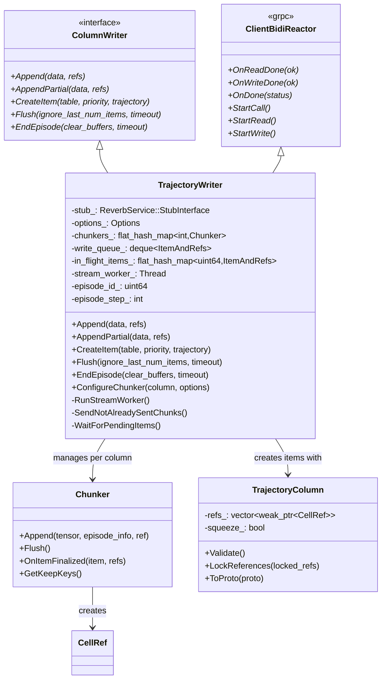

Sources: [reverb/cc/trajectory_writer.h:146-229](), [reverb/cc/trajectory_writer.h:231-465](), [reverb/cc/trajectory_writer.h:467-503]()

### Key Data Structures

**ItemAndRefs**

Represents a pending item with its data references:

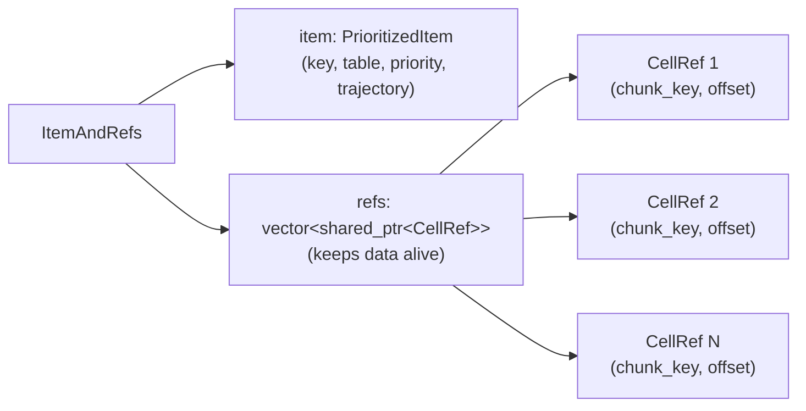

Sources: [reverb/cc/trajectory_writer.h:255-267]()

**Options**

Configuration for TrajectoryWriter behavior:

| Field | Type | Purpose |
|-------|------|---------|
| `chunker_options` | `shared_ptr<ChunkerOptions>` | Default chunking configuration (max_chunk_length, num_keep_alive_refs, delta_encode, compression) |
| `flat_signature_map` | `optional<FlatSignatureMap>` | Optional table signatures for validation |

Sources: [reverb/cc/trajectory_writer.h:240-253]()

## Data Model: Sparse Trajectories

### Conceptual Model

The TrajectoryWriter treats episodes as sparse tables where:
- **Rows** = timesteps (identified by episode_step)
- **Columns** = tensor streams (e.g., observations, actions, rewards)
- **Cells** = individual tensor values

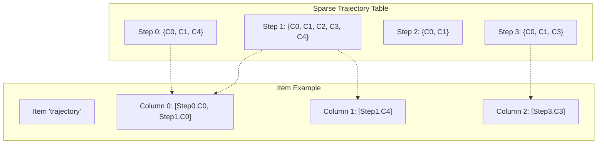

Unlike dense trajectories where all columns must be present at every step, sparse trajectories allow:
- Missing columns in a step (not all tensors need to be written)
- Items that reference non-contiguous steps
- Items where different columns have different lengths

Sources: [reverb/cc/trajectory_writer.h:47-144]()

### Column Management with Chunkers

Each column is managed by a `Chunker` object:

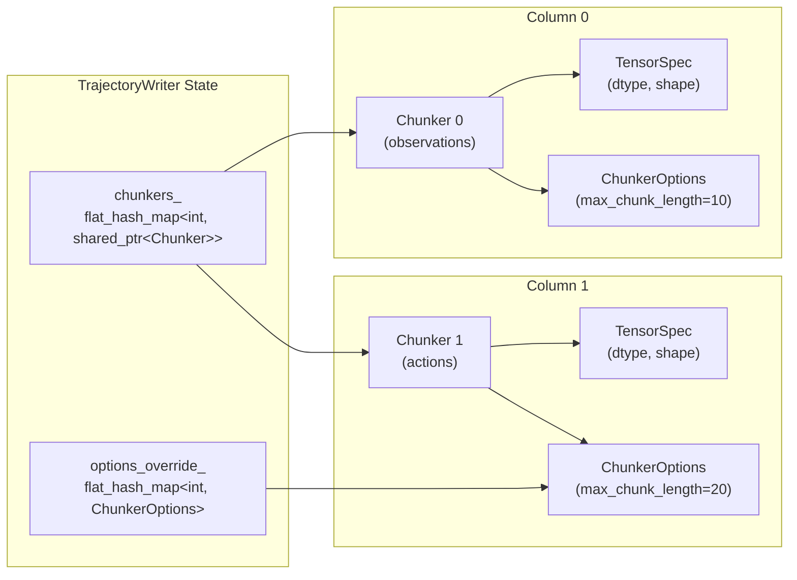

Sources: [reverb/cc/trajectory_writer.h:401-408](), [reverb/cc/trajectory_writer.cc:373-386]()

## Core Operations

### Append: Adding Data to Columns

The `Append()` method adds data to column chunkers and increments the episode step:

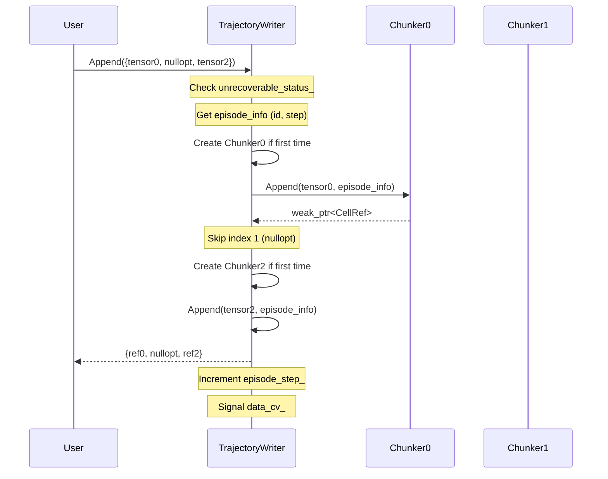

Key behaviors:
- Creates chunkers on-demand when a column is first seen
- Uses `options_override_` if `ConfigureChunker()` was called for that column
- Returns weak_ptr references that must be used in `CreateItem()`
- Thread-safe: acquires mutex for episode_step management

Sources: [reverb/cc/trajectory_writer.cc:347-424]()

### AppendPartial: Incremental Step Construction

`AppendPartial()` enables building steps across multiple calls without incrementing episode_step:

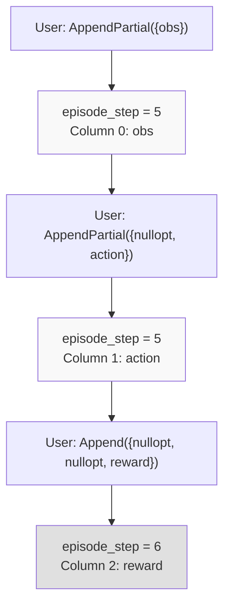

**Validation**: The implementation prevents writing to the same column twice in a partial step sequence:

Sources: [reverb/cc/trajectory_writer.cc:353-424](), [reverb/cc/trajectory_writer_test.cc:519-606]()

### CreateItem: Defining Trajectories

`CreateItem()` constructs a `PrioritizedItem` from trajectory columns:

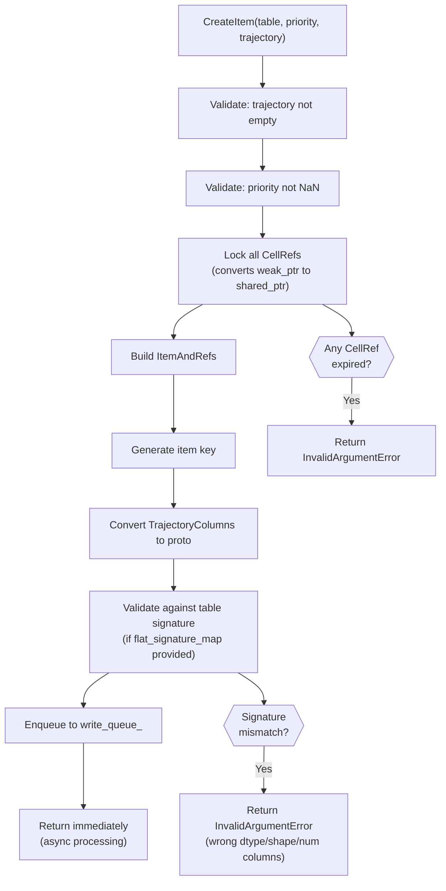

Sources: [reverb/cc/trajectory_writer.cc:426-475](), [reverb/cc/trajectory_writer.cc:219-276]()

**TrajectoryColumn Validation**:

Each `TrajectoryColumn` must satisfy:
- No expired CellRefs
- All CellRefs have compatible dtypes and shapes
- If `squeeze=true`, exactly one row

Sources: [reverb/cc/trajectory_writer.cc:813-846]()

### Flush: Synchronization

`Flush()` blocks until pending items are confirmed by the server:

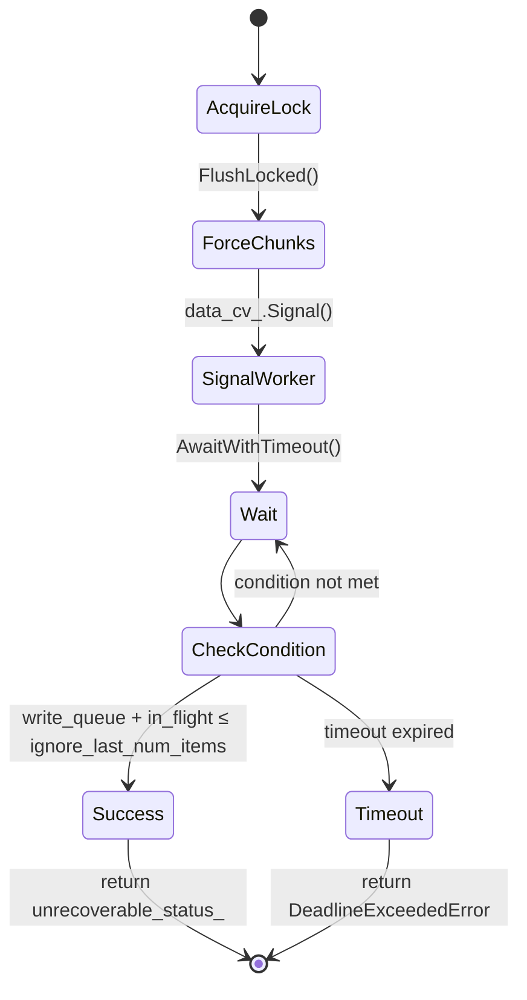

**Parameters**:
- `ignore_last_num_items`: Allows "run-ahead" by not blocking on the last N items
- `timeout`: Maximum time to wait (default: infinite)

**Force Flush**: For each non-ignored item, if any referenced CellRef is not ready (chunk incomplete), calls `Chunker::Flush()` to finalize the chunk prematurely.

Sources: [reverb/cc/trajectory_writer.cc:702-750]()

### EndEpisode: Episode Lifecycle

`EndEpisode()` finalizes the current episode and resets state:

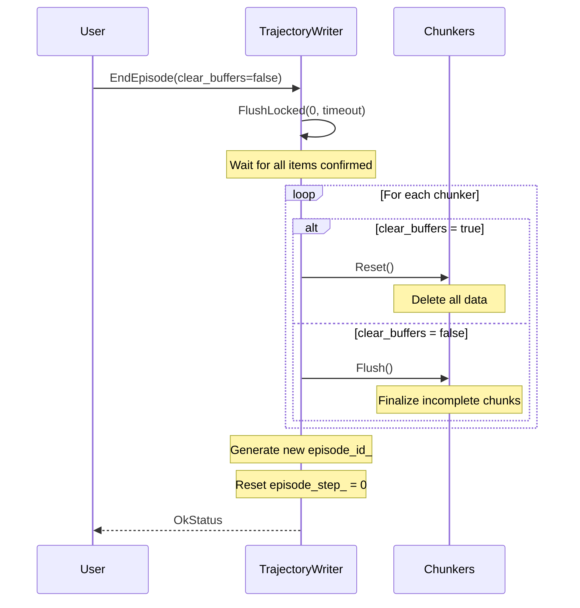

Sources: [reverb/cc/trajectory_writer.cc:752-773]()

## Asynchronous Processing

### Background Thread Architecture

TrajectoryWriter uses a dedicated `stream_worker_` thread to handle all gRPC communication:

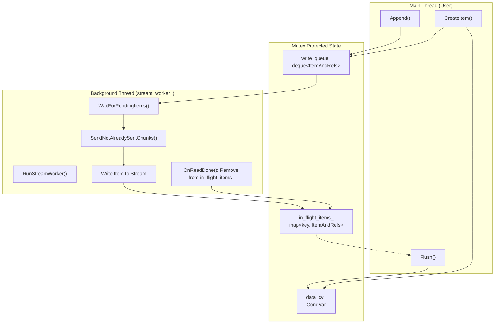

Sources: [reverb/cc/trajectory_writer.cc:278-328](), [reverb/cc/trajectory_writer.h:446-449]()

### Item State Machine

Items progress through three states:

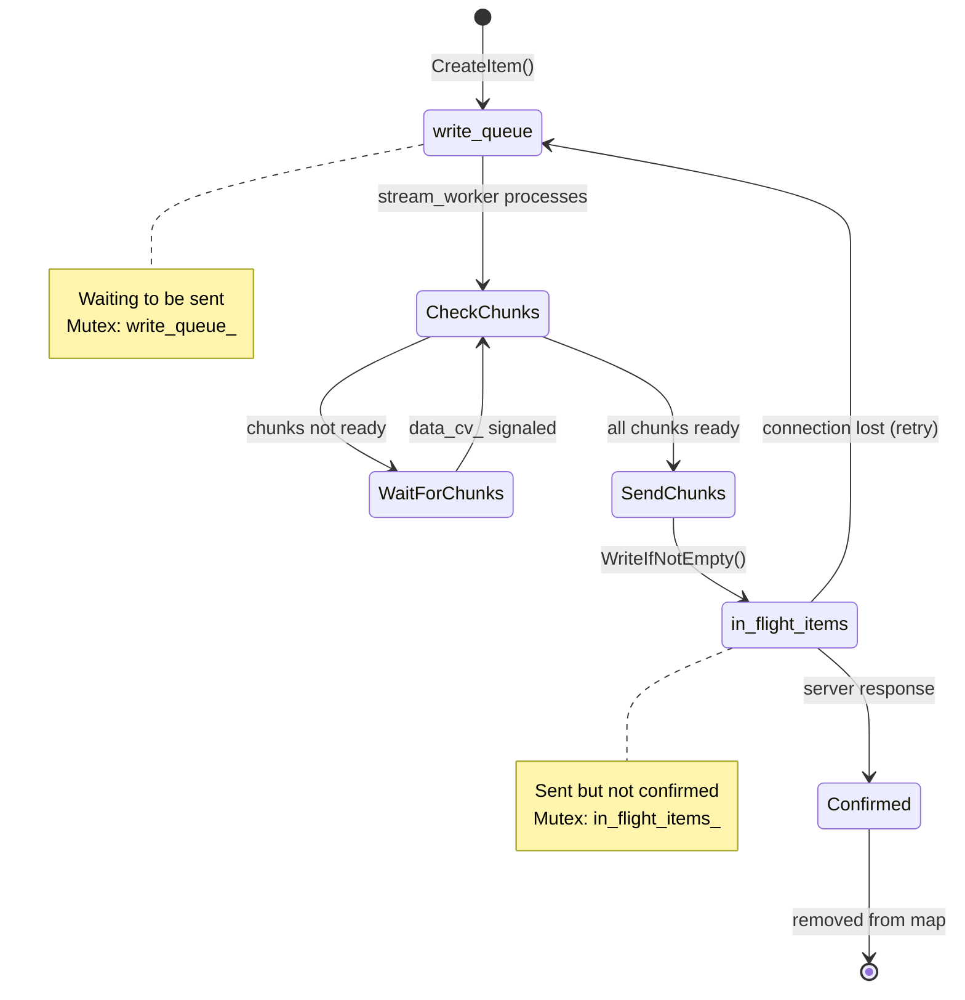

Sources: [reverb/cc/trajectory_writer.cc:595-700]()

### Stream Worker Main Loop

The `RunStreamWorker()` function implements the core processing logic:

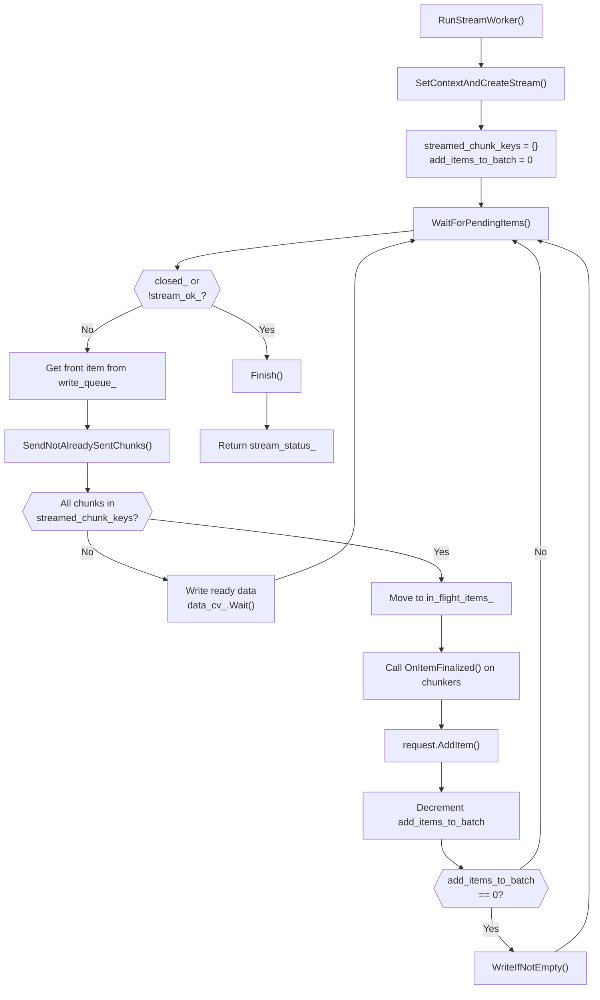

**Key optimizations**:
- Batches multiple items into single gRPC message (up to `kMaxRequestSizeBytes` = 40MB)
- Tracks `streamed_chunk_keys` to avoid resending chunks
- Sends `keep_chunk_keys` to tell server which chunks are still needed

Sources: [reverb/cc/trajectory_writer.cc:595-700]()

### Retry Logic

The outer loop in `stream_worker_` handles transient failures:

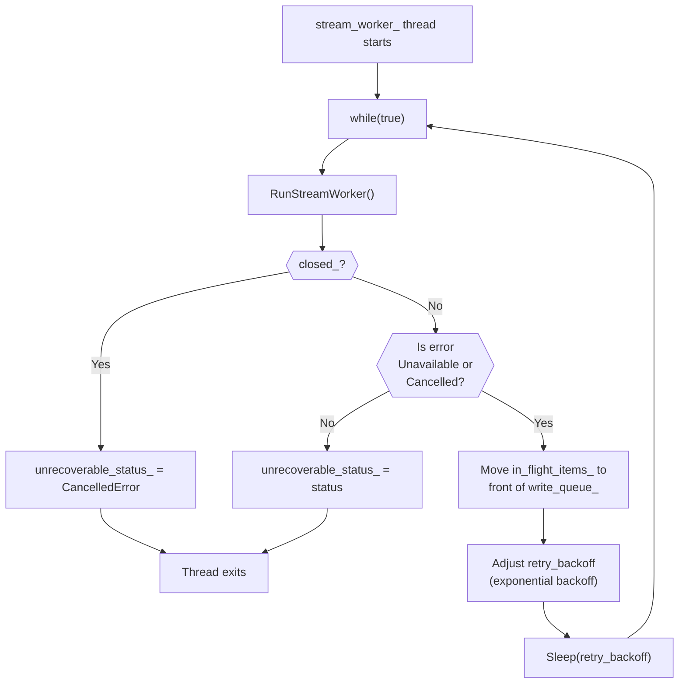

**Backoff strategy**:
- If stream lasted < 2 seconds: double backoff (up to 1 second max)
- If stream lasted ≥ 2 seconds: reset backoff to 1ms

Sources: [reverb/cc/trajectory_writer.cc:288-327]()

### gRPC Callbacks

TrajectoryWriter implements `ClientBidiReactor` callbacks:

| Callback | Purpose | Actions |
|----------|---------|---------|
| `OnReadDone(bool ok)` | Server sent confirmation | Remove confirmed keys from `in_flight_items_`, start next read, set `stream_ok_=false` if not ok |
| `OnWriteDone(bool ok)` | Write completed | Clear `write_inflight_` flag, set `stream_ok_=false` if not ok |
| `OnDone(Status s)` | Stream terminated | Set `stream_done_=true`, store `stream_status_` |

Sources: [reverb/cc/trajectory_writer.cc:501-528]()

## Memory Management

### Chunk Lifecycle and Keep-Alive

The TrajectoryWriter manages chunk memory through a keep-alive mechanism:

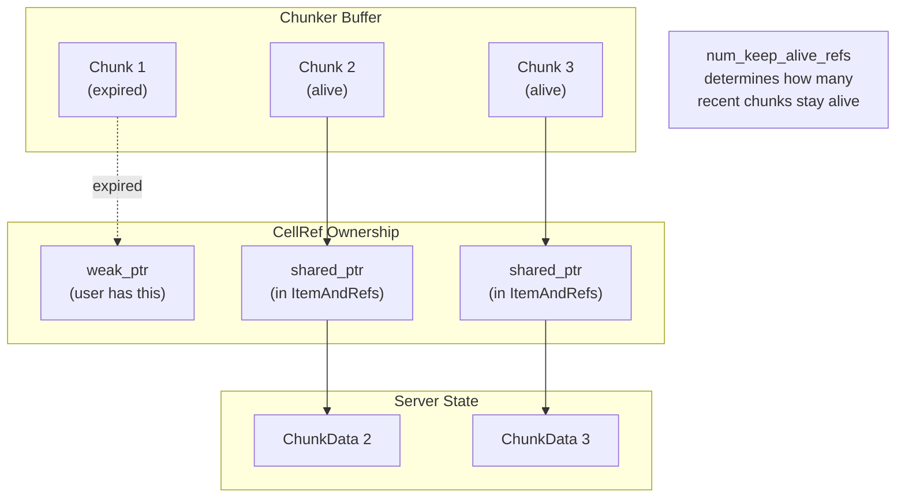

**Keep Keys**: After each item is written, TrajectoryWriter sends `keep_chunk_keys` to tell the server which chunks to retain in memory:

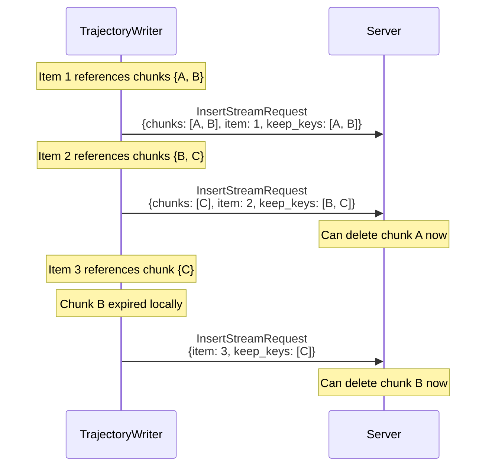

Sources: [reverb/cc/trajectory_writer.cc:568-593](), [reverb/cc/trajectory_writer.h:383-390]()

### Progressive Cleanup

To prevent unbounded memory growth, TrajectoryWriter periodically cleans up tracking state:


The `GetKeepKeys()` method:
1. Collects chunk keys from all chunkers' keep-alive windows
2. Collects chunk keys from pending items (except front item)
3. Filters both by presence in `streamed_chunk_keys`

Sources: [reverb/cc/trajectory_writer.cc:664-667]()

### Arena-Allocated Requests

To avoid memory fragmentation, `ArenaOwnedRequest` manages protobuf objects efficiently:

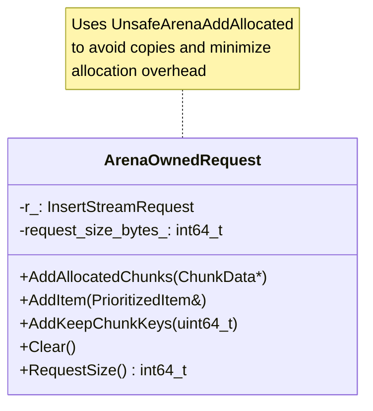

Sources: [reverb/cc/trajectory_writer.cc:54-91]()

## Error Handling and Validation

### Input Validation

TrajectoryWriter validates inputs at multiple stages:

**Append/AppendPartial Validation**:

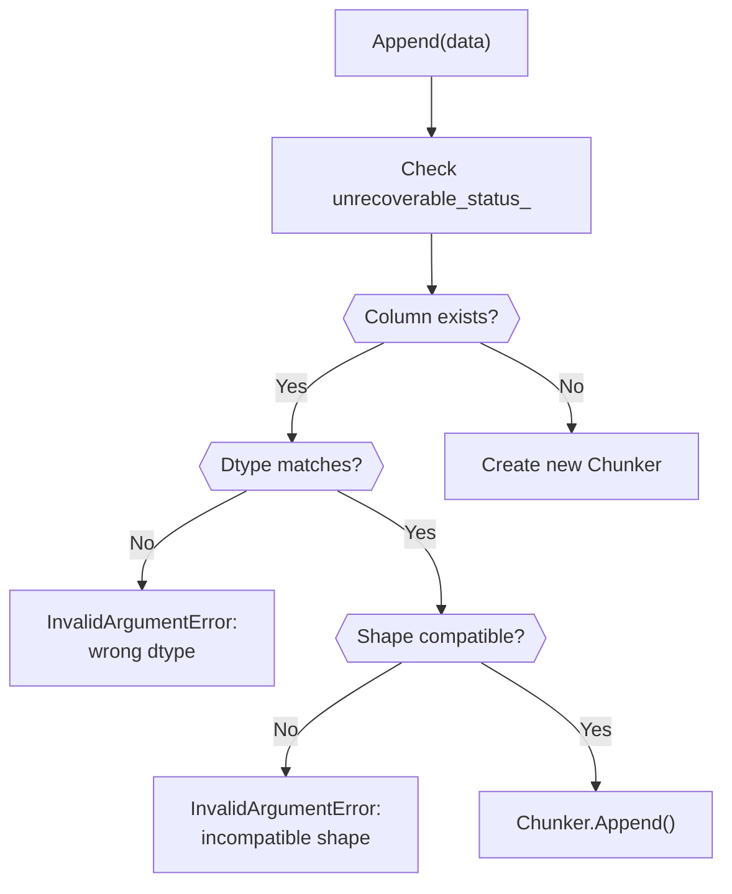

Sources: [reverb/cc/trajectory_writer_test.cc:449-496]()

**CreateItem Validation**:

| Check | Error Condition | Error Message |
|-------|----------------|---------------|
| Empty trajectory | All columns empty or no columns | "trajectory must not be empty" |
| NaN priority | `std::isnan(priority)` | "`priority` must not be nan" |
| Expired CellRef | Any `weak_ptr` cannot be locked | "Column contains expired CellRef" |
| Column dtype mismatch | CellRefs in same column have different dtypes | "Column references tensors with different dtypes" |
| Column shape mismatch | CellRefs in same column have incompatible shapes | "Column references tensors with incompatible shapes" |
| Squeeze with multiple rows | `squeeze=true` but column has != 1 rows | "TrajectoryColumn must contain exactly one row when squeeze is set" |

Sources: [reverb/cc/trajectory_writer.cc:426-475](), [reverb/cc/trajectory_writer.cc:813-846]()

### Signature Validation

If `Options.flat_signature_map` is provided, CreateItem validates against table signatures:

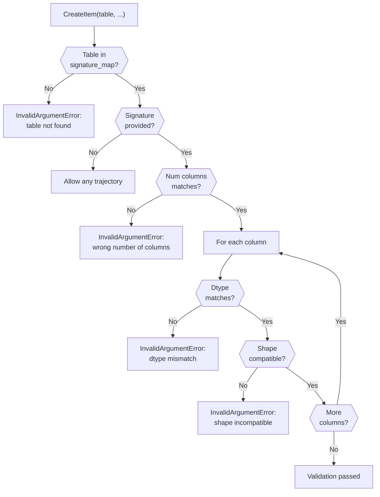

Sources: [reverb/cc/trajectory_writer.cc:219-276]()

### Unrecoverable Errors

Certain errors cause the TrajectoryWriter to enter a failed state:

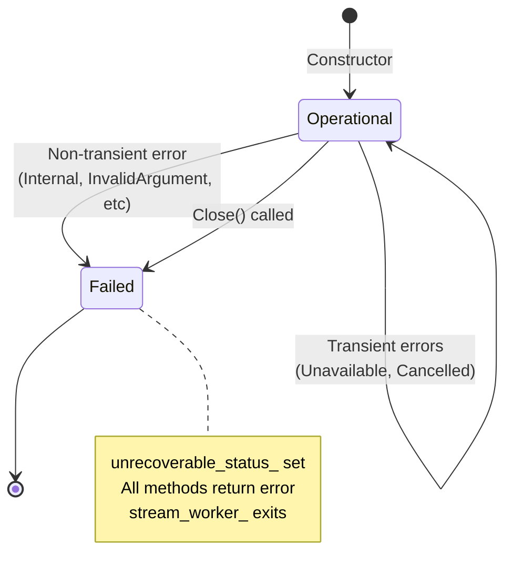

All public methods check `unrecoverable_status_` before proceeding.

Sources: [reverb/cc/trajectory_writer.cc:367-368](), [reverb/cc/trajectory_writer.h:421-424]()

## Configuration and Tuning

### ChunkerOptions Per Column

Use `ConfigureChunker()` to customize behavior for specific columns:

```mermaid
flowchart LR
    User["User"] --> ConfigureChunker["ConfigureChunker(column, options)"]
    
    ConfigureChunker --> CheckExists{{"Chunker<br/>exists?"}}
    CheckExists -->|Yes| ApplyNow["Chunker.ApplyConfig(options)"]
    CheckExists -->|No| StoreOverride["options_override_[column] = options"]
    
    StoreOverride --> FutureAppend["Future Append()"]
    FutureAppend --> CreateWithOptions["Create Chunker with overridden options"]
```

**Common use cases**:
- Large observations: increase `max_chunk_length` to reduce overhead
- Frequent sampling: increase `num_keep_alive_refs` to prevent premature expiration
- High-frequency columns: enable `delta_encode` for better compression

Sources: [reverb/cc/trajectory_writer.cc:780-790](), [reverb/cc/trajectory_writer.h:309-314]()

### Request Size Limit

TrajectoryWriter splits large requests to avoid gRPC message size limits:

```cpp
// reverb/cc/trajectory_writer.h:238
static constexpr int64_t kMaxRequestSizeBytes = 40 * 1024 * 1024;  // 40MB
```

When `request.RequestSize() >= kMaxRequestSizeBytes`:
1. Send current request with accumulated chunks
2. Continue with remaining chunks in next request

Sources: [reverb/cc/trajectory_writer.h:235-238](), [reverb/cc/trajectory_writer.cc:199-209]()

### Pending Items Warning

If `in_flight_items_.size() + write_queue_.size() >= 50`, the writer logs warnings:

> "The number of pending items is alarmingly high, did you forget to call Flush?"

This indicates the user should call `Flush()` more frequently to avoid OOM.

Sources: [reverb/cc/trajectory_writer.cc:52-52](), [reverb/cc/trajectory_writer.cc:653-662]()

## Integration Points

### Relationship with Chunker

```mermaid
graph LR
    TW["TrajectoryWriter"] -->|"manages"| Chunkers["flat_hash_map<br/>&lt;int, shared_ptr&lt;Chunker&gt;&gt;"]
    
    Chunkers --> C0["Chunker 0"]
    Chunkers --> C1["Chunker 1"]
    Chunkers --> CN["Chunker N"]
    
    C0 -->|"creates"| Chunks0["ChunkData objects"]
    C1 -->|"creates"| Chunks1["ChunkData objects"]
    CN -->|"creates"| ChunksN["ChunkData objects"]
    
    Chunks0 -->|"sent via"| Stream["gRPC InsertStream"]
    Chunks1 -->|"sent via"| Stream
    ChunksN -->|"sent via"| Stream
```

Each `Chunker`:
- Manages a circular buffer of data for one column
- Creates `CellRef` objects that point into chunks
- Notified via `OnItemFinalized()` when items using its data are written
- Can adapt chunking strategy based on usage patterns

Sources: [reverb/cc/trajectory_writer.h:401-408](), [reverb/cc/trajectory_writer.cc:671-687]()

### Relationship with gRPC Service

```mermaid
sequenceDiagram
    participant TW as TrajectoryWriter
    participant Stub as ReverbService::Stub
    participant Server as ReverbServiceImpl
    
    TW->>Stub: async()->InsertStream(context, reactor)
    Stub->>TW: SetReactor()
    TW->>TW: StartCall()
    TW->>TW: StartRead(&response_)
    
    loop Until closed or error
        TW->>TW: StartWrite(&request)
        Note over TW,Stub: Async write
        Stub-->>TW: OnWriteDone(true)
        
        Server-->>Stub: InsertStreamResponse
        Stub-->>TW: OnReadDone(true)
        TW->>TW: StartRead(&response_)
    end
    
    Note over TW: Close() or error
    TW->>TW: context_->TryCancel()
    Stub-->>TW: OnDone(status)
```

The bidirectional stream enables:
- Async writes of chunks and items
- Async reads of confirmation messages
- Parallel processing: writer can send next item while waiting for previous confirmations

Sources: [reverb/cc/trajectory_writer.cc:541-558](), [reverb/cc/trajectory_writer.cc:501-528]()

---

This completes the documentation for the C++ TrajectoryWriter. For information about the Python wrapper around this class, see [4.2](#4.2). For details about the underlying chunking mechanism, see [3.2.3](#3.2.3).

---

