<!-- source: DeepWiki mcp.deepwiki.com · repo google-deepmind/reverb · extra page C++ Writer Implementation · fetched 2026-10-26 -->

# C++ Writer Implementation

<details>
<summary>Relevant source files</summary>

The following files were used as context for generating this wiki page:

- [reverb/cc/writer.cc](reverb/cc/writer.cc)
- [reverb/cc/writer.h](reverb/cc/writer.h)
- [reverb/cc/writer_test.cc](reverb/cc/writer_test.cc)

</details>


## Purpose and Scope

This document details the C++ `Writer` class, which is the low-level implementation for writing data to Reverb tables. The `Writer` handles buffering timesteps, chunking data, compressing and streaming chunks via gRPC, and confirming item insertions asynchronously.

For the Python wrapper around this class, see [Python Client API](#4). For the higher-level trajectory writing abstraction, see [C++ TrajectoryWriter](#3.2.2). For details on compression and delta encoding, see [Chunking and Compression](#3.2.3).

**Sources:** [reverb/cc/writer.h:1-254](), [reverb/cc/writer.cc:1-644]()

## Overview

The `Writer` class provides a low-level interface for streaming timestep data to a Reverb server and creating items that reference sequences of timesteps. It operates in a batched, chunked manner to optimize network transmission and memory usage.

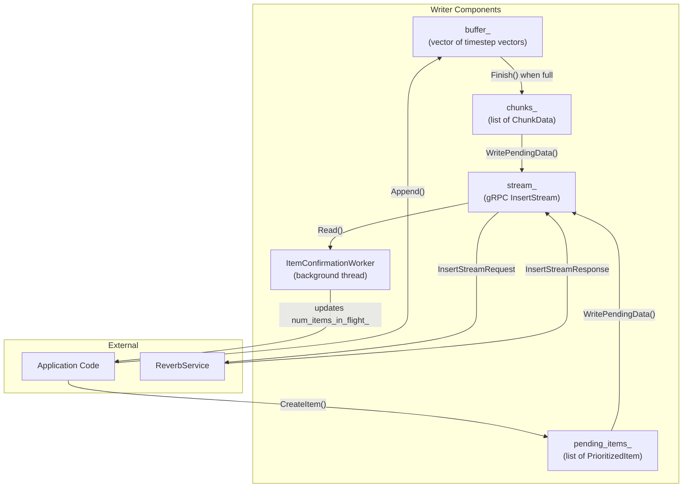

**Sources:** [reverb/cc/writer.h:42-249](), [reverb/cc/writer.cc:73-90]()

## Core Architecture

### Key Data Structures

The `Writer` maintains several internal buffers and queues:

| Member | Type | Purpose |
|--------|------|---------|
| `buffer_` | `vector<vector<Tensor>>` | Unbatched timesteps awaiting chunking |
| `chunks_` | `list<ChunkData>` | Batched and compressed chunks that can be referenced |
| `pending_items_` | `list<PrioritizedItem>` | Items awaiting transmission to server |
| `streamed_chunk_keys_` | `flat_hash_set<uint64_t>` | Keys of chunks already sent to server |
| `inserted_dtypes_and_shapes_` | `vector<DtypesAndShapes>` | Circular buffer of signatures for validation |

**Sources:** [reverb/cc/writer.h:214-240]()

### Configuration Parameters

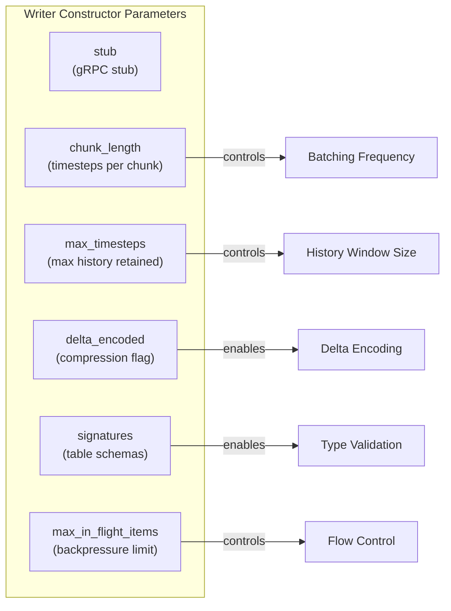

| Parameter | Default | Purpose |
|-----------|---------|---------|
| `chunk_length` | User-defined | Number of timesteps batched per chunk |
| `max_timesteps` | User-defined | Maximum history window for item references |
| `delta_encoded` | `false` | Enable delta encoding before compression |
| `max_in_flight_items` | `25` | Maximum unconfirmed items for backpressure |

**Sources:** [reverb/cc/writer.h:45-52](), [reverb/cc/writer.cc:73-90]()

## Buffering and Chunking

### Append Operation Flow

The `Append()` method buffers timesteps and triggers chunking when the buffer reaches `chunk_length_`:

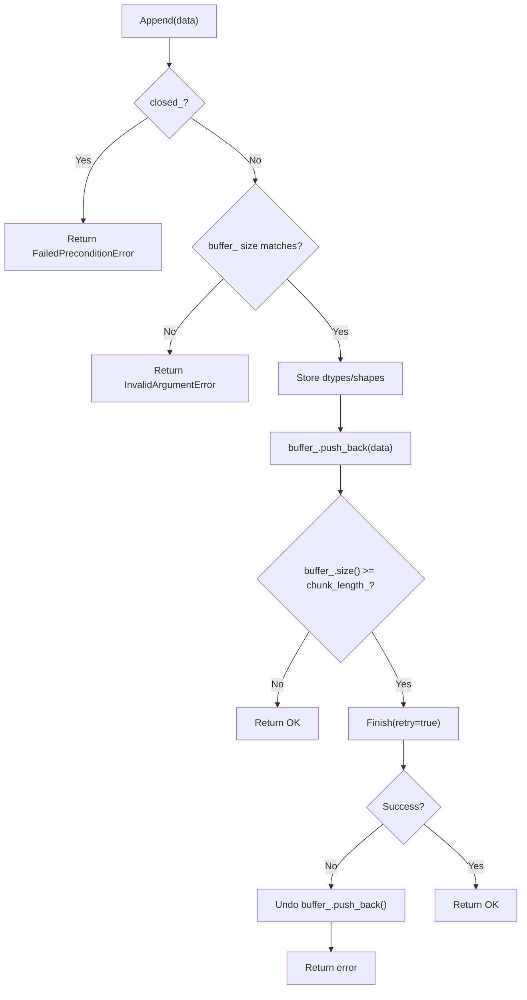

**Sources:** [reverb/cc/writer.cc:96-133]()

### Chunk Creation

The `Finish()` method converts buffered timesteps into a `ChunkData`:

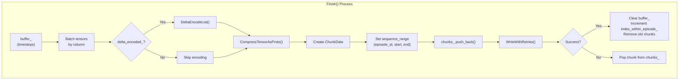

The batching process at line [reverb/cc/writer.cc:421-443]() concatenates tensors column-wise:

1. For each column index `i` in `[0, num_columns)`:
   - Extract tensor at column `i` from each timestep in `buffer_`
   - Insert a dimension at position 0 with size 1
   - Concatenate all tensors along dimension 0

**Sources:** [reverb/cc/writer.cc:420-485]()

### Sequence Range Tracking

Each chunk is tagged with a `SequenceRange` that identifies its position within an episode:

```cpp
chunk_data.mutable_sequence_range()->set_episode_id(episode_id_);
chunk_data.mutable_sequence_range()->set_start(index_within_episode_);
chunk_data.mutable_sequence_range()->set_end(index_within_episode_ + buffer_.size() - 1);
```

This enables the server to track temporal relationships and detect sequence gaps.

**Sources:** [reverb/cc/writer.cc:447-450]()

## gRPC Streaming Protocol

### Stream Lifecycle

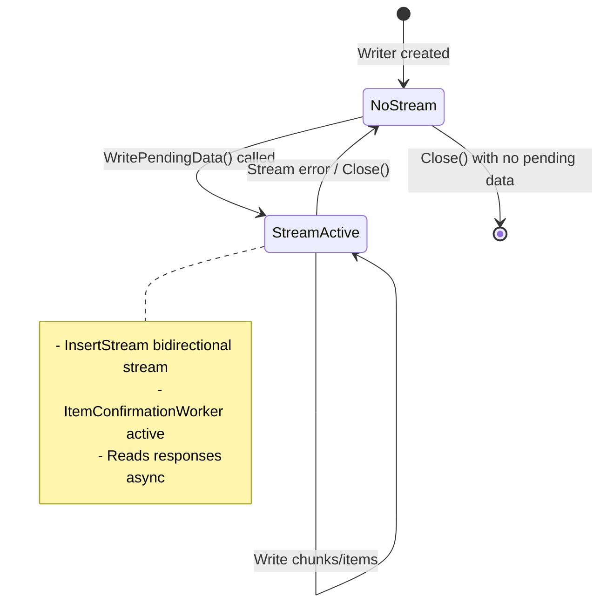

The stream is lazily initialized on first write at [reverb/cc/writer.cc:514-519]():

```cpp
if (!stream_) {
  streamed_chunk_keys_.clear();
  context_ = std::make_unique<grpc::ClientContext>();
  stream_ = stub_->InsertStream(context_.get());
  StartItemConfirmationWorker();
}
```

**Sources:** [reverb/cc/writer.cc:500-575](), [reverb/cc/writer.h:153-157]()

### Write Protocol

The `WritePendingData()` method implements the write protocol:

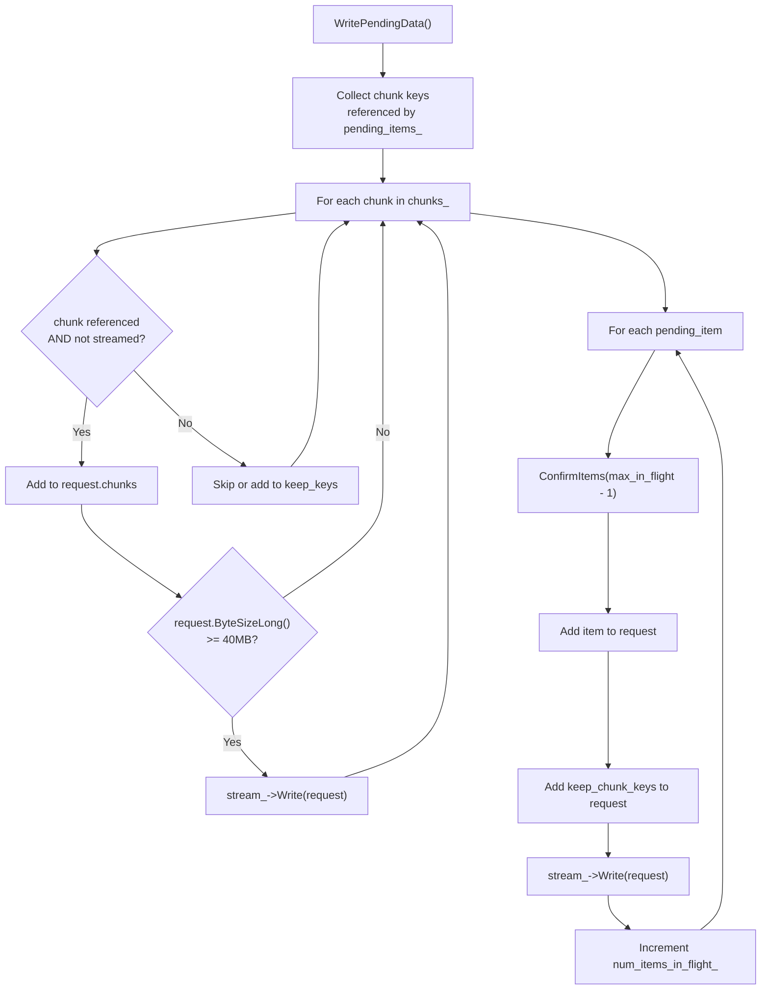

Key aspects:
- **Chunk deduplication**: Only sends chunks not yet streamed (tracked in `streamed_chunk_keys_`)
- **Size limiting**: Splits large requests at 40MB boundary ([reverb/cc/writer.cc:543]())
- **Keep-alive**: Sends `keep_chunk_keys` to prevent server from garbage collecting chunks
- **No compression**: Uses `WriteOptions.set_no_compression()` since data is already compressed

**Sources:** [reverb/cc/writer.cc:500-575]()

### Keep-Alive Protocol

The `keep_chunk_keys` field in `InsertStreamRequest` tells the server which chunks to retain:

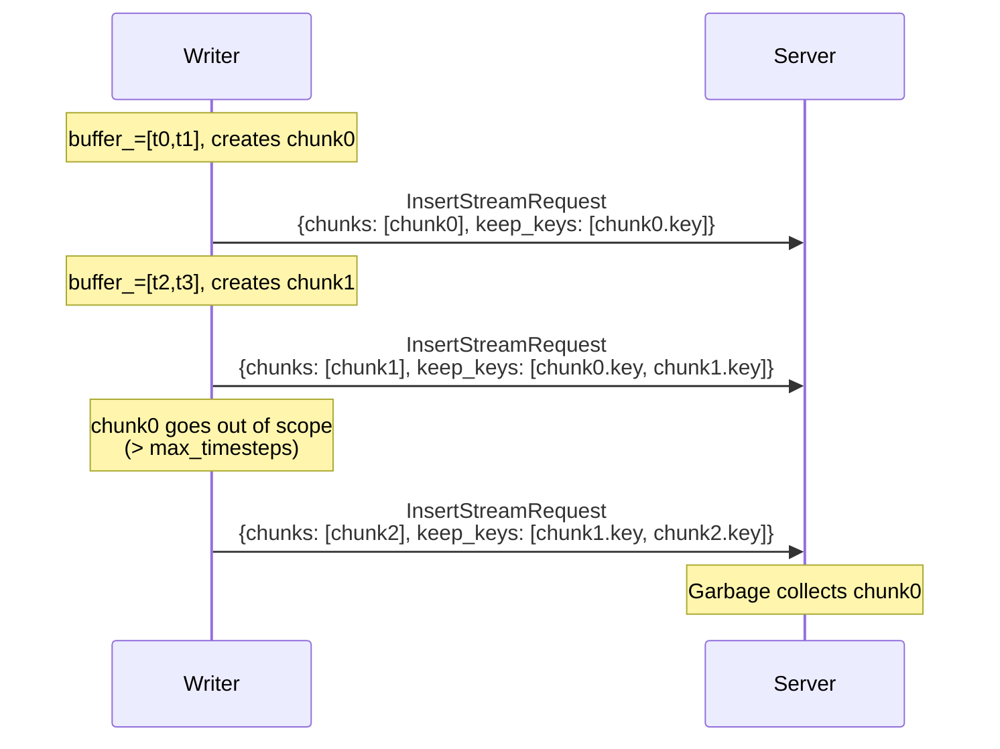

**Sources:** [reverb/cc/writer.cc:535-562]()

## Item Creation and Confirmation

### CreateItem Operation

The `CreateItem()` method builds a `PrioritizedItem` that references a trajectory of timesteps:

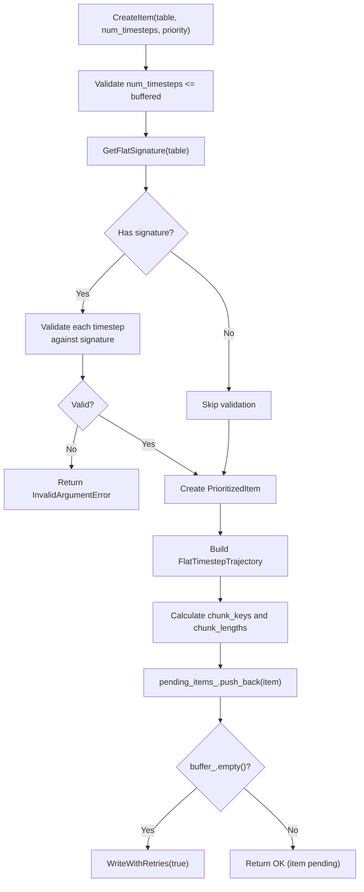

The trajectory construction at [reverb/cc/writer.cc:266-296]() works backwards from the most recent timestep:

1. If `buffer_` is not empty, include it as the last chunk
2. Traverse `chunks_` in reverse until `num_timesteps` is satisfied
3. Reverse the order to get chronological ordering
4. Create `FlatTimestepTrajectory` with offset to handle partial chunk inclusion

**Sources:** [reverb/cc/writer.cc:168-307]()

### Signature Validation

When table signatures are provided, `CreateItem()` validates each timestep against the expected schema:

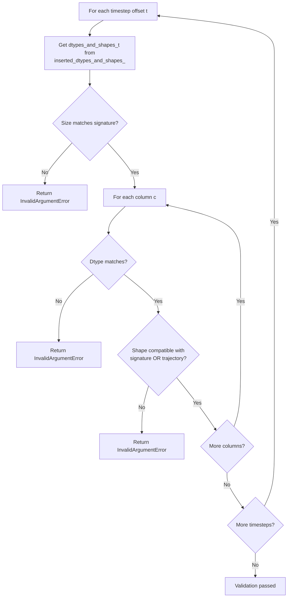

The validation supports two modes:
- **Per-timestep**: Shape matches signature directly
- **Per-trajectory**: Shape matches `[num_timesteps] + signature_shape`

This flexibility allows the writer to work with tables that expect either individual timesteps or full trajectories.

**Sources:** [reverb/cc/writer.cc:186-259]()

## Asynchronous Item Confirmation

### Confirmation Worker Thread

The `ItemConfirmationWorker` thread reads `InsertStreamResponse` messages asynchronously:

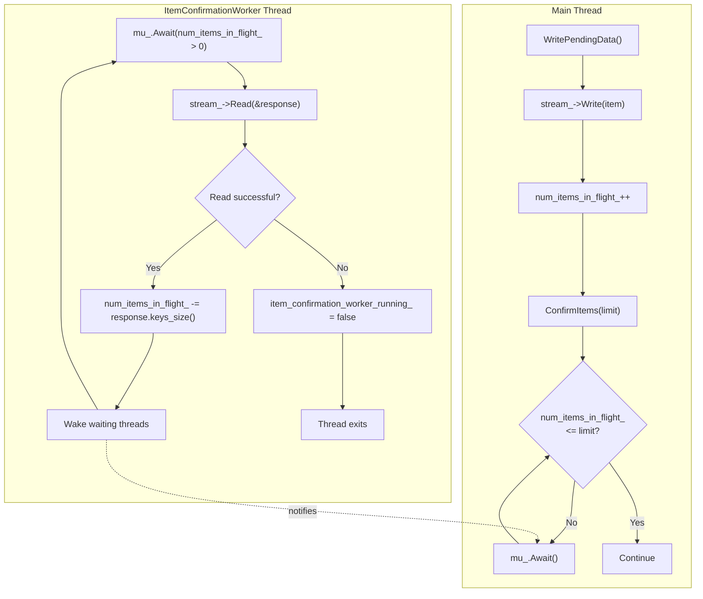

The worker provides **backpressure control**: when `num_items_in_flight_` reaches `max_in_flight_items_`, the main thread blocks in `ConfirmItems()` until the worker decrements the count.

**Sources:** [reverb/cc/writer.cc:615-641](), [reverb/cc/writer.h:124-148]()

### Thread Lifecycle

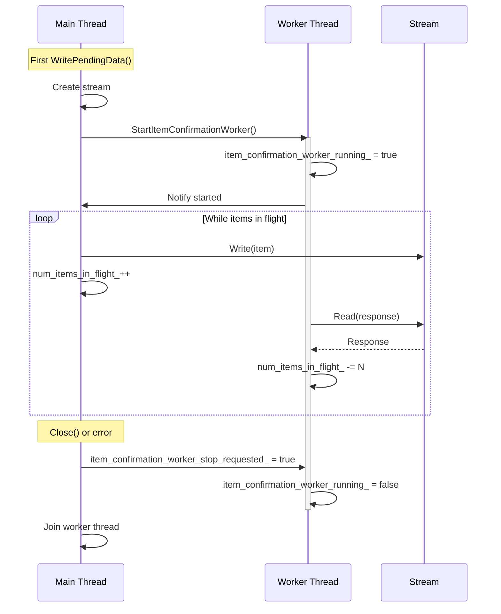

**Sources:** [reverb/cc/writer.cc:357-374](), [reverb/cc/writer.cc:335-355]()

## Error Handling and Retry Logic

### Retry Strategy

The `WriteWithRetries()` method implements retry logic for transient errors:

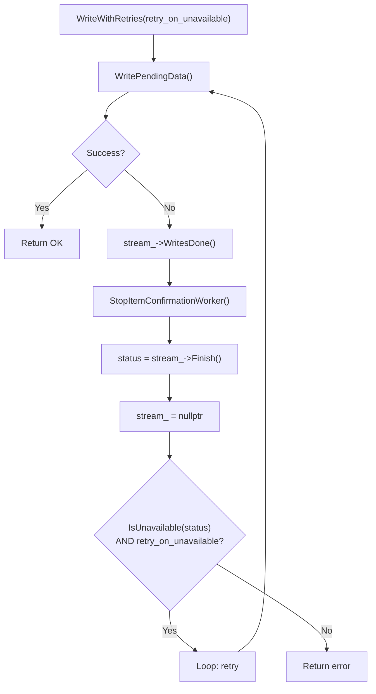

Only `UNAVAILABLE` errors are retried, indicating transient server issues. Other errors (e.g., `INVALID_ARGUMENT`) are permanent and returned immediately.

**Sources:** [reverb/cc/writer.cc:487-498]()

### Error Recovery on Append

When `Append()` triggers `Finish()` and an error occurs, the operation is **fully rolled back**:

```cpp
auto status = Finish(/*retry_on_unavailable=*/true);
if (!status.ok()) {
  // Undo adding stuff to the buffer and undo the dtypes_and_shapes_ changes.
  buffer_.pop_back();
  insert_dtypes_and_shapes_location_ =
      PositiveModulo(insert_dtypes_and_shapes_location_ - 1, max_timesteps_);
  std::swap(dtypes_and_shapes_t,
            inserted_dtypes_and_shapes_[insert_dtypes_and_shapes_location_]);
}
```

This ensures that `buffer_` and `inserted_dtypes_and_shapes_` remain consistent even if network errors occur.

**Sources:** [reverb/cc/writer.cc:123-132]()

### Close Error Handling

The `Close()` method has special handling for unavailable servers:

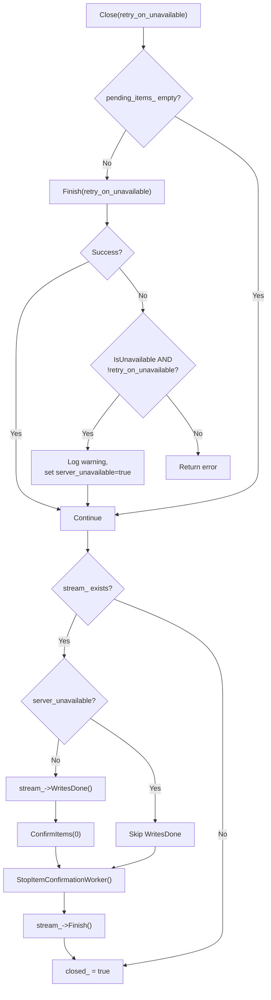

When `retry_on_unavailable=false` and the server is unavailable, the writer logs a warning but still closes successfully, preventing hangs when the server is down.

**Sources:** [reverb/cc/writer.cc:376-418]()

## State Management

### Episode and Index Tracking

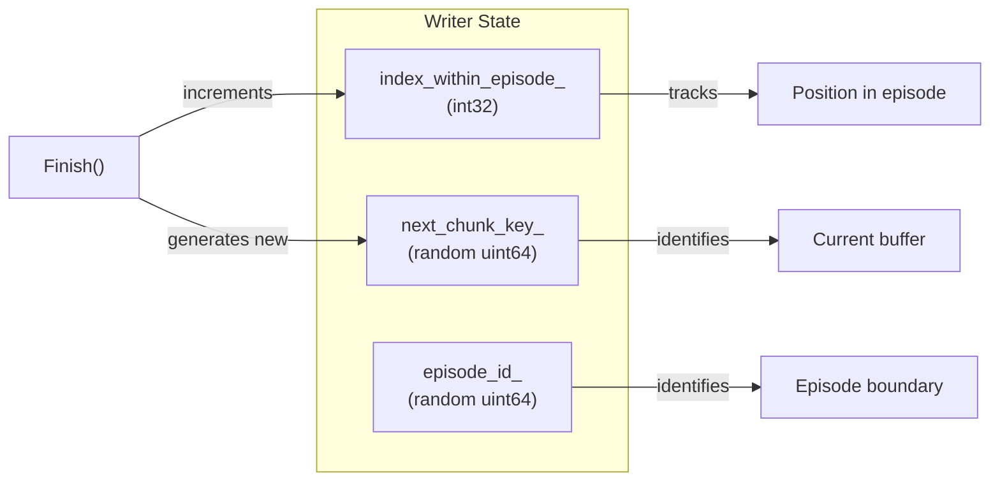

Each `ChunkData` is tagged with:
- `episode_id_`: A randomly generated ID that persists for the lifetime of the writer
- `start`/`end`: Indices within the episode (from `index_within_episode_`)

This enables the server to detect episode boundaries and sequence continuity.

**Sources:** [reverb/cc/writer.cc:84-86](), [reverb/cc/writer.cc:447-450](), [reverb/cc/writer.cc:474]()

### Circular Buffer for Signature Validation

The `inserted_dtypes_and_shapes_` circular buffer stores signatures of recently appended timesteps:

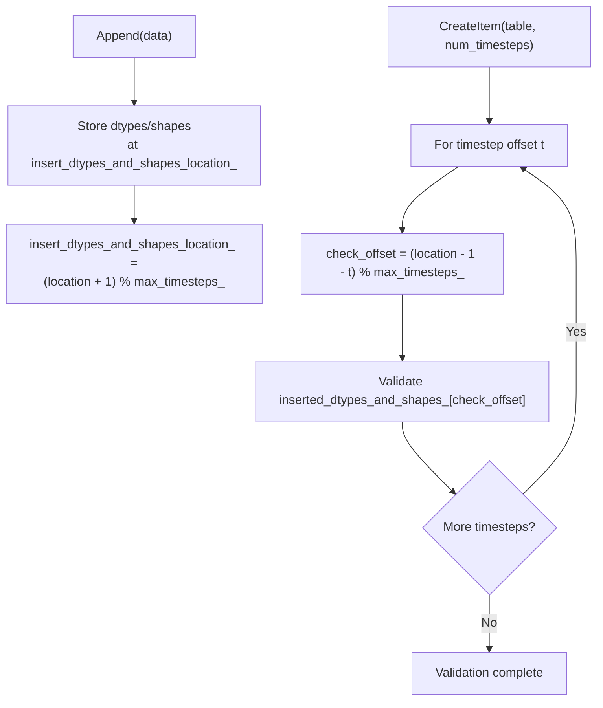

This design allows validation of any trajectory within the last `max_timesteps_` without storing full tensors.

**Sources:** [reverb/cc/writer.cc:108-118](), [reverb/cc/writer.cc:191-218](), [reverb/cc/writer.h:235-240]()

## Usage Pattern

### Typical Usage Flow

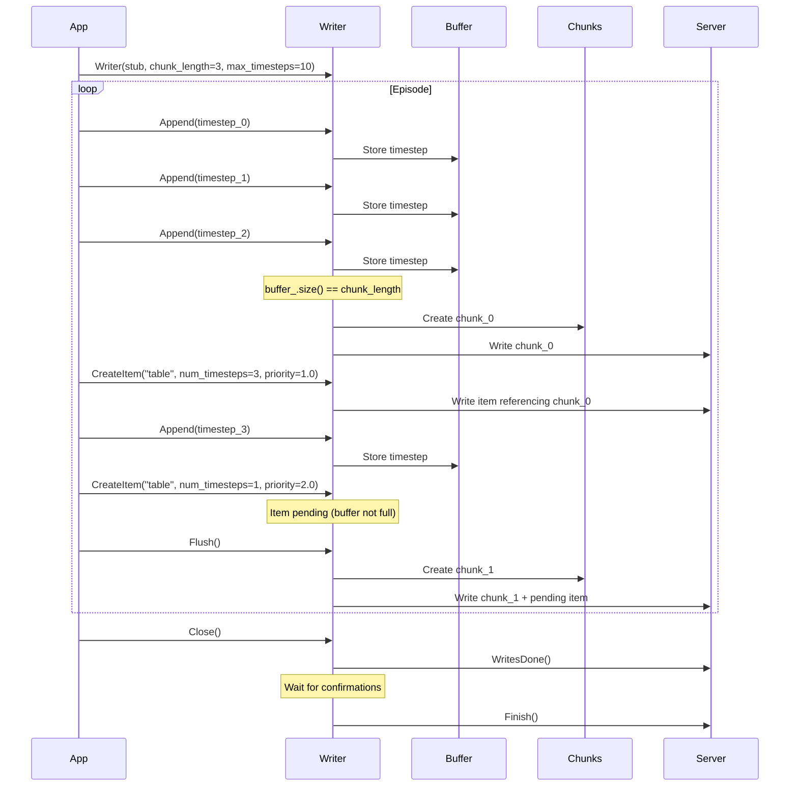

**Sources:** [reverb/cc/writer_test.cc:275-433]()

## Memory Management

### Chunk Lifecycle

Chunks are retained in `chunks_` only while they may be referenced:

```cpp
while ((chunks_.size() - 1) * chunk_length_ >= max_timesteps_) {
  streamed_chunk_keys_.erase(chunks_.front().chunk_key());
  chunks_.pop_front();
}
```

This ensures memory usage is bounded by `(max_timesteps_ / chunk_length_ + 1) * chunk_size`.

**Sources:** [reverb/cc/writer.cc:477-480]()

### Arena-Owned Requests

To avoid memory leaks from protobuf arena allocation, `WritePendingData()` uses a custom `ArenaOwnedRequest` wrapper:

```cpp
class ArenaOwnedRequest {
 public:
  ~ArenaOwnedRequest() { Clear(); }
  void Clear() {
    while (!r.chunks().empty()) {
      r.mutable_chunks()->UnsafeArenaReleaseLast();
    }
  }
  InsertStreamRequest r;
};
```

This ensures chunks added to the request via `UnsafeArenaAddAllocated()` are properly released.

**Sources:** [reverb/cc/writer.cc:501-513]()

## Key Implementation Details

### Random ID Generation

```cpp
uint64_t Writer::NewID() {
  return absl::Uniform<uint64_t>(bit_gen_, 0, UINT64_MAX);
}
```

Uses Abseil's high-quality random number generator to generate unique IDs for episodes, chunks, and items.

**Sources:** [reverb/cc/writer.cc:577-579]()

### Positive Modulo Helper

```cpp
int PositiveModulo(int value, int divisor) {
  if (divisor == 0) return value;
  if ((value > 0) == (divisor > 0)) {
    return value % divisor;
  } else {
    return (value % divisor + divisor) % divisor;
  }
}
```

Ensures modulo operations always return non-negative results, critical for circular buffer indexing.

**Sources:** [reverb/cc/writer.cc:59-69]()

### AppendSequence Batching

`AppendSequence()` efficiently appends batched timesteps by slicing along the batch dimension:

```cpp
for (int i = 0; i < sequence[0].dim_size(0); i++) {
  std::vector<tensorflow::Tensor> step;
  step.reserve(sequence.size());
  for (const auto& column : sequence) {
    auto slice = column.SubSlice(i);
    if (!slice.IsAligned()) {
      slice = tensorflow::tensor::DeepCopy(slice);
    }
    step.push_back(std::move(slice));
  }
  REVERB_RETURN_IF_ERROR(Append(std::move(step)));
}
```

This allows batch-first data formats common in ML to be efficiently written without manual unbatching.

**Sources:** [reverb/cc/writer.cc:135-166]()

---

