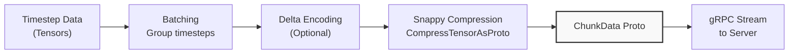
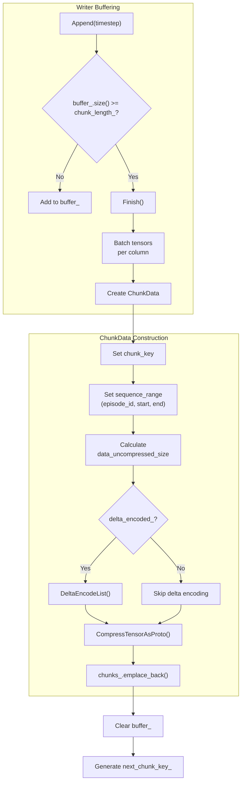
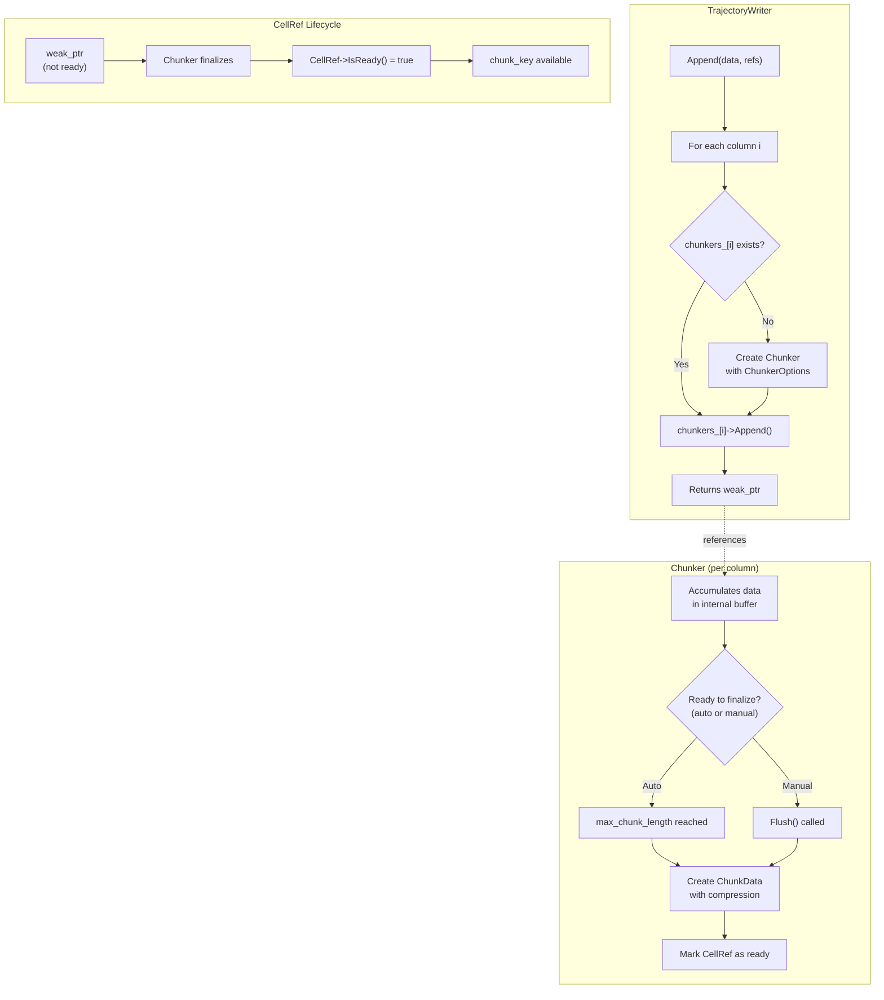
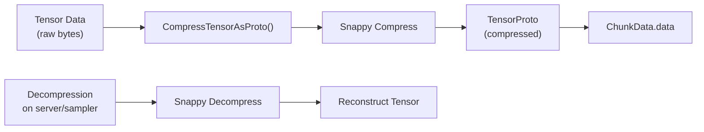
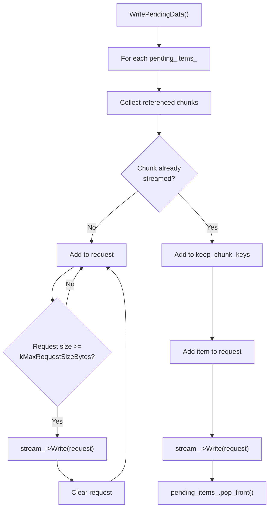
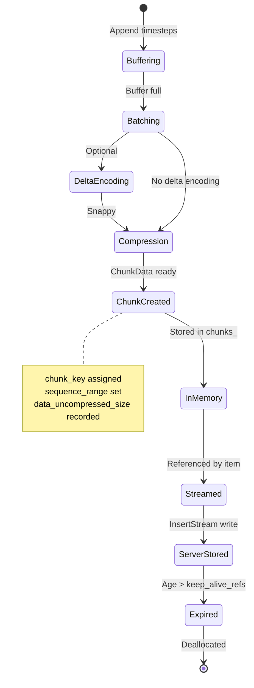

<!-- source: DeepWiki mcp.deepwiki.com · repo google-deepmind/reverb · extra page Chunking and Compression · fetched 2026-10-26 -->

# Chunking and Compression

<details>
<summary>Relevant source files</summary>

The following files were used as context for generating this wiki page:

- [reverb/cc/BUILD](reverb/cc/BUILD)
- [reverb/cc/trajectory_writer.cc](reverb/cc/trajectory_writer.cc)
- [reverb/cc/trajectory_writer.h](reverb/cc/trajectory_writer.h)
- [reverb/cc/trajectory_writer_test.cc](reverb/cc/trajectory_writer_test.cc)
- [reverb/cc/writer.cc](reverb/cc/writer.cc)
- [reverb/cc/writer.h](reverb/cc/writer.h)
- [reverb/cc/writer_test.cc](reverb/cc/writer_test.cc)

</details>


## Purpose and Scope

This document explains how Reverb chunks data into `ChunkData` protos and compresses them for efficient storage and transmission to the server. Chunking groups multiple timesteps together, while compression reduces the size of tensor data before it is sent over gRPC.

For information about how chunks are created and managed by the `Chunker` class, see the Data Ingestion System documentation [3.2](#3.2). For details on how compressed chunks are stored on the server, see the Table System documentation [3.1](#3.1).

---

## Overview: Chunking and Compression Pipeline



**Diagram: Data transformation pipeline from raw tensors to compressed chunks**

Sources: [reverb/cc/writer.cc:420-485](), [reverb/cc/trajectory_writer.cc:188-210]()

---

## Why Chunking?

Chunking serves multiple purposes in Reverb:

| Purpose | Benefit |
|---------|---------|
| **Batch Efficiency** | Reduces gRPC overhead by sending multiple timesteps in a single message |
| **Memory Management** | Enables progressive deallocation as chunks expire |
| **Reference Counting** | Items reference chunks rather than individual timesteps |
| **Compression** | Batched data compresses more efficiently than individual timesteps |
| **Network Optimization** | Chunks can be streamed incrementally, up to `kMaxRequestSizeBytes` (40MB) |

A chunk is represented by the `ChunkData` proto, which contains:
- `chunk_key`: Unique identifier (uint64)
- `sequence_range`: Episode ID and timestep range (start/end indices)
- `data`: Compressed tensor data
- `delta_encoded`: Whether delta encoding was applied
- `data_uncompressed_size`: Original size before compression
- `data_tensors_len`: Number of tensors in the chunk

Sources: [reverb/cc/schema.proto](), [reverb/cc/writer.h:43-46](), [reverb/cc/trajectory_writer.h:238]()

---

## Chunking in Writer

The `Writer` class implements a fixed-size chunking strategy controlled by `chunk_length_`.

### Chunk Creation Process



**Diagram: Fixed-size chunk creation in Writer class**

Sources: [reverb/cc/writer.cc:96-133](), [reverb/cc/writer.cc:420-485]()

### Code Flow in Writer::Finish

The `Finish` method orchestrates chunk creation:

1. **Tensor Batching** [reverb/cc/writer.cc:421-443]()
   - Concatenates tensors from `buffer_` along a new batch dimension
   - Each column (tensor index) is batched separately
   - Example: 3 timesteps with shape `[H,W]` → batched shape `[3,H,W]`

2. **Metadata Population** [reverb/cc/writer.cc:445-458]()
   ```
   chunk_data.set_chunk_key(next_chunk_key_);
   chunk_data.mutable_sequence_range()->set_episode_id(episode_id_);
   chunk_data.mutable_sequence_range()->set_start(index_within_episode_);
   chunk_data.mutable_sequence_range()->set_end(index_within_episode_ + buffer_.size() - 1);
   chunk_data.set_data_uncompressed_size(total_uncompressed_size);
   ```

3. **Optional Delta Encoding** [reverb/cc/writer.cc:459-462]()
   ```
   if (delta_encoded_) {
     batched_tensors = DeltaEncodeList(batched_tensors, true);
     chunk_data.set_delta_encoded(true);
   }
   ```

4. **Compression** [reverb/cc/writer.cc:464-468]()
   ```
   for (const auto& tensor : batched_tensors) {
     REVERB_RETURN_IF_ERROR(CompressTensorAsProto(
         tensor, chunk_data.mutable_data()->add_tensors()));
   }
   ```

5. **Chunk Storage** [reverb/cc/writer.cc:470-480]()
   - Adds chunk to `chunks_` deque
   - Removes old chunks when buffer exceeds `max_timesteps_`

Sources: [reverb/cc/writer.cc:420-485]()

---

## Chunking in TrajectoryWriter

The `TrajectoryWriter` uses the `Chunker` class for more flexible, column-specific chunking controlled by `ChunkerOptions`.

### Chunker-Based Architecture



**Diagram: Column-specific chunking architecture in TrajectoryWriter**

Sources: [reverb/cc/trajectory_writer.cc:360-424](), [reverb/cc/chunker.h](), [reverb/cc/chunker.cc]()

### Key Differences from Writer

| Aspect | Writer | TrajectoryWriter |
|--------|--------|------------------|
| **Chunking Strategy** | Fixed size for all columns | Configurable per column via `ChunkerOptions` |
| **Chunk Creation** | Synchronous when `chunk_length_` reached | Asynchronous; chunks finalized when ready |
| **Column Independence** | All columns chunked together | Each column has its own `Chunker` instance |
| **Configuration** | Constructor parameters (`chunk_length_`, `delta_encoded_`) | Per-column `ConfigureChunker()` [reverb/cc/trajectory_writer.cc:780-790]() |
| **Reference Model** | Items reference chunk keys directly | Items reference `CellRef` objects that resolve to chunks |

Sources: [reverb/cc/trajectory_writer.h:231-329](), [reverb/cc/writer.h:43-96]()

### Chunker Lifecycle

The `Chunker` class manages data accumulation and chunk finalization:

1. **Data Accumulation**: `Chunker::Append()` adds tensors to an internal buffer
2. **Automatic Finalization**: When buffer reaches `max_chunk_length`, chunk is created
3. **Manual Finalization**: `Chunker::Flush()` forces premature chunk creation
4. **Compression**: Chunks are compressed during finalization
5. **Reference Resolution**: All `CellRef` objects pointing to the chunk become "ready"

Sources: [reverb/cc/chunker.h](), [reverb/cc/chunker.cc]()

---

## Delta Encoding

Delta encoding is an optional pre-compression optimization that stores only the differences between consecutive elements.

### When Delta Encoding Helps

Delta encoding is most effective for:
- **Sequential observations**: Video frames, sensor readings
- **Slowly changing data**: Embeddings, state representations
- **Repetitive patterns**: Similar timesteps in short sequences

### Delta Encoding Algorithm

The `DeltaEncodeList` function implements first-order differencing:

```
For tensor T with shape [N, ...]:
  result[0] = T[0]                    // First element unchanged
  result[i] = T[i] - T[i-1]  for i > 0  // Store differences
```

This is applied per-tensor before compression, allowing the compressor to achieve better ratios on the resulting sparse data.

**Configuration**:
- **Writer**: Set `delta_encoded=true` in constructor [reverb/cc/writer.cc:73-90]()
- **TrajectoryWriter**: Set `GetDeltaEncode()` in `ChunkerOptions` [reverb/cc/chunker.h]()

Sources: [reverb/cc/writer.cc:459-462](), [reverb/cc/tensor_compression.h]()

---

## Compression with Snappy

Reverb uses the Snappy compression library to compress tensor data before transmission.

### Compression Pipeline



**Diagram: Tensor compression and decompression flow**

Sources: [reverb/cc/tensor_compression.cc](), [reverb/cc/tensor_compression.h](), [reverb/cc/BUILD:189-202]()

### Compression Function

The `CompressTensorAsProto` function [reverb/cc/tensor_compression.cc]():

1. Serializes the tensor to a byte string
2. Applies Snappy compression
3. Stores compressed data in `TensorProto.tensor_content`
4. Records metadata (dtype, shape) for decompression

### Uncompressed Size Tracking

The `data_uncompressed_size` field tracks the original size before compression:

```cpp
int64_t total_uncompressed_size = 0;
for (const auto& tensor : batched_tensors) {
  total_uncompressed_size += tensor.TotalBytes();
}
chunk_data.set_data_uncompressed_size(total_uncompressed_size);
```

This metadata is used for:
- Memory accounting on the server
- Monitoring compression ratios
- Capacity management in `ChunkStore`

Sources: [reverb/cc/writer.cc:452-458]()

---

## Chunk Streaming and Size Limits

Chunks are streamed to the server via the `InsertStream` bidirectional gRPC endpoint, with careful attention to message size limits.

### Request Size Management

Both `Writer` and `TrajectoryWriter` enforce a maximum request size:

```cpp
static constexpr int64_t kMaxRequestSizeBytes = 40 * 1024 * 1024;  // 40MB
```

This prevents excessively large gRPC messages that could cause memory issues or timeouts.

### Chunked Streaming in Writer

[reverb/cc/writer.cc:500-575]():



**Diagram: Chunk streaming with size-based batching in Writer**

Sources: [reverb/cc/writer.cc:500-575]()

### Chunked Streaming in TrajectoryWriter

[reverb/cc/trajectory_writer.cc:158-210]():

The `TrajectoryWriter` uses a similar strategy but with additional complexity:

1. **Incremental Transmission**: `SendNotAlreadySentChunks()` sends chunks as they become ready
2. **Backpressure**: Writer thread blocks if chunks referenced by pending items are not yet finalized
3. **Keep-Alive Keys**: `streamed_chunk_keys` tracks sent chunks; `GetKeepKeys()` tells server which to retain

```cpp
if (request.RequestSize() >= TrajectoryWriter::kMaxRequestSizeBytes) {
  if (!WriteIfNotEmpty(*streamed_chunk_keys, request)) {
    return false;
  }
  // Continue with remaining references
}
```

### gRPC Write Options

Both writers disable gRPC's automatic compression since data is already compressed:

```cpp
grpc::WriteOptions options;
options.set_no_compression();
stream_->Write(request, options);
```

This avoids double-compression overhead.

Sources: [reverb/cc/writer.cc:532-534](), [reverb/cc/trajectory_writer.cc:171-173]()

---

## Chunk Lifecycle Summary



**Diagram: Complete lifecycle of a chunk from creation to deallocation**

Sources: [reverb/cc/writer.cc:420-485](), [reverb/cc/trajectory_writer.cc:595-700]()

---

## Key Classes and Functions

| Entity | Location | Purpose |
|--------|----------|---------|
| `ChunkData` | [reverb/cc/schema.proto]() | Proto message containing compressed chunk |
| `Writer::Finish()` | [reverb/cc/writer.cc:420-485]() | Creates chunks with fixed-size batching |
| `Chunker` | [reverb/cc/chunker.h]() | Per-column chunking with configurable options |
| `CompressTensorAsProto()` | [reverb/cc/tensor_compression.cc]() | Compresses tensor data with Snappy |
| `DeltaEncodeList()` | [reverb/cc/tensor_compression.cc]() | Applies delta encoding pre-compression |
| `SendNotAlreadySentChunks()` | [reverb/cc/trajectory_writer.cc:185-210]() | Streams chunks incrementally |
| `kMaxRequestSizeBytes` | [reverb/cc/writer.h:45](), [reverb/cc/trajectory_writer.h:238]() | 40MB request size limit |

Sources: All files listed in table

---

## Configuration Options

### Writer Configuration

```cpp
Writer(stub, 
       chunk_length,        // Timesteps per chunk
       max_timesteps,       // Max history retained
       delta_encoded,       // Enable delta encoding
       signatures,          // Table signatures
       max_in_flight_items) // Flow control
```

### TrajectoryWriter Configuration

```cpp
TrajectoryWriter::Options {
  chunker_options,         // Default ChunkerOptions for all columns
  flat_signature_map       // Optional table signatures
};

// Per-column override
ConfigureChunker(column_index, custom_chunker_options);
```

### ChunkerOptions Interface

```cpp
class ChunkerOptions {
  virtual int GetMaxChunkLength() = 0;      // Chunk size
  virtual int GetNumKeepAliveRefs() = 0;    // How long to keep chunks
  virtual bool GetDeltaEncode() = 0;        // Delta encoding
  virtual bool GetCompressionDisabled() = 0; // Disable compression
  virtual absl::Status OnItemFinalized(...) = 0; // Callback
};
```

Sources: [reverb/cc/writer.h:49-52](), [reverb/cc/trajectory_writer.h:240-253](), [reverb/cc/chunker.h]()

---

