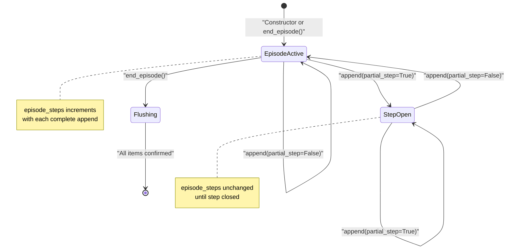
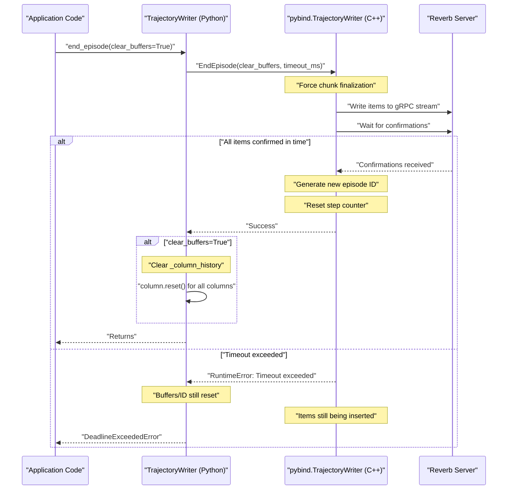
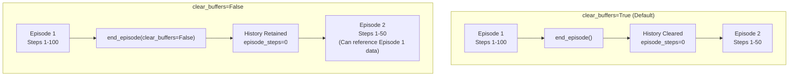
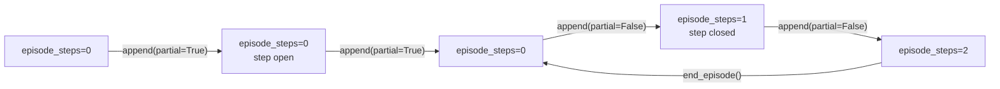
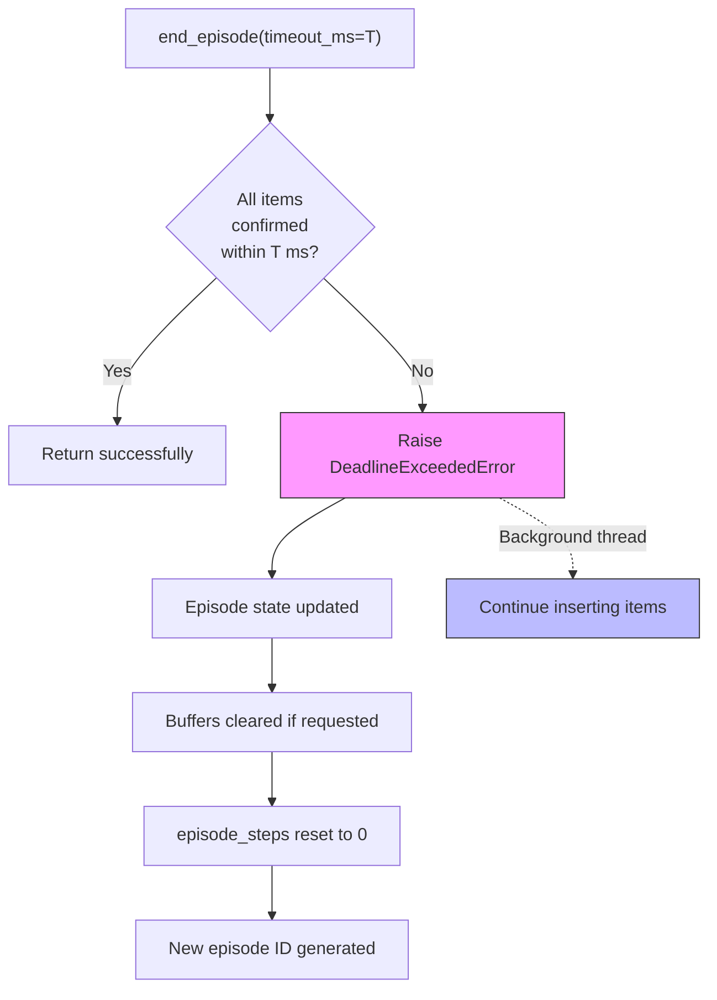
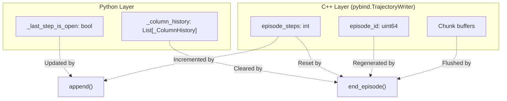

<!-- source: DeepWiki mcp.deepwiki.com · repo google-deepmind/reverb · extra page Episode Management · fetched 2026-10-26 -->

# Episode Management

<details>
<summary>Relevant source files</summary>

The following files were used as context for generating this wiki page:

- [reverb/trajectory_dataset_test.py](reverb/trajectory_dataset_test.py)
- [reverb/trajectory_writer.py](reverb/trajectory_writer.py)
- [reverb/trajectory_writer_test.py](reverb/trajectory_writer_test.py)

</details>


## Purpose and Scope

This document describes how episodes are managed in the Python `TrajectoryWriter` class. It covers the episode lifecycle, the step counter, the `end_episode` method, and how partial steps interact with episode boundaries.

For information about the overall `TrajectoryWriter` architecture and data appending mechanisms, see [Python TrajectoryWriter](#4.2). For details on history and column management, see [History and Column Management](#4.2.1).

---

## Episode Lifecycle Overview

An **episode** in Reverb's `TrajectoryWriter` represents a logical grouping of sequential steps, typically corresponding to a single run of an environment from initial state to terminal state in reinforcement learning applications. Each episode has:

1. A unique **episode ID** generated by the underlying C++ writer
2. A **step counter** tracking the number of complete steps appended
3. A **history buffer** containing data references from the episode
4. **Pending items** that reference data from the episode



Sources: [reverb/trajectory_writer.py:29-110]()

---

## Episode Step Counter

The `TrajectoryWriter.episode_steps` property returns the number of complete steps appended since the last `end_episode` call or writer construction.

### Counter Behavior

| Operation | Effect on `episode_steps` |
|-----------|---------------------------|
| `append(data, partial_step=False)` | Increments by 1 |
| `append(data, partial_step=True)` | No change (step still open) |
| `end_episode()` | Resets to 0 |
| Writer construction | Initialized to 0 |


### Implementation

The step counter is maintained by the underlying C++ `TrajectoryWriter` and accessed through a property:

[reverb/trajectory_writer.py:188-195]()

```python
@property
def episode_steps(self) -> int:
  """Number of append calls since last `end_episode` call.
  
  This does not count partial calls to append, i.e. ones with
  `partial_step=True`.
  """
  return self._writer.episode_steps
```

Sources: [reverb/trajectory_writer.py:188-195](), [reverb/trajectory_writer_test.py:339-378]()

---

## The `end_episode` Method

The `end_episode` method finalizes the current episode by:

1. Flushing all pending items (forcing chunk finalization if needed)
2. Blocking until the server confirms all insertions
3. Generating a new episode ID in the C++ layer
4. Optionally clearing the history buffers
5. Resetting the `episode_steps` counter to 0

### Method Signature

[reverb/trajectory_writer.py:428-454]()

```python
def end_episode(self,
                clear_buffers: bool = True,
                timeout_ms: Optional[int] = None):
  """Flush all pending items and generate a new episode ID.
  
  Args:
    clear_buffers: Whether the history should be cleared or not. Buffers
      should only not be cleared when trajectories spanning multiple episodes
      are used.
    timeout_ms: (optional, default is no timeout) Maximum time to block for
      before unblocking and raising a `DeadlineExceededError` instead. Note
      that although the block is interrupted, the buffers and episode ID are
      reset all the same and the insertion of the items will proceed in the
      background thread.
  
  Raises:
    DeadlineExceededError: If operation did not complete before the timeout.
  """
```

### Execution Flow



Sources: [reverb/trajectory_writer.py:428-458](), [reverb/trajectory_writer_test.py:439-455]()

---

## Buffer Clearing Behavior

The `clear_buffers` parameter controls whether history is retained across episode boundaries.

### When `clear_buffers=True` (Default)

All data references in the history are cleared, and the `_column_history` list is reset:

[reverb/trajectory_writer.py:455-458]()

```python
if clear_buffers:
  for column in self._column_history:
    column.reset()
```

The `_ColumnHistory.reset()` method clears the circular buffer:

[reverb/trajectory_writer.py:561-563]()

```python
def reset(self):
  self._data_references = []
  self._offset = 0
```

### When `clear_buffers=False`

History buffers are **not** cleared, allowing trajectories to span multiple episodes. This is useful for:

- **N-step returns across episode boundaries**: Computing returns that include rewards from the next episode
- **State continuity**: When episodes are artificially segmented but the underlying process is continuous
- **Bootstrap values**: Using the first state of episode N+1 as the bootstrap target for episode N



Sources: [reverb/trajectory_writer.py:428-458](), [reverb/trajectory_writer_test.py:380-395]()

---

## Partial Steps and Episode Boundaries

Partial steps (created with `append(data, partial_step=True)`) must be closed before calling `end_episode`. The `_last_step_is_open` flag tracks whether the current step is still accepting data.

### Partial Step State Management

[reverb/trajectory_writer.py:136-140]()

```python
# Set when `append` called with `partial_step=True`. Remains set until
# `append` called with `partial_step=False`. This is used to control where
# new data references are added to the history (i.e whether a new step
# should be created).
self._last_step_is_open = False
```

[reverb/trajectory_writer.py:338-340]()

```python
# Save the flag so the next `append` call either populates the same step
# or begins a new step.
self._last_step_is_open = partial_step
```

### Episode Step Counter with Partial Steps



### Example: Multi-Part Step Construction

```python
writer = client.trajectory_writer(num_keep_alive_refs=10)

# Start a step with observation only
writer.append({'observation': obs}, partial_step=True)
print(writer.episode_steps)  # 0 - step not complete

# Add action to the same step
writer.append({'action': action}, partial_step=True)
print(writer.episode_steps)  # 0 - step still not complete

# Close the step with reward
writer.append({'reward': reward}, partial_step=False)
print(writer.episode_steps)  # 1 - step now complete

# End episode
writer.end_episode()
print(writer.episode_steps)  # 0 - reset
```

Sources: [reverb/trajectory_writer.py:136-140](), [reverb/trajectory_writer.py:238-340](), [reverb/trajectory_writer_test.py:357-378]()

---

## Timeout Handling

Both `end_episode` and its internal use of `flush` support timeout parameters to prevent indefinite blocking when the server is slow or the rate limiter is blocking insertions.

### Timeout Behavior

When a timeout occurs:

1. A `DeadlineExceededError` is raised to the caller
2. The episode state changes **still occur** (new ID generated, buffers cleared if requested, counter reset)
3. Item insertion **continues in the background** thread
4. The GIL is released during the blocking wait, so other threads can progress

[reverb/trajectory_writer.py:446-454]()

```python
try:
  self._writer.EndEpisode(clear_buffers, timeout_ms)
except RuntimeError as e:
  if 'Timeout exceeded' in str(e) and timeout_ms is not None:
    raise errors.DeadlineExceededError(
        f'End episode call did not complete within provided timeout of '
        f'{datetime.timedelta(milliseconds=timeout_ms)}')
  raise
```

### Timeout Decision Tree



Sources: [reverb/trajectory_writer.py:428-454](), [reverb/trajectory_writer_test.py:439-455]()

---

## Common Usage Patterns

### Standard RL Episode Loop

The most common pattern for managing episodes in reinforcement learning:

```python
client = reverb.Client('localhost:8000')

with client.trajectory_writer(num_keep_alive_refs=5) as writer:
  for episode_num in range(NUM_EPISODES):
    timestep = env.reset()
    writer.append({'observation': timestep.observation})
    
    while not timestep.last():
      action = policy(timestep)
      timestep = env.step(action)
      
      writer.append({
          'observation': timestep.observation,
          'action': action,
          'reward': timestep.reward,
      })
      
      if writer.episode_steps >= 5:
        writer.create_item(
            table='my_table',
            priority=1.0,
            trajectory={
                'observations': writer.history['observation'][-5:],
                'actions': writer.history['action'][-4:],
                'rewards': writer.history['reward'][-4:],
            })
        writer.flush(block_until_num_items=5)
    
    # Episode complete - flush all pending items and clear buffers
    writer.end_episode(clear_buffers=True)
```

### Multi-Episode Trajectories with Bootstrap

When computing n-step returns that may span episode boundaries:

```python
N_STEP = 10

with client.trajectory_writer(num_keep_alive_refs=N_STEP + 1) as writer:
  for episode_num in range(NUM_EPISODES):
    timestep = env.reset()
    writer.append({'state': timestep.observation, 'terminal': False})
    
    while not timestep.last():
      action = policy(timestep)
      timestep = env.step(action)
      writer.append({
          'state': timestep.observation,
          'action': action,
          'reward': timestep.reward,
          'terminal': timestep.last(),
      })
      
      # Create n-step trajectory (may include previous episode's data)
      if len(writer.history['state']) > N_STEP:
        writer.create_item(
            table='n_step_table',
            priority=1.0,
            trajectory={
                'states': writer.history['state'][-N_STEP-1:],
                'actions': writer.history['action'][-N_STEP:],
                'rewards': writer.history['reward'][-N_STEP:],
            })
    
    # Don't clear buffers - next episode's first state serves as bootstrap
    writer.end_episode(clear_buffers=False)
```

### Episode Management with Timeouts

When operating in time-constrained environments:

```python
EPISODE_TIMEOUT_MS = 10000  # 10 seconds max per episode

with client.trajectory_writer(num_keep_alive_refs=100) as writer:
  for episode_num in range(NUM_EPISODES):
    # ... append data and create items ...
    
    try:
      writer.end_episode(timeout_ms=EPISODE_TIMEOUT_MS)
    except reverb.DeadlineExceededError:
      logging.warning(
          f'Episode {episode_num} insertion timed out. '
          f'Continuing to next episode (insertions still proceeding).')
      # Episode state is still updated, safe to continue
```

Sources: [reverb/trajectory_writer.py:29-110](), [reverb/trajectory_writer_test.py:339-456]()

---

## Key Method Reference

### `TrajectoryWriter.episode_steps`

**Type**: `int` (read-only property)

**Returns**: Number of complete steps appended since the last `end_episode` call or writer construction. Does not include partial steps.

**Sources**: [reverb/trajectory_writer.py:188-195]()

---

### `TrajectoryWriter.end_episode(clear_buffers=True, timeout_ms=None)`

**Purpose**: Finalize the current episode, flush pending items, and optionally clear history buffers.

**Parameters**:
- `clear_buffers` (bool, default=True): Whether to clear `_column_history`. Set to False when trajectories span episodes.
- `timeout_ms` (Optional[int], default=None): Maximum milliseconds to wait for item confirmations. None means wait indefinitely.

**Raises**:
- `DeadlineExceededError`: If timeout expires before all items are confirmed. Episode state is still updated.

**Side Effects**:
- Flushes all pending items (forces chunk finalization)
- Generates new episode ID in C++ layer
- Resets `episode_steps` to 0
- Clears `_column_history` if `clear_buffers=True`

**Sources**: [reverb/trajectory_writer.py:428-458]()

---

## Internal State Transitions

The Python `TrajectoryWriter` maintains episode-related state through several fields:

| Field | Type | Purpose |
|-------|------|---------|
| `_writer.episode_steps` | `int` | C++ counter of complete steps |
| `_last_step_is_open` | `bool` | Whether current step accepts more data |
| `_column_history` | `List[_ColumnHistory]` | Circular buffers of data references |



Sources: [reverb/trajectory_writer.py:112-140](), [reverb/trajectory_writer.py:188-195](), [reverb/trajectory_writer.py:428-458]()

---

