<!-- source: DeepWiki mcp.deepwiki.com · repo google-deepmind/reverb · extra page History and Column Management · fetched 2026-10-26 -->

# History and Column Management

<details>
<summary>Relevant source files</summary>

The following files were used as context for generating this wiki page:

- [reverb/trajectory_dataset_test.py](reverb/trajectory_dataset_test.py)
- [reverb/trajectory_writer.py](reverb/trajectory_writer.py)
- [reverb/trajectory_writer_test.py](reverb/trajectory_writer_test.py)

</details>


This page explains how the Python `TrajectoryWriter` manages internal history buffers, handles dynamic schema evolution, and creates `TrajectoryColumn` objects for trajectory construction. This covers the mechanics of the `history` property and the underlying column storage system.

For information about using the TrajectoryWriter API, see [Python TrajectoryWriter](#4.2). For details on episode lifecycle and buffer clearing, see [Episode Management](#4.2.2).

## Overview

The Python `TrajectoryWriter` maintains a structured history of all data appended since construction or the last `end_episode` call. This history serves three primary functions:

1. **Buffer Management**: Stores references to recently appended data in circular buffers sized by `num_keep_alive_refs`
2. **Schema Evolution**: Dynamically grows the structure when new fields are introduced via `append`
3. **Trajectory Construction**: Provides indexed access for building trajectories with flexible slicing and selection

The history system bridges the gap between the arbitrary nested structures passed to `append()` and the flat column-based storage required by the C++ writer implementation.

**Sources**: [reverb/trajectory_writer.py:29-110](), [reverb/trajectory_writer.py:152-186]()

## Core Data Structures

The TrajectoryWriter maintains several key internal structures to manage history:

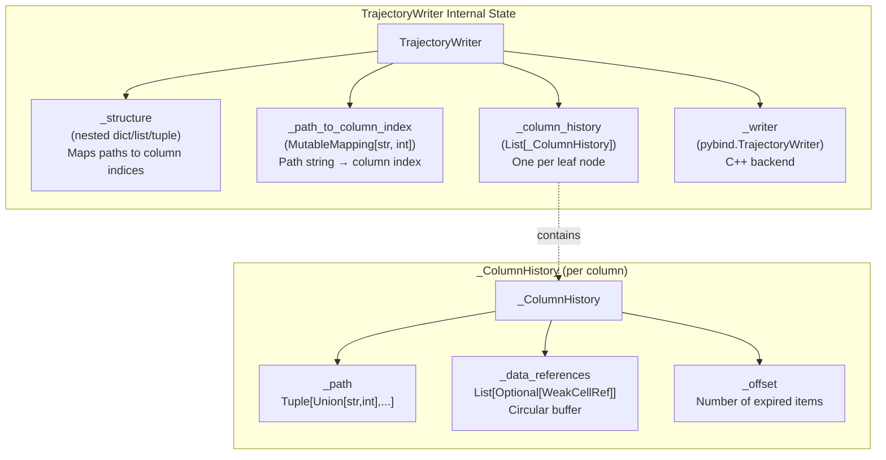

**Sources**: [reverb/trajectory_writer.py:112-140](), [reverb/trajectory_writer.py:530-563]()

### Key Structures

| Structure | Type | Purpose |
|-----------|------|---------|
| `_structure` | Nested structure | Union of all data structures seen; maps leaf paths to column indices |
| `_column_history` | `List[_ColumnHistory]` | One circular buffer per leaf node in the structure |
| `_path_to_column_index` | `MutableMapping[str, int]` | Maps structured paths to column indices in `_column_history` |
| `_path_to_column_config` | `MutableMapping` | Stores chunker configurations for columns not yet created |
| `_last_step_is_open` | `bool` | Tracks whether partial step is active |

**Sources**: [reverb/trajectory_writer.py:116-140]()

## Column Creation and Indexing

### Path-Based Column Mapping

The TrajectoryWriter uses structured paths to maintain stable column assignments even as the schema evolves. This is critical because Python's tree flattening order can change as new fields are added.

**Example Problem**: 
- Step 1 data: `{'a': 1, 'c': 101}` → flattens to `[1, 101]`
- Step 2 data: `{'a': 2, 'b': 12, 'c': 102}` → flattens to `[2, 12, 102]`

Without explicit mapping, column 1 would receive `c` then `b`, which violates column type consistency.

**Solution**: The `_structure` explicitly stores column indices:
- After step 1: `{'a': 0, 'c': 1}`
- After step 2: `{'a': 0, 'b': 2, 'c': 1}` 
- Data flattens as: `[1, 101]` and `[2, 102, 12]`

**Sources**: [reverb/trajectory_writer.py:500-528]()

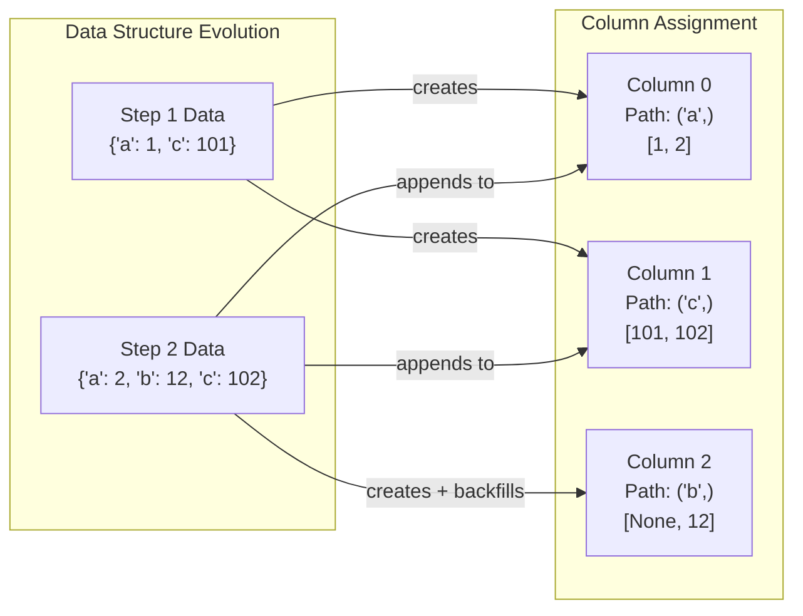

**Sources**: [reverb/trajectory_writer_test.py:115-146]()

### Column Creation Process

The `_maybe_create_column` method handles column creation:

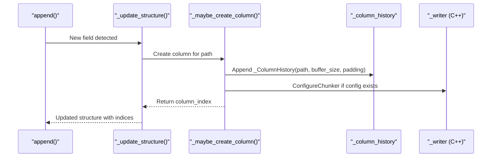

**Sources**: [reverb/trajectory_writer.py:479-499]()

When a new column is created:

1. **Append to `_column_history`**: New `_ColumnHistory` added at the end
2. **Record path mapping**: `_path_to_column_index[path] = column_index`
3. **Forward-pad history**: Initialize with `None` for all preceding steps to maintain alignment
4. **Apply delayed config**: If `configure()` was called before the column appeared, apply chunker options now

**Sources**: [reverb/trajectory_writer.py:479-499]()

## Dynamic Schema Evolution

### Structure Union Algorithm

The `_update_structure` method expands the schema using `_tree_union`, which computes the disjunction of two nested structures:

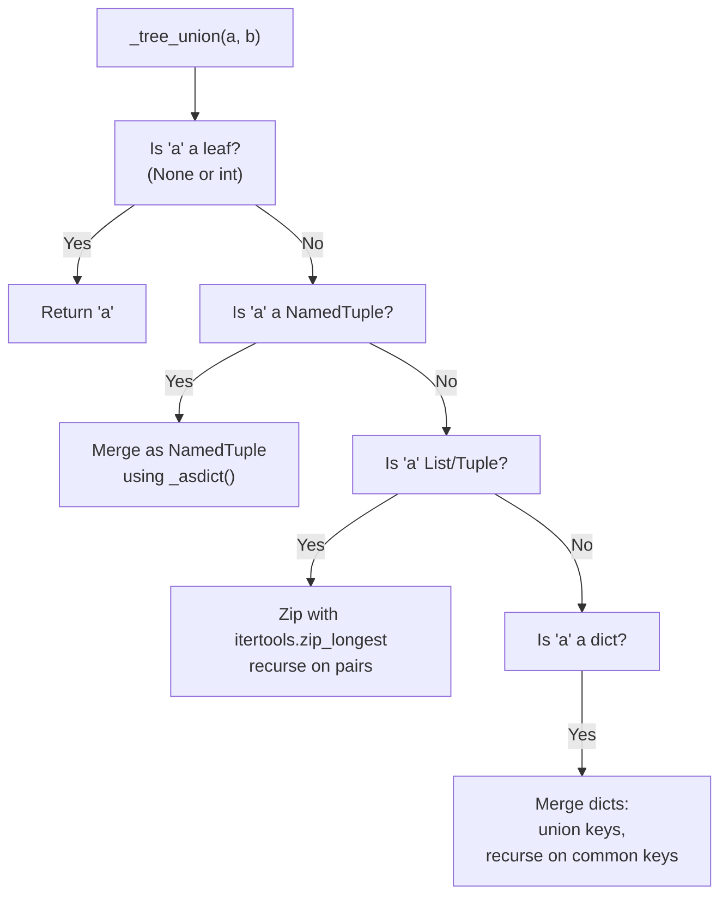

**Sources**: [reverb/trajectory_writer.py:728-748]()

### Handling New Fields in `append()`

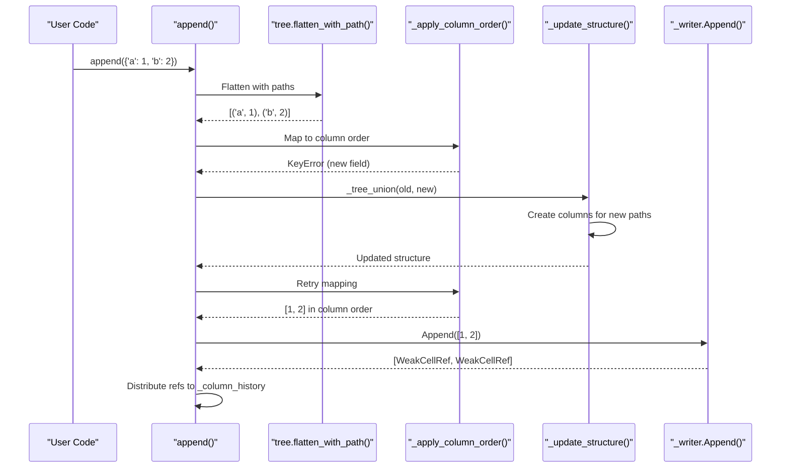

**Sources**: [reverb/trajectory_writer.py:272-340]()

### Forward-Padding for Alignment

When a new column is created after existing steps, it is forward-padded with `None` to maintain indexing alignment across all columns:

| Step | Column 'a' | Column 'b' (added at step 3) |
|------|-----------|------------------------------|
| 0    | `<ref>`   | `None` (padding)             |
| 1    | `<ref>`   | `None` (padding)             |
| 2    | `<ref>`   | `<ref>` (first actual value) |

This ensures `history['a'][i]` and `history['b'][i]` always refer to the same step, even if 'b' wasn't present initially.

**Sources**: [reverb/trajectory_writer.py:486-494](), [reverb/trajectory_writer.py:533-550]()

## Accessing History via the `history` Property

### The _ColumnHistory Class

`_ColumnHistory` implements the history buffer for a single column with list-like indexing semantics:

```python
# From reverb/trajectory_writer.py:530-634

class _ColumnHistory:
    def __init__(self, path, buffer_size, history_padding=0):
        self._path = path
        self._buffer_size = buffer_size
        self._data_references = [None] * min(buffer_size, history_padding)
        self._offset = history_padding - len(self._data_references)
```

**Key Features**:
- **Circular Buffer**: Limited to `buffer_size` (from `num_keep_alive_refs`)
- **Virtual Indexing**: Tracks `_offset` for items that have scrolled out
- **List-style Access**: Supports `int`, `slice`, and `list` indexing
- **None Handling**: Returns `None` for expired or padding entries

**Sources**: [reverb/trajectory_writer.py:530-634]()

### Indexing Operations

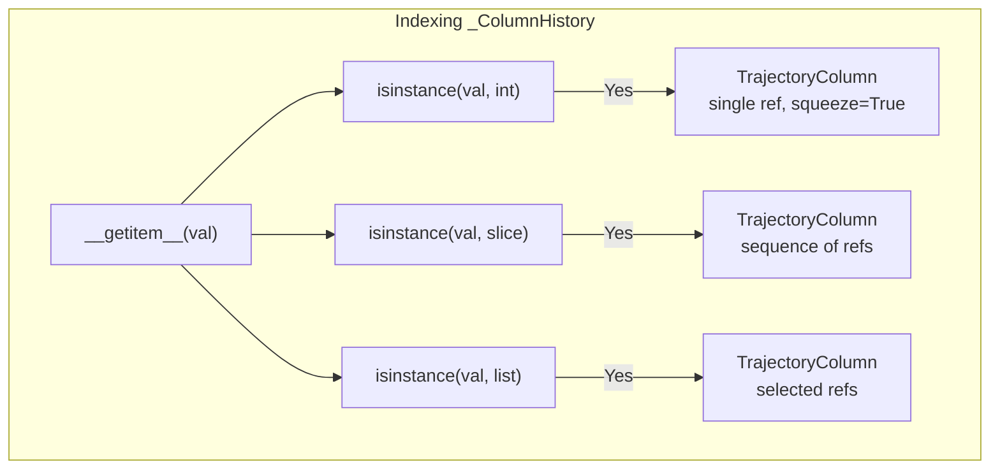

**Sources**: [reverb/trajectory_writer.py:619-630]()

The `_slice` method handles virtual indexing, accounting for the circular buffer and offset:

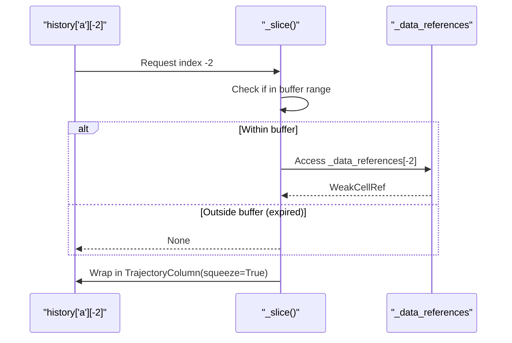

**Sources**: [reverb/trajectory_writer.py:576-611]()

### History Property Implementation

The `history` property unflattens the column list back into the original nested structure:

```python
# Simplified logic from reverb/trajectory_writer.py:152-186

@property
def history(self):
    if not self._column_history:
        raise RuntimeError('history cannot be accessed before append is called')
    
    return self._unflatten(self._column_history)
```

The `_unflatten` method uses the `_structure` to reconstruct the nested form:

```python
# From reverb/trajectory_writer.py:469-474

def _unflatten(self, column_data):
    structure_columns = tree.flatten(self._structure)
    structure_ordered_data = [
        column_data[column_id] for column_id in structure_columns
    ]
    return tree.unflatten_as(self._structure, structure_ordered_data)
```

**Sources**: [reverb/trajectory_writer.py:152-186](), [reverb/trajectory_writer.py:469-474]()

## TrajectoryColumn Creation

### From _ColumnHistory to TrajectoryColumn

When indexing `_ColumnHistory`, it returns a `TrajectoryColumn` object that wraps the data references:

```python
# From reverb/trajectory_writer.py:619-630

def __getitem__(self, val) -> 'TrajectoryColumn':
    path = self._path + (val,)
    if isinstance(val, int):
        return TrajectoryColumn([self._slice(val)], squeeze=True, path=path)
    elif isinstance(val, slice):
        return TrajectoryColumn(self._slice(val), path=path)
    elif isinstance(val, list):
        return TrajectoryColumn([self._slice(x) for x in val], path=path)
```

**Sources**: [reverb/trajectory_writer.py:619-630]()

### TrajectoryColumn Class

The `TrajectoryColumn` class wraps a sequence of `WeakCellRef` objects for use in `create_item()`:

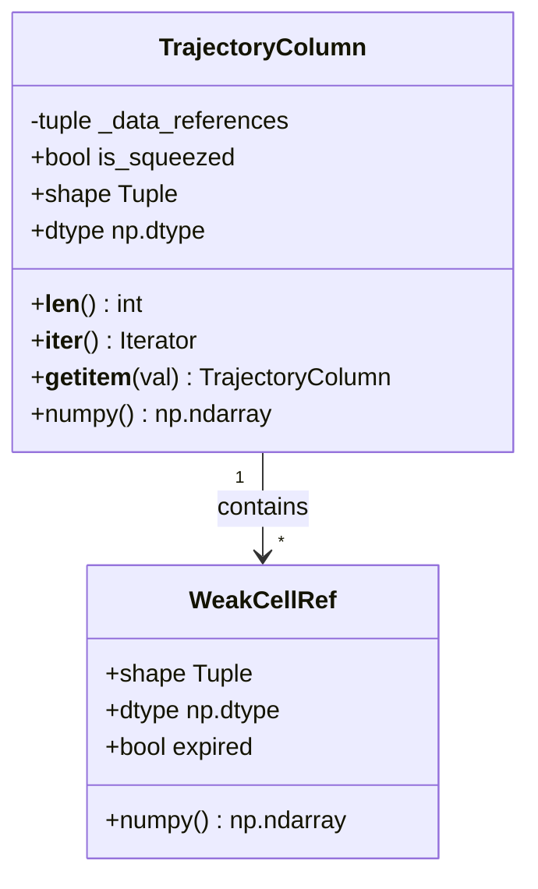

**Key Properties**:
- **`is_squeezed`**: When `True`, indicates single-element column (removes time dimension)
- **`shape`**: Combined shape `(len, *element_shape)` or just `element_shape` if squeezed
- **`dtype`**: Data type of elements (all refs must have same dtype)
- **`numpy()`**: Materializes data by stacking all refs

**Sources**: [reverb/trajectory_writer.py:636-708]()

### Validation Rules

`TrajectoryColumn` enforces several invariants:

```python
# From reverb/trajectory_writer.py:644-651

if squeeze and len(data_references) != 1:
    raise ValueError('Columns must contain exactly one data reference when squeeze set')

if any(ref is None for ref in data_references):
    raise ValueError('TrajectoryColumns cannot contain any None data references')
```

This prevents creating invalid trajectories with expired or missing data.

**Sources**: [reverb/trajectory_writer.py:639-651]()

## Partial Steps and Column State

### Partial Step Mechanics

When `append(data, partial_step=True)` is called, the writer adds data to the current step without advancing to a new step:

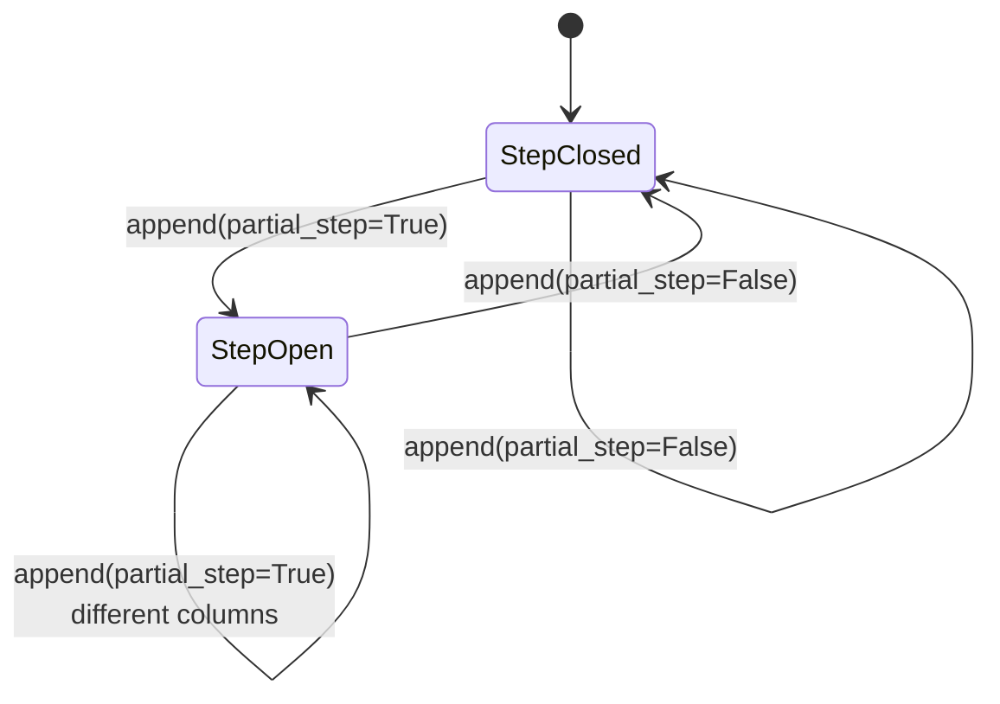

**Sources**: [reverb/trajectory_writer.py:238-340]()

### `set_last()` Method

During partial steps, `_ColumnHistory.set_last()` populates the last entry instead of appending:

```python
# From reverb/trajectory_writer.py:565-570

def set_last(self, ref: pybind.WeakCellRef):
    if not self._data_references:
        raise RuntimeError('set_last called on empty history column')
    if self._data_references[-1] is not None:
        raise RuntimeError('set_last called on already set cell')
    self._data_references[-1] = ref
```

The `can_set_last` property checks if a column is eligible for `set_last()`:

```python
# From reverb/trajectory_writer.py:572-574

@property
def can_set_last(self) -> bool:
    return bool(self._data_references) and self._data_references[-1] is None
```

This prevents overwriting already-set values and enforces the partial step contract.

**Sources**: [reverb/trajectory_writer.py:565-574](), [reverb/trajectory_writer.py:291-336]()

## Data Reference Lifecycle

### WeakCellRef Overview

`WeakCellRef` (from the C++ layer via pybind) represents a reference to data stored in the C++ `Writer`'s circular buffers:

| Property | Description |
|----------|-------------|
| `shape` | Shape of the referenced tensor |
| `dtype` | NumPy dtype of the data |
| `expired` | `True` if data has been evicted from circular buffer |
| `numpy()` | Materializes the data (may decompress if chunked) |

**Sources**: [reverb/trajectory_writer_test.py:32-50]()

### Reference Expiration

References expire when the circular buffer scrolls past them (controlled by `num_keep_alive_refs`):

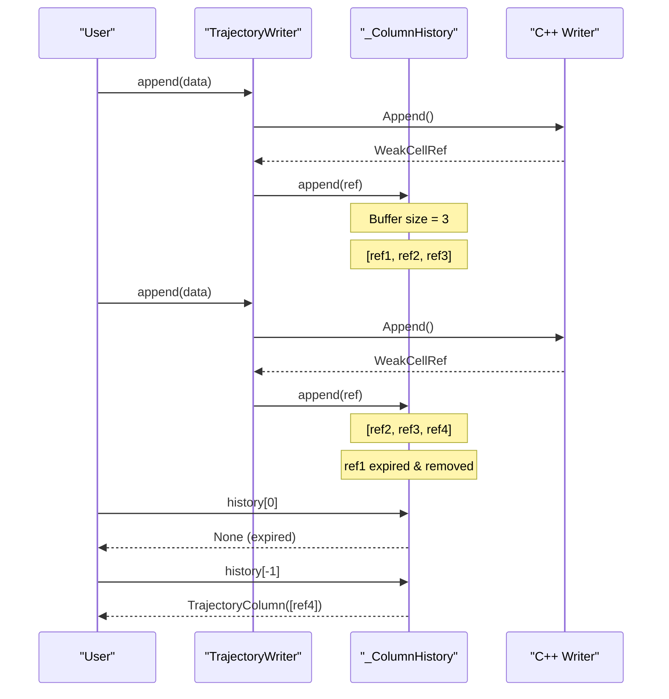

**Sources**: [reverb/trajectory_writer.py:555-559]()

### Validating References in create_item()

Before creating an item, `create_item()` validates that all trajectory columns are valid:

```python
# From reverb/trajectory_writer.py:364-375

flat_trajectory = tree.flatten(trajectory)
if not all(isinstance(col, TrajectoryColumn) for col in flat_trajectory):
    raise TypeError('All leaves of trajectory must be TrajectoryColumn')

# C++ layer validates:
# - All references are alive (not expired)
# - Data references within a column have same dtype and compatible shapes
```

This ensures items only reference valid, consistent data.

**Sources**: [reverb/trajectory_writer.py:342-376]()

## Complete Data Flow Example

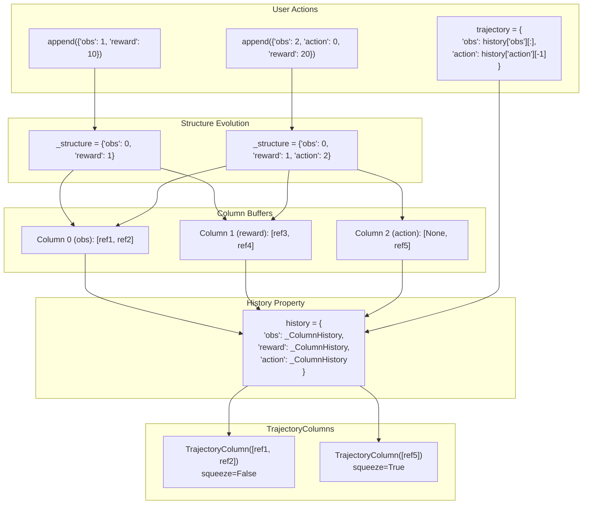

**Sources**: [reverb/trajectory_writer.py:29-748](), [reverb/trajectory_writer_test.py:98-146]()

---

