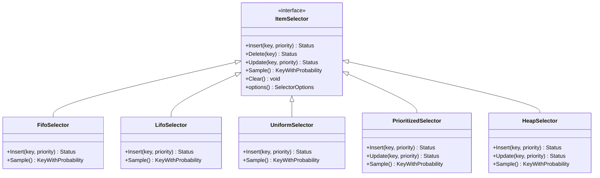
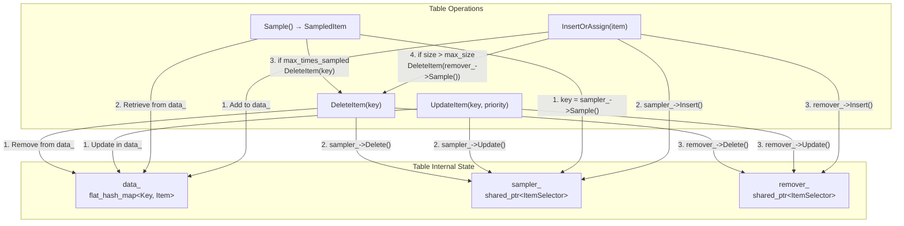
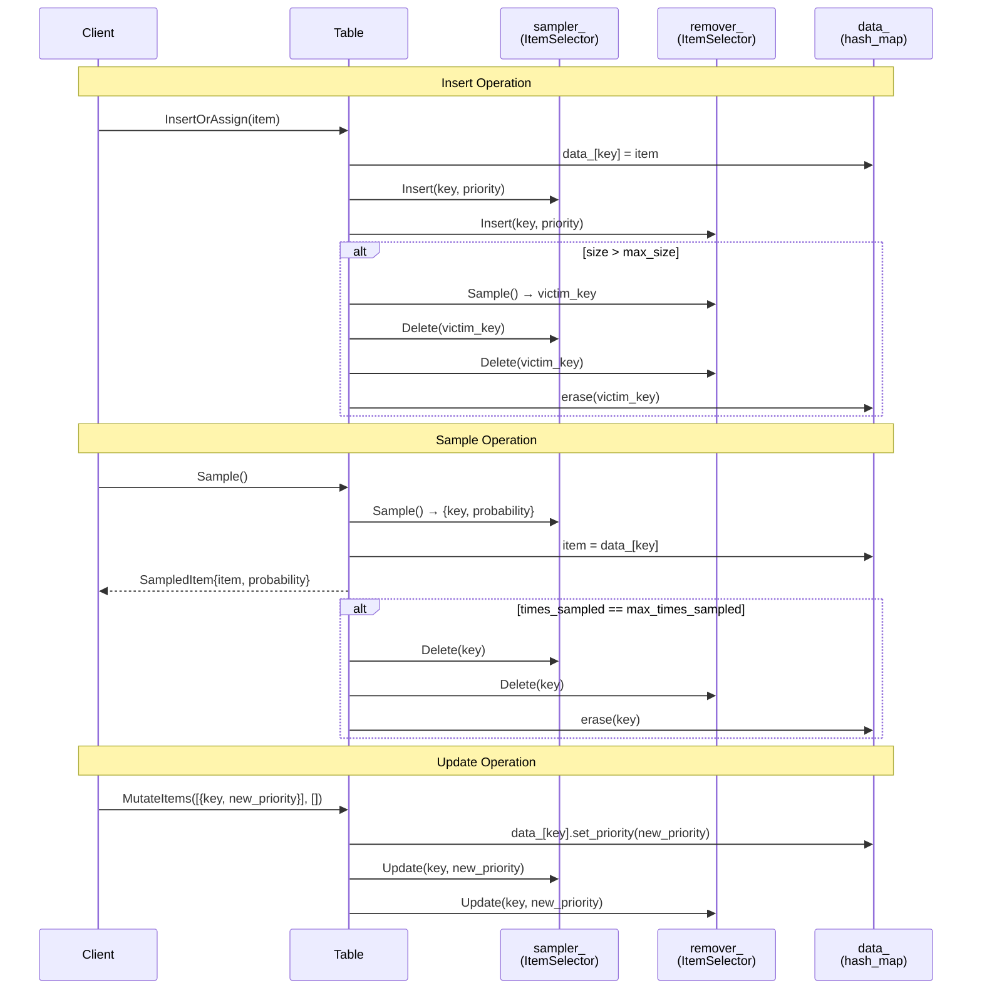
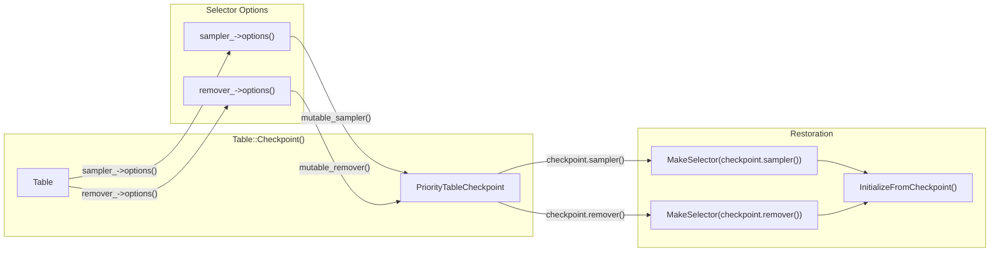

<!-- source: DeepWiki mcp.deepwiki.com · repo google-deepmind/reverb · extra page Item Selection Strategies · fetched 2026-10-26 -->

# Item Selection Strategies

<details>
<summary>Relevant source files</summary>

The following files were used as context for generating this wiki page:

- [reverb/BUILD](reverb/BUILD)
- [reverb/__init__.py](reverb/__init__.py)
- [reverb/cc/ops/BUILD](reverb/cc/ops/BUILD)
- [reverb/cc/platform/tfrecord_checkpointer.cc](reverb/cc/platform/tfrecord_checkpointer.cc)
- [reverb/cc/table.cc](reverb/cc/table.cc)
- [reverb/cc/table.h](reverb/cc/table.h)
- [reverb/cc/table_test.cc](reverb/cc/table_test.cc)

</details>


## Purpose and Scope

This document explains the **ItemSelector** implementations in Reverb, which control how items are selected for sampling and removal from tables. Item selection strategies are fundamental to the Table system's behavior, determining both which items are returned when sampling and which items are evicted when the table reaches capacity.

For information about the broader Table system architecture, see [Table System](#3.1). For details on how rate limiting interacts with sampling, see [Rate Limiting](#3.1.2).

## Overview

An **ItemSelector** is an abstract interface that manages a distribution of items and supports selection operations. Each Table instance uses **two** separate ItemSelector instances:

- **Sampler**: Determines which items are returned when `Sample()` is called
- **Remover**: Determines which items are deleted when the table exceeds `max_size`

Both selectors maintain parallel views of the same items in the table, receiving identical `Insert`, `Update`, and `Delete` operations but serving different purposes. The sampler controls what users observe, while the remover controls the eviction policy.

**Sources:** [reverb/cc/table.h:128-148](), [reverb/cc/selectors/interface.h]()

### ItemSelector Interface



**Diagram: ItemSelector interface and concrete implementations**

**Sources:** [reverb/cc/selectors/interface.h](), [reverb/BUILD:112-117]()

## Available Selector Implementations

### FIFO (First-In-First-Out)

The **FifoSelector** returns items in the order they were inserted. When `Sample()` is called, it returns the oldest item in the table. This is the most common choice for the **remover** selector, as it implements a natural eviction policy where old data is replaced by new data.

**Typical Use Case:** Remover for standard replay buffers, or sampler for queue-like behavior.

**Sources:** [reverb/cc/selectors/fifo.h](), [reverb/cc/table_test.cc:333-344]()

### LIFO (Last-In-First-Out)

The **LifoSelector** returns the most recently inserted item when `Sample()` is called. This implements stack-like behavior.

**Typical Use Case:** Specialized scenarios requiring recent data emphasis, or testing different memory patterns.

**Sources:** [reverb/cc/selectors/lifo.h]()

### Uniform (Random Uniform)

The **UniformSelector** samples items with equal probability, regardless of their priority values. Each item has probability `1/N` where `N` is the current table size.

**Typical Use Case:** Uniform experience replay where all items should be sampled equally.

**Sources:** [reverb/cc/selectors/uniform.h](), [reverb/cc/table_test.cc:93-100]()

### Prioritized (Weighted Random Sampling)

The **PrioritizedSelector** implements weighted random sampling where the probability of selecting an item is proportional to its priority. The sampling probability for item `i` is:

```
P(i) = priority(i) / sum(priority(j) for all j)
```

This selector supports dynamic priority updates via the `Update(key, priority)` operation, which is commonly used in Prioritized Experience Replay to update priorities based on TD-error.

**Typical Use Case:** Prioritized Experience Replay (PER) where important transitions are sampled more frequently.

**Sources:** [reverb/cc/selectors/prioritized.h]()

### Heap (Priority-Based with Custom Comparison)

The **HeapSelector** maintains items in a heap data structure and returns the item with the highest (or lowest) priority based on a configurable comparator. Unlike PrioritizedSelector which samples probabilistically, HeapSelector deterministically returns the extreme priority item.

**Typical Use Case:** Always sample the highest-priority item, or implement custom priority-based strategies.

**Sources:** [reverb/cc/selectors/heap.h]()

## Integration with Table

The Table class maintains two ItemSelector instances and ensures they stay synchronized through all table operations:



**Diagram: Selector operations synchronized by Table**

**Sources:** [reverb/cc/table.cc:593-631](), [reverb/cc/table.cc:716-748](), [reverb/cc/table.cc:814-843](), [reverb/cc/table.cc:895-906]()

### Key Operations

| Table Operation | Selector Interaction | Purpose |
|----------------|---------------------|---------|
| `InsertOrAssign` | Calls `sampler_->Insert()` and `remover_->Insert()` | Register new item with both selectors |
| `Sample` | Calls `sampler_->Sample()` | Get key to sample from distribution |
| `DeleteItem` | Calls `sampler_->Delete()` and `remover_->Delete()` | Remove item from both selectors |
| `UpdateItem` | Calls `sampler_->Update()` and `remover_->Update()` | Update priority in both selectors |
| `Reset` | Calls `sampler_->Clear()` and `remover_->Clear()` | Clear all items from selectors |
| Capacity enforcement | Calls `remover_->Sample()` to select victim | Evict item when table exceeds max_size |

**Sources:** [reverb/cc/table.cc:593-631](), [reverb/cc/table.cc:716-748](), [reverb/cc/table.cc:814-843](), [reverb/cc/table.cc:895-906](), [reverb/cc/table.cc:927-936]()

## Common Configuration Patterns

### Pattern 1: Uniform Replay Buffer

```
Sampler: UniformSelector
Remover: FifoSelector
```

This is the classic uniform experience replay configuration. Items are sampled uniformly at random, and the oldest items are removed when the buffer is full.

**Sources:** [reverb/cc/table_test.cc:93-100]()

### Pattern 2: FIFO Queue

```
Sampler: FifoSelector
Remover: FifoSelector
Max Times Sampled: 1
```

Using FifoSelector for both sampling and removal, combined with `max_times_sampled=1`, implements a strict FIFO queue where items are sampled once in insertion order and then automatically removed.

**Sources:** [reverb/cc/table_test.cc:333-387]()

### Pattern 3: Prioritized Experience Replay

```
Sampler: PrioritizedSelector
Remover: FifoSelector or PrioritizedSelector
```

The sampler uses priorities for weighted sampling, while the remover can either use FIFO (keeping recent data) or also use priorities (removing low-priority items).

**Sources:** [reverb/cc/selectors/prioritized.h]()

### Pattern 4: Most Recent Data Priority

```
Sampler: UniformSelector or PrioritizedSelector
Remover: LifoSelector
```

**Warning:** This is generally an anti-pattern. Using LifoSelector as the remover causes the newest items to be removed first, which means items may be deleted before they can be sampled. This configuration is dangerous when multiple tables share chunks, as mentioned in the Table documentation.

**Sources:** [reverb/cc/table.h:150-155]()

## Python Configuration

In Python, selectors are configured when creating a Table:

```python
import reverb

# Create a server with a uniform replay buffer
server = reverb.Server(tables=[
    reverb.Table(
        name='uniform_replay',
        sampler=reverb.selectors.Uniform(),  # Uniform sampling
        remover=reverb.selectors.Fifo(),     # FIFO removal
        max_size=10000,
        rate_limiter=reverb.rate_limiters.MinSize(100),
    ),
])

# Prioritized Experience Replay configuration
per_table = reverb.Table(
    name='prioritized_replay',
    sampler=reverb.selectors.Prioritized(priority_exponent=0.6),
    remover=reverb.selectors.Fifo(),
    max_size=50000,
    rate_limiter=reverb.rate_limiters.MinSize(1000),
)

# FIFO Queue configuration
queue_table = reverb.Table(
    name='fifo_queue',
    sampler=reverb.selectors.Fifo(),
    remover=reverb.selectors.Fifo(),
    max_size=1000,
    max_times_sampled=1,
    rate_limiter=reverb.rate_limiters.SampleToInsertRatio(
        samples_per_insert=1.0,
        min_size_to_sample=1,
    ),
)
```

**Sources:** [reverb/__init__.py:27](), [reverb/item_selectors.py](), [reverb/server.py]()

## Selector Lifecycle in Table Operations



**Diagram: Sequence of selector operations during table interactions**

**Sources:** [reverb/cc/table.cc:593-631](), [reverb/cc/table.cc:716-748](), [reverb/cc/table.cc:895-906]()

## Checkpointing and Persistence

Selectors are checkpointed as part of the Table checkpoint process. The selector configuration is stored in the `PriorityTableCheckpoint` proto:



**Diagram: Checkpoint serialization and restoration of selectors**

Each selector type serializes its configuration into a `SelectorOptions` proto containing:

- **FIFO**: `fifo: true`
- **LIFO**: `lifo: true`
- **Uniform**: `uniform: true`
- **Prioritized**: `prioritized: { priority_exponent: value }`
- **Heap**: `heap: { min_heap: bool }`

When loading from a checkpoint, `MakeSelector()` reconstructs the appropriate selector type from the `SelectorOptions` proto.

**Sources:** [reverb/cc/table.cc:949-984](), [reverb/cc/platform/tfrecord_checkpointer.cc:470-490](), [reverb/cc/checkpointing/checkpoint.proto]()

## Performance Considerations

| Selector Type | Insert | Delete | Update | Sample | Memory Overhead |
|--------------|--------|--------|--------|--------|----------------|
| FifoSelector | O(1) | O(1) | O(1) | O(1) | O(N) |
| LifoSelector | O(1) | O(1) | O(1) | O(1) | O(N) |
| UniformSelector | O(1) | O(log N) | O(1) | O(1) | O(N) |
| PrioritizedSelector | O(log N) | O(log N) | O(log N) | O(log N) | O(N) |
| HeapSelector | O(log N) | O(log N) | O(log N) | O(1) | O(N) |

Notes:
- All selectors maintain an index mapping keys to internal positions, resulting in O(N) memory overhead
- PrioritizedSelector uses a sum tree data structure for efficient weighted sampling
- HeapSelector provides O(1) sampling of the extreme element but requires heap rebalancing for other operations
- FIFO/LIFO use simple queue/stack structures with constant-time operations

**Sources:** [reverb/cc/selectors/uniform.h](), [reverb/cc/selectors/prioritized.h](), [reverb/cc/selectors/heap.h](), [reverb/cc/selectors/fifo.h](), [reverb/cc/selectors/lifo.h]()

---

