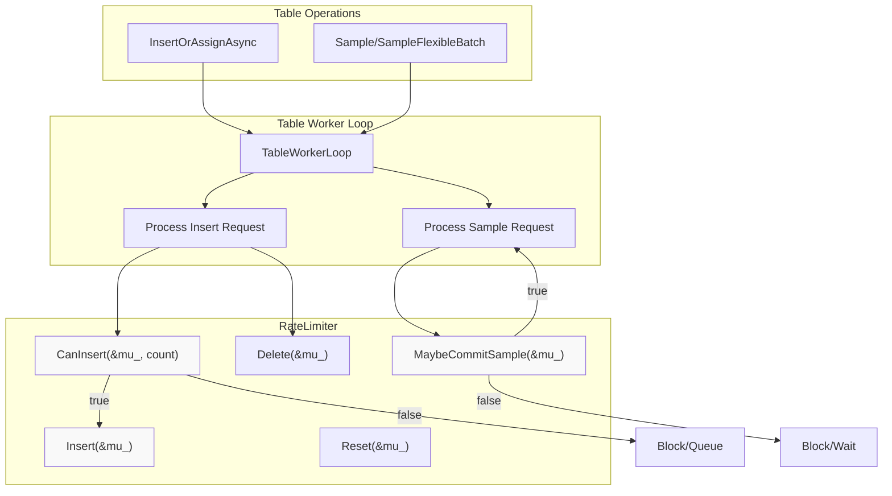
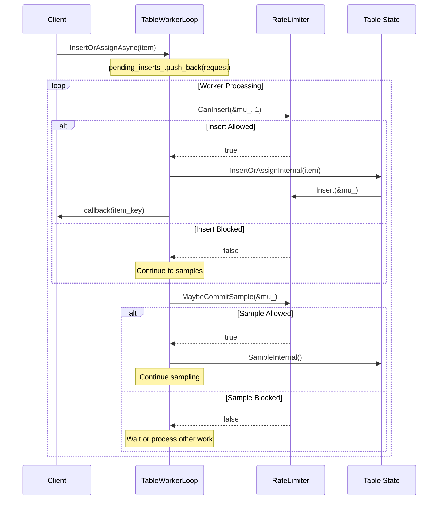
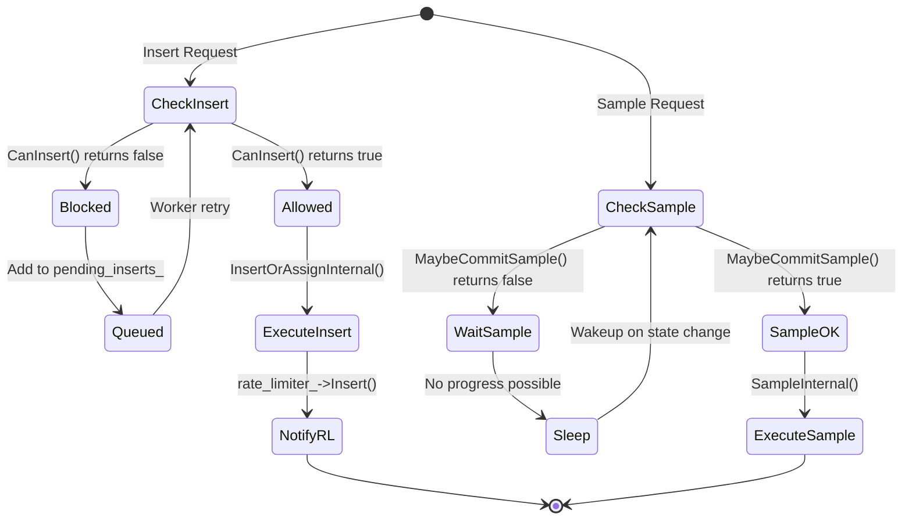
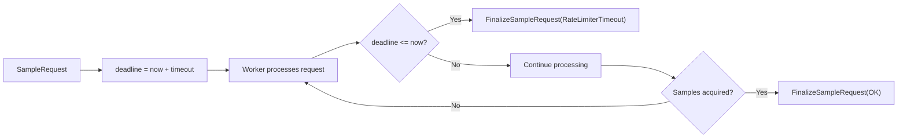
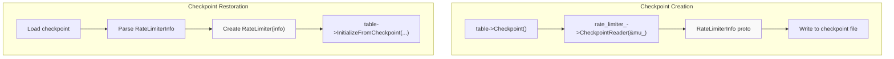
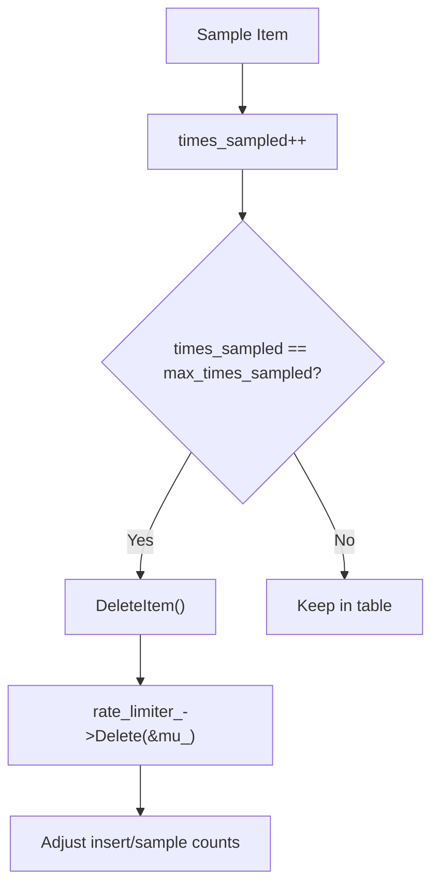

<!-- source: DeepWiki mcp.deepwiki.com · repo google-deepmind/reverb · extra page Rate Limiting · fetched 2026-10-26 -->

# Rate Limiting

<details>
<summary>Relevant source files</summary>

The following files were used as context for generating this wiki page:

- [README.md](README.md)
- [docs/images/multiple_tables_example.png](docs/images/multiple_tables_example.png)
- [reverb/cc/platform/tfrecord_checkpointer.cc](reverb/cc/platform/tfrecord_checkpointer.cc)
- [reverb/cc/table.cc](reverb/cc/table.cc)
- [reverb/cc/table.h](reverb/cc/table.h)
- [reverb/cc/table_test.cc](reverb/cc/table_test.cc)
- [reverb/pip_package/reverb_version.py](reverb/pip_package/reverb_version.py)
- [reverb/pip_package/setup.py](reverb/pip_package/setup.py)

</details>


## Purpose and Scope

Rate limiting in Reverb controls the flow of insert and sample operations to maintain desired relationships between data production and consumption. The `RateLimiter` component enforces constraints on when items can be inserted into or sampled from a table, enabling backpressure mechanisms that prevent resource exhaustion and ensure balanced operation.

This page covers the rate limiting system's architecture, available implementations, and how it integrates with the Table system. For information about item selection strategies that determine *which* items to sample or remove, see [Item Selection Strategies](#3.1.1). For the broader Table system context, see [Table System](#3.1).

## Core Concepts

The rate limiter operates on three fundamental principles:

1. **Insert/Sample Ratio**: Maintains a target ratio between the number of insert and sample operations
2. **Minimum Size**: Ensures a minimum number of items exist before allowing samples
3. **Differential Limits**: Controls the difference between insert and sample counts to prevent unbounded growth or starvation

The rate limiter can **block** operations when constraints are not satisfied, providing natural backpressure to producers and consumers.

**Sources:** [README.md:296-309](), [reverb/cc/table.h:227-230]()

## RateLimiter Integration with Table

The `RateLimiter` is a core component of the `Table` class, consulted for every insert and sample operation.



**Diagram: RateLimiter Integration Points in Table Operations**

The rate limiter provides mutual exclusion through the table's mutex (`mu_`), ensuring thread-safe state updates.

**Sources:** [reverb/cc/table.cc:270](), [reverb/cc/table.cc:295](), [reverb/cc/table.cc:629](), [reverb/cc/table.cc:834]()

## Key RateLimiter Methods

The `RateLimiter` class (defined in `reverb/cc/rate_limiter.h`) provides these critical methods called by the Table:

| Method | Purpose | Called From |
|--------|---------|-------------|
| `CanInsert(&mu_, count)` | Checks if `count` inserts are allowed | [reverb/cc/table.cc:270]() |
| `MaybeCommitSample(&mu_)` | Attempts to commit a sample operation | [reverb/cc/table.cc:295]() |
| `Insert(&mu_)` | Records a completed insert | [reverb/cc/table.cc:629]() |
| `Delete(&mu_)` | Records a deleted item | [reverb/cc/table.cc:834]() |
| `Reset(&mu_)` | Resets to initial state | [reverb/cc/table.cc:936]() |
| `RegisterTable(table)` | Registers with a table | [reverb/cc/table.cc:175]() |
| `UnregisterTable(&mu_, table)` | Unregisters from a table | [reverb/cc/table.cc:190](), [reverb/cc/table.cc:227]() |
| `Info(&mu_)` | Returns current state info | [reverb/cc/table.cc:770]() |
| `CheckpointReader(&mu_)` | Serializes state for checkpointing | [reverb/cc/table.cc:969]() |

**Sources:** [reverb/cc/table.h:40](), [reverb/cc/table.cc:175](), [reverb/cc/table.cc:270](), [reverb/cc/table.cc:295]()

## Table Worker Loop Integration

The table worker loop coordinates with the rate limiter to process queued operations:



**Diagram: RateLimiter Coordination in Worker Loop**

The worker alternates between processing inserts and samples, checking with the rate limiter before each operation.

**Sources:** [reverb/cc/table.cc:236-423](), [reverb/cc/table.cc:268-285](), [reverb/cc/table.cc:292-319]()

## Available Rate Limiter Types

Reverb provides several rate limiter implementations in Python (exposed via `reverb.rate_limiters`):

### MinSize

Ensures a minimum number of items exist before allowing sampling. Does not restrict inserts.

```python
# Python API
reverb.rate_limiters.MinSize(min_size_to_sample)
```

**Configuration:**
- `min_size_to_sample`: Minimum items required before samples proceed
- `samples_per_insert`: Typically 1.0 (no specific ratio)
- `min_diff`: -∞ (no lower bound)
- `max_diff`: +∞ (no upper bound)

**Use Case:** Cold-start protection for replay buffers

**Sources:** [README.md:302-303]()

### SampleToInsertRatio

Maintains a target ratio between samples and inserts by blocking operations that would violate the ratio.

**Configuration:**
- `samples_per_insert`: Target ratio (e.g., 2.0 means 2 samples per insert)
- `min_size_to_sample`: Minimum table size before sampling
- `min_diff`: Minimum allowed (inserts - samples)
- `max_diff`: Maximum allowed (inserts - samples)

**Use Case:** Controlling sample reuse in off-policy RL

**Sources:** [README.md:304-306]()

### Queue

Configures table as a FIFO queue where each item is sampled exactly once.

```python
# Python API
reverb.rate_limiters.Queue(size)
```

**Equivalent Configuration:**
- `samples_per_insert`: 1.0
- `min_size_to_sample`: 1
- `min_diff`: 0
- `max_diff`: queue_size

Blocks inserts when full, blocks samples when empty.

**Use Case:** On-policy data collection (e.g., IMPALA)

**Sources:** [README.md:307](), [reverb/cc/table_test.cc:334-344]()

### Stack

Configures table as a LIFO stack where each item is sampled exactly once.

**Use Case:** Specialized queue behaviors

**Sources:** [README.md:308]()

## Blocking Behavior and Flow Control



**Diagram: Rate Limiter State Flow for Insert and Sample Operations**

### Blocking Mechanisms

**Insert Blocking:**
- Inserts are queued in `pending_inserts_` when rate limiter blocks
- Worker retries when conditions change (e.g., after samples)
- Maximum queue size: `max_enqueued_inserts_` (min of 1000 or 10% of table size)

**Sample Blocking:**
- Sample requests wait in `pending_sampling_` 
- Worker sleeps if no progress can be made
- Wakes up when inserts occur or conditions change
- Timeout mechanism via `deadline` field in `SampleRequest`

**Sources:** [reverb/cc/table.cc:268-285](), [reverb/cc/table.cc:287-319](), [reverb/cc/table.cc:358-386](), [reverb/cc/table.h:162-163]()

## Timeout Handling

Sample requests include a timeout mechanism to prevent indefinite blocking:



**Diagram: Sample Request Timeout Flow**

If a sample request cannot be satisfied within the timeout period, it completes with either:
- An error status (`RateLimiterTimeout`) if no samples were acquired
- Success with partial results if some samples were acquired

**Sources:** [reverb/cc/table.cc:124-140](), [reverb/cc/table.cc:358-399]()

## Configuration Examples

### Uniform Experience Replay Buffer

```python
reverb.Table(
    name='uniform_replay',
    sampler=reverb.selectors.Uniform(),
    remover=reverb.selectors.Fifo(),
    max_size=1000,
    rate_limiter=reverb.rate_limiters.MinSize(100)
)
```

**Behavior:**
- Samples blocked until 100 items inserted
- No restrictions on insert rate
- Uniform sampling probability

**Sources:** [README.md:211-228]()

### Prioritized Experience Replay

```python
reverb.Table(
    name='prioritized_replay',
    sampler=reverb.selectors.Prioritized(0.8),
    remover=reverb.selectors.Fifo(),
    max_size=1000,
    rate_limiter=reverb.rate_limiters.MinSize(100)
)
```

**Behavior:**
- Samples blocked until 100 items
- Priority-based sampling once ready
- Standard FIFO removal

**Sources:** [README.md:233-250]()

### Queue (FIFO with Exact-Once Sampling)

```python
reverb.Table.queue(name='my_queue', max_size=1000)

# Equivalent explicit configuration:
reverb.Table(
    name='my_queue',
    sampler=reverb.selectors.Fifo(),
    remover=reverb.selectors.Fifo(),
    max_size=1000,
    max_times_sampled=1,
    rate_limiter=reverb.rate_limiters.Queue(size=1000)
)
```

**Behavior:**
- Inserts blocked when full (1000 items)
- Samples blocked when empty
- Each item sampled exactly once then removed

**Sources:** [README.md:256-274](), [reverb/cc/table_test.cc:334-387]()

### Custom Ratio Control

```python
# 2 samples per insert allowed, table size 10-1000
Table(
    name='custom',
    sampler=reverb.selectors.Uniform(),
    remover=reverb.selectors.Fifo(),
    max_size=1000,
    max_times_sampled=0,  # unlimited
    rate_limiter=RateLimiter(
        samples_per_insert=2.0,
        min_size_to_sample=10,
        min_diff=-100,
        max_diff=100
    )
)
```

**Behavior:**
- Minimum 10 items before sampling
- Can sample ~2x as fast as inserts
- Blocks if difference exceeds ±100

**Sources:** [reverb/cc/table_test.cc:396-400]()

## RateLimiter State and Checkpointing

The rate limiter maintains internal state that must be preserved during checkpointing:

**State Components:**
- `samples_per_insert`: Target ratio
- `min_size_to_sample`: Minimum table size
- `min_diff` and `max_diff`: Differential bounds
- `insert_count`: Total inserts committed
- `sample_count`: Total samples committed

**Checkpointing Process:**



**Diagram: RateLimiter Checkpointing Flow**

The rate limiter state is serialized as part of the `PriorityTableCheckpoint` proto and restored during table initialization.

**Sources:** [reverb/cc/table.cc:969](), [reverb/cc/table.cc:184-213](), [reverb/cc/platform/tfrecord_checkpointer.cc:464-491]()

## Reset Behavior

When `Table::Reset()` is called, the rate limiter is reset to its initial state:

```cpp
// reverb/cc/table.cc
absl::Status Table::Reset() {
  // ... clear table data ...
  rate_limiter_->Reset(&mu_);
  // ... signal worker ...
}
```

This resets insert/sample counts and allows blocked operations to proceed with a fresh start.

**Test Example:**
```cpp
// Insert makes new inserts block due to rate limiter
table->InsertOrAssign(MakeItem(1, 123));  // diff = 1.0

// Thread attempting insert is blocked...

// Reset unblocks the insert
table->Reset();
```

**Sources:** [reverb/cc/table.cc:908-946](), [reverb/cc/table_test.cc:467-497]()

## Rate Limiter Info and Monitoring

The rate limiter exposes its current state via `Info(&mu_)`:

```cpp
TableInfo info = table->info();
RateLimiterInfo rl_info = info.rate_limiter_info();

// Available fields:
// - samples_per_insert
// - min_size_to_sample  
// - min_diff, max_diff
// - sample_count, insert_count
```

This information is included in the `TableInfo` returned by `table->info()` and can be used for monitoring and debugging.

**Sources:** [reverb/cc/table.cc:757-800](), [reverb/cc/table.cc:770]()

## Interaction with max_times_sampled

The rate limiter works in conjunction with `max_times_sampled` to control item lifecycle:



**Diagram: Automatic Deletion and Rate Limiter Updates**

When items are automatically deleted (due to `max_times_sampled`), the rate limiter is notified via `Delete(&mu_)`, which may unblock pending insert operations.

**Sources:** [reverb/cc/table.cc:743-744](), [reverb/cc/table.cc:834](), [reverb/cc/table_test.cc:600-641]()

## Implementation Notes

### Thread Safety

All rate limiter methods require the table's mutex (`mu_`) to be held, ensuring thread-safe operation. The mutex is passed by pointer to enforce this requirement at the API level.

### Worker Coordination

The table worker loop calls `wakeup_worker_.Signal()` when conditions change that might unblock operations:
- After inserting items
- After sampling items  
- On explicit mutations
- On reset

**Sources:** [reverb/cc/table.cc:583](), [reverb/cc/table.cc:649](), [reverb/cc/table.cc:687](), [reverb/cc/table.h:611]()

### Asynchronous Insert Queue

To avoid blocking clients, inserts are queued asynchronously:

```cpp
absl::Status Table::InsertOrAssignAsync(
    Item item, bool* can_insert_more,
    std::weak_ptr<InsertCallback> insert_completed) {
  // Queue the insert request
  pending_inserts_.push_back(request);
  
  // Indicate if more inserts can be accepted without slowing down
  *can_insert_more = pending_inserts_.size() < max_enqueued_inserts_;
  
  wakeup_worker_.Signal();
  return absl::OkStatus();
}
```

The `can_insert_more` flag provides backpressure feedback to clients without blocking.

**Sources:** [reverb/cc/table.cc:568-591](), [reverb/cc/table.h:283-286]()

## Advanced: Rate Limiter Registration

The rate limiter can be shared across multiple tables and maintains references to all registered tables:

```cpp
// Constructor
Table::Table(..., std::shared_ptr<RateLimiter> rate_limiter, ...) {
  rate_limiter_->RegisterTable(this);
  // ...
}

// Destructor  
Table::~Table() {
  rate_limiter_->UnregisterTable(&mu_, this);
  // ...
}
```

This allows the rate limiter to coordinate behavior across multiple tables if needed, though most use cases employ one rate limiter per table.

**Sources:** [reverb/cc/table.cc:175](), [reverb/cc/table.cc:190](), [reverb/cc/table.cc:227]()

---

