<!-- source: DeepWiki mcp.deepwiki.com · repo google-deepmind/reverb · extra page Table Extensions · fetched 2026-10-26 -->

# Table Extensions

<details>
<summary>Relevant source files</summary>

The following files were used as context for generating this wiki page:

- [reverb/cc/platform/tfrecord_checkpointer.cc](reverb/cc/platform/tfrecord_checkpointer.cc)
- [reverb/cc/table.cc](reverb/cc/table.cc)
- [reverb/cc/table.h](reverb/cc/table.h)
- [reverb/cc/table_test.cc](reverb/cc/table_test.cc)

</details>


This document describes the **Table Extension System** in Reverb, which provides customizable hooks into table operations for implementing metrics collection, logging, and other custom behavior. For information about the Table's core data management functionality, see [Table System](#3.1). For details on the rate limiter that controls table operations, see [Rate Limiting](#3.1.2).

## Overview

Table Extensions allow users to inject custom logic into the lifecycle of items stored in Reverb tables. Extensions receive notifications when items are inserted, sampled, updated, or deleted, enabling use cases such as:

- **Metrics collection**: Track sampling frequencies, insertion rates, or custom statistics
- **Logging and monitoring**: Record table operations for debugging or analysis
- **Custom data structures**: Maintain auxiliary indices or metadata alongside table items
- **Conditional logic**: Implement specialized behavior based on item properties

Extensions operate through a callback-based interface, with support for both synchronous (blocking) and asynchronous (non-blocking) execution models.

**Sources:** [reverb/cc/table.h:156-239](), [reverb/cc/table.cc:52]()

## Extension Interface

Extensions implement the `TableExtension` interface, which defines lifecycle hooks called at specific points during table operations:

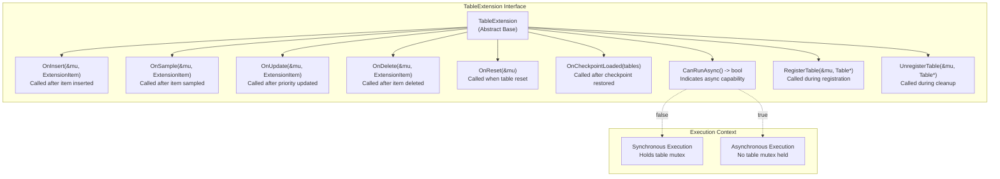

Each hook receives an `ExtensionItem` wrapper containing:
- `ref`: Shared pointer to the `TableItem`
- `times_sampled`: Current sample count snapshot
- `priority`: Current priority value snapshot

**Sources:** [reverb/cc/table_extensions/interface.h](), [reverb/cc/table.h:118-126]()

## Synchronous vs Asynchronous Extensions

Extensions can operate in two execution modes, determined by the `CanRunAsync()` method:

| Aspect | Synchronous Extensions | Asynchronous Extensions |
|--------|------------------------|-------------------------|
| **Execution** | Inline during table operation | Separate extension worker thread |
| **Mutex** | Holds `Table::mu_` during execution | Holds `Table::async_extensions_mu_` |
| **Ordering** | Strict FIFO order guaranteed | FIFO order relative to other async operations |
| **Performance** | Blocks table operations | Non-blocking for table operations |
| **Use Cases** | Critical operations, data consistency | Metrics, logging, monitoring |

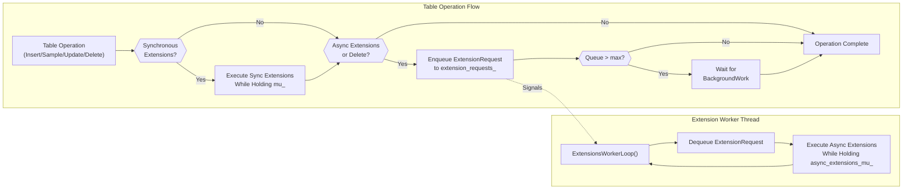

**Sources:** [reverb/cc/table.cc:512-537](), [reverb/cc/table.cc:845-886]()

## Extension Lifecycle Hooks

Extensions receive notifications at the following table lifecycle events:

### OnInsert

Called immediately after an item is successfully inserted into the table. This occurs:
- After the item is added to `data_`, `sampler_`, and `remover_`
- After the insertion timestamp is set
- Before any item is potentially removed due to `max_size_` overflow
- After `rate_limiter_->Insert()` is called

**Sources:** [reverb/cc/table.cc:593-631](), [reverb/cc/table.cc:620]()

### OnSample

Called after an item is sampled from the table. This occurs:
- After `times_sampled` is incremented
- Before the item is potentially deleted due to `max_times_sampled_`
- The `ExtensionItem` contains the updated `times_sampled` value

**Sources:** [reverb/cc/table.cc:716-747](), [reverb/cc/table.cc:738]()

### OnUpdate

Called when an item's priority is modified via `MutateItems()` or during an overwrite in `InsertOrAssign()`. This occurs:
- After priority is updated in `data_`, `sampler_`, and `remover_`
- When an existing key is re-inserted with a different priority

**Sources:** [reverb/cc/table.cc:895-906](), [reverb/cc/table.cc:903]()

### OnDelete

Called when an item is removed from the table. This occurs during:
- Automatic removal when `max_size_` is exceeded
- Explicit deletion via `MutateItems()`
- Automatic deletion when `max_times_sampled_` is reached
- After the item is removed from `data_`, `sampler_`, and `remover_`
- After `rate_limiter_->Delete()` is called

**Sources:** [reverb/cc/table.cc:814-843](), [reverb/cc/table.cc:837]()

### OnReset

Called when the table is reset, clearing all items. This occurs:
- After the extension worker completes all pending operations
- Before `data_`, `sampler_`, and `remover_` are cleared
- Both sync and async extensions are notified

**Sources:** [reverb/cc/table.cc:908-947](), [reverb/cc/table.cc:920-925]()

### OnCheckpointLoaded

Called after a checkpoint is restored. This allows extensions to:
- Update internal pointers to reconstructed tables
- Reinitialize state based on restored items
- Called before items are inserted into the restored tables

**Sources:** [reverb/cc/platform/tfrecord_checkpointer.cc:497-499]()

## Extension Worker Thread

Asynchronous extensions execute in a dedicated thread managed by `ExtensionsWorkerLoop()`:

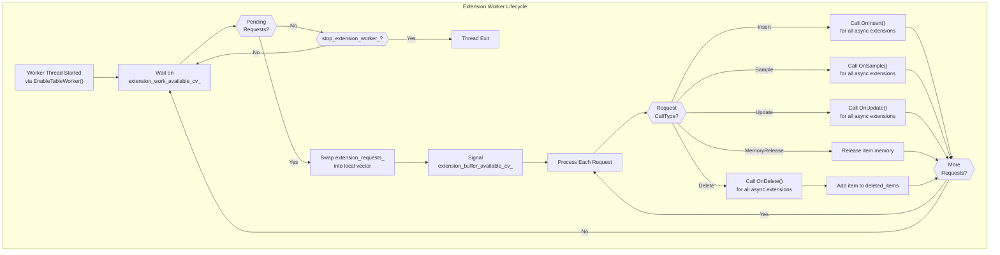

**Key properties:**
- **Single-threaded**: One extension worker per table ensures sequential processing
- **FIFO ordering**: Requests are processed in the order they're enqueued
- **Backpressure**: Table operations wait if the queue exceeds `max_enqueued_extension_ops_`
- **Memory management**: Deleted items are deferred to avoid expensive deallocations in critical paths

**Sources:** [reverb/cc/table.cc:425-502](), [reverb/cc/table.cc:512-537]()

## Extension Request Queue

The extension system uses a request queue to decouple table operations from extension execution:

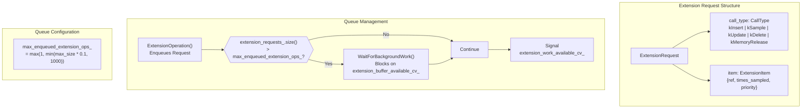

**Queue limits:**
- **Absolute limit**: 1000 operations (`kMaxPendingExtensionOps`)
- **Relative limit**: 10% of table `max_size` (`kMaxPendingExtensionOpsPerc`)
- **Minimum**: Always at least 1 operation allowed

When the queue is full, table operations block until the extension worker processes enough requests to create space. This provides backpressure to prevent unbounded memory growth.

**Sources:** [reverb/cc/table.h:465-469](), [reverb/cc/table.cc:162-169](), [reverb/cc/table.cc:888-893]()

## Registration and Management

Extensions must be registered with tables before any items are inserted:

### UnsafeAddExtension

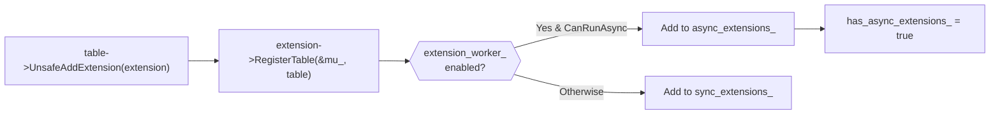

**Requirements:**
- Must be called before any items are inserted (enforced by `REVERB_CHECK(data_.empty())`)
- Not thread-safe; caller must ensure no concurrent access
- Extension's `RegisterTable()` is called immediately

**Sources:** [reverb/cc/table.cc:1028-1039]()

### UnsafeClearExtensions

Removes and unregisters all extensions:

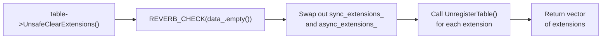

**Requirements:**
- Must be called when table is empty (enforced by `REVERB_CHECK(data_.empty())`)
- Returns all extensions for potential reuse
- Calls `UnregisterTable()` on each extension

**Sources:** [reverb/cc/table.cc:1065-1083]()

### GetExtensions

Retrieves a copy of all registered extensions without removing them:

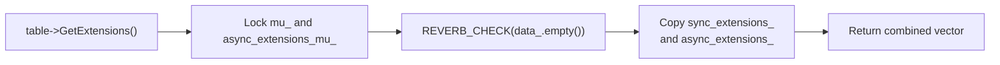

**Sources:** [reverb/cc/table.cc:1085-1093]()

## Threading and Concurrency Model

The extension system uses a multi-mutex design to minimize contention:

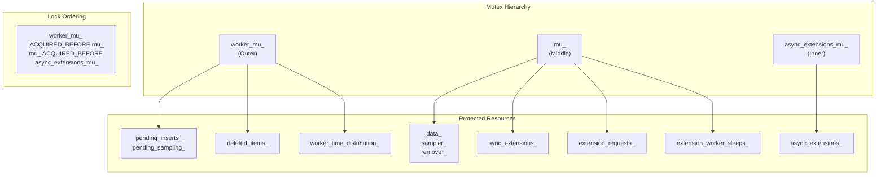

**Lock acquisition patterns:**

1. **Synchronous extension execution**: Holds `mu_` throughout
2. **Asynchronous extension execution**: Holds `async_extensions_mu_` only
3. **Extension registration**: Holds both `mu_` and `async_extensions_mu_` briefly
4. **Reset operation**: Acquires locks in order, waits for extension worker to finish

**Sources:** [reverb/cc/table.h:532](), [reverb/cc/table.h:614](), [reverb/cc/table.h:650]()

## ExtensionItem Wrapper

The `ExtensionItem` struct provides a safe interface for extensions to access item data:

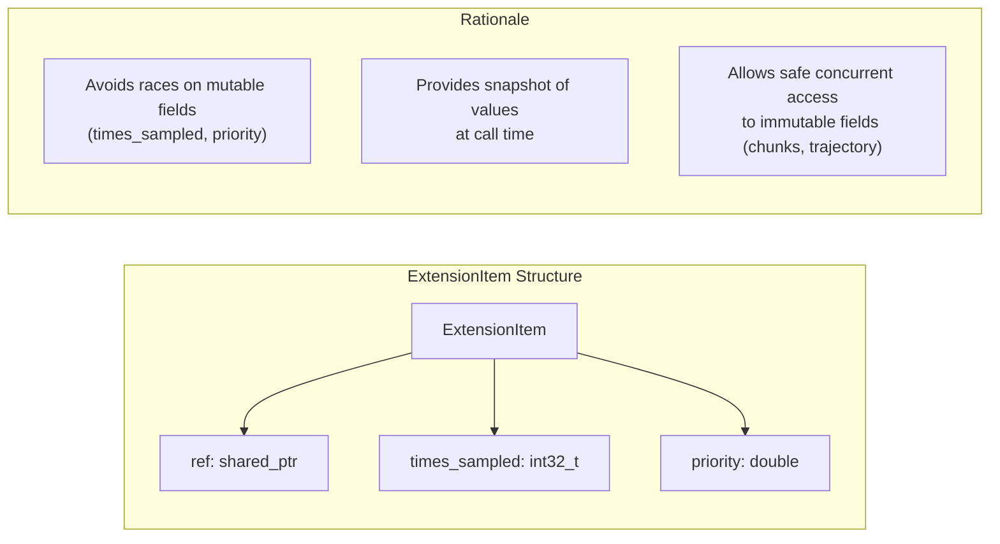

**Design rationale:**

The `TableItem` class contains both immutable fields (e.g., `flat_trajectory`, `chunks`) and mutable fields (e.g., `times_sampled`, `priority`). Protocol buffers invalidate ALL fields for concurrent access when ANY field is modified. To safely access immutable fields while allowing concurrent modifications to mutable ones, `ExtensionItem` extracts snapshots of the mutable fields at the time of the hook call.

Extensions can:
- Read `times_sampled` and `priority` from the snapshot values
- Access immutable fields like `chunks()` and `flat_trajectory()` from `ref`
- Store `ref` for later use (maintaining shared ownership)

**Sources:** [reverb/cc/table.h:115-126](), [reverb/cc/table.h:51-61]()

## Checkpointing Integration

Extensions participate in the checkpoint restoration process:

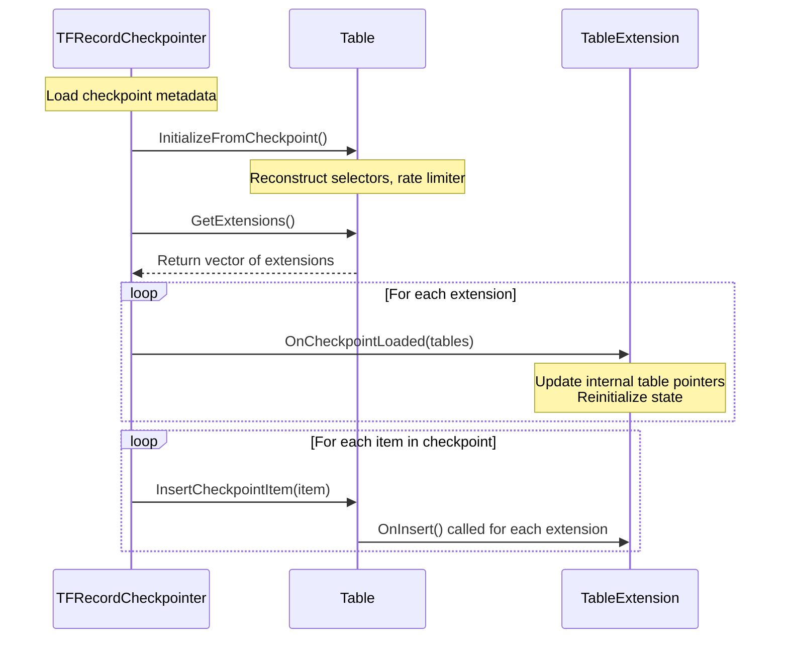

**Key points:**

1. **OnCheckpointLoaded is called first**: This allows extensions to update internal pointers to the reconstructed tables before any items are inserted
2. **OnInsert is called for each restored item**: Extensions receive normal insertion notifications for checkpoint items
3. **Extension list is preserved**: Extensions registered before checkpoint loading remain registered after restoration

**Sources:** [reverb/cc/platform/tfrecord_checkpointer.cc:462-499]()

## Implementation Details

### Extension Operation Call Sites

Extensions are notified at the following code locations:

| Hook | Call Site | Context |
|------|-----------|---------|
| `OnInsert` | [reverb/cc/table.cc:620]() | After inserting into data/sampler/remover |
| `OnSample` | [reverb/cc/table.cc:738]() | After incrementing times_sampled |
| `OnUpdate` | [reverb/cc/table.cc:903]() | After updating priority in data/sampler/remover |
| `OnDelete` | [reverb/cc/table.cc:837]() | After removing from data/sampler/remover |
| `OnReset` | [reverb/cc/table.cc:920-925]() | Before clearing data structures |

**Sources:** [reverb/cc/table.cc:620](), [reverb/cc/table.cc:738](), [reverb/cc/table.cc:837](), [reverb/cc/table.cc:903](), [reverb/cc/table.cc:920-925]()

### Memory Management for Deleted Items

When items are deleted, the table employs a deferred deallocation strategy:

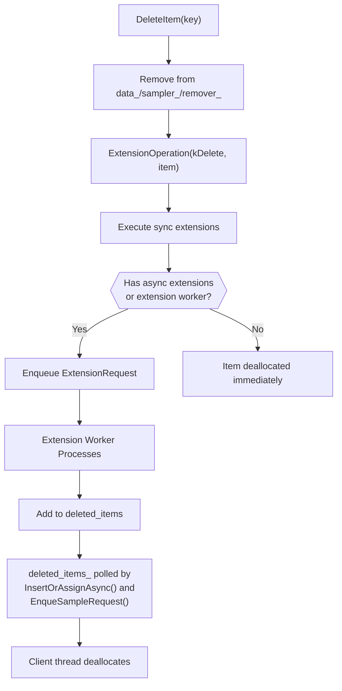

This design spreads the cost of memory deallocation across multiple threads and prevents expensive operations from blocking the table worker or extension worker.

**Sources:** [reverb/cc/table.cc:469-500](), [reverb/cc/table.cc:576-590](), [reverb/cc/table.cc:669-688]()

### Waiting for Extension Work Completion

Several operations require waiting for all extension work to complete:

**Reset operation:**
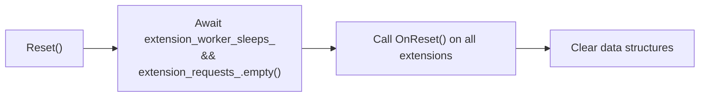

**Purpose:** Ensures all pending extension operations complete before the table state is cleared, preventing use-after-free errors.

**Sources:** [reverb/cc/table.cc:908-947]()

## Testing Extensions

The codebase includes tests demonstrating proper extension usage:

**Death test for late registration:**
```cpp
TEST(PriorityTableDeathTest, DiesIfUnsafeAddExtensionCalledWhenNonEmpty) {
  auto table = MakeUniformTable("dist");
  REVERB_EXPECT_OK(table->InsertOrAssign(MakeItem(1, 1)));
  ASSERT_DEATH(table->UnsafeAddExtension(nullptr), "");
}
```

This verifies that extensions cannot be added after items are inserted, ensuring consistent state across all extensions.

**Sources:** [reverb/cc/table_test.cc:720-725]()

---

**Summary:** Table Extensions provide a flexible mechanism for injecting custom behavior into Reverb's table lifecycle. The system supports both synchronous and asynchronous execution models, with a dedicated worker thread managing async operations to minimize impact on table performance. Extensions must be registered before any items are inserted and receive notifications at all critical lifecycle events. The design carefully manages threading and memory to ensure safety and performance.

---

