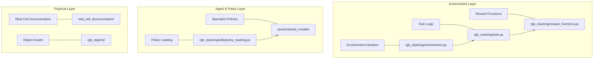
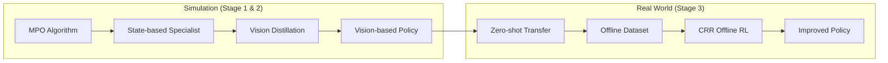

<!-- source: DeepWiki mcp.deepwiki.com · repo google-deepmind/rgb_stacking · page 1 Overview · fetched 2026-10-26 -->

# Overview

Relevant source files

The following files were used as context for generating this wiki page:

- [CONTRIBUTING.md](CONTRIBUTING.md)
- [LICENSE](LICENSE)
- [README.md](README.md)
- [doc/images/rgb_environment.png](doc/images/rgb_environment.png)

The `rgb_stacking` repository provides a simulation environment and associated research assets for robotic manipulation tasks involving diverse shapes. Specifically, it focuses on the task of stacking a red object onto a blue object while navigating a green obstacle within a workspace basket [README.md:1-27]().

This project is a re-implementation of the environment used in the 2021 CoRL paper ["Beyond Pick-and-Place: Tackling Robotic Stacking of Diverse Shapes"](https://arxiv.org/abs/2110.08723). It is built using the [Modular Manipulation (MoMa)](https://github.com/google-deepmind/robotics/tree/main/py/moma) framework and MuJoCo [README.md:25-27]().

### System Architecture and Code Mapping

The following diagram illustrates how high-level system components map to specific code entities and directories within the repository.

**System to Code Entity Mapping**

Sources: [README.md:10-27](), [rgb_stacking/environment.py:1-20](), [rgb_stacking/task.py:1-30](), [rgb_stacking/reward_functions.py:1-25](), [rgb_stacking/utils/policy_loading.py:1-15]()

### Core Task Description
The environment features a Sawyer robot arm equipped with a Robotiq 2F-85 gripper. The agent's objective is to stack the red object on the blue object within a 20-second time limit [README.md:19-23]().

The agent interacts with the environment via a 4D Cartesian controller, commanding:
*   **X, Y, Z velocities**
*   **Rotation around the Z-axis** [README.md:23-25]()

### Key Repository Components

| Component | Description |
| :--- | :--- |
| **Simulation** | A MuJoCo environment utilizing the MoMa framework for modular robot manipulation. |
| **Object Triplets** | Specific sets of three objects (Red, Green, Blue). The repo supports test, train, and held-out splits [README.md:138-143](). |
| **Specialist Policies** | Pre-trained state-based policies for five specific test triplets, achieving ~75% success [README.md:46-58](). |
| **Real-World Documentation** | Comprehensive assembly guides and bills of materials for replicating the simulation in a physical robot cell. |

### Research Context: The Three-Stage Pipeline
The repository supports a multi-stage reinforcement learning and distillation pipeline:
1.  **Stage 1: Skill Mastery**: Training state-based specialist policies using Maximum a Posteriori Policy Optimization (MPO).
2.  **Stage 2: Skill Generalization**: Distilling specialists into vision-based policies via interactive imitation learning.
3.  **Stage 3: Offline Policy Improvement**: Refining policies using offline RL (Critic Regularized Regression - CRR) from real-world data [README.md:29-42]().

**Training Pipeline Data Flow**

Sources: [README.md:29-42]()

### Wiki Navigation

*   **[Getting Started](#1.1)**: Installation instructions and how to run the interactive viewer or record policy videos using `run.sh` and `rgb_stacking/main.py`.
*   **[Research Background and Training Pipeline](#1.2)**: Deep dive into the MPO/CRR methodology and the object triplet distribution used for evaluation.
*   **Simulation Environment**: Detailed documentation of `task.py`, observation sets, and reward functions.
*   **Pre-trained Specialist Policies**: Information on loading and using the TensorFlow `SavedModel` assets provided in the repository.
*   **Real-World Cell Documentation**: Guidance on using the provided PDFs and CAD models to build a physical counterpart to the simulation.
*   **Testing and Development**: How to run `environment_test.py` and contribute to the project.

Sources: [README.md:65-125](), [CONTRIBUTING.md:1-25](), [LICENSE:1-130]()

---

