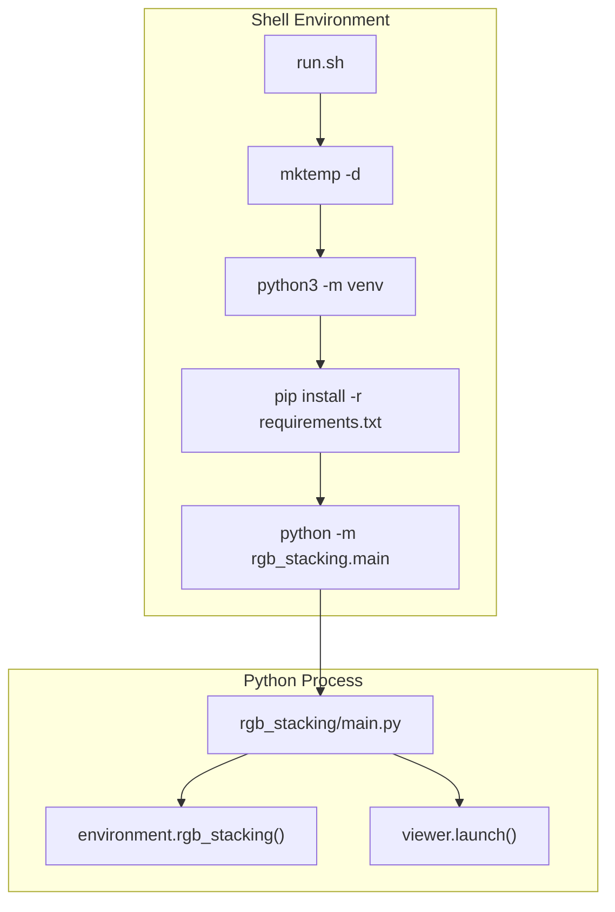
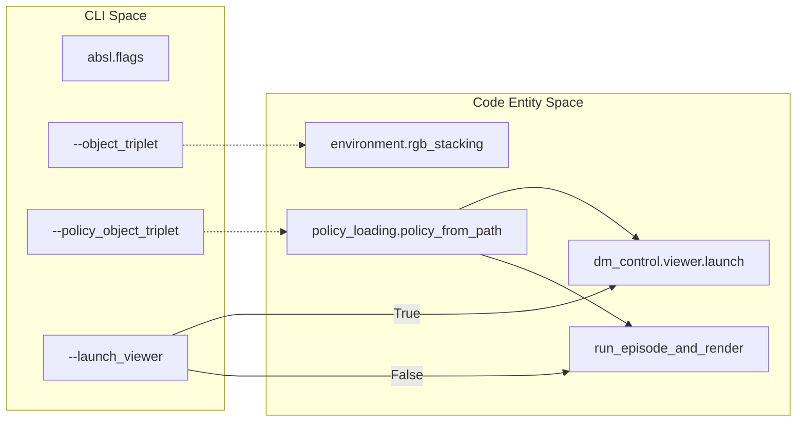
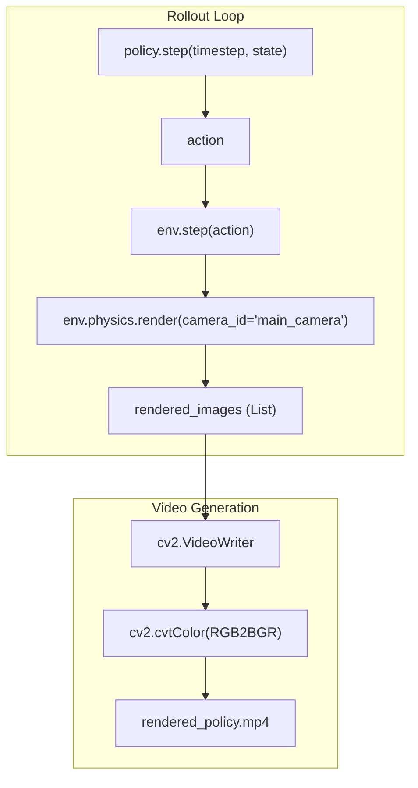

<!-- source: DeepWiki mcp.deepwiki.com · repo google-deepmind/rgb_stacking · page 1.1 Getting Started · fetched 2026-10-26 -->

# Getting Started

Relevant source files

The following files were used as context for generating this wiki page:

- [requirements.txt](requirements.txt)
- [rgb_stacking/main.py](rgb_stacking/main.py)
- [run.sh](run.sh)

This page provides a technical guide for setting up the `rgb_stacking` environment, installing its dependencies, and utilizing the provided CLI tools to visualize the environment or record policy rollouts.

## Installation and Environment Setup

The repository uses a standard Python virtual environment approach to manage dependencies. The primary entry point for automated setup is the `run.sh` script.

### Dependency Management
The environment relies on several DeepMind robotics libraries and TensorFlow for policy execution. Key dependencies defined in `requirements.txt` [1-7]() include:
*   `dm-control`: The underlying MuJoCo physics wrapper.
*   `dm-robotics-moma`: The Model-Based Manipulation (MoMa) framework used to construct the task.
*   `tensorflow`: Required for loading and running the pre-trained specialist policies.
*   `dm-reverb`: Used for data management in reinforcement learning contexts.

### Automated Setup with `run.sh`
The `run.sh` script [1-36]() automates the creation of a temporary environment to run the visualizer. It performs the following steps:
1.  Creates a temporary directory using `mktemp` [23]().
2.  Initializes a Python 3 virtual environment [25]().
3.  Upgrades and installs all requirements from `requirements.txt` [29]().
4.  Executes the main visualization script [32]().
5.  Cleans up the temporary directory upon exit [35]().

**Data Flow: Installation to Execution**
The following diagram illustrates how `run.sh` prepares the system for `rgb_stacking.main`.

**Setup and Execution Flow**

Sources: [run.sh:1-36](), [requirements.txt:1-7](), [rgb_stacking/main.py:115-116]()

---

## Interactive Viewer and CLI Usage

The `rgb_stacking/main.py` script is the central utility for interacting with the environment. It supports both an interactive GUI (via `dm_control.viewer`) and a headless video recording mode.

### Command Line Flags
The script uses `absl.flags` to configure the environment and policy loading:

| Flag | Type | Default | Description |
| :--- | :--- | :--- | :--- |
| `--object_triplet` | Enum | `rgb_test_random` | The set of 3 objects to load. Options include specific test triplets or `rgb_train_random`/`rgb_test_random` [45-47](). |
| `--policy_object_triplet` | Enum | `None` | If provided, loads a pre-trained specialist policy for that specific triplet from `assets/saved_models` [48-51](). |
| `--launch_viewer` | Bool | `True` | If `True`, starts the interactive MuJoCo viewer. If `False`, records a video rollout [52-55](). |

### Policy Loading Logic
When a policy is requested via `--policy_object_triplet`, the script maps the triplet name to a filesystem path [41-43]() and uses `policy_loading.policy_from_path` to instantiate the model [90](). For use within the interactive viewer, the policy is wrapped in a `StatefulPolicyCallable` [97]() to manage the internal state of the MPO agent across timesteps.

**Entity Mapping: CLI to Code Entities**

Sources: [rgb_stacking/main.py:41-55](), [rgb_stacking/main.py:85-98]()

---

## Recording Policy Rollouts

If `--launch_viewer` is set to `False`, the system enters a recording loop defined in `run_episode_and_render` [58-74]().

### The Rendering Pipeline
1.  **Initialization**: The policy's initial state is retrieved via `policy.initial_state()` [66](), and the environment is reset [67]().
2.  **Simulation Loop**:
    *   The policy produces an action based on the current `timestep` and `state` [70]().
    *   The environment steps the physics forward using `env.step(action)` [71]().
    *   The `main_camera` view is rendered into a numpy array via `env.physics.render` [72]().
3.  **Video Encoding**:
    *   The sequence of images is processed using `cv2.VideoWriter` [106-109]().
    *   Color spaces are converted from RGB (MuJoCo) to BGR (OpenCV) [111]().
    *   The frame rate is calculated as `1.0 / env.task.control_timestep` [109]().
    *   The resulting file is saved as `./rendered_policy.mp4` [107]().

**Data Flow: Policy Rollout to Video**

Sources: [rgb_stacking/main.py:58-74](), [rgb_stacking/main.py:102-113]()

---

