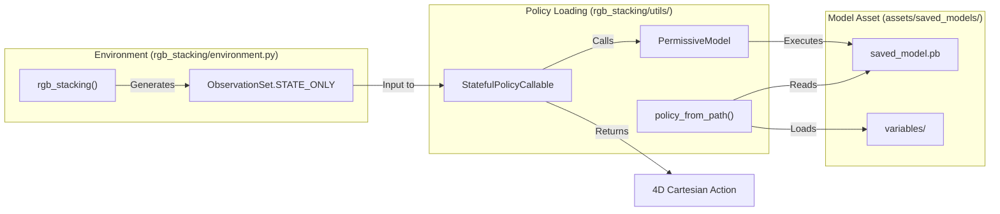

<!-- source: DeepWiki mcp.deepwiki.com · repo google-deepmind/rgb_stacking · page 1.2 Research Background and Training Pipeline · fetched 2026-10-26 -->

# Research Background and Training Pipeline

<details>
<summary>Relevant source files</summary>

The following files were used as context for generating this wiki page:

- [README.md](README.md)
- [assets/saved_models/mpo_state_rgb_test_triplet1/saved_model.pb](assets/saved_models/mpo_state_rgb_test_triplet1/saved_model.pb)

</details>


This page documents the three-stage training methodology used to develop the stacking policies for the RGB-stacking task, as described in the CoRL 2021 paper "Beyond Pick-and-Place: Tackling Robotic Stacking of Diverse Shapes". The pipeline transitions from simulation-based reinforcement learning with full state access to vision-based policies capable of zero-shot sim-to-real transfer and subsequent offline refinement.

## Methodology Overview

The training process is divided into three distinct phases designed to overcome the challenges of complex shape manipulation and the reality gap.

| Stage | Name | Algorithm | Observation Space | Goal |
| :--- | :--- | :--- | :--- | :--- |
| **Stage 1** | Skill Mastery | MPO | `STATE_ONLY` | Train expert "specialist" policies on specific object triplets using ground-truth simulation states. |
| **Stage 2** | Skill Generalization | Interactive Imitation | `INTERACTIVE_IMITATION_LEARNING` | Distill specialist knowledge into a vision-based "generalist" policy using domain randomization. |
| **Stage 3** | Offline Improvement | CRR | `OFFLINE_POLICY_IMPROVEMENT` | Refine the vision policy using real-world data and Critic Regularized Regression. |

Sources: [README.md:29-42](), [README.md:163-171]()

---

## Stage 1: Skill Mastery (MPO)

In the first stage, Maximum a Posteriori Policy Optimization (MPO) is used to train state-based specialists. These agents have access to the exact positions and orientations of the objects, which simplifies the learning problem.

### Key Components
*   **Algorithm:** MPO (Maximum a Posteriori Policy Optimization).
*   **Observations:** `STATE_ONLY`. This includes proprioception (joint angles/velocities), the robot's pinch pose, and the absolute poses of the Red, Green, and Blue objects [README.md:163-165]().
*   **Output:** Specialist policies for specific object triplets. This repository includes 5 such specialist models [README.md:46-58]().

### Object Triplet Splits
To evaluate generalization, the objects are partitioned into three sets:
1.  **Train Triplets:** Used for training the generalist in Stage 2 [README.md:142-142]().
2.  **Test Triplets:** 5 specific triplets used to evaluate Skill Mastery and Generalization [README.md:140-141]().
3.  **Held-out Triplets:** Entirely unseen objects used to test the limits of generalization [README.md:143-143]().

Sources: [README.md:36-37](), [README.md:126-146]()

---

## Stage 2: Skill Generalization (Vision Distillation)

The second stage involves distilling the knowledge from the state-based specialists into a vision-based student policy. This is achieved through **Interactive Imitation Learning**.

### The Distillation Process
1.  **Teacher:** The state-based MPO specialist (Stage 1).
2.  **Student:** A vision-based policy receiving RGB camera feeds.
3.  **Interactive Loop:** The student policy predicts actions based on pixels. During training, the student is supervised by the teacher's actions.
4.  **Domain Randomization:** To facilitate sim-to-real transfer, the simulation environment is randomized (lighting, textures, camera positions). Note: The open-source version of this repository currently omits the domain randomization module [README.md:13-15]().

### Code Entity Mapping: Distillation Observations
The following diagram bridges the research concept of "Interactive Imitation" to the specific observation sets defined in the codebase.

**Vision Distillation Data Flow**
```mermaid
graph TD
    subgraph "Natural Language Space"
        Teacher["State-Based Specialist"]
        Student["Vision-Based Generalist"]
        Sim["Simulation Env"]
    end

    subgraph "Code Entity Space (rgb_stacking/environment.py)"
        IIL_SET["ObservationSet.INTERACTIVE_IMITATION_LEARNING"]
        STATE_SET["ObservationSet.STATE_ONLY"]
        VISION_SET["ObservationSet.VISION_ONLY"]
    end

    Sim -->|Provides| STATE_SET
    Sim -->|Provides| VISION_SET
    
    STATE_SET -->|Inputs to| Teacher
    VISION_SET -->|Inputs to| Student
    
    Teacher -.->|Supervises| Student
    
    IIL_SET ---|Combines| VISION_SET
    IIL_SET ---|Adds| Proprioception["Proprioception (Sub-set)"]
end
```
Sources: [README.md:37-40](), [README.md:167-168]()

---

## Stage 3: Offline Policy Improvement (CRR)

The final stage addresses the performance gap when the vision policy is deployed on physical hardware. Even with domain randomization, sim-to-real transfer is rarely perfect.

### Methodology
*   **Data Collection:** The distilled vision policy is deployed on the real robot cell [README.md:39-40](). Rollouts (both successes and failures) are recorded into a dataset.
*   **Algorithm:** Critic Regularized Regression (CRR). This offline RL algorithm allows the policy to learn from the collected data without further environment interaction.
*   **Observation Space:** `OFFLINE_POLICY_IMPROVEMENT`. This set is optimized for the data stored in the offline logs, typically including compressed visual features and robot state [README.md:169-171]().

Sources: [README.md:40-42](), [README.md:169-171]()

---

## Implementation in Code

The training pipeline stages are reflected in how the environment is initialized and how policies are loaded.

### Policy Loading and Execution
The `SavedModel` assets provided in the repository are the result of **Stage 1**. They expect state-based observations as defined in the `_MPOState` named tuple or the `STATE_ONLY` observation set.

**Policy Execution Pipeline**


### Key Functions and Classes
*   `rgb_stacking.environment.rgb_stacking`: The main entry point for creating the environment with specific `ObservationSet` configurations [README.md:133-135]().
*   `rgb_stacking.utils.policy_loading.policy_from_path`: Utility to load the TensorFlow SavedModels from the `assets/` directory.
*   `rgb_stacking.main`: Demonstrates how to link a specific object triplet (e.g., `rgb_test_triplet4`) with its corresponding specialist policy [README.md:115-115]().

Sources: [README.md:110-116](), [README.md:157-159](), [assets/saved_models/mpo_state_rgb_test_triplet1/saved_model.pb:1-103]()

---

