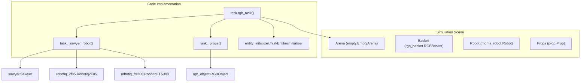

<!-- source: DeepWiki mcp.deepwiki.com · repo google-deepmind/rgb_stacking · page 2.1 Task Construction · fetched 2026-10-26 -->

# Task Construction

Relevant source files

The following files were used as context for generating this wiki page:

- [rgb_stacking/environment.py](rgb_stacking/environment.py)
- [rgb_stacking/task.py](rgb_stacking/task.py)

This page details the construction of the RGB stacking task using the Modular Manipulation (MoMa) framework. The task is defined in `rgb_stacking/task.py` and encapsulates the physical simulation components, including the robot, workspace, objects, and the control interfaces required for reinforcement learning.

The environment consists of a Sawyer robot arm equipped with a Robotiq gripper, positioned in front of a basket containing three colored objects (Red, Green, Blue). The primary goal is to stack the red object onto the blue one [rgb_stacking/environment.py:16-22]().

## System Architecture

The task construction follows the MoMa `BaseTask` pattern, which separates the physical assembly of the scene from the high-level task logic (rewards and observations).

### Code Entity Relationship
The following diagram illustrates how high-level components map to specific classes and functions within the codebase.

**Component Mapping: Natural Language to Code Entities**

**Sources:** [rgb_stacking/task.py:116-175](), [rgb_stacking/task.py:202-245](), [rgb_stacking/task.py:270-283]()

## Physical Components

### 1. Robot Assembly
The robot is a Rethink Robotics Sawyer arm [rgb_stacking/task.py:51](). It is assembled with the following hardware stack:
*   **Arm:** Sawyer robot arm.
*   **Wrist Sensor:** Robotiq FTS-300 force-torque sensor [rgb_stacking/task.py:50]().
*   **End-Effector:** Robotiq 2F-85 parallel gripper [rgb_stacking/task.py:49]().

The robot is integrated into the MoMa framework via `moma_robot.Robot`, which bundles the arm, gripper, sensors, and effectors [rgb_stacking/task.py:236-245]().

### 2. Workspace and Arena
The environment uses an empty arena as a base [rgb_stacking/task.py:134](). The interaction area is defined by an `RGBBasket` positioned at a default offset from the robot base [rgb_stacking/task.py:70-73]().
*   **Basket Origin:** (0.6, 0.0, 0.0498) [rgb_stacking/task.py:72]().
*   **Workspace Size:** 0.25m x 0.25m x 0.2m [rgb_stacking/task.py:74]().

### 3. RGB Objects (Props)
The task involves three objects, identified by their colors. These are instantiated using the `rgb_object.RGBObject` class, which handles the MuJoCo geometry for the various shapes used in the research [rgb_stacking/task.py:270-283]().

**Sources:** [rgb_stacking/task.py:48-60](), [rgb_stacking/task.py:134-152](), [rgb_stacking/task.py:178-185]()

## Sensors and Perception

The task defines a suite of sensors to provide the state and visual information required for the `ObservationSet`.

| Sensor Category | Implementation Class | Description |
| :--- | :--- | :--- |
| **Proprioception** | `RobotArmSensor`, `RobotiqGripperSensor` | Joint angles, velocities, and torques [rgb_stacking/task.py:221-224](). |
| **TCP State** | `RobotTCPSensor` | Cartesian pose and velocity of the Tool Center Point [rgb_stacking/task.py:225](). |
| **Force/Torque** | `RobotWristFTSensor` | 6-axis F/T data from the FTS-300 [rgb_stacking/task.py:226](). |
| **Visual** | `CameraSensor` | Three 128x128 RGB cameras: `basket_back_left`, `basket_front_left`, and `basket_front_right` [rgb_stacking/task.py:102-113](). |
| **Object State** | `PropPoseSensor` | Absolute poses of the red, green, and blue objects [rgb_stacking/task.py:154](). |

**Sources:** [rgb_stacking/task.py:99-113](), [rgb_stacking/task.py:153-160](), [rgb_stacking/task.py:221-234]()

## Initialization and Control

### Entity Initializers
To ensure variety during training, the environment uses a `TaskEntitiesInitializer` to randomize the starting configuration of every episode [rgb_stacking/task.py:162-164]().
*   **Gripper Initializer:** Randomizes the TCP pose within a defined box: X [0.5, 0.7], Y [-0.14, 0.14], Z [0.22, 0.43] [rgb_stacking/task.py:85-86]().
*   **Prop Initializer:** Randomly places the three objects within the basket bounds: X [0.5, 0.7], Y [-0.1, 0.1] [rgb_stacking/task.py:81-82]().

### 4D Cartesian Velocity Effector
The agent controls the robot using a 4D Cartesian velocity interface. This effector maps agent actions to:
1.  **Linear Velocity (X, Y, Z):** Limited to 0.07 m/s [rgb_stacking/task.py:76]().
2.  **Angular Velocity (Yaw/Z-axis):** Limited to 1.0 rad/s [rgb_stacking/task.py:77]().

The effector is implemented using `Cartesian4dVelocityEffector`, which utilizes an IK solver with a nullspace preference towards a default joint configuration `_NULLSPACE_JOINT_STATE` to maintain a natural arm posture [rgb_stacking/task.py:92-94](), [rgb_stacking/task.py:255-267]().

**Data Flow: Action to Simulation**

**Sources:** [rgb_stacking/task.py:75-98](), [rgb_stacking/task.py:162-164](), [rgb_stacking/task.py:255-267](), [rgb_stacking/environment.py:57]()

---

