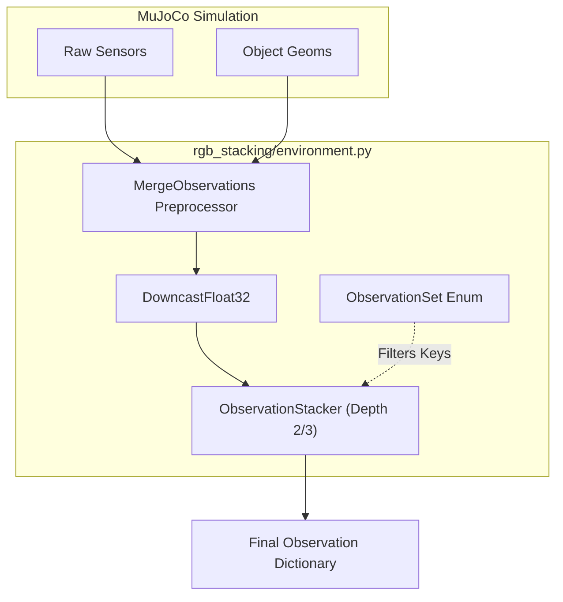
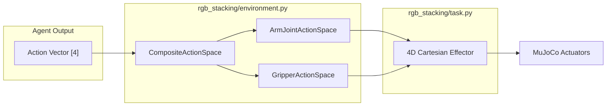

<!-- source: DeepWiki mcp.deepwiki.com · repo google-deepmind/rgb_stacking · page 2.2 Observation and Action Spaces · fetched 2026-10-26 -->

# Observation and Action Spaces

Relevant source files

The following files were used as context for generating this wiki page:

- [rgb_stacking/environment.py](rgb_stacking/environment.py)
- [rgb_stacking/environment_test.py](rgb_stacking/environment_test.py)

This page documents the interface between the agent and the `rgb_stacking` environment. It covers the various observation configurations available for different training stages, the preprocessing pipeline for sensor data, and the 4D Cartesian action space used to control the robot.

## Observation Spaces

The environment uses the `ObservationSet` enum to define which sensors are exposed to the agent [rgb_stacking/environment.py:114-134](). This allows the same environment code to support state-based reinforcement learning (Stage 1), vision-based distillation (Stage 2), and offline policy improvement (Stage 3).

### ObservationSet Configurations

| Enum Member | Purpose | Key Observations |
| :--- | :--- | :--- |
| `STATE_ONLY` | Stage 1: Skill Mastery (MPO) | Proprioception, Object Poses, Relative distances. |
| `VISION_ONLY` | Visual feedback only | Camera pixels from three basket views. |
| `ALL` | Debugging / Comprehensive | Combination of State and Vision. |
| `INTERACTIVE_IMITATION_LEARNING` | Stage 2: Skill Generalization | Proprioception + Front-left/Front-right camera pixels. |
| `OFFLINE_POLICY_IMPROVEMENT` | Stage 3: CRR from real data | Velocity-augmented proprioception + Front cameras. |

Sources: [rgb_stacking/environment.py:60-134]()

### Observation Preprocessing and Stacking

Observations undergo a transformation pipeline managed by `subtask_env_builder.SubtaskEnvBuilder` [rgb_stacking/environment.py:167-169](). This pipeline includes:

1.  **Type Casting**: All floating-point observations are downcast to `float32` [rgb_stacking/environment.py:188-189]().
2.  **Merging**: Specific vectors (like position and quaternions) are merged into single "pose" observations (e.g., `robot0_tcp_pose`) [rgb_stacking/environment.py:192-195]().
3.  **Temporal Stacking**: To provide temporal context, observations are stacked across multiple timesteps:
    *   Standard observations: Stacked depth of 3 [rgb_stacking/environment.py:50]().
    *   Action-related observations: Stacked depth of 2 [rgb_stacking/environment.py:51]().

### Data Flow: From Simulation to Agent

The following diagram illustrates how raw MuJoCo data is processed into the final observation dictionary.

**Observation Processing Pipeline**

Sources: [rgb_stacking/environment.py:47-51](), [rgb_stacking/environment.py:114-134](), [rgb_stacking/environment.py:188-195]()

---

## Action Space

The agent interacts with the environment through a **4D Cartesian velocity space**. This space is constructed by combining the robot arm's Cartesian effector and the gripper's scalar effector.

### Action Space Composition

The `rgb_stacking` environment uses `dm_robotics.agentflow` to compose action spaces [rgb_stacking/environment.py:183-185]().

*   **Arm Action (3D)**: Linear velocity $(v_x, v_y, v_z)$ of the Tool Center Point (TCP) in the robot's base frame.
*   **Gripper Action (1D)**: A scalar value representing the desired change in gripper opening/closing.

The `subtask_env` exposes these via a `CompositeActionSpace` [rgb_stacking/environment.py:183-185]().

### Action Space Mapping

Sources: [rgb_stacking/environment.py:173-185](), [rgb_stacking/task.py:26-29]()

### Environment Lifecycle

The environment is instantiated via `rgb_stacking.environment.rgb_stacking(...)` [rgb_stacking/environment.py:137-141]().

1.  **Task Initialization**: Loads the `rgb_task` with specific object triplets [rgb_stacking/environment.py:156-157]().
2.  **Physics Setup**: Sets simulation timestep to 0.0005s [rgb_stacking/environment.py:57-158]().
3.  **Collision Optimization**: Uses `mujoco_collisions` to exclude impossible geom interactions to improve performance [rgb_stacking/environment.py:162-163]().
4.  **Reward Binding**: Attaches either the sparse reward or the complex staged reward function [rgb_stacking/environment.py:140-141]().

Sources: [rgb_stacking/environment.py:137-170]()

---

