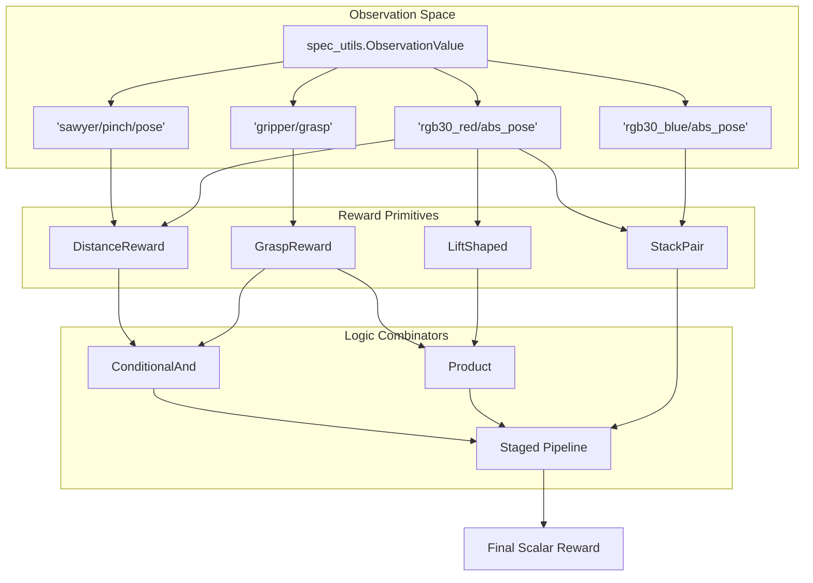
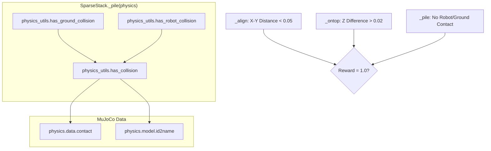

<!-- source: DeepWiki mcp.deepwiki.com · repo google-deepmind/rgb_stacking · page 2.3 Reward Functions · fetched 2026-10-26 -->

# Reward Functions

Relevant source files

The following files were used as context for generating this wiki page:

- [rgb_stacking/physics_utils.py](rgb_stacking/physics_utils.py)
- [rgb_stacking/reward_functions.py](rgb_stacking/reward_functions.py)
- [rgb_stacking/stack_rewards.py](rgb_stacking/stack_rewards.py)

The `rgb_stacking` package implements a sophisticated reward system designed to guide reinforcement learning agents through the complex task of stacking objects. This system includes a five-stage shaped reward pipeline for skill acquisition and a physics-based sparse reward for evaluating final task success.

## Reward System Architecture

The reward system is divided into two primary files:
- `rgb_stacking/reward_functions.py`: Contains generic, reusable reward primitives (e.g., distance, lifting, grasping) and logic combinators [rgb_stacking/reward_functions.py:16-17]().
- `rgb_stacking/stack_rewards.py`: Defines the specific stacking task rewards, including the `Staged` pipeline and the `SparseStack` physics-based reward [rgb_stacking/stack_rewards.py:16-17]().

### Reward Flow Overview

The following diagram illustrates how the reward components interact to produce a final reward signal for the agent.

**Reward Calculation Data Flow**

Sources: [rgb_stacking/reward_functions.py:31-31](), [rgb_stacking/stack_rewards.py:52-57](), [rgb_stacking/stack_rewards.py:65-111]()

## Shaped Stacking Pipeline

The `get_shaped_stacking_reward` function constructs a `Staged` reward pipeline. This pipeline ensures that the agent receives a dense signal by progressing through five distinct stages [rgb_stacking/stack_rewards.py:65-111]().

| Stage | Name | Description | Implementation Detail |
| :--- | :--- | :--- | :--- |
| 1 | **Reach and Grasp** | Agent must move the pinch site to the red object and close the gripper. | `ConditionalAnd(reach_red, grasp, 0.9)` [rgb_stacking/stack_rewards.py:68-86]() |
| 2 | **Grasp and Lift** | Agent must maintain a grasp while lifting the red object above a height threshold. | `Product([grasp, lift_reward])` [rgb_stacking/stack_rewards.py:89-90]() |
| 3 | **Hover** | Agent must move the lifted red object to a position above the blue object. | `DistanceReward` with `_HOVER_OFFSET` [rgb_stacking/stack_rewards.py:95-101]() |
| 4 | **Stack** | Agent must place the red object on top of the blue object and release it. | `StackPair` [rgb_stacking/stack_rewards.py:104-104]() |
| 5 | **Stack and Leave** | Final stage where the object is stacked and the arm moves away. | `Product(stack, above_red)` [rgb_stacking/stack_rewards.py:107-108]() |

Sources: [rgb_stacking/stack_rewards.py:65-111]()

## Reward Primitives and Combinators

### Core Primitive Classes
- **`DistanceReward`**: Calculates a shaped reward based on the L2 distance between two entities. It uses a squared tanh shaping function (`tanh_squared`) to provide a smooth gradient [rgb_stacking/reward_functions.py:168-182]().
- **`LiftShaped`**: Provides reward for lifting an object. It is zero below a minimum height and reaches maximum reward at a target threshold [rgb_stacking/reward_functions.py:277-285]().
- **`GraspReward`**: A sparse reward that returns 1.0 if the gripper sensor reports an `_INWARD_GRASP` (value 2) [rgb_stacking/reward_functions.py:52-65]().
- **`StackPair`**: Checks if the horizontal and vertical distance between two objects is within specified tolerances (`_STACK_HORIZONTAL_TOLERANCE`, `_STACK_VERTICAL_TOLERANCE`) [rgb_stacking/reward_functions.py:68-114]().

### Combinator Classes
- **`Staged`**: Chains multiple reward functions. The agent only receives reward for stage $N$ if the reward for stage $N-1$ exceeds a specific threshold [rgb_stacking/reward_functions.py:461-470]().
- **`Product`**: Returns the product of multiple reward terms, effectively acting as a soft "AND" gate [rgb_stacking/reward_functions.py:423-435]().
- **`ConditionalAnd`**: Returns the second reward only if the first reward is above a threshold; otherwise, it returns a scaled version of the first reward [rgb_stacking/reward_functions.py:381-397]().
- **`Max`**: Returns the maximum value among several reward terms, often used to combine different ways of achieving a sub-goal [rgb_stacking/reward_functions.py:350-362]().

Sources: [rgb_stacking/reward_functions.py:52-470]()

## Sparse Physics-Based Reward

The `SparseStack` class in `stack_rewards.py` provides a ground-truth success metric based on MuJoCo physics state rather than just object poses [rgb_stacking/stack_rewards.py:159-166]().

### Success Criteria
For a stack to be considered successful by `SparseStack`, three conditions must be met:
1.  **Alignment**: The red object's center must be within `_X_Y_CLOSE` (0.05m) of the blue object in the X-Y plane [rgb_stacking/stack_rewards.py:184-187]().
2.  **Verticality**: The red object must be at least `_ONTOP` (0.02m) above the blue object [rgb_stacking/stack_rewards.py:189-192]().
3.  **Stability (No Robot Contact)**: The red object must NOT be in contact with the robot or the ground, ensuring it is supported solely by the blue object [rgb_stacking/stack_rewards.py:194-200]().

### Physics Utilities
The `SparseStack` reward relies on `rgb_stacking/physics_utils.py` to query the MuJoCo contact buffer:
- **`has_ground_collision`**: Checks if an object is touching the `work_surface` or `ground` geoms [rgb_stacking/physics_utils.py:39-46]().
- **`has_robot_collision`**: Checks if an object is touching any `robot` geoms [rgb_stacking/physics_utils.py:49-56]().
- **`has_collision`**: The underlying iterator that scans `physics.data.contact` for geom pairs within a specified `margin` [rgb_stacking/physics_utils.py:59-74]().

**Physics-Based Success Logic**

Sources: [rgb_stacking/stack_rewards.py:184-200](), [rgb_stacking/physics_utils.py:59-74]()

---

