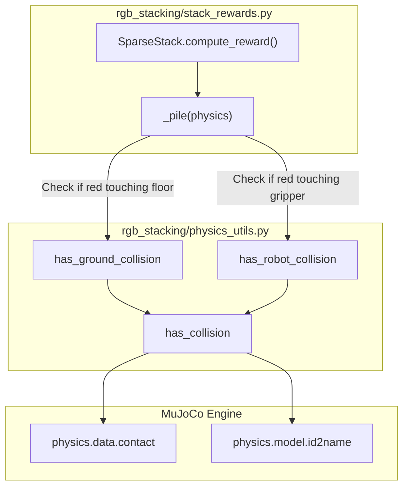
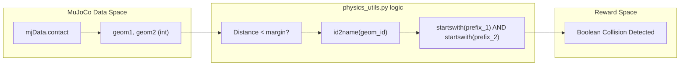

<!-- source: DeepWiki mcp.deepwiki.com · repo google-deepmind/rgb_stacking · page 2.4 Physics Utilities · fetched 2026-10-26 -->

# Physics Utilities

Relevant source files

The following files were used as context for generating this wiki page:

- [rgb_stacking/physics_utils.py](rgb_stacking/physics_utils.py)
- [rgb_stacking/stack_rewards.py](rgb_stacking/stack_rewards.py)

The `rgb_stacking/physics_utils.py` module provides a suite of helper functions for querying MuJoCo contact data. These utilities are essential for detecting collisions between the three primary entity types in the environment: the RGB objects, the robot arm (Sawyer/Robotiq), and the ground/workspace surface.

The primary role of these utilities is to support the sparse reward logic and task termination criteria by verifying that objects are supported by each other rather than being held by the robot or resting on the ground.

## Collision Detection Logic

Collision detection is implemented by iterating through the `physics.data.contact` buffer provided by MuJoCo. The utilities filter these contacts based on a distance margin and geom name prefixes.

### Key Prefixes and Margins
The module defines standard prefixes to identify geoms within the MuJoCo model:
*   **Object Geoms**: Identified by the prefix `rgb` [rgb_stacking/physics_utils.py:24]().
*   **Ground Geoms**: Identified by prefixes `work_surface` or `ground` [rgb_stacking/physics_utils.py:25]().
*   **Robot Geoms**: Identified by the prefix `robot` [rgb_stacking/physics_utils.py:26]().

Two default margins are used:
*   `DEFAULT_OBJECT_COLLISION_MARGIN`: 0.0002 [rgb_stacking/physics_utils.py:21]().
*   `DEFAULT_COLLISION_MARGIN`: 1e-8 [rgb_stacking/physics_utils.py:22]().

### Core Function: `has_collision`
The `has_collision` function is the underlying engine for all physics queries in this module. It performs the following steps:
1.  Iterates through all active contacts in `physics.data.contact` [rgb_stacking/physics_utils.py:62]().
2.  Ignores contacts where the distance is greater than the specified `margin` [rgb_stacking/physics_utils.py:63-64]().
3.  Resolves the MuJoCo `id` of the two colliding geoms into string names using `physics.model.id2name` [rgb_stacking/physics_utils.py:65-66]().
4.  Checks if the names start with the provided prefixes for the two groups being compared [rgb_stacking/physics_utils.py:69-72]().

**Sources:** [rgb_stacking/physics_utils.py:21-74]()

## High-Level Query Functions

The module exposes specialized wrappers to check collisions against specific categories.

| Function | Purpose | Implementation |
| :--- | :--- | :--- |
| `has_object_collision` | Checks if a specific geom is touching any RGB object. | Calls `has_collision` with `OBJECT_GEOM_PREFIXES` [rgb_stacking/physics_utils.py:29-36](). |
| `has_ground_collision` | Checks if a specific geom is touching the floor or basket. | Calls `has_collision` with `GROUND_GEOM_PREFIXES` [rgb_stacking/physics_utils.py:39-46](). |
| `has_robot_collision` | Checks if a specific geom is touching the robot arm/gripper. | Calls `has_collision` with `ROBOT_GEOM_PREFIXES` [rgb_stacking/physics_utils.py:49-56](). |

**Sources:** [rgb_stacking/physics_utils.py:29-56]()

## Integration with Sparse Rewards

The `SparseStack` reward class in `rgb_stacking/stack_rewards.py` relies heavily on these utilities to validate a successful stack. A "sparse" success is defined not just by proximity, but by the physical state of the objects.

### Sparse Reward Flow
The `SparseStack` class uses `physics_utils` to ensure that a stack is "freestanding":
1.  **Alignment**: Checks if objects are aligned in the X-Y plane [rgb_stacking/stack_rewards.py:185-188]().
2.  **Verticality**: Checks if the top object is above the bottom object [rgb_stacking/stack_rewards.py:191-192]().
3.  **No Grounding**: Uses `has_ground_collision` to ensure the top object is not touching the basket [rgb_stacking/stack_rewards.py:196-197]().
4.  **No Robot Support**: Uses `has_robot_collision` to ensure the robot is not touching the top object, confirming the agent has released it [rgb_stacking/stack_rewards.py:198-199]().

### Code Entity Mapping: Reward to Physics

The following diagram illustrates how the high-level reward logic invokes the low-level physics utilities.

**Diagram: Sparse Reward Physics Validation**

**Sources:** [rgb_stacking/stack_rewards.py:159-200](), [rgb_stacking/physics_utils.py:59-74]()

## Data Flow: From Contact to Boolean

The mapping from raw MuJoCo contact buffers to semantic collision booleans is shown below.

**Diagram: Collision Detection Data Flow**

**Sources:** [rgb_stacking/physics_utils.py:62-74]()

## Constants Reference

The following constants define the geometric categories used throughout the collision detection system:

| Constant | Value | Description |
| :--- | :--- | :--- |
| `OBJECT_GEOM_PREFIXES` | `['rgb']` | Targets all manipulatable objects (Red, Blue, Green) [rgb_stacking/physics_utils.py:24](). |
| `GROUND_GEOM_PREFIXES` | `['work_surface', 'ground']` | Targets the floor and the basket boundaries [rgb_stacking/physics_utils.py:25](). |
| `ROBOT_GEOM_PREFIXES` | `['robot']` | Targets the Sawyer arm and Robotiq gripper components [rgb_stacking/physics_utils.py:26](). |

**Sources:** [rgb_stacking/physics_utils.py:24-26]()

---

