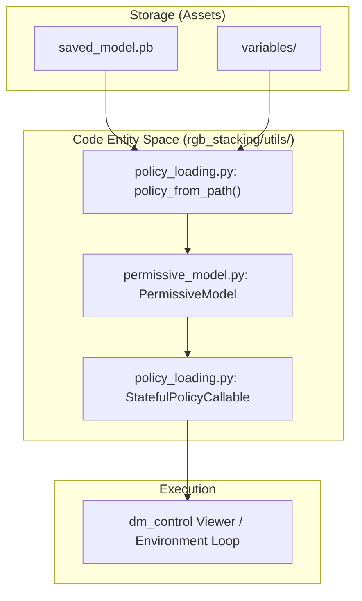
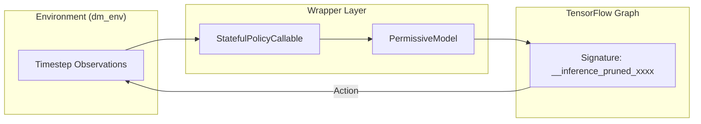

<!-- source: DeepWiki mcp.deepwiki.com · repo google-deepmind/rgb_stacking · page 3 Pre-trained Specialist Policies · fetched 2026-10-26 -->

# Pre-trained Specialist Policies

Relevant source files

The following files were used as context for generating this wiki page:

- [assets/saved_models/mpo_state_rgb_test_triplet1/saved_model.pb](assets/saved_models/mpo_state_rgb_test_triplet1/saved_model.pb)
- [assets/saved_models/mpo_state_rgb_test_triplet2/saved_model.pb](assets/saved_models/mpo_state_rgb_test_triplet2/saved_model.pb)
- [assets/saved_models/mpo_state_rgb_test_triplet3/saved_model.pb](assets/saved_models/mpo_state_rgb_test_triplet3/saved_model.pb)
- [assets/saved_models/mpo_state_rgb_test_triplet4/saved_model.pb](assets/saved_models/mpo_state_rgb_test_triplet4/saved_model.pb)
- [assets/saved_models/mpo_state_rgb_test_triplet5/saved_model.pb](assets/saved_models/mpo_state_rgb_test_triplet5/saved_model.pb)

This page provides an overview of the five pre-trained specialist policies included in the `rgb_stacking` repository. These policies represent the result of the **Skill Mastery** stage (Stage 1) of the training pipeline described in the associated research. They are state-based agents trained using Maximum a Posteriori Policy Optimization (MPO) to solve the stacking task for specific object triplets.

## Overview and Purpose

The specialist policies are intended to serve as "teachers" for subsequent training stages, such as vision-based distillation or offline policy improvement. Each policy is specialized to one of the five test triplets defined in the environment. Unlike the final agents which may use vision, these specialists operate on the `STATE_ONLY` observation set, giving them ground-truth knowledge of object poses.

### Performance and Success Rates
The following table summarizes the success rates for each specialist policy on its corresponding triplet:

| Triplet Name | Asset Directory | Success Rate |
| :--- | :--- | :--- |
| Test Triplet 1 | `assets/saved_models/mpo_state_rgb_test_triplet1/` | ~75% |
| Test Triplet 2 | `assets/saved_models/mpo_state_rgb_test_triplet2/` | ~85% |
| Test Triplet 3 | `assets/saved_models/mpo_state_rgb_test_triplet3/` | ~85% |
| Test Triplet 4 | `assets/saved_models/mpo_state_rgb_test_triplet4/` | ~85% |
| Test Triplet 5 | `assets/saved_models/mpo_state_rgb_test_triplet5/` | ~80% |

**Licensing Note:** While the source code of this project is under the Apache 2.0 license, the pre-trained model weights in `assets/saved_models/` are licensed under **Creative Commons Attribution 4.0 (CC BY 4.0)**.

**Sources:**
- [assets/saved_models/mpo_state_rgb_test_triplet1/saved_model.pb:1-200]() (and subsequent triplet files)

## System Architecture: From Model to Environment

The following diagram illustrates how the pre-trained specialist policies (stored as TensorFlow SavedModels) are integrated into the execution pipeline via the provided utility classes.

### Policy Loading Flow
"This diagram maps the high-level loading process to specific code entities."

**Sources:**
- [assets/saved_models/mpo_state_rgb_test_triplet1/saved_model.pb:92-110]()
- [assets/saved_models/mpo_state_rgb_test_triplet1/saved_model.pb:247-270]()

## SavedModel Structure

Each specialist is stored in the standard TensorFlow SavedModel format. These models contain the computational graph and the trained weights (variables) required to map environment observations to robot actions.

The models expose specific `SignatureDefs` for inference, typically involving:
- **Inputs:** A collection of tensors representing the `STATE_ONLY` observation set (e.g., `sawyer_pinch_pose`, `rgb30_red_abs_pose`).
- **Outputs:** The 4D Cartesian velocity actions for the robot arm and gripper.
- **State:** Recurrent state tensors (MPO states) that must be passed back to the model in subsequent timesteps.

For a detailed breakdown of the file layout and internal variable groups (actor/critic), see **[SavedModel Asset Structure](#3.1)**.

**Sources:**
- [assets/saved_models/mpo_state_rgb_test_triplet1/saved_model.pb:211-230]()
- [assets/saved_models/mpo_state_rgb_test_triplet1/saved_model.pb:247-250]()

## Loading and Usage Utilities

The repository provides specialized utilities to handle the complexities of loading these models into a `dm_env` compatible loop.

### Policy Interaction Diagram
"This diagram shows the relationship between the Environment's observation output and the Policy's action input."

Key utility components include:
- **`policy_from_path`**: The primary entry point for loading a specialist.
- **`PermissiveModel`**: A wrapper that allows the model to accept observations even if the input dictionary contains extra keys not required by the specific SavedModel signature.
- **`StatefulPolicyCallable`**: Manages the `_MPOState` NamedTuple, ensuring that recurrent states are correctly persisted and updated between environment steps.

For details on implementation and usage in the viewer, see **[Policy Loading Utilities](#3.2)**.

**Sources:**
- [assets/saved_models/mpo_state_rgb_test_triplet1/saved_model.pb:211-230]()
- [assets/saved_models/mpo_state_rgb_test_triplet1/saved_model.pb:281-300]()

---

