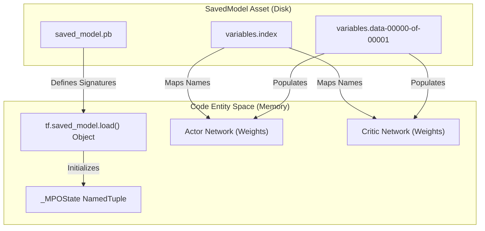
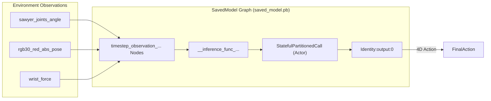

<!-- source: DeepWiki mcp.deepwiki.com · repo google-deepmind/rgb_stacking · page 3.1 SavedModel Asset Structure · fetched 2026-10-26 -->

# SavedModel Asset Structure

Relevant source files

The following files were used as context for generating this wiki page:

- [assets/saved_models/mpo_state_rgb_test_triplet1/saved_model.pb](assets/saved_models/mpo_state_rgb_test_triplet1/saved_model.pb)
- [assets/saved_models/mpo_state_rgb_test_triplet1/variables/variables.data-00000-of-00001](assets/saved_models/mpo_state_rgb_test_triplet1/variables/variables.data-00000-of-00001)
- [assets/saved_models/mpo_state_rgb_test_triplet1/variables/variables.index](assets/saved_models/mpo_state_rgb_test_triplet1/variables/variables.index)
- [assets/saved_models/mpo_state_rgb_test_triplet2/saved_model.pb](assets/saved_models/mpo_state_rgb_test_triplet2/saved_model.pb)
- [assets/saved_models/mpo_state_rgb_test_triplet2/variables/variables.data-00000-of-00001](assets/saved_models/mpo_state_rgb_test_triplet2/variables/variables.data-00000-of-00001)
- [assets/saved_models/mpo_state_rgb_test_triplet2/variables/variables.index](assets/saved_models/mpo_state_rgb_test_triplet2/variables/variables.index)
- [assets/saved_models/mpo_state_rgb_test_triplet3/saved_model.pb](assets/saved_models/mpo_state_rgb_test_triplet3/saved_model.pb)
- [assets/saved_models/mpo_state_rgb_test_triplet3/variables/variables.data-00000-of-00001](assets/saved_models/mpo_state_rgb_test_triplet3/variables/variables.data-00000-of-00001)
- [assets/saved_models/mpo_state_rgb_test_triplet3/variables/variables.index](assets/saved_models/mpo_state_rgb_test_triplet3/variables/variables.index)
- [assets/saved_models/mpo_state_rgb_test_triplet4/saved_model.pb](assets/saved_models/mpo_state_rgb_test_triplet4/saved_model.pb)
- [assets/saved_models/mpo_state_rgb_test_triplet4/variables/variables.data-00000-of-00001](assets/saved_models/mpo_state_rgb_test_triplet4/variables/variables.data-00000-of-00001)
- [assets/saved_models/mpo_state_rgb_test_triplet4/variables/variables.index](assets/saved_models/mpo_state_rgb_test_triplet4/variables/variables.index)
- [assets/saved_models/mpo_state_rgb_test_triplet5/saved_model.pb](assets/saved_models/mpo_state_rgb_test_triplet5/saved_model.pb)
- [assets/saved_models/mpo_state_rgb_test_triplet5/variables/variables.data-00000-of-00001](assets/saved_models/mpo_state_rgb_test_triplet5/variables/variables.data-00000-of-00001)
- [assets/saved_models/mpo_state_rgb_test_triplet5/variables/variables.index](assets/saved_models/mpo_state_rgb_test_triplet5/variables/variables.index)

This page describes the internal organization and data layout of the TensorFlow SavedModel assets provided for the five MPO state-based specialist policies. These models are located in `assets/saved_models/` and correspond to the "Skill Mastery" stage (Stage 1) of the training pipeline.

## 1. Directory Layout

Each specialist policy is stored as a self-contained TensorFlow SavedModel directory. This format allows for the serialization of the complete computational graph, including its variables (weights) and the specific functions (signatures) required to execute the policy.

The structure for a typical triplet (e.g., `mpo_state_rgb_test_triplet1`) is as follows:

| File / Directory | Description |
| :--- | :--- |
| `saved_model.pb` | The main protocol buffer file containing the graph definition, metadata, and `SignatureDefs`. |
| `variables/` | Directory containing the serialized values of the model's parameters. |
| `variables/variables.index` | A key-value index mapping tensor names to their location in the data shards. |
| `variables/variables.data-00000-of-00001` | The actual weight values (sharded; in this case, a single shard). |

**Sources:**
- `assets/saved_models/mpo_state_rgb_test_triplet1/saved_model.pb` [1-104]()
- `assets/saved_models/mpo_state_rgb_test_triplet1/variables/variables.index` [1]()
- `assets/saved_models/mpo_state_rgb_test_triplet1/variables/variables.data-00000-of-00001` [1-5]()

## 2. Computational Graph and Signatures

The `saved_model.pb` file defines the operations and data flow for the policy. It utilizes `SignatureDefs` to expose specific entry points for inference and state management.

### Graph Definition Overview
The graph is composed of several high-level components defined through `StatefulPartitionedCall` operations. These calls encapsulate complex sub-graphs for:
- **Observation Processing**: Mapping raw environment observations (joint angles, object poses, etc.) to internal representations.
- **Policy Execution (Actor)**: Mapping processed observations to the 4D Cartesian action space.
- **State Management**: Handling the recurrent state of the MPO agent (captured in the `_MPOState` named tuple).

### Signature Mapping
The SavedModels expose signatures that the `PermissiveModel` and `policy_loading.py` utilities interact with. These signatures include:
- `serve`: The primary inference endpoint.
- `__inference_pruned_...`: Internal traced functions for specific execution paths (e.g., `__inference_pruned_9555` in triplet 1).

**Sources:**
- `assets/saved_models/mpo_state_rgb_test_triplet1/saved_model.pb` [67-77](), [186-193]()
- `assets/saved_models/mpo_state_rgb_test_triplet2/saved_model.pb` [281-286]()

## 3. Variable Groups

The weights stored in the `variables/` directory are partitioned into groups based on their role within the MPO (Maximum a Posteriori Policy Optimization) architecture.

### Actor, Critic, and Target Networks
The SavedModel contains variables for:
1.  **Actor Network**: The policy network $\pi(a|s)$ that generates actions.
2.  **Critic Network**: The Q-function or Value function used during the MPO optimization process.
3.  **Target Networks**: Delayed copies of the actor and critic used to stabilize training.

### Internal State Tensors
Because these are stateful MPO policies, the variables also include initialization values for the recurrent cores. These are often referenced in the graph via `mpo/initial_state/zeros` or `mpo/initial_state/Squeeze` operations.

### Data Flow: Asset to Code Entity
The following diagram illustrates how the physical SavedModel assets map to the logical entities used during policy loading and execution.

**Policy Asset Mapping**

**Sources:**
- `assets/saved_models/mpo_state_rgb_test_triplet4/saved_model.pb` [151-163]()
- `assets/saved_models/mpo_state_rgb_test_triplet1/saved_model.pb` [102-105]()

## 4. Input and Output Tensors

The policies expect a structured set of input tensors corresponding to the `ObservationSet.STATE_ONLY` configuration.

### Input Observations
The graph defines placeholders for various sensors, including:
- **Proprioception**: `sawyer_joints_angle`, `sawyer_tcp_pose`, `gripper_joints_angle`.
- **Object State**: `rgb30_red_abs_pose`, `rgb30_blue_to_pinch`, etc.
- **Forces**: `wrist_force`, `wrist_torque`.

### Output Actions
The output of the policy is a 4D action vector representing Cartesian velocity and gripper state, typically handled via an `Identity` operation at the end of the `PartitionedCall`.

**Observation to Graph Mapping**

**Sources:**
- `assets/saved_models/mpo_state_rgb_test_triplet1/saved_model.pb` [211-229]()
- `assets/saved_models/mpo_state_rgb_test_triplet2/saved_model.pb` [373-392]()
- `assets/saved_models/mpo_state_rgb_test_triplet3/saved_model.pb` [306-325]()

---

