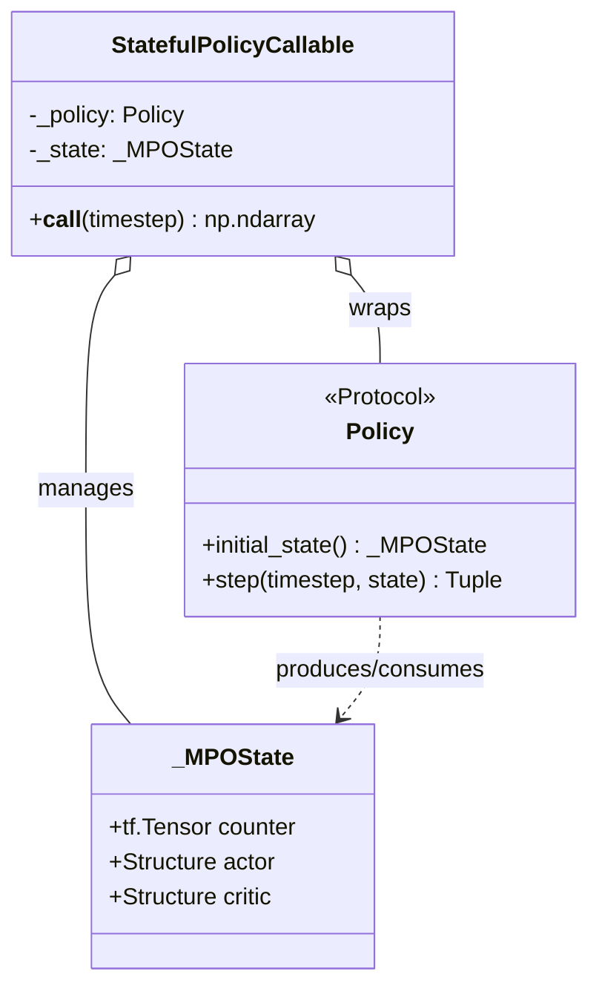

<!-- source: DeepWiki mcp.deepwiki.com · repo google-deepmind/rgb_stacking · page 3.2 Policy Loading Utilities · fetched 2026-10-26 -->

# Policy Loading Utilities

<details>
<summary>Relevant source files</summary>

The following files were used as context for generating this wiki page:

- [rgb_stacking/main.py](rgb_stacking/main.py)
- [rgb_stacking/utils/permissive_model.py](rgb_stacking/utils/permissive_model.py)
- [rgb_stacking/utils/policy_loading.py](rgb_stacking/utils/policy_loading.py)

</details>


This page documents the utilities used to load, wrap, and execute the pre-trained TensorFlow SavedModels provided in the `rgb_stacking` repository. These utilities bridge the gap between strict TensorFlow SavedModel signatures and the `dm_env` interfaces used by the environment and the `dm_control` viewer.

The primary logic is contained within `rgb_stacking/utils/policy_loading.py`, which handles batch dimension management and state tracking, and `rgb_stacking/utils/permissive_model.py`, which provides a flexible wrapper for SavedModel functions.

## Policy Loading Pipeline

The loading process transforms a directory containing a TensorFlow SavedModel into a `Policy` protocol-compliant object that can be used for rollouts or visualization.

### Data Flow: From SavedModel to Policy Callable

The following diagram illustrates how a raw SavedModel is transformed into a usable policy through various wrapping layers.

**Policy Wrapping Layers**
```mermaid
graph TD
    subgraph "SavedModel on Disk"
        [A] -- "tf.saved_model.load" --> B["Raw TF Model"]
    end

    subgraph "rgb_stacking.utils.permissive_model"
        B -- "PermissiveModel()" --> C["PermissiveModel Instance"]
    end

    subgraph "rgb_stacking.utils.policy_loading"
        C -- "policy_from_path()" --> D["Policy (Unbatched Wrapper)"]
        D -- "StatefulPolicyCallable()" --> E["Viewer-Compatible Callable"]
    end

    E -- "Calls" --> D
    D -- "Calls" --> C
    C -- "Calls" --> B
```
Sources: [rgb_stacking/utils/policy_loading.py:47-74](), [rgb_stacking/utils/policy_loading.py:77-89](), [rgb_stacking/utils/permissive_model.py:43-80]()

### Key Functions and Classes

| Entity | Location | Description |
| :--- | :--- | :--- |
| `policy_from_path` | `policy_loading.py` | Entry point for loading a model. It loads the TF graph, wraps it in `PermissiveModel`, and adds logic to handle batch dimension expansion/squeezing. |
| `_MPOState` | `policy_loading.py` | A `NamedTuple` representing the internal state of the MPO agent, containing a `counter`, `actor` structure, and `critic` structure. |
| `StatefulPolicyCallable` | `policy_loading.py` | A class that maintains the `_MPOState` internally, allowing the policy to be passed as a simple `Callable[[dm_env.TimeStep], np.ndarray]` to the `dm_control` viewer. |
| `PermissiveModel` | `permissive_model.py` | A wrapper that inspects SavedModel signatures and allows calling functions with extraneous or missing optional arguments without crashing. |

Sources: [rgb_stacking/utils/policy_loading.py:31-35](), [rgb_stacking/utils/policy_loading.py:47-49](), [rgb_stacking/utils/policy_loading.py:77-82](), [rgb_stacking/utils/permissive_model.py:43-52]()

---

## Permissive Model Wrapper

The `PermissiveModel` class is designed to handle the strictness of TensorFlow's `SignatureDef` requirements. When a model is exported via `tf.saved_model.save`, the resulting functions often have very specific input signatures. `PermissiveModel` relaxes these requirements to facilitate easier integration with different versions of the environment or observation sets.

### Implementation Details
- **Signature Inspection**: During initialization, it retrieves function signatures and parameters using `model.function_signatures()` [rgb_stacking/utils/permissive_model.py:66-76]().
- **Argument Binding**: It uses Python's `inspect.Signature.bind` to map provided arguments to the expected canonical arguments of the SavedModel [rgb_stacking/utils/permissive_model.py:156-158]().
- **Table Initialization**: It automatically initializes any hash tables required by the SavedModel (e.g., for vocabulary lookups) by locating the relevant ops in the graph [rgb_stacking/utils/permissive_model.py:82-121]().

Sources: [rgb_stacking/utils/permissive_model.py:43-153]()

---

## Batch Dimension Management

The pre-trained specialist policies (MPO state-based agents) are trained on batched data and expect inputs with a leading batch dimension. However, the `dm_env` loop typically provides single timesteps. `policy_from_path` implements a closure that handles this transformation transparently.

### The `policy_step_fn` Logic
When `policy_from_path` is called, it redefines the `step` method of the loaded policy:
1. **Expand**: It applies `np.expand_dims(x, axis=0)` to all tensors in the `dm_env.TimeStep.observation` and the `_MPOState` [rgb_stacking/utils/policy_loading.py:58-68]().
2. **Execute**: It calls the underlying `PermissiveModel` function with the batched data [rgb_stacking/utils/policy_loading.py:69-69]().
3. **Squeeze**: It applies `np.squeeze(x, axis=0)` to the resulting action and updated state before returning them to the caller [rgb_stacking/utils/policy_loading.py:61-71]().

Sources: [rgb_stacking/utils/policy_loading.py:54-74]()

---

## Stateful Policy for Visualization

The `dm_control` viewer expects a policy to be a simple callable that takes a `TimeStep` and returns an action. Because the specialist policies are stateful (tracking MPO internal states), they cannot be passed directly.

### `StatefulPolicyCallable`
This class wraps a `Policy` and manages the lifecycle of the `_MPOState`:
- **Initialization**: It calls `policy.initial_state()` to get the starting state [rgb_stacking/utils/policy_loading.py:82-82]().
- **Reset Logic**: On every `dm_env.StepType.FIRST` (the start of a new episode), it automatically resets the internal state [rgb_stacking/utils/policy_loading.py:85-86]().
- **Action Selection**: It executes the policy step and stores the updated state internally, returning only the action to the viewer [rgb_stacking/utils/policy_loading.py:87-88]().

**State Management Entity Map**

Sources: [rgb_stacking/utils/policy_loading.py:31-44](), [rgb_stacking/utils/policy_loading.py:77-89]()

## Usage in `main.py`

The `main.py` script demonstrates the standard usage of these utilities. It loads a policy based on a command-line flag and chooses whether to wrap it for the viewer or for a manual rendering loop.

- **For Video Recording**: The script uses the `Policy` object directly, manually passing the state through the loop in `run_episode_and_render` [rgb_stacking/main.py:58-74]().
- **For Interactive Viewer**: The script wraps the loaded policy in a `StatefulPolicyCallable` before passing it to `viewer.launch` [rgb_stacking/main.py:94-98]().

Sources: [rgb_stacking/main.py:88-98]()

---

