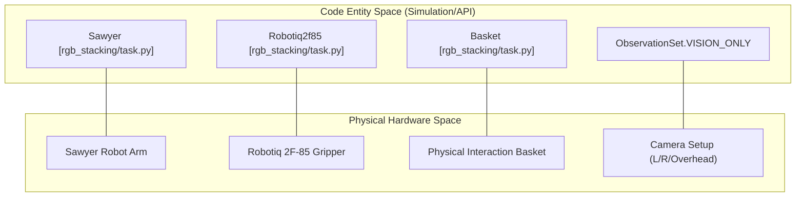
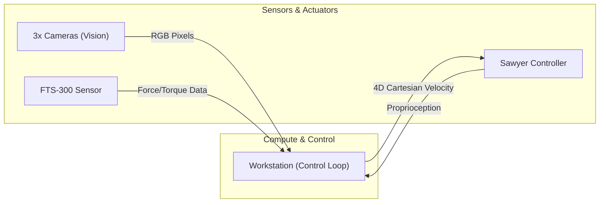

<!-- source: DeepWiki mcp.deepwiki.com · repo google-deepmind/rgb_stacking · page 4 Real-World Cell Documentation · fetched 2026-10-26 -->

# Real-World Cell Documentation

Relevant source files

The following files were used as context for generating this wiki page:

- [real_cell_documentation/basket_and_camera_assembly.pdf](real_cell_documentation/basket_and_camera_assembly.pdf)
- [real_cell_documentation/bill_of_materials.pdf](real_cell_documentation/bill_of_materials.pdf)
- [real_cell_documentation/cell_assembly.pdf](real_cell_documentation/cell_assembly.pdf)
- [real_cell_documentation/robot_assembly.pdf](real_cell_documentation/robot_assembly.pdf)
- [real_cell_documentation/standard_cell_generic_setup.pdf](real_cell_documentation/standard_cell_generic_setup.pdf)

This page provides a high-level overview of the physical hardware environment designed to mirror the `rgb_stacking` simulation. The real-world cell consists of a Sawyer robot arm, a Robotiq gripper, a workspace basket, and a multi-camera vision system. The repository includes comprehensive PDF documentation and CAD models to enable the reproduction of this standardized research environment.

The physical setup is designed to be functionally identical to the simulation's task construction [rgb_stacking/task.py:53-125](), ensuring that policies trained in MuJoCo can be transferred to the real world with minimal friction.

## Hardware Components and Assembly

The physical cell is a modular assembly built around an aluminum extrusion frame. It integrates the robot, the interaction basket, and the sensing suite into a rigid, calibrated unit.

*   **Robot and Gripper**: A Rethink Robotics Sawyer arm equipped with a Robotiq 2F-85 gripper.
*   **Sensing**: Includes an ATI FTS-300 force-torque sensor and a vision system comprising three synchronized cameras (Left, Right, and Overhead).
*   **Workspace**: A standardized basket containing the "Red", "Green", and "Blue" objects. The objects themselves are 3D-printed using STL files provided in the repository assets.

### System Mapping: Code to Physical Entities

The following diagram maps the software abstractions used in the `rgb_stacking` environment to their physical hardware counterparts described in the documentation.

**Hardware-to-Code Mapping**

Sources: [rgb_stacking/task.py:53-125](), [real_cell_documentation/cell_assembly.pdf:1-30]()

For detailed step-by-step instructions on building the basket, mounting cameras, and integrating the robot arm, see **[Hardware Assembly Guides](#4.1)**.

## Procurement and Connectivity

The cell is documented through a complete Bill of Materials (BOM) and a generic wiring diagram. These documents ensure that the electrical and network topology of the real cell matches the expectations of the control software.

*   **Bill of Materials**: A granular list of every component required, from the robot arm down to specific fasteners and 3D-printing specifications for the RGB objects.
*   **Wiring and Networking**: Detailed schematics for connecting the robot controller, camera sync boxes, and the workstation. This setup supports the 20Hz control loop and synchronized image acquisition required for vision-based policies.

### Infrastructure Topology

This diagram illustrates how the physical components are networked to provide the observations defined in the `ObservationSet` [rgb_stacking/task.py:37-45]().

**Cell Networking and Signal Flow**

Sources: [real_cell_documentation/standard_cell_generic_setup.pdf:97-124](), [real_cell_documentation/bill_of_materials.pdf:100-112]()

For the full parts list and electrical schematics, see **[Bill of Materials and Cell Wiring](#4.2)**.

## Documentation Index

The `real_cell_documentation/` directory contains five primary PDF files that serve as the definitive guide for the physical setup:

| Document | Description |
| :--- | :--- |
| `basket_and_camera_assembly.pdf` | Instructions for the workspace frame and camera positioning. |
| `robot_assembly.pdf` | Integration of the Sawyer arm, FTS sensor, and Robotiq gripper. |
| `cell_assembly.pdf` | Final integration of the robot into the basket/frame environment. |
| `bill_of_materials.pdf` | Complete list of parts, vendors, and quantities. |
| `standard_cell_generic_setup.pdf` | Electrical wiring and network configuration. |

Additionally, a CAD model of the full assembly is available on **Onshape** (link provided in the repository's hardware documentation folder).

Sources: [real_cell_documentation/basket_and_camera_assembly.pdf:1-6](), [real_cell_documentation/bill_of_materials.pdf:45-47](), [real_cell_documentation/cell_assembly.pdf:1-6](), [real_cell_documentation/robot_assembly.pdf:1-6](), [real_cell_documentation/standard_cell_generic_setup.pdf:1-6]()

---

