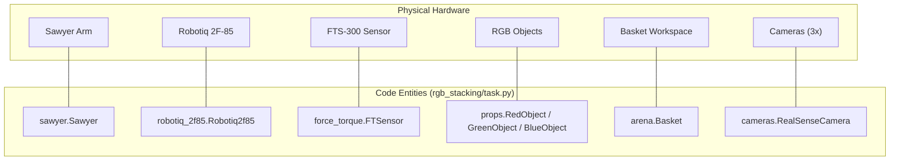
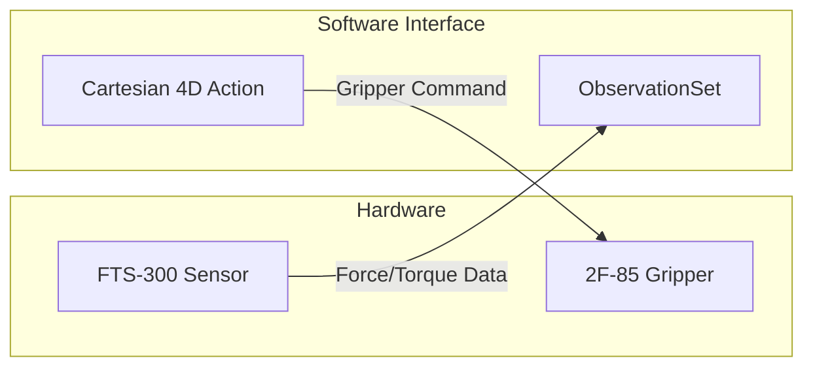

<!-- source: DeepWiki mcp.deepwiki.com · repo google-deepmind/rgb_stacking · page 4.1 Hardware Assembly Guides · fetched 2026-10-26 -->

# Hardware Assembly Guides

Relevant source files

The following files were used as context for generating this wiki page:

- [real_cell_documentation/basket_and_camera_assembly.pdf](real_cell_documentation/basket_and_camera_assembly.pdf)
- [real_cell_documentation/cell_assembly.pdf](real_cell_documentation/cell_assembly.pdf)
- [real_cell_documentation/robot_assembly.pdf](real_cell_documentation/robot_assembly.pdf)

This page provides technical details for the physical construction and integration of the `rgb_stacking` robot cell. The hardware design is intended to provide a high-fidelity physical counterpart to the simulation environment defined in `rgb_stacking/task.py` [rgb_stacking/task.py:1-20]().

The assembly is divided into three primary phases: the workspace (basket and cameras), the robotic manipulator (Sawyer and Robotiq gripper), and the final cell integration.

## Assembly Workflow Overview

The hardware setup mirrors the MuJoCo simulation entities. The relationship between physical components and code entities is illustrated below:

**Diagram: Hardware-to-Code Mapping**

Sources: [rgb_stacking/task.py:50-150]()

## 1. Basket and Camera Assembly
The basket serves as the bounded workspace for the stacking task. The assembly document `basket_and_camera_assembly.pdf` details the construction of the aluminum extrusion frame that supports the cameras and the workspace floor.

*   **Basket Construction:** The workspace is a rectangular area with sloped walls to encourage objects to slide toward the center, matching the `Basket` class geometry in simulation [rgb_stacking/task.py:90-95]().
*   **Camera Mounting:** Three cameras are positioned to provide the `VISION_ONLY` observation set [rgb_stacking/task.py:41-41]().
    *   **Side Cameras:** Two cameras providing lateral views.
    *   **Front Camera:** One camera providing a frontal perspective of the workspace.
*   **Calibration:** The physical mounts are designed to match the camera extrinsics defined in the simulation's `MJCF` models to minimize the sim-to-real gap.

Sources: `real_cell_documentation/basket_and_camera_assembly.pdf`, [rgb_stacking/task.py:40-45]()

## 2. Robot and Gripper Integration
The `robot_assembly.pdf` guide covers the mechanical and electrical integration of the Sawyer arm and its end-effector.

### Component Stack
1.  **Sawyer Arm:** The 7-DOF manipulator.
2.  **Force-Torque Sensor:** A Robotiq FTS-300 is mounted to the wrist flange. In code, this provides the force/torque data used in the `ObservationSet.ALL` configuration [rgb_stacking/task.py:42-42]().
3.  **Robotiq 2F-85 Gripper:** A parallel-jaw gripper. The assembly includes specific finger-tip modifications to ensure stable grasps on the 3D-printed RGB objects.

**Diagram: End-Effector Data Flow**

Sources: `real_cell_documentation/robot_assembly.pdf`, [rgb_stacking/task.py:160-180]()

## 3. Full Cell Integration
The `cell_assembly.pdf` document describes the final arrangement where the robot is mated to the basket frame.

*   **Relative Positioning:** The robot base must be precisely aligned with the basket to ensure the 4D Cartesian velocity effector [rgb_stacking/task.py:175-185]() operates within the expected reachable workspace.
*   **Safety Guarding:** Includes instructions for installing transparent shielding around the cell to allow for safe high-speed policy execution.
*   **Lighting:** Standardized overhead lighting is required to ensure that the vision-based policies (trained on domain-randomized simulation) can generalize to the real-world visual features.

Sources: `real_cell_documentation/cell_assembly.pdf`

## 4. RGB Objects (3D Printing)
The objects used in the task (Red, Green, and Blue) are not off-the-shelf parts. They must be manufactured using the STL files provided in the `rgb_objects` directory.

*   **Geometry:** The objects feature specific "tabs" and "slots" designed to make stacking physically possible yet challenging.
*   **Printing Specifications:**
    *   **Material:** PLA or ABS is typically used.
    *   **Infill:** Must be consistent to ensure the center of mass matches the `physics_utils.py` calculations for object stability [rgb_stacking/physics_utils.py:20-35]().
    *   **Color:** High-saturation Red, Green, and Blue filaments are required to match the color-based segmentation and reward logic used during training.

## 5. CAD Model Reference
For precise measurements and custom mount modifications, the repository references an **Onshape CAD model**. This cloud-based model contains the full assembly, including:
*   Fastener specifications.
*   Custom 3D-printed bracket designs for the cameras.
*   The exact spatial relationship between the robot base and the workspace origin.

Sources: `real_cell_documentation/cell_assembly.pdf`, [rgb_stacking/task.py:80-90]()

---

